# Exam Questions — Energy, Work & Power
**1. Motion, Forces & Energy** · Cambridge (CIE) IGCSE physics (0625 & 0972)
> Source: [https://www.savemyexams.com/igcse/physics/cie/23/topic-questions/](https://www.savemyexams.com/igcse/physics/cie/23/topic-questions/) · 51 questions across 3 sets

## Alternative To Practical Questions (1 questions)

### Q1 — medium — 7 marks

**Q1** [7 marks]

A student is investigating the work required to pull a box containing some masses up a sloping wooden board. Fig. 4.1 shows the board and the box.

Plan an experiment to investigate how the work required to pull the box up the slope depends on the mass of the box and its contents.

Work done is calculated using the equation:

work done = force × distance moved in the direction of the force.

The following apparatus is available to the students:

a wooden board a box with a length of string attached a selection of masses that fit in the box a metre rule an electronic balance.

In your plan, you should:

- list any other apparatus that you would use
- explain briefly how you would carry out the investigation, including the measurements you would take
- state the key variables that you would control
- draw a suitable table, with column headings, to show how you would display your readings (you are **not** required to enter any readings in the table)
- explain how you would use the results to reach a conclusion.

You may add to the diagram if it helps your explanation.

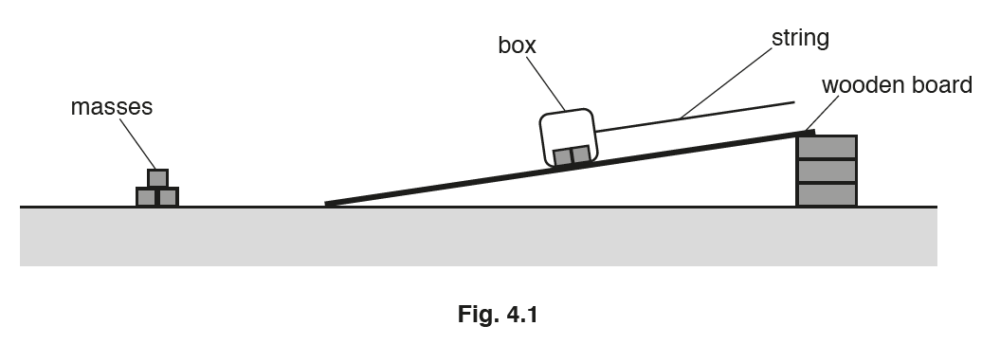

*Source: May 2019 0625/61 Q4*

## Multiple Choice Questions (29 questions)

### Q1 — medium — 1 marks

**Q1** [1 mark]

**Extended tier only**

A motor lifts a 500 N load through a height of 3.0 m in 10 s. The electrical energy supplied to the motor is 2250 J.

What is the efficiency of the motor?

### Q2 — medium — 1 marks

**Q2** [1 mark]

A ball is dropped from a height above the ground.

Which transfer between energy stores takes place as the ball falls towards the ground?

### Q3 — hard — 1 marks

**Q3** [1 mark]

Two students, X and Y, race up the same flight of stairs. Student X has a greater mass than student Y. They both start from rest and develop the same average power during the race.

Which student reaches the top of the stairs first and why?

### Q4 — medium — 1 marks

**Q4** [1 mark]

A woman of mass 50 kg has 81 J of kinetic energy.

What is her speed?

*Source: June 2023 0972/21 Q11*

### Q5 — medium — 1 marks

**Q5** [1 mark]

A child runs up a set of stairs four times. The time taken for each run is recorded.

Which time is measured when the child’s useful power is greatest?

*Source: June2023 0972/11 Q12*

### Q6 — hard — 1 marks

**Q6** [1 mark]

** **A rock of weight 50 N falls a vertical distance of 7.0 m from rest.

What is the change in the gravitational potential energy store of the rock?

*Source: June 2023 0972/11 Q11*

### Q7 — medium — 1 marks

**Q7** [1 mark]

Which row about the change of energy in the energy store must be correct?

|   | **process** | **energy store** | **change of energy in store** |
|---|---|---|---|
| **A **  **B **  **C**  **D** | water pumped up to a high-altitude dam | gravitational potential energy of water | increases |
| water pumped up to a high-altitude dam | kinetic energy of water | decreases |   |
| air passes through a wind turbine | gravitational potential energy of air | increases |   |
| air passes through a wind turbine | kinetic energy of air | increases |   |

*Source: June 2023 0972/11 Q10*

### Q8 — medium — 1 marks

**Q8** [1 mark]

**Extended Tier Only**

A car has 620 kJ of kinetic energy. The car brakes and stops in a distance of 91 m.

What is the average braking force acting on the car?

*Source: June 2022 paper 2 Q12*

### Q9 — medium — 1 marks

**Q9** [1 mark]

A mass hangs vertically from a spring.

The mass is raised to a point P and is then released.

The mass oscillates repeatedly between point P and a lower point Q.

Which energies alternately increase and decrease throughout the oscillations?

*Source: june 2022 paper 1 Q9*

### Q10 — medium — 1 marks

**Q10** [1 mark]

A man climbs a ladder.

Which quantities can be used to calculate the useful power of the man?

*Source: specimen 2023 paper 1 Q10*

### Q11 — medium — 1 marks

**Q11** [1 mark]

A ball is at rest at the top of a hill.

The ball rolls down the hill.

At the bottom of the hill the ball hits a wall and stops.

Which energy changes occur?

*Source: specimen 2023 paper 2 Q10*

### Q12 — easy — 1 marks

**Q12** [1 mark]

A force $F$ acts on an object and the object moves a distance $d$ in the direction of the force.

What is the work done on the object?

*Source: June 2022 paper 1 Q10*

### Q13 — easy — 1 marks

**Q13** [1 mark]

Which of the following statements is **not** a summary of the law of conservation of energy?

### Q14 — easy — 1 marks

**Q14** [1 mark]

Which row correctly matches an energy store with an example of that store?

| ** ** | **Energy Store** | **Example** |
|---|---|---|
| **A.** | kinetic | a car moving at 70 km / h |
| **B.** | elastic | a box sitting high on a shelf |
| **C.** | magnetic | compression of springs in a car's suspension |
| **D.** | chemical | the nuclei of uranium atoms |

### Q15 — easy — 1 marks

**Q15** [1 mark]

Which energy transfer takes place when a log burns in a fire?

### Q16 — easy — 1 marks

**Q16** [1 mark]

Identify the **incorrect** definition of power.

### Q17 — easy — 1 marks

**Q17** [1 mark]

Identify the correct energy transfer taking place when an electric kettle is boiling water

### Q18 — hard — 1 marks

**Q18** [1 mark]

**Extended tier only**

The diagram shows an LED light bulb.

Which expression gives the efficiency of the bulb?

### Q19 — medium — 1 marks

**Q19** [1 mark]

Which of the following energy transfers is most efficient?

### Q20 — hard — 1 marks

**Q20** [1 mark]

**Extended tier only**

The diagram below shows a wind turbine.

What is the change in the kinetic energy if the wind speed is reduced by half?

### Q21 — medium — 1 marks

**Q21** [1 mark]

A trolley is pushed with a force that causes it to move a certain distance. It moves in the direction it is pushed.

Which row in the table represents the combination of force and distance that means the smallest amount of work is done on the trolley?

|   | **Force / N** | **Distance moved / m** |
|---|---|---|
| **A** | 20 | 20 |
| **B** | 40 | 10 |
| **C** | 50 | 6.0 |
| **D** | 70 | 4.0 |

### Q22 — medium — 1 marks

**Q22** [1 mark]

A sledge is pushed up a hill with a force, F.

The work done on the sledge depends on the force applied and on a distance moved.

Which distance?

### Q23 — medium — 1 marks

**Q23** [1 mark]

A fork lift truck lifts a heavy box onto a shelf.

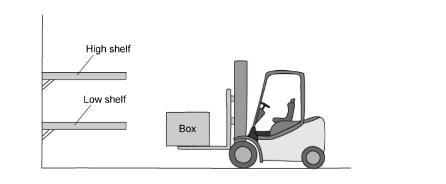

Which action requires the greatest power output from the fork lift truck.

### Q24 — medium — 1 marks

**Q24** [1 mark]

The image below shows a simplified layout of a non-condensing gas boiler that is typically used to heat houses in the United Kingdom.

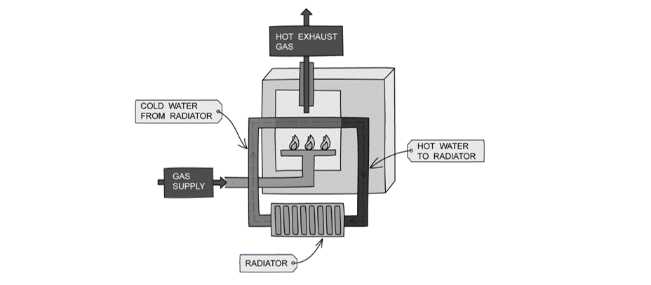

Which option correctly describes the energy transfers taking place in the boiler?

### Q25 — medium — 1 marks

**Q25** [1 mark]

Four different electric bicycles are driven along a road.

The work done by their motor, and the time taken to do that work is shown in the table below.

Which of the electric bicycles produces the most power?

|   | **Work done / J** | **Time taken / s** |
|---|---|---|
| **A** | 10 000 | 20 |
| **B** | 20 000 | 40 |
| **C** | 400 000 | 400 |
| **D** | 2000 | 1 |

### Q26 — hard — 1 marks

**Q26** [1 mark]

**Extended tier only**

A penny is held at the top of Blackpool tower. The penny is released and falls a distance *h* to the ground. It reaches a speed *v* as it falls.

As the penny falls, air resistance causes some of the original energy of the penny to be transferred into the air as heat. Which of the expressions below gives the work done against air resistance?

### Q27 — hard — 1 marks

**Q27** [1 mark]

A crane lifts four pallets of bricks, each of which weigh 5000 N. The crane lifts each pallet a height of 30m. The crane takes 4 minutes to do this.

How much useful power did the crane produce to lift the bricks?

### Q28 — hard — 1 marks

**Q28** [1 mark]

**Extended tier only**

A large truck of mass 5000 kg is travelling at 5.0 m/s. A motorbike has a mass of 200 kg. Both the truck and the motorbike have the same kinetic energy.

What is the speed of the motorbike?

### Q29 — medium — 1 marks

**Q29** [1 mark]

The law of conservation of energy states that energy cannot be created or destroyed, it can only be transferred from one store to another.

Which of the following statements is true?

## Theory Questions (21 questions)

### Q1 — medium — 8 marks

**Q1** [2 marks]

A solar-powered pump is used to raise water from a well to a storage tank. The tank is $12m$ above the surface of the water in the well.

Describe the transfers of energy between stores as energy from the Sun is used to raise the water to the tank.

**Q1** [2 marks]

Show that the gravitational potential energy gained by $50\mathrm{kg}$ of water raised through a height of $12m$ is approximately $5900J$.

**Q1** [2 marks]

**Extract:**

Show that the gravitational potential energy gained by 50 kg of water raised through a height of 12 m is approximately 5900 J.

ΔEp = m g Δh
ΔEp = 50 × 9.8 × 12
ΔEp = 5880 ≈ 5900 J

The solar panel that powers the pump has an efficiency of 18%.

Calculate the total energy input from the solar panel required to raise this water.

**Q1** [2 marks]

Suggest **two **advantages of using solar energy to power the water pump, compared to using a diesel generator.

### Q2 — medium — 7 marks

**Q2** [2 marks]

A ball is dropped from a height. Energy is transferred in the process.

(i) State the energy store that is full before the ball is dropped.

[1]

(ii) The energy from part (i) is transferred into another energy store as the ball falls.

State the name of this energy store.

[1]

**Q2** [1 mark]

State the **principle of conservation of energy***.*

**Q2** [4 marks]

A motor lifts a load of 550 N through a vertical height of 12 m.

(i) Calculate the work done by the motor.

[2]

(ii) The work is done in 25 seconds.

Calculate the power of the motor.

Give your answer to 2 significant figures.

[2]

### Q3 — medium — 9 marks

**Q3** [6 marks]

A student uses an electric motor to lift a load. Fig. 4.1 shows the arrangement.

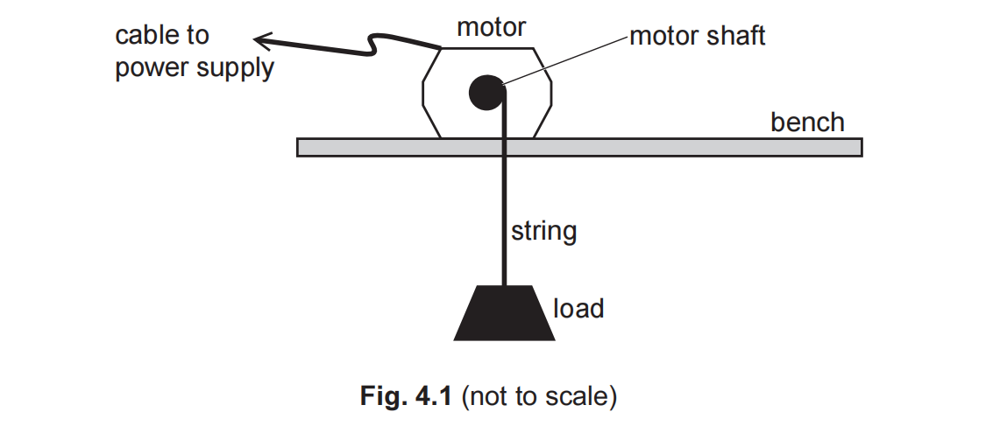

(i)**   **The motor exerts a force of 25 N on the load. It lifts the load a vertical distance of 2.0 m.

Calculate the work done by the motor on the load.

work done on the load = ...................................................... J [3]

(ii)**  **State the useful energy output of the electric motor when it lifts the load 2.0 m.

useful energy output = ...................................................... J [1]

(ii)  The useful energy output of the motor is less than the energy input to the motor.

Explain why the useful energy output is less than the energy input.

[2]

*Source: 0972/June 2023 31 Q4A*

**Q3** [3 marks]

The student uses the motor to lift a different load. The motor does 80 J of work when it lifts this load. It takes 5.0 s to lift the load.

Calculate the power output of the electric motor.

power output = ..................................................... W

*Source: June 2023 0972/31 Q4B*

### Q4 — medium — 1 marks

**Q4** [1 mark]

Fig. 2.1 shows water stored in a reservoir behind a hydroelectric dam.

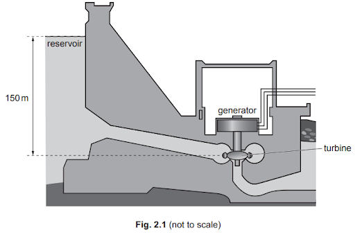

State the form of the energy stored in the water in the reservoir that is used to generate electricity

*Source: June 2022 paper 4 Q2A*

### Q5 — medium — 4 marks

**Q5** [4 marks]

**Extended Tier Only**

Fig. 8.1 shows two vertical, cylindrical tubes and a cylindrical magnet all held in a vacuum

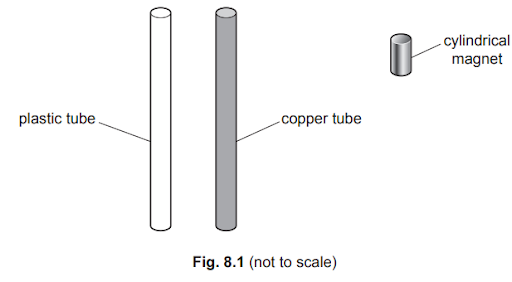

One tube is made of plastic and the other tube is made of copper. The two cylindrical tubes have identical dimensions.

The magnetic field of the small, cylindrical magnet is extremely strong.

Initially, the magnet is at rest at the top of the plastic tube.

The magnet is released and it falls through the plastic tube without experiencing a resistive force. The magnet takes 0.67 s to fall to the lower end of the plastic tube.

The mass of the magnet is 0.012 kg.

Calculate the kinetic energy of the magnet when it reaches the lower end of the plastic tube.

kinetic energy = ........................................................

*Source: June 2022 paper 4 Q8A*

### Q6 — medium — 3 marks

**Q6** [3 marks]

Fig. 4.1 shows an electric motor and pulley wheel being used to raise a load M. The electric motor uses a belt to turn the pulley wheel

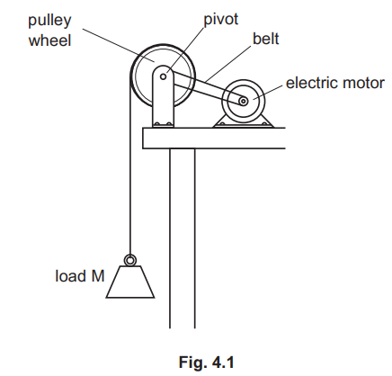

When the electric motor lifts the load, it transfers energy. Fig. 4.2 shows the energy transfers.

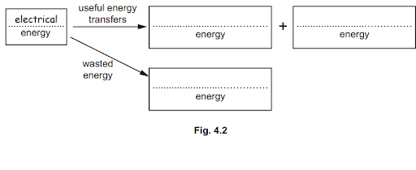

Write on Fig. 4.2 to complete the label in each box. The first label is done for you.

*Source: June 2022 Paper 3 Q4A*

### Q7 — hard — 8 marks

**Q7** [1 mark]

Fig. 2.1 shows a fork-lift truck lifting a box.

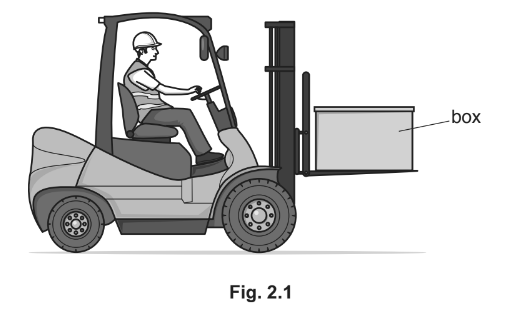

The electric motor that drives the lifting mechanism is powered by batteries.

Name the store that energy is usefully transferred from by the batteries.

*Source: 2018 0625/41 Q2A*

**Q7** [5 marks]

**Extended tier only**

The lifting mechanism raises a box of mass 32 kg through a vertical distance of 2.5 m in 5.4 s.

(i) Calculate the energy transferred to the gravitational potential energy store of the box.

energy = ...........................................................[2]

(ii) The efficiency of the lifting mechanism is 0.65 (65%).

Calculate the input power to the lifting mechanism.

input power = ...........................................................[3]

*Source: 2018 0625/45 Q2B*

**Q7** [2 marks]

**Extract:**

Fig. 2.1 shows a fork-lift truck lifting a box.

The electric motor that drives the lifting mechanism is powered by batteries.

Batteries are recharged from a mains voltage supply that is generated in an oil-fired power station.

By comparison with a wind farm, state one advantage and one disadvantage of running a power station using oil.

*Source: 2018 0625/41 Q2C*

### Q8 — medium — 7 marks

**Q8** [1 mark]

State what is meant by the principle of conservation of energy.

*Source: 2018 (Series 1) 0625/41 Q3A*

**Q8** [6 marks]

**Extended tier only**

Fig. 3.1 shows a girl throwing a heavy ball.

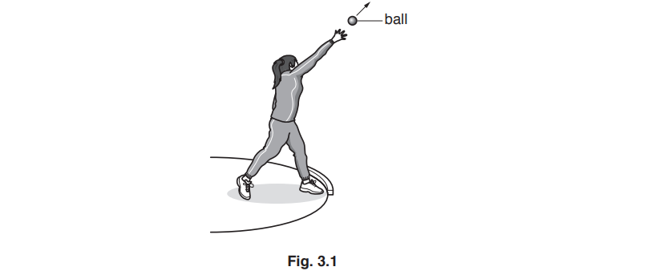

(i) State the energy transfers that take place from when the girl begins to exert a force on the ball until the ball hits the ground and stops moving.

[2]

(ii) The mass of the ball is 4.0 kg. The girl exerts a force on the ball for 0.60 s. The speed of the ball increases from 0 m/ s to 12 m/s before it leaves the girl’s hand.

Calculate:

1. the momentum of the ball on leaving the girl’s hand

momentum = ...........................................................[2]

2. the average resultant force exerted on the ball.

average resultant force = ...........................................................[2]

*Source: 2018 (Series 1) 0625/41 Q3B*

### Q9 — medium — 10 marks

**Q9** [4 marks]

**Extended tier only**

Fig. 3.1 shows a model of a wind turbine used to demonstrate the use of wind to generate electricity. The wind is blowing towards the model, as shown.

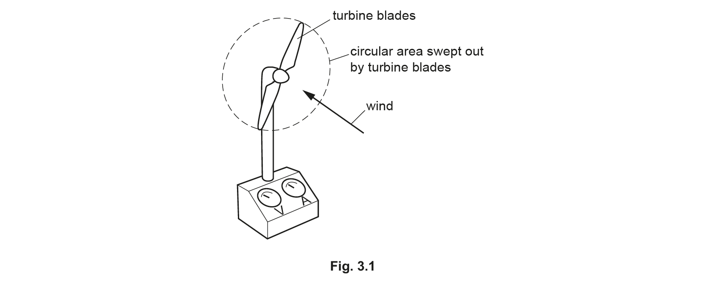

The mass of air passing through the circular area swept out by the turbine blades each second is 7.5 kg. The energy in the kinetic store of the air that passes through this circular area each second is 240 J.

(i) Calculate the speed of the air.

speed = ........................................................ [3]

(ii) The moving air drives a generator. State the input power of the air passing through the turbine blades.

input power = ........................................................ [1]

*Source: 2020 Feb/March 0625/42 Q3A*

**Q9** [4 marks]

**Extract:**

The mass of air passing through the circular area swept out by the turbine blades each second is 7.5 kg. The energy in the kinetic store of the air that passes through this circular area each second is 240 J.

(ii) The moving air drives a generator. State the input power of the air passing through the turbine blades.

input power = ........................................................ [1]

(ii) State the input power:
- Recall that power = the energy per second
- Therefore input power = kinetic energy
- P = 240 W; [1 mark]

**Extended tier only**

The output current of the generator is 2.0 A. The output potential difference (p.d.) of the generator is 11 V.

(i) Calculate the output power of the generator.

output power = ........................................................ [2]

(ii) Calculate the efficiency of the wind turbine.

efficiency = .................................................... % [2]

*Source: 2020 Feb/March 0625/42 Q3B*

**Q9** [2 marks]

**Extract:**

The mass of air passing through the circular area swept out by the turbine blades each second is 7.5 kg.

The density of air is 1.3 kg / m3.

Calculate the volume of air passing through the circular area swept out by the turbine blades each second.

*Source: 2020 Feb/March 0625/42 Q3C*

### Q10 — hard — 9 marks

**Q10** [5 marks]

**Extended tier only**

A rifle fires a bullet of mass 0.020 kg vertically upwards through the air. As it leaves the rifle, the speed of the bullet is 350 m/s.

Calculate

(i) the energy in the kinetic store of the bullet as it leaves the rifle,

energy = ...........................................................[3]

(ii) the maximum possible height that the bullet can reach.

maximum height = ...........................................................[2]

*Source: 2018 0625/43 Q2A*

**Q10** [4 marks]

**Extract:**

A rifle fires a bullet of mass 0.020 kg vertically upwards through the air. As it leaves the rifle, the speed of the bullet is 350 m/s.

To calculate the maximum height:
- Mass of bullet, m = 0.020 kg
- Initial speed = 350 m/s
- Recall the equation for gravitational potential energy: E_p = mgh
- Recall the link between E_k and E_p:
- All the energy will be transferred from the kinetic store to the gravitational potential store at maximum height
- E_k = E_p = mgh
- h = E_k / (mg) = 1200 / (0.020 × 9.81)
- h = 6000 m (1.s.f)

An object fired upwards will reach a maximum height where velocity will momentarily be 0. This point occurs when all the energy has been transferred from the kinetic store of the bullet to the gravitational potential store.

The actual height reached by the bullet is less than the value calculated in **(a)(ii)**.

(i) Explain, in terms of the forces acting on the bullet, why this is so.

[2]

(ii) As the bullet rises through the air, the amount of energy in its kinetic store decreases.

State what happens to this energy.

[2]

*Source: 2018 0625/43 Q2B*

### Q11 — medium — 10 marks

**Q11** [3 marks]

An electric kettle contains water at a temperature of 19 °C. The kettle has a power rating of 3.0 kW and is switched on for 3.5 minutes.

Calculate the energy supplied to the kettle by the electricity supply.

energy = ........................................................

*Source: Oct 2019 0625/43 Q5A*

**Q11** [5 marks]

**Extract:**

At 3.5 minutes, the temperature of the water reaches 100 °C. The volume of the water in the kettle is 1700 cm^3 and its density is 1.0 g/cm^3. The specific heat capacity of water is 4200 J/(kg °C). Initial temperature = 19 °C. Final temperature = 100 °C. Volume of water, V = 1700 cm^3. Density of water, ρ = 1.0 g/cm^3. Specific heat capacity of water, c = 4200 J/kg °C. The equation for the change in energy associated with a temperature change: ΔE = m × c × ΔT. The equation relating mass, volume and density: ρ = m / V. Rearranged: m = ρ × V.

**Extended tier only**

At 3.5 minutes, the temperature of the water reaches 100 °C. The volume of the water in the kettle is 1700 cm3 and its density is 1.0 g/cm3. The specific heat capacity of water is 4200 J/(kg °C).

Calculate the energy gained by the water.

energy = ........................................................

*Source: Oct 2019 0625/43 Q5B*

**Q11** [2 marks]

**Extract:**

Energy supplied to the kettle by the electricity supply = 630 000 J
Energy gained by the water = 580 000 J

**Extended tier only**

Calculate the efficiency of the kettle.

efficiency = ........................................................

*Source: Oct 2019 0625/43 Q5C*

### Q12 — easy — 4 marks

**Q12** [2 marks]

**Extract:**

- Accept "light", "EM waves", "electromagnetic waves" or "infrared" for "Radiation".
- Accept "thermal", "thermal energy" or "heat" for "Heating"; do not accept "internal", which is a store, not a pathway.
- Award each pathway independently: an answer naming both light and heat scores 2 marks.

An electric current transfers energy from the battery to the filament lamp.

State the two energy transfer pathways for the energy emitted by the filament lamp.

*Source: 2020 Feb/March 0625/32 Q4A*

**Q12** [1 mark]

State which store of energy in the battery is decreasing.

*Source: 2020 Feb/March 0625/32 Q4B*

**Q12** [1 mark]

**Extract:**

An electric current transfers energy from the battery to the filament lamp.

Two energy transfer pathways for the energy emitted by the filament lamp are:

- Radiation
- Heating

The store of energy decreasing in the battery is:

- Chemical

Explain how the principle of conservation of energy applies to this circuit.

*Source: 2020 Feb/March 0625/32 Q4C*

### Q13 — easy — 6 marks

**Q13** [2 marks]

A drone is a machine that can fly. Fig. 4.1 shows a drone rising into the air, lifting a camera.

The drone obtains energy from a battery of cells.

Complete the sequence of useful energy transfers as the drone rises into the air. One part is done for you.

................................. store  →  kinetic store  →  ............................. store

*Source: 2018 (Series 2) 0625/32 Q4A*

**Q13** [2 marks]

**Extract:**

A drone is a machine that can fly. Fig. 4.1 shows a drone rising into the air, lifting a camera.

The drone obtains energy from a battery of cells.

**Extended tier only**

The drone can move in any direction up or down, backwards or forwards, left or right. It can also remain stationary above the ground.

Describe the motion and position of the drone when it has both a large quantity of potential energy and a small quantity of kinetic energy.

*Source: 2018 (Series 2) 0625/32 Q4B*

**Q13** [2 marks]

**Extract:**

A drone is a machine that can fly. Fig. 4.1 shows a drone rising into the air, lifting a camera.

The drone obtains energy from a battery of cells.

When the drone moves, it wastes some energy.

Describe what happens to this energy.

*Source: 2018 (Series 2) 0625/32 Q4C*

### Q14 — medium — 7 marks

**Q14** [1 mark]

**Extended tier only**

A force is used to move an object from the Earth’s surface to a greater height.

Explain why the energy in the gravitational potential store of the object increases.

*Source: February/March 2018 0625/42 Q2A*

**Q14** [2 marks]

**Extended tier only**

Fig. 2.1 shows a train moving up towards the top of a mountain.

The train transports 80 passengers, each of average mass 65 kg, through a vertical height of 1600 m.

Calculate the increase in energy stored in the gravitational potential store of the passengers.

increase in energy = .........................................................

*Source: February/March 2018 0625/42 Q2B*

**Q14** [4 marks]

**Extract:**

The train transports 80 passengers, each of average mass 65 kg, through a vertical height of 1600 m.
Calculate the increase in energy stored in the gravitational potential store of the passengers.

List the known quantities:
- Number of passengers = 80
- Mass of each passenger = 65
- Height, h = 1600 m
- Acceleration of free fall, g = 9.8 m / s^2

Calculate the total mass of the passengers, m:
- m = number of passengers × mass of each passenger
- m = 80 × 65 = 5200 kg

State the equation for gravitational potential energy:
- E_p = mgh

Calculate the increase in gravitational potential energy of the passengers:
- E_p = 5200 × 9.8 × 1600
- E_p = 81 500 000 J = 8.2 × 10^7 J

**Extended tier only**

The engine of the train has a power of 1500 kW. The time taken to reach the top of the mountain is 30 minutes.

Calculate the efficiency of the engine in raising the 80 passengers 1600 m to the top of the mountain.

efficiency = .........................................................

*Source: February/March 2018 0625/42 Q2C*

### Q15 — easy — 9 marks

**Q15** [2 marks]

**Extract:**

Gravitational field strength g = 9.8 N/kg. Expected answer 953 J, rounded to 950 J. Accept 972 J (or 970 J) for full marks if g = 10 N/kg is used. Accept the unit N m as well as J.

A group of students want to measure their power output when climbing a ladder.

Student A has a mass of 54 kg and takes 15 s to climb the ladder which has a vertical height of 1.8 m.

Calculate the work done in raising the student's body mass as they climb the ladder.

work = ....................................

**Q15** [2 marks]

**Extract:**

Work done from part (a): 953 J (accept 950 J, or 972 J if g = 10 N/kg was used). Time taken 15 s. Expected answer 63.5 W, rounded to 64 W. Error carried forward: award full marks for the candidate's own part (a) value divided by 15 and correctly evaluated.

Calculate the power output of Student A in raising their body mass up the ladder.

power output = ....................................

**Q15** [3 marks]

**Extract:**

Efficiency 17% (0.17). Useful power output from part (b): 64 W (accept 63.5 W or 63 W). Expected answer 376 W, rounded to 380 W. Error carried forward: award full marks for the candidate's own part (b) value divided by 0.17 and correctly evaluated (e.g. 374 W from 63.5 W, 371 W from 63 W, 381 W from 64.8 W).

**Extended tier only**

Student A's body is only 17% efficient when climbing the ladder.

Calculate the total power input of the student to climb the ladder.

power input =  ....................................

**Q15** [2 marks]

**Extract:**

Expected answer: chemical store (muscles) to gravitational potential store. Accept the kinetic store as an intermediate step. Accept thermal store of the surroundings as an additional destination only.

State the energy transfer taking place as student A climbs the ladder.

### Q16 — easy — 8 marks

**Q16** [1 mark]

Identify the unit for energy.

Tick **one** box.

`square` N

`square` K

`square` J

**Q16** [2 marks]

Describe the link between work done is and energy transferred.

**Q16** [2 marks]

Fork-lift trucks are used to move crates in warehouses. Fig. 1.1 shows a crate being lifted to high shelf.

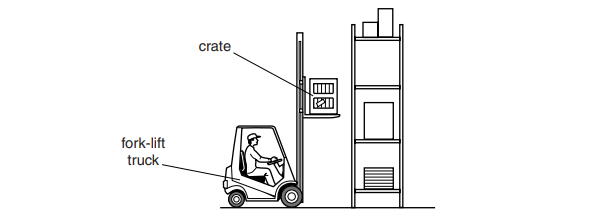

**Fig. 1.1**

The fork-lift truck lifts a crate of 450 N to a shelf that is 3.9 m above the ground.

Calculate the work done to lift the crate.

work done = ....................................

**Q16** [3 marks]

**Extract:**

The fork-lift truck lifts a crate of 450 N to a shelf that is 3.9 m above the ground.
Calculate the work done to lift the crate.

Use the equation for work done:
- W = F d = 450 × 3.9
- W = 1755 N m

**Extended tier only**

The total energy input for the fork-lift truck to lift the crate is 2500 J

Calculate the efficiency of the fork-lift truck.

efficiency = ....................................

### Q17 — medium — 5 marks

**Q17** [3 marks]

**Extended tier only**

Fig. 3.1 shows an aircraft on the deck of an aircraft carrier.

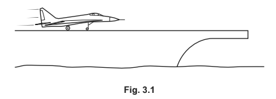

The aircraft accelerates from rest along the deck. At take-off, the aircraft has a speed of 75 m/s.

The mass of the aircraft is 9500 kg.

Calculate the energy in the kinetic store of the aircraft at take-off.

energy = ...........................................................

*Source: 2018 0625/42 Q3A*

**Q17** [2 marks]

**Extract:**

The aircraft accelerates from rest along the deck. At take-off, the aircraft has a speed of 75 m/s.
The mass of the aircraft is 9500 kg.
Calculate the energy in the kinetic store of the aircraft at take-off.

energy = 2.7 × 10^7 J

The catapult provides a constant force for a distance of 150 m along the deck.

On an aircraft carrier, a catapult provides an accelerating force on the aircraft. The catapult provides a constant force for a distance of 150 m along the deck.

Calculate the resultant force on the aircraft as it accelerates. Assume that all of the kinetic energy at take-off is from the work done on the aircraft by the catapult.

force = ...........................................................

*Source: 2018 0625/42 Q3B*

### Q18 — hard — 13 marks

**Q18** [6 marks]

**Extended tier only**

Salmon are born in freshwater rivers, spend most of their lives in the sea, but return to freshwater rivers to breed. As they swim up rivers, they often have to jump up waterfalls.

Fig. 1.1 shows a salmon attempting to jump up a waterfall with a vertical height of 0.36 m.

**Fig. 1.1 **

The salmon has a mass of 1.84 kg.

The salmon leaves the water with a speed of 3.2 m/s.

Determine whether the salmon can make the height required for the jump.

**Q18** [4 marks]

**Extract:**

Fig. 1.1 shows a salmon attempting to jump up a waterfall with a vertical height of 0.36 m.

**Extended tier only**

Another salmon of mass 2.2 kg tries to make the jump.

Calculate the minimum speed with which the salmon would have to leave the water in order to reach the height required.

speed = ....................................

**Q18** [2 marks]

**Extract:**

Salmon are born in freshwater rivers, spend most of their lives in the sea, but return to freshwater rivers to breed. As they swim up rivers, they often have to jump up waterfalls.

Fig. 1.1 shows a salmon attempting to jump up a waterfall with a vertical height of 0.36 m.

The salmon has a mass of 1.84 kg.

The salmon leaves the water with a speed of 3.2 m/s.

The salmon swim far upstream and encounter a high waterfall.

The salmon attempts to jump to the top of the waterfall, but fails, and performs a somersault during the decent. The salmon straightens out before it enters the water as shown in Fig. 1.2.

Discuss whether the speed of entry into the water is greater than, less than or equal to the speed with which it leaves the water. Ignore any effects of air resistance.

**Q18** [1 mark]

**Extract:**

Salmon are born in freshwater rivers, spend most of their lives in the sea, but return to freshwater rivers to breed. As they swim up rivers, they often have to jump up waterfalls.

Fig. 1.1 shows a salmon attempting to jump up a waterfall with a vertical height of 0.36 m.

The salmon has a mass of 1.84 kg.

The salmon leaves the water with a speed of 3.2 m/s.

The temperature of the water at the bottom of a waterfall is greater than the temperature of the water at the top.

Suggest why this is the case.

### Q19 — hard — 7 marks

**Q19** [4 marks]

A man is working on a platform. He uses a rope to raise a bag from the ground to the platform as shown in Fig. 4.1.

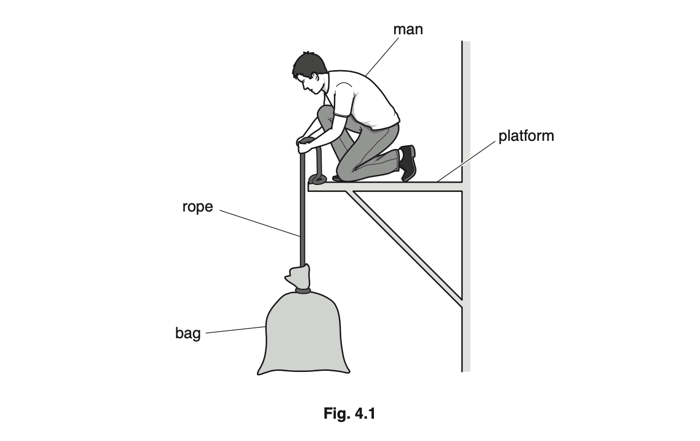

(i) Name the energy store that energy is usefully transferred to as the bag is lifted at constant speed.

[1]

(ii) The man then lifts a second bag from the ground to the platform. The first bag weighs 100 N and the second bag weighs 150 N.

On which bag of materials does the man do more work?

Explain your answer.

[1]

(iii) The man wants to determine his useful power as he lifts one of the bags. He knows the weight of the bag. State the **two** other quantities he needs to know.

[2]

*Source: Oct 2019 0625/33 Q4A*

**Q19** [3 marks]

The statements describe processes in a coal-fired power station. They are not in the correct order.

A  Energy is transferred to the thermal store of the water

B  Coal burns releasing energy from its chemical store

C  Energy is transferred electrically via the national grid

D  A turbine turns coils in a magnetic field

E  Steam turns a turbine

Use the letters A, B, C, D and E to complete the flow chart explaining how the power station works.

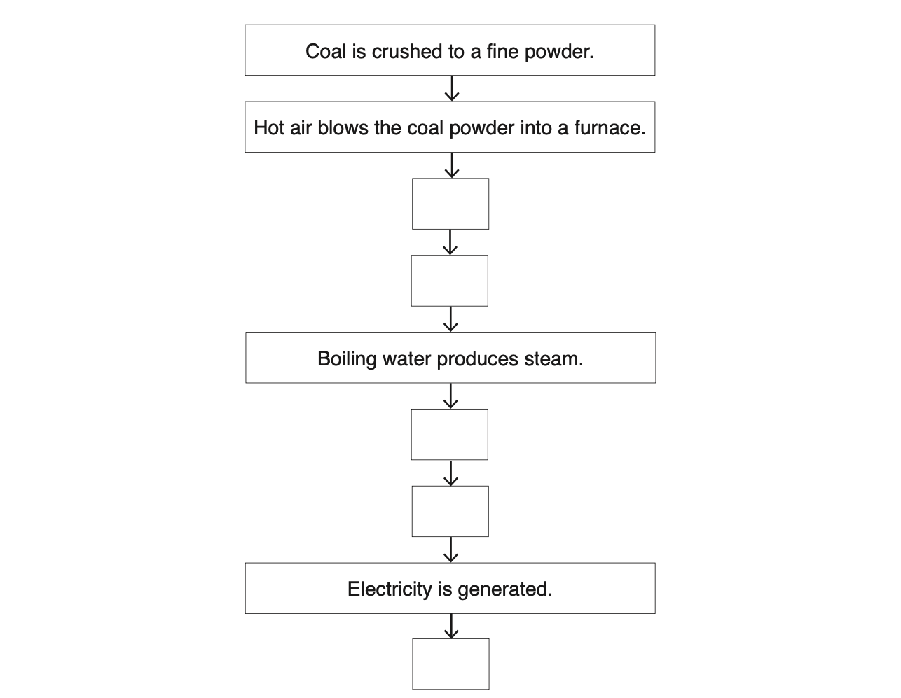

*Source: Oct 2019 0625/33 Q4B*

### Q20 — easy — 11 marks

**Q20** [2 marks]

A bouncy ball is dropped from a height of 1.65 m onto a smooth wooden floor, where it bounces, reaching a height of 1.43 m.

The bouncy ball has a mass of 0.07 kg

Complete the energy transfers taking place when

(i) the ball is falling towards the floor

.................................... energy store → kinetic energy store [1]

(ii) the ball hits the floor and deforms

kinetic energy store → .................................... energy store [1]

**Q20** [2 marks]

**Extract:**

A bouncy ball is dropped from a height of 1.65 m onto a smooth wooden floor, where it bounces, reaching a height of 1.43 m.

The bouncy ball has a mass of 0.07 kg

**Extended tier only**

Calculate the energy in the gravitational potential store of the ball just before it is dropped.

energy = ....................................

**Q20** [4 marks]

**Extract:**

Mass, m = 0.07 kg
gravitational field strength, g = 9.8 N/kg
Height, h = 1.65 m
E_P = 0.07 × 9.8 × 1.65 = 1.13 J

**Extended tier only**

Calculate the speed at which the bouncy ball hits the floor.

For the purposes of this calculation, you can assume there is no air resistance.

speed = ....................................

**Q20** [3 marks]

**Extract:**

A bouncy ball is dropped from a height of 1.65 m onto a smooth wooden floor, where it bounces, reaching a height of 1.43 m.

The bounce height is smaller than the height the ball was dropped from.

Explain why this is the case.

### Q21 — hard — 11 marks

**Q21** [1 mark]

Define power.

**Q21** [3 marks]

An amusement at a fairground uses the arrangement shown in Fig. 1.1 to measure the individual power rating of customers.

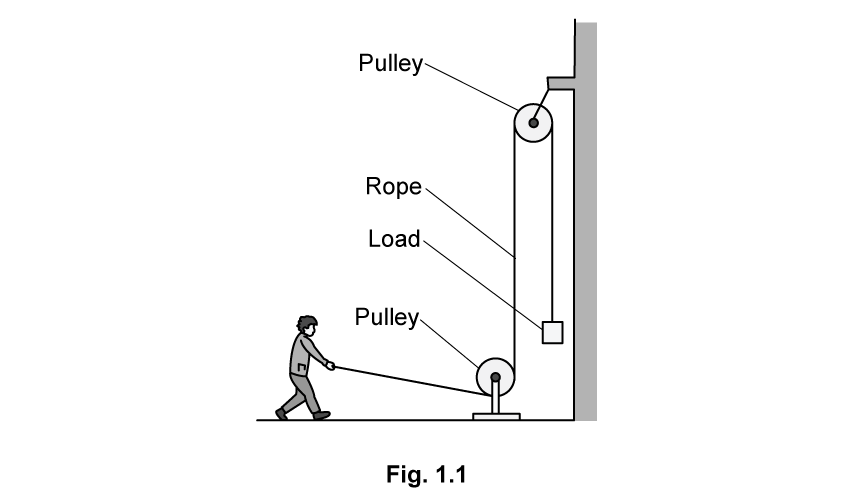

In the table below, list the quantities they must measure and the instrument used for measuring them.

|   | quantity to be measured | instrument used for measurement |
|---|---|---|
| 1. |   |   |
| 2. |   |   |
| 3. |   |   |

**Q21** [5 marks]

**Extract:**

An amusement at a fairground uses the arrangement shown in Fig. 1.1 to measure the individual power rating of customers.

In the table below, list the quantities they must measure and the instrument used for measuring them.

|   | quantity to be measured | instrument used for measurement |
|---|---|---|
| 1. |   |   |
| 2. |   |   |
| 3. |   |   |

The mass of the load on the system is 30 kg. The length of rope able to pass through the pulley is 1.3 m.

The man pulled the rope as hard as he could. The time taken was measured to be 1.2 s.

(i) Calculate the power rating of the man.

[4]

(ii) The amusement gave the man a power rating of 300 W.

Suggest a reason for the discrepancy.

[1]

**Q21** [2 marks]

**Extract:**

The man's body was only 19% efficient whilst pulling on the rope.
Work done = 382.2 N m (from part (c))

**Extended tier only**

The man's body was only 19% efficient whilst pulling on the rope.

Calculate the total energy he used.

energy used = ....................................
