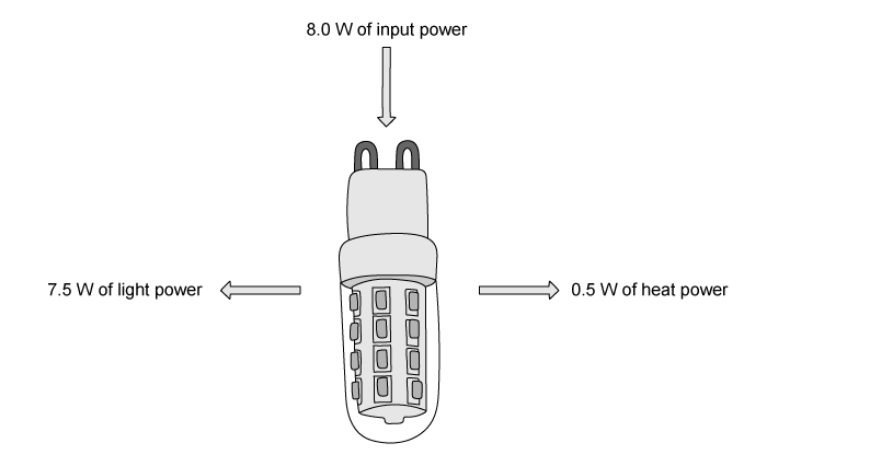

# Exam Questions — Energy, Work & Power
**1. Motion, Forces & Energy** · Cambridge (CIE) IGCSE physics (0625 & 0972)
> Source: [https://www.savemyexams.com/igcse/physics/cie/23/topic-questions/](https://www.savemyexams.com/igcse/physics/cie/23/topic-questions/) · 29 questions across 1 sets

## Multiple Choice Questions (29 questions)

### Q1 — medium — 1 marks

**Q1** [1 mark]

**Extended tier only**

A motor lifts a 500 N load through a height of 3.0 m in 10 s. The electrical energy supplied to the motor is 2250 J.

What is the efficiency of the motor?

### Q2 — medium — 1 marks

**Q2** [1 mark]

A ball is dropped from a height above the ground.

Which transfer between energy stores takes place as the ball falls towards the ground?

### Q3 — hard — 1 marks

**Q3** [1 mark]

Two students, X and Y, race up the same flight of stairs. Student X has a greater mass than student Y. They both start from rest and develop the same average power during the race.

Which student reaches the top of the stairs first and why?

### Q4 — medium — 1 marks

**Q4** [1 mark]

A woman of mass 50 kg has 81 J of kinetic energy.

What is her speed?

*Source: June 2023 0972/21 Q11*

### Q5 — medium — 1 marks

**Q5** [1 mark]

A child runs up a set of stairs four times. The time taken for each run is recorded.

Which time is measured when the child’s useful power is greatest?

*Source: June2023 0972/11 Q12*

### Q6 — hard — 1 marks

**Q6** [1 mark]

** **A rock of weight 50 N falls a vertical distance of 7.0 m from rest.

What is the change in the gravitational potential energy store of the rock?

*Source: June 2023 0972/11 Q11*

### Q7 — medium — 1 marks

**Q7** [1 mark]

Which row about the change of energy in the energy store must be correct?

|   | **process** | **energy store** | **change of energy in store** |
|---|---|---|---|
| **A **  **B **  **C**  **D** | water pumped up to a high-altitude dam | gravitational potential energy of water | increases |
| water pumped up to a high-altitude dam | kinetic energy of water | decreases |   |
| air passes through a wind turbine | gravitational potential energy of air | increases |   |
| air passes through a wind turbine | kinetic energy of air | increases |   |

*Source: June 2023 0972/11 Q10*

### Q8 — medium — 1 marks

**Q8** [1 mark]

**Extended Tier Only**

A car has 620 kJ of kinetic energy. The car brakes and stops in a distance of 91 m.

What is the average braking force acting on the car?

*Source: June 2022 paper 2 Q12*

### Q9 — medium — 1 marks

**Q9** [1 mark]

A mass hangs vertically from a spring.

The mass is raised to a point P and is then released.

The mass oscillates repeatedly between point P and a lower point Q.

Which energies alternately increase and decrease throughout the oscillations?

*Source: june 2022 paper 1 Q9*

### Q10 — medium — 1 marks

**Q10** [1 mark]

A man climbs a ladder.

Which quantities can be used to calculate the useful power of the man?

*Source: specimen 2023 paper 1 Q10*

### Q11 — medium — 1 marks

**Q11** [1 mark]

A ball is at rest at the top of a hill.

The ball rolls down the hill.

At the bottom of the hill the ball hits a wall and stops.

Which energy changes occur?

*Source: specimen 2023 paper 2 Q10*

### Q12 — easy — 1 marks

**Q12** [1 mark]

A force $F$ acts on an object and the object moves a distance $d$ in the direction of the force.

What is the work done on the object?

*Source: June 2022 paper 1 Q10*

### Q13 — easy — 1 marks

**Q13** [1 mark]

Which of the following statements is **not** a summary of the law of conservation of energy?

### Q14 — easy — 1 marks

**Q14** [1 mark]

Which row correctly matches an energy store with an example of that store?

| ** ** | **Energy Store** | **Example** |
|---|---|---|
| **A.** | kinetic | a car moving at 70 km / h |
| **B.** | elastic | a box sitting high on a shelf |
| **C.** | magnetic | compression of springs in a car's suspension |
| **D.** | chemical | the nuclei of uranium atoms |

### Q15 — easy — 1 marks

**Q15** [1 mark]

Which energy transfer takes place when a log burns in a fire?

### Q16 — easy — 1 marks

**Q16** [1 mark]

Identify the **incorrect** definition of power.

### Q17 — easy — 1 marks

**Q17** [1 mark]

Identify the correct energy transfer taking place when an electric kettle is boiling water

### Q18 — hard — 1 marks

**Q18** [1 mark]

**Extended tier only**

The diagram shows an LED light bulb.

Which expression gives the efficiency of the bulb?

### Q19 — medium — 1 marks

**Q19** [1 mark]

Which of the following energy transfers is most efficient?

### Q20 — hard — 1 marks

**Q20** [1 mark]

**Extended tier only**

The diagram below shows a wind turbine.

What is the change in the kinetic energy if the wind speed is reduced by half?

### Q21 — medium — 1 marks

**Q21** [1 mark]

A trolley is pushed with a force that causes it to move a certain distance. It moves in the direction it is pushed.

Which row in the table represents the combination of force and distance that means the smallest amount of work is done on the trolley?

|   | **Force / N** | **Distance moved / m** |
|---|---|---|
| **A** | 20 | 20 |
| **B** | 40 | 10 |
| **C** | 50 | 6.0 |
| **D** | 70 | 4.0 |

### Q22 — medium — 1 marks

**Q22** [1 mark]

A sledge is pushed up a hill with a force, F.

The work done on the sledge depends on the force applied and on a distance moved.

Which distance?

### Q23 — medium — 1 marks

**Q23** [1 mark]

A fork lift truck lifts a heavy box onto a shelf.

Which action requires the greatest power output from the fork lift truck.

### Q24 — medium — 1 marks

**Q24** [1 mark]

The image below shows a simplified layout of a non-condensing gas boiler that is typically used to heat houses in the United Kingdom.

Which option correctly describes the energy transfers taking place in the boiler?

### Q25 — medium — 1 marks

**Q25** [1 mark]

Four different electric bicycles are driven along a road.

The work done by their motor, and the time taken to do that work is shown in the table below.

Which of the electric bicycles produces the most power?

|   | **Work done / J** | **Time taken / s** |
|---|---|---|
| **A** | 10 000 | 20 |
| **B** | 20 000 | 40 |
| **C** | 400 000 | 400 |
| **D** | 2000 | 1 |

### Q26 — hard — 1 marks

**Q26** [1 mark]

**Extended tier only**

A penny is held at the top of Blackpool tower. The penny is released and falls a distance *h* to the ground. It reaches a speed *v* as it falls.

As the penny falls, air resistance causes some of the original energy of the penny to be transferred into the air as heat. Which of the expressions below gives the work done against air resistance?

### Q27 — hard — 1 marks

**Q27** [1 mark]

A crane lifts four pallets of bricks, each of which weigh 5000 N. The crane lifts each pallet a height of 30m. The crane takes 4 minutes to do this.

How much useful power did the crane produce to lift the bricks?

### Q28 — hard — 1 marks

**Q28** [1 mark]

**Extended tier only**

A large truck of mass 5000 kg is travelling at 5.0 m/s. A motorbike has a mass of 200 kg. Both the truck and the motorbike have the same kinetic energy.

What is the speed of the motorbike?

### Q29 — medium — 1 marks

**Q29** [1 mark]

The law of conservation of energy states that energy cannot be created or destroyed, it can only be transferred from one store to another.

Which of the following statements is true?
