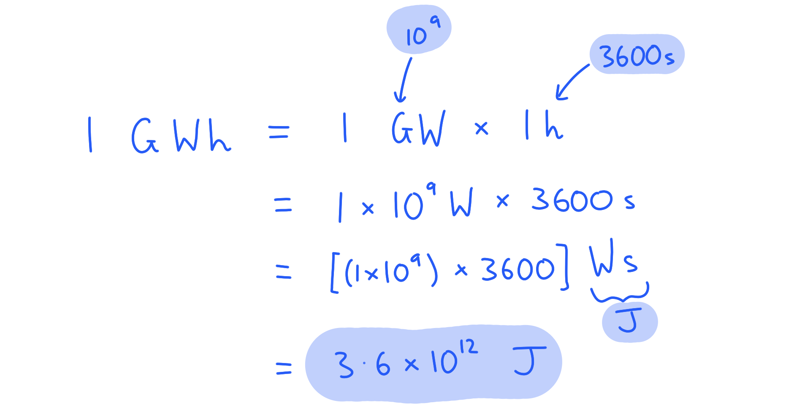
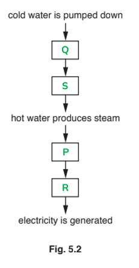

# Mark Schemes — Energy Sources
**1. Motion, Forces & Energy** · Cambridge (CIE) IGCSE physics (0625 & 0972)

## Multiple Choice Questions (18 questions)

### Q1
**Final answer:** **The correct answer is A**

- Tidal energy comes from the gravitational pull of the Moon and Sun on the oceans, not solar radiation

**B** is incorrect because wind is caused by differential solar heating.

**C** is incorrect because waves are generated by wind, which comes from solar heating.

**D** is incorrect because hydroelectric power depends on the water cycle, driven by solar evaporation.

### Q2
**Final answer:** **The correct answer is C**

- The water in the reservoir is at a higher level than the generator
- The energy store associated with height above the ground is gravitational potential

  - Therefore, the water behind a hydroelectric dam is a store of **gravitational potential energy**
- As the water flows downwards through the pipe to the generator, its speed increases
- The water then moves through a turbine, which turns the generator
- The energy store associated with movement is kinetic

  - Therefore, energy is transferred to the **kinetic energy** store of the generator

**A **&** B** are incorrect as chemical energy is not involved in hydroelectric power stations; this would be more appropriate for a fossil fuel power station, as fossil fuels (e.g. coal, oil) are stores of chemical energy.

**D** is incorrect as hydroelectric is not an energy store, it is an energy resource for generating electricity.

> **[exam-tip]**
> When answering questions about energy stores and transfers in power stations, think about the physical processes involved step by step. In a hydroelectric power station, water starts high up (gravitational potential energy), falls and speeds up (kinetic energy), then drives turbines connected to generators (kinetic energy). Remember that chemical energy is associated with fuels, not with water stored at height.

### Q3
**Final answer:** **The correct answer is D because:**

- Wind is the only renewable source of energy listed

**A**,** B **and **C **are incorrect as when coal, natural gas, or oil are burned, they cannot be reused.

### Q4
**Final answer:** **The correct answer is ****B**** because:**

- Hydroelectric power generates electricity when **water** turns a turbine
- Greenhouse gases are released when hydrocarbons are burned

  - This occurs in all options apart from **B**

Hydro- is often a prefix for 'water'. Think of 'hydrated' or 'hydroxide'.

Hydroelectric dams sometimes do use pumps to return the water to the reservoir. Those pumps do use fossil fuels. However, hydroelectric dams can function without a pump; the reservoir is refilled by rainfall.

### Q5
**Final answer:** **The correct answer is ****A**** because:**

- Plants form the basis for fossil fuels
- Plants grow using **radiation** from the **Sun**

Geothermal energy relies on the **heat** produced in the Earth's core and radioactive elements in the crust.

Nuclear power relies on the energy released by **radioactive** **materials**

Tidal power comes (mostly) from the gravitational attraction to the Moon. Some of this is influenced by the Sun, but **not** by its **radiation**.

### Q6
**Final answer:** **The correct answer is ****C**** because: **

- Nuclear power uses uranium, which is mined from the Earth. The energy stored in the Uranium was not produced by the Sun.

**A** is incorrect as hydroelectric power uses falling water. The Sun evaporates water, which then falls as rain atop mountains.

**B** is incorrect as wind is caused by convection currents in the atmosphere. These currents are driven by solar heating.

**D** is incorrect as coal comes from ancient trees. The trees used sunlight to photosynthesis and grow.

### Q7
**Final answer:** **The correct answer is ****A**** because: **

- Nuclear fission is the splitting of heavy nuclei - uranium or plutonium - to release energy.

**B** Is incorrect as geothermal energy comes from the heat in volcanic regions on the Earth.

**C** Is incorrect as biomass energy comes from burning plant matter.

**D** Is incorrect as nuclear fusion is not commercially viable yet, but involves releasing energy by joining together light nuclei.

### Q8
**Final answer:** **The correct answer is ****D**** because:**

- Geothermal energy is reliable - the rocks far below the Earth's surface are always hot so can always be used as a source of energy
- The first three options are disadvantages of geothermal energy

### Q9
**Final answer:** **The correct answer is ****C**** because:**

- Wind, hydroelectric and biomass are all renewable energy types as the energy source can be replaced within a human lifespan.
- Uranium cannot be replaced. Once it has been fissioned, more must be dug from the ground, and will not be replaced until another star goes supernova and creates another planet capable of sustaining life.

**A** is incorrect as uranium is non-renewable

**B** is incorrect as biomass is renewable and is not in the list

**D** is incorrect as uranium is non-renewable

### Q10
**Final answer:** **The correct answer is ****B**** because:**

- Nuclear power is a non-renewable energy resource because it relies on finite supplies of uranium found in the Earth

  - This discounts options **A** & **D**
- Nuclear power is reliable because there are many nuclear power plants globally producing large scale electricity generation and meeting changes in demand

  - This discounts option **C**
- Therefore the only correct answer is **B**

You will be required to think deeply about the related issues surrounding the various energy resources and the effects they have upon the environment beyond pollution. Make sure you could answer an extended answer question on the advantages and disadvantages of each energy resource.

### Q11
**Final answer:** **The correct answer is ****B**** because:**

- Solar panels use energy from the sun to heat water

  - This discounts options **A** & **D**
- Solar cells use energy from the sun to generate electricity

  - This discounts option **C**
  - Therefore, the only correct answer is **B**

Make sure you know the difference between solar panels and solar cells, as these two very difference items often get confused

### Q12
**Final answer:** **The correct answer is ****A**** because:**

- Although statements **B, C** & **D **are true, they do not provide evidence that the claim of biofuels being carbon neutral is controversial

  - All these statements still apply if the land was used to farm food produce
- The crops take in the same amount of carbon dioxide during photosynthesis as they release upon burning

  - However, if the land was used to farm food produce, that carbon dioxide would not be returned to the atmosphere
  - Therefore, statement **A** is the correct piece of evidence

You will be required to think deeply about the related issues surrounding the various energy resources and the effects they have upon the environment beyond pollution. Make sure you could answer an extended answer question on the advantages and disadvantages of each energy resource.

### Q13
**Final answer:** **The correct answer is ****C**** because:**

- All of these energy sources involve turning a turbine which rotates a coil / magnet in a generator to produce an alternating current

**A** is incorrect as nuclear power isn't renewable

**B** is incorrect as geothermal energy cannot be used on a large scale

**D** is incorrect as hydroelectric power does not use steam to turn the turbine

### Q14
**Final answer:** **The correct answer is ****D**** because:**

- Hydroelectric dam pumping systems release large amounts of greenhouse gases
- This is only answer option that would not help to reduce the negative effects of burning fossil fuels

**A** is incorrect as planting more trees would increase the amount of carbon dioxide, CO2, removed from the atmosphere through photosynthesis, bringing atmospheric CO2 levels down

**B** is incorrect as  investing in carbon capture and sulphur removal technologies would remove the harmful substances being released into the atmosphere when fossil fuels are burned

**C** is incorrect as increasing the efficiency of power stations would reduce the amount of fuel required to run the fossil fuel power stations, and increase the global percentage of power generated by cleaner energy sources such as nuclear, thus indirectly reducing the demand for power generated by coil and gas fired power stations

### Q15
**Final answer:** **The correct answer is ****C**** because:**

- The energy transfer from the sunlight to the particles is what causes them to move and produce a current

  - This is a useful energy transfer
- Therefore, answer **C** is the only answer option that does not account for the wasted energy

### Q16
**Final answer:** **The correct answer is ****D**** because:**

- Nuclear waste is harmful for a very long time
- It has a long half-life so must be stored for thousands of yers before the activity decreases to safe levels

**A** is incorrect as Decades is not a long enough timescale for the waste products to become safe

**B** is incorrect as It is not yet possible to use nuclear fusion on a large scale in a power station that uses steam to generate electric current

**C** is incorrect as Nuclear fission does not form the majority of the UK's energy sources - only 15% comes from nuclear sources

### Q17
**Final answer:** **The correct answer is ****C ****because:**

- Fossil fuels produce atmospheric pollution

  - Carbon dioxide is a greenhouse gas
  - Sulphur dioxide causes acid rain
  - This rules out option **A**
- Biofuel releases carbon dioxide

  - Even though it can considered to be carbon neutral
  - This rules out option **B**
- Geothermal power stations can release greenhouse gases such as methane

  - When water is pumped into fissures in the ground and ejected as steam, natural gas (methane) trapped in the rocks can be released
  - This discounts option **D**
- Nuclear fuel does not release any atmospheric pollutants, and neither does wind or solar power
- Therefore, the only correct answer is **C**

### Q18
**Final answer:** **The correct answer is ****A**** because: **

- Extracting fossil fuels causes damage to habitats

  - Oil is often drilled for beneath oceans, requiring large structures and drilling into the ocean floor
  - Coal is often mined from rock seams beneath the Earth creating industrial areas and large-scale digging and disruption
  - Gas is often extracted by fracking or acidizing, taking up and damaging large areas of land
- Wave power produces electricity by placing turbines in the water

  - Sea life can be injured by the turbines and their behaviours (such as migration patterns) affected
  - Habitats can be disrupted by the installation and presence of the turbines
- Hydroelectric dams require the flooding of valleys

  - This destroys large areas of natural and man-made habitats lived in by a range of plants, animals and human beings

## Theory Questions (21 questions)

### Q1
> **[mark-scheme]**
> (i) State two advantages of using solar energy to generate electricity:
> 
> Any **two** from (one mark per point):
> 
> - Renewable / will not run out
> - No fuel costs
> - No pollution / emissions / no greenhouse gases (during use)
> - Low running costs
> 
> **[2 marks]**
> 
> (ii) State one disadvantage of using solar energy to generate electricity:
> 
> Any **one** from:
> 
> - Unreliable / dependent on weather
> - Only works in the day **OR** doesn't work at night
> - High initial costs
> - Large area / lots of land required
> - Intermittent / variable output
> 
> **[1 mark]**

> **[exam-tip]**
> When asked for advantages or disadvantages, make sure each point you give is distinct. For example, "no pollution" and "no greenhouse gases" are essentially the same point, so only one mark would be awarded.
> 
> Similarly, "renewable" and "will not run out" mean the same thing.
> 
> Always think about whether your points are genuinely different from each other.
> **[mark-scheme]**
> (i) State the names of two fossil fuels:
> 
> Any **two **from (one mark per point):
> 
> - Coal
> - Oil
> - Natural gas / methane
> 
> **[2 marks]**
> 
> (ii) State the name of one polluting gas produced by the combustion of fossil fuel:
> 
> - Nitrogen oxides **OR** Sulphur dioxide **[1 mark]**
> **[mark-scheme]**
> - Nuclear (is more suitable) **[1 mark]**
> - (Because) nuclear is reliable / works continuously / provides a high power output **OR**
> Wind is unreliable / intermittent / depends on wind speed / direction **[1 mark]**

> **[exam-tip]**
> Make sure you read the question carefully and link your justification to the specific requirement mentioned, in this case, providing a constant supply of electricity.
> 
> Simply stating that nuclear is better without explaining why it meets the requirement of constant supply will not earn the mark.
> 
> Remember that wind energy is variable because it depends on weather conditions, whereas nuclear power stations can operate continuously.

### Q2
Two disadvantages of using wind turbines are:

Any **two** from:

- A large amount of land is needed; **[1 mark]**
- The supply can be intermittent (go off and on) **OR** the turbine         cannot operate because the wind is too strong or too weak; **[1 mark]**
- The energy output of a wind turbine is not large enough;** [1 mark]**
- The turbines may harm birds; **[1 mark]**
- Wind turbines are difficult to maintain/fix; **[1 mark]**
- The turbines are noisy **OR** cause visual pollution (look ugly); **[1 mark]**

**[Total: 2 marks]**

> **[exam-tip]**
> This question asks you to **state** two facts. Think carefully about what you know about wind turbines and choose two facts to state. Write short phrases.
> 
> When answering questions like this, you may know more disadvantages than the question asks for. Don’t try to list every disadvantage you know; only give the required number and use the ones you are most certain of. You may lose a mark if you give two correct answers and one incorrect answer.
> 
> Make sure that your two answers do not say the same thing in different ways, otherwise you may not gain the two marks. For example, writing these two answers would only score one mark as they cover the same idea:
> 
> 1. The wind might not be blowing hard.
> 2. The supply might go off due to lack of wind.

### Q3
The correct description is:

**C**         Energy from the Sun heats the atmosphere unevenly.

**↓**

**D**         Uneven heating of the atmosphere produces regions of different atmospheric pressure.

**↓**

**A**         Air moves from regions of high pressure to regions of low pressure.

**↓**

**F**          Moving air turns the turbine blades.

**↓**

**B**         The turbine blades turn a generator.

**↓**

**E**          The generator produces electrical energy.

- One correct;** [1 mark]**
- Two or three correct; **[2 marks]**
- Four correct; **[3 marks]**

**[Total: 3 marks]**

> **[exam-tip]**
> The question asks you to **complete** the flow chart, so you just need to write the correct letters in the empty boxes. Once you have completed the boxes, read through the whole description in your chosen order to see if it makes logical sense. You can make changes at this stage if you clearly cross out and replace the letters.

### Q4
A wind turbine generates electricity from energy in the wind because:

**Final answer:** **Any ****three**** from:**

- Wind / (moving) air has kinetic energy;** [1 mark]**
- Wind / (moving) air turns turbine / blades;** [1 mark]**
- The turbine turns the generator;** [1 mark]**
- The (rotating) generator produces / generates electricity; **[1 mark]**

**[Total:3 marks]**
The advantages of wind turbines over coal-burning power stations are:

**Final answer:** **Any ****two ****from:**

- It is a renewable energy source; **[1 mark] **
- (During operation) wind turbines produce no greenhouse gases / CO2 **OR** it does not contribute to global warming; **[1 mark]**
- (During operation) wind turbines produce no acidic gases / SO2 / nitrous oxides **OR** it does not cause acid rain; **[1 mark]**

**[Total:2 marks]**
The disadvantages of wind turbines over coal-burning power stations are:

**Final answer:** **Any ****two**** from: **

- A larger area of land is needed **OR** it is a dilute energy source; **[1 mark]**
- It can be an intermittent / inconsistent / unreliable supply of electricity **OR** it may not work if the wind is too strong / weak;** [1 mark]**
- It can pose (possible) harm to (migrating) birds; **[1 mark]**
- It can be difficult to maintain (particularly if off-shore);** [1 mark]**

**[Total:2 marks]**

### Q5
(i) The process in the Sun which releases energy is:

- Nuclear fusion; **[1 mark]**

(ii) To describe nuclear fusion:

Describe what happens in the process:

- Nuclei collide and <u>combine</u>; **[1 mark]**

Describe the changes:

Any **one** from:

- Smaller nuclei (join to form) into larger nuclei; **[1 mark]**
- Hydrogen nuclei join to form helium; **[1 mark]**
- There is a slight mass loss (which is converted into energy); **[1 mark]**

**[Total: 3 marks]**
**EITHER**

- Wind; **[1 mark]**
- Is a renewable resource **AND **the Sun heats regions of air, causing wind to flow;  **[1 mark]**

**OR**

- Waves; **[1 mark]**
- Is a renewable resource **AND **the Sun heats regions of air, causing wind to flow which produces waves;  **[1 mark]**

**OR**

- Hydroelectric / dams; **[1 mark]**
- Is a renewable resource **AND **the Sun contributes to the water cycle, causing rain to flow into dams;  **[1 mark]**

**OR**

- Biofuels; **[1 mark]**
- Is a renewable resource **AND **plants use the Sun in photosynthesis, these plants are then used as biofuel;  **[1 mark]**

**OR**

- Fossil fuels / coal / oil / gas; **[1 mark]**
- Are a non-renewable resource **AND **ancient plants used the Sun to photosynthesis and these make up fossil fuels; **[1 mark]**

**[Total: 2 marks]**

> *The second mark depends on which resource you choose. If it was renewable, for example, you had to state that it was renewable and give a brief explanation of how the Sun is the main source of energy. *

> *Options such as nuclear, geothermal and tidal are not accepted, as the Sun is not the main source here.*
Two advantages of solar cells are:

Any **two** from:

- No polluting gases;** [1 mark]**
- Quiet; **[1 mark]**
- Low maintenance; **[1 mark]**
- Can be placed on roofs;** [1 mark]**
- Cheap to run; **[1 mark]**

Two disadvantages of solar cells are:

Any **two** from:

- Intermittent supply; **[1 mark]**
- Unattractive; **[1 mark]**
- Takes up space; **[1 mark]**
- Uses (a large amount of) land;** [1 mark]**
- d.c. output; **[1 mark]**

**[Total: 4 marks]**

### Q6
In Fig. 4.1 the energy source is:

- Solar; **[1 mark]**

In Fig. 4.2 the energy source is:

- Wind; **[1 mark]**

**[Total: 2 marks]**
(i) Two advantages of the renewable energy sources in (a) compared to burning coal are:

Any **two** from:

- They do not produce pollution; **[1 mark]**
- Renewable resources can be replaced in a short period of time; **[1 mark]**
- Conserves stores of fossil fuels; **[1 mark]**
- They don’t contribute to global warming; **[1 mark]**

(ii) One disadvantage of the renewable energy sources in (a) compared to burning coal is:

- They depend on the weather; **OR**
- Energy supply is not constant; **[1 mark]**

**[Total: 3 marks]**

> *There are a few reliable answers to questions like this. Burning fuels produce pollutants and contribute to global warming, whereas most renewable resources do not do this. Many renewable resources, however, depend on the weather. If it is not windy, wind turbines cannot produce power.*

> *One notable exception to the rule is burning biofuels (e.g. wood). While this is renewable, as the wood can be regrown quickly, this still contributes to global warming, so always consider the scenario outlined in the question carefully.*

### Q7
Any **three** from:

- Water flows down from the reservoir; **[1 mark]**
- Energy is transferred from the gravitational potential energy store to the kinetic energy store (of the water); **[1 mark]**
- The moving water turns the turbine; **[1 mark]**
- Turbine turns the generator; **[1 mark]**

**[Total: 3 marks]**

> *Understanding and being able to describe how energy resources work to generate electricity is a way to gain easy marks in your examination. *
**Any three from:**

Hydroelectric systems:

- Do not contribute to atmospheric pollution / acid rain; **[1 mark]**
- Do not contribute to greenhouse gases / global warming; **[1 mark]**
- Use renewable energy source (so will not run out); **[1 mark]**
- Have a short start-up time / can meet surges in demand; **[1 mark]**
- Conserve non-renewable reserves / fossil fuels (because they do not use them); **[1 mark]**
- Help to reduce dependence on fossil fuels (from other countries); **[1 mark]**

**[Total: 3 marks]**

> *Use the revision notes to learn the advantages and disadvantages of the different types of energy resources. Discussing these in your examination can award you some easy marks. *
(i) Energy is transferred electrically from the mains supply to the **kinetic** store of the drill; **[1 mark]**

(ii) The second drill is less **efficient** than the first drill; **[1 mark]**

**[Total: 2 marks]**

> *It can be a little difficult to understand the differences between energy transfers and energy stores. Use the revision notes to help you and create your own examples to help you remember the difference. *

### Q8
To describe how the wind turbine produces electricity:

**Any three from:**

- The moving wind / air; **[1 mark]**
- Turns / drives the turbine (blades); **[1 mark]**
- (The moving turbine blades) turn a generator; **[1 mark]**
- This makes a coil turn in magnetic field; **[1 mark]**

**[Total: 3 marks]**

> *This kind of short explanation is a common question and answer. Practice these, making sure you are able to produce at least one bullet point per mark. *
(i) One disadvantage of using wind turbines compared to coal-fired power stations is:

**Any one from:**

Describe the type of energy resource:

- Wind is a <u>dilute</u> source of energy; **[1 mark]**

Compare to coal-fired power stations:

- Wind power is dependent on weather / there is an intermittent supply; **[1 mark]**

(ii) Two advantages of using wind turbines instead of coal-fired power stations are:

**Any two from:**

- Wind is a renewable source of energy; **[1 mark]**
- Wind does not cause <u>atmospheric / air</u> pollution; **[1 mark]**
- Using wind power means we can conserve fossil fuels; **[1 mark]**
- Wind power does not contribute to global warming; **[1 mark]**

**[Total: 3 marks]**

> *The debate about how to power human life around the planet will be significant for your whole lifetime. For that reason alone you can be confident examiners will ask you to compare the advantages and disadvantages of different ways of producing electricity.*

### Q9
To describe how energy released from fission reactions is used to generate electricity:

- The energy released by fission reactions is transferred to the thermal energy store of the water which produces steam; **[1 mark]**
- The steam turns a turbine; **[1 mark]**
- The turbine turns a generator which generates electricity; **[1 mark]**

**[Total: 3 marks]**
To describe two environmental problems that arise from using nuclear power stations.

**Any two from:**

- Radioactive material / waste is produced; **[1 mark]**
- There can be problems storing waste; **[1 mark]**
- There is a long half-life of waste / fission products; **[1 mark]**
- There can be an accidental leak of nuclear / radioactive material; **[1 mark]**

**[Total: 2 marks]**

### Q10
Explain how, in a power station, burning a fuel causes a generator to produce an alternating current:

- Burning the fuel heats water; **[1 mark]**
- This water boils / becomes steam; **[1 mark]**
- The steam turns a turbine; **[1 mark]**
- The turbine rotates a coil in a magnetic field **OR** the turbine rotates a magnet in a coil; **[1 mark]**

**[Total: 4 marks]**
Calculate the total power the surface of the Earth receives from the Sun:

Convert the percentage to a decimal:

- $5.0 \times 10^{- 8} \% = 5.0 \times 10^{- 10}$ **[1 mark]**

Calculate the fraction of the Sun's power received:

- $P = ( 3.8 \times 10^{26 ) \times ( 5.0 \times 10^{-10} } )$
- $P=1.9\times10^{17}W$ **[1 mark]**

**[Total: 2 marks]**
(i) Suggest why the power at the Earth's surface is less than this value:

- The rest of the power is reflected / absorbed by the atmosphere / air; **[1 mark]**

**   **

(ii) The Earth's radius is 6 370 000 m. Calculate the surface area in sunlight at any one time:

Recall the equation for surface area of a sphere:

- $A=4πr^{2}$ **[1 mark]**

Calculate the area which is in sunlight:

- Only <u>half</u> the Earth is illuminated at one time; **[1 mark]**
- $A_{Sun}=\frac{A}{2}=2πr^{2}$
- $A_{S u n} = 2 \mathrm{\pi } \times ( 6 370 000 )^{2}$

Give the answer to three significant figures and with units:

- $A_{Sun}=2.55\times10^{14}m^{2}$ **[1 mark]**

**[Total: 4 marks]**

> *The mark for realising only half the Earth is in sunlight can be gained by stating it, or it can be inferred through the equation *$\frac{4πr^{2}}{2}$
(i) Calculate the power that each square metre of the Earth receives from the Sun, giving its units:

List the known quantities:

- Power the Earth's surface receives from the Sun, $P_{surface}$ = 1.9 × 1017 W
- Area of the Earth in sunlight, $A_{Sun}$ = 2.55 × 1014 m2

Calculate power per square metre:

- $\frac{P_{surface}}{A_{Sun}}=\frac{1.9\times10^{17}}{2.55\times10^{14}}=745.1$ **[1 mark]**
- Power per square metre = 750 W/m2 **[1 mark]**

**   **

(ii) A solar cell absorbs sunlight over a surface area of 2.5 m2. It has an efficiency of 0.6. Calculate its power output:

Calculate the power transferred to the solar cell, $P_{in}$:

- $P_{in}=745\times2.5=1862.5=1860W$ **[1 mark]**

Use the efficiency equation to calculate useful power out, $P_{out}$:

- $\mathrm{efficiency}=\frac{P_{out}}{P_{in}}$
- $P_{out}=0.6\times1860$ **[1 mark]**
- $P_{out}=1116$

Give the answer to two significant figures and give units:

- $P_{out}=1100W$ **[1 mark]**

**   **

(iii) Determine the number of solar cells required to match the power output of the coal power station:

List the known quantities:

- Power output of coal station, $P_{coal}$ = 400 MW = 400 × 106 W **[1 mark]**
- Power output of solar cell, $P_{out}$ = 1100 W

Calculate the number of solar cells, $N$ needed to produce 400 MW:

- $N=\frac{400\times10^{6}}{1100}=363600=360000$ (2 s.f.) **[1 mark]**

**[Total: 7 marks]**

### Q11
Calculate the temperature increase of the water:

List the known quantities:

- Power of sunlight from the Sun, *P* = 5.0 kW
- Mass of water every hour, *m *= 15 kg
- Time, *t *= 1 hour
- Specific heat capacity of water, *c *= 4200 J / (kg°C)
- Efficiency of solar panel = 20%

Convert the energy from the Sun from kW to W:

- $1000W=1kW$

  - $5.0kW=5\times1000=5000W$

Convert the time from hours into seconds:

- $1hour=60seconds$
- $1minutes=60seconds$

  - $1hour=60\times60=3600s$

Recall the equation to calculate the energy input from the Sun using it's power:

- $energyinput=power\timestime=Pt$
- $energyinput=5000\times3600=1.8\times10^{7}J$

Recall the equation for calculating the energy output of the solar panel using the specific heat capacity of the water, *c*:

- $energyoutput=mcΔT$ **[1 mark]**

Substitute the known quantities into the equation to obtain an expression for energy output:

- $energyoutput=15\times4200\timesΔT$
- $energyoutput=63000\timesΔT$

Recall the equation for calculating the efficiency of the solar panel:

- $e f f i c i e n c y = 20 \% = 0.2$
- $efficiency=\frac{energyoutput}{energyinput}$ **[1 mark]**

Rearrange the equation for efficiency and substitute for each quantity:

- $energyoutput=efficiency\timesenergyinput$
- $63 000 \times \Delta T = 0.2 \times ( 1.8 \times 10^{7} )$* ***[1 mark]**

Rearrange the expression to calculate the change in temperature:

- $\Delta T = \frac{0.2 \times ( 1.8 \times 10^{7} )}{63 000}$
- Δ*T *= 57 °C **[1 mark]**

**[Total: 4 marks]**

> *Your first step in this long question is to remove the k for kW and convert time into seconds. So all units are in their fundamental form. *

> *The question gives you the efficiency of the solar panel, this indicates you must calculate both the input and output energy. Then apply the efficiency and rearrange to obtain the change in temperature. *
State one advantage of heating the water in a solar panel:

Any **one **from:

- Solar energy is renewable; **[1 mark]**
- Solar energy does not generate <u>air</u> pollution; **[1 mark]**
- Solar energy does not generate polluting gasses; **[1 mark]**
- Solar energy does not contribute to the greenhouse effect; **[1 mark]**
- Solar panels have low running costs; **[1 mark]**

Explain the advantage:

**One** mark for each correct explanation that corresponds with the advantage stated.

Solar energy is renewable is an advantage because:

- It does not use up non-renewable sources like coal; **[1 mark]**

Solar energy does not generate air pollution / polluting gasses is an advantage because:

- Breathing clean air is preferred over polluted air for people's health; **[1 mark]**

Solar energy does not contribute to the greenhouse effect is an advantage because:

- The greenhouse effect causes Earth's temperature to rise / contributes to global warming / extreme weather which is bad for the planet / human life / nature; **[1 mark]**

State one disadvantage of heating the water in a solar panel:

**Any one from:**

- Solar panels are expensive to install; **[1 mark]**
- Solar energy is not available from solar panels at night; **[1 mark]**
- Solar panels create visual pollution; **[1 mark]**
- Solar panels need suitable roof space; **[1 mark]**

Explain the disadvantage:

**One mark for each correct explanation that corresponds with the disadvantage stated.**

Solar panels are expensive to install is a disadvantage because:

- It can be hard to find / save enough money for the initial purchase and installation; **[1 mark]**

Solar energy is not available at night is a disadvantage because:

- Energy may be required by houses during the night; **[1 mark]**

**   OR **

- Not enough energy is stored from the solar panels for use during the night; **[1 mark]**

Solar panels create visual pollution is a disadvantage because:

- They are not nice to look at; **[1 mark]**

**   ****OR**

- **Looking at fields / normal house roofs is nicer; [1 mark]**

Solar panels need suitable roof space is a disadvantage because:

- Enough roof space is required to erect enough solar panels to generate the electricity required in their homes; **[1 mark]**

**[Total: 4 marks]**

> *Use the revision notes to learn the many advantages and disadvantages of using solar panels. The mark scheme lists the main ones but you will gain marks for additional valid statements. *

### Q12
State the name of the energy store:

- (Gravitational) <u>potential</u> energy store; **[1 mark]**

**[Total: 1 mark]**

> *The energy store is gravitational potential because the water stored behind the barrage is above the level of the rest of the water. *
Explain how the tidal barrage (dam) produces electricity:

**Any three from:**

- Water flows through the tunnel / has energy in its kinetic store; **[1 mark]**
- When the tide in coming in and / or going out; **[1 mark]**
- The moving water causes the turbine / (component) X to rotate / turn; **[1 mark]**
- The turbine turns a generator (which produces electricity); **[1 mark]**

**[Total: 3 marks]**

### Q13
Calculate the number of joules in 1 GWh:

Convert GWh to Wh:

- $1\mathrm{GWh}=1\times10^{9}\mathrm{Wh}$ **[1 mark]**

Convert Wh to Ws:

- 1 hours = 3600 s
- $1 \times 10^{9} \text{Wh} = ( ( 1 \times 10^{9} ) \times 3600 ) \text{Ws}$
- $1\mathrm{GWh}=3.6\times10^{12}J$ **[1 mark]**

**[Total: 2 marks]**

> *If you find yourself unsure of whether to multiply or divide by a unit or prefix when converting, it can help to substitute the value of the prefix into the equation, as shown below:*

> *Remember that **units** can be multiplied and rearranged too. *
(i) Calculate the kinetic energy of this cylinder of sea water:

List the known quantities:

- Radius, $r$ = 5.0 m
- Length, $l$ = 24 m
- Density of sea water, $ρ$ = 1020 kg/m3
- Speed of tide, $v$ = 6.0 m/s

Calculate the volume of the cylinder:

- $V=πr^{2}l$
- $V=π\times5.0^{2}\times24$ **[1 mark]**
- $V=1885m^{3}$

Calculate the mass of the cylinder:

- $ρ=\frac{m}{V}$
- $m=ρV=1020\times1885$ **[1 mark]**
- $m=1.92\times10^{6}\mathrm{kg}$

Calculate the kinetic energy:

- $E_{k}=\frac{1}{2}mv^{2}$
- $E_{k} = 1 \frac{1}{2} \times ( 1.92 \times 10^{6} ) \times 6.0^{2}$ **[1 mark]**
- $E_{k}=3.46\times10^{7}$

Give the answer to 2 significant figures and with units:

- $E_{k}=3.5\times10^{7}J$ **[1 mark]**

**   **

(ii) Calculate the time taken for 24 m of water to pass through the turbine at 6.0 m/s:

Rearrange the speed equation:

- $d=vt$
- $t=\frac{d}{v}=\frac{24}{6.0}$
- $t=4.0s$ **[1 mark]**

(iii) Calculate the power transferred to the turbine:

Substitute the known quantities from (i) and (ii) into the power equation:

- $P=\frac{E}{t}=\frac{3.46\times10^{7}}{4.0}=8.65\times10^{6}$
- $P=8.7\mathrm{MW}$ **[1 mark]**

**   **

(iv) The turbine's electrical power output is 7.0 MW. Calculate its efficiency:

Substitute the values into the efficiency equation:

- $\mathrm{efficiency}=\frac{\mathrm{useful} \mathrm{power} \mathrm{output}}{\mathrm{total} \mathrm{power} \mathrm{input}}=\frac{7.0}{8.7}$
- $\mathrm{efficiency}=0.80$ **[1 mark]**

**[Total: 7 marks]**

> *While it is important to give your answers to the correct number of significant figures (2 s.f. here), it is best to use **unrounded** values in calculations.*

> *Rounding multiple values **midway** **through** a long calculation like this can end up having a big impact on the final answer. *
Suggest why tidal power is more expensive than power from fossil fuels:

Any **two** from:

- The infrastructure / facilities / power stations already exist to burn coal / gas; **[1 mark]**
- The technology to burn coal / gas is well-established; **[1 mark]**
- The technology for tidal power is new; **[1 mark]**
- Coal / gas generators can be constructed anywhere; **[1 mark]**
- Tidal power stations must be constructed underwater; **[1 mark]**
- Tidal power stations must withstand the tides / storms; **[1 mark]**
- Tidal power stations must withstand rusting / seawater; **[1 mark]**
- Coal / gas generators are already connected to the power grid; **[1 mark]**
- Tidal power stations must be connected to the power grid; **[1 mark]**

**[Total: 2 marks]**

> *There are many correct answers for this question - if yours is not listed but you believe it is correct, check with a teacher, tutor or peer. *
Suggest why these statements could be correct:

**Any two from:**

- The <u>moving</u> / <u>rotating</u> <u>turbines</u> could physically harm sea creatures; **[1 mark]**
- The <u>sound</u> from the <u>turbines</u> may prevent creatures ability to hear others / communicate; **[1 mark]**
- The turbulence from the turbines may <u>reduce visibility</u> / make the water unclear (by disturbing the sea bed); **[1 mark]**

**[Total: 2 marks]**

### Q14
Draw a ring around each energy source that is non-renewable:

- Gas **AND** oil both circled; **[1 mark]**

**[Total: 1 mark]**

> *This is prime revision card material - test yourself often to see if you can recall all of the most common sources of renewable and non-renewable energy. *
Describe how the geothermal power station generates electricity:

State the effect the hot rocks have on the cold water:

- The cold water is <u>heated</u> by the hot rocks; **[1 mark]**

**OR**

- The water is <u>changed to steam</u> by the hot rocks; **[1 mark]**

Describe the path of this steam:

- This steam moves up the pipe and <u>turns a turbine</u>; **[1 mark]**

Explain how the turbine generates electricity:

- The turbine rotates / drives a <u>generator;</u> **[1 mark]**
- The generator produces electricity; **[1 mark]**

**[Total: 4 marks]**

> *This is how most power stations typically work. Water is heated, it turns to steam, that steam turns a turbine which turns a generator which induces a current. The difference is **how** the water is heated. In a nuclear power station, a fission chain reaction heats water. In the example above, geothermal energy heats the water and burning coal and oil is used elsewhere.*
State two environmental disadvantages associated with generating electrical power from coal:

Any **two **from:

- Coal produces atmospheric pollution or soot/particulates/smoke; **[1 mark]**
- Coal releases sulfur dioxide/SO2 and/or nitrogen oxides/NO*x* which cause acid rain; **[1 mark]**
- Coal burning releases carbon dioxide/CO2), which contributes to global warming or the greenhouse effect; **[1 mark]**
- Mining (to extract coal) damages the landscape; **[1 mark]**
- Generating power from coal can lead to water pollution;**[1 mark]**

State one physical advantage that tidal power holds over wind power regarding the reliability of energy generation:

- Tidal energy is predictable/reliable/consistent but wind energy is intermittent / dependent on weather/wind strength; **[1 mark]**

**[Total: 3 marks]**

### Q15
A completed diagram which would score three marks is:

- **Three marks for all 4 correct**
- **Two marks for 2 or 3 correct**
- **One mark for 1 correct**

**[Total: 3 marks]**

> *This is a really common exam question, so make sure you learn the order in which different forms of electricity generation produce the power.*
Describe one advantage of geothermal power stations:

- Continuous / steady supply; **[1 mark]**

Describe one disadvantage of geothermal power stations:

**Any one from:**

- Only available in certain areas / near geysers; **[1 mark]**
- They can damage the water table; **[1 mark]**
- They have a limited lifespan / rocks can cool; **[1 mark]**

**[Total: 2 marks]**

### Q16
Calculate the surface area of this sphere:

Recall the expression for a sphere's surface area $A$ in terms of diameter $D$:

- $A=4πr^{2}=πD^{2}$ **[1 mark]**

Convert the diameter into metres:

- $150000\mathrm{km}=1.50\times10^{8}m$

Calculate the surface area:

- $A = \mathrm{\pi } \times ( 1.5 \times 10^{8} )^{2}$ **[1 mark]**
- $A=7.07\times10^{16}$

Give the area to 2 significant figures with units:

- $A=7.1\times10^{16}m^{2}$ **[1 mark]**

**[Total: 3 marks]**

> *An answer of 7.1 × 10**10** km**2** would also have scored 3 marks, provided the correct units were given. *

> *If you need some help with the derivation for area:*

- $A = 4 \mathrm{\pi } r^{2} = 4 \mathrm{\pi } ( \frac{D}{2} )^{2} = 4 \mathrm{\pi } \frac{D^{2}}{4} = \mathrm{\pi } D^{2}$
(i) Calculate the size of the force due to gravity experienced by the core:

Recall the equation for pressure:

- $P=\frac{F}{A}$ **[1 mark]**

Rearrange for force and substitute the pressure and area:

- $F = ( 26.5 \times 10^{15} ) \times ( 7.1 \times 10^{16} )$ **[1 mark]**
- $F=1.88\times10^{33}$

Give the answer to 2 significant figures and give units:

- $1.9\times10^{33}N$ **[1 mark]**

(ii) Calculate the temperature of the core of the star:

Rearrange for temperature and substitute the known values:

- $T=\frac{P}{c}=\frac{26.5\times10^{15}}{2.2\times10^{9}}$ **[1 mark]**
- $T=1.20\times10^{7}$

Give the answer to 2 significant figures and with units:

- $T=1.2\times10^{7}K$ **[1 mark]**

**[Total: 5 marks]**
Compare the advantages and disadvantages of nuclear fusion and nuclear fission:

**Any four from:**

- Fission outputs (more) energy (than it requires) <u>whereas</u> fusion does not; **[1 mark]**
- Fission can be performed at regular temperatures <u>but</u> fusion needs a very high starting temperature; **[1 mark]**
- Nuclear fission can generate electricity on a large scale, <u>however</u> there are very few places currently attempting fusion; **[1 mark]**
- <u>Neither</u> nuclear fusion <u>or</u> fission release pollution; **[1 mark]**
- Nuclear fusion does not use radioactive fuel <u>but</u> fission does; **[1 mark]**
- <u>Unlike</u> fission, the products of fusion are not harmful; **[1 mark]**
- (Per kilogram of fuel,) fusion (could) release <u>more</u> energy than fission; **[1 mark]**
- Fission has caused accidents in the past <u>whereas</u> fusion has not yet; **[1 mark]**

**[Total: 4 marks]**

> *Your wording does not have to be **identical** to the answers in the marks. scheme, but you do need four **comparative** **statements about fusion **and** fission.*

> *While one obvious disadvantage of fusion is that it is not currently commercially viable, its **potential** advantages are what you must refer to to gain full marks here. *

### Q17
(i) The meaning of non-renewable is:

- It will be used up / cannot be replaced (easily); **[1 mark]**

(ii) The non-renewable energy sources are:

** ****✓ **nuclear

** ****✓ **oil

`square` solar

`square` wave

`square` wind

- One mark for **both correct**

**[Total: 2 marks]**

> *Nuclear fuel can be confusing, since it does not produce greenhouse gases, but unlike other sources of energy which don't contribute to global warming, nuclear fuel is **not renewable**. *

> *This is because the radioactive materials used to make the fuel rods are made from **naturally occurring rocks** and will eventually run out as we use them up.*
Advantages of using natural gas as an energy source include:

**Any two from:**

- It is easy to store; **[1 mark]**
- It causes less <u>atmospheric</u> pollution than other fossil fuels; **[1 mark]**
- It can be cheaper than other fossil fuels; **[1 mark]**
- It is a concentrated energy source; **[1 mark]**
- There are large reserves; **[1 mark]**
- Gas producers can respond to demand; **[1 mark]**
- It is reliable; **[1 mark]**

Disadvantages of using natural gas as an energy source include:

**Any two from:**

- It produces /  causes carbon dioxide; **[1 mark]**
- It causes <u>acid rain</u>; **[1 mark]**
- Burning it contributes to <u>global warming</u>; **[1 mark]**
- Gas is non-renewable; **[1 mark]**
- It is expensive to use for heating; **[1 mark]**
- There is a danger of explosion; **[1 mark]**
- Environmental damage is caused by <u>extraction</u>; **[1 mark]**
- Political problems / war may make it hard to get; **[1 mark]**
- There is a danger of carbon monoxide poisoning; **[1 mark]**
- Long pipelines are needed from some gas fields / countries; **[1 mark]**

**[Total: 4 marks]**

> *When you are revising, **don't try to memorise a long list** like this one.*

> *Choose **two or three** from each list **only**, picking the ones which make most sense to you and which you can remember easily. That is all you will need for the exam.*

### Q18
A renewable resource is:

- A resource that can be replenished as it is used / is replaced (by nature) in less than a (human) lifetime; **[1 mark]**

**[Total: 1 mark]**

> *"A resource that doesn't run out" may or may not gain a mark, depending on the mark scheme for your exam. It is better to use scientific language and refer to rate of use and rate at which the resource is replenished. *
Place a tick in the correct box for each resource:

| **Resource** | **Renewable** | **Non-renewable** |
|---|---|---|
| Coal |   | **✓** |
| Nuclear fuel |   | **Final answer:** **✓** |
| Biofuel | **Final answer:** **✓** |   |
| Solar energy | **Final answer:** **✓** |   |
| Oil |   | **Final answer:** **✓** |

- One mark for each correct tick;** [4 marks]**

**[Total: 4 marks]**
Explain why fossil fuels are not a renewable resource:

- They are used up / burned; **[1 mark]**
- Faster / at a higher rate than they are replenished; **[1 mark]**

**[Total: 2 marks]**
(i) Describe the process of nuclear fusion:

- Small <u>nuclei</u>; **[1 mark]**
- Fuse together (to form larger nuclei); **[1 mark]**

(ii) Explain why nuclear fusion is not currently used as an energy resource:

- Fusion requires (very) high temperatures; **[1 mark]**
- That cannot (currently) be produced (by scientists); **[1 mark]**

**[Total: 4 marks]**

> *Don't get confused between **fusion **and **fission** - write flash cards or revision notes clearly showing the difference between both. One way to remember is that **fu**sion** **is the** **fu**ture!*

### Q19
The energy source is:

- Sun(light); **[1 mark]**

The useful form of energy is:

- Electrical; **[1 mark]**

**[Total: 2 marks]**
(i) Two advantages of a solar farm are:

**Any two from:**

- Uses a renewable source of energy; **[1 mark]**
- No cost for source of energy; **[1 mark]**
- No polluting / greenhouse gases **OR** no carbon dioxide produced; **[1 mark]**
- Easy to erect and dismantle; **[1 mark]**
- Conserves fossil fuels; **[1 mark] **

(ii) One disadvantage of a solar farm is:

- Does not work at night; **[1 mark] **

**OR**

- Need large area of land (for sufficient output); **[1 mark] **

**[Total: 3 marks]**

> *Advantages and disadvantages of different energy sources are very common exam questions. Make sure you have memorised **at least 3** for each type. *

> *Some of the advantages are the same for all renewable energy sources e.g. No greenhouse gases are produced. The disadvantages must relate back to the energy source at hand. For example, a disadvantage of wind farms is that they only work if it's windy, similar to solar farms only work if there is sunlight upon them.*
It is useful that the solar cells can tilt and rotate because:

**Any one from:**

- So that the solar cells can follow the sun as it moves across the sky; **[1 mark]**
- So the solar cells will absorb more energy; **[1 mark]**
- So the solar cell transfers energy/work more efficiently; **[1 mark]**

**[Total: 1 mark]**

### Q20
**Tick the correct boxes:**

** **✓ Building hydroelectric power stations has an impact on the environment. **[1 mark]**

** **✓ Burning fossil fuels produces atmospheric pollution. **[1 mark]**

`square` Wind turbines are turned using gravitational potential energy.

`square` Coal and crude oil are sources of renewable energy.

** **✓ Geothermal energy is obtained from hot rocks below the ground. **[1 mark]**

**[Total: 3 marks]**

Many facilities are designed to make use of renewable energy resources, but almost all of these have at least some drawbacks and you must be aware of what they are. Just saying something is good or bad won't get you very far in your physics exam!

To answer this question, you must know multiple types of renewable and non-renewable energy sources and the pros and cons of using these sources. Revision cards could be helpful for this - have an energy source on one side and try to recall:

- Whether it is renewable or not
- The positives of using it
- The negatives of using it.

### Q21
Two methods of using energy from water are:

- Tidal power (turning turbines) / turbines in the sea; **[1 mark]**
- Hydroelectric dams; **[1 mark]**

**[Total: 2 marks]**
**EITHER**

Advantages of tidal power:

**Any two from:**

- No pollution / greenhouse gases; **[1 mark]**
- Reliable (as tides always occur); **[1 mark]**
- Renewable (energy source); **[1 mark]**
- (Can be used in) small systems (which can provide local energy for small islands); **[1 mark]**

**OR**

Advantages of hydroelectric dams:

**Any two from:**

- No pollution / greenhouse gases; **[1 mark]**
- Reliable / available (as it can be increased on demand); **[1 mark]**
- Can generate <u>large</u> amounts of electricity; **[1 mark]**

**[Total: 2 marks]**
(c) State which line on the graph represents the energy output of a solar cell:

- Line A; **[1 mark]**

**[Total: 1 mark]**
Explain how you arrived at your answer to part (c):

**EITHER**

- The energy output is high at midday; **[1 mark]**
- This is when the light from the Sun is brightest; **[1 mark]**

**OR**

- The energy output is low at 06:00 / 00:00; **[1 mark]**
- This is when little / no light is received from the Sun **OR** there is no daylight; **[1 mark]**

**[Total: 2 marks]**

Answers saying anything like "the Sun is brightest around midday" will not score the second mark - the brightness of the Sun is constant! It is the proportion of the light that we receive which varies.
