# Exam Questions — Energy Sources
**1. Motion, Forces & Energy** · Cambridge (CIE) IGCSE physics (0625 & 0972)
> Source: [https://www.savemyexams.com/igcse/physics/cie/23/topic-questions/](https://www.savemyexams.com/igcse/physics/cie/23/topic-questions/) · 39 questions across 2 sets

## Multiple Choice Questions (18 questions)

### Q1 — easy — 1 marks

**Q1** [1 mark]

Which energy resource does **not **originate from the Sun's radiation?

### Q2 — medium — 1 marks

**Q2** [1 mark]

A hydroelectric power station generates electricity. Water stored in a reservoir behind a hydroelectric dam flows through a pipe to a generator below the level of the water. The flow of water makes the generator move and this produces electricity.

Which row gives the name of the energy store in the water in the reservoir and the energy store of the moving generator?

|   | reservoir | generator |
|---|---|---|
| **A** | chemical | kinetic |
| **B** | chemical | hydroelectric |
| **C** | gravitational potential | kinetic |
| **D** | gravitational potential | hydroelectric |

### Q3 — easy — 1 marks

**Q3** [1 mark]

Which source of energy is renewable?

*Source: specimen 2023 paper 1 Q9*

### Q4 — easy — 1 marks

**Q4** [1 mark]

Which energy resource does not release greenhouse gases?

### Q5 — easy — 1 marks

**Q5** [1 mark]

**Extended tier only**

Which energy source relies on radiation from the Sun?

### Q6 — easy — 1 marks

**Q6** [1 mark]

**Extended tier only**

Which energy resource does not use the Sun as the source of its energy?

### Q7 — easy — 1 marks

**Q7** [1 mark]

Which energy resource involves splitting heavy nuclei?

### Q8 — easy — 1 marks

**Q8** [1 mark]

Which disadvantage does not apply to geothermal energy?

### Q9 — medium — 1 marks

**Q9** [1 mark]

Listed below are some energy resources.

**W**   wind powering a turbine

**X**   water falling through a hydroelectric turbine

**Y**   alcohol made from crops which have been grown for burning in a biomass generator

**Z**   uranium for nuclear fission reactors

Which of the resources are renewable?

### Q10 — medium — 1 marks

**Q10** [1 mark]

Which statement best describes nuclear fuel as an energy source?

### Q11 — medium — 1 marks

**Q11** [1 mark]

Which statement best describes the differences between solar cells and solar panels?

### Q12 — hard — 1 marks

**Q12** [1 mark]

When plants are grown they take in carbon dioxide from the atmosphere during photosynthesis, but when biofuel is burned it releases carbon dioxide back into the atmosphere.

A company manufacturing biofuels claim that they are carbon neutral.

Why is this claim considered to be controversial?

### Q13 — medium — 1 marks

**Q13** [1 mark]

What feature do geothermal, hydroelectric and nuclear energy sources share?

### Q14 — hard — 1 marks

**Q14** [1 mark]

It is possible to reduce the harmful effects of burning fossil fuels on the environment without reducing the amount of fossil fuels burned.

Which of the following suggestions would **not** reduce the harmful effects of burning fossil fuels?

### Q15 — hard — 1 marks

**Q15** [1 mark]

The diagram below shows how a solar cell produces electricity using energy from the sun.

Energy is transferred by radiation to the silicon layer of the solar cell causing charges to move. This movement of charges produces a current.

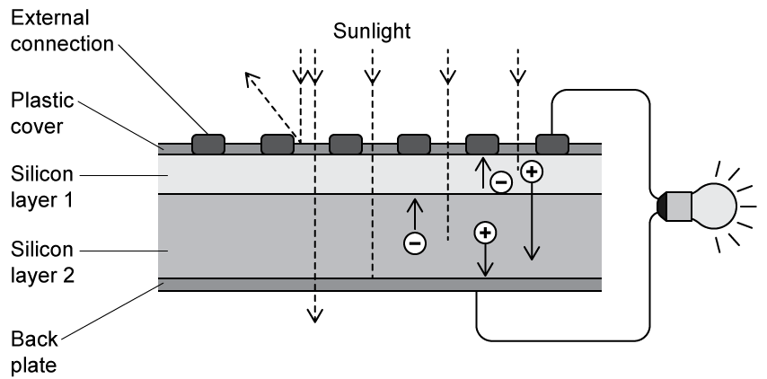

The efficiency of a solar cell is far below 100%.

Which of the following statements does **not **account for wasted energy?

### Q16 — medium — 1 marks

**Q16** [1 mark]

Which statement about nuclear fuel is correct?

### Q17 — hard — 1 marks

**Q17** [1 mark]

Which of the following energy sources produce no atmospheric pollution?

### Q18 — hard — 1 marks

**Q18** [1 mark]

Which of the following energy sources cause damage to natural habitats?

## Theory Questions (21 questions)

### Q1 — medium — 8 marks

**Q1** [3 marks]

Energy can be obtained from many different sources.

(i) State **two** advantages of using solar energy to generate electricity.

[2]

(ii) State **one** disadvantage of using solar energy to generate electricity.

[1]

**Q1** [3 marks]

Fossil fuels are also used for electricity generation.

The combustion of fossil fuels produces gases that contribute to the greenhouse effect and acid rain.

(i) State the names of **two** fossil fuels.

[2]

(ii) State the name of **one** polluting gas that contributes to acid rain.

[1]

**Q1** [2 marks]

A city needs a power station that can provide a constant supply of electricity day and night throughout the year.

The city planning committee compares wind energy and nuclear energy for this purpose.

State which one is more suitable and justify your answer.

### Q2 — medium — 2 marks

**Q2** [2 marks]

Electricity is distributed from wind turbines to homes and industry.

State **two **disadvantages, apart from cost, of using wind turbines to produce electrical energy for homes and industry.

*Source: June 2023 0972/31 Q3B*

### Q3 — hard — 3 marks

**Q3** [3 marks]

Electricity is distributed from wind turbines to homes and industry.

Statements A–F describe the main stages in the transfer of energy from the Sun to electrical energy in a wind turbine generator.

The statements A–F are **not **in the correct order.

A        Air moves from regions of high pressure to regions of low pressure.

B        The turbine blades turn a generator.

C        Energy from the Sun heats the atmosphere unevenly.

D        Uneven heating of the atmosphere produces regions of different atmospheric pressure.

E        The generator produces electrical energy.

F        Moving air turns the turbine blades.

Complete the flow chart to describe how a wind turbine uses energy from the Sun to generate electrical energy. Insert the missing letters in the empty boxes.

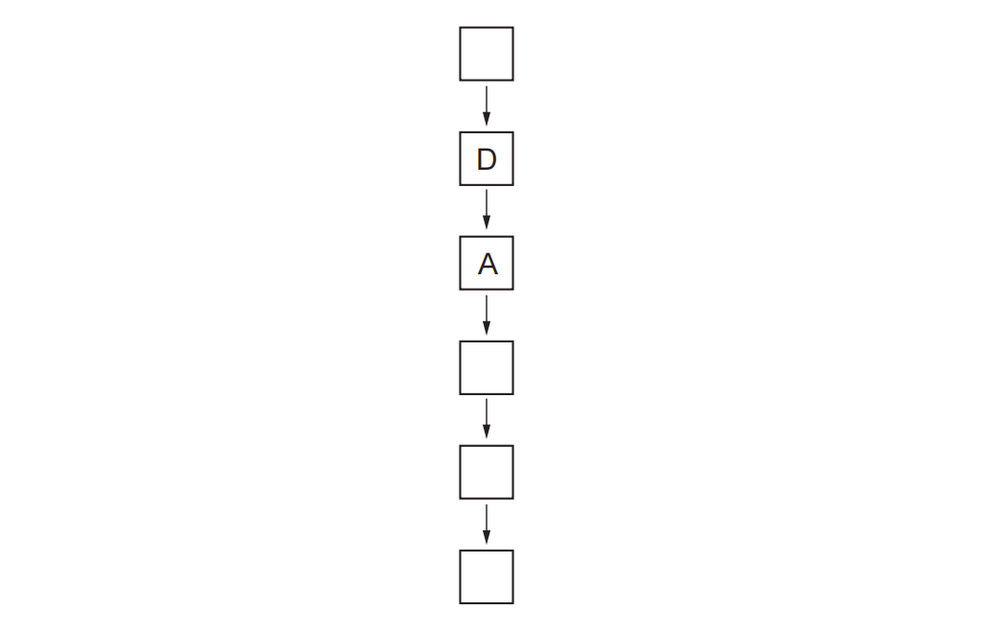

*Source: June 2023 0972/31 Q3A*

### Q4 — medium — 7 marks

**Q4** [3 marks]

Describe how a wind turbine generates electricity from energy in the wind.

*Source: June 2022 paper 3 Q5A*

**Q4** [2 marks]

Apart from cost, state **two advantages **of generating electricity using wind turbines compared with using a power station that burns coal.

*Source: june 2022 paper 3 Q5B*

**Q4** [2 marks]

Apart from cost, state **two disadvantages **of generating electricity using wind turbines compared with using a power station that burns coal.

*Source: June 2022 paper 3 Q5C*

### Q5 — medium — 9 marks

**Q5** [3 marks]

**Extended Tier Only**

Fig. 3.1 shows solar cells that use radiation from the Sun to generate electrical power.

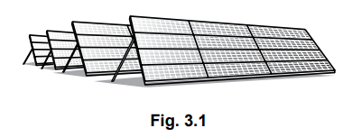

(i) State the name of the process which releases energy in the Sun.

[1]

(ii) Describe what happens in this process.

[2]

*Source: 2023 specimen paper 4 Q3A*

**Q5** [2 marks]

Apart from solar cells, there are other energy resources used on Earth for which the radiation from the Sun is the main source.

State the name of **one** of these energy resources and explain whether it is renewable.

*Source: specimen 2023 paper 4 Q3B*

**Q5** [4 marks]

State** two **advantages and **two **disadvantages of using solar cells to generate electrical power.

*Source: specimen 2023 paper 4 Q3C*

### Q6 — medium — 5 marks

**Q6** [2 marks]

Fig. 4.1 and Fig. 4.2 show two methods of using renewable sources to generate electrical power.

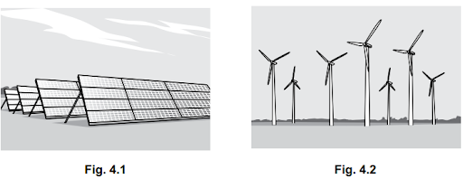

Name the energy source used by each method.

In Fig. 4.1 the energy source is ....................................................

In Fig. 4.2 the energy source is ...................................................

*Source: 2023 specimen paper 3 Q4A*

**Q6** [3 marks]

**Extract:**

In Fig. 4.1 the energy source is: Solar; In Fig. 4.2 the energy source is: Wind;

(i) State **two **advantages of using the renewable sources in either Fig. 4.1 or Fig. 4.2 for generating electrical power compared to using a coal-fired power station.

[2]

(ii) State **one** disadvantage of using the renewable sources in either Fig. 4.1 or Fig. 4.2 for generating electrical power compared to using a coal-fired power station.

[1]

*Source: 2023 Specimen paper 3 Q4B*

### Q7 — medium — 8 marks

**Q7** [3 marks]

Fig.4.1 represents a hydroelectric system for generating electrical energy.

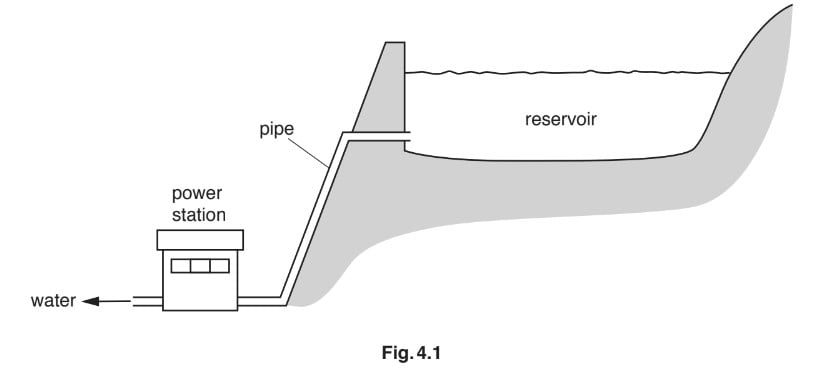

Describe how the power station uses the water in the reservoir to generate electricity.

*Source: February/March 2018 0625/32 Q4A*

**Q7** [3 marks]

State three advantages of generating electricity using a hydroelectric system compared with using a coal-fired power station.

*Source: February/March 2018 0625/32 Q4B*

**Q7** [2 marks]

An electric drill is shown in Fig.4.2.

Complete the sentences about the electric drill. Use words from the box. Each word may be used once, more than once, or not at all.

| efficient | kinetic | potential | powerful | reliable | thermal |
|---|---|---|---|---|---|

(i) Energy is transferred electrically from the mains supply to the ............................. store of the drill.

[1]

(ii) A second electric drill transfers the same amount of energy per second as the first one. However, it wastes more of this energy.The second drill is less ......................................... than the first drill.[1]

*Source: February/March 2018 0625/32 Q4C*

### Q8 — medium — 6 marks

**Q8** [3 marks]

Fig. 5.1 shows a wind turbine.

Describe how the wind turbine produces electricity.

*Source: 2020 Feb/March 0625/32 Q5A*

**Q8** [3 marks]

Wind turbines are used in many countries to replace coal-fired power stations.

(i) State one disadvantage of using wind turbines compared to coal-fired power stations.

[1]

(ii) State two advantages of using wind turbines instead of coal-fired power stations.

[2]

*Source: 2020 Feb/March 0625/32 Q5B*

### Q9 — medium — 5 marks

**Q9** [3 marks]

Nuclear fission is used in nuclear power stations to release energy.

Describe how the energy is used to generate electricity.

*Source: 2018 0625/32 Q6A*

**Q9** [2 marks]

Describe two environmental problems that arise from using nuclear power stations.

*Source: 2018 0625/32 Q6B*

### Q10 — hard — 17 marks

**Q10** [4 marks]

A coal power station has an average output of 400 MW. Explain how, in a power station, burning a fuel causes a generator to produce an alternating current.

**Q10** [2 marks]

**Extended tier only**

The Sun has a total power output of 3.8 × 1026 W across its whole surface. The surface of the Earth receives 5.0 × 10−8 % of this power.

Calculate the total power the surface of the Earth receives from the Sun.

**Q10** [4 marks]

**Extract:**

The Sun has a total power output of 3.8 × 10^26 W across its whole surface. The surface of the Earth receives 5.0 × 10^−8 % of this power.

**Extended tier only**

The power that the Earth receives from the Sun is actually twice the percentage given in part (b).

(i) Suggest why the power at the Earth's surface is less than this value.

[1]

(ii) The Earth's radius is 6 370 000 m. Calculate the surface area of the Earth which is in sunlight at any one time.

[3]

**Q10** [7 marks]

**Extract:**

Power the Earth's surface receives from the Sun, P_surface = 1.9 × 10^17 W
Area of the Earth in sunlight, A_Sun = 2.55 × 10^14 m^2
Power output of coal station, P_coal = 400 MW = 400 × 10^6 W

**Extended tier only**

(i) Under the assumption that there are no clouds obscuring the Sun, calculate the power that each square metre of the Earth receives from the Sun.

[2]

(ii) A solar cell absorbs sunlight over a surface area of 2.5 m2. It has an efficiency of 0.6. Calculate its power output.

[3]

(iii) Determine the number of solar cells required to match the power output of the coal power station.

[2]

### Q11 — hard — 8 marks

**Q11** [4 marks]

**Extended tier only**

A solar panel receives energy from the Sun at a rate of 5.0 kW.

Thermal energy is transferred from the solar panel to water with an efficiency of 20%.

Cold water of mass 15 kg enters the solar panel every hour.

The specific heat capacity of water is 4200 J / (kg°C).

Calculate the temperature increase of the water.

temperature increase = .....................................................°C

*Source: May/June 2020 (Series 2) 0625/42 Q3A*

**Q11** [4 marks]

State and explain one advantage and one disadvantage of heating the water in a solar panel compared with heating the water in a coal-burning boiler.

*Source: May/June 2020 (Series 2) 0625/42 Q3B*

### Q12 — medium — 4 marks

**Q12** [1 mark]

A tidal barrage (dam) produces electricity using tides. Fig. 5.1 shows a diagram of a tidal barrage (simplified).

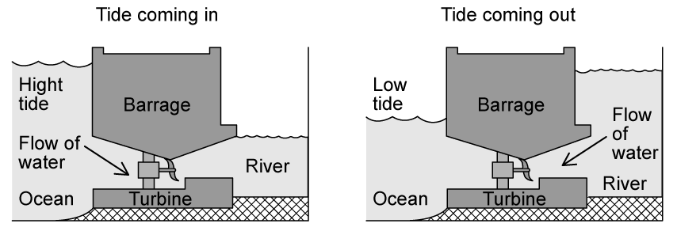

The water behind the barrage (dam) has most of its energy in one of its energy stores. State the name of this energy store.

*Source: Nov 2018 (S1) 0625/31 Q5A*

**Q12** [3 marks]

**Extract:**

A tidal barrage (dam) produces electricity using tides. Fig. 5.1 shows a diagram of a tidal barrage (simplified).

The water behind the barrage (dam) has most of its energy in one of its energy stores.

Explain how the tidal barrage (dam) produces electricity.

*Source: Nov 2018 (S1) 0625/31 Q5B*

### Q13 — hard — 13 marks

**Q13** [2 marks]

Calculate the number of joules in 1 GWh.

**Q13** [7 marks]

**Extended tier only**

Tidal power electrically transfers energy in the kinetic store of moving water.

When the tide is moving, a portion of sea water passes through the turbine. The turbine has a cylindrical shape as the turbine spins in a circular path. A turbine is shown in Fig. 1.1.

The cylinder is 24 m long and has a radius of 5.0 m. The tide is travelling at 6.0 m/s.

(i) Calculate the kinetic energy of this cylinder of sea water.

Density of sea water = 1020 kg/m3

[4]

(ii) Calculate the time taken for 24 m of water to pass through the turbine at 6.0 m/s.

[1]

(iii) Calculate the power transferred to the turbine.

[1]

(iv) The turbine's electrical power output is 7.0 MW. Calculate its efficiency.

[1]

**Q13** [2 marks]

In America, it is estimated that tidal power would cost \$150 per MWh produced, whereas coal only costs \$60 per MWh produced.

Suggest why tidal power is more expensive than power from fossil fuels.

**Q13** [2 marks]

**Extract:**

Tidal power electrically transfers energy in the kinetic store of moving water.  When the tide is moving, a portion of sea water passes through the turbine. The turbine has a cylindrical shape as the turbine spins in a circular path. ... The cylinder is 24 m long and has a radius of 5.0 m. The tide is travelling at 6.0 m/s.

Some ocean environmental groups oppose the use of tidal power, stating that it can physically harm aquatic life, as well as impacting their ability to communicate.

Suggest why these statements could be correct.

### Q14 — hard — 8 marks

**Q14** [1 mark]

Energy sources used to generate electricity are shown in the box.

Which energy sources are non-renewable?

Draw a ring around **each** energy source that is non-renewable.

*Source: Oct 2019 0625/32 Q5A*

**Q14** [4 marks]

The diagram shows a geothermal power station.

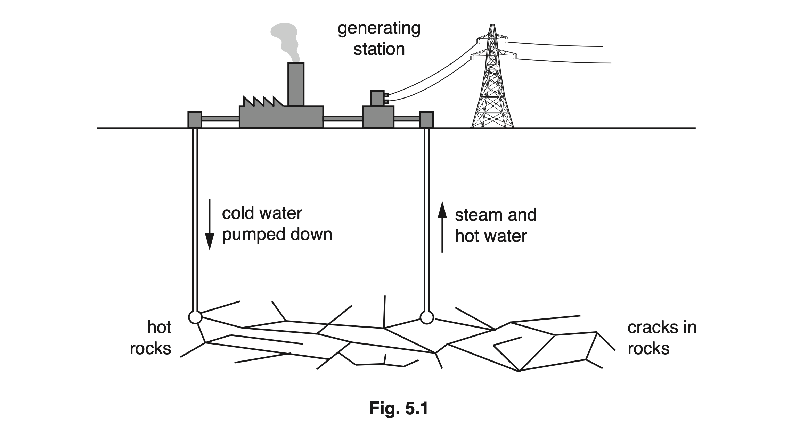

Describe how the geothermal power station generates electricity.

*Source: Oct 2019 0625/32 Q5B*

**Q14** [3 marks]

Coal and tidal energy are contrasting power sources. (a)

(i) State two environmental disadvantages associated with generating electrical power from coal.

[2]

(ii) State one physical advantage that tidal power holds over wind power regarding the reliability of energy generation.

[1]

### Q15 — medium — 5 marks

**Q15** [3 marks]

Fig. 5.1 shows a geothermal power station. It generates electricity.

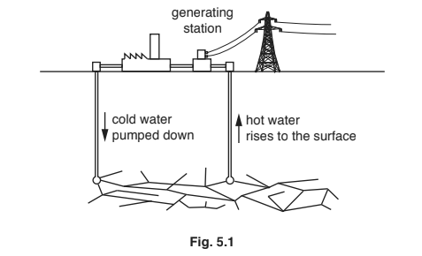

In a geothermal power station, the process of generating electricity includes seven stages.

Four of the stages are shown below.

P   steam turns a turbine

Q   hot underground rocks heat the cold water

R   the turbine spins a generator

S    hot water rises to the surface

The flow chart in Fig. 5.2 shows the seven stages, but it is incomplete. Complete the flow chart by adding the letters P, Q, R and S in the correct sequence.

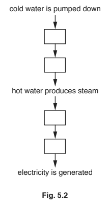

*Source: 2018 0625/31 Q5A*

**Q15** [2 marks]

The cost of electricity obtained from a geothermal power station is similar to the cost of electricity obtained from wind turbines.

Describe one advantage and one disadvantage of using a geothermal power station to generate electricity compared with using wind turbines.

*Source: 2018 0625/31 Q5B*

### Q16 — hard — 12 marks

**Q16** [3 marks]

**Extended tier only**

Fusion is occurring in the centre of a star. The region in which a certain type of fusion is occurring has a diameter of 150 000 km.

Calculate the surface area of this sphere.

**Q16** [5 marks]

**Extract:**

The region in which a certain type of fusion is occurring has a diameter of 150 000 km.
A = 7.1 × 10^16 m^2 (surface area of the sphere)

The weight of the star around the core exerts a large force on the core.

The core experiences a pressure of 26.5 × 1015 Pa.

(i) Calculate the size of the force due to gravity experienced by the core.

[3]

(ii) The volume of the core is approximately constant, so pressure and temperature (in degrees Kelvin) can be approximated as directly proportional. They are related in the following equation:

$P=cT$

*c* is a constant equal to 2.2 × 109 Pa/K

Calculate the temperature of the core of the star.

[2]

**Q16** [4 marks]

**Extended tier only**

Compare the advantages and disadvantages of nuclear fusion and nuclear fission.

### Q17 — easy — 6 marks

**Q17** [2 marks]

Coal is a non-renewable source of energy.

(i) Explain what is meant by the term *non-renewable*.

[1]

(ii) There are other non-renewable sources of energy.

Place a tick in the box by each non-renewable source of energy.

`square` nuclear

`square` oil

`square` solar

`square` wave

`square` wind

[1]

*Source: 2019 May/June 0972/31 Q5A*

**Q17** [4 marks]

State two advantages and two disadvantages of using natural gas as an energy source.

*Source: 2019 May/June 0972/31 Q5B*

### Q18 — easy — 11 marks

**Q18** [1 mark]

Define the term "renewable resource".

**Q18** [4 marks]

A list of resources is shown in the table below.

| **Resource** | **Renewable** | **Non-renewable** |
|---|---|---|
| Coal |   | ✓ |
| Nuclear fuel |   |   |
| Biofuel |   |   |
| Solar energy |   |   |
| Oil |   |   |

Place a tick in the correct box for each resource.

**Q18** [2 marks]

**Extract:**

A renewable resource is:

- A resource that can be replenished as it is used / is replaced (by nature) in less than a (human) lifetime; [1 mark]

"A resource that doesn't run out" may or may not gain a mark, depending on the mark scheme for your exam. It is better to use scientific language and refer to rate of use and rate at which the resource is replenished.

Fossil fuels are produced when living matter is compressed. They are continually produced.

Explain why they are not a renewable resource.

**Q18** [4 marks]

**Extended tier only**

(i) Describe the process of nuclear fusion.

[2]

(ii) Explain why nuclear fusion is not currently used as an energy resource.

[2]

### Q19 — easy — 6 marks

**Q19** [2 marks]

Fig. 5.1 shows part of a solar farm. The solar cells tilt and rotate.

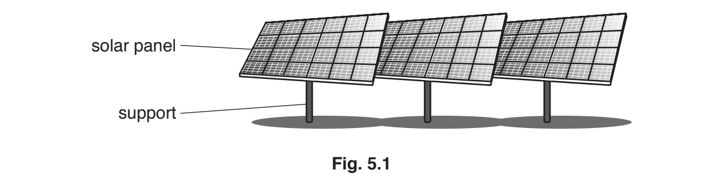

The solar farm converts energy from a source into a different, useful form of energy.

State the energy source and the useful form of energy.

*Source: 2019 0625/32 Q5A*

**Q19** [3 marks]

Solar farms have advantages and disadvantages.

(i) State **two** advantages of a solar farm.

[2]

(ii) State one disadvantage of a solar farm.

[1]

*Source: 2019 0625/32 Q5B*

**Q19** [1 mark]

**Extract:**

Fig. 5.1 shows part of a solar farm. The solar cells tilt and rotate.

Suggest why it is useful that the solar cells can tilt and rotate.

*Source: 2019 0625/32 Q5C*

### Q20 — easy — 3 marks

**Q20** [3 marks]

Here are some statements about energy and energy resources.

Some statements are correct. Put a tick (✓) in the box alongside each of these.

`square` Building hydroelectric power stations has an impact on the environment.

`square` Burning fossil fuels produces atmospheric pollution.

`square` Wind turbines are turned using gravitational potential energy.

`square` Coal and crude oil are sources of renewable energy.

`square` Geothermal energy is obtained from hot rocks below the ground.

*Source: Oct 2019 3 Q5*

### Q21 — easy — 7 marks

**Q21** [2 marks]

Complete the sentence below about energy sources.

Two methods of using energy from water are ____________ and _____________.

**Q21** [2 marks]

**Extract:**

Two methods of using energy from water are: Tidal power (turning turbines) / turbines in the sea; Hydroelectric dams;

State two advantages of one of the methods from part (a).

**Q21** [1 mark]

A graph of the energy output of two renewable resources over time is shown in Fig. 1.1. One is a solar cell, the other is a wind turbine.

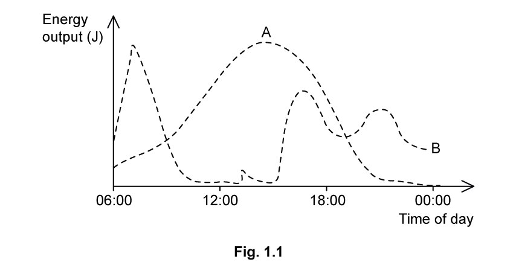

**Fig. 1.1**

State which line on the graph represents the energy output of a solar cell.

**Q21** [2 marks]

**Extract:**

A graph of the energy output of two renewable resources over time is shown in Fig. 1.1. One is a solar cell, the other is a wind turbine.

State which line on the graph represents the energy output of a solar cell.

(c) State which line on the graph represents the energy output of a solar cell:

- Line A; [1 mark]

Explain how you arrived at your answer to part (c).
