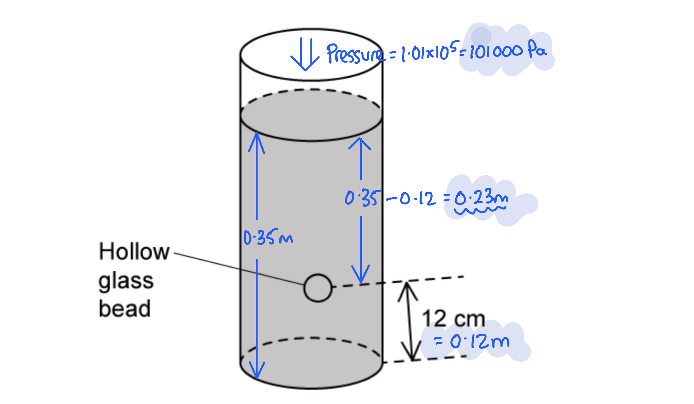

# Mark Schemes — Pressure
**1. Motion, Forces & Energy** · Cambridge (CIE) IGCSE physics (0625 & 0972)

## Multiple Choice Questions (23 questions)

### Q1
**Final answer:** **The correct answer is B**

- Pressure $p$ is force $F$ per unit area $A$, and is calculated using the equation:

$p=\frac{F}{A}$

- In this context, the force is the weight of the block, which is proportional to its mass $( W = m g )$
- To find which block exerts the greatest pressure, the mass of each block is divided by its base area (the area in contact with the ground):

  - Block **A**: $15\text{g}\div10\text{cm}^{2}=1.5$ g/cm2
  - Block **B**: $40\text{g}\div10\text{cm}^{2}=4.0$ g/cm2
  - Block **C**: $55\text{g}\div20\text{cm}^{2}=2.75$ g/cm2
  - Block **D**: $70\text{g}\div20\text{cm}^{2}=3.5$ g/cm2
- Block **B** results in the highest value, meaning it exerts the greatest pressure

### Q2
**Final answer:** **The correct answer is ****C**** because:**

The pressure acting on the floor can be found using the relationship:

$\mathrm{pressure}=\frac{\mathrm{force}}{\mathrm{area}}\mathrm{or}p=\frac{F}{A}\,p=\frac{F}{A}=\frac{600N}{0.050m^{2}}=1.2\times10^{4}N/m^{2}\,$

**A** is a miscalculation using an area of 0.500 m2 instead of 0.050 m2.

Watch out for errors involving values mistyped into your calculator. Make sure that you enter leading zeros in decimals correctly.

**B** and **D** show a misunderstanding about the number of feet touching the floor. The question states that the total area of contact is 0.050 m2. If you assumed that the question was asking about the pressure caused when the woman was standing on one foot, you could get these incorrect answers by halving the area of contact to 0.0250 m2. Using this value gives option **D,** while using 0.2500 m2 will give option **B**.

### Q3
**Final answer:** **The correct answer is ****D**** because:**

- The pressure at a depth in a liquid can be calculated using:

$\mathrm{pressure}=\mathrm{liquid} \mathrm{density}\times\mathrm{gravitational} \mathrm{field} \mathrm{strength}\times\mathrm{depth} \mathrm{or}\Deltap=\mathrm{ρg}\Deltah$

- A value of the gravitational field strength (on Earth) of 10 N/kg can be used for this question.
- Substituting in values from the question $\Deltap=1000\mathrm{kg}/m^{3}\times10N/\mathrm{kg}\times15m\,\Deltap=150000\mathrm{Pa}$

**A** is incorrect because the correct equation has not been used for the calculation.

**B** is incorrect as the density and depth have been divided by the gravitational field strength rather than multiplied by it.

**C** is incorrect as the gravitational field strength has not been used in the calculation.

### Q4
**Final answer:** **The correct answer is D because:**

- Pressure is defined as the force exerted per unit area and is given by the equation

$p=\frac{F}{A}$

- The force exerted by the liquid is given by its weight

$F=W=mg$

- Where *g* is the acceleration of free fall, *g* = 10 m/s2
- Therefore, the pressure exerted by the liquid of the base of the tank is

$p=\frac{92\times10}{0.23}=4000N/m^{2}$

- This is option **D**

### Q5
**Final answer:** **The correct answer is B because:**

- The equation for pressure in a liquid is

$\Deltap=pg\Deltah$

- In the first scenario, the depth is 20 m, the density is 1.3ρ and the pressure is *P*

$P=1.3pg\times20$

$P=26ρg$

- In the second scenario, the depth is 26 m, the density is ρ and the pressure is *P**new*

$P_{new}=pg\times26$

$P_{new}=26pg$

- The pressure in fresh water at 26 m is equal to the pressure in salt water at 20 m

$P_{new}=P$

- This is option **B**

Labelling variables correctly and assigning the right values to each scenario helps avoid errors in these questions. Sometimes a quick sketch can help ensure you have read the question properly.

### Q6
**Final answer:** **The correct answer is D because:**

- Pressure in a liquid increases with depth
- The weight of the liquid above the fish pushes down on the fish
- The denser the liquid, the greater the weight pushing down on the fish
- Fish **D** is in the liquid with the greatest density and at the greatest depth
- Therefore, Fish **D** experience the greatest pressure

### Q7
**Final answer:** **The correct answer is D because:**

- The pin has a large surface area at the end which touches the thumb
- The surface area is very small at the end which touches the board
- Pressure is defined as force per unit area

  - The force on each end is the same
  - The end touching the board has a smaller area, so the force per unit area is larger
  - The pressure of the pin on the board is greater than the pressure of the pin on the student’s thumb

### Q8
**Final answer:** **The correct answer is A because:**

- The pressure of a liquid depends on

  - the **depth **beneath the surface of the liquid
  - the **density **of the liquid
- Therefore, the pressure at X depends **only **on the depth of the water at X

### Q9
**Final answer:** **The correct answer is ****A**** because:**

- Pressure in liquids is caused by two properties - the density and the depth of the liquid

  - Distilled water is less dense than a concentrated sugar solution since the sugar solution contains sugar molecules as well as water
  - Therefore for a given depth, there will be less pressure when distilled water is used
  - This eliminates both **C** and** D**
- Pressure increases with depth

  - Therefore the shallowest option from **A** and **B** is the correct answer
- This is option **A**

### Q10
**Final answer:** **The correct answer is ****C**** because:**

- The equation to calculate the pressure in a liquid is:
- $Δp=ρgΔh=1000\times9.8\times0.6=5880\mathrm{Pa}$

### Q11
**Final answer:** **The correct answer is ****D**** because:**

- Pressure = force / area. It is the same person, so the force (weight) is the same in each situation, but the area is different.
- The situation with the smallest area will generate the greatest pressure.
- Standing on one foot is the situation with the smallest area.

**A **is incorrect as the area is not the smallest

**B **is incorrect as the area is the largest

**C **is incorrect as the area is not the smallest.

### Q12
**Final answer:** **The correct answer is ****B**** because:**

- The base of the tank is the **area** needed to calculate the pressure the tank exerts on the table

  - The area of the base = 1.0 × 0.5 = 0.5 m**2**

The area referred to in the pressure equation is the **cross-sectional** area. This is an example of such area.

### Q13
**Final answer:** **The correct answer is ****B**** because:**

- Pressure = force / area.
- B is the only example where the area is being made as small as possible

**A **is incorrect as skis increase the contact area

**C **is incorrect as wider tyres increase the contact area

**D **is incorrect as lying down increases the contact area compared to standing on two feet.

### Q14
**Final answer:** **The correct answer is ****D ****because:**

- Since the depth and density are the same in all three containers, the pressure exerted by the liquid must be equal.

**A , B** and **C** are incorrect as the pressure is equal in all three

### Q15
**Final answer:** **The correct answer is ****B**** because:**

- The equation to calculate pressure in a liquid, 
$P=ρgh=1000\times9.8\times0.7=6860\mathrm{Pa}$
- This answer rounds most closely to 6900 Pa

### Q16
**Final answer:** **The correct answer is ****C**** because:**

- The person sinks because they exert too large a pressure on the snow.
- Pressure = force / area, so the person needs to increase the area of contact between themselves and the snow. Therefore larger area shoes, like skis or snowshoes, would work.

**A **is incorrect as lowering their centre of mass will do nothing to change their pressure.

**B **is incorrect as running quickly will not change their pressure. If anything, it would increase the force exerted with each step, which would exacerbate the problem.

**D **is incorrect as increasing their weight would increase the force, increasing the pressure and making them sink further.

### Q17
**Final answer:** **The correct answer is ****C**** because:**

- The **deeper** a submarine goes, the **greater** the pressure it experiences. High pressures can crush the hull of a submarine.

**A **is incorrect as temperature doesn’t really affect the ability of a submarine to work

**B **is incorrect as density of water actually increases slightly at greater depths.

**D **is incorrect as gravitational pull does not increase (or decrease substantially) at greater depths.

### Q18
**Final answer:** **The correct answer is ****B**** because:**

- Pressure = Force / area.
- C gives a pressure of 20 Pa. This is the lowest pressure that can be calculated from the data in the table.

**A **is incorrect as Pressure = 80 Pa

**C **is incorrect as Pressure = 160 Pa

**D **is incorrect as Pressure = 40 Pa

### Q19
**Final answer:** **The correct answer is ****C**** because:**

- The equation pressure = force / area is used to determine pressure. Therefore we need the side with the smallest area to produce the largest pressure.
- Multiplying the dimensions of all the sides leads us to the fact that side B has the smallest area, and, therefore, exerts the highest pressure.

**A** and **B **are incorrect as side A does not have the smallest area.

**D **is incorrect as the pressure depends on the area. It will not be the same on all sides because the area of each side is different.

### Q20
**Final answer:** **The correct answer is ****A ****because:**

- The equation for pressure is:

  - $P=\frac{F}{A}$
- Area of the base is:

  - $A=3\times2=6m^{2}$
- Therefore the pressure is:

  - $P=\frac{24}{6}=4.0\mathrm{Pa}$

### Q21
**Final answer:** **The correct answer is ****D**** because:**

- Lowering the block deeper into the liquid would **increase** the pressure

**A **is incorrect as surface area has no effect on pressure in a fluid.

**B **is incorrect as lowering the density would *reduce* the pressure.

**C **is incorrect as mass of the block has no effect on the pressure in a fluid.

### Q22
**Final answer:** **The correct answer is ****C**** because:**

- The area of a circle is found using $A=πr^{2}$
- Pressure is found using $P=\frac{F}{A}$
- Therefore the difference in pressure will be:
- `capital delta P = (12)/(pi ( 0.05 ^2 )) - (12)/(pi ( 0.25 ^2 ))`
- $ΔP=1528-61=1467$
- This rounds most closely to 1500 Pa

### Q23
**Final answer:** **The correct answer is ****A**** because:**

- The **force** on the floor is caused by the **weight** of the briefcase, weight is the force, due to gravity, that pulls the briefcase downward. The briefcase’s weight does not change, so the force is **unchanged**.
- Pressure = Force / Area, the **area** of the briefcase in contact with the floor has **increased**. This means that the pressure has decreased.

**B **is incorrect as the pressure is not unchanged, it has decreased.

**C **and **D **are incorrect as the force remains the same.

## Theory Questions (20 questions)

### Q1
Calculate the pressure on the ground due to the concrete beam:

List the known quantities:

- Length of beam = 160 cm
- Width of beam = 12 cm
- Force = weight of beam = 1540 N

Determine the area of the concrete block in contact with the ground:

- $\mathrm{area}=12\times160=1920\mathrm{cm}^{2}$ **[1 mark]**

State the equation for pressure:

- $\mathrm{pressure}=\mathrm{force}\div\mathrm{area}$**[1 mark]**

Substitute in the values for the force (weight) and area to calculate the pressure:

- $\mathrm{pressure}=1540\div1920$  **[1 mark]**
- $\mathrm{pressure}=0.8$ N/cm2 **[1 mark]**

> **[exam-tip]**
> This is a **calculate** question, so you are going to use an equation to calculate values after identifying the important data in the figure and the question. The question is about pressure, and you should remember that this is linked to force and area. Examining the figure shows how to find the area of the block in contact with the ground, and the question gives the weight (a force).
> 
> Stating the equation that you are using will often get you a mark for the question, even if the actual calculation is incorrect, so always write down the equation in words or in standard symbols.

### Q2
The kinetic energy of the water in the pipe remains constant because:

- The speed (of the water) remains constant; **[1 mark]**

Plus any **one **from:

- If speed were not constant, the density would decrease; **[1 mark]**
- If speed were not constant, gaps would appear in the water; **[1 mark]**
- The volume / density of water is constant / does not change; **[1 mark]**
- Liquids are incompressible; **[1 mark]**
- Water enters / leaves the pipe at a constant rate; **[1 mark]**
- The quantity of water remains constant (at all points in the pipe); **[1 mark]**

**[Total: 2 marks]**

### Q3
(i) Calculate the total pressure in the water at the turbine:

List the known quantities:

- Atmospheric pressure, $p_{atm}$ = 1.0 × 105 Pa
- The density of water, $p$ = 1000 kg/m3
- Height of water, $\Deltah$ = 150 m
- Gravitational field strength, $g$= 10 N/kg

Use the equation for pressure in a liquid to find the pressure due to the water in the reservoir:

- $p_{water}=pg\Deltah$ **[1 mark]**
- $p_{water}$= 1000 × 10 × 150
- $p_{water}$ = 1.5 × 106 Pa

Calculate the total pressure by adding the atmospheric pressure:

- Total pressure = $p_{atm}$+ $p_{water}$
- Total pressure = (1.0 × 105) + (1.5 × 106) **[1 mark]**
- Total pressure = 1.6 × 106 Pa **[1 mark]**

(ii) Calculate the force exerted on the turbine by the water:

- Pressure = force ÷ area  **OR  **$p=\frac{F}{A}$
- Therefore, force = pressure × area  **OR ** $F=pA$** [1 mark]**

  - Where *p *= 1.6 × 106 Pa and *A* = 3.5 m2
- Force = (1.6 × 106) × 3.5
- Force = 5.6 × 106 N **[1 mark]**

**[Total: 5 marks]**

### Q4
Calculate the pressure of the block on the ground:

- Pressure = force ÷ area **OR**  $p=\frac{F}{A}$**[1 mark]**

  - Where force = *F* = 24 N and area = *A* = 4.0 cm2
- Pressure = 24 ÷ 4.0 **[1 mark]**
- Pressure = 6.0 N/cm2** [1 mark]**

**[Total: 3 marks]**

### Q5
To calculate pressure:

List the known quantities:

- Weight, *W* = 5.4 N
- Area, *A* = 9.2 cm2

Recall the equation for pressure:

- $P=\frac{F}{A}$**[1 mark]**
- Here, the force is weight

Substitute the known quantities:

- $P=\frac{5.4}{9.2}$**[1 mark]**
- $P=0.59N/\mathrm{cm}^{2}$ **[1 mark]**

**[Total: 3 marks]**

> *Note that the answer is required in N / cm**2**. This means no units need to be converted, even though the area is usually measured in m**2**.*

### Q6
Convert the area of one ski to the area for two skis:

- Area, $A=0.2\times2=0.4m^{2}$ **[1 mark]**

**[Total: 1 mark]**
Use the equation for pressure:

- $P=\frac{F}{A}$ **[1 mark]**

Substitute the values from the question:

- $P=\frac{750}{0.4}=1875$ **[1 mark]**

Round the answer to two sig figs and include the units:

- $P=1900\mathrm{Pa}/1.9\mathrm{kPa}$ **[1 mark]**

**[Total: 4 marks]**
The effect of using skis with smaller surface area:

- <u>Increases</u> the pressure; **[1 mark]**

**[Total: 1 mark]**
Decreasing surface area increases pressure because:

- Pressure = force ÷ area **OR **pressure and area are <u>inversely</u> proportional; **[1 mark]**

**[Total: 1 mark]**

### Q7
Complete the table by adding a suitable unit for each measurement:

A table scoring two marks:

| **measurements** | **value** | **unit** |
|---|---|---|
| mass of elephant | 4000 | **Final answer:** **kg** |
| height of elephant | 3.0 | **Final answer:** **m** |
| surface area of elephant foot | 0.125 | **Final answer:** **m****2** |

- Units given for mass as kg **AND **units given for height as m; **[1 mark]**
- Units given for area as m2; **[1 mark]**

**[Total: 2 marks]**
(i) Calculate the weight of the elephant:

List the known quantities:

- Mass, *m* = 4000 kg (from part (a))

Recall the equation for weight:

- $g=\frac{W}{m}$ **OR** $W=mg$ **[1 mark]**

Recall the value of acceleration of free fall:

- *g* = 9.8 m/s2

Substitute the known values into the equation to calculate weight:

- $W=4000\times9.8$ **[1 mark]**
- *W* = 39 200 N **[1 mark]**

(ii) Calculate the pressure the elephant exerts on the ground when it is standing on four feet, including the unit:

List the known quantities:

- Area of one elephant's foot, *A* = 0.125 m2 (from part (a))
- Weight of the elephant, *W* = 39 200 N (from part (b)(i))

Calculate the total area in contact with the ground:

- Elephants have 4 feet
- $totalarea=0.125\times4=0.500m^{2}$ **[1 mark]**

Recall the equation for pressure:

- $pressure=\frac{force}{area}$  **OR**  $P=\frac{F}{A}$  **[1 mark]**

Substitute the known values into the equation to calculate pressure:

- The force here is weight, *W* = 39 200 N (from part (i))
- $P=\frac{39200}{0.500}$ **[1 mark]**
- *P* = 78 400 Pa **[1 mark]**

**[Total: 7 marks]**

> *Remember that mass is a measure of the amount of matter in an object, whereas weight is the force acting on an object with mass in a gravitational field. *

### Q8
- Pressure is defined as the **force**; **[1 mark]**
- per unit **area**; **[1 mark]**

**[Total: 2 marks]**
- Pressure in a solid is the **force**; **[1 mark] **
- ÷ **area**;** [1 mark]**

**[Total: 2 marks]**
|   |   | **High or Low Pressure?** | ** ** |
|---|---|---|---|
|   | High heeled shoe | **high** | **[1 mark]** |
|   | Snowshoes | **low** | **[1 mark]** |
|   | Kitchen knife | **high** | **[1 mark]** |
|   | Point of a nail | **high** | **[1 mark]** |
|   | Skis | **low** | **[1 mark]** |

**[Total: 5 marks]**
To calculate pressure:

Use the equation for pressure:

- $P=\frac{F}{A}$ **[1 mark]**

Substitute the values from the question:

- $P=\frac{550}{0.020}=27500$ **[1 mark]**

Round the answer to two sig figs and include the unit:

- $P=28000\mathrm{Pa}$ **[1 mark]**

**[Total: 3 marks]**

### Q9
Convert the area of one tyre to the area for four tyres:

- Area, $A=0.1\times4=0.4m^{2}$ **[1 mark]**

**[Total: 1 mark]**
Use the equation for pressure:

- $P=\frac{F}{A}$ **[1 mark]**

Substitute the values from the question:

- $P=\frac{20000}{0.4}=50000$ **[1 mark]**

Round the answer to two sig figs and include the unit:

- $P=50000\mathrm{Pa}/50\mathrm{kPa}$ **[1 mark]**

**[Total: 4 marks]**
The effect of adding weight (the roof-rack and equipment) to the car:

- Increases the pressure; **[1 mark]**

**[Total: 1 mark]**
Adding weight increases pressure because:

- Pressure = force ÷ area **OR **pressure and force / weight are directly proportional; **[1 mark]**

**[Total: 1 mark]**

### Q10
To describe how the pressure beneath the surface of a liquid changes:

(i) With depth:

- As depth <u>increases</u>, pressure <u>increases</u> / they are directly proportional; **[1 mark]**

(ii) With density:

- As density <u>increases</u>, <u>pressure increases</u> / they are directly proportional<u>;</u> **[1 mark]**

**[Total: 2 mark]**
- Pressure in a liquid is the **density**** **of the liquid × gravitational field strength; **[1 mark]**
- × change in **depth**;** [1 mark]**

**[Total: 2 marks]**

> *You could say 'height' for depth here, but since the symbol is Δ**h** it would be allowed to mix them up.*
Identify the object experiencing higher pressure and explain the reason:

(i)

- **B** is at higher pressure; **[1 mark]**
- <u>Sea water is more dense</u> than fresh water; **[1 mark]**

(ii)

- **A **is at higher pressure; **[1 mark]**
- <u>**A**</u><u> is deeper</u> (under the water level / in the water) than **B **

**OR**

- There is a greater volume of water above **A **than **B**; **[1 mark]**

**[Total: 4 marks]**
To calculate pressure:

Use the equation for pressure in a liquid:

- $P=ρgΔh$ **[1 mark]**

Substitute the values from the question:

- $P=1000\times9.8\times2$ **[1 mark]**
- $P=19600$

Round the answer to two sig figs and include the unit:

- $P=20000\mathrm{Pa}/20\mathrm{kPa}$ **[1 mark]**

**[Total: 3 marks]**

### Q11
(i) To calculate the total pressure at a depth of 5.0 m:

List the known quantities:

- Atmospheric pressure = 1.0 × 105 Pa
- Density of water = 1000 kg/m3
- Depth = 5.0 m

Recall the equation for pressure at depth, and substitute in known values:

- $pressureatdepth=density\timesg\timesheight$ **OR** $p=ρgh$
- $pressureatdepth=1000\times9.81\times5.0$ **[1 mark]**

Calculate pressure at this depth:

- $pressureatdepth=50000\mathrm{Pa}$ **[1 mark]**

Combine with atmospheric pressure to give total pressure, *p*:

- $p=atmosphericpressure+pressureatdepth$
- $p=100000+50000$
- *p* = 1.5 × 105 Pa **[1 mark]**

(ii) State the pressure in the bubble:

- Pressure is constant at constant depth
- Therefore, pressure = 1.5 × 105 Pa **[1 mark]**

**[Total: 4 marks]**

> *Remember that pressure is constant at a constant depth. The depth is determined by the gravitational field strength (**g**), density of the liquid (**ρ**) and depth (**h**). Don't forget that a question might need you to consider atmospheric pressure as well, especially when it's asked for the **total **pressure.*
To explain why the bubble rises to the surface:

- (The bubble rises because) the density of gas is less than density of water; **[1 mark]**

**OR**

- There is a resultant upward force on bubble; **[1 mark]**

To explain why the volume increases:

- (As the bubble rises) the pressure (of the gas in bubble) decreases; **[1 mark]**

- Since pressure multiplied by volume is constant, volume will increase when pressure decreases; **[1 mark]**

**OR**

- $P\timesV=constant$ / $V\propto\frac{1}{P}$**[1 mark]**

**[Total: 3 marks]**

> *If an object in a liquid is less dense than that liquid, it will rise up and float on the liquid. It is important to memorise the gas relationships so you can back up your answers!*

### Q12
(i) To state what happens to the pressure of the air in the bottle:

- (Pressure) increases; **[1 mark]**

(ii) To explain why the pressure of the air in the bottle changes. Use your ideas about gas molecules:

**Any four from:**

- (Air) molecules / particles have more (kinetic) energy / move faster; **[1 mark]**
- More frequent collisions; **[1 mark]**
- Harder collisions (with walls); **[1 mark]**
- Collisions with walls; **[1 mark]**
- Idea of collisions causing force; **[1 mark]**

**[Total: 5 marks]**

> *Recognising when molecules have a higher temperature then they have more energy and can therefore move faster, creating more collisions. Each collision involves a force, and the higher the force then the higher the pressure *$Pressure=\frac{Force}{Area}$*. *
List the known quantities:

- Weight = Force, *F *= 5.4 N
- Surface area, *A *= 9.2 cm2 

Recall the equation for calculating pressure between solids, *P*:

- $Pressure=\frac{Force}{Area}orP=\frac{F}{A}$ **[1 mark]**

Substitute the known quantities into the equation and calculate the pressure, *P*:

- $P=\frac{5.4}{9.2}$
- *P *= 0.59 **[1 mark]**

State the correct units for pressure from the calculation:

- N / cm2 **[1 mark]**

**[Total: 3 marks]**

> *Be careful with the units in this question. Whilst pressure can be measured in Pascals (Pa). Pascals are the equivalent to N / m**2** and not N / cm**2**.*
(i)

To calculate the area of this circle:

List the known quantities:

- Radius of circle, *r *= 4.0 cm

Recall the equation to calculate the area of a circle:

- Area of circle = π*r*2 

Substitute the known quantities into the equation to calculate the area of the circle:

- Area of circle = π × 42 

Calculate the area of the circle:

- Area of circle = 50.2654 cm2** [1 mark]**

(ii)

To explain why the bottle shown in Fig. 5.2 exerts more pressure on the table than the bottle shown in Fig. 5.1:

- Smaller area (in contact with the table); **[1 mark]**

**[Total: 2 marks]**

> *Make sure you can calculate the area and volume of regular shapes, as this skill can be useful in a wide range of questions in your exams. *

> *In part (ii) it is important that you notice that *$Pressure=\frac{Force}{Area}$* so the smaller the area the bigger the pressure. When you have a bigger denominator in your fraction then the fraction is smaller. For instance *$\frac{1}{3}$*is  smaller than *$\frac{1}{2}$

### Q13
Calculate the density of the liquid:

List the known quantities:

- Weight, *W* = 2.5 N
- Acceleration of free fall, g = 10 m/s2
- Radius of cylinder, *r* = 3.0 cm = 0.03 m
- Depth of liquid, *h* = 10 cm = 0.1 m

State the equations for density, mass and volume:

- $ρ=\frac{m}{V}$
- Where

  - mass $m$ can be found from $W=mg$
  - volume $V$ can be found from $V=πr^{2}h$

Rearrange the weight equation for mass and substitute in the values:

- $m=\frac{W}{g}$
- $m=\frac{2.5}{10}=0.25\mathrm{kg}$ **[1 mark]**

Substitute the known values to calculate volume:

- $V=πr^{2}h$
- $V = \mathrm{\pi } \times ( 0.03 )^{2} \times 0.1 = 2.8 \times 10^{- 4} \mathrm{m}^{3}$* ***[1 mark]**

Substitute the mass and volume values into the density equation:

- $ρ=\frac{0.25}{2.8\times10^{-4}}$
- $ρ$ = 892.86 = 890 kg/m3 **[1 mark]**

**[Total: 3 marks]**

> *This question is a **lot** more involved than it looks at first sight. It relies heavily on your recall of equations. Make sure you learn **all** the equations, and understand the links between them. You will be able to apply different equations to find the values you need.*

> *For example, once you understood that you were using the density equation, and to that you needed to know the mass and the volume, you can use the equations for **weight** to find the **mass** and the equation for the **volume** of a **cylinder** to find the volume of the liquid. *

> *Remember that for CIE IGCSE exams, you are **not** given an equation sheet or a data booklet. You will need to recall **all** the equations that you have met throughout your course. It is easier and far more effective to learn them as you study each topic, rather than trying to learn them all just before your exams. *
(i) Calculate the difference between the pressure of the gas and atmospheric pressure:

List the known quantities:

- Change in height of liquid, Δ*h *= 2.0 cm = 0.02 m
- Density of the liquid, *ρ *= 800 kg/m3
- Gravitational field strength, *g* = 10 N/kg

State the equation for pressure in fluids:

- $\Deltap=ρg\Deltah$

Substitute in the known values to calculate the change in pressure:

- $\Deltap=800\times10\times0.02$ **[1 mark]**
- $\Deltap$ = 160 Pa **[1 mark]**

(ii) State and explain any effect on the value of *h:*

State the effect on the value of *h*:

- The value of *h* stays the same; **[1 mark]**

Explain the effect on the value of *h*:

- Because the difference in height does not depend on the cross-sectional area of the tube **OR**
- Because the pressure of the liquid column depends only on height, density and gravitational field strength (because Δ*p* = *ρg*Δ*h*); **[1 mark]**

**[Total: 4 marks]**

> *Remember that gravitational field strength, **g**, and acceleration of free fall, **g**, are the **same** **thing**. They have different units, but the same value. *

- *gravitational field strength, **g **=** **9.8 N/kg*
- *acceleration of free fall, **g **= 9.8 m/s**2** *

> *These are the values you should learn, and these are the values you should use,** unless the question tells you otherwise**, as it does in this instance.*

### Q14
To calculate the weight of water in the container:

Recall the equation and calculate weight:

- $W=mg$
- $W=6.2\times9.8$
- $W=61N$ **[1 mark]**

**[Total: 1 mark]**
To calculate the pressure due to the liquid on the base of the container:

Calculate the area of the base:

- Area, $A=πr^{2}=\frac{πd^{2}}{4}$
- $A=\frac{π\times0.15^{2}}{4}=0.018m^{2}$ **[1 mark]**

Use the pressure equation and substitute in known values:

- $P=\frac{F}{A}$
- $P=\frac{61}{0.018}$ **[1 mark]**
- $P=3389$

Write the answer to two sig figs and include the unit:

- P = 3400 Pa / 3.4 kPa  **[1 mark]**

**[Total: 3 marks]**
The total pressure on the bench is greater because:

- The <u>cylinder</u> also has <u>weight</u>, (so total force is more); **[1 mark]**
- There is atmospheric pressure (in addition to liquid pressure); **[1 mark]**

**[Total: 2 marks]**
To calculate the total pressure on the bead:

Depth of the bead below the surface:

- 12 cm = 0.12 m
- Depth, *h *= 0.35 - 0.12 = 0.23 m **[1 mark]**

Pressure on the bead from the water column:

- $P_{w}=ρgh$ **OR ** $P_{w}=1000\times9.8\times0.23$ **[1 mark]**
- $P_{w}=2254/2300\mathrm{Pa}$ **[1 mark]**

Add the value for atmospheric pressure:

- Total pressure, $P = 2254 + ( 1.01 \times 10^{5} )$ **[1 mark]**
- $P=103254$

Round the answer to two sig figs and include the unit:

- $P=100000\mathrm{Pa}/1\times10^{5}\mathrm{Pa}/100\mathrm{kPa}$ **[1 mark]**

**[Total: 5 marks]**

> *There is quite a lot going on in this question. The depth has been given in centimetres as a height above the base, rather than depth, and atmospheric pressure has been introduced.*

> *The answer is a large number which could be presented in different ways. Make sure what you have written exactly matches one of our options.*

> *You should annotate diagrams, or sketch your own, to keep yourself straight whenever calculations get tricky.*

### Q15
Calculate the reading shown on the balance:

List the known quantities:

- Radius, *r *= 3.5 cm
- Depth, *h *= 12.0 cm
- Density, *ρ *= 900 kg/m3
- Weight of empty cylinder = 2.5 N

Convert the units for radius and depth from cm into m:

- There are 100 cm in 1 m
- So, for radius there are 3.5 ÷ 100 = 0.035 m
- For depth there are 12 ÷ 100 = 0.12 m

Calculate the volume of the liquid in the cylinder:

- $Volumeofcylinder,V=πr^{2}h$
- $V = \pi \times ( 0.035 )^{2} \times 0.12$
- *V *= 4.62 × 10−4 m3 **[1 mark]**

Recall the equation for density and rearrange to make mass the subject:

- $ρ=\frac{m}{V}$
- $m=ρV$ **[1 mark]**

Calculate the mass of the liquid, *m*:

- $m = 900 \times ( 4.62 \times 10^{- 4} ) = 0.41 \text{kg}$** [1 mark]**

Convert the mass of the cylinder from N into kg:

- $weight,W=mass\timesgravity$
- $mass=\frac{weight}{gravity}$
- $mass=\frac{2.5}{9.8}$
- mass = 0.255 kg

Calculate the total mass of the liquid and cylinder as recorded on the balance:

- $Totalmass=massofcontainer+massofliquid$
- $Totalmass=0.255+0.41$
- Total mass = 0.665 kg = 0.67 kg (2 s.f.) **[1 mark]**

**[Total: 4 marks]**

> *When solving calculation questions:*

- *Convert units into their standard form e.g. kg for mass and m for length*
- *Check each step of your workings at the end*
(i) Calculate the density of the liquid:

List the known quantities:

- Gas pressure, *P *= 400 Pa
- Gravitational field strength, *g *= 9.8 N/kg
- Depth of liquid, *h *= 50 mm

Convert the liquid depth, *h *from mm into m:

- There are 1000 mm in 1 m
- So, in 50 mm there are 50 ÷ 1000 = 0.05 m

Recall the equation for pressure in a liquid and rearrange to make *ρ *the subject:

- $P=ρgh$
- $ρ=\frac{P}{gh}$ **[1 mark]**

Substitute the known quantities into the equation to calculate the density of the liquid, *ρ*:

- $ρ=\frac{400}{9.8\times0.05}$
- *ρ *= 816.32 kg/m3 = 820 kg/m3 (2 s.f.) **[1 mark]**

** **

(ii) State and explain what happens to the liquid in the manometer:

- The liquid on the left moves further up the tube; **[1 mark]**
- The pressure of the gas > air pressure + pressure from liquid column; **[1 mark]**

**[Total: 4 marks]**

> *The manometer makes the question seem complicated, but you should expect to see familiar topics set in unfamiliar contexts in your exam. The physics should be familiar, here, the pressure increase causes the gas to expand and the liquid to move around the tube. The mamometer measures the pressure of the gas in the tube by comparing it to atmospheric pressure.*

### Q16
Calculate the mass of the seawater in the container:

List the known quantities:

- Container dimensions = 30 cm × 30 cm × 40 cm
- Density of seawater, *ρ *= 1020 kg/m3 

Calculate the volume of the container, *V*:

- $V=0.3\times0.3\times0.4=0.036m^{3}$** [1 mark]**

Recall the equation for density, *ρ*:

- $ρ=\frac{m}{V}$ **OR **$m=ρV$

Substitute the known quantities into the equation for mass, *m*:

- $m=1020\times0.036$ **[1 mark]**

Calculate the mass of seawater:

- *m *= 36.72 kg = 37 kg (2 s.f.) **[1 mark]**

**[Total: 3 marks]**
(i) Calculate the depth of the top surface of the submarine below the surface of the sea:

List the known quantities:

- Atmospheric pressure = 100 kPa
- Total pressure on top surface = 500 kPa
- Density of seawater, *ρ *= 1020 kg/m3

Calculate the pressure caused by the water on the submarine:

- Pressure caused by water = total pressure − atmospheric pressure
- Pressure caused by water = 500 − 100
- Pressure caused by water = 400 kPa

Convert the units for pressure caused by water from kPa into Pa:

- There are 1000 Pa in 1 kPa
- So, 400 kPa = 400 × 1000 = 400 × 103 Pa

Recall the equation to calculate the pressure, *P* in a liquid:

- $P=ρgh$ **[1 mark]**

Rearrange the equation to make depth, *h *the subject and substitute the known quantities:

- $h=\frac{P}{ρg}$
- $h=\frac{400\times10^{3}}{1020\times9.8}$ **[1 mark]**

Calculate the depth, *h* of the water:

- *h* = 40 m **[1 mark]**

**Final answer:** ** **

(ii) Calculate the downward force on the hatch due to the total pressure on the top surface of the submarine:

List the known quantities:

- Area of hatch, *A *= 0.62 m2
- Total pressure on hatch, *P *= 500 kPa (from part (b) (i))

Recall the equation to calculate pressure, *P *in a solid:

- $P=\frac{F}{A}$ **OR **$F=PA$

Substitute the known quantities into the equation:

- $F = ( 500 \times 10^{3} ) \times 0.62$ **[1 mark]**

Calculate the force, *F *on the hatch:

- *F *= 310 000 N / 310 kN **[1 mark]**

**[Total: 5 marks]**

> *Before answering the question put pressure into Pa. *

> *Total pressure = water pressure + atmospheric pressure*

> *So, water pressure = total pressure − atmospheric pressure*

### Q17
To calculate the pressure on the archer's fingers:

List the known quantities:

- Force, *F* = 120 N
- Area,* A* = 0.5 cm2

Recall the equation linking pressure, force and area:

- $pressure=\frac{force}{area}$ **OR** $P=\frac{F}{A}$**[1 mark]**

Substitute in known values:

- $P=\frac{120}{0.5}$ **[1 mark]**
- *P* = 240 N/cm2 **[1 mark]**

**[Total: 3 marks]**
State whether the pressure is greater than, the same as or less than the pressure on the fingers:

- Pressure is inversely proportional to area

  - An increase in area will mean a decrease in pressure
- Therefore, the pressure on the hand is <u>less than</u> the pressure on the fingers; **[1 mark]**

**[Total: 1 mark]**

> *Qualitative statements based on equations are a common exam question. You often don't need to do a calculation, but you need to be aware of the relationships between variables.*
Energy is transferred into the:

- Elastic / elastic potential energy store; **[1 mark]**

**[Total: 1 mark]**

### Q18
To calculate the pressure exerted on the top surface of the pin:

List the known quantities:

- Area, *a* = 1.8 cm2
- Force, *F* = 50 N

Recall the equation for pressure:

- $P=\frac{F}{A}$** [1 mark]**

Substitute the values:

- $P=\frac{50}{1.8}$ **[1 mark]**

Calculate and write the answer:

- P = 28 N / cm2 **[1 mark]**

**[Total: 3 marks]**
To calculate the pressure exerted by the point on the wall:

Use the ratio from the question:

- The area of the point is 500 times smaller (from the question)
- Therefore since $P=\frac{F}{A}$, the pressure must be 500 times larger

Calculate using the ratio:

- Pressure from the point = 500 × 28  = 14 000 N / cm2 **[1 mark]**

**[Total: 1 mark]**

> *They key to this question is to realise that the force is the same at each end of the pin, and that only the pressure changes. This is why pins have a sharp end and a flat end - one easily goes into walls (high pressure) while the other does not easily go into and hurt your thumb (low pressure).*

> *For the final part you may have decided to find the area of the point and then calculate. In this case your working should look like:*

- $areaofpoint=\frac{areaoftop}{500}$
- $areaofpoint=\frac{1.8}{500}=0.0036cm^{2}$
- $pressurefrompoint=\frac{force}{area}=\frac{50}{0.0036}=13889Ncm^{2}$

> *To take into account alternative methods the examiner would allow a range of answers from 13 500 to 15 000 N / cm**2**.*

### Q19
To explain why the cylinder floats:

- The average / overall / combined density (of the metal and air contained) is less (than density of sea water); **[1 mark]**

**[Total: 1 mark]**

> *An object with a lower density than water will float, and an object with a greater density than water will sink.*
To calculate the force exerted on the bottom of the cylinder due to the depth of the seawater:

List the known quantities:

- Length of the cylinder = 1.8 m
- Submerged length = 1.2 m
- Cross-sectional area of the cylinder = 0.80 m2
- Density of seawater = 1020 kg/m3

**METHOD 1**

Recall the equation for pressure, *P* in a liquid:

- $pressure=density\timesg\timesheight$ **OR** $P=ρgh$ **[1 mark]**

Substitute in known values to calculate the pressure:

- Use the submerged length as the height
- $P=1020\times9.81\times1.2$
- *P* = 12000 Pa **[1 mark]**

Recall the equation linking force, pressure and area:

- $pressure=\frac{force}{area}$ **OR ** $p=\frac{F}{A}$**[1 mark]**

Substitute in known values to calculate the force:

- $force=pressure\timesarea=12000\times0.80$
- *F* = 9600 N **[1 mark]**

**METHOD 2:**

Recall the equation for volume:

- $volume=area\timeslength$ **OR** $V=A\timesL$**[1 mark]**

Substitute in known values and calculate volume:

- Use the submerged length as the height
- $V=0.80\times1.2$
- V = 0.96 m3 **[1 mark]**

Recall the equation linking density, mass and volume and the equation linking weight, mass and g:

- $density=\frac{mass}{volume}$ **AND** $weight=mass\timesg$ **[1 mark]**

Combine these into one equation:

- $mass=density\timesvolume$
- $weight=density\timesvolume\timesg$ **OR** $W=ρ\timesV\timesg$ **[1 mark]**

Substitute in known values and calculate weight, which is equal to the force:

- $W=1020\times0.96\times9.8$
- W = 95906 N = 9600 N (2 s.f.) **[1 mark]**

**[Total: 4 marks]**

> *There is often more than one way to get to the right answer - either way, make sure you set out all your working.*
Deduce the weight of the cylinder:

- 9600 N **[1 mark]**

Explain the weight of the cylinder:

Any **one** from:

- The resultant force is 0; **[1 mark]**
- The downward force = the upward force; **[1 mark]**
- The forces are balanced; **[1 mark]**

**[Total: 2 marks]**

> *Since there is no acceleration of the block the forces must be balanced. The weight is the value calculated in part (b)*

### Q20
(i) To calculate the weight of liquid in the container:

List the known quantities:

- Mass, *m* = 4.8 kg
- Gravitational field strength,* g* = 9.81

Recall the equation and calculate weight:

- $W=mg=4.8\times9.81$
- weight = 47 N **[1 mark]**

(ii) To calculate the pressure due to the liquid on the base of the container:

List the known quantities:

- Dimensions of the base = 0.12 m × 0.16 m
- Weight = 47 N

Recall the equation linking pressure, force and area and substitute in known values:

- $P=\frac{F}{A}$
- $P=\frac{47}{0.12\times0.16}$ **[1 mark]**

Calculate *P*:

- P = 2450 Pa **[1 mark]**

**[Total: 3 marks]**
The total pressure on the base is greater than that calculated in (a)(ii) because:

- There is atmospheric pressure (in addition to liquid pressure); **[1 mark]**

**[Total: 1 mark]**

> *As well as the pressure of the liquid pressing down, there is also the pressure from the air above. We usually ignore this in calculations unless specifically asked for.*
To calculate the density of the liquid:

List the known quantities:

- Liquid depth, *h* = 0.32 m
- Dimensions of the base = 0.12 m × 0.16 m
- Pressure, *P *= 2450 Pa
- Mass, *m* = 4.8 kg
- Gravitational Field Strength,* g* = 9.81 m/s2

**METHOD 1**

Recall the equation for pressure, *P* in a liquid:

- $P=ρgh$ **[1 mark]**

Rearrange for density, *ρ*, substitute in values and calculate density:

- $ρ=\frac{P}{g\timesh}=\frac{2450}{9.81\times0.32}$
- *ρ* = 780 kg/m3 **[1 mark]**

**METHOD 2**

Recall the equation for density, *ρ*

- $ρ=\frac{m}{V}$ **[1 mark]**

Calculate volume:

- $V=dimensionsofthebase\timesheight=0.32\times0.12\times0.16$

Substitute in values and calculate density:

- $ρ=\frac{m}{V}=\frac{4.8}{0.32\times0.12\times0.16}$
- *ρ* = 780 kg/m3 **[1 mark]**

**[Total: 2 marks]**

> *There is often more than one way for you to get to the right answer - just make sure you lay out your steps carefully to make it clear which method you are using.*
