# Exam Questions — Pressure
**1. Motion, Forces & Energy** · Cambridge (CIE) IGCSE physics (0625 & 0972)
> Source: [https://www.savemyexams.com/igcse/physics/cie/23/topic-questions/](https://www.savemyexams.com/igcse/physics/cie/23/topic-questions/) · 43 questions across 2 sets

## Multiple Choice Questions (23 questions)

### Q1 — medium — 1 marks

**Q1** [1 mark]

The diagrams show four solid blocks with their dimensions and masses. Each block rests on the ground.

Which block exerts the greatest pressure on the ground?

### Q2 — medium — 1 marks

**Q2** [1 mark]

** **A woman has a weight of 600 N. She stands on a horizontal floor. The area of her feet in contact with the floor is 0.050 m2.

What is the pressure she exerts on the floor?

*Source: June 2023 0972/11 Q13*

### Q3 — easy — 1 marks

**Q3** [1 mark]

A dam holds water in a reservoir. The height of the water in the reservoir is 15 m.

The density of water is 1000 kg / m3.

What is the pressure due to the water at the bottom of the dam?

*Source: June 2023 0972/21 Q13*

### Q4 — medium — 1 marks

**Q4** [1 mark]

Liquid of mass 92 kg is contained in a rectangular tank.

The area of the base of the tank is 0.23 m2 .

What is the pressure exerted by the liquid on the base of the tank?

*Source: June 2022 Paper 1 Q11*

### Q5 — medium — 1 marks

**Q5** [1 mark]

**Extended Tier Only**

A submarine is a boat that can travel below the surface of the sea.

A submarine is 20 m below the surface of the sea. The pressure due to the sea water at this depth is *P*.

On another day, the submarine is 26 m below the surface of fresh water.

The density of sea water is 1.3 times the density of fresh water.

What is the pressure due to the fresh water at a depth of 26 m?

*Source: Specimen 2023 Paper 2 Q13*

### Q6 — medium — 1 marks

**Q6** [1 mark]

Two identical fish tanks are filled with water to the same level.

One tank contains fresh water. The other tank contains sea water.

Sea water is more dense than fresh water.

Which fish experiences the greatest pressure?

*Source: Specimen 2023 Paper 1 Q12*

### Q7 — medium — 1 marks

**Q7** [1 mark]

A student uses her thumb to push a drawing pin (thumb tack) into a notice board.

The pin goes into the board but does not penetrate her thumb.

Which statement explains this?

*Source: Specimen 2023 Paper 1 Q11*

### Q8 — easy — 1 marks

**Q8** [1 mark]

The diagram shows a deep reservoir formed by a dam.

On what does the pressure at X depend?

*Source: June 2022 Paper 1 Q12*

### Q9 — easy — 1 marks

**Q9** [1 mark]

The diagram shows four measuring identical cylinders containing either distilled water or concentrated sugar solution.

Which measuring cylinder has the least pressure at the base, due to the liquid?

### Q10 — easy — 1 marks

**Q10** [1 mark]

**Extended tier only**

For the tank of water in the diagram below, which value gives the pressure on the base of the tank due to the water?

The density of water = 1000 kg/m3

### Q11 — easy — 1 marks

**Q11** [1 mark]

A woman is in contact with the floor.

In which of these poses does she produce the most pressure on the floor?

Assume she is wearing flat shoes in each pose.

### Q12 — easy — 1 marks

**Q12** [1 mark]

A water-filled tank is resting on a table as shown in Fig. 1

Using the measurements in the diagram, determine the area which should be used to calculate the pressure the tank exerts on the table.

### Q13 — easy — 1 marks

**Q13** [1 mark]

Which is an example of a force acting over a small area to produce a large pressure?

### Q14 — hard — 1 marks

**Q14** [1 mark]

Three beakers of water are placed on a table. The depth of water in each container is the same.

In which container does the water exert the greatest pressure on the base of the container?

### Q15 — medium — 1 marks

**Q15** [1 mark]

**Extended tier only**

For the tank of water in the diagram below, which value gives the pressure on the base of the tank due to the water?

The density of water = 1000 kg/m3

### Q16 — hard — 1 marks

**Q16** [1 mark]

A person walking through snow sinks into it.

The person makes a change so that they do not sink as far next time they go out.

What do they do?

### Q17 — hard — 1 marks

**Q17** [1 mark]

There is a significant risk to submarines which dive to very great depths.

Why is it dangerous to do this?

### Q18 — hard — 1 marks

**Q18** [1 mark]

The table gives four combinations of the force applied to a surface and the area over which it acts.

Which row gives the smallest pressure exerted on the surface?

|   | **Force / N** | **Area / m****2** |
|---|---|---|
| **A** | 40 | 0.5 |
| **B** | 40 | 2.0 |
| **C** | 80 | 0.5 |
| **D** | 80 | 2.0 |

### Q19 — medium — 1 marks

**Q19** [1 mark]

A wooden block rests on a table.

On which surface should the block be laid to produce the largest pressure on the table?

### Q20 — medium — 1 marks

**Q20** [1 mark]

What pressure does the object in the diagram below exert on the ground beneath it?

### Q21 — medium — 1 marks

**Q21** [1 mark]

A small metal block is suspended under the surface of a beaker of water by a string.

The metal block experiences a pressure exerted by the liquid.

What would increase the pressure exerted on the metal block?

### Q22 — hard — 1 marks

**Q22** [1 mark]

The ornament in Fig. 1 is designed to balance in either of the positions shown.

Calculate the difference in the pressure on the ground when the ornament's position is changed.

### Q23 — medium — 1 marks

**Q23** [1 mark]

A briefcase, with flat, rectangular sides rests on the floor as shown in the diagram.

The briefcase is now turned so that it rests with its large, flat side on the floor.

How has the change affected the force on the floor, and the pressure exerted by the briefcase on the floor?

|   | **Force** | **Pressure** |
|---|---|---|
| **A** | unchanged | decreased |
| **B** | unchanged | unchanged |
| **C** | decreased | decreased |
| **D** | decreased | unchanged |

## Theory Questions (20 questions)

### Q1 — medium — 4 marks

**Q1** [4 marks]

Fig. 2.1 shows a concrete beam resting on the ground.

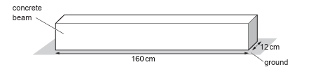

*Fig. 2.1 *

The weight of the concrete beam is 1540 N.

Calculate the pressure on the ground due to the concrete beam.

pressure = .............................................. N / cm2

*Source: June 2023 0972/31 Q2A*

### Q2 — medium — 2 marks

**Q2** [2 marks]

The water in a hydroelectric dam flows to the turbine through a pipe of constant cross-sectional area.

Explain why the kinetic energy of the water in the pipe remains constant as it flows through the pipe.

*Source: June 2022 Paper 4 Q2C*

### Q3 — medium — 5 marks

**Q3** [5 marks]

**Extended Tier Only**

Fig. 2.1 shows water stored in a reservoir behind a hydroelectric dam.

The turbine is 150 m below the level of the water in the reservoir.

Atmospheric pressure is 1.0 × 105  Pa. The density of water is 1000 kg/m3.

(i) Calculate the total pressure in the water at the turbine.

pressure = ......................................................... [3]

(ii) The turbine has a cross-sectional area of 3.5 m2.

Calculate the force exerted on the turbine by the water.

force = .......................................................... [2]

*Source: June 2022 Paper 4 Q2B*

### Q4 — medium — 3 marks

**Q4** [3 marks]

A metal block has a weight of 24 N. The area of this metal block in contact with the ground is 4.0 cm2.

Calculate the pressure of this block on the ground.

pressure = ............................................. N/cm2

*Source: June 2022 Paper 3 Q3B*

### Q5 — medium — 3 marks

**Q5** [3 marks]

The bottle has a weight of 5.4 N and an area of 9.2 cm2 in contact with the table.

Calculate the pressure produced by the bottle on the table.

pressure = .............................................. N/cm2

*Source: Specimen 2023 Paper 3 Q5B*

### Q6 — easy — 6 marks

**Q6** [1 mark]

The weight of the skier shown in Fig.1 is 750 N. For each ski, the area in contact with the snow is 0.2 m2.

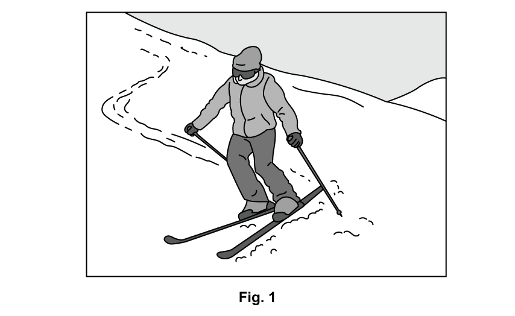

Calculate the total area of the skis which is in contact with the snow.

**Q6** [3 marks]

**Extract:**

The weight of the skier shown in Fig.1 is 750 N. For each ski, the area in contact with the snow is 0.2 m^2.
Area, A = 0.2 × 2 = 0.4 m^2

Calculate the total pressure exerted by the skier on the snow.

**Q6** [1 mark]

**Extract:**

The weight of the skier shown in Fig.1 is 750 N. For each ski, the area in contact with the snow is 0.2 m^2.

The skier has been told that using narrower skis will make her go faster.

She switches to skis which each have a surface area of 0.15 m2.

State how this will affect the pressure which the skier exerts on the snow.

**Q6** [1 mark]

**Extract:**

The skier has been told that using narrower skis will make her go faster. She switches to skis which each have a surface area of 0.15 m^2. The effect of using skis with smaller surface area: Increases the pressure; Pressure = force ÷ area OR pressure and area are inversely proportional;

Explain your answer to part (c).

### Q7 — easy — 9 marks

**Q7** [2 marks]

A student is studying elephants. Fig. 2.1 shows an elephant.

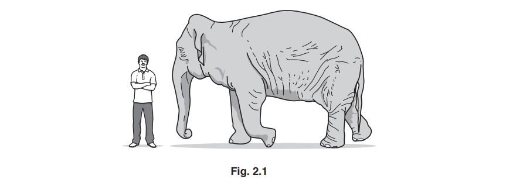

The student measures the elephant and records the values, as shown in the table.

Complete the table by adding a suitable unit for each measurement. Choose the units from those shown in the box.

| m2 | kg | cm | mm2 | g | m | cm2 | mg | mm |
|---|---|---|---|---|---|---|---|---|

| **measurements** | **value** | **unit** |
|---|---|---|
| mass of elephant | 4000 |   |
| height of elephant | 3.0 |   |
| surface area of elephant foot | 0.125 |   |

*Source: 2018 (Series 2) 0625/32 Q2A*

**Q7** [7 marks]

**Extract:**

| measurements | value | unit |
| mass of elephant | 4000 | kg |
| height of elephant | 3.0 | m |
| surface area of elephant foot | 0.125 | m^2^ |

Using information from the table in **(a)**:

(i) Calculate the weight of the elephant.

weight = ..................................................... N [3]

(ii) Calculate the pressure the elephant exerts on the ground when it is standing on four feet. Include a unit.

pressure = ......................................................... [4]

*Source: 2018 (Series 2) 0625/32 Q2B*

### Q8 — easy — 8 marks

**Q8** [2 marks]

Complete the sentence defining pressure in solids.

Pressure is defined as the ________ per unit ________.

**Q8** [2 marks]

**Extract:**

Pressure is defined as the force per unit area.

Complete the word equation defining pressure in solids.

Pressure in a solid is the _______ ÷ _______.

**Q8** [1 mark]

**Extract:**

Pressure is defined as the force per unit area.
Pressure in a solid is the force ÷ area.

The table shows some everyday examples of objects which exert a pressure.

For each one identify whether the object would exert high pressure or low pressure.

|   |   | **High or Low Pressure?** |
|---|---|---|
|   | High heeled shoe |   |
|   | Snowshoes |   |
|   | Kitchen knife |   |
|   | Point of a nail |   |
|   | Skis |   |

**Q8** [3 marks]

A student of weight 550 N is wearing shoes so that his two feet have a total area of 0.020 m2.

Calculate the pressure exerted by the student on the ground when standing on both feet.

### Q9 — easy — 6 marks

**Q9** [1 mark]

The weight of a car is 20 000 N. For each tyre, the area in contact with the road is 0.1 m2.

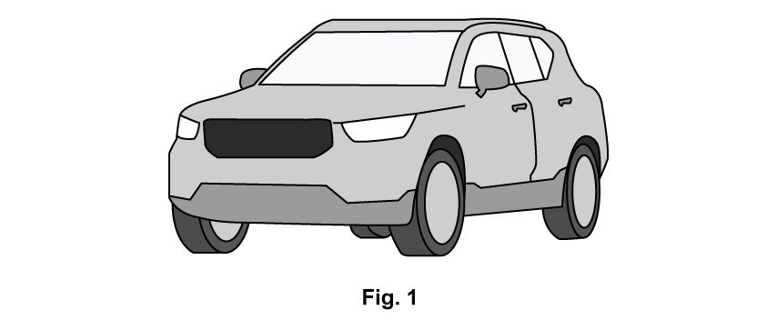

For the car shown in **Fig. 1**, calculate the total area of the car tyres which are in contact with the road surface.

**Q9** [3 marks]

**Extract:**

The weight of a car is 20 000 N. For each tyre, the area in contact with the road is 0.1 m^2. Area = 0.1 × 4 = 0.4 m^2.

Calculate the total pressure exerted by the car on the road.

**Q9** [1 mark]

**Extract:**

Use the equation for pressure:

- P = F / A

Substitute the values from the question:

- P = 20 000 / 0.4 = 50 000

Round the answer to two sig figs and include the unit:

- P = 50 000 Pa / 50 kPa

The family who own the car are going on holiday. They add a roof-rack filled with heavy camping equipment.

State how this will affect the pressure which the car exerts on the road.

**Q9** [1 mark]

**Extract:**

The effect of adding weight to the car:

- Increases the pressure;

Explain your answer to part (c).

### Q10 — easy — 11 marks

**Q10** [2 marks]

Describe how the pressure beneath the surface of a liquid changes

(i) With depth.

[1]

(ii) With density of the liquid.

[1]

**Q10** [2 marks]

**Extended tier only**

Complete the word equation defining pressure in liquids.

Pressure in a liquid is the _________ of the liquid × gravitational field strength × change in _________.

**Q10** [4 marks]

**Extract:**

(From part a)
(i) With depth:
- As depth increases, pressure increases / they are directly proportional.
(ii) With density:
- As density increases, pressure increases / they are directly proportional.

(From part b)
Pressure in a liquid is the density of the liquid × gravitational field strength × change in depth.

**Fig. 1** shows two pairs of objects in a column of liquid.

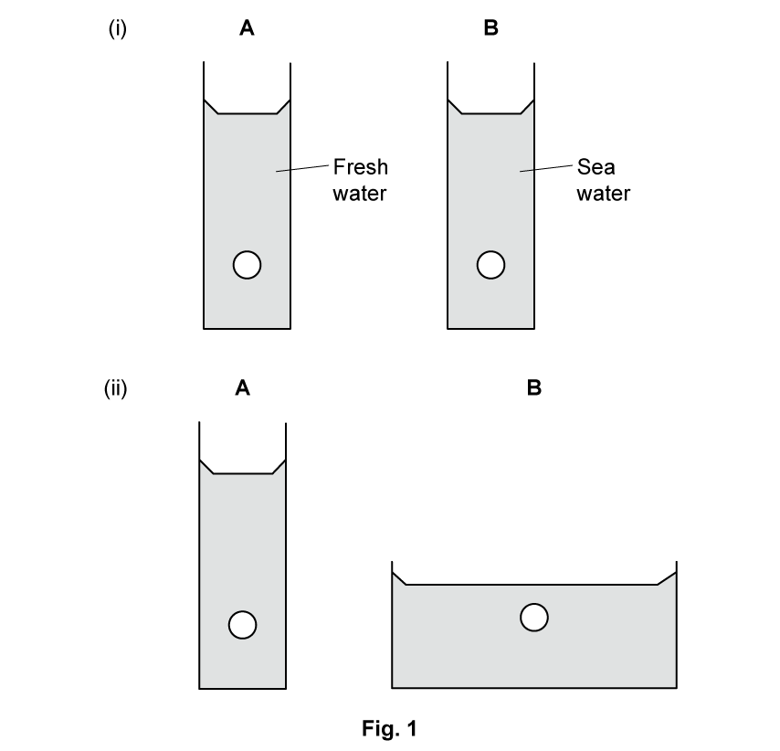

For each pair identify the object which experiences the **highest **pressure and explain your reason.

**Q10** [3 marks]

**Extract:**

Pressure in a liquid is the density of the liquid × gravitational field strength × change in depth.

**Extended tier only**

A swimmer dives to the bottom of a swimming pool which is 2 m deep. Calculate the pressure on the swimmer. The density of the water in the pool is 1000 kg/m3.

### Q11 — medium — 7 marks

**Q11** [4 marks]

**Extended tier only**

On a particular day, the atmospheric pressure is 1.0 × 105 Pa. A bubble of gas forms at a point 5.0 m below the surface of a lake. The density of water is 1000 kg/m3.

Determine

(i) the total pressure at a depth of 5.0 m in the water,

pressure = ...........................................................[3]

(ii) the pressure of the gas in the bubble.

pressure = ...........................................................[1]

*Source: 2018 0625/43 Q3A*

**Q11** [3 marks]

**Extract:**

On a particular day, the atmospheric pressure is 1.0 × 105 Pa. A bubble of gas forms at a point 5.0 m below the surface of a lake. The density of water is 1000 kg/m3.

(i) the total pressure at a depth of 5.0 m in the water,

(ii) the pressure of the gas in the bubble.

**Extended tier only**

As the bubble rises to the surface, the mass of gas in the bubble stays constant. The temperature of the water in the lake is the same throughout.

Explain why the bubble rises to the surface and why its volume increases as it rises.

*Source: 2018 0625/43 Q3B*

### Q12 — medium — 10 marks

**Q12** [5 marks]

Fig.5.1 shows a glass bottle containing air. The bottle is sealed with a cap.

The air in the bottle becomes warmer.

(i) State what happens to the pressure of the air in the bottle.

[1]

(ii) Explain why the pressure of the air in the bottle changes. Use your ideas about gas molecules.

[4]

*Source: February/March 2018 0625/32 Q5A*

**Q12** [3 marks]

**Extract:**

Fig.5.1 shows a glass bottle containing air. The bottle is sealed with a cap.

The air in the bottle becomes warmer.

The bottle has a weight of 5.4 N and an area of 9.2 cm2 in contact with the table.

Calculate the pressure produced by the bottle on the table. Give the unit.

pressure = .........................................................

*Source: February/March 2018 0625/32 Q5B*

**Q12** [2 marks]

Fig. 5.2 shows another bottle. The bottle is on a table. Part of the base of this bottle is not in contact with the table.

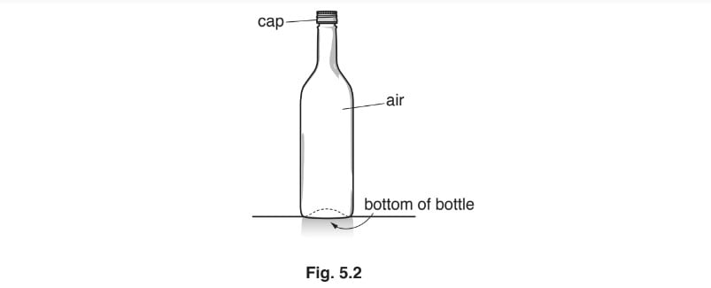

(i) The base of the bottle is circular. The radius of the outer circle is 4.0 cm as shown in Fig. 5.3. Calculate the area of this circle.

area = .................................................. cm2 [1]

(ii) The bottle shown in Fig. 5.2 has the same mass as the bottle shown in Fig. 5.1.

Explain why the bottle shown in Fig. 5.2 exerts more pressure on the table than the bottle shown in Fig. 5.1.

[1]

*Source: February/March 2018 0625/32 Q5C*

### Q13 — hard — 7 marks

**Q13** [3 marks]

Fig. 4.1 shows liquid in a cylinder.

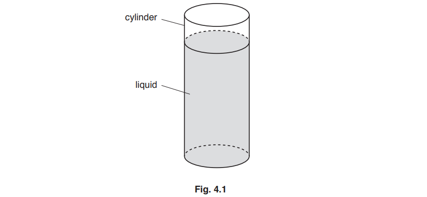

The depth of the liquid is 10 cm and the radius of the cylinder is 3.0 cm. The weight of the liquid in the cylinder is 2.5 N.

Calculate the density of the liquid. You can assume that acceleration of free fall is 10 m/s2.

density = ...........................................................

*Source: 2018 0625/41 Q4A*

**Q13** [4 marks]

**Extended tier only**

Fig. 4.2 shows a device called a manometer that measures the pressure of a gas supply.

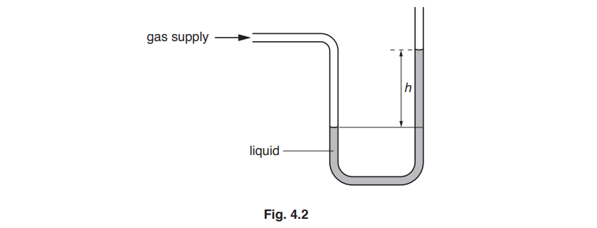

(i) The difference *h* between the two liquid levels is 2.0 cm. The density of the liquid is 800 kg/m3.

Calculate the difference between the pressure of the gas and atmospheric pressure.

pressure difference = ...........................................................[2]

(ii) A similar device with a tube of smaller cross-sectional area is connected to a gas supply at the same pressure.

State and explain any effect on the value of *h*.

[2]

*Source: 2018 (Series 1) 0625/41 Q4B*

### Q14 — hard — 11 marks

**Q14** [1 mark]

A cylindrical container has a base with diameter of 0.15 m and is filled with water to a depth of 0.35 m as shown in Fig. 1.1.

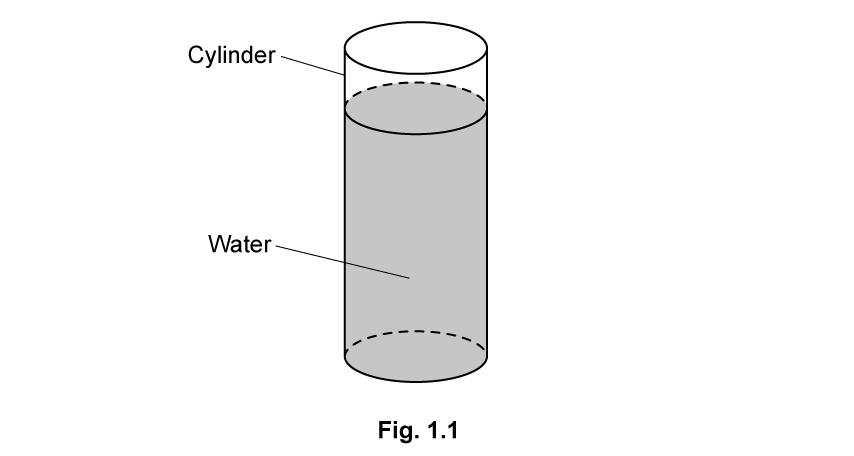

The mass of the water is 6.2 kg.

Calculate the weight of the water in the container.

**Q14** [3 marks]

**Extract:**

A cylindrical container has a base with diameter of 0.15 m and is filled with water to a depth of 0.35 m as shown in Fig. 1.1.

The mass of the water is 6.2 kg.

weight = 61 N

Calculate the pressure due to the liquid on the base of the container.

**Q14** [2 marks]

**Extract:**

To calculate the pressure due to the liquid on the base of the container:

Calculate the area of the base:

- Area, A = π r^2 = (π d^2)/4
- A = (π × 0.15^2)/4 = 0.018 m^2

Use the pressure equation and substitute in known values: 

- P = F/A
- P = 61/0.018
- P = 3389

Write the answer to two sig figs and include the unit:

- P = 3400 Pa / 3.4 kPa

The water-filled cylinder is placed on a laboratory bench.

Suggest reasons why the total pressure on the bench is higher than the value calculated in part (b).

**Q14** [5 marks]

**Extended tier only**

A bead of hollow glass is dropped into the water and comes to rest floating 12 cm above the base of the cylinder as shown in Fig. 1.2.

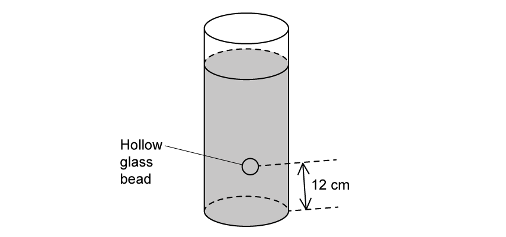

**Fig. 1.2**

Calculate the total pressure on the bead.

Atmospheric pressure at sea level = 1.01 × 105 Pa

Density of water = 1000 kg/m3

### Q15 — medium — 8 marks

**Q15** [4 marks]

Fig 2.1 shows liquid in a cylinder.

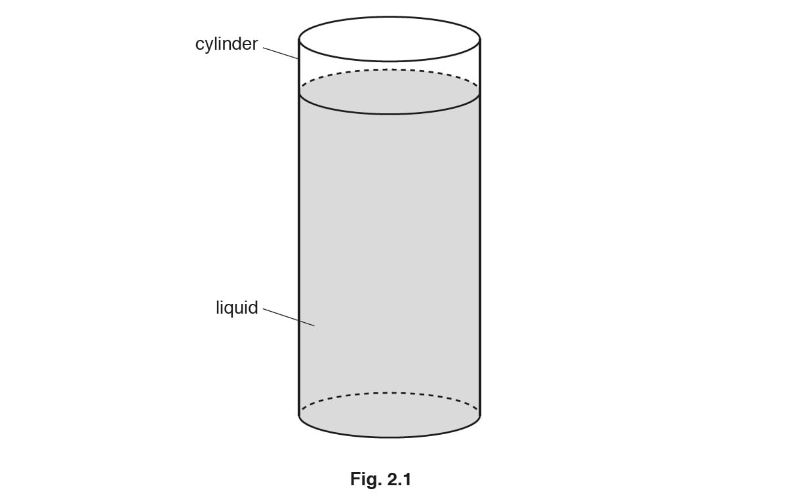

Table 2.1 gives some data about the cylinder and the liquid.

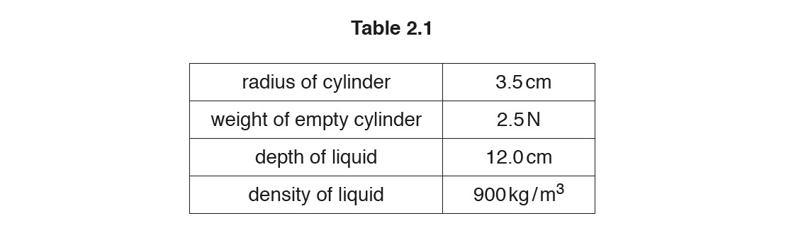

The cylinder containing liquid is placed on a digital balance that displays the mass in kg.

Calculate the reading shown on the balance.

reading ......................................................kg

*Source: Oct/Nov2018  (Series 2) 0625/42 Q2A*

**Q15** [4 marks]

**Extended tier only**

Fig. 2.2 shows a device called a manometer that measures the pressure of a gas.

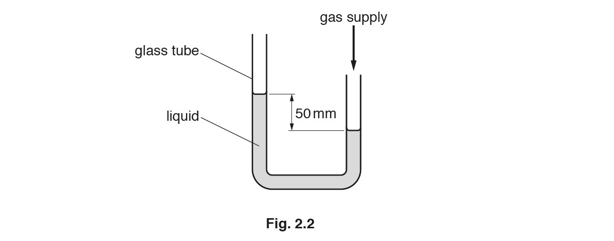

(i) The pressure of the gas is 400 Pa greater than atmospheric pressure.

Calculate the density of the liquid.

density = ...........................................................[2]

(ii) With the gas supply connected, the top of the tube on the left of the device is sealed securely with a rubber stopper. The gas pressure is then increased.

State and explain what happens to the liquid in the manometer.

[2]

*Source: Oct/Nov2018  (Series 2) 0625/42 Q2B*

### Q16 — hard — 8 marks

**Q16** [3 marks]

A scientist fills a container with seawater. The container has dimensions 30 cm × 30 cm × 40 cm. The density of seawater is 1020 kg/m3.

Calculate the mass of the seawater in the container.

mass = .........................................................

*Source: May/June 2020 (Series 3) 0625/43 Q2A*

**Q16** [5 marks]

**Extended tier only**

Fig. 2.1 shows a submarine. The submarine is fully submerged in the sea.

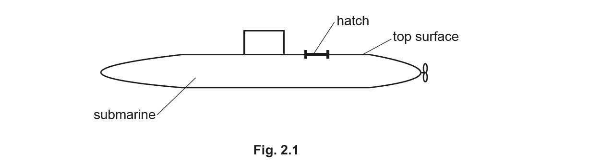

(i) The atmospheric pressure is 100 kPa and the total pressure on the top surface of the submarine is 500 kPa.

Calculate the depth of the top surface of the submarine below the surface of the sea.

depth = ......................................................... [3]

(ii) A hatch (an opening door) on the top surface of the submarine has an area of 0.62 m2.

Calculate the downward force on the hatch due to the total pressure on the top surface of the submarine.

force = ......................................................... [2]

*Source: May/June 2020 (Series 3) 0625/43 Q2B*

### Q17 — medium — 5 marks

**Q17** [3 marks]

Fig. 3.1 shows an archer pulling the string of a bow.

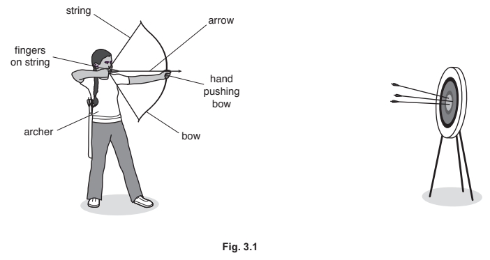

The archer uses a force of 120 N. The force acts on an area of 0.5 cm2 on the archer’s fingers.

Calculate the pressure on the archer’s fingers.

pressure on fingers = ............................................ N/cm2 

*Source: 2020 0625/32 Q3A*

**Q17** [1 mark]

**Extract:**

The archer uses a force of 120 N. The force acts on an area of 0.5 cm^2 on the archer's fingers.

To calculate the pressure on the archer's fingers:

List the known quantities:

- Force, F = 120 N
- Area, A = 0.5 cm^2

Recall the equation linking pressure, force and area:

- pressure = force / area OR P = F / A

Substitute in known values:

- P = 120 / 0.5
- P = 240 N/cm^2

The archer’s other hand is pushing the bow with the same force of 120 N. This force acts on a larger area than the force in **(a)**.

State whether the pressure on this hand is greater than, the same as or less than the pressure on the fingers holding the string.

*Source: 2020 0625/32 Q3B*

**Q17** [1 mark]

**Extract:**

Fig. 3.1 shows an archer pulling the string of a bow.

State the energy store of the bow that energy is transferred into when the archer bends it as shown in Fig. 3.1.

*Source: 2020 0625/32 Q3C*

### Q18 — medium — 4 marks

**Q18** [3 marks]

Fig. 4.1 shows a pin. Fig. 4.2 shows a person pushing the pin into a wall.

The area of the top surface of the pin is 1.8 cm2.

The person applies a force of 50 N.

Calculate the pressure exerted on the top surface of the pin.

pressure = ............................................. N / cm2

*Source: 2019 May/June 0972/31 Q4A*

**Q18** [1 mark]

**Extract:**

The area of the top surface of the pin is 1.8 cm^2.
The person applies a force of 50 N.
pressure = 28 N / cm^2

The area of the top surface of the pin is 500 times larger than the area of the point.

Calculate the value of the pressure exerted by the point on the wall.

pressure = ............................................. N / cm2

*Source: 2019 May/June 0972/31 Q4A*

### Q19 — hard — 7 marks

**Q19** [1 mark]

Fig. 2.1 shows a hollow metal cylinder containing air, floating in the sea.

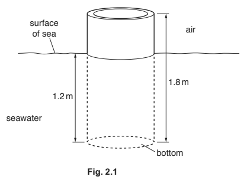

The density of the metal used to make the cylinder is greater than the density of seawater.

Explain why the cylinder floats.

*Source: 2018 0625/42 Q2A*

**Q19** [4 marks]

**Extract:**

Fig. 2.1 shows a hollow metal cylinder containing air, floating in the sea.

The density of the metal used to make the cylinder is greater than the density of seawater.

**Extended tier only**

The cylinder has a length of 1.8 m. It floats with 1.2 m submerged in the sea. The bottom of the cylinder has an area of cross-section of 0.80 m2.

The density of seawater is 1020 kg/m3. Calculate the force exerted on the bottom of the cylinder due to the depth of the seawater.

force = ...........................................................

*Source: 2018 0625/42 Q2B*

**Q19** [2 marks]

**Extract:**

Length of the cylinder = 1.8 m
Submerged length = 1.2 m
Cross-sectional area of the cylinder = 0.80 m^2^
Density of seawater = 1020 kg/m^3^

force = 9600 N (calculated as the force exerted on the bottom of the cylinder due to the depth of the seawater)

There is no acceleration of the block so the forces must be balanced. The weight is the value calculated in part (b)

Deduce the weight of the cylinder. Explain your answer.

*Source: 2018 0625/42 Q2C*

### Q20 — hard — 6 marks

**Q20** [3 marks]

A rectangular container has a base of dimensions 0.12 m × 0.16 m. The container is filled with a liquid. The mass of the liquid in the container is 4.8 kg.

Calculate

(i) the weight of liquid in the container

weight = ...........................................................[1]

(ii) the pressure due to the liquid on the base of the container

pressure = ...........................................................[2]

*Source: 2018 0625/41 Q3A*

**Q20** [1 mark]

**Extract:**

(ii) To calculate the pressure due to the liquid on the base of the container:

List the known quantities:

- Dimensions of the base = 0.12 m × 0.16 m
- Weight = 47 N

Recall the equation linking pressure, force and area and substitute in known values:

- P = F / A
- P = 47 / (0.12 × 0.16)

Calculate P:

- P = 2450 Pa

Explain why the total pressure on the base of the container is greater than the value calculated in (a)(ii).

*Source: 2018 0625/41 Q3B*

**Q20** [2 marks]

**Extract:**

A rectangular container has a base of dimensions 0.12 m × 0.16 m. The container is filled with a liquid. The mass of the liquid in the container is 4.8 kg.

Pressure, P = 2450 Pa

The depth of liquid in the container is 0.32 m.

Gravitational Field Strength, g = 9.81 m/s^2^

**Extended tier only**

The depth of liquid in the container is 0.32 m.

Calculate the density of the liquid.

density = ...........................................................

*Source: 2018 0625/41 Q3C*

