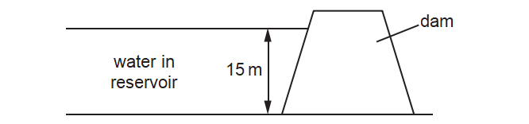
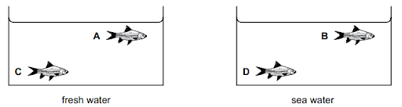
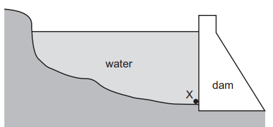
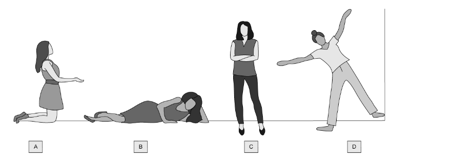
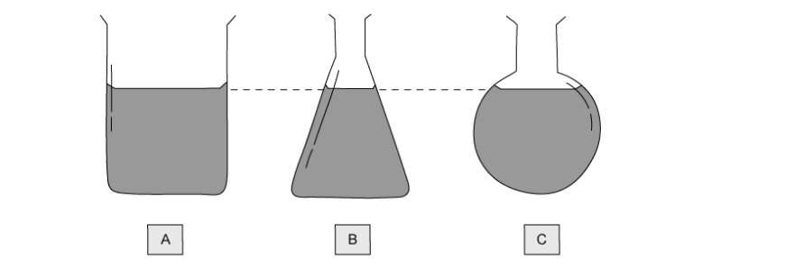
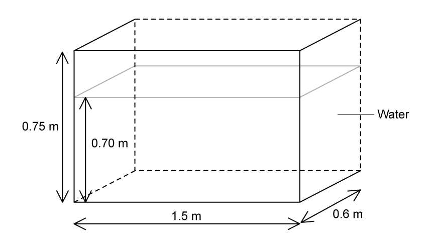
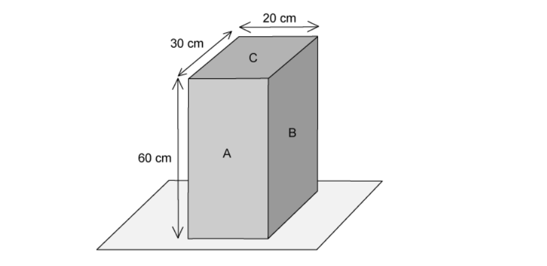
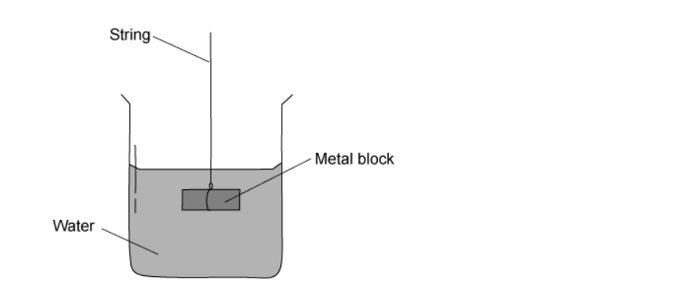
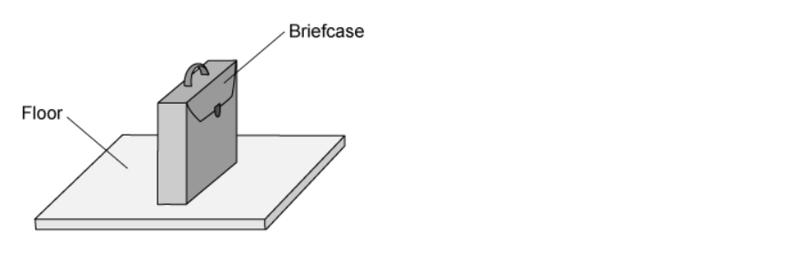
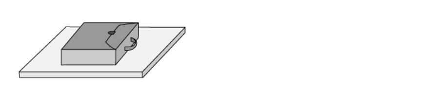

# Exam Questions — Pressure
**1. Motion, Forces & Energy** · Cambridge (CIE) IGCSE physics (0625 & 0972)
> Source: [https://www.savemyexams.com/igcse/physics/cie/23/topic-questions/](https://www.savemyexams.com/igcse/physics/cie/23/topic-questions/) · 23 questions across 1 sets

## Multiple Choice Questions (23 questions)

### Q1 — medium — 1 marks

**Q1** [1 mark]

The diagrams show four solid blocks with their dimensions and masses. Each block rests on the ground.

Which block exerts the greatest pressure on the ground?

### Q2 — medium — 1 marks

**Q2** [1 mark]

** **A woman has a weight of 600 N. She stands on a horizontal floor. The area of her feet in contact with the floor is 0.050 m2.

What is the pressure she exerts on the floor?

*Source: June 2023 0972/11 Q13*

### Q3 — easy — 1 marks

**Q3** [1 mark]

A dam holds water in a reservoir. The height of the water in the reservoir is 15 m.

The density of water is 1000 kg / m3.

What is the pressure due to the water at the bottom of the dam?

*Source: June 2023 0972/21 Q13*

### Q4 — medium — 1 marks

**Q4** [1 mark]

Liquid of mass 92 kg is contained in a rectangular tank.

The area of the base of the tank is 0.23 m2 .

What is the pressure exerted by the liquid on the base of the tank?

*Source: June 2022 Paper 1 Q11*

### Q5 — medium — 1 marks

**Q5** [1 mark]

**Extended Tier Only**

A submarine is a boat that can travel below the surface of the sea.

A submarine is 20 m below the surface of the sea. The pressure due to the sea water at this depth is *P*.

On another day, the submarine is 26 m below the surface of fresh water.

The density of sea water is 1.3 times the density of fresh water.

What is the pressure due to the fresh water at a depth of 26 m?

*Source: Specimen 2023 Paper 2 Q13*

### Q6 — medium — 1 marks

**Q6** [1 mark]

Two identical fish tanks are filled with water to the same level.

One tank contains fresh water. The other tank contains sea water.

Sea water is more dense than fresh water.

Which fish experiences the greatest pressure?

*Source: Specimen 2023 Paper 1 Q12*

### Q7 — medium — 1 marks

**Q7** [1 mark]

A student uses her thumb to push a drawing pin (thumb tack) into a notice board.

The pin goes into the board but does not penetrate her thumb.

Which statement explains this?

*Source: Specimen 2023 Paper 1 Q11*

### Q8 — easy — 1 marks

**Q8** [1 mark]

The diagram shows a deep reservoir formed by a dam.

On what does the pressure at X depend?

*Source: June 2022 Paper 1 Q12*

### Q9 — easy — 1 marks

**Q9** [1 mark]

The diagram shows four measuring identical cylinders containing either distilled water or concentrated sugar solution.

Which measuring cylinder has the least pressure at the base, due to the liquid?

### Q10 — easy — 1 marks

**Q10** [1 mark]

**Extended tier only**

For the tank of water in the diagram below, which value gives the pressure on the base of the tank due to the water?

The density of water = 1000 kg/m3

### Q11 — easy — 1 marks

**Q11** [1 mark]

A woman is in contact with the floor.

In which of these poses does she produce the most pressure on the floor?

Assume she is wearing flat shoes in each pose.

### Q12 — easy — 1 marks

**Q12** [1 mark]

A water-filled tank is resting on a table as shown in Fig. 1

Using the measurements in the diagram, determine the area which should be used to calculate the pressure the tank exerts on the table.

### Q13 — easy — 1 marks

**Q13** [1 mark]

Which is an example of a force acting over a small area to produce a large pressure?

### Q14 — hard — 1 marks

**Q14** [1 mark]

Three beakers of water are placed on a table. The depth of water in each container is the same.

In which container does the water exert the greatest pressure on the base of the container?

### Q15 — medium — 1 marks

**Q15** [1 mark]

**Extended tier only**

For the tank of water in the diagram below, which value gives the pressure on the base of the tank due to the water?

The density of water = 1000 kg/m3

### Q16 — hard — 1 marks

**Q16** [1 mark]

A person walking through snow sinks into it.

The person makes a change so that they do not sink as far next time they go out.

What do they do?

### Q17 — hard — 1 marks

**Q17** [1 mark]

There is a significant risk to submarines which dive to very great depths.

Why is it dangerous to do this?

### Q18 — hard — 1 marks

**Q18** [1 mark]

The table gives four combinations of the force applied to a surface and the area over which it acts.

Which row gives the smallest pressure exerted on the surface?

|   | **Force / N** | **Area / m****2** |
|---|---|---|
| **A** | 40 | 0.5 |
| **B** | 40 | 2.0 |
| **C** | 80 | 0.5 |
| **D** | 80 | 2.0 |

### Q19 — medium — 1 marks

**Q19** [1 mark]

A wooden block rests on a table.

On which surface should the block be laid to produce the largest pressure on the table?

### Q20 — medium — 1 marks

**Q20** [1 mark]

What pressure does the object in the diagram below exert on the ground beneath it?

### Q21 — medium — 1 marks

**Q21** [1 mark]

A small metal block is suspended under the surface of a beaker of water by a string.

The metal block experiences a pressure exerted by the liquid.

What would increase the pressure exerted on the metal block?

### Q22 — hard — 1 marks

**Q22** [1 mark]

The ornament in Fig. 1 is designed to balance in either of the positions shown.

Calculate the difference in the pressure on the ground when the ornament's position is changed.

### Q23 — medium — 1 marks

**Q23** [1 mark]

A briefcase, with flat, rectangular sides rests on the floor as shown in the diagram.

The briefcase is now turned so that it rests with its large, flat side on the floor.

How has the change affected the force on the floor, and the pressure exerted by the briefcase on the floor?

|   | **Force** | **Pressure** |
|---|---|---|
| **A** | unchanged | decreased |
| **B** | unchanged | unchanged |
| **C** | decreased | decreased |
| **D** | decreased | unchanged |
