# Mark Schemes — Kinetic Particle Model of Matter
**2. Thermal Physics** · Cambridge (CIE) IGCSE physics (0625 & 0972)

## Multiple Choice Questions (23 questions)

### Q1
**Final answer:** **The correct answer is C**

- The random, rapid motion of smoke particles is called Brownian motion
- It is caused by collisions between the relatively large smoke particles and the much smaller, fast-moving air molecules
- The air molecules are too small to be seen through the microscope, but their effect is visible because they constantly bombard the smoke particles from all sides
- The collisions are random and uneven, causing the smoke particles to change direction unpredictably

**A** is incorrect because air currents would cause all the smoke particles to move in the same general direction, not in random, rapid motion.

**B** is incorrect because the random motion is caused by collisions with invisible air molecules, not collisions between the smoke particles themselves. The smoke particles are too far apart to collide frequently.

**D** is incorrect because Brownian motion is not caused by electrostatic forces. It is a result of molecular bombardment.

### Q2
**Final answer:** **The correct answer is D**

- Temperature is a measure of the average kinetic energy of the molecules
- When the temperature decreases, the average kinetic energy decreases, so the average speed of the molecules decreases
- Slower molecules hit the walls of the balloon less frequently and with less force
- This means the pressure decreases

**A** is incorrect because the average speed of the molecules is directly related to the temperature. If the temperature decreases, the average speed must also decrease.

**B** is incorrect because the pressure does not stay the same. Slower molecules exert less force on the walls of the balloon, so the pressure decreases.

**C** is incorrect because both the average speed and the pressure decrease when the temperature decreases, not increase.

### Q3
**Final answer:** **The correct answer is D**

- In a solid, the particles are held in a regular lattice by strong attractive forces and can only vibrate about their fixed positions

  - Therefore, statement 1 is **correct**
- Solids have a fixed shape and a fixed volume because the particles are not free to move about their fixed positions

  - Therefore, statement 2 is **incorrect**
- Because the particles in a solid are packed very closely together with almost no space between them, they are difficult to compress

  - Therefore, statement 3 is **correct**

### Q4
**Final answer:** **The correct answer is C**

- Temperature is a measure of the average kinetic energy of the particles within a substance
- When a substance is heated, energy is transferred to its particles, causing them to move (or vibrate) faster
- This increase in particle motion directly corresponds to an increase in their average kinetic energy, which is observed as a rise in temperature

**A** is incorrect as particles become fixed in position during solidification or freezing, which is a change of state usually caused by a drop in temperature.

**B** is incorrect as the mass of individual particles is a fundamental property and does not change with temperature.

**D** is incorrect as particles typically move further apart when a substance expands due to heating, but this is a consequence of increased kinetic energy and intermolecular forces, not what temperature itself measures or what always happens (e.g., if heated at constant volume).

### Q5
**Final answer:** **The correct answer is ****C**** because:**

- The pollen particles are much more massive than the water molecules
- The water molecules are too small to see but they are in constant random motion.
- When invisible water molecules collide with the visible pollen particles, they cause them to move suddenly and randomly
- This gives evidence for the particle model of matter, allowing you to see the effect of particles too small to see directly
- This motion is called Brownian motion and provides evidence for the kinetic particle model of matter, supporting the idea that all matter is made of tiny particles in motion

**A** and **B** are incorrect because you cannot see the water molecules at all, they are too small to observe, even with a microscope.

**D** is incorrect because pollen grains are not molecules, they are much larger particles and are visible under a microscope.

### Q6
**Final answer:** **The correct answer is ****C**** because:**

- The particles in gases are far apart
- The particles in liquids and solids are close together

You might think that the particles in liquids are much further apart than those in solids. The particle separation distances are actually very similar in solids and liquids. The main difference between their properties is the ability of particles in liquids to move past other particles instead of being fixed in place.

### Q7
**Final answer:** **The correct answer is B because:**

- Consider change 1:

  - Particles can only move throughout a substance in liquids and gases
  - Particles are closer together in a liquid
  - The change must be from gas to liquid, which is **condensation**
  - Eliminate options **C** and **D**
- Consider change 2:

  - Only solids feature particles fixed in place and vibrating
  - The particles were previously able to travel in the substance
  - The transition must be from liquid to solid, which is **solidification**
  - Eliminate options **A**

Transitions from solid to gas or gas to solid are not examinable in this course. If there is a transition to a solid, it is always from a liquid for the purposes of this exam.

### Q8
**Final answer:** **The correct answer is B because:**

- Pressure is caused by a force over a surface
- The particles all exert a force on the container wall

  - Force is the rate of change of momentum
- The change in momentum of the particles produces a force on the wall which produces a pressure

**A **is incorrect as the particles’ energies do not change at a given temperature

**C **is incorrect as the particles are not doing work so are not producing power

**D **is incorrect as the particles have the same speed (but in different directions) before and after the collisions

### Q9
**Final answer:** **The correct answer is D because:**

- When a gas is cooled at a constant volume, the pressure of the gas decreases
- The air stays as a gas, so the average distance between the air particles does **not change**

  - This eliminates options **A** and **B**
- When the temperature of a gas decreases, the gas particles move **slower**
- Therefore, the average speed of the air particles decreases

  - This eliminates option **C**

### Q10
**Final answer:** **The correct answer is D because:**

- Heating a gas increases the kinetic energy of its particles
- A greater kinetic energy corresponds to an increase in speed
- Therefore, the particles of the gas move faster

**A **is incorrect as the particles themselves do not change shape

**B **is incorrect as the volume of the gas is unchanged so the average separation of particles is unaffected

**C **is incorrect as the particles hit the walls with more force, as they collide with a greater speed

### Q11
**Final answer:** **The correct answer is A because:**

- The defining properties of a liquid are

  - they are **not compressible**
  - they can **flow**
  - they take the shape of a container but do **not always** completely fill it
- Therefore, only statements 1 and 2 are correct

Remember, completely filling a container is one of the defining properties of a gas.

### Q12
**Final answer:** **The correct answer is A because:**

- Brownian motion is the random motion of small, visible particles in a gas or liquid
- This is caused by invisible air particles colliding with visible smoke particles

**B **is incorrect as Brownian motion can be observed in the absence of convection currents

**C **is incorrect as Brownian motion is a result of collisions with air particles, not falling

**D **is incorrect as smoke particles far from container walls still undergo Brownian motion

### Q13
**Final answer:** **The correct answer is ****C**** because:**

- This random motion of smoke particles is called **Brownian motion**.
- Smoke particles are constantly being buffeted around by tiny air particles, which are too small to see with a microscope.
- This is what causes their **random** motion.

**A **is incorrect as the smoke particles are not attracted to each other. If they had an electric charge, it is likely they would all have the same charge, and would repel anyway. This is not happening.

**B **is incorrect as the random vibration due to thermal energy is taking place in the atoms which make up the smoke particles, this would not be visible under a microscope.

**D **is incorrect as if the microscope were vibrating like this, *all* the smoke particles would appear to move in the same direction at the same time. They do not do this.

### Q14
**Final answer:** **The correct answer is ****D**** because:**

- The molecules in a solid are arranged tightly in rows together and can vibrate in random directions
- This is shown by the molecules in state 2

### Q15
**The correct answer is ****B**** **because the particles in a solid vibrate around fixed positions whereas the particles in a gas move rapidly in straight lines and are very widely spaced.

**A **is incorrect as the molecules are too far apart in state Y for it to be a liquid.

**C **is incorrect as the molecules in state X are in fixed positions, the molecules of a liquid are free to move past each other.

**D **is incorrect as state X has closely bound particles, in a gas the particles are widely spaced.

### Q16
**Final answer:** **The correct answer is ****D**** because:**

- The same number of molecules of gas are present before and after the expansion. So the mass of the gas is the same.
- $Density=\frac{mass}{volume}$ so increasing the volume for a constant mass, **reduces the density**.
- If the volume of the gas increases, then the same number of air molecules have to collide with a larger surface area of the wall.
- As the volume of the container increases, the area over which this force is exerted also increases.
- $Pressure=\frac{force}{area}$
- This means that the pressure inside the syringe decreases.

The other answers have one or both of the statements incorrect, for the reasons outlined above.

### Q17
**Final answer:** **The correct answer is ****D**** because:**

- The particles in a liquid are in contact with each other, while those in a gas are considerably further apart.
- The average kinetic energy of each molecule is related to the temperature of the substance. This means that, if a substance has a higher temperature, its molecules will, on average, have a higher kinetic energy.
- As Kinetic energy = $\frac{1}{2}mv^{2}$, the speed of the molecules will also be greater.
- Since both the liquid water and the gaseous water are *both* at a temperature of 100 oC, their molecules both have *the same* kinetic energy, and are travelling at *the same* speed.

Each of the other answers has made at least one error. Liquid particles are *always* closer together than gas particles.

Most students incorrectly think that gas particles have a higher kinetic energy than liquid particles. This is ***only*** true* *if the gas is also at a higher temperature than the liquid (which is usually, but not always, the case)

### Q18
**Final answer:** **The correct answer is ****C**** because:**

- As the temperature of a gas, in a container with a constant volume, is increased, its pressure will increase.
- This is because higher temperature gas molecules move faster, hit the walls of the container harder, and exert more force on them, and pressure = force / area.
- Graph C shows a linear increase of pressure with temperature.

**A **is incorrect as this graph shows pressure reducing at a linear rate with temperature. This, also, is not true.

**B **is incorrect as this graph shows that pressure remains constant. We know this not to be true.

**D **is incorrect as this graph shows an inverse relationship between pressure and temperature. This would be the correct answer if the question were about the relationship between pressure and **volume**.

### Q19
**Final answer:** **The correct answer is ****D**** because:**

- Temperature is proportional to the average kinetic energy (KE) per molecule. If the **temperature increases**, then so does the average KE per molecule.

- If the particles have **more KE**, they move with a **greater velocity**. This causes them to hit the walls of the tyre at a greater speed, and to **exert** more **force** when they bounce off.
- This increased force **increases** the **pressure** in the tyre.

**A **is incorrect as the tyre has not been pumped up, so no more air has been added. Therefore the mass cannot have increased.

**B **is incorrect as the tyre has a (very nearly) fixed volume therefore the area with which air molecules can collide could not have changed.

**C **is incorrect as if anything, the molecules will collide with each other ***more*** frequently, but it is collisions with the wall of the *tyre* that increase the pressure.

### Q20
**Final answer:** **The correct answer is ****C**** because**

- The average kinetic energy of the molecules in a substance is proportional to the temperature of the substance. Since the temperature inside the syringe is constant, the average KE per molecule also remains constant.
- Since KE = $\frac{1}{2}mv^{2}$, the speed of the air molecules stays the same.
- Pressure against the inside walls of the container is caused by the air molecules colliding with the walls. They move at the same speed, and so the force of each collision remains the same.
- If the volume of the gas increases, then the same number of air molecules have to collide with a larger surface area of the wall.
- As the volume of the container increases, the area over which this force is exerted also increases.
- $Pressure=\frac{force}{area}$
- This means that the pressure inside the syringe decreases.

The other answers have one or both of the statements incorrect, for the reasons outlined above.

### Q21
**Final answer:** **The correct answer is ****A**** because:**

- The average kinetic energy of the molecules in a substance is proportional to the temperature of the substance. So as the temperature in the bottle rises, the average kinetic energy per molecule will also increase.
- Since  KE = $\frac{1}{2}mv^{2}$, increasing the kinetic energy also increases the speed of the air molecules.
- Pressure against the inside walls of the container is caused by the air molecules colliding with the walls.
- The faster the molecules are moving, the greater the force they apply when they collide with the container.
- As the volume of the container remains constant, the area over which this force is exerted remains constant.
- Remember $pressure=\frac{force}{area}$
- Since the air molecules are moving faster, they exert more pressure on the walls of the container.

The other answers have one or both of the statements incorrect, for the reasons outlined above.

### Q22
**Final answer:** **The correct answer is ****B**** because:**

- p1V1 = p2V2 (this is Boyle’s Law).
- So 1.21 x 105 x 50 = 1.00 x 105 x V2 

Therefore V2 = $\frac{1.21\times10^{5}\times50}{1.00\times10^{5}}$ =  60.5 cm3

The other answers all make errors with the calculation in some form or another, and are all incorrect.

### Q23
**Final answer:** **The correct answer is ****C**** because:**

- This random motion of pollen grains is called **Brownian** **motion**.
- Pollen grains are constantly being buffeted around by tiny water molecules, which are too small to see with a microscope.
- This is what causes their **random** motion.

**A **is incorrect as water molecules are too small to be seen with a microscope.

**B **is incorrect as water molecules are too small to be seen with a microscope. They *are* thermally moving, but this motion cannot be seen.

**D **is incorrect as the molecules that make up the pollen grains are vibrating due to their thermal energy, but this does not make the *entire* pollen grain vibrate. The thermal vibrations are random, and cancel out, on average.

## Theory Questions (22 questions)

### Q1
> **[mark-scheme]**
> - Particles gain kinetic energy **OR** particles vibrate more / faster **[1 mark]**
> - Internal energy increases (because the kinetic energy of the particles increases) **[1 mark]**
> 
> Accept "molecules" or "atoms" for "particles"
> 
> Do not accept "particles move faster" without specifying vibration (in a solid, particles vibrate — they do not move about freely)

> **[exam-tip]**
> In a solid, the particles vibrate about fixed positions — they do not move freely like gas particles. When the temperature increases, the particles vibrate more vigorously, which means their kinetic energy increases. Internal energy is the total kinetic and potential energy of all the particles, so the internal energy increases. Avoid circular reasoning such as "internal energy increases because it gets hotter" — you must explain the mechanism in terms of particle motion.

### Q2
Particles of gas can exert a pressure because:

Any **three** from:

- The gas particles are moving about randomly; **[1 mark]**
- The particles are involved in collisions;** [1 mark]**
- The particles collide with the container walls; **[1 mark]**
- The collisions cause forces (on the container); **[1 mark]**
- Pressure is caused by forces acting over an area (e.g. the container walls); **[1 mark].**

**[Total: 3 marks]**

An example answer could be:

*The gas particles are moving about randomly and colliding with the walls of the container. Each collision exerts a small force on the wall. Several of these forces acting over an area causes pressure.*

> **[exam-tip]**
> For this answer, you need to write a **description**. It is important that you link the movement of the particles to pressure. Pressure is caused by forces acting over an area, so describe how the particles can exert forces on the container walls.
> 
> An explanation needs to link ideas together in a logical sequence; it should not just be a list of statements. Read through your answer to make sure it has a starting idea (the particles moving) and steps that lead to a conclusion (there is pressure on the walls of the box).
When the number of gas particles in the box increases:

- The pressure increases;** [1 mark]**

This is because:

- There are more (frequent) collisions between the particles and the walls of the container;** ****[1 mark]**

**[Total: 2 marks]**

An example full answer could be:

*When more particles are added to the box, the pressure of the gas will increase. There will be more collisions between the particles and the walls of the container every second. This produces more force acting over the same area, which leads to more pressure.*

> **[exam-tip]**
> To answer this question, you need to do two things: **state** a fact and then **explain** it. Think about your explanation of what causes pressure and think about the effect of adding more moving particles into the container.
> 
> The question states that the temperature does not increase. This is stated because a change in temperature would also change the pressure. At higher temperatures, the particles will travel faster and collide with the container at greater speeds. This increases the size of the force and so increases the pressure. The question also mentions that the particles are in a ‘metal box’. This means the volume of the box remains the same. This is stated because a change in volume would also change the pressure.

### Q3
(i) When the temperature of air in the bottle increases:

- Pressure increases; **[1 mark]**

(ii) The pressure in the bottle changes because:

Any **four** from:

- Particles have more kinetic energy (because temperature is higher); **[1 mark]**
- This means they collide more frequently; **[1 mark]**
- These collisions are harder; **[1 mark]**
- They collide with the walls of the container; **[1 mark]**
- These collisions produce a greater force on the walls; **[1 mark]**

**[Total: 5 marks]**

> *An example answer for part (ii) might be:*

- *The temperature increase causes particles to have greater kinetic energy. Particles moving at higher speeds collide more frequently with the walls of the container. As a result, these collisions produce a greater force on the container walls.*

### Q4
To explain how helium produces a force on the balloon walls:

- Atoms collide with / rebound from the wall; **[1 mark]**
- (This causes) atoms to undergo a change in momentum; **[1 mark]**
- Force on the wall is the rate of change of momentum (of the atoms); **[1 mark]**

**[Total: 3 marks]**
(i) Pressure in the balloon decreases with height because:

- Volume of the gas increases
- Fewer atoms per unit volume **OR** gas density decreases; **[1 mark]**
- Rate of collisions decreases **OR** fewer collisions per unit area;** [1 mark]**

(ii) To calculate pressure at 12 m3:

List the known quantities:

- Initial volume, *V**1* = 9.6 cm3
- Final volume, *V**2* = 12 cm3
- Initial pressure, *P**1* = 1.0 $\times$ 105 Pa

Recall the equation for Boyle’s law:

- $P_{1}V_{1}=P_{2}V_{2}$ **[1 mark]**

Rearrange for final pressure:

- $P_{2}=\frac{P_{1}V_{1}}{V_{2}}$

Substitute the known quantities:

- $P_{2}=\frac{(1.0\times10^{5})\times9.6}{12}$
- $P_{2}=8.0\times10^{4}$ Pa **[1 mark]**

**[Total: 4 marks]**

### Q5
When wax is in a solid state, the molecules are:

Any **three **from:

- Fixed in place / position;** [1 mark]**
- In a regular spacing / pattern / arrangement; **[1 mark]**
- Vibrating;** [1 mark]**
- Close together; **[1 mark]**

When wax is in a gaseous state, the molecules are:

Any **three **from:

- Moving randomly; **[1 mark]**
- Moving at high speed; **[1 mark]**
- Colliding (with each other / container walls);** [1 mark]**
- Randomly arranged **OR** not arranged in a regular pattern; **[1 mark]**
- (Relatively) far apart;** [1 mark]**

**[****Total: 6 marks]**

### Q6
To explain how the force due to air pressure is produced:

Describe the motion of the air molecules:

- Air molecules;

  - Are in (constant, random) motion; **[1 mark]**
  - Collide with the walls of the container;** [1 mark]**
  - Have change in momentum **OR**** **exert impulse (on the walls); **[1 mark]**

**[Total: 3 marks]**
(i) To calculate pressure at a certain depth in a liquid:

List the known quantities:

- Density of the liquid, *ρ* = 1500 kg / m3
- Depth of the liquid, Δ*h* = 0.028 m
- Gravitational field strength, *g* = 9.8 N/ kg

Recall the equation for pressure in a liquid:

- $Δp=ρgΔh$** [1 mark]**

Substitute the values:

- $Δp=1500\times9.8\times0.028$

Calculate:

- $\Deltap=411.6$

Write the answer to two significant figures and include the units:

- Pressure = 410 Pa **[1 mark]**

(ii) To calculate the force caused by the pressure in a liquid:

List the known quantities:

- Length of the sides of the container, 0.04 m (from the diagram)
- Pressure, *p* = 410 Pa (from part (i))

Calculate area:

- Area = the square of the sides
- $A=0.04\times0.04=1.6\times10^{-3}m^{2}$

Recall the equation relating force and pressure:

- $p=\frac{F}{A}$

Rearrange to make force the subject by multiplying both sides by *A*:

- $F=pA$**[1 mark]**

Substitute the values and calculate:

- $F = 410 \times ( 1.6 \times 10^{- 3} ) = 0.656$

Write the answer to two significant figures and include the units:

- Force, *F* = 0.66 N **[1 mark]**

**[Total: 4 marks]**
(i) To calculate work done:

List the known quantities:

- Force, *F* = 0.66 N (from part (b))
- Distance, *d* = 0.034

Recall the equation for work done:

- $W=F\timesd$ **[1 mark]**

Substitute the values and calculate:

- $W=0.66\times0.034$
- $W=0.02244$

Write the answer to two significant figures and include the units:

- W = 0.022 J **[1 mark]**

**    **

(ii) A reason why this is not efficient:

Look for a cause of wasted energy:

- This method <u>lifts the liquid</u> as well as the cube **OR**** **there will be friction between the liquid and the container / pipe; **[1 mark]**

**[Total: 3 marks]**

### Q7
Complete each statement by using words from the box:

- The change from solid to liquid is called **melting**; **[1 mark]**
- The change from liquid to gas is called** evaporation / boiling**; **[1 mark]**
- The change from liquid to solid is called** freezing / solidifying;** **[1 mark]**
- The change from gas to liquid is called **condensing**; **[1 mark]**

**[Total: 4 marks]**

> *You need to learn and remember the changes in state with increasing and decreasing energy:*

- *A solid will **melt** into a liquid as energy is transferred **to** the substance.*

  - *This change of state happens at the **melting point**.*

- *A liquid will **evaporate** into a gas as energy is transferred **to** the substance.*

  - *This change of state happens at the **boiling point**.*

- *A gas will **condense** into a liquid as energy is transferred **away** from the substance.*

  - *This change of state happens at the **boiling point**. *

- *A liquid will **freeze** into a solid as energy is transferred **away** from the substance.*

  - *This change of state happens at the **melting point**. *

> *Melting** and **freezing** happen at the **melting point**. **Evaporation** and **condensing** happen at the **boiling point**. *

> *Energy is transferred **to** a substance when it is **heated**, and energy is transferred **away** from a substance when it is **cooled**.*
State and explain the effect on the pressure of the gas as it heated at a constant volume:

- Statement:

  - The pressure increases; **[1 mark]**

- Explanation:

  - As there are more frequent collisions of gas particles with the walls of the container; **[1 mark]**

**OR**

- As the particles collide with the walls of the container at greater speeds / with greater force; **[1 mark]**

- Because the gas particles have more kinetic energy; **[1 mark]**

**[Total: 3 marks]**

> *As the gas is heated, energy is transferred to the system. The gas particles gain **kinetic energy** and move with **greater speeds**. If the volume of the container was not fixed, the gas would expand. But since the volume is fixed, the increase in speed of the gas particles causes **more frequent** and **more forceful** collisions with the walls of the container. Both of these effects result in **increased pressure**.*

### Q8
The pressure inside the bottle:

- Decreases; **[1 mark]**
- Because the (carbon dioxide) gas molecules escape / take up a larger volume; **[1 mark]**

**[Total: 2 marks]**

> *The question has not stated any heating of the bottle at all, so it can be assumed that the temperature of the gas stays constant.*
(i) The mistake in the student's graph is:

- The axes are labelled the wrong way around **OR ***V* should be on the vertical and *T* should be on the horizontal axis; **[1 mark]**

**Any one from:**

- A temperature in kelvin cannot be negative **OR** the graph should start from 0 **[1 mark]**
- The temperature *T* should be in °C **[1 mark]**

(ii) A new graph to show the correct relationship between temperature and volume is:

**Method 1: Changing the temperature into °C**

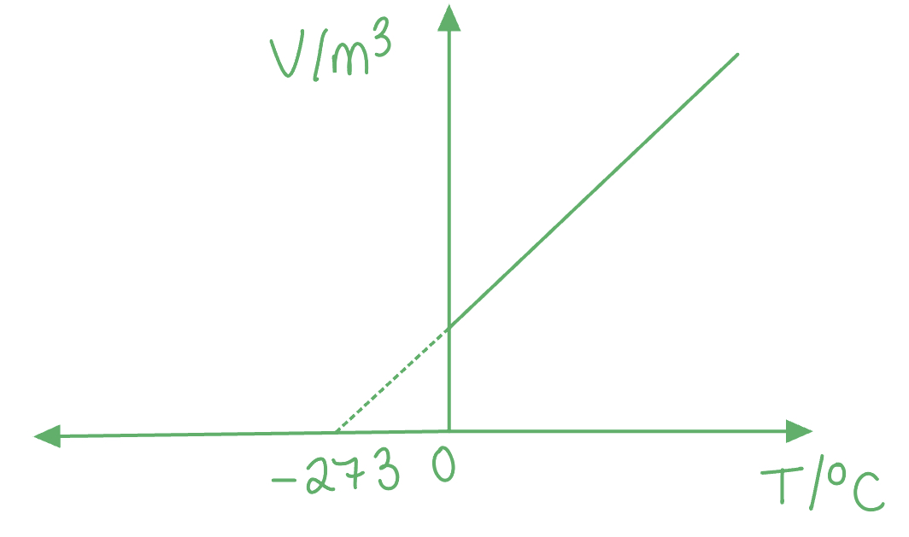

- Vertical axis labelled *V */ m3 and horizontal axis labelled *T * **[1 mark]**
- *T* to be in °C **[1 mark]**

**OR**

**Method 2**: **Keeping the temperature in K and changing the graph**

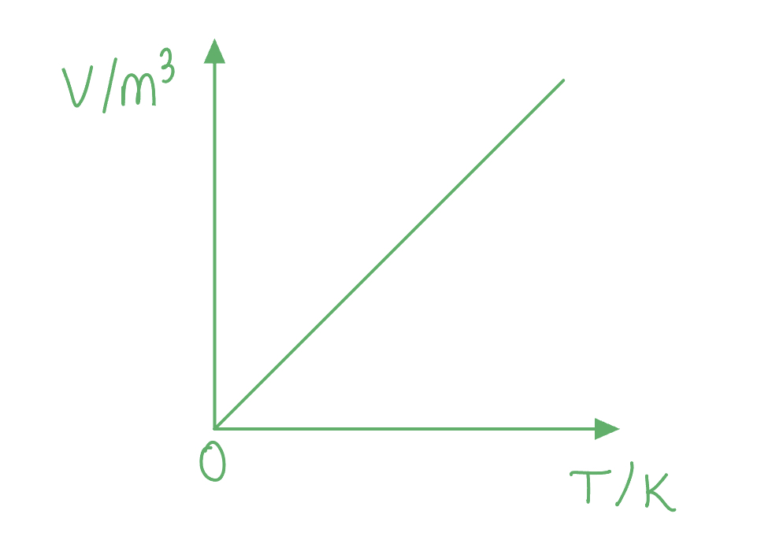

- Vertical axis labelled *V */ m3 and horizontal axis labelled *T * **[1 mark]**
- *T* to be in K **AND** straight line graph going through 0 (no negative values for the temperature); **[1 mark]**

**[Total: 4 marks]**

> *Method 1 is slightly easier than Method 2, but either is still correct! The important thing is that the temperature is Kelvin **cannot** be less than 0, as 0 K is the lowest temperature that an object can be. Therefore, the –273, the temperature at the lowest volume, is in **degrees**.*

> *Whenever you are sketching a graph, always make sure your labels are clear and you are using a ruler and a sharp pencil. The neater the graph, the less likely you are to lose marks for sloppiness, even if the physics is correct!*
State from which mug the tea evaporates quicker. Explain why, in terms of the behaviour of molecules and the process of evaporation

- The tea from mug (B) evaporates quicker;** [1 mark]**
- When evaporating, the molecules gain more kinetic energy; **[1 mark]**
- This means they break free from the surface (of the liquid / tea); **[1 mark]**
- There is a greater <u>area</u> for the gas molecules to escape (in mug B);** [1 mark]**
- So more molecules / moles escape in a given time (compared to from mug A); **[1 mark]**

**[Total: 5 marks]**

### Q9
To describe and explain what the student sees when viewing the smoke particles through the microscope:

**Any four from:**

- Observation:

  - Specks / dots of light; **[1 mark]**
- Explanation:

  - The <u>smoke / air particles</u> are <u>moving</u>; **[1 mark]**
  - The movement is <u>random</u>; **[1 mark]**
  - Because fast moving <u>air molecules collide with smoke particles</u>; **[1 mark]**
  - This produces <u>Brownian motion</u>; **[1 mark]**

**[Total: 4 marks]**
Name the term used to describe the process:

- The process is evaporation; **[1 mark]**

Explanation of the particles involved:

**Any one from:**

- Higher energy / faster moving molecules; **[1 mark]**
- Molecules with enough energy; **[1 mark]**
- Molecules with greater kinetic energy; **[1 mark]**

Explain what happens to the molecules:

- They escape from the water surface; **[1 mark]**

**[Total: 3 marks]**

### Q10
(i) A diagram which would score two marks is:

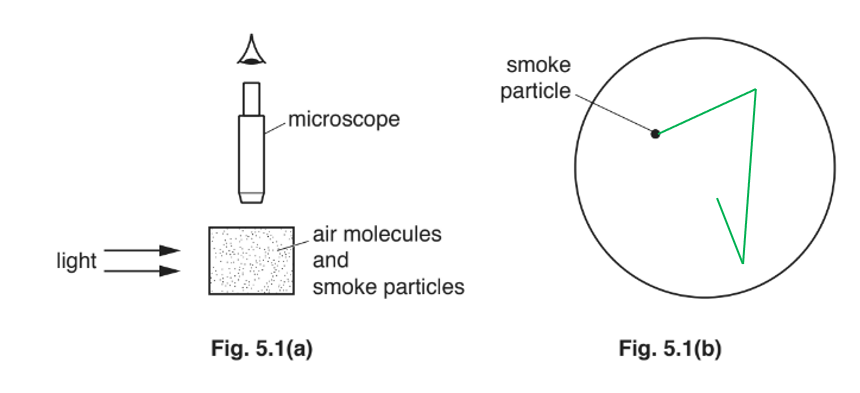

- Path shows three or more straight line sections; **[1 mark]**
- The path has sudden changes of direction **AND**** **at least two different lengths; **[1 mark]**

(ii) To describe how air molecules cause the smoke particle to follow the observed path:

- Air molecules travel in random (directions); **[1 mark]**
- These collide with the smoke particle (causing them to change direction); **[1 mark]**

**[Total: 4 marks]**

> *Brownian motion occurs when larger particles are suspended in a liquid or gas made of smaller particles. An example of this is smoke particles in air:*

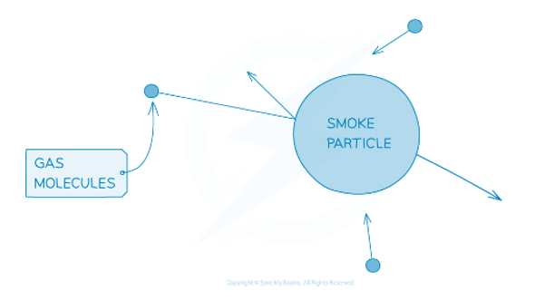

> *The gas molecules hit the smoke particles, and cause the smoke particle to change direction. This is due to conservation of momentum.*
To explain why the piston moves to the left when the temperature is decreased:

- (The average) speed of the molecules decreases (when the temperature decreases); **[1 mark]**
- The molecules collide less often (with the piston and the walls of the cylinder); **[1 mark]**
- There is a smaller momentum change for molecules (on collision with the piston and walls of the container); **[1 mark]**
- (The piston moves because) it has a greater force on its right-hand side **OR** the pressure is less than atmospheric; **[1 mark]**

**[Total: 4 marks]**

> *The link between force and pressure is directly proportional (from the equation  *$p=\frac{F}{A}$*). Therefore, a decrease in pressure will result in a decrease in force. If the forces on the piston are no longer balanced on it will begin to move.*

> *Remember to state that the molecules collide **less often** and not that just that they collide 'less'. *

### Q11
Diagrams which would score** **one mark each would look like:

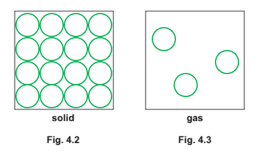

(i) Solid: Atoms drawn close to each other and in rows; **[1 mark]**

(ii) Gas: Atoms drawn far apart and randomly positioned; **[1 mark]**

**[Total: 2 marks]**
(i) To describe the motion of the atoms in a solid:

- (The atoms) vibrate / oscillate; **[1 mark]**

(ii) To explain why he must apply a large force:

- There are <u>attractive forces between atoms / molecules</u> (in the rock); **[1 mark]**
- The force applied must be large enough <u>to overcome forces between atoms / molecules</u>; **OR **Energy is needed / work must be done to separate atoms / molecules; **[1 mark]**

**[Total: 3 marks]**

> *The bonds between molecules in a solid are greater than the bonds between molecules in a liquid or a gas. It takes energy to overcome the force of these bonds.*
After the balloon has burst:

**EITHER**

- Helium spreads / diffuses / moves freely / collides with air (molecules); **[1 mark]**
- The helium atoms travel in all directions/ randomly / at high speed; **[1 mark]**

**OR**

- The helium rises; **[1 mark]**
- Because the <u>helium has low density</u> **OR** the atoms have high speed; **[1 mark]**

**[Total: 2 marks]**

### Q12
To calculate the force on the lid due to the air in the can:

List the known quantities:

- Pressure = 20 000 N / m2
- Area = 0.09 m2

Recall the equation linking pressure, force and area:

- $Pressure=\frac{force}{area}$**[1 mark]**

Rearrange to make force the subject, and substitute in known values:

- Force = pressure × area
- Force = 20 000 × 0.09 **[1 mark]**

Calculate force:

- Force = 1800 N **[1 mark]**

**[Total: 3 marks]**

> *Make sure you memorise all the equations you are required to.*
State what happens to the pressure of the air in the can:

- The pressure increases; **[1 mark]**

Explain why:

**Any two from:**

- The molecules move faster / have more kinetic energy; **[1 mark]**
- The molecules collide more often with walls of can **OR** they collide harder; **[1 mark]**
- Collisions impart force on the walls of the can; **[1 mark]**

**[Total: 3 marks]**

> *The collisions impart force on the walls due to change in momentum. Therefore, more collisions will mean more force imparted over the same period of time. An increase in force leads to an increase in pressure.*

### Q13
Recall the internal structure of different states of matter:

- The molecules making up solids are closely pack in a fixed lattice
- The molecules making up a gas move quickly and randomly at high speeds

A correctly completed table looks like:

| statement | gas | solid |
|---|---|---|
| molecules are closely packed |   | **Final answer:** **✓** |
| molecules are free to move around from place to place | **Final answer:** **✓** |   |
| molecules are far compared to their size | **Final answer:** **✓** |   |
| molecules can only vibrate about a fixed position |   | **Final answer:** **✓** |
| molecules change position randomly | **Final answer:** **✓** |   |

- **Four marks** for all correct
- **One mark off** for each mistake

**[Total: 4 marks]**
(i) The term given to the movement of the smoke particle is:

- The movement is called <u>Brownian motion</u>; **[1 mark]**

(ii) The motion of the smoke particle shows that:

Any **three **from:

- Air molecules exist - it means that air must consists of particles / is not continuous; **[1 mark]**
- Air molecules bombard / collide with the smoke particles; **[1 mark]**
- Air molecules are moving (freely) at high speed; **[1 mark]**
- Air molecules are moving randomly; **[1 mark]**
- Air molecules are very small (compared with smoke particles); **[1 mark]**

**[Total: 4 marks]**

### Q14
(i) To sketch the path of the smoke particle:

A diagram that would score 1 mark should look like this:

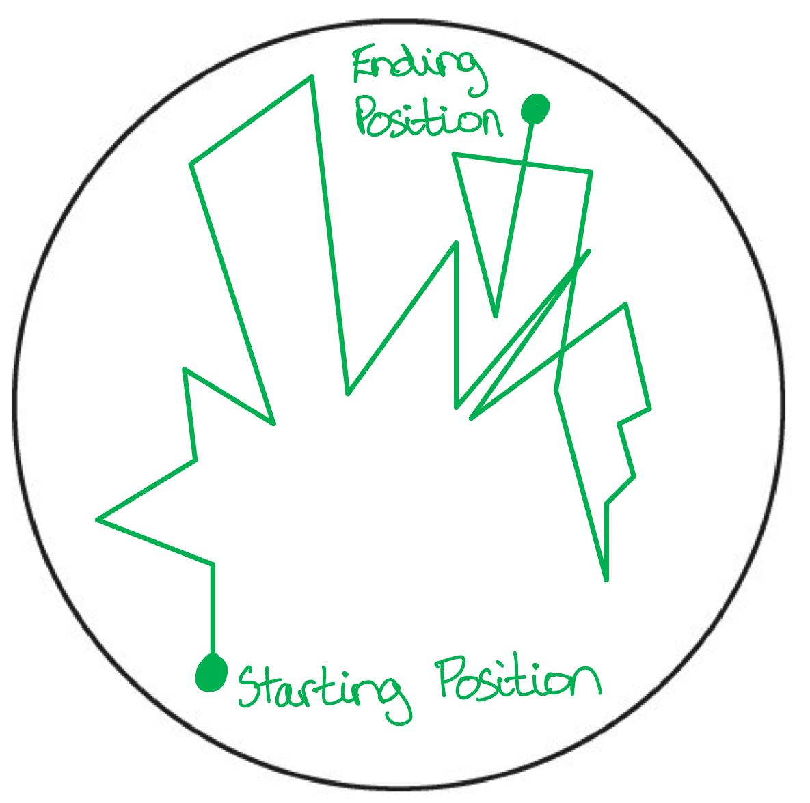

- Straight lines with sudden changes of direction; **[1 mark]**

(ii) To explain why the smoke particle follows the path that is observed:

**Any three from:**

- The air molecules move in random / different directions; **[1 mark]**
- Smoke particles are hit; **[1 mark]**
- By the air molecules; **[1 mark]**
- This means the smoke particles change direction at each collision / undergo Brownian motion; **[1 mark]**

**[Total: 4 marks]**

> *The smoke particle moves about randomly, only because of its collisions with the surrounding air particles. Brownian motion can be remembered as the "random zig-zig motion" of particles.*

### Q15
To describe the movement of the molecules in:

(i) A solid:

- (Molecules) vibrate/oscillate (around a fixed position); **[1 mark]**

(ii) A gas:

- Movement is random / haphazard / in all directions; **[1 mark]**

**Any one from:**

- The molecules move:

  - with high speed; **[1 mark]**
  - freely; **[1 mark]**
  - in a zig-zag pattern; **[1 mark]**
  - in straight lines; **[1 mark]**

**[Total: 3 marks]**
The momentum of the molecules causes them to exert a pressure on the walls of the box:

- Molecules <u>collide with the walls</u> of the box **OR **Molecules <u>rebound from walls</u> of the box; **[1 mark]**
- When the molecules rebound, a <u>change of momentum</u> occurs; **[1 mark]**
- The force on the walls = total change of momentum per second; **[1 mark]**
- Pressure equals force divided by area; **[1 mark]**

**[Total: 4 marks]**

> *Gas molecules hitting a surface will exert pressure on that surface, due to a change in momentum:*

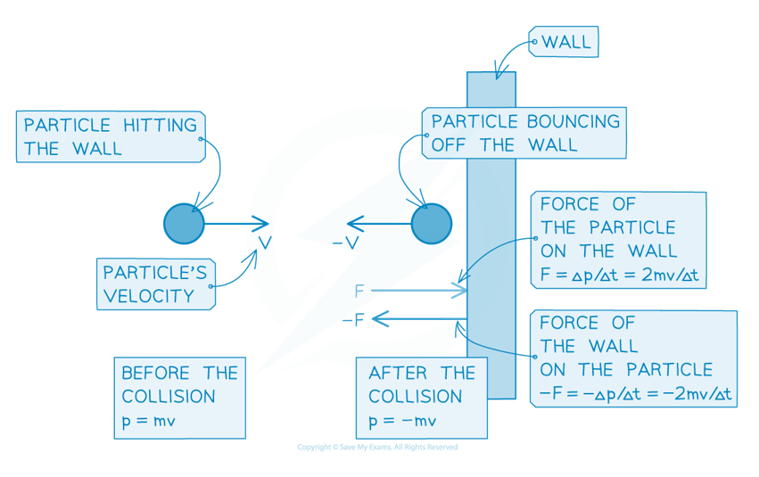

### Q16
Sketch the graph for the same gas at a higher temperature

A graph at a higher temperature should look like:

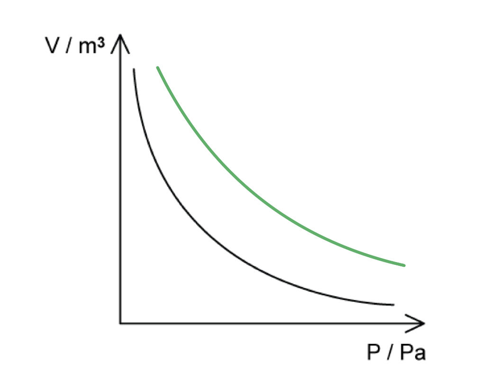

- Slightly shallower curve shifted upwards; **[1 mark]**

**[Total: 1 mark]**

> *At a higher temperature, the gas will start with a higher initial pressure, so the product **pV** will be greater. *
(i) A graph of pressure *p* against $\frac{1}{V}$ looks like:

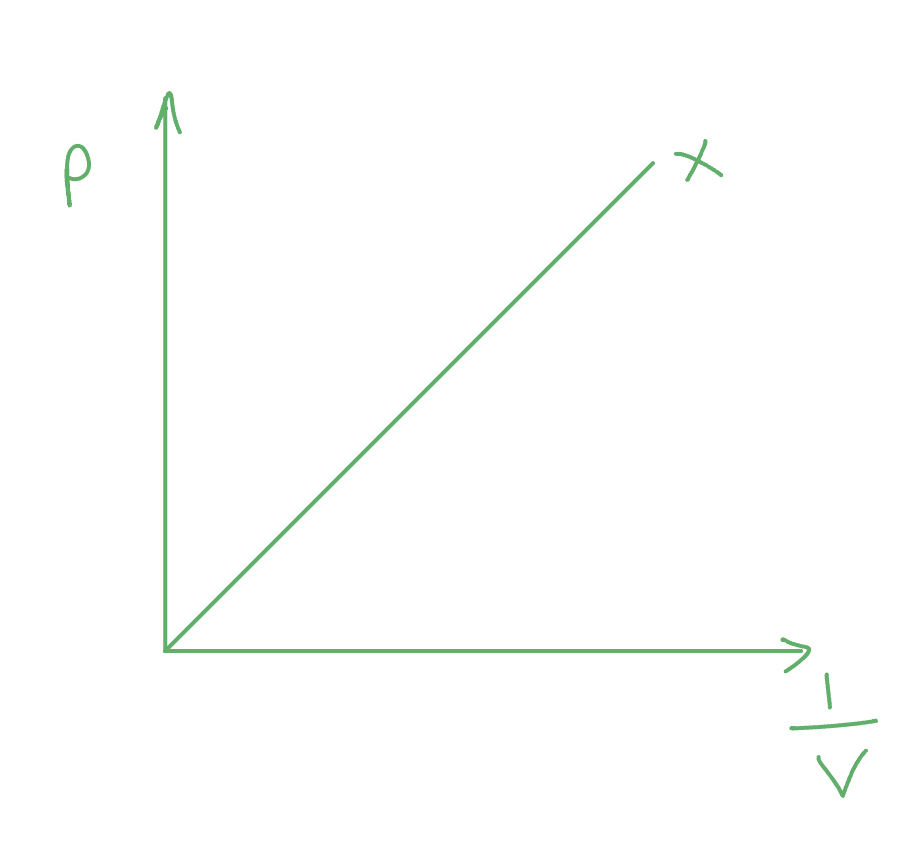

- *p *and $\frac{1}{V}$labelled on each axis;** [1 mark]**
- A straight line through the origin labelled X;** [1 mark]**

(ii) The graph in part (i) at a higher temperature is:

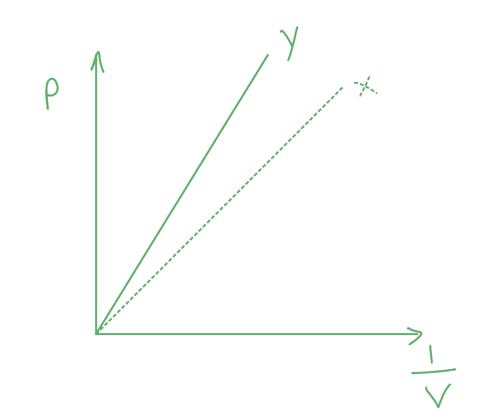

- A straight line through the origin with a steeper gradient than X **AND **labelled Y; **[1 mark]**

**[Total: 3 marks]**

*This is based on the equation **pV** = constant, which means *$p=\frac{constant}{V}$* or* $p=\mathrm{co}nstant\times\frac{1}{V}$*. This means that **p** and *$\frac{1}{V}$* are directly proportional. *

> *At a higher temperature, the pressure is going to be much greater per unit change in volume that before, so this is shown by a steeper gradient.*
Calculate the pressure is moved to position B

List the known quantities:

- Initial pressure, *p*1 = 2.5 × 105 Pa
- Distance of position A from the end of the cylinder, *l*1 = 25 cm

Calculate the distance of position B from the end of the cylinder, *l*2:

- Position B is double the distance of position A, $2\times25=50\mathrm{cm}$
- $l_{2}=50+25=75\mathrm{cm}$ from the end of the cylinder **[1 mark]**

State Boyle's law:

- $p_{1}V_{1}=p_{2}V_{2}$ **[1 mark]**

Rearrange the equation for the pressure distance, *p*2:

- $V_{2}=\frac{p_{1}V_{1}}{p_{2}}$ where $V=lA$

  - *l* is the length of the cylinder
  - *A* is the cross-sectional area of the cylinder
- $l_{2}A=\frac{p_{1}l_{1}A}{p_{2}}\Rightarrowl_{2}=\frac{p_{1}l_{1}}{p_{2}}$
- $p_{2}=\frac{p_{1}l_{1}}{l_{2}}$

Substitute the values into the equation:

- $p_{2} = \frac{( 2.5 \times 10^{5} ) \times 25}{75}$ **[1 mark]**
- $p_{2}=8.3\times10^{4}\mathrm{Pa}$ **[1 mark]**

**[Total: 4 marks]**

> *Always make sure your answer makes sense at the end. In this case, the temperature isn't changing. Boyle's law states that pressure is inversely proportional to volume. From A to B, the volume increases, so the pressure must decrease. This means **p**2** must be less than **p**1** which is the case for our final answer. If you get a value that's greater than **p**1 **this is an indication you have gone wrong with the maths somewhere!*

> *Remember that the volume of a cylinder is length, **l** × cross-sectional area, **A**. **A** is the same in both scenarios as we are using the same cylinder.*

### Q17
(i) The effect on the pressure of a fixed mass of gas when there is an increase in temperature at a constant volume is:

- It will <u>increase</u>;** [1 mark]**
- Because the <u>average speed</u> of the particles increases **AND** so there are more <u>frequent</u> collisions with the walls of the container; **[1 mark]**

(ii) The effect on the pressure of a fixed mass of gas when there is an increase in volume at a constant temperature is:

- It will <u>decrease</u>; **[1 mark]**
- Because the particles the particle will have the same average speed **AND **so will collide with the walls of the container <u>less often</u> / <u>frequently</u>; **[1 mark]**

**[Total: 4 marks]**
(i) The equation linking the pressure and volume at a constant temperature is:

- *pV* = constant; **[1 mark]**

(ii) These figures indicate that the temperature was constant throughout the experiment because:

- *p* × *V* is (approximately) the same each time **OR **when *p* is doubled, *V* is always halved; **[1 mark]**
- So the temperature must be (approximately) constant throughout the experiment;** [1 mark]**

*Example* *calculation*:

- 120 × 60 = 7200 kPa cm3
- 240 × 30 = 7200 kPa cm3

**[Total: 3 marks]**

*Note that part (i) asks for the **equation** linking pressure and volume at constant temperature, so answers such as *$p=\frac{1}{V}$* or  *$p\propto\frac{1}{V}$*will* *not be allowed.*

> *For the last two readings,** pV **= 7192 kPa cm**3**, which is 7200 kPa cm**3** to 2 s.f. The slight difference is due to rounding/experimental uncertainty.*
Calculate how far the piston has moved

List the known quantities:

- Initial pressure of the air, *p*1 = 7.1 × 105 Pa
- Final pressure of the air, *p*2 = 9.0 × 105 Pa
- Inital distance, *l*1 = 48 mm

State the equation linking pressure and volume:

- *pV* = constant, therefore, $p_{1}V_{1}=p_{2}V_{2}$ **[1 mark]**

Rearrange the equation for the final distance, *l*2:

- $V_{2}=\frac{p_{1}V_{1}}{p_{2}}$ where $V=lA$

  - *l* is the length of the cylinder
  - *A* is the cross-sectional area of the cylinder
- $l_{2}A=\frac{p_{1}l_{1}A}{p_{2}}\Rightarrowl_{2}=\frac{p_{1}l_{1}}{p_{2}}$

Substitute the values into the equation to calculate *l*2:

- $l_{2} = \frac{( 7.1 \times 10^{5} ) \times 48}{9.0 \times 10^{5} }$ **[1 mark]**
- $l_{2}=37.867\mathrm{mm}$ **[1 mark]**

Calculate the distance moved, *d *:

- $d=l_{1}-l_{2}=48-37.867=10.1\mathrm{mm}$ **[1 mark]**

**[Total: 3 marks]**

> *The volume that the gas has taken up is the volume of the **cylinder**. This is equal to its length × cross-sectional area.*

> *From previous subparts, we know that pressure is **inversely proportional** to volume. This means that as one increases, the other must decrease.*

> *In both cases, 1 and 2, the cross-sectional area **A** is the same as the cylinder itself has not changed, just the distance of the closed end of the cylinder to the piston. You must be confident in using this equation in this form - look out for the 'two scenarios' type of questions which is when you have to use *$p_{1}V_{1}=p_{2}V_{2}$

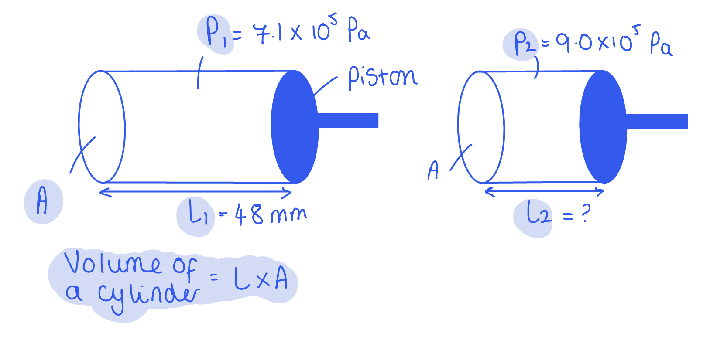

### Q18
(i) The movement of the gas molecules is:

- They are at a <u>high speed</u>; **[1 mark]**
- They travel in any direction / all directions / in random motion; **[1 mark]**

(ii) The molecules exert a pressure on the walls of the box by:

- Collisions; **[1 mark]**
- Of the molecules with the walls of the box; **[1 mark]**

**[Total: 4 marks]**

> *Part (ii) is a very common question! The pressure comes from the collisions with the walls of the box, which each exerts a force. Since pressure is the force per unit area (*$p=\frac{F}{A}$*),  this means that there is also a pressure applied by each of the molecules on the walls of the box.*
The average separation of molecules in the gas is different from the average separation of molecules in the solid because:

- The molecules in the gas are <u>widely separated</u> **AND** whilst in a solid they are <u>very close (together) / touching</u>;** [1 mark]**

**[Total: 1 mark]**

> *It is better to describe the gas molecules as '**widely** separated' or 'far apart' instead of just 'separated'. You must describe the separation **relative to** the separation in a solid.*

### Q19
Absolute zero is:

- The <u>lowest</u> possible temperature / –273 °C / 0 K **[1 mark]**
- (Where the) particles have the least <u>kinetic energy</u>;** [1 mark]**

**[Total: 2 marks]**
(i) Convert –93 °C into K

- *T* (K) = *θ* (°C) + 273
- *T* (K) = – 93 + 273** [1 mark]**
- *T* (K) = 180 K **[1 mark]**

(ii) Convert 428 K into °C

- *θ* (°C) = *T* (K) – 273
- *θ* (°C) = 428 – 273 = 155 °C** [1 mark]**
- *θ* (°C) = 155 °C** [1 mark]**

**[Total: 4 marks]**

> *You must remember the conversion of Kelvin into degrees Celsius for your exam!*

> *Since 0 K (absolute zero) is the lowest temperature possible, you know have gone wrong somewhere if you get a negative value for K! You can only have **positive** values for temperature in Kelvin.*
Draw a ring around the state of matter that is the easiest to expand:

- Ring drawn around 'gas' only; **[1 mark]**

**[Total: 1 mark]**
Gas is the easiest to expand because:

- There is more room for the molecules / there are (large) gaps between the molecules / they have a low density;** [1 mark]**
- The forces of attraction / intermolecular forces between the molecules are negligible/very weak
**OR**
The molecules are more energetic / move around at faster speeds; **[1 mark]**

**[Total: 2 marks]**

### Q20
A completed table which would score 3 marks would look like:

**Table 4.1**

| **state of matter** | **description** |
|---|---|
| solids | **Final answer:** **B** |
| liquids | **Final answer:** **C** |
| gases | **Final answer:** **A** |

- Solids - **B** Molecules vibrate about fixed positions; **[1 mark]**
- Liquids - **C** Molecules move around randomly and are close to each other; **[1 mark]**
- Gases - **A** Molecules move around freely and are far apart from each other; **[1 mark]**

**[Total: 3 marks]**

> *You need to be able to describe the arrangement and the motion of particles in each state of matter. *

> *Remember that as particles gain energy (when the temperature rises) their range of motion increases. The increase in energy means that they can overcome the intermolecular forces of attraction holding them close to one another. *

> *As particles in a solid gain energy they vibrate about their fixed position more and more until, with enough energy, they begin to overcome the intermolecular forces of attraction holding them in their fixed position, and they can then flow over one another becoming a liquid.*

> *As particles in a liquid gain enough energy, they move faster and can break free from the intermolecular forces of attraction holding them in close proximity to one another. When they break free, they become a gas. Gas particles have the most energy, they can fill the space of the container by travelling fast in random directions and bouncing off any surface they come into contact with.*
To describe and explain how the temperature of the water changes during the 13 minutes:

**Any three from:**

- During the first eight minutes the temperature rises; **[1 mark]**
- (Because) the internal energy of water rises (from thermal energy input); **[1 mark]**
- During the next five minutes temperature is constant / stays the same; **[1 mark]**
- (Because) the internal energy does not rise (at the boiling point); **[1 mark]**

**[Total: 3 marks]**

> *It's important to remember that the once the water has reached boiling point, the temperature will not increase. This is because all the energy is being used by the particles to overcome the intermolecular forces of attraction between the water molecules, turning them from a liquid into a gas.*

### Q21
(i) In box **A**, draw the arrangement of particles in a solid:

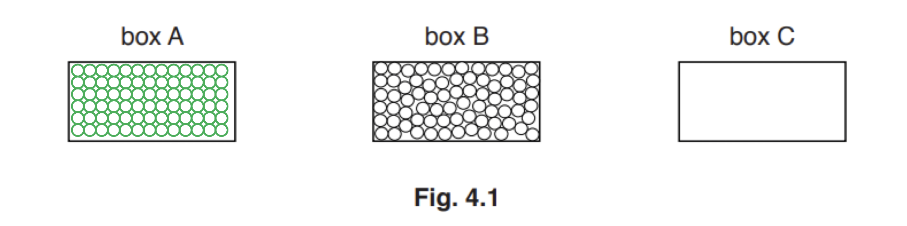

- Particles in box **A** shown in a regular arrangement; **[1 mark]**

(ii) In box **C**, draw the arrangement of particles in a gas:

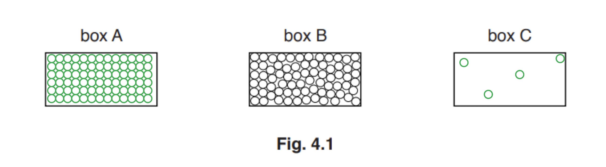

- Few particles in box **C** shown with no pattern; **[1 mark]**

**[Total: 2 marks]**

> *If you drew the particles bigger to save time, that's ok. As the long as the relative number of particles was approximately correct and the arrangements were clearly shown.*

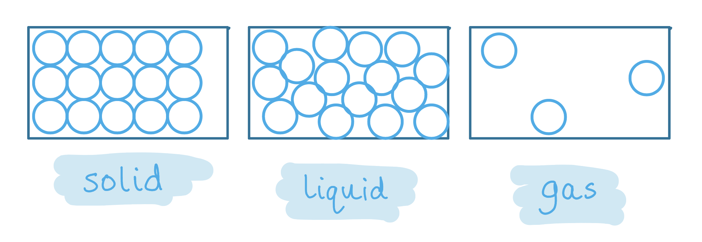

> *Remember that particles in a solid have a fixed arrangement, generally in rows. This is because particles in a solid can only vibrate about their fixed position. They do not have enough energy to overcome the intermolecular forces of attraction holding them close together.*

> *Particles in a liquid are close together with no fixed pattern; at least a third of the particles should be touching and they can overlap. This is because particles in a liquid have more energy and have partially overcome the intermolecular forces of attraction holding them together. The particles can flow and move over one another, hence they have no fixed pattern and can overlap.*

> *Particles in a gas are far apart and randomly placed. This is because the particles in a gas have enough energy to overcome the intermolecular forces of attraction holding them together. Gases will fill the available space and move with different velocities in different directions. When you sketch a gas, keep it simple. Between 3-6 particles will be enough.*
Write the correct term for each change of state below each arrow in Fig. 4.2.:

**One mark for each correct answer:**

- Solid → liquid: melting
- Gas → liquid: condensing (accept condensation)

**[Total: 2 marks]**

> *Check the direction each arrow points before naming the process. Gas to liquid is condensing, not boiling or evaporating.*
State and explain what happens to the water using ideas about molecules in your answer:

State what is happening:

- <u>Evaporation</u> / The water is <u>evaporating</u>; **[1 mark]**

Explain what is happening:

**Any two from:**

- Atoms (at the surface of the liquid) gain kinetic energy; **[1 mark]**
- The fastest molecules / molecules with the most energy ... ; **[1 mark]**
- ... escape from the surface (of the liquid and become a gas); **[1 mark]**

**[Total: 3 marks]**

> *Evaporation** is a change in state of a liquid to a gas. It happens at any temperature, but only from the **surface** of a liquid.*

> *The molecules in a liquid have a range of energies. Some have lots of energy, others have very little. Evaporation occurs when **more energetic molecules** moving near the surface of the liquid have enough energy to escape. *

### Q22
> **[mark-scheme]**
> - Arrangement: random / no fixed pattern / irregular **[1 mark]**
> - Separation: far apart / widely spaced (compared with solids and liquids) **[1 mark]**
> - Motion: random / in all directions / at high speed / colliding with each other and the walls **[1 mark]**

> **[exam-tip]**
> Give one clear point for each of the three words in the question, arrangement, separation and motion, and say "molecules" each time: "the gas is far apart" does not score. Examiners credit a correct point wherever it appears, but keeping the three ideas separate makes it easy to check you have all three.
(i) Continue the path of the smoke particle:

**[2 marks]**

> **[mark-scheme]**
> 1 mark for drawing a path with a change of direction
> 
> 1 mark for drawing a minimum of two straight lines between the changes of direction

> **[mark-scheme]**
> (ii) The term for this movement is:
> 
> - Brownian motion **[1 mark]**

> **[exam-tip]**
> Draw straight segments with sharp corners, not a wavy curve: between collisions, the smoke particle moves in a straight line, and each corner is a collision with an air molecule that is too small to see.
