# Exam Questions — Kinetic Particle Model of Matter
**2. Thermal Physics** · Cambridge (CIE) IGCSE physics (0625 & 0972)
> Source: [https://www.savemyexams.com/igcse/physics/cie/23/topic-questions/](https://www.savemyexams.com/igcse/physics/cie/23/topic-questions/) · 45 questions across 2 sets

## Multiple Choice Questions (23 questions)

### Q1 — medium — 1 marks

**Q1** [1 mark]

Smoke particles are observed through a microscope. The smoke particles are seen to move in random, rapid motion.

What causes the smoke particles to move in this way?

### Q2 — medium — 1 marks

**Q2** [1 mark]

A balloon is filled with air and tied closed. The balloon is placed in a refrigerator.

What happens to the average speed of the air molecules and the pressure of the air inside the balloon as the temperature decreases?

|   | average speed of air molecules | pressure of air |
|---|---|---|
| **A** | stays the same | decreases |
| **B** | decreases | stays the same |
| **C** | increases | increases |
| **D** | decreases | decreases |

### Q3 — easy — 1 marks

**Q3** [1 mark]

Some properties of a substance are listed.

1. The particles vibrate about fixed positions.
2. It has no fixed shape.
3. It is difficult to compress.

Which properties are correct for a solid?

### Q4 — medium — 1 marks

**Q4** [1 mark]

When a substance is heated and its temperature rises, which statement about its particles is correct?

### Q5 — medium — 1 marks

**Q5** [1 mark]

A student uses a microscope to observe pollen moving on the surface of water.

Which statement describes the reason for this movement?

*Source: June 2023 0972/21 Q14*

### Q6 — easy — 1 marks

**Q6** [1 mark]

** **Gases, liquids and solids are made up of small particles.

Which row gives the relative separation of the particles?

|   | **gas** | **liquid** | **solid** |
|---|---|---|---|
| **A** | far apart | far apart | far apart |
| **B** | far apart | far apart | close together |
| **C** | far apart | close together | close together |
| **D** | close together | close together | far apart |

*Source: June 2023 0972/11 Q14*

### Q7 — medium — 1 marks

**Q7** [1 mark]

A substance can exist in three different states: solid, liquid or gas.

Each of the two statements below describes a change of state.

Change 1: Particles move much closer together but continue to travel throughout the substance.

Change 2: Particles stop travelling throughout the substance and just vibrate about fixed positions.

Which changes of state do these statements describe?

|   | **change 1** | **change 2** |
|---|---|---|
| **A** | condensation | melting |
| **B** | condensation | solidification |
| **C** | solidification | condensation |
| **D** | solidification | melting |

*Source: specimen 2023 paper 1 Q16*

### Q8 — medium — 1 marks

**Q8** [1 mark]

**Extended Tier Only**

When particles of a gas collide with a wall of a container, the wall experiences a pressure.

What is the cause of this pressure?

*Source: 2023 specimen paper 2 Q14*

### Q9 — medium — 1 marks

**Q9** [1 mark]

A sealed rigid container has a fixed volume. The container is filled with air.

The container is placed in a freezer cabinet and the temperature of the air in the container decreases.

Which row correctly describes what happens to the air in the container?

|   | **average distance between air particles** | **average speed of air particles** |
|---|---|---|
| **A** | decreases | increases |
| **B** | decreases | decreases |
| **C** | no change | increases |
| **D** | no change | decreases |

*Source: June 2022 paper 2 Q14*

### Q10 — easy — 1 marks

**Q10** [1 mark]

The diagram represents particles of a gas inside a closed container of constant volume.

The gas is heated.

What happens to the particles of the gas?

*Source: specimen 2023 paper 1 Q13*

### Q11 — easy — 1 marks

**Q11** [1 mark]

** **The list gives three properties of different states of matter.

1. They cannot be compressed significantly.
2. They can flow.
3. They always completely fill their container.

Which properties are correct for liquids?

*Source: June 2022 Paper 1 Q13*

### Q12 — easy — 1 marks

**Q12** [1 mark]

When using a microscope to look at smoke particles in air, Brownian motion is observed.

What causes the smoke particles to move at random?

*Source: specimen 2023 paper 1 Q14*

### Q13 — easy — 1 marks

**Q13** [1 mark]

A popular demonstration of kinetic theory is to view smoke particles through a microscope, while illuminating them with a bright light.

The diagram shows the view of the smoke particles through a microscope. They are moving about randomly.

What causes the motion of the smoke particles?

### Q14 — easy — 1 marks

**Q14** [1 mark]

The diagrams represent the molecules in two different states of matter. The arrows show the motion of the molecules.

Which state represents a solid?

### Q15 — easy — 1 marks

**Q15** [1 mark]

Descriptions of two different states of matter are shown below.

To which state of matter do each of the descriptions fit?

| *X: the molecules are very close together, in fixed positions. They vibrate around these fixed positions.*  *Y: the molecules move rapidly and randomly in straight lines until they collide with something. The molecules are spaced apart very far.* |
|---|

*   *

|   | **State X** | **State Y** |
|---|---|---|
| **A** | solid | liquid |
| **B** | solid | gas |
| **C** | liquid | gas |
| **D** | gas | liquid |

### Q16 — easy — 1 marks

**Q16** [1 mark]

A sealed piston is used to expand a gas. No gas escapes during the process.

What happens to both the density of the gas and to its pressure when it is expanded in this way?

|   | **Density** | **Pressure** |
|---|---|---|
| **A** | stays the same | stays the same |
| **B** | increases | decreases |
| **C** | decreases | stays the same |
| **D** | decreases | decreases |

### Q17 — medium — 1 marks

**Q17** [1 mark]

A beaker of water, at its boiling point of 100 oC, is heated so that the liquid starts to become a gas, also at 100 oC.

Which row of the table correctly compares the liquid phase with the gas phase under these conditions?

|   | **Average distance between the particles** | **Average speed of the particles** |
|---|---|---|
| **A** | the same in the liquid and the gas | the same in the liquid and the gas |
| **B** | greater in the liquid | greater in the gas |
| **C** | greater in the gas | greater in the liquid |
| **D** | greater in the gas | the same in the liquid and the gas |

### Q18 — medium — 1 marks

**Q18** [1 mark]

Air is trapped inside a cylinder. The volume of the cylinder cannot change.

The temperature of the air is increased.

Which of the graphs below shows the correct relationship between pressure and temperature?

### Q19 — medium — 1 marks

**Q19** [1 mark]

A car tyre is inflated with air.

As the car drives, the temperature of the tyre increases, which also causes the temperature of the air inside the tyre to increase. This increases the pressure of the air inside the tyre.

Which of the following is a correct explanation as to why?

### Q20 — hard — 1 marks

**Q20** [1 mark]

A syringe is half filled with air and sealed. The plunger is then pulled outwards, causing the volume of the gas to increase.

This is done slowly, so that the expansion happens at a constant temperature.

What happens to the pressure of the gas, and to the speed of the air molecules?

|   | **Pressure inside syringe** | **Speed of air molecules** |
|---|---|---|
| **A** | stays the same | stays the same |
| **B** | increases | decreases |
| **C** | decreases | stays the same |
| **D** | decreases | decreases |

### Q21 — medium — 1 marks

**Q21** [1 mark]

A sealed yet empty (except for air) plastic drinks bottle is left outside in the sunshine on a warm day.

Which row of the table correctly describes what happens to the average speed of the air molecules, and to the pressure inside the bottle?

|   | **Average speed of particles** | **Pressure inside bottle** |
|---|---|---|
| **A** | increases | increases |
| **B** | increases | decreases |
| **C** | decreases | increases |
| **D** | decreases | decreases |

### Q22 — hard — 1 marks

**Q22** [1 mark]

**Extended tier only**

A whale takes a breath at the surface of the ocean, where the pressure is 1.00 x 105 Pa. It then dives to a depth where the pressure is 1.21 x 105 Pa. The temperature is the same at this depth as it is at the surface.

The whale lets out a bubble of air of volume 50 cm3. This bubble rises to the surface of the ocean.

What is the volume of the bubble when it reaches the surface?

### Q23 — hard — 1 marks

**Q23** [1 mark]

**Extended tier only**

In an experiment to determine the nature of liquids, some very tiny pollen grains are suspended in water. They are illuminated by a bright light, and observed under a microscope.

The view through the microscope is of small, bright dots, which move about at random, rapidly and they frequently change direction.

Which of the following would be the correct explanation for the observation through the microscope?

## Theory Questions (22 questions)

### Q1 — medium — 2 marks

**Q1** [2 marks]

Explain, in terms of particles, what happens to the internal energy of the block as its temperature increases.

### Q2 — hard — 5 marks

**Q2** [3 marks]

Fig. 5.1 represents some particles of a gas in a metal box. The arrows represent the directions of movement of the particles.

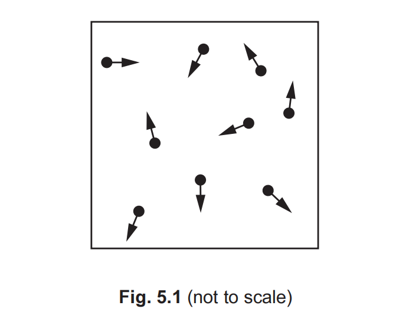

Describe how the particles in Fig. 5.1 exert a pressure on the walls of the box.

*Source: June 2023 0972/31 Q5A*

**Q2** [2 marks]

The number of gas particles in the box increases. The temperature of the gas does **not **change.

State and explain the effect, if any, on the pressure exerted by the gas particles on the walls of the box.

*Source: June 2023 0972/31 Q5B*

### Q3 — medium — 5 marks

**Q3** [5 marks]

Fig. 5.1 shows a glass bottle containing air. The bottle is sealed with a cap. The mass of the air in the bottle is constant.

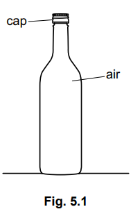

The temperature of the air in the bottle increases.

(i) State what happens to the pressure of the air in the bottle.

[1]

(ii) Explain why the pressure of the air in the bottle changes.

Use ideas about gas particles in your answer.

[4]

*Source: 2023 specimen paper 3 Q5A*

### Q4 — medium — 7 marks

**Q4** [3 marks]

**Extended Tier Only**

Fig. 4.1 shows a balloon filled with helium that is used to lift measuring instruments to a great height above the Earth’s surface.

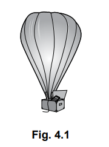

Using ideas about momentum, explain how the atoms of helium produce a force on the wall of the balloon.

*Source: specimen 2023 paper 4 Q4A*

**Q4** [4 marks]

**Extended Tier Only**

At ground level, the pressure of the helium in the balloon is 1.0$\times$105  Pa. The volume of the helium is 9.6 m3 .

The balloon is released and it rises quickly through the atmosphere. The volume of the helium increases. The temperature of the helium remains constant.

(i)** **Explain why the pressure in the balloon decreases as the balloon rises.

You should refer to helium atoms in your answer.

[2]

(ii)** **Calculate the pressure of the helium when its volume is 12 m3 .

pressure = .......................................................... [2]

*Source: specimen 2023 paper 4 Q4B*

### Q5 — medium — 6 marks

**Q5** [6 marks]

Describe the molecular structure of the wax in terms of the arrangement, separation and motion of its molecules when it is a solid and when it is a gas.

*Source: June 2022 paper 3 Q6B*

### Q6 — hard — 10 marks

**Q6** [3 marks]

**Extended tier only**

A cube of side 0.040 m is floating in a container of liquid. Fig. 3.1 shows that the surface of the liquid is 0.028 m above the level of the bottom face of the cube.

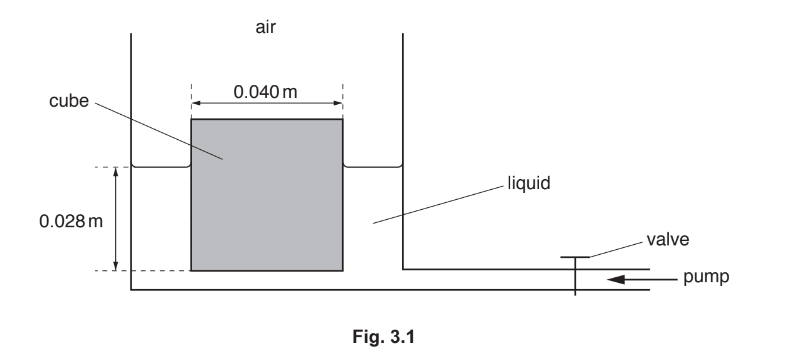

The pressure of the air above the cube exerts a force on the top face of the cube. The valve is closed.

Explain, in terms of air molecules, how the force due to the pressure of the air is produced.

*Source: 2019 May/June 0972/41 Q3A*

**Q6** [4 marks]

**Extract:**

A cube of side 0.040 m is floating in a container of liquid. Fig. 3.1 shows that the surface of the liquid is 0.028 m above the level of the bottom face of the cube.

**Extended tier only**

The density of the liquid in the container is 1500 kg/m3.

Calculate:

(i) the pressure due to the liquid at a depth of 0.028 m

pressure = ......................................................... [2]

(ii) the force on the bottom face of the cube caused by the pressure due to the liquid.

force = ......................................................... [2]

*Source: 2019 May/June 0972/41 Q3B*

**Q6** [3 marks]

**Extract:**

Force, F = 0.66 N (from part (b))
The surface of the liquid rises a distance of 0.034 m.

**Extended tier only**

The valve is opened and liquid is pumped into the container. The surface of the liquid rises a distance of 0.034 m.

The cube remains floating in the liquid with its bottom face 0.028 m below the surface of the liquid.

(i) Calculate the work done on the cube by the force in (b)(ii).

work done = ......................................................... [2]

(ii) Suggest one reason why this is not an efficient method of lifting up the cube.

[1]

*Source: 2019 May/June 0972/41 Q4C*

### Q7 — easy — 7 marks

**Q7** [4 marks]

When a material is cooled or heated there may be a change of state.

Complete each statement by using words from the box. Each word can be used once, more than once or not at all.

| condensation     evaporation     freezing     melting |
|---|

The change from solid to liquid is called .....................................

The change from liquid to gas is called .....................................

The change from liquid to solid is called .....................................

The change from gas to liquid is called ..................................... .

*Source: 2018 (Series 2) 0625/32 Q5B*

**Q7** [3 marks]

**Extended Tier Only**

A student heats a gas and keeps its volume constant.

State and explain the effect on the pressure of the gas. In your answer, use your ideas about molecules.

*Source: 2018 (Series 2) 0625/32 Q5C*

### Q8 — hard — 11 marks

**Q8** [2 marks]

The fizz in a soda bottle is caused by carbonation. When the soda is bottled, carbon dioxide is added to the liquid to give it a fizzy taste. The carbon dioxide gas is kept in the liquid by the pressure inside the bottle.

When the bottle of soda is opened, state what happens to the pressure inside the bottle and why.

**Q8** [4 marks]

A student is struggling with their revision and has sketched the following graph in Fig 1.1 to represent the change in temperature with volume for a gas at constant pressure.

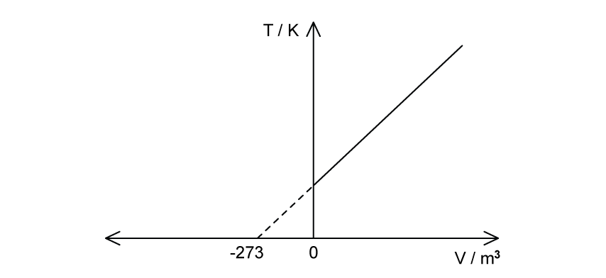

**Fig 1.1**

(i) State the mistake made in the student's graph.

[2]

(ii) Sketch a new graph to show the correct relationship between temperature and volume.

[2]

**Q8** [5 marks]

**Extended tier only**

Fig. 1.2 shows two mugs of tea, A and B. They both hold the same volume of tea.

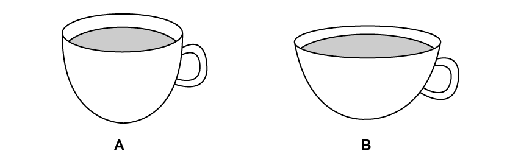

**Fig. 1.2**

State from which mug the tea evaporates quicker. Explain why, in terms of the behaviour of molecules and the process of evaporation.

### Q9 — medium — 7 marks

**Q9** [4 marks]

Fig. 4.1 shows a smoke cell. The cell contains smoke particles and air molecules. It is lit from the side. A student views the motion of smoke particles in the cell by using a microscope.

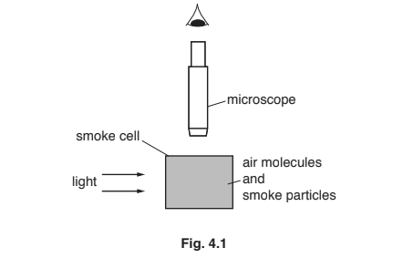

Describe and explain what the student sees when viewing the smoke particles through the microscope.

*Source: 2018 0625/31 Q4A*

**Q9** [3 marks]

Drops of water on a warm surface disappear after a short time. State the term used to describe this process. Explain the process, using your ideas about molecules.

name of process: ..........................................................................................................................

explanation: ..................................................................................................................................

*Source: 2018 0625/31 Q4B*

### Q10 — hard — 8 marks

**Q10** [4 marks]

**Extended tier only**

A microscope that produces a very high magnification is used to observe the Brownian motion of smoke particles in air.

Fig. 5.1(a) shows the apparatus used with the microscope. Fig. 5.1(b) represents the view through the microscope and shows one of the smoke particles being observed.

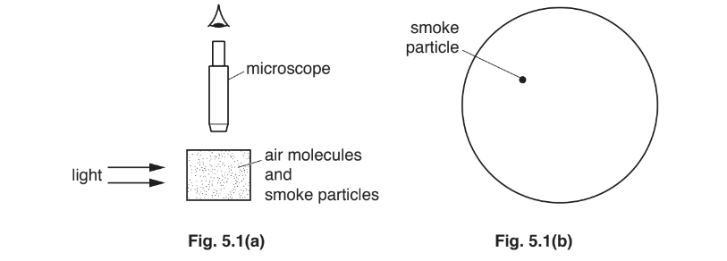

(i) On Fig. 5.1(b), draw a possible path for the smoke particle.

[2]

(ii) Describe how air molecules cause the smoke particle to follow the observed path.

[2]

*Source: 2018 0625/43 Q5A*

**Q10** [4 marks]

Fig. 5.2 shows a volume of gas in a cylinder.

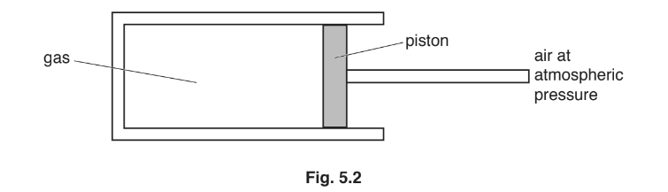

The piston in the cylinder is free to move. The piston moves to the left when the temperature of the gas is decreased.

Explain, in terms of the molecules of the gas, why this happens.

*Source: 2018 0625/43 Q5B*

### Q11 — medium — 7 marks

**Q11** [2 marks]

Fig. 4.1 represents an atom.

Representing atoms by circles approximately the same size as in Fig. 4.1, sketch

(i) on Fig. 4.2, the arrangement of atoms in a crystalline solid,

[1]

(ii) on Fig. 4.3, the arrangement of atoms in a gas.

[1]

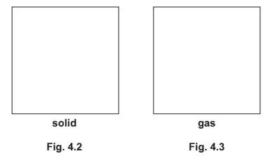

*Source: 2018 0625/42 Q4A*

**Q11** [3 marks]

**Extended tier only**

(i) Describe the motion of the atoms in a solid.

[1]

(ii) A sculptor makes a statue from a block of crystalline rock using a cutting tool. Explain why he must apply a large force to the tool to remove a small piece of rock.

[2]

*Source: 2018 0625/42 Q4B*

**Q11** [2 marks]

A helium-filled balloon in the room of a house suddenly bursts.

State and explain, in terms of atoms, what happens to the helium from the balloon after the balloon has burst.

*Source: 2018 0625/42 Q4C*

### Q12 — medium — 6 marks

**Q12** [3 marks]

Fig. 5.1 shows a metal can containing air. The can is sealed with a lid.

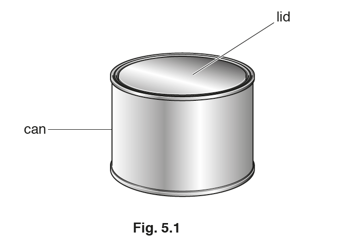

The air in the can exerts a pressure of 20 000 N/m2 on the lid. The area of the can lid is 0.09 m2.

Calculate the force on the lid due to the air in the can.

force = ...................................................... N

*Source: 2018 0625/33 Q5A*

**Q12** [3 marks]

The air in the can becomes warmer.

State and explain what happens to the pressure of the air in the can. Use your ideas about gas molecules.

*Source: 2018 0625/33 Q5B*

### Q13 — easy — 8 marks

**Q13** [4 marks]

Table 6.1 gives a list of statements about molecules in gases and solids.

**Table 6.1**

| statement | gas | solid |
|---|---|---|
| molecules are closely packed |   |   |
| molecules are free to move around from place to place |   |   |
| molecules are far apart compared to their size |   |   |
| molecules can only vibrate about a fixed position |   |   |
| molecules change position randomly |   |   |

Put one tick in every row to indicate whether each statement refers to a gas or a solid.

*Source: 2020 Feb/March 0625/32 Q6A*

**Q13** [4 marks]

Fig. 6.1 represents a smoke particle in air. The smoke particle is moving.

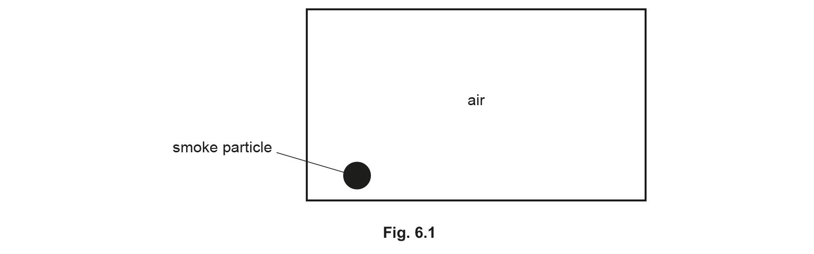

Fig. 6.2 shows the path of the smoke particle and the position of the smoke particle a short time later.

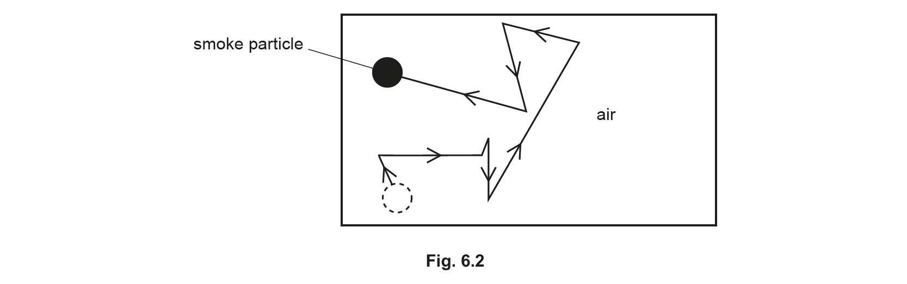

(i) State the term given to the movement of the smoke particle.

[1]

(ii) State what the motion of the smoke particle shows about air molecules.

[3]

*Source: 2020 Feb/March 0625/32 Q6B*

### Q14 — medium — 4 marks

**Q14** [4 marks]

Fig. 5.1 shows the apparatus used to observe the motion of smoke particles that are in the air in a box.

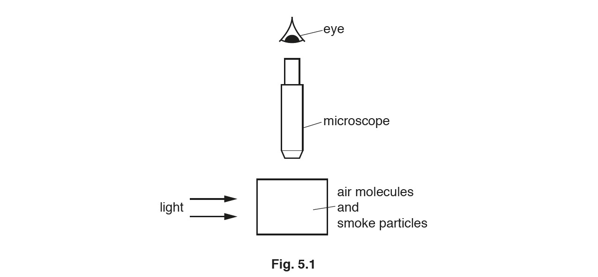

Light from a lamp enters the box through a window in one side of the box. The smoke particles are observed using a microscope fixed above a window in the top of the box.

(i) The motion of a single smoke particle is observed through the microscope.

In the circle shown, sketch the path of this smoke particle.

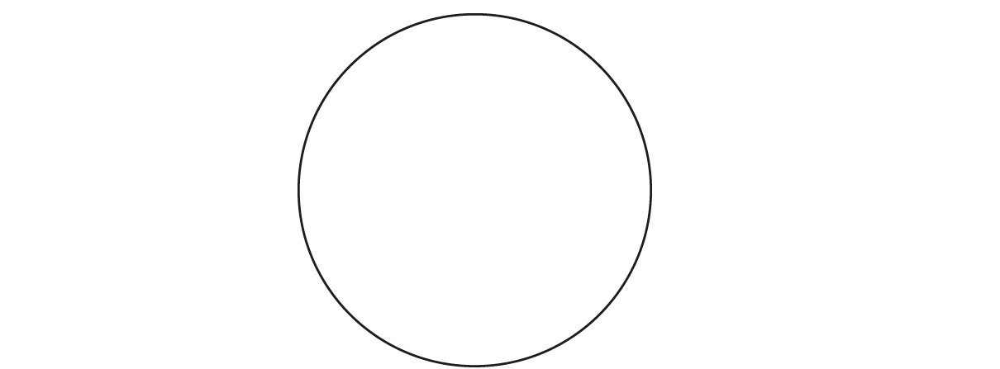

[1]

(ii) Explain why the smoke particle follows the path that is observed.

[3]

*Source: February/March 2018 0625/42 Q5A*

### Q15 — medium — 7 marks

**Q15** [3 marks]

Describe the movement of the molecules in

(i) a solid.

[1]

(ii) a gas.

[2]

*Source: 2018 0625/41 Q4A*

**Q15** [4 marks]

**Extended tier only**

A closed box contains gas molecules. How does the momentum of the molecules cause them to exert a pressure on the walls of the box?

*Source: 2018 0625/41 Q4B*

### Q16 — hard — 8 marks

**Q16** [1 mark]

**Extended tier only**

Fig 1.1 shows the graph showing how the volume changes with pressure for a gas at a constant temperature

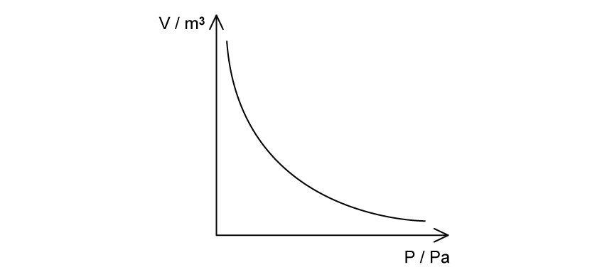

**Fig** **1.1**

Sketch the graph for the same gas at a higher temperature.

**Q16** [3 marks]

**Extended tier only**

Sketch

(i) a graph of pressure *p* against $\frac{1}{V}$ where *V* is the volume of a gas. Label this X.

[2]

(ii) the graph in part (i) but with the gas at a higher temperature. Label this Y.

[1]

**Q16** [4 marks]

**Extract:**

The piston in Fig 1.2 is pulled out of the cylinder from position A to position B, without changing the temperature of the air enclosed. Position B is double the length of the distance between position A and the end of the cylinder. The pressure when the piston is at position A is 2.5 × 10^5 Pa.

Initial pressure, p₁ = 2.5 × 10^5 Pa
Distance of position A from the end of the cylinder, l₁ = 25 cm
Position B is double the distance of position A, so l₂ = 50 + 25 = 75 cm from the end of the cylinder
Boyle's law: p₁V₁ = p₂V₂
Volume of a cylinder is length × cross-sectional area (V = lA), A is the same in both scenarios
p₂ = (p₁ × l₁) / l₂

**Extended tier only**

The piston in Fig 1.2 is pulled out of the cylinder from position A to position B, without changing the temperature of the air enclosed. Position B is double the length of the distance between position A and the end of the cylinder. The pressure when the piston is at position A is 2.5 × 105 Pa.

Calculate the pressure when the piston is moved to position B.

### Q17 — hard — 11 marks

**Q17** [4 marks]

Describe qualitatively, in terms of particles, the effect on the pressure of a fixed mass of gas in a container when there is:

(i) an increase in temperature at a constant volume

[2]

(ii) an increase in volume at a constant temperature

[2]

**Q17** [3 marks]

**Extended tier only**

Table 1.1 gives a series of pressures and their corresponding volumes, obtained in an experiment with a fixed amount of gas. The gas obeys the law for a fixed amount of gas at a constant temperature.

| **pressure / kPa** | 120 | 240 | 480 | 580 | 1160 |
|---|---|---|---|---|---|
| **volume / cm****3** | 60 | 30 | 15 | 12.4 | 6.2 |

** Table** **1.1 **

(i) State the equation linking the pressure and volume at a constant temperature

[1]

(ii) Determine whether these figures indicate that the temperature was constant throughout the experiment.

[2]

**Q17** [4 marks]

**Extract:**

Air is trapped by a piston in a cylinder. The pressure of the air is 7.1 × 10^5 Pa. The distance from the closed end of the cylinder to the piston is 48 mm. The piston is pushed in until the pressure of the air has risen to 9.0 × 10^5 Pa.

- Initial pressure of the air, p1 = 7.1 × 10^5 Pa
- Final pressure of the air, p2 = 9.0 × 10^5 Pa
- Initial distance, l1 = 48 mm

The equation linking pressure and volume at a constant temperature is:
- pV = constant

The volume that the gas has taken up is the volume of the cylinder. This is equal to its length × cross-sectional area (V = l × A).

**Extended tier only**

Air is trapped by a piston in a cylinder. The pressure of the air is 7.1 × 105 Pa. The distance from the closed end of the cylinder to the piston is 48 mm.

The piston is pushed in until the pressure of the air has risen to 9.0 × 105 Pa.

Calculate how far the piston has moved.

### Q18 — medium — 5 marks

**Q18** [4 marks]

Some gas molecules are in a box at room temperature.

Fig. 3.1 shows the position of some of the molecules and the direction of movement of each molecule.

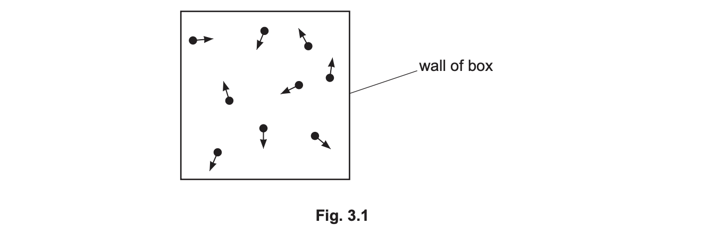

(i) Describe the movement of the gas molecules.

[2]

(ii) Describe how the molecules exert a pressure on the walls of the box.

[2]

*Source: 2020 0625/31 Q3A*

**Q18** [1 mark]

The gas in Fig. 3.1 is cooled. The gas turns into a liquid then into a solid.

State how the average separation of molecules in the gas is different from the average separation of molecules in the solid.

*Source: 2020 0625/31 Q3B*

### Q19 — easy — 9 marks

**Q19** [2 marks]

Define *absolute zero*.

**Q19** [4 marks]

Convert the following temperatures

(i) –93 °C into K

[2]

(ii) 428 K into °C

[2]

**Q19** [1 mark]

**Extended tier only**

In the list below, draw a ring around the state of matter that is the easiest to expand.

| **solid          liquid          gas** |
|---|

**Q19** [2 marks]

**Extract:**

In the list below, draw a ring around the state of matter that is the easiest to expand.

| solid          liquid          gas |

Ring drawn around 'gas' only;

**Extended tier only**

In terms of its molecules, explain why the state of matter ringed in part (c) is the easiest to expand.

### Q20 — medium — 6 marks

**Q20** [3 marks]

Match each description with the correct state of matter in Table 4.1.

Write the correct letter in Table 4.1.

A – Molecules move around freely and are far apart from each other.

B – Molecules vibrate about fixed positions.

C – Molecules move around randomly and are close to each other.

**Table 4.1**

| **state of matter** | **description** |
|---|---|
| solids |   |
| liquids |   |
| gases |   |

*Source: 2020 0625/32 Q4A*

**Q20** [3 marks]

Some students heat water in a beaker. They measure the temperature every minute. They heat the water for 8 minutes until it boils, and then continue to heat it for a further 5 minutes.

Describe and explain how the temperature of the water changes during the 13 minutes.

*Source: 2020 0625/32 Q4B*

### Q21 — easy — 7 marks

**Q21** [2 marks]

A student draws diagrams that represent three states of matter, as shown in Fig. 4.1.

Box **B** shows the arrangement of particles in a liquid.

(i) In box** A**, draw the arrangement of particles in a solid.

[1]

(ii) In box **C**, draw the arrangement of particles in a gas.

[1]

*Source: Nov 2018 (S1) 0625/31 Q4A*

**Q21** [2 marks]

**Extract:**

- Accept "condensation" for "condensing".
- The first arrow is solid → liquid (melting). The second arrow is gas → liquid (condensing); do not accept "boiling", "evaporating" or "cooling" for it.

Write the correct term for each change of state below each arrow in Fig. 4.2.

**Fig. 4.2**

*Source: Nov 2018 (S1) 0625/31 Q4B*

**Q21** [3 marks]

A wet beaker is in a warm room. After several hours the beaker is dry.

State and explain what happens to the water. Use your ideas about molecules in your answer.

*Source: Nov 2018 (S1) 0625/31 Q4C*

### Q22 — easy — 6 marks

**Q22** [3 marks]

**Extract:**

Three marks, one each for arrangement, separation and motion of the gas molecules. Arrangement: random / no fixed pattern / irregular. Separation: far apart / widely spaced, accepted alone (a comparison with solids and liquids is not required). Motion: random / in all directions / at high speed / colliding, any one.

Accept "far apart" or "widely spaced" alone for the separation mark; the comparison with solids and liquids is not required

Accept any one of the motion points for the motion mark

Do not accept "the gas is far apart": it is the molecules that are far apart

Do not accept bulk properties such as "flows" or "can be compressed" for any mark

Do not accept "the gas is far apart" (must refer to the molecules) or bulk properties such as flowing or being compressible.

All matter is made up of atoms and molecules.

Describe the arrangement, separation and motion of gas molecules.

*Source: Oct 2019 0625/32 Q7A*

**Q22** [3 marks]

**Extract:**

(i) Expected: a zig-zag path made of straight-line segments with abrupt random changes of direction, at least two segments drawn. (ii) Expected: Brownian motion.

The motion of smoke particles in air can be observed using a smoke cell and microscope.

Fig. 7.1 shows the arrangement.

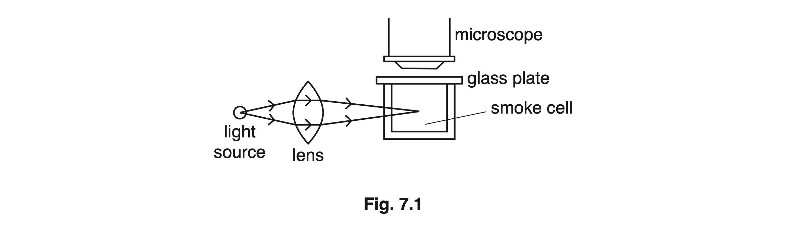

Smoke is placed inside the glass smoke cell. Light enters from the side of the smoke cell.

A student looks through the microscope. She sees tiny spots of light moving. Each spot of light is a smoke particle.

Fig. 7.2 represents the path of a smoke particle seen in the eyepiece of the microscope.

(i) On Fig. 7.2, continue the path of the smoke particle.

[2]

(ii) State the term used to describe the movement of the smoke particle.

[1]

*Source: Oct 2019 0625/32 Q7B*

