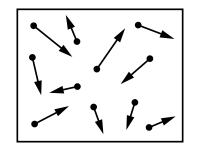
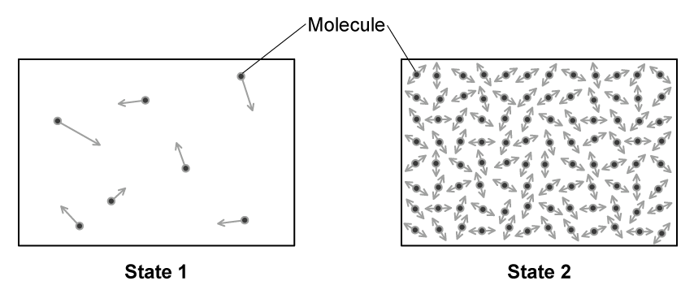
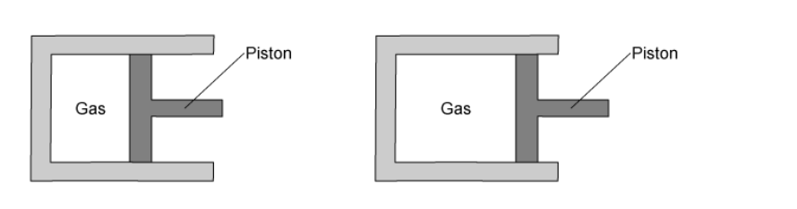
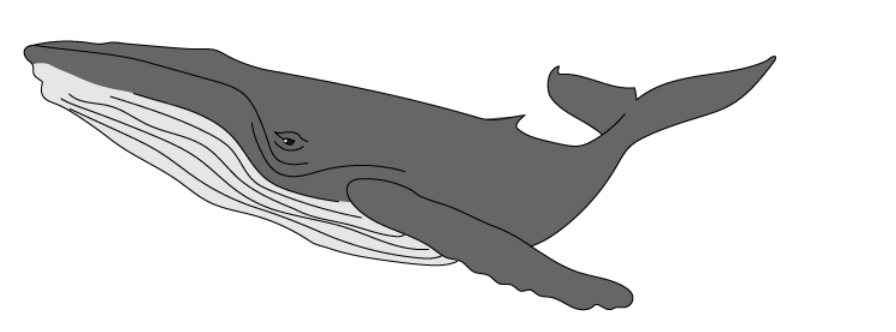

# Exam Questions — Kinetic Particle Model of Matter
**2. Thermal Physics** · Cambridge (CIE) IGCSE physics (0625 & 0972)
> Source: [https://www.savemyexams.com/igcse/physics/cie/23/topic-questions/](https://www.savemyexams.com/igcse/physics/cie/23/topic-questions/) · 23 questions across 1 sets

## Multiple Choice Questions (23 questions)

### Q1 — medium — 1 marks

**Q1** [1 mark]

Smoke particles are observed through a microscope. The smoke particles are seen to move in random, rapid motion.

What causes the smoke particles to move in this way?

### Q2 — medium — 1 marks

**Q2** [1 mark]

A balloon is filled with air and tied closed. The balloon is placed in a refrigerator.

What happens to the average speed of the air molecules and the pressure of the air inside the balloon as the temperature decreases?

|   | average speed of air molecules | pressure of air |
|---|---|---|
| **A** | stays the same | decreases |
| **B** | decreases | stays the same |
| **C** | increases | increases |
| **D** | decreases | decreases |

### Q3 — easy — 1 marks

**Q3** [1 mark]

Some properties of a substance are listed.

1. The particles vibrate about fixed positions.
2. It has no fixed shape.
3. It is difficult to compress.

Which properties are correct for a solid?

### Q4 — medium — 1 marks

**Q4** [1 mark]

When a substance is heated and its temperature rises, which statement about its particles is correct?

### Q5 — medium — 1 marks

**Q5** [1 mark]

A student uses a microscope to observe pollen moving on the surface of water.

Which statement describes the reason for this movement?

*Source: June 2023 0972/21 Q14*

### Q6 — easy — 1 marks

**Q6** [1 mark]

** **Gases, liquids and solids are made up of small particles.

Which row gives the relative separation of the particles?

|   | **gas** | **liquid** | **solid** |
|---|---|---|---|
| **A** | far apart | far apart | far apart |
| **B** | far apart | far apart | close together |
| **C** | far apart | close together | close together |
| **D** | close together | close together | far apart |

*Source: June 2023 0972/11 Q14*

### Q7 — medium — 1 marks

**Q7** [1 mark]

A substance can exist in three different states: solid, liquid or gas.

Each of the two statements below describes a change of state.

Change 1: Particles move much closer together but continue to travel throughout the substance.

Change 2: Particles stop travelling throughout the substance and just vibrate about fixed positions.

Which changes of state do these statements describe?

|   | **change 1** | **change 2** |
|---|---|---|
| **A** | condensation | melting |
| **B** | condensation | solidification |
| **C** | solidification | condensation |
| **D** | solidification | melting |

*Source: specimen 2023 paper 1 Q16*

### Q8 — medium — 1 marks

**Q8** [1 mark]

**Extended Tier Only**

When particles of a gas collide with a wall of a container, the wall experiences a pressure.

What is the cause of this pressure?

*Source: 2023 specimen paper 2 Q14*

### Q9 — medium — 1 marks

**Q9** [1 mark]

A sealed rigid container has a fixed volume. The container is filled with air.

The container is placed in a freezer cabinet and the temperature of the air in the container decreases.

Which row correctly describes what happens to the air in the container?

|   | **average distance between air particles** | **average speed of air particles** |
|---|---|---|
| **A** | decreases | increases |
| **B** | decreases | decreases |
| **C** | no change | increases |
| **D** | no change | decreases |

*Source: June 2022 paper 2 Q14*

### Q10 — easy — 1 marks

**Q10** [1 mark]

The diagram represents particles of a gas inside a closed container of constant volume.

The gas is heated.

What happens to the particles of the gas?

*Source: specimen 2023 paper 1 Q13*

### Q11 — easy — 1 marks

**Q11** [1 mark]

** **The list gives three properties of different states of matter.

1. They cannot be compressed significantly.
2. They can flow.
3. They always completely fill their container.

Which properties are correct for liquids?

*Source: June 2022 Paper 1 Q13*

### Q12 — easy — 1 marks

**Q12** [1 mark]

When using a microscope to look at smoke particles in air, Brownian motion is observed.

What causes the smoke particles to move at random?

*Source: specimen 2023 paper 1 Q14*

### Q13 — easy — 1 marks

**Q13** [1 mark]

A popular demonstration of kinetic theory is to view smoke particles through a microscope, while illuminating them with a bright light.

The diagram shows the view of the smoke particles through a microscope. They are moving about randomly.

What causes the motion of the smoke particles?

### Q14 — easy — 1 marks

**Q14** [1 mark]

The diagrams represent the molecules in two different states of matter. The arrows show the motion of the molecules.

Which state represents a solid?

### Q15 — easy — 1 marks

**Q15** [1 mark]

Descriptions of two different states of matter are shown below.

To which state of matter do each of the descriptions fit?

| *X: the molecules are very close together, in fixed positions. They vibrate around these fixed positions.*  *Y: the molecules move rapidly and randomly in straight lines until they collide with something. The molecules are spaced apart very far.* |
|---|

*   *

|   | **State X** | **State Y** |
|---|---|---|
| **A** | solid | liquid |
| **B** | solid | gas |
| **C** | liquid | gas |
| **D** | gas | liquid |

### Q16 — easy — 1 marks

**Q16** [1 mark]

A sealed piston is used to expand a gas. No gas escapes during the process.

What happens to both the density of the gas and to its pressure when it is expanded in this way?

|   | **Density** | **Pressure** |
|---|---|---|
| **A** | stays the same | stays the same |
| **B** | increases | decreases |
| **C** | decreases | stays the same |
| **D** | decreases | decreases |

### Q17 — medium — 1 marks

**Q17** [1 mark]

A beaker of water, at its boiling point of 100 oC, is heated so that the liquid starts to become a gas, also at 100 oC.

Which row of the table correctly compares the liquid phase with the gas phase under these conditions?

|   | **Average distance between the particles** | **Average speed of the particles** |
|---|---|---|
| **A** | the same in the liquid and the gas | the same in the liquid and the gas |
| **B** | greater in the liquid | greater in the gas |
| **C** | greater in the gas | greater in the liquid |
| **D** | greater in the gas | the same in the liquid and the gas |

### Q18 — medium — 1 marks

**Q18** [1 mark]

Air is trapped inside a cylinder. The volume of the cylinder cannot change.

The temperature of the air is increased.

Which of the graphs below shows the correct relationship between pressure and temperature?

### Q19 — medium — 1 marks

**Q19** [1 mark]

A car tyre is inflated with air.

As the car drives, the temperature of the tyre increases, which also causes the temperature of the air inside the tyre to increase. This increases the pressure of the air inside the tyre.

Which of the following is a correct explanation as to why?

### Q20 — hard — 1 marks

**Q20** [1 mark]

A syringe is half filled with air and sealed. The plunger is then pulled outwards, causing the volume of the gas to increase.

This is done slowly, so that the expansion happens at a constant temperature.

What happens to the pressure of the gas, and to the speed of the air molecules?

|   | **Pressure inside syringe** | **Speed of air molecules** |
|---|---|---|
| **A** | stays the same | stays the same |
| **B** | increases | decreases |
| **C** | decreases | stays the same |
| **D** | decreases | decreases |

### Q21 — medium — 1 marks

**Q21** [1 mark]

A sealed yet empty (except for air) plastic drinks bottle is left outside in the sunshine on a warm day.

Which row of the table correctly describes what happens to the average speed of the air molecules, and to the pressure inside the bottle?

|   | **Average speed of particles** | **Pressure inside bottle** |
|---|---|---|
| **A** | increases | increases |
| **B** | increases | decreases |
| **C** | decreases | increases |
| **D** | decreases | decreases |

### Q22 — hard — 1 marks

**Q22** [1 mark]

**Extended tier only**

A whale takes a breath at the surface of the ocean, where the pressure is 1.00 x 105 Pa. It then dives to a depth where the pressure is 1.21 x 105 Pa. The temperature is the same at this depth as it is at the surface.

The whale lets out a bubble of air of volume 50 cm3. This bubble rises to the surface of the ocean.

What is the volume of the bubble when it reaches the surface?

### Q23 — hard — 1 marks

**Q23** [1 mark]

**Extended tier only**

In an experiment to determine the nature of liquids, some very tiny pollen grains are suspended in water. They are illuminated by a bright light, and observed under a microscope.

The view through the microscope is of small, bright dots, which move about at random, rapidly and they frequently change direction.

Which of the following would be the correct explanation for the observation through the microscope?
