# Mark Schemes — Thermal Properties & Temperature
**2. Thermal Physics** · Cambridge (CIE) IGCSE physics (0625 & 0972)

## Alternative To Practical Questions (3 questions)

### Q1
The room temperature at the beginning of the experiment is:

- *θ*R = 23 °C **[1 mark]**

**[Total: 1 mark]**
The missing units from the column headings in Table 2.1 are:

| *t*/s | *θ*/°C |
|---|---|
| 0 | 84 |
| 30 | 79 |
| 60 | 75 |
| 90 | 72 |
| 120 | 70 |
| 150 | 68 |
| 180 | 67 |

- Time column: s **AND** temperature column: °C; **[1 mark]**

**[Total: 1 mark]**
(i) When measuring volume from a measuring cylinder, the precautions to take are:

- 1. To view the scale / value / water level at right angles / perpendicularly; **[1 mark]**
- 2. (To view the scale / value / water level) at the bottom of the meniscus; **[1 mark]**

(ii) Recording the volume to the nearest 1 cm3 is appropriate because:

- A measuring cylinder can only be read to the nearest 1 or 2 cm3 **OR**
- This would measure volume to 3 significant figures (which is sufficiently accurate); **[1 mark]**

**[Total: 3 marks]**
(i) Calculate the average rate of cooling between times *t* = 0 and *t* = 60 s:

Calculate the decrease in temperature Δ*θ*1 of the hot water:

- At *t* = 0, *θ* = 84°C
- At *t* = 60 s, *θ* = 75°C
- Between *t* = 0 and *t* = 60 s, Δ*θ*1 = (84 − 75) = 9°C

Calculate the average rate of cooling *R*1 of the water:

- $R_{1}=\frac{\Deltaθ_{1}}{\Deltat}=\frac{9}{60}$
- *R*1 = 0.15 **[1 mark]**
- Unit: °C / s **[1 mark]**

(ii) Calculate the average rate of cooling between times *t* = 120 s and *t* = 180 s:

Calculate the decrease in temperature Δ*θ*2 of the hot water:

- At *t* = 120, *θ* = 70°C
- At *t* = 180 s, *θ* = 67°C
- Between *t* = 120 and *t* = 180 s, Δ*θ*1 = (70 − 67) = 3°C

Calculate the average rate of cooling *R*2 of the water:

- $R_{2}=\frac{\Deltaθ_{2}}{\Deltat}=\frac{3}{60}$
- *R*2 = 0.05 °C / s **[1 mark]**

**[Total: 3 marks]**
The suggestion that the rate of cooling is lower when the temperature of the water is lower is:

- Correct / supported by the results

**AND**

- (Because they show that) at a higher temperature, the cooling rate is 0.15 °C / s but at lower temperature the cooling rate is 0.05 °C / s; **[1 mark]**

**[Total: 1 mark]**
To reduce the thermal energy loss, suitable additions are:

- 1. (To reduce heat loss by evaporation, a suitable addition is) a lid; **[1 mark]**
- 2. (To reduce heat loss by conduction, a suitable addition is) insulation; **[1 mark]**

**[Total: 2 marks]**

### Q2
Record *θ*R:

- *θ*R = 23 °C **[1 mark]**

**[Total: 1 mark]**

> *Examiners are looking for you to match the precision of the instrument shown.*

> *Since this thermometer measures in increments of 1°C, you are expected to give your answer to the nearest 1°C.*

> *Draw** on the diagram to help read the scale. Do not read it from an angle, read it from **directly above.** **Count** the lines correctly.*

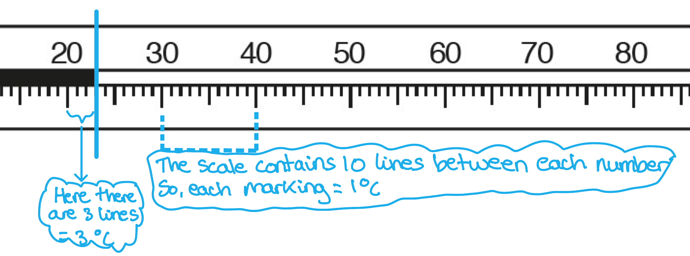
(i) Explain why the student should wait a few seconds after placing the thermometer in the hot water before taking the first temperature reading:

- The student should wait a few seconds to ensure that the thermometer / bulb / alcohol / mercury has reached the temperature of the water; **[1 mark]**

(ii) Complete the column headings in the table:

A table showing the completed column headings that would score 1 mark should look like this:

**Table 2.1**

| t/ **s** | *θ / ***°C** |
|---|---|
| 0 | 70 |
|   | 60 |
|   | 52 |
|   | 49 |
|   | 46 |
|   | 43 |

- Left-hand side column units are s / seconds

**   AND**

- RIght-hand side column units are °C; **[1 mark]**

** **

(iii) Complete the time column in the table:

List the known quantities:

- Temperature of hot water at time *t* = 0 recorded
- Temperature readings recorded every 30 s

A table that would score 1 mark should look like this:

| t/ **s** | *θ / ***°C** |
|---|---|
| **Final answer:** **0** | 70 |
| **Final answer:** **30** | 60 |
| **Final answer:** **60** | 52 |
| **Final answer:** **90** | 49 |
| **Final answer:** **120** | 46 |
| **Final answer:** **150** | 43 |

- All values of time correct; **[1 mark]**

(iv) Plot a graph of *θ */ °C (y-axis) against *t */ s (x-axis):

A graph that would score 4 marks should look like this:

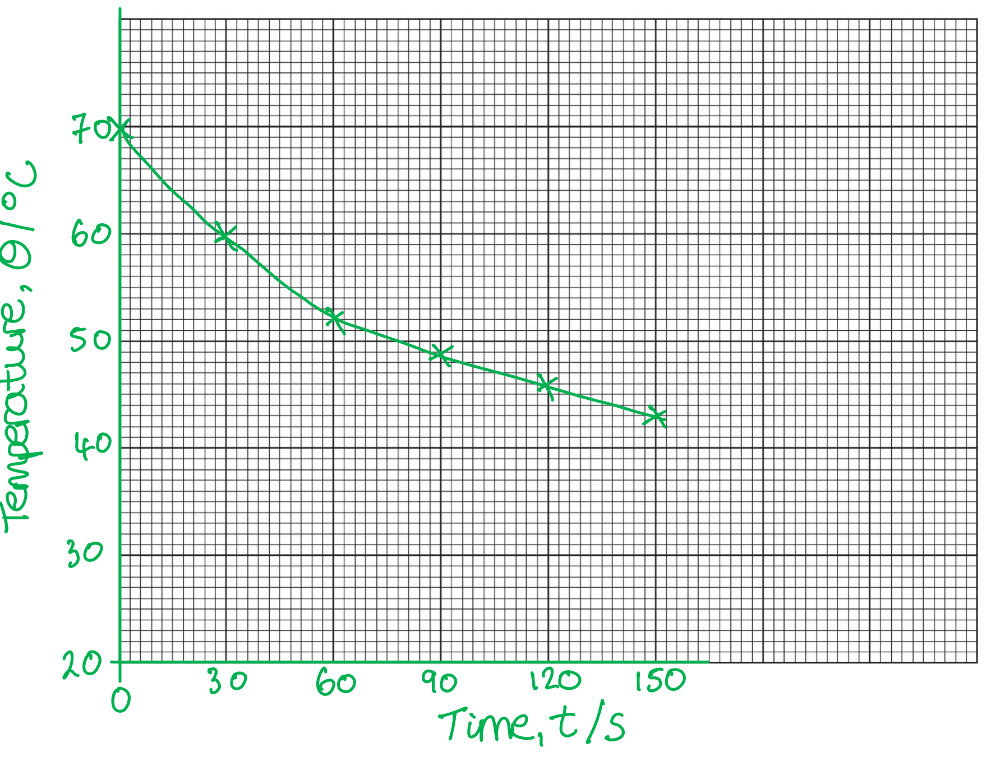

- Horizontal axis labelled time, *t ***AND** vertical axis temperature, *θ*; **[1 mark]**
- Scale starts below room temperature, *θ**R* **AND **increases in suitable even increments to cover more than half the axis space; **[1 mark]**
- All points plotted correctly using an 'x' **AND **accurate to within ½ a small square; **[1 mark]**
- Line of best fit drawn as a thin, continuous line **AND **passes through the 'x' of each point; **[1 mark]**

**[Total: 7 marks]**

> *In a results table, units are found in the **column heading only**.*

> *Key concepts to remember when plotting a graph:*

- *Time** is always on the **x-axis** (it tells us to do this!)*
- *Points should be plotted with an** 'x'*
- *The line of best fit must follow the natural exponential curve of the graph, this relationship is not a straight line*

> *Creating a scale for your graph:*

- *Step 1** consider time, **t*

  - *From the question, time is measured every 30 seconds*
  - *So, each square on the x-axis represents 30 seconds*
- *Step 2** consider temperature, **θ*

  - *Temperature range = 70 *$\rightarrow$* 23 (room temperature** required in the question**)*
  - *Increasing the temperature range from 20 *$\rightarrow$* 70 = 60 °C makes it easier to create a scale*
  - *There are 6 vertical spaces on the grid*
  - *So, each vertical space = 10 °C *
Draw a horizontal line across the graph grid to indicate the value of room temperature *θ*R:

A graph that would score 1 mark should look like this:

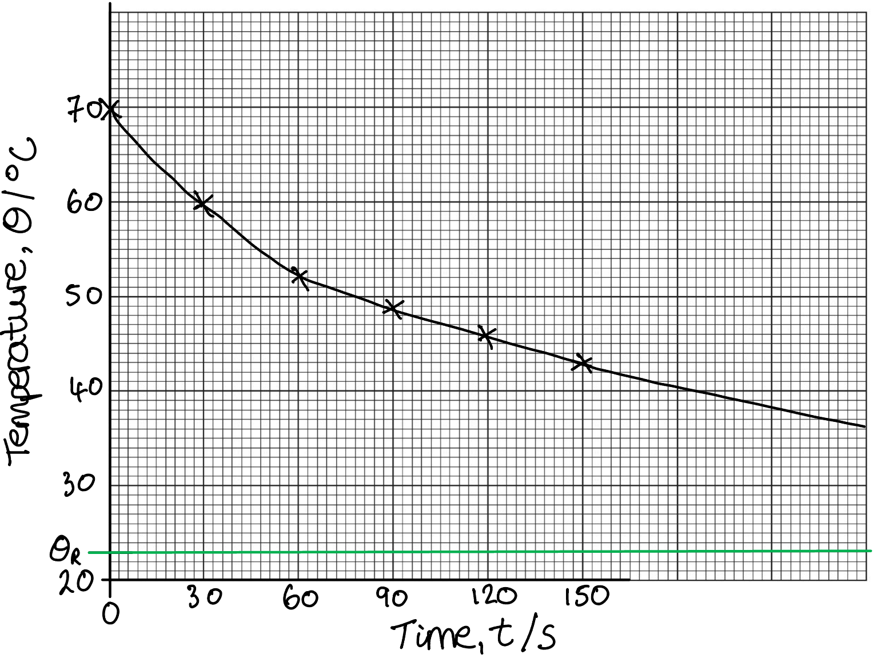

- Horizontal line drawn using a ruler at temperature, *θ *= 23 °C **[1 mark]**

**[Total: 1 mark]**
State two precautions that you would take in order to obtain accurate readings in this experiment:

Any **two **from:

- View the thermometer at right angles to the markings; **[1 mark]**
- Stir the water before taking a temperature reading; **[1 mark]**
- Don't let the thermometer bulb touch the side / bottom of the beaker; **[1 mark]**
- Wait for the thermometer to reach the temperature of the water before taking the reading; **[1 mark]**

**[Total: 2 marks]**

An experimental result **close** to the **accepted value** is considered accurate. Ponder the following results for an accepted value of *t *= 2 seconds:

- SET A: *t* = 5 s, 1 s, 8 s

**   OR**

- SET B: *t *= 2.1 s, 1.9 s, 2.0 s

Which results are more accurate?

Set B are more accurate, all the results are close to the accepted value.

A great way to remember this is to consider a **target,** an accurate archer will hit the middle every time but an inaccurate one will not:

Suggest two changes to the apparatus or the procedure that would increase the rate of cooling of the water:

**Any two from:**

- Start at a higher temperature / use hotter water; **[1 mark]**
- Use a metal can instead of a beaker as metal is a better conductor of heat; **[1 mark]**
- Lower the room temperature / use a cold water bath; **[1 mark]**
- Use a fan to cool the air temperature; **[1 mark]**
- Use a container for the water with a greater surface area / a larger beaker; **[1 mark]**

**[Total: 2 marks]**

> *The key to this question is recognising that increasing the rate of cooling expands the temperature range of the water. *

### Q3
Record the room temperature *θ*R, shown on the thermometer:

- *θ*R = 21 °C **[1 mark]**

**[1 mark]**

> *Draw** on the diagram to help read the scale. Do not read it from an angle, read it from **directly above.** **Count** the lines correctly.*

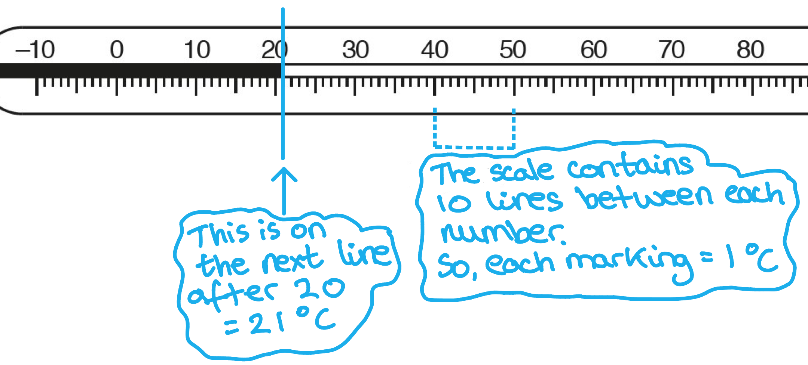
Complete the headings and the time *t* column in the table:

List the known quantities:

- Temperature *θ* measured every 30 s

A completed table that would score 2 marks should look like this:

**Table 1.1**

|   | beaker with lid **A** | beaker with lid **B** |
|---|---|---|
| t / **s** | *θ / ***°C** | *θ / ***°C** |
| **Final answer:** **0** | 80.0 | 81.0 |
| **Final answer:** **30** | 77.0 | 79.0 |
| **Final answer:** **60** | 74.5 | 77.5 |
| **Final answer:** **90** | 72.5 | 76.0 |
| **Final answer:** **120** | 70.5 | 75.0 |
| **Final answer:** **150** | 69.5 | 74.0 |
| **Final answer:** **180** | 68.0 | 73.5 |

Headings:

- Column 1 time has units of <u>seconds / s</u>

**   ****AND**

- Column 2 temperature has units of <u>°C</u>

** ****  AND**

- Column 3 temperature has units of <u>°C</u>; **[1 mark]**

Time:

- All values of time correct; **[1 mark]**

**[Total: 2 marks]**

In a results table, the units are found in the **column heading only**.
Describe a precaution that should be taken to ensure that the temperature readings are as accurate as possible in the experiment:

**Any one from:**

- The temperature value is read by an observer who is at a right angle to the reading on the scale, this avoids a parallax error; **[1 mark]**
- Wait until the liquid in the thermometer stops moving to record the temperature; **[1 mark]**

**[Total: 1 mark]**

> *When taking a measurement the observer will obtain **different values **based on where it was viewed from. E.g. when **observing** the volume of liquid in a measuring cylinder you can see how the different values are obtained: *

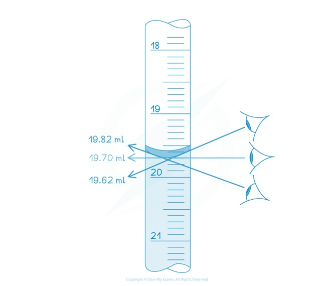

> *This is called a parallax error, which is a specific type of random error. It is random because, without predetermining an angle to view the volume from, the experimenter will view from a different, random angle each time. *
(i) Write a conclusion to this experiment and explain your results:

Conclusion:

- The beaker with lid **A **has a greater rate of cooling; **[1 mark]**

Explanation:

- This is because the temperature change of the beaker with lid **A **from *t *= 0 s to *t *= 180 s is greater than the beaker with lid **B**; **[1 mark]**

(ii) Suggest and explain a change to the **apparatus** that could produce a greater difference between the rates of cooling for lids **A** and **B**:

Suggest a change to the apparatus:

**Any one from:**

Reducing the temperature change for the beaker with lid **B **to increase the difference:

- Place on an insulating mat / have the sides insulated (to decrease temperature loss); **[1 mark]**
- Change the beaker to a plastic beaker (to decrease temperature loss); **[1 mark]**
- Use a thicker lid (to decrease temperature loss); **[1 mark]**

Increasing the temperature change for the beaker with lid **A** to increase the difference:

- Use a wider beaker (to increase temperature loss); **[1 mark]**
- Use a fan near the beaker (to increase temperature loss); **[1 mark]**

**  **

Explanation of the reason for the apparatus chosen:

**One mark for each correct explanation that corresponds with the change made**

Place the beaker with lid **B** on an insulating mat / have the sides insulated:

- This is because less thermal energy will be transferred through the sides / bottom of the beaker, reducing the rate of cooling; **[1 mark]**

Change the beaker with lid **B ** to a plastic beaker:

- This is because thermal energy only escapes from the surface of the beaker (because plastic is more insulating); **[1 mark]**

The beaker with lid **B **should use a thicker lid:

- This is because less heat will be conducted through the lid, reducing the rate of cooling; **[1 mark]**

The beaker with lid **A **should use a wider beaker;

- This is because there is a larger surface area from which evaporation can occur; **[1 mark]**

A fan should be used in the vicinity of beaker **A**;

- This will increase the temperature difference between the water and surrounding air, increasing the rate of cooling; **[1 mark]**

**[Total: 4 marks]**

This question requires you to consider increasing the cooling rate of beaker **A **but decreasing it for beaker **B**, this results in the **greatest temperature difference** between the water cooling in both beakers.  Adding insulation reduces the cooling effect. Increasing the surface area reduces the surrounding air temperature and increases the cooling effect.
Describe how his graph line will show whether the rate of cooling and the percentage of uncovered surface area are directly proportional:

- The graph will be a straight line; **[1 mark]**
- It will pass through the origin; **[1 mark]**

**[Total: 2 marks]**

Remember from **Maths**, a graph showing a directly proportional relationship is a straight line from bottom left to top right. If the student's graph looks like this, the rate of cooling and the percentage of uncovered surface area are directly proportional.

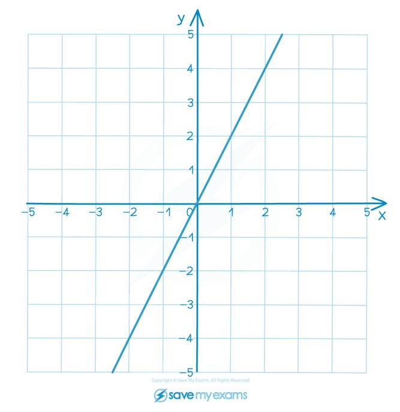
(f) Suggest one factor that they should keep the same if they are to obtain similar readings:

**Any one from:**

- Volume of water; **[1 mark]**
- Initial temperature of water; **[1 mark]**
- Use the same lids; **[1 mark]**
- Use the same type / material / size of beaker; **[1 mark]**
- Maintain the same room temperature / humidity; **[1 mark]**

**[Total: 1 mark]**

This is basically asking you to state a **control variable**, one thing you would keep the same.

## Multiple Choice Questions (34 questions)

### Q1
**Final answer:** **The correct answer is C**

- Use the equation for specific heat capacity:

$E=mc\Deltaθ$

- Rearrange to find *c*:

$c=\frac{E}{m\Deltaθ}$

- The temperature change is:

$\Deltaθ=50-20=30\text{°C}$

- Substitute the values:

$c=\frac{12600}{0.50\times30}$

$c=840\text{J/(kg °C)}$

### Q2
**Final answer:** **The correct answer is D**

- Evaporation occurs when molecules at the surface of a liquid gain enough energy to escape as a gas
- Blowing air across the surface removes the vapour molecules from above the liquid, preventing them from returning to the liquid and allowing more molecules to escape
- This increases the rate of evaporation

**A** is incorrect because cooling the liquid reduces the average kinetic energy of the molecules. Fewer molecules will have enough energy to escape from the surface, so the rate of evaporation decreases.

**B** is incorrect because covering the dish traps the vapour above the liquid. The vapour becomes saturated and molecules return to the liquid at the same rate as they leave, so the net rate of evaporation decreases.

**C** is incorrect because decreasing the surface area reduces the number of molecules at the surface that can escape. A larger surface area increases the rate of evaporation.

### Q3
**Final answer:** **The correct answer is C**

- When water is heated, its temperature rises as the internal energy of the water molecules increases
- When the water reaches its boiling point (100 °C at standard atmospheric pressure), the temperature remains constant
- At the boiling point, the energy supplied is used to break the intermolecular bonds and change the state from liquid to gas, rather than to increase the temperature
- This is why the temperature stays at 100 °C until all the water has boiled

**A** is incorrect because the rate of temperature increase is not constant. It depends on the mass of water remaining and heat losses to the surroundings. More importantly, the temperature stops increasing entirely at the boiling point.

**B** is incorrect because the temperature does not continue to increase above the boiling point while liquid water is still present. All the energy goes into the change of state.

**D** is incorrect because boiling only occurs at the boiling point (100 °C), not at room temperature. The water must first be heated to this temperature before it begins to boil.

### Q4
**Final answer:** **The correct answer is A**

- Molecules in a liquid have a range of different speeds and kinetic energies
- During evaporation, only the molecules with the highest kinetic energy (the fastest moving) have enough energy to break the bonds at the surface and escape into the air
- Since the fastest molecules have left, the total kinetic energy of the water that stays behind is lower
- This results in a lower average speed for the molecules remaining in the puddle, which causes the temperature of the liquid to decrease

**B** is incorrect because if the slower (less energetic) molecules escape, the average speed of the remaining molecules would increase.

**C** is incorrect as the average speed cannot increase when the most energetic particles are being removed from the system.

**D** is incorrect because the less energetic molecules do not have sufficient energy to overcome attractive forces and escape the surface of the liquid.

### Q5
**Final answer:** **The correct answer is A**

- Heating the air transfers thermal energy to the particles, increasing their average kinetic energy, which results in an **increase **in **temperature**

  - Therefore, **C** and **D** can be eliminated
- As the temperature rises, the air particles move faster and hit the piston more frequently and with greater force
- Because the piston is frictionless and moveable, it moves outwards, which **increases** the **volume** of the air and allows the pressure to remain constant

  - Therefore, **A** is correct

**B** is incorrect as heating a gas at constant pressure causes it to expand, not contract.

**C** is incorrect because the application of heat results in a temperature increase, not a decrease.

**D** is incorrect as both temperature and volume increase when a trapped gas is heated and allowed to expand against a moveable piston.

### Q6
**Final answer:** **The correct answer is ****B**** because:**

- Evaporation occurs when the more energetic particles escape from the surface of a liquid (in this case, water)

  - Therefore, statement **2** is correct
- This reduces the average energy of the particles in the remaining liquid
- Temperature is related to the energy of the particles, so the remaining liquid will cool to a lower temperature as the more energetic particles escape

  - Therefore, statement **1** is correct

This type of question can be tricky because of the way it is asked. The best way to tackle it is to read through the whole question, then place a tick alongside each correct statement and a cross next to each statement that is definitely incorrect. Finally, look at the answers again and check which one matches your conclusions. If none of the answers match your conclusions exactly, then start again.

Statement 3 is incorrect: evaporation of a liquid happens at any temperature, but increases as the liquid becomes hotter. This means that statements 1 and 2 are correct and statement 3 is incorrect.

### Q7
**Final answer:** **The correct answer is B**

- The rate of evaporation depends on

  - the temperature of the liquid
  - the surface area of the liquid
  - the amount of air movement
- Both containers of water have the same temperature and experience the same amount of air movement

  - Therefore, in this case, the rate of evaporation depends** only** on the surface area
- Container 1 has a **greater** surface area of water than container 2, so it has a greater rate of evaporation

  - This eliminates options **C** and **D**
- The rate of evaporation can be increased by increasing the water temperature

  - This eliminates option **A**

### Q8
**Final answer:** **The correct answer is C**

- When a substance is heated at constant pressure, it **expands**
- This means its volume **increases**
- This applies to **all** states of matter, i.e. solids, liquids and gases
- Therefore, the volume of liquid metal and solid metal will both increase when heated

### Q9
**Final answer:** **The correct answer is B**

- The melting and boiling points of pure water are **fixed points**
- This means a correctly calibrated liquid-in-glass thermometer should show

  - a reading of 0°C for a beaker of pure melting ice
  - a reading of 100°C for a beaker of pure boiling water
- The upper fixed point on the thermometer is 100°C, so this could be checked by putting the bulb in a beaker of boiling pure water

**A** & **C** are incorrect because the melting and boiling points of a mixture of water (or ice) and salt are not fixed points

**D** is incorrect because the question asks how to check the upper fixed point, not the lower one

### Q10
**Final answer:** **The correct answer is B**

- When air is blown over the wet gauze wrapped around thermometer Q, the water will **evaporate**

  - This eliminates options **A** and **C**
- During evaporation, the most energetic molecules become water vapour (gas molecules) and escape, taking the energy with them

  - As a result, this **cools **the wet gauze and thermometer bulb
  - Hence, the temperature reading on thermometer Q will **decrease**
- Therefore, thermometer P will show a **higher** temperature reading than thermometer Q

### Q11
**Final answer:** **The correct answer is C**

- Boiling only occurs at a liquid’s boiling point

  - This happens throughout the liquid
  - Eliminate options **A** and **B**
- Evaporation happens at temperatures below boiling point

  - Only the particles at the surface can escape
  - Eliminate option **D**

### Q12
**Final answer:** **The correct answer is A**

- List the known quantities:

  - Mass, 2.0 kg
  - Thermal energy transferred, ΔE =  12 000 J
  - Specific heat capacity, *c* =  385 J/kg °C
- The thermal energy transferred to a material is given by

ΔE=mcΔθ

- Rearrange for the change in temperature:

Δθ=$\frac{\DeltaE}{mc}$

- Substitute these values into the equation for temperature change

$\Deltaθ=\frac{12000}{2.0\times385}$

$\Deltaθ=16^{\circ}C$ (2 s.f.)

- This is option **A**

Make sure you are comfortable rearranging this equation for any of the terms. Practise this before your exam.

### Q13
**Final answer:** **The correct answer is B**

- If the cap becomes easier to remove, the ring of metal around the bottle must loosen

  - To do this, either the metal must expand or the bottle must shrink
  - Eliminate options **A** and **D**
- When heated, all objects expand including

  - This includes the glass bottle which is heated and therefore expands
  - Eliminate option **C**
  - The metal cap must expand to a greater degree than the glass

> *This is a common scenario to be asked about, as you need to really understand thermal expansion. All substances expand when heated, but metal expands to a greater degree than most other solids. *

> *One common example is heating a metal with a hole drilled into it. Many students think the hole will shrink as the metal expands, but the hole gets larger. This is because the particles around the edge of the hole move further from one another, increasing the circumference of the hole.*

### Q14
**Final answer:** **The correct answer is A**

- Condensation is when a substance cools and changes from a gas into a liquid
- This can be seen on the outside of the glass of a cold drink

  - The cold glass cools the water vapour (gas) in the air and changes it into water droplets (liquid)

**B** is incorrect because conduction is a type of heat transfer involving the vibrations of particles in a medium

**C** is incorrect because convection is a type of heat transfer involving the movement of particles in a liquid or gas

**D** is incorrect because evaporation is when a substance is heated and changes from a liquid into a gas

### Q15
**Final answer:** **The correct answer is ****B**** because:**

- Expansion happens because the atoms gain energy and move faster
- Therefore, the space between the atoms increases

It is a common misconception that the size of the atoms / molecules / particles increases with expansion. This is not true! As the particles move more and more with the gain in energy, the space between the particles increases. This is true for a solid, a liquid, and a gas.

### Q16
**Final answer:** **The correct answer is ****D**** because:**

- Evaporation happens when the **most** **energetic** particles **leave** the **surface** of a liquid.
- As these particles leave, they take their energy with them.
- Since **temperature** is the **average** **kinetic** energy per molecule in a substance, the removal of this energy causes the **average kinetic energy to fall,** thus reducing the temperature**.**

**A **is incorrect as there will always be more energetic molecules. True: evaporation will happen less at lower temperatures, but it will still happen (think about puddles evaporating outside in winter!).

**B **is incorrect as evaporation only happens from the surface of a liquid. The molecules have to be on the surface to escape.

**C **Is incorrect as evaporation will also happen in dense liquids. Even mercury.

### Q17
**Final answer:** **The correct answer is ****D**** because:**

- Internal energy is the total energy stored inside a system by the particles that make up that system due to their motion and positions

- Therefore, increasing the temperature of a substance:

  - increases the average speed of the particles
  - which increases the average kinetic energy of the particles
  - which increases the internal energy of the substance

### Q18
**Final answer:** **The correct answer is ****C**** because:**

- 0°C is the freezing point of pure water (or the melting point of pure ice, if you prefer)
- 100°C is the boiling point of pure water
- These are the points around which the rest of the Celsius scale is defined

**A **is incorrect as no common temperature scale uses the boiling point of salt water to define it.

**B **is incorrect as these are the fixed points of the original Fahrenheit temperature scale (they have since been adjusted slightly).

**D **is incorrect as these points are used in the Kelvin temperature scale.

### Q19
**Final answer:** **The correct answer is ****C**** because:**

- The **temperature** of a cooling substance will remain **constant** while it changes state.
- This is because any energy lost is forming bonds between the molecules, rather than reducing the average kinetic energy of the molecules in the substance.
- The flat area on the graph represents a phase change.
- There is a second phase change at a lower temperature.
- This means that the first phase change *must *be **condensation**, while the second phase change must be **freezing**.

**A **is incorrect as this would be represented by the initial, sloped part of the graph.

**B **is incorrect as this would be represented by the second flat part of the graph.

**D **is incorrect as this would be represented by the middle sloped part of the graph.

### Q20
**Final answer:** **The correct answer is ****D ****because:**

- The substance will be partly liquid and partly gas during its boiling phase change.
- The temperature of a substance does not change during a phase change, so these are shown by flat sections on the graph.
- The first flat section will represent the melting phase change, so we are interested in the second flat section.

**A **is incorrect as this shows the solid rising in temperature.

**B **is incorrect as this shows the solid melting.

**C **is incorrect as this shows the liquid rising in temperature*.*

### Q21
**Final answer:** **The correct answer is ****B**** because:**

- Evaporation happens to molecules which:

  - Have a high energy
  - Are at the surface of a liquid.
- Molecule B fulfils both of these criteria.

**A **is incorrect as although this molecule is moving quickly, it is nowhere near the surface. It might have the energy to escape, but it has nowhere to escape *to*.

**C **is incorrect as whilst this molecule is at the surface of the pool, its energy is not high enough to escape; it simply isn't moving fast enough.

**D** is incorrect as this molecule has nowhere to escape to, and it doesn’t have the energy to move fast either.

### Q22
**Final answer:** **The correct answer is ****C ****because:**

- Specific heat capacity is the energy required to raise the temperature of 1 kg of a substance by 1℃.
- $Q=mc\DeltaT$
- If energy is supplied at the same rate to equal masses of liquid, then the one with the lower specific heat capacity will show the greater temperature change, as it requires less energy to increase its temperature by 1℃
- This means that the substance with the steeper gradient on the graph will have the lower specific heat capacity.
- Therefore X has a lower specific heat capacity than Y.

**A **is incorrect as we have no information about the melting point of either substance.

**B **is incorrect as X actually boils sooner than Y.

**D **is incorrect as X has the higher boiling point.

### Q23
**Final answer:** **The correct answer is ****D ****because:**

- Heating objects causes them to expand.
- A hot, and slightly larger, iron ring could then be placed on the barrel, and allowed to cool.
- When the iron ring cools it contracts, becoming tight around the barrel.

**A **is incorrect as heating the barrel would cause it to expand, making it more difficult to fit the iron rings around it.

**B **is incorrect as cooling the iron ring would cause it to contract, making it more difficult to fit around the barrel.

**C **is incorrect as soaking the barrel in water would cause it to expand, making it more difficult to fit the iron ring around it.

### Q24
**Final answer:** **The correct answer is ****A**** because:**

- The rate of evaporation from a surface is increased by:

  - A draught over the surface,
  - Higher temperatures,
  - A greater surface area of liquid exposed to the air.
- On a windy day, the drought is greater than on a still day, and on a warm day the temperature is higher than on a cool day. Both of these factors contribute to an increased rate of evaporation.

**B **is incorrect as a still day will not increase the rate of evaporation, although the high temperature will.

**C **is incorrect as the low temperature will not increase the rate of evaporation, although the wind will.

**D **is incorrect as both of these conditions reduce the amount of evaporation from the saucer.

### Q25
**Final answer:** **The correct answer is ****B ****because:**

- When metals become warm, they expand. When metals become cold, they contract.
- If the wire is already tight between the pylons, then any contraction of the wire could cause it to break.

**A **is incorrect as this could, and would happen if the weather became **warmer**, not colder.

**C **is incorrect as the temperatures over which weather can change are not likely to make the wire brittle enough to break.

**D **is incorrect as the wire does contract, but, if anything, its resistance would **decrease**, as resistance falls with temperature.

### Q26
**Final answer:** **The correct answer is ****B ****because:**

- The temperature of a solid material cannot increase above its melting point.
- The melting point of ice is 0 ℃, therefore, since its surroundings are warmer than it is, any solid ice **must** be at a temperature of 0 ℃.

Since the temperature of the solid ice cannot increase above 0 ℃, all of the other answers must be discounted.

### Q27
**Final answer:** **The correct answer is ****D ****because:**

- Thermal capacity is defined as *mass* x *specific heat capacity.*

- The energy required to change the temperature by 20℃ is *thermal capacity* x 20.
- Since block 2 has the higher thermal capacity, it requires more energy to raise its temperature by 20℃.
- Exactly the same argument is true in reverse: if it took more energy to raise its temperature, and that energy is now sitting in the internal energy of block 2, all that energy has to come out again for the temperature to drop back to room temperature.
- Therefore, block 2 will also lose more energy as it cools.

Each of the other answers involves block 1 gaining or losing more energy, and can therefore be discounted.

### Q28
**Final answer:** **The correct answer is ****A**** because:**

- Evaporation happens when the most energetic particles leave the surface of the swimming pool.
- As these particles leave, they take their energy with them.

Since temperature is the average kinetic energy per molecule in a substance, the removal of this energy causes the **average kinetic energy to fall**, thus **reducing the temperature**

**B** is incorrect as temperature does not stay the same when evaporation takes place.

**C** is incorrect as temperature does not increase when evaporation takes place.

**D** is incorrect as if temperature falls, the average kinetic energy per molecule must also fall, it cannot stay the same.

### Q29
**Final answer:** **The correct answer is ****A**** because:**

- The equation governing this question is change in energy = 
$mc\DeltaT$

  - $35,000=0.750\times4200\times(T_{f}-13)$
  - $\frac{35,000}{0.75\times4200}+13=T_{f}$
- Therefore, $T_{f} = 24.1 ℃$, which is 24℃ to the nearest degree.

**B **is incorrect as if the energy is not converted to Joules, you’ll get this answer.

**C **is incorrect as if the multiplication is done incorrectly, this answer is obtained.

**D **is incorrect as this answer is the temperature *change*, rather than the final temperature.

### Q30
**Final answer:** **The correct answer is ****D ****because**

- The lower fixed point on the Celsius scale is the melting point of pure ice.
- This happens at 0℃.

The other answers do not correspond to the lowest fixed point of the Celsius scale.

### Q31
**Final answer:** **The correct answer is ****B ****because:**

- As the iron cube is heated, it will expand.
- This means its volume will **increase**.
- Its mass will stay the same, as no iron is being added or taken away.
- Since  $density=\frac{mass}{volume}$, the density will decrease.

**A **is incorrect as mass remains constant, as no iron is being added or taken away.

**C **is incorrect as volume **increases**, it does not decrease.

**D **is incorrect as the block’s internal energy will **increase **as its temperature rises; it does not decrease.

### Q32
**Final answer:** **The correct answer is ****A**** because:**

- The total energy stored inside a system is due to the particles that make up that system having motion and positions relative to each other

  - This is the internal energy of a substance

### Q33
**Final answer:** **The correct answer is ****A ****because:**

- Specific heat capacity is the energy required to raise the temperature of 1 kg of a substance by 1 ℃.
- $Q=mc\DeltaT$

**B **is incorrect as this is the definition of **thermal capacity**.

**C **is incorrect as this isn’t the definition of anything, quite, but it’s similar to the coefficient of thermal expansion.

**D **is incorrect as this is the definition of **latent heat of vaporisation**.

### Q34
**Final answer:** **The correct answer is ****C ****because:**

- The energy required to raise the temperature of a substance by 1 ℃ is given by its *thermal capacity*, *mc*.
- If the temperature of P increases by less than the temperature of Q when the same amount of energy is supplied to both, its thermal capacity must be greater.

**A **is incorrect as being a better thermal conductor has nothing to do with the amount by which its temperature will change. It might reach equilibrium quicker, but the final temperature will not be affected.

**B **is incorrect as being a better thermal conductor has nothing to do with the amount by which its temperature will change. It might reach equilibrium quicker, but the final temperature will not be affected.

**D **is incorrect as discussed above, P has the higher thermal capacity.

## Theory Questions (18 questions)

### Q1
> **[mark-scheme]**
> - Energy required to raise the temperature (of a substance) **[1 mark]**
> - Per unit mass per unit temperature change **[1 mark]**
> 
> Accept: "energy transferred per unit mass per unit temperature change" for both marks
> 
> Accept: "energy needed to raise the temperature of 1 kg of a substance by 1 °C" for both marks
> 
> "Energy per unit temperature change" scores 1 mark max. Must mention "per unit mass" for the second mark
> 
> Do not accept: just the equation $c=\frac{E}{m\Deltaθ}$ without words
To calculate the specific heat capacity of aluminium:

- List the known quantities:

  - Power of heater, $P=48W$
  - Time, $t=20\mathrm{min}$
  - Mass of aluminium block, $m=2.0\mathrm{kg}$
  - Temperature change, $\Deltaθ=45-20=25^{\circ}C$
- Convert the time to seconds:

$t=20\times60=1200\text{s}$

- Calculate the energy supplied by the heater:

$E=Pt$

$E=48\times1200=57600\text{J}$ **[1 mark]**

- Use the equation for specific heat capacity to find $c$:

$c=\frac{E}{m\Deltaθ}$ **[1 mark]**

$c=\frac{57600}{2.0\times25}$

$c=$ $1150\text{J/(kg °C)}$ **[1 mark]**

> **[mark-scheme]**
> 1 mark for converting the time to seconds (1200 s) **AND** using $E = P t$ to calculate the energy supplied (57 600 J)
> 
> 1 mark for correct equation **OR** correct substitution
> 
> - Accept $c=\frac{E}{m\Deltaθ}$ or $\frac{57600}{2.0\times25}$
> 
> 1 mark for a correct final answer of $1150\text{J/(kg °C)}$
> 
> - Accept $1152\text{J/(kg °C)}$
> - Accept $\text{J/(kg K)}$ as the unit
> 
> Full marks can be scored for the correct answer alone
> **[mark-scheme]**
> - Thermal energy is transferred to the surroundings **OR** not all thermal energy is transferred to the block **[1 mark]**
> 
> Accept: "energy is lost by conduction/convection/radiation to the surroundings"
> 
> Do not accept: "energy is lost" without stating where it is lost to (must mention surroundings or air)

> **[exam-tip]**
> For the calculated value ($1152  \text{J/(kg °C)}$) to be higher than the accepted value ($900  \text{J/(kg °C)}$), the energy that was transferred to the block must be less than $57  600  \text{J}$. This makes the numerator too large, so the calculated specific heat capacity is too high. Whenever a "suggest" question asks about experimental error, think about energy losses first — this is the most common source of error in thermal experiments.
> **[mark-scheme]**
> - Particles gain kinetic energy **OR** particles vibrate more / faster **[1 mark]**
> - Internal energy increases (because the kinetic energy of the particles increases) **[1 mark]**
> 
> Accept "molecules" or "atoms" for "particles"
> 
> Do not accept "particles move faster" without specifying vibration (in a solid, particles vibrate — they do not move about freely)

> **[exam-tip]**
> In a solid, the particles vibrate about fixed positions — they do not move freely like gas particles. When the temperature increases, the particles vibrate more vigorously, which means their kinetic energy increases. Internal energy is the total kinetic and potential energy of all the particles, so the internal energy increases. Avoid circular reasoning such as "internal energy increases because it gets hotter" — you must explain the mechanism in terms of particle motion.

### Q2
> **[mark-scheme]**
> In a liquid, particles:
> 
> - The arrangement is random / irregular / no fixed pattern **[1 mark]**
> - The particles are close together / touching  **[1 mark]**
> - They move / slide past each other  **[1 mark]**
> **[mark-scheme]**
> (i) The process is:
> 
> - Evaporation **[1 mark]**

> **[exam-tip]**
> Evaporation occurs when more energetic particles escape from the surface of a liquid, which results in cooling of the liquid, i.e. thermal energy is transferred from the surface of the water to the air above.

> **[mark-scheme]**
> (ii) To reduce the total rate of thermal energy loss from the water:
> 
> Any **two **from (one mark for each point):
> 
> - Put a lid on the beaker
> - Insulate/wrap the beaker
> - Use a container with lower thermal conductivity
> - Reduce surface area exposed to air
> - Place in warmer surroundings
> 
> **[2 marks]**
> **[mark-scheme]**
> (i) Thermal energy is transferred through the glass of the beaker by:
> 
> - Conduction **[1 mark]**
> 
> (ii) A convection current forms in the water in the beaker when:
> 
> - Cooler water from the surface moves downward/sinks **[1 mark]**
> - (Because) cooler water is denser (than warmer water) **[1 mark]**
> - Warmer water from below moves upward/rises **[1 mark]**
> - (Because) warmer water is less dense **[1 mark]**
> 
> (iii) Convection is useful in:
> 
> Any **one **from (one mark per point):
> 
> - Heating a room (with a radiator/heater)
> - Heating water in a kettle/pan
> - Cooling systems/refrigerator/air conditioning
> - Sea breeze **OR** land breeze
> - Hot air balloon rising
> 
> **[1 mark]**
> 
> Any reasonable suggestion will gain the mark.

### Q3
Boiling point is defined as

- The temperature; **[1 mark]**
- At which a liquid becomes a gas **OR** a liquid and gas exist together; **[1 mark]**

**Total: [2 marks]**
(i) Calculate the thermal energy produced by the heater in 60 s:

List the known quantities:

- Voltage of the supply, *V* = 230 V
- Current in the heater, *I* = 13 A
- Time, *t *= 60 s

The thermal energy is equal to the electrical energy transferred:

- *E* = *VIt*
- *E* = 230 × 13 × 60 **[1 mark]**
- *E* = 1.8 × 105 J **[1 mark]**

(ii) Calculate the rate at which water at its boiling point emerges from the tap:

Calculate the change in temperature of the water:

- The water enters the tap at 22 °C and leaves the tap at the boiling point of water
- The boiling point of water is 100 °C
- Therefore, Δ*T* = 100 – 22 = 78 °C **[1 mark]**

Determine the equation for the mass of water leaving the tap each second:

- The rate is equal to the amount, or mass, of water, leaving the tap each second, or $\frac{m}{t}$
- Rearrange the equation for specific heat capacity $E=mc\DeltaT$ for the mass $m=\frac{E}{c\DeltaT}$**[1 mark]**
- Using the equation for power  $P=\frac{E}{t}$ the rate can be found by dividing each side of the equation by time
- Rate =  $\frac{m}{t}$= $\frac{E}{c\DeltaTt}$=  $\frac{E}{t}\frac{1}{c\DeltaT}=\frac{P}{c\DeltaT}$

Calculate the mass of water leaving the tap each second:

- List the known quantities

  - Power, *P* = *VI* = 230 × 13
  - Specific heat capacity of water, *c* = 4200 J/(kg °C)
- Rate =   $\frac{P}{c\DeltaT}$=  $\frac{230\times13}{4200\times78}$ **[1 mark]**
- Rate = 9.1 × 10–3 kg/s **[1 mark]**

**Total: [6 marks]**

> *You may also gain the marks by calculating the energy transferred in 1 second, then substituting this into **E** = **mc**Δ**T** and rearranging to find mass leaving each second.*

### Q4
Evaporation cools the water in the cloth because:

- The faster / higher speed / more energetic molecules escape (into the air); **[1 mark]**
- Temperature is related to the speed / energy of molecules;**[1 mark]**
- The slower / lower speed / less energetic molecules remain (in the water) **OR** the average speed / average kinetic energy of the molecules decreases; **[1 mark]**
- Therefore, the average temperature of the water in the cloth decreases

**Total: [3 marks]**

### Q5
(i) Two ways in which boiling differs from evaporation:

**Any two from:**

Describe boiling:

- It occurs <u>throughout</u> the liquid **OR**** **<u>bubbles</u> formed; **[1 mark]**
- Only one temperature / boiling point; **[1 mark]**
- Does not produce cooling **OR**** **unaffected by draught / surface area / humidity; **[1 mark]**

(ii) How volatile liquids cool the skin:

Describe evaporation:

- More energetic molecules (gain energy and) escape (from the liquid) **OR**** **overcome intermolecular forces / break bonds; **[1 mark]**
- The average speed decreases **OR**** **molecules with less (kinetic) energy are left behind ; **[1 mark]**
- Temperature of liquid decreases ; **[1 mark]**
- Thermal energy is conducted/gained <u>from</u> the skin / body **OR**** **lost <u>by</u> skin / body; **[1 mark]**

**[Total: 6 marks]**
Liquids are incompressible because:

- The molecules are touching **OR**** **there is no space between molecules; **[1 mark]**
- There are large repulsive/intermolecular forces (which stop them being moved closer); **[1 mark]**

**[Total: 2 marks]**

### Q6
(i) To calculate energy required to raise the temperature:

List the known quantities:

- Mass of gas, *m* = 0.23 g
- Specific heat capacity of the gas, *c* = 0.72 J / (g °C)
- Change in temperature, Δ*T* = 550 °C

Recall the equation linking energy and specific heat capacity:

- $E=mcΔT$* ***[1 mark]**

Substitute the values and calculate:

- $E=0.23\times0.72\times550$
- $E=91.08$

Round the answer to two significant figures and include the units:

- Energy, *E* = 91 J **[1 mark]**

(ii)

**1.** To calculate the time taken to supply the energy:

List the known quantities:

- Energy, *E* = 91 J
- Power, *P* = 2.4 W

Recall the equation for power:

- $P=\frac{E}{t}$ **[1 mark]**

Rearrange to make time the subject by multiplying both sides by t and then dividing by P:

- $E=P\timest$
- $t=\frac{E}{P}$

Substitute the values and calculate:

- $t=\frac{91}{2.4}$
- $t=37.92$

Round the answer to two significant figures and include the units:

- Time, *t *= 38 s **[1 mark]**

**2.** Reasons it will take longer than the estimate above:

- Thermal/heat energy also heats up/is dissipated to the cylinder / piston / heater / surroundings; **[1 mark]**

**[Total: 5 marks]**

> *Since experiments, machinery and electronics always lose energy as thermal energy is dissipated to the surroundings, you can almost guarantee being asked about this in your exam.*

> *You should have done experiments in class where you can feel for yourself that the heat escapes. Other ways of testing this are simply to feel the way your phone, laptop or car gets hot while in use.*

> *The phrase 'thermal energy is dissipated to the surroundings' is a very useful one - be ready to use it!*
(i) To state and explain what happens to the piston:

First state the direction of movement:

- The piston moves to the right / away from heater **OR **accelerates (to right); **[1 mark]**

Explain the cause of this movement:

- The pressure of the gas is greater on the left **OR **the resultant force is to the right; **[1 mark]**

(ii) To determine the final volume of gas:

List the known quantities (given in part (a)):

- Initial volume, *V**1* = 1.9 × 10–4 m3
- Initial pressure, *P**1* = 2.9 × 105 Pa
- Final pressure, *P**2* =  1.0 × 105 Pa

Since temperature is constant, use the equation relating pressure and temperature (Boyle's Law):

- $P_{1}V_{1}=P_{2}V_{2}$ **[1 mark]**

Rearrange by dividing by *P**2* to make final volume *V**2*  the subject:

- $V_{2}=\frac{P_{1}V_{1}}{P_{2}}$

Substitute the values and calculate:

- $V_{2} = \frac{( 2.9 \times 10^{5 ) \times ( 1.9 \times 10^{-4} } )}{( 1.0 \times 10^{5} )}$ **[1 mark]**
- $V_{2}=5.51\times10^{-4}$

Round the answer to two significant figures and include the units:

- Final volume, *V**2* = 5.5 × 10−4 m3 **[1 mark]**

**[Total: 5 marks]**

- *Don't get confused by the initial and final values for pressure and volume, make sure you understand what is happening to the gas in this question*
- *After the temperature has increased, but before the catch is released, the pressure inside the cylinder, **P**1** = 2.9 × 10**5** Pa and the volume has not changed from part a), so **V**1** = 1.9 × 10**–4** m**3*
- *When the catch is released, the piston will move, the volume of gas will increase and the pressure will decrease*
- *The piston will stop moving when the pressure inside the cylinder is equal to the pressure outside the cylinder, i.e. atmospheric pressure, so **P**2* =  1.0 × 105 Pa

### Q7
State three factors that determine the rate of evaporation of water:

**Any three from:**

- Temperature (of the liquid / water); **[1 mark]**
- Surface area (of the liquid / water); **[1 mark]**
- Movement of air (over the surface of the liquid / water); **[1 mark]**
- Temperature of the <u>surroundings</u>; **[1 mark]**
- Humidity (of the surrounding air); **[1 mark]**

**[Total: 3 marks]**
To explain why evaporation cools surfaces:

**Any two from:**

- More energetic / faster molecules escape (from the surface of the water); **[1 mark]**
- Less energetic / slower molecules remain; **[1 mark]**
- The water is colder (than the body of the person); **[1 mark]**
- Thermal energy is transferred from the person's body / skin to the water (causing the person to feel colder); **[1 mark]**
- Evaporation requires the latent heat of vaporisation; **[1 mark]**

**[Total: 2 marks]**

### Q8
Specific heat capacity is:

- (The quantity of) energy / heat required to raise the temperature by 1°C; **[1 mark]**
- Of 1 kg of a substance; **[1 mark]**

**[Total: 2 marks]**
The student also needs to take readings of:

- Initial **AND** final temperature

**OR**

- Change in temperature; **[1 mark]**

**[Total: 1 mark]**
Calculate the change in temperature:

Determine the temperature readings:

- Initial temperature = 20°C **[1 mark]**
- Final temperature = 46°C **[1 mark]**

Calculate the change in temperature:

- Change in temperature = final − initial
- Change in temperature = 46 − 20 = 26°C **[1 mark]**

**[Total: 3 marks]**
Calculate the specific heat capacity and give the correct units:

List the known quantities:

- Mass of block, $m$ = 0.796 kg (from part (b))
- Energy supplied, $\DeltaE$ = 18 792 J (from part (b))
- Change in temperature, $\Deltaθ$ = 26°C (from part (c))

Determine the specific heat capacity:

- $c=\frac{\DeltaE}{m\Deltaθ}$ **[1 mark]**
- $c=\frac{18792}{0.796\times26}$ **[1 mark]**
- $c=908$**[1 mark]**

Give the correct units:

- J/kg °C** [1 mark]**

### Q9
Write the changes of state on the dotted lines:

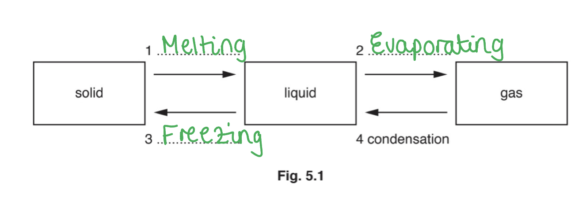

1. Melting; **[1 mark]**
2. Boiling / evaporating / evaporation; **[1 mark]**
3. Freezing; **[1 mark]**

**[Total: 3 marks]**

> *If you struggle with remembering these processes, try and visualise **water** changing between solid, liquid and gas. Water changes from liquid to gas in a kettle or pan and changes from liquid to solid in a freezer. It is likely that you will see water change state most days (depending on how many cups of tea you make!). This may jog your memory for the names of different processes. *
Explain why the water cools:

Any **three** from:

- (During evaporation) the particles with the <u>highest energy escape</u> from the surface of the liquid; **[1 mark]**
- (As a result of this,) the <u>average</u> kinetic energy of molecules in the liquid <u>decreases</u>; **[1 mark]**
- The temperature of the liquid decreases; **[1 mark]**
- Energy transfers from the water (on the bench) to the liquid (in the beaker, so the water cools and freezes); **[1 mark]**

**[Total: 3 marks]**

> *When you hear about the average kinetic energy decreasing, it can be hard to visualise. The kinetic energy of the other particles is unchanged, but the highest energy particles are no longer there to increase the average kinetic energy.*

> *This can be simplified by thinking of just a few particles. In any material, the particles have a **range** of kinetic energies. During evaporation, those with the highest kinetic energies are able to escape the liquid.*

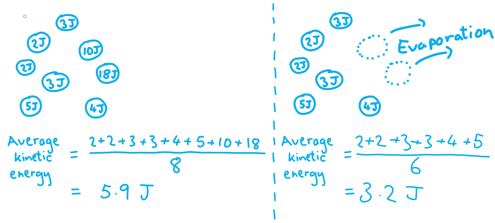

> *As you can see, when the higher energy particles leave, the average kinetic energy decreases even though the kinetic of other particles is unchanged.*

### Q10
(i) Suggest a material and explain how it improves the accuracy of the experiment:

**Any suitable insulating material, including any one from:**

- Wool; **[1 mark]**
- Polystyrene; **[1 mark]**
- Glass; **[1 mark]**
- Foam; **[1 mark]**
- Plastic; **[1 mark]**
- Cardboard; **[1 mark]**

** Explanation:**

- It reduces thermal energy store transfer / heat loss into the surroundings; [1 mark]
- More electrical energy is transferred into the block **OR **the block is an insulator / poor conductor; [1 mark]

(ii) State how the student could further improve the accuracy of the experiment:

- Add insulation to the top of the block; **[1 mark]**

**[Total: 4 marks]**

> *To answer questions about an experiment well, think carefully about each aspect of the equipment set up. *
Calculate the specific heat capacity of iron:

List the known quantities:

- Potential difference, p.d., *V *= 12 V
- Current, *I *= 3.8 A
- Mass, *m *= 2.0 kg
- Time, *t *= 10 minutes
- Initial temperature, *T**1* = 25 °C
- Final temperature, *T**2* = 55 °C

Convert the time from minutes into seconds:

- There are 60 seconds in 1 minute
- So, in 10 minutes there are 10 × 60 = 600 seconds

Recall the equation for energy input, *E *in terms of potential difference, *V, *current, *I* and time, *t *and substitute the known quantities:

- $E=VIt$
- $E=12\times3.8\times600$
- *E *= 27 360 J = 27 000 J (2 s.f.) **[1 mark]**

Calculate the change in temperature Δ*T*:

- $\DeltaT=T_{2}-T_{1}$
- $\DeltaT=55-25$
- Δ*T *= 30 °C **[1 mark]**

Recall the equation for specific heat capacity:

- $E=mc\DeltaT$ **OR **$c=\frac{E}{m\DeltaT}$ **[1 mark]**

Substitute the known quantities into the equation for specific heat capacity:

- $c=\frac{27000}{2\times30}$
- *c *= 450 J kg−1 C−1 **[1 mark]**

**[Total: 4 marks]**

> *You must show each step with full workings clearly and remember to convert the time into seconds. *

### Q11
Suggest why the students were given an electric water bath rather than a Bunsen burner:

- The unknown substance maybe flammable (so a water bath is safer); **[1 mark]**

**[Total: 1 mark]**
To determine the specific heat capacity of a substance, the students must measure:

- Change in temperature; **[1 mark]**
- Mass of substance; **[1 mark]**
- Energy transferred to substance; **[1 mark]**

**[Total: 3 marks]**
One method for measuring the energy transferred to the unknown substance is:

- Perform the investigation with water that has a known specific heat capacity, to calculate the energy transferred from the water bath to the water in a specific time; **[1 mark]**
- Use the same time (and the same temperature settings) for the unknown substance; **[1 mark]**

**[Total: 2 marks]**
(i) Identify the unknown substance:

Calculate the specific heat capacity:

- $c=\frac{\DeltaE}{m\Deltaθ}$ **[1 mark]**
- $c = \frac{11 070}{0.41 \times ( 34 - 22 )}$ **[1 mark]**
- $c=2250J/\mathrm{kg}^{\circ}C$ **[1 mark]**

Identify the most likely substance:

- 2250 J/kg °C is closest to 2180 J/kg °C, therefore the unknown substance is most likely to be acetic acid; **[1 mark]**

** **

(ii) Suggest a reason why the value calculated is different to the value given in the table:

**Any one from:**

- The method of measuring the energy transferred may not have been accurate; **[1 mark]**
- The unknown substance may not be pure **OR** tap water is not pure; **[1 mark]**
- The flask was not insulated so some of the energy transferred is dissipated to the surroundings / used to heat the glass flask; **[1 mark]**

**[Total: 5 marks]**

> *For part (ii), any reasonable suggestion would get the mark.*

### Q12
Describe, in terms of the behaviour of the molecules, what happens when a liquid evaporates:

- Water molecules escape from the surface of the liquid;** [1 mark]**
- It is the more energetic / faster moving molecules that escape; ** [1 mark]**
- Slower / less energetic molecules are left behind; ** [1 mark]**
- The temperature of the liquid decreases because the average kinetic energy of the remaining molecules is lower;  ** [1 mark]**

**[Total: 4 marks]**

> *To get all the marks describe the molecular behaviour and state why some molecules leave the liquid.*
State two changes in the weather that help the wet clothes to dry more quickly:

**Any two from:**

- Air temperature increases; **[1 mark]**
- Wind increases; **[1 mark]**
- Cloud stops covering the Sun; **[1 mark]**

**[Total: 2 marks]**

### Q13
To calculate the energy transferred from the thermal energy store:

List the known quantities:

- Mass of water = 200 g
- Initial temperature of water = 22 °C
- Final temperature of water = 0 °C
- Specific heat capacity of water = 4.2J/(g °C)

Recall the equation for specific heat capacity:

- $energytransferred=mass\timesspecificheatcapacity\timestemperaturechange$ **OR**** **$Q=mcΔθ$ **OR**** **$E=mcΔT$ **[1 mark]**

Substitute in values and calculate energy, *Q*:

- $Q = 200 \times 4.2 \times ( 22 - 0 )$
- *Q* = 18000 J **[1 mark]**

Be very careful with units - you will often find specific heat capacity is given as J/(kg °C). Make sure that your units for mass match your units for specific heat capacity.

Many text books write energy as ***E*** instead of ***Q, ***and temperature as ***T*** instead of ***θ***.

As long as you are consistent throughout your calculation it's fine to do either.

### Q14
(i) Calculate the energy supplied by the heater:

List the known quantities:

- Power of heater, *P *= 50 W
- Time, *t *= 2.0 minutes

Convert the units for time from minutes into seconds:

- There are 60 seconds in 1 minute
- So, in 2 minutes there are 2 × 60 = 120 s

Recall the equation to calculate energy using power and time:

- $E=Pt$ **[1 mark]**

Substitute the known quantities into the equation to calculate the energy supplied:

- $E=50\times120$
- *E *= 6000 J **[1 mark]**

(ii) Calculate a value for the specific heat capacity of the sand:

List the known quantities:

- Energy supplied by the heater, *E *= 6000 J
- Mass of sand, *m *= 550 g
- Initial temperature, *T**1* = 20 °C
- Final temperature, *T**2* = 33 °C

Recall the equation for specific heat capacity:

- $E=mc\DeltaT$ **[1 mark]**

**Method 1: Keep the units for mass in g**

Rearrange the equation to make specific heat capacity, *c *the subject and substitute the known quantities:

- $c = \frac{E}{m \Delta T} = \frac{E}{m ( T_{2} - T_{1} )}$
- $c = \frac{6000}{550 ( 33 - 20 )}$ **[1 mark]**

Calculate the specific heat capacity, *c*:

- *c *= 0.839 J/(g °C) = 0.84 (2 s.f.) J/(g °C) **[1 mark]**

** **

**Method 2: Convert the units for mass into kg**

Convert the units of mass from g into kg:

- There are 1000 g in 1 kg
- So, in 500g there are 550 ÷ 1000 = 0.55 kg

Rearrange the equation to make specific heat capacity, *c *the subject and substitute the known quantities:

- $c = \frac{E}{m \Delta T} = \frac{E}{m ( T_{2} - T_{1} )}$
- $c = \frac{6000}{0.55 ( 33 - 20 )}$ **[1 mark]**

Calculate the specific heat capacity, *c*:

- *c *= 839 J/(kg °C) = 840 (2 s.f.) J/(kg °C)  **[1 mark]**

** **

(iii) Explain why the specific heat capacity of sand may be different from the value calculated:

**Any one from:**

- Some of the energy supplied by the heater heats the heater / goes into the surroundings; **[1 mark]**

**  **** AND**

- The specific heat capacity is lower than the value in part (ii); **[1 mark]**

- Some energy may be absorbed from the surroundings if it is at a higher temperature; **[1 mark]**

**   ****AND **

- The specific heat capacity is higher than the value in part (ii); **[1 mark]**

**[Total: 7 marks]**

Write out each step in an equation rearrangement, this reduces your chances of error.

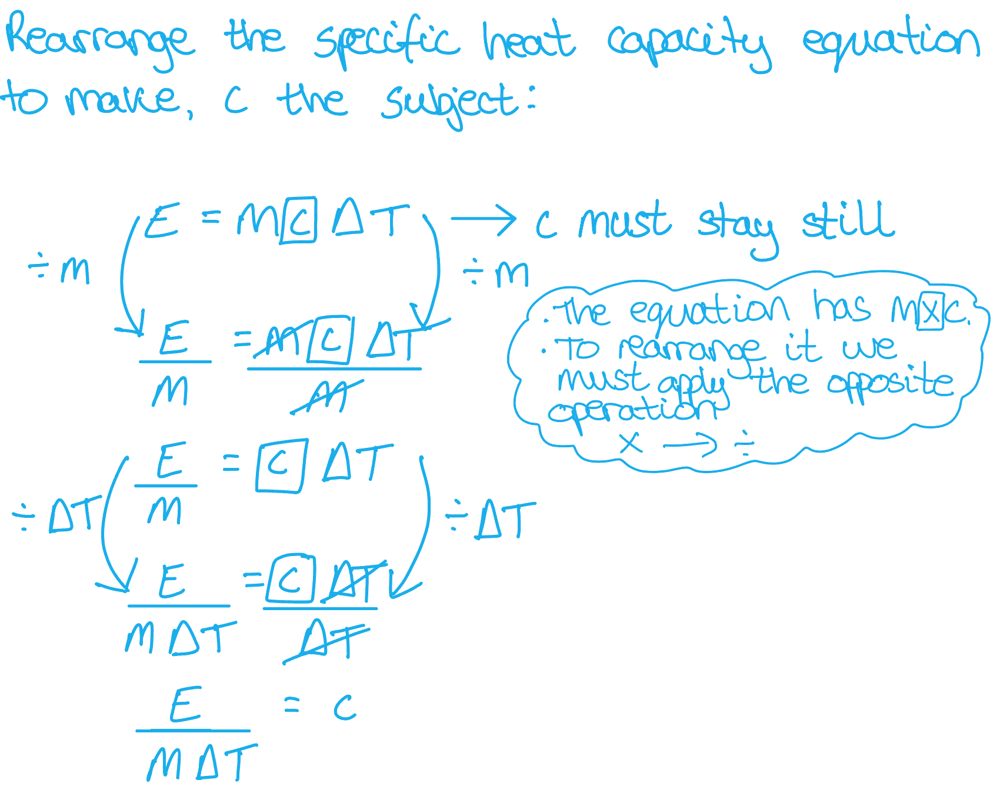
Explain why on a sunny day, the temperature of the sand on a beach is much higher than the temperature of the sea:

- The specific heat capacity of water is much higher than the specific heat capacity of sand; **[1 mark]**
- The same rate of energy is supplied to both the sand and the sea; **[1 mark]**

**[Total: 2 marks]**

### Q15
To name the substance with the greatest increase in volume:

Recall that in **gases **the particles are loosely bound and can move freely:

- Therefore <u>hydrogen</u> has the greatest increase in volume; **[1 mark]**

**[Total: 1 mark]**
(i) The temperature reading on the thermometer is:

Find the value of each division on the scale:

- There are ten divisions between each number
- Therefore each division is worth 1 °C

Read the temperature from the scale:

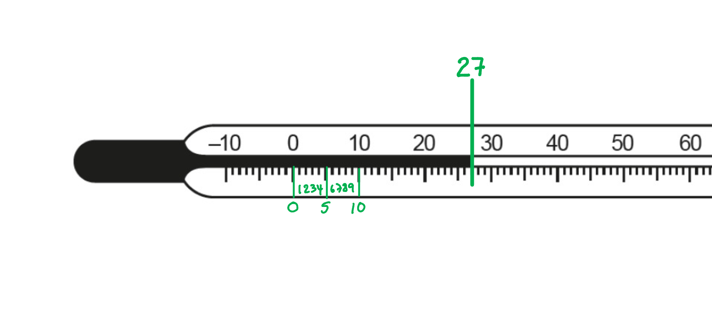

- The reading is  27 °C; **[1 mark]**

(ii) The temperature range of the thermometer is:

Recall that 'range' means from the smallest to the largest number':

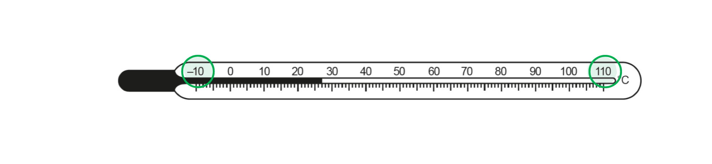

- The range is −10 °C to 110 °C; **[1 mark]**

(iii) The values of the fixed points are:

- The fixed points of water are <u>0 °C and 100 °C</u>; **[1 mark]**

**[Total: 3 marks]**

> *When reading the numbers from a scale always check first what the divisions are worth. The most common misconception for this kind of question is assuming that the divisions are decimal places. If you made this mistake you probably thought the temperature was  20.7 °C. Looking again and counting the divisions will show you how to get it right next time.*

> *Another common misconception is mixing up range and fixed points. **Fixed points** are those which are the same for all thermometers, where ever you go. Hence, **fixed**. The boiling and freezing points of water are useful when checking or calibrating a thermometer, as they are always the same.*
One other application or consequence of thermal expansion is:

**Any one line from:**

| **Use or consequence** | **Description of effect** | **Explanation of effect** |
|---|---|---|
| Bimetallic strip | The strip <u>bends</u> when heated | Two different metals are used, which <u>expand at different rates</u> |
| Expansion gaps in railway tracks | In hot weather the <u>tracks expand</u> and can buckle | The <u>gap allows expansion</u> with no damage to the track |
| Expansion gaps in railway bridges /  road surfaces | In hot weather the <u>surface can expand</u> and buckle | The <u>gap allows expansion</u> with no damage to the surface or bridge |
| Power lines stretching /  becoming tight | Power lines have to be carefully measured so there is enough room for expansion and contraction | Power lines stretch and sag when hot and go tight and can pull down the poles when cold |
| Vacuum sealed / tight lids on jars | <u>Heating the lid</u> of a jar allows it to be removed easily | The metal lid <u>expands more</u> than the glass when heated |

- **One mark for each statement ****in the same row**

**[Total: 3 marks]**

> *In the outline above an effect, description and consequence are given in each row. Your answer must connect up ideas in the same way. You won't get marks for a description which doesn't match the effect you stated!*

> *There are countless different applications and consequences of thermal expansion. Don't try to learn them all! Choose two (or three at most) which are easy for you to recall.*

### Q16
Explain, in terms of molecular behavior, how thermal expansion takes place in a liquid:

- At higher temperatures, the molecules / particles have a higher energy / greater speed; **[1 mark]**
- Therefore the (average) separation between molecules / particles increases; **[1 mark]**

**[Total: 2 marks]**
Complete the table to show the relative expansion of solids and gases for equal volumes at equal pressures for equal temperature rises, when compared to a liquid:

**One mark for each correct answer:**

| **state of matter** | **expansion compared to liquids** |
|---|---|
| solid | **Final answer:** **slightly less** |
| gases | **Final answer:** **much more** |

**[Total: 2 marks]**
One use of thermal expansion is:

**Any one from:**

- Liquid thermometers; **[1 mark]**
- Vacuum sealed lids on glass jars; **[1 mark]**
- Temperature activated switches **OR** bimetallic strip; **[1 mark]**

**[Total: 1 mark]**
Engineers minimise the effect of thermal expansion by:

- Building in gaps (so that the materials can expand); **[1 mark]**

**[Total: 1 mark]**

### Q17
The temperature at the surface of the water starts to decrease because:

- The more energetic molecules escape/evaporate; **[1 mark]**
- The less energetic molecules remain; **[1 mark]**
- The average <u>kinetic</u> energy of molecules decreases **OR** temperature depends on <u>kinetic</u> energy; **[1 mark]**

**[Total: 3 marks]**
State the name of the thermal transfer:

- Convection; **[1 mark]**

Explain what is happening in the water:

- The water at the surface is colder **OR** it contracts; **[1 mark]**
- The cold water sinks **OR** the warmer water rises; **[1 mark]**

**[Total: 3 marks]**

> *Most questions involve the use of heat at the bottom to generate a convection current, but this one needs you to consider what would happen if the **top** of the fluid is cooled.*
(i) State what is meant by:

1. Range:

- The difference between the maximum temperature and minimum temperature it can measure; **[1 mark]**

2. Sensitivity:

- The distance moved by the thread per °C **OR** per unit temperature change; **[1 mark]**

(ii) When a smaller blub contains less mercury:

- (The range) increases **AND** there is  less expansion / increase in volume (of mercury per unit temperature rise); **[1 mark]**

**[Total: 3 marks]**

> *It is important to understand the limitations of various instruments.*

### Q18
State and explain any effect on the sensitivity of a liquid-in-glass thermometer of reducing the diameter of the capillary tube:

- The thermometer would be more sensitive; **[1 mark]**
- Since the thread moves further (for the same expansion of the liquid); **[1 mark]**

**[Total: 2 marks]**

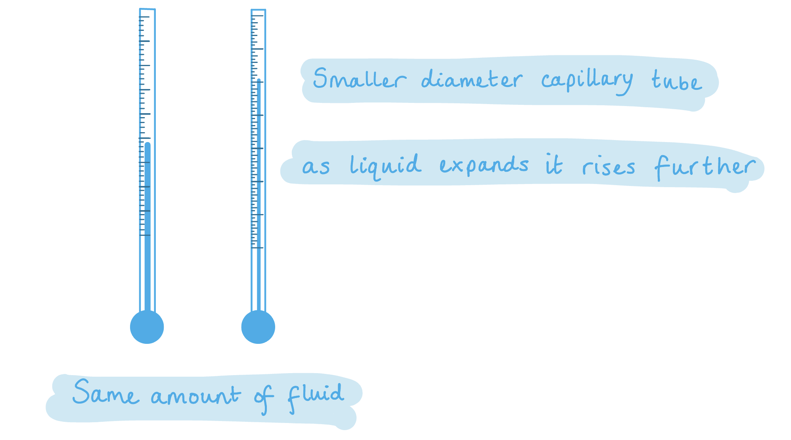
State and explain any effect on the sensitivity of a liquid-in-glass thermometer of increasing the volume of the liquid-filled bulb:

- The thermometer would be more sensitive; **[1 mark]**
- Because there would be greater expansion of the liquid due to there being more liquid in the bulb; **[1 mark]**

**[Total: 2 marks]**

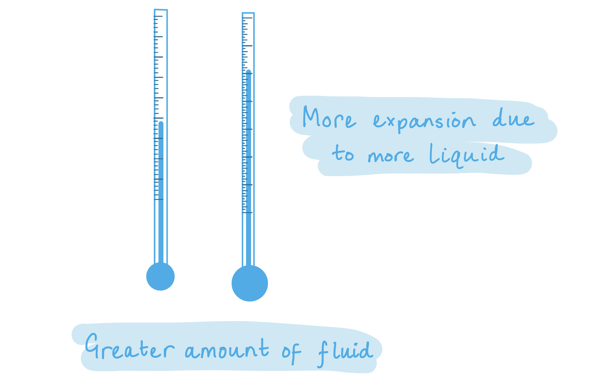
