# Exam Questions — Thermal Properties & Temperature
**2. Thermal Physics** · Cambridge (CIE) IGCSE physics (0625 & 0972)
> Source: [https://www.savemyexams.com/igcse/physics/cie/23/topic-questions/](https://www.savemyexams.com/igcse/physics/cie/23/topic-questions/) · 55 questions across 3 sets

## Alternative To Practical Questions (3 questions)

### Q1 — medium — 11 marks

**Q1** [1 mark]

** **A student investigates the cooling of water.

The apparatus is shown in Fig. 2.1.

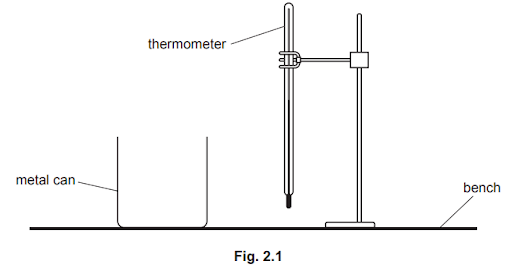

The thermometer in Fig. 2.2 shows the room temperature *θ*R at the beginning of the experiment. Record* θ*R.

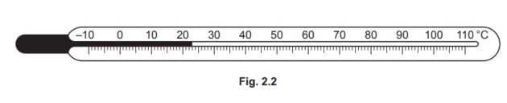

*θ*R = .........................................................

*Source: June 2022 paper 6 Q2A*

**Q1** [1 mark]

The student pours hot water into the metal can.

She places the thermometer in the hot water.

She records the temperature *θ *of the hot water at time *t *= 0 and immediately starts a stop‑clock.

She measures the water temperature every 30 s. The readings are shown in Table 2.1.

Complete the column headings in Table 2.1.

**Table 2.1**

| *t*/ | *θ*/ |
|---|---|
| 0 | 84 |
| 30 | 79 |
| 60 | 75 |
| 90 | 72 |
| 120 | 70 |
| 150 | 68 |
| 180 | 67 |

*Source: June 2022 paper 6 Q2B*

**Q1** [3 marks]

The student pours the water from the can into a measuring cylinder and records the volume* V* of water.

*V* = .......................196................................. cm3

(i) State **two **precautions taken when reading the volume of water in a measuring cylinder in order to obtain an accurate result.

[2]

(ii) The student records the volume *V* to the nearest 1 cm3.

Suggest why this is appropriate.

[1]

*Source: June 2022 paper 6 Q2C*

**Q1** [3 marks]

**Extract:**

| t/s | θ/°C |
| --- | --- |
| 0   | 84   |
| 30  | 79   |
| 60  | 75   |
| 90  | 72   |
| 120 | 70   |
| 150 | 68   |
| 180 | 67   |

(i)** **Calculate the decrease in temperature Δ*θ*1 of the hot water between times* t* = 0 and   *t* = 60 s.

Δ*θ*1 = ...............................................................

Calculate the average rate of cooling R1 of the water using the equation

$R_{1}=\frac{\Deltaθ_{1}}{\Deltat}$

where Δ*t* = 60 s. Include the unit.

* R*1 = ......................................................... [2]

(ii)** **Calculate the decrease in temperature Δ*θ*2 of the hot water between times *t* = 120 s and* t* = 180 s.

Δ*θ*2 = ..............................................................

Calculate the average rate of cooling R2 of the water using the equation

$R_{2}=\frac{\Deltaθ_{2}}{\Deltat}$

where Δ*t* = 60 s. Include the unit.

*R*2 = ............................................................... [1]

*Source: June 2022 paper 6 Q2D*

**Q1** [1 mark]

**Extract:**

At t = 0, θ = 84°C
At t = 60 s, θ = 75°C
Between t = 0 and t = 60 s, Δθ₁ = (84 − 75) = 9°C
R₁ = 0.15 °C / s

At t = 120, θ = 70°C
At t = 180 s, θ = 67°C
Between t = 120 and t = 180 s, Δθ₂ = (70 − 67) = 3°C
R₂ = 0.05 °C / s

**Extended Tier Only**

A student suggests that the rate of cooling is lower when the temperature of the water is lower.

State and explain whether the results support this suggestion.

*Source: June 2022 paper 6 Q2E*

**Q1** [2 marks]

**Extract:**

A student investigates the cooling of water. The apparatus is shown in Fig. 2.1. The thermometer in Fig. 2.2 shows the room temperature θR at the beginning of the experiment.

**Extended Tier Only**

The student states that most of the thermal energy lost by the water in the can is by evaporation from the water surface.

Another student states that most of the thermal energy lost by the water in the can is by conduction through the sides of the can.

The students repeat the experiment twice to investigate the two statements.

Suggest** one** suitable addition to the apparatus for** each **additional experiment.

*Source: June 2022 paper 6 Q2F*

### Q2 — medium — 13 marks

**Q2** [1 mark]

A student is investigating the cooling of water.

Fig. 2.1 shows the apparatus used.

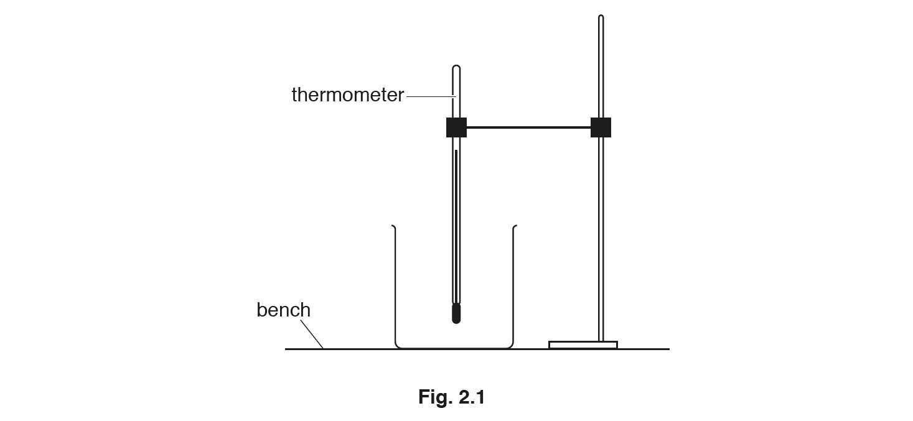

The thermometer in Fig. 2.2 shows room temperature *θ*R at the beginning of the experiment.

Record *θ*R.

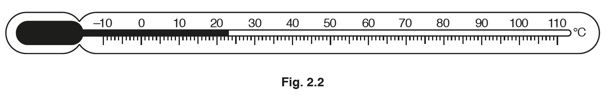

*θ*R = .........................................................

*Source: May/June 2018 (Series 2) 0625/62 Q2A*

**Q2** [7 marks]

**Extract:**

The thermometer in Fig. 2.2 shows room temperature θ_R at the beginning of the experiment. θ_R = 23.0 °C

The student pours 200 cm^3 of hot water into the beaker. He records the temperature θ_H of the hot water at time t = 0 and immediately starts a stopclock. He continues recording the temperature readings every 30 s. The readings are shown in Table 2.1.

Table 2.1
| t/ s | θ / °C |
| 0   | 70     |
| 30  | 60     |
| 60  | 52     |
| 90  | 49     |
| 120 | 46     |
| 150 | 43     |

The student pours 200 cm3 of hot water into the beaker.

He records the temperature *θ*H of the hot water at time *t* = 0 and immediately starts a stopclock.

He continues recording the temperature readings every 30 s. The readings are shown in Table 2.1.

(i) Explain why the student should wait a few seconds after placing the thermometer in the hot water before taking the first temperature reading.

[1]

(ii) Complete the column headings in Table 2.1.

[1]

(iii) Complete the time column in Table 2.1.

[1]

**Table 2.1**

| t/ | *θ /* |
|---|---|
| 0 | 70 |
|   | 60 |
|   | 52 |
|   | 49 |
|   | 46 |
|   | 43 |

(iv) Plot a graph of *θ*/ °C (y-axis) against *t*/s (x-axis). You do not need to start the y-axis at the origin (0,0) but the value of room temperature *θ*R must be marked on the y-axis.

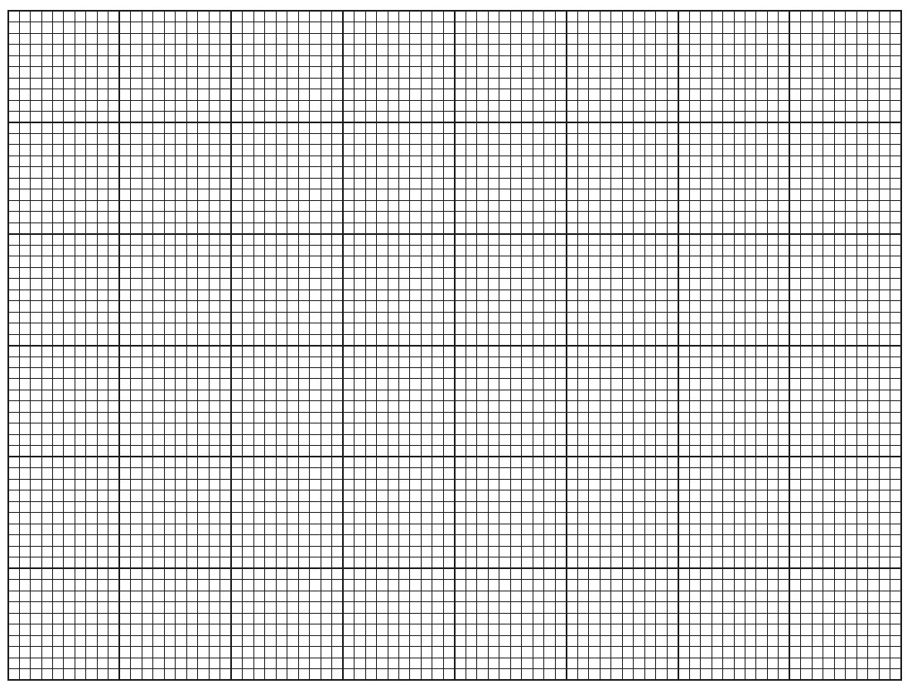

[4]

*Source: May/June 2018 (Series 2) 0625/62 Q2B*

**Q2** [1 mark]

**Extract:**

θ_R = 23.0 °C

Draw a horizontal line across the graph grid to indicate the value of room temperature *θ*R, as shown by the thermometer in Fig. 2.2.

*Source: May/June 2018 (Series 2) 0625/62 Q2C*

**Q2** [2 marks]

**Extract:**

The student pours 200 cm3 of hot water into the beaker.

He records the temperature *θ*H of the hot water at time *t* = 0 and immediately starts a stopclock.

He continues recording the temperature readings every 30 s. The readings are shown in Table 2.1.

**Table 2.1**

| t/ | *θ /* |
|---|---|
| 0 | 70 |
|   | 60 |
|   | 52 |
|   | 49 |
|   | 46 |
|   | 43 |

State **two** precautions that you would take in order to obtain accurate readings in this experiment.

*Source: May'June 2018 (Series 2) 0625/62 Q2D*

**Q2** [2 marks]

**Extract:**

A student is investigating the cooling of water.

The thermometer in Fig. 2.2 shows room temperature *θ*~R~ at the beginning of the experiment.

The student pours 200 cm^3 of hot water into the beaker. He records the temperature *θ*~H~ of the hot water at time *t* = 0 and immediately starts a stopclock. He continues recording the temperature readings every 30 s.

A student plans to repeat the experiment using the same thermometer and the same volume of water.

Suggest **two** changes to the apparatus or the procedure that would **increase** the rate of cooling of the water.

*Source: May/June 2018 (Series 2) 0625/62 Q2E*

### Q3 — medium — 11 marks

**Q3** [1 mark]

A student is investigating how partly covering the surface of the water in a beaker affects the rate at which the water cools.

The apparatus used is shown in Fig. 1.1.

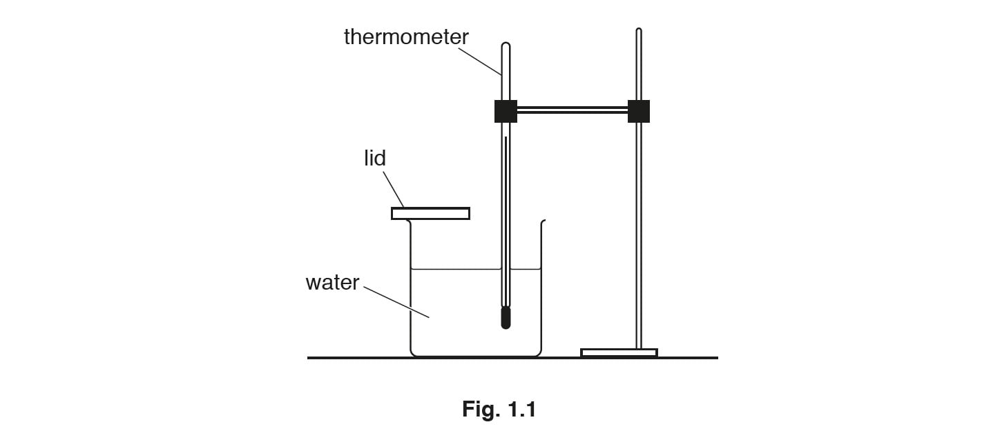

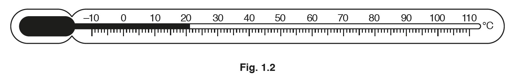

Record the room temperature *θ*R, in °C, shown on the thermometer in Fig. 1.2.

* *

*θ*R = .........................................................

*Source: May/June 2018 (Series 3) 0625/63 Q1A*

**Q3** [2 marks]

The student pours 100 cm3 of hot water into a beaker. She places lid A on the beaker. This leaves half of the water surface uncovered, as shown in Fig. 1.3.

She records the temperature of the water in the beaker and immediately starts a stopclock.

She records the temperature *θ* of the water every 30 s. Her readings are shown in Table 1.1.

She repeats the procedure using lid B. This leaves a quarter of the water surface uncovered, as shown in Fig. 1.4.

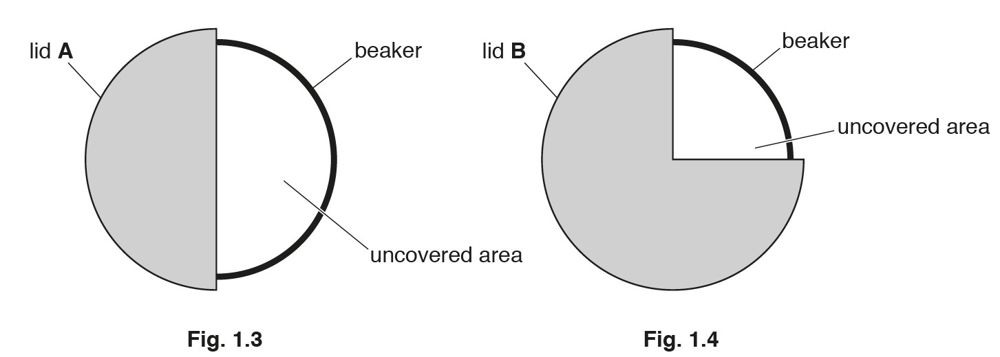

Complete the headings and the time *t* column in Table 1.1.

**Table 1.1**

|   | beaker with lid **A** | beaker with lid **B** |
|---|---|---|
| t / | *θ /* | *θ /* |
| 0 | 80.0 | 81.0 |
|   | 77.0 | 79.0 |
|   | 74.5 | 77.5 |
|   | 72.5 | 76.0 |
|   | 70.5 | 75.0 |
|   | 69.5 | 74.0 |
|   | 68.0 | 73.5 |

*Source: May/June 2018 (Series 3) 0625/63 Q1B*

**Q3** [1 mark]

**Extract:**

A student is investigating how partly covering the surface of the water in a beaker affects the rate at which the water cools.

The apparatus used is shown in Fig. 1.1.

Record the room temperature *θ*R, shown on the thermometer in Fig. 1.2.

The student pours 100 cm3 of hot water into a beaker. She places lid A on the beaker. This leaves half of the water surface uncovered, as shown in Fig. 1.3.

She records the temperature of the water in the beaker and immediately starts a stopclock.

She records the temperature *θ* of the water every 30 s. Her readings are shown in Table 1.1.

She repeats the procedure using lid B. This leaves a quarter of the water surface uncovered, as shown in Fig. 1.4.

**Table 1.1**

|   | beaker with lid **A** | beaker with lid **B** |
|---|---|---|
| t / | *θ /* | *θ /* |
| 0 | 80.0 | 81.0 |
|   | 77.0 | 79.0 |
|   | 74.5 | 77.5 |
|   | 72.5 | 76.0 |
|   | 70.5 | 75.0 |
|   | 69.5 | 74.0 |
|   | 68.0 | 73.5 |

Describe a precaution that should be taken to ensure that the temperature readings are as accurate as possible in the experiment.

*Source: May/June 2018 (Series 3) 0625/63 Q1C*

**Q3** [4 marks]

**Extract:**

The student pours 100 cm^3 of hot water into a beaker. She places lid A on the beaker. This leaves half of the water surface uncovered, as shown in Fig. 1.3.

She records the temperature of the water in the beaker and immediately starts a stopclock.

She records the temperature θ of the water every 30 s. Her readings are shown in Table 1.1.

She repeats the procedure using lid B. This leaves a quarter of the water surface uncovered, as shown in Fig. 1.4.

Table 1.1

|   | beaker with lid A | beaker with lid B |
| t / s | θ / °C | θ / °C |
| 0 | 80.0 | 81.0 |
| 30 | 77.0 | 79.0 |
| 60 | 74.5 | 77.5 |
| 90 | 72.5 | 76.0 |
| 120 | 70.5 | 75.0 |
| 150 | 69.5 | 74.0 |
| 180 | 68.0 | 73.5 |

(i) Write a conclusion to this experiment, stating for which lid the rate of cooling is greater.

Explain your answer by reference to the results.

[2]

(ii) Suggest a change to the **apparatus** that could produce a greater difference between the rates of cooling for lid **A** and lid **B**.

Explain why the change might produce a greater difference.

[2]

*Source: May/June 2018 (Series 3) 0625/63 Q1D*

**Q3** [2 marks]

**Extract:**

A student is investigating how partly covering the surface of the water in a beaker affects the rate at which the water cools.

The apparatus used is shown in Fig. 1.1.

Record the room temperature *θ*R, shown on the thermometer in Fig. 1.2.

The student pours 100 cm3 of hot water into a beaker. She places lid A on the beaker. This leaves half of the water surface uncovered, as shown in Fig. 1.3.

She records the temperature of the water in the beaker and immediately starts a stopclock.

She records the temperature *θ* of the water every 30 s. Her readings are shown in Table 1.1.

She repeats the procedure using lid B. This leaves a quarter of the water surface uncovered, as shown in Fig. 1.4.

**Table 1.1**

|   | beaker with lid **A** | beaker with lid **B** |
|---|---|---|
| t / | *θ /* | *θ /* |
| 0 | 80.0 | 81.0 |
|   | 77.0 | 79.0 |
|   | 74.5 | 77.5 |
|   | 72.5 | 76.0 |
|   | 70.5 | 75.0 |
|   | 69.5 | 74.0 |
|   | 68.0 | 73.5 |

A student suggests that the rate of cooling is directly proportional to the percentage of the uncovered surface area. He wants to draw a graph of cooling rate against the percentage of uncovered area to investigate this.

Describe how his graph line will show whether the rate of cooling and the percentage of uncovered surface area are directly proportional.

*Source: May/June 2018 (Series 3) 0625/63 Q1E*

**Q3** [1 mark]

**Extract:**

The student pours 100 cm^3^ of hot water into a beaker. She places lid A on the beaker. This leaves half of the water surface uncovered, as shown in Fig. 1.3. She records the temperature of the water in the beaker and immediately starts a stopclock. She records the temperature *θ* of the water every 30 s. Her readings are shown in Table 1.1. She repeats the procedure using lid B. This leaves a quarter of the water surface uncovered, as shown in Fig. 1.4.

Students in other countries carry out the same experiment.

Suggest **one** factor that they should keep the same if they are to obtain similar readings.

*Source: May/June 2018 (Series 3) 0625/63 Q1F*

## Multiple Choice Questions (34 questions)

### Q1 — medium — 1 marks

**Q1** [1 mark]

An electric heater supplies $12600J$ of energy to $0.50\mathrm{kg}$ of a liquid. The temperature of the liquid rises from $20^{\circ}C$ to $50^{\circ}C$.

What is the specific heat capacity of the liquid?

### Q2 — medium — 1 marks

**Q2** [1 mark]

A liquid evaporates from an open dish.

Which change would increase the rate of evaporation?

### Q3 — medium — 1 marks

**Q3** [1 mark]

A beaker of water is heated from room temperature until the water boils.

Which statement about the water is correct?

### Q4 — medium — 1 marks

**Q4** [1 mark]

On a warm day, water evaporates from a puddle on a road.

Which row explains what happens to the average speed of the remaining water molecules?

|   | average speed of the remaining molecules | explanation |
|---|---|---|
| **A** | decreases | the more energetic molecules escape from the surface |
| **B** | decreases | the less energetic molecules escape from the surface |
| **C** | increases | the more energetic molecules escape from the surface |
| **D** | increases | the less energetic molecules escape from the surface |

### Q5 — medium — 1 marks

**Q5** [1 mark]

The diagram shows air trapped in a cylinder by a frictionless piston.

The air inside the cylinder is heated, and the piston moves as shown. The pressure of the air remains constant.

Which statement about the trapped air in the cylinder is correct?

### Q6 — medium — 1 marks

**Q6** [1 mark]

** **Which statements about evaporation of water are correct?

1. Evaporation causes the remaining liquid to cool.
2. During evaporation, the more energetic particles escape from the surface of the liquid.
3. Evaporation only happens at 100 °C.

*Source: June 2023 0972/11 Q15*

### Q7 — medium — 1 marks

**Q7** [1 mark]

**Extended Tier Only**

Two open containers are filled with water at room temperature. The containers have different shapes.

From which container does the water evaporate at the greater rate and how can the rate of evaporation be increased?

| ** ** | **container with the greater rate of evaporation** | **how the rate of evaporation can be increased** |
|---|---|---|
| **A** | 1 | decrease the water temperature |
| **B** | 1 | increase the water temperature |
| **C** | 2 | decrease the water temperature |
| **D** | 2 | increase the water temperature |

*Source: June 2022 paper 2 Q16*

### Q8 — medium — 1 marks

**Q8** [1 mark]

What happens to the volumes of liquid metal and of solid metal when heated at constant pressure?

| ** ** | **volume of liquid metal** | **volume of solid metal** |
|---|---|---|
| **A** | decreases | increases |
| **B** | decreases | no change |
| **C** | increases | increases |
| **D** | increases | no change |

*Source: June 2022 paper 1 Q15*

### Q9 — medium — 1 marks

**Q9** [1 mark]

** **The diagram shows a liquid-in-glass thermometer. ** **

A student wishes to check the marking of the upper fixed point on this thermometer.

*Source: June 2022 paper 1 Q16*

### Q10 — medium — 1 marks

**Q10** [1 mark]

Two thermometers, P and Q, give the same reading at room temperature.

The bulb of thermometer Q is wrapped in gauze and dipped in a beaker of water at room temperature.

Air at room temperature is blown over the two thermometer bulbs.

Which statement correctly describes and explains what happens?

*Source: June 2022 paper 1 Q14*

### Q11 — medium — 1 marks

**Q11** [1 mark]

**Extended Tier Only**

Which row about boiling and about evaporation is correct? ** **

| ** ** | **boiling** | **evaporation** |
|---|---|---|
| **A** | takes place only at the surface | takes place only at the surface |
| **B** | takes place only at the surface | takes place throughout the liquid |
| **C** | takes place throughout the liquid | takes place only at the surface |
| **D** | takes place throughout the liquid | takes place throughout the liquid |

*Source: specimen 2023 paper 2 Q18*

### Q12 — medium — 1 marks

**Q12** [1 mark]

**Extended Tier Only**

Copper is a type of metal.

A block of copper has a mass of 2.0 kg.

The block of copper absorbs 12 000 J of thermal energy.

The specific heat capacity of copper is 385 J/(kg °C).

What is the temperature rise of the copper?

*Source: specimen 2023 paper 2 Q16*

### Q13 — medium — 1 marks

**Q13** [1 mark]

A glass bottle has a metal cap. The cap fits very tightly and is difficult to remove.

The cap and the neck of the bottle are lowered into a bowl of hot water. The cap can be removed more easily.

What happens to allow the cap to be removed more easily from the bottle?

*Source: specimen 2023 paper 1 Q15*

### Q14 — easy — 1 marks

**Q14** [1 mark]

**  **A glass contains an iced drink on a warm and humid day. Water starts to form on the outside of the glass.

What is the name of the effect by which the water forms?

*Source: june 2022 paper 1 Q17*

### Q15 — easy — 1 marks

**Q15** [1 mark]

Which statement best describes a metal experiencing thermal expansion?

### Q16 — easy — 1 marks

**Q16** [1 mark]

Below are four statements about evaporation. One of them is correct.

Which statement is correct?

### Q17 — easy — 1 marks

**Q17** [1 mark]

A rise in temperature of a substance increases its

### Q18 — easy — 1 marks

**Q18** [1 mark]

What are the upper and lower fixed points on a Celsius scale thermometer?

|   | **Upper** | **Lower** |
|---|---|---|
| **A** | The boiling point of saturated salt solution | The freezing point of salt-water |
| **B** | The normal temperature of the human body | The freezing point of salt-water |
| **C** | The boiling point of pure water | The freezing point of pure water |
| **D** | The boiling point of pure water | Absolute zero |

### Q19 — easy — 1 marks

**Q19** [1 mark]

A substance is cooled. The graph below shows how its temperature changes over time.

What is happening in the portion of the graph between X and Y?

### Q20 — easy — 1 marks

**Q20** [1 mark]

A substance, which is initially in its solid form, is heated at a constant rate.

The graph shows how its temperature changes with time.

Between which points is the substance partly a liquid and partly a gas?

### Q21 — medium — 1 marks

**Q21** [1 mark]

The diagram shows four water molecules in a swimming pool. It also shows how much energy each molecule has.

Which of the water molecules is most likely to *evaporate* from the liquid?

### Q22 — hard — 1 marks

**Q22** [1 mark]

**Extended tier only**

Two beakers, X and Y, containing different liquids are heated by a student.

Both beakers contain the same mass of liquid, and are heated using the same heater set to the same power.

The graph shows how the temperature of each liquid changes with time.

What conclusion can be correctly drawn from the graph?

### Q23 — medium — 1 marks

**Q23** [1 mark]

Wooden barrels are often reinforced by putting tight iron rings around them.

What procedure would make it easier to get the iron ring onto the barrel?

### Q24 — hard — 1 marks

**Q24** [1 mark]

**Extended tier only**

In a children’s experiment, a saucer of water is left outside to evaporate.

Which row shows weather conditions that will each cause the rate of evaporation from the saucer to increase?

|   | **Temperature** | **Wind speed** |
|---|---|---|
| **A** | warm | windy |
| **B** | warm | still |
| **C** | cool | windy |
| **D** | cool | still |

### Q25 — medium — 1 marks

**Q25** [1 mark]

A National Grid engineer connects an electrical cable between two pylons.

The cable is a bit too tight.

What could happen to the wire if the weather became very cold, and why?

|   | **What could happen?** | **Why?** |
|---|---|---|
| **A** | The wire sags low | It expands |
| **B** | The wire breaks | It contracts |
| **C** | The wire breaks | It becomes brittle |
| **D** | The wire’s resistance increases | It contracts |

### Q26 — hard — 1 marks

**Q26** [1 mark]

Drinks are often cooled by putting ice cubes into them.

A delicious cocktail is initially at a temperature of 12℃, when a few ice cubes are put into the drink.

After some time has passed, some of the ice has melted, and the temperature of the cocktail has dropped to 7 ℃.

What is the temperature of the remaining, unmelted ice?

### Q27 — hard — 1 marks

**Q27** [1 mark]

**Extended tier only**

A student takes two blocks, block 1 and block 2, of different metals and heats them until the temperature of both has risen by 20℃.

She then leaves both blocks on the desk to cool.

Block 2 has a greater thermal capacity than block 1.

Which of the blocks loses more energy as it cools to room temperature, and which of the blocks required more energy to raise its temperature by 20℃?

|   | **Lost more energy when cooling** | **Required more energy to heat up.** |
|---|---|---|
| **A** | block 1 | block 1 |
| **B** | block 1 | block 2 |
| **C** | block 2 | block 1 |
| **D** | block 2 | block 2 |

### Q28 — medium — 1 marks

**Q28** [1 mark]

The water in outdoor swimming pools gradually evaporates.

How does the process of evaporation affect the temperature of the water in the swimming pool and what is the effect on the average kinetic energy of the water molecules?

|   | **Temperature** | **Average kinetic energy per molecule** |
|---|---|---|
| **A** | reduces | reduces |
| **B** | stays the same | stays the same |
| **C** | increases | increases |
| **D** | reduces | stays the same |

### Q29 — hard — 1 marks

**Q29** [1 mark]

**Extended tier only**

A pan, containing 0.750 kg of water which is initially at 13 ℃ is heated by an electric hob. 35 kJ of thermal energy is put into the water and its temperature rises.

You can assume that all the energy supplied by the hob goes into raising the temperature of the water.

The specific heat capacity of water is 4200 J/kg ℃.

To the nearest ℃, what is the final temperature of the water?

### Q30 — medium — 1 marks

**Q30** [1 mark]

In order to calibrate a degrees Celsius thermometer, the lowest fixed point can be found by placing the thermometer in:

### Q31 — medium — 1 marks

**Q31** [1 mark]

An iron cube is heated by a Bunsen burner.

Which of its properties decreases?

### Q32 — medium — 1 marks

**Q32** [1 mark]

Internal energy is affected by two properties of the particles which make up a substance.

Identify the two properties.

### Q33 — hard — 1 marks

**Q33** [1 mark]

**Extended tier only**

Which of the following statements defines the **specific heat capacity** of a substance?

### Q34 — hard — 1 marks

**Q34** [1 mark]

**Extended tier only**

Two metal cylinders, P and Q, are heated using an electric heater. Both of the cylinders receive exactly the same amount of thermal energy.

The temperature of P increases by a smaller amount than the temperature of Q.

What conclusion can be drawn?

## Theory Questions (18 questions)

### Q1 — medium — 8 marks

**Q1** [2 marks]

State what is meant by specific heat capacity.

**Q1** [3 marks]

A student heats a $2.0\mathrm{kg}$ aluminium block in an electrical heater of power $48W$. The initial temperature of the block is $20^{\circ}C$. After 20 minutes, the temperature of the block is $45^{\circ}C$.

Calculate the specific heat capacity of aluminium.

**Q1** [1 mark]

**Extract:**

A student heats a 2.0 kg aluminium block in an electrical heater of power 48 W. The initial temperature of the block is 20 °C. After 20 minutes, the temperature of the block is 45 °C.

Calculate the specific heat capacity of aluminium.

Calculated value: 1150-1152 J/(kg °C)

The accepted value for the specific heat capacity of aluminium is $900\text{J/(kg °C)}$.

Suggest why the student's calculated value is higher than the accepted value.

**Q1** [2 marks]

Explain, in terms of particles, what happens to the internal energy of the block as its temperature increases.

### Q2 — medium — 12 marks

**Q2** [3 marks]

A student investigates how a beaker of hot water cools down.

Fig. 6.1 shows the apparatus.

**Fig. 6.1**

Describe the arrangement, separation and motion of particles in a **liquid**.

**Q2** [3 marks]

**Extract:**

A student investigates how a beaker of hot water cools down.

Fig. 6.1 shows the apparatus.

**Fig. 6.1**

The student leaves the water to cool and monitors the temperature.

(i) State the name of the process in which a liquid loses thermal energy by particles escaping from its surface.

[1]

(ii) State **two** ways the student could reduce the total rate of thermal energy loss from the water.

[2]

**Q2** [6 marks]

**Extract:**

A student investigates how a beaker of hot water cools down.

Fig. 6.1 shows the apparatus.

**Fig. 6.1**

As the water cools, thermal energy is transferred from the hot water to the surroundings.

(i) State which thermal process transfers energy through the glass of the beaker.

[1]

(ii) Explain how a convection current forms in the water in the beaker.

[4]

(iii) Suggest one everyday situation where convection is a useful method of thermal energy transfer.

[1]

### Q3 — medium — 8 marks

**Q3** [2 marks]

Fig. 5.1 shows a kitchen tap that supplies instant boiling water.

Cold water passes over an electric immersion heater inside the tap.

The boiling point of water is 100 °C.

State what is meant by boiling point.

*Source: June 2022 paper 4 Q5A*

**Q3** [6 marks]

**Extended Tier Only**

The immersion heater is powered by the mains at a voltage of 230 V. When the tap is opened, the heater switches on and the current in the heater is 13 A.

(i) Calculate the thermal energy produced by the heater in 60 s.

thermal energy = ......................................................... [2]

(ii)** **The specific heat capacity of water is 4200 J/(kg °C). The cold water that enters the tap is at 22 °C.

Calculate the rate at which water at its boiling point emerges from the tap.

rate = ......................................................... [4]

*Source: june 2022 paper 4 Q5B*

### Q4 — medium — 3 marks

**Q4** [3 marks]

**Extended Tier Only**

During a picnic on a warm, dry day, a metal can of lemonade is wrapped in a damp cloth.

Evaporation cools the water in the cloth.

Explain, in terms of molecules, how evaporation cools the water in the cloth.

*Source: June 2022 paper 4 Q3A*

### Q5 — easy — 8 marks

**Q5** [6 marks]

**Extended Tier Only**

Liquids and gases are two states of matter.

In both boiling and evaporation, a liquid changes into a gas.

(i)  State two ways in which boiling differs from evaporation.

[2]

(ii) Before injecting a patient, a doctor wipes a small amount of a volatile liquid on to the patient’s skin.

Explain, in terms of molecules, how this procedure cools the patient’s skin.

[4]

*Source: 2019 May/June 0972/41 Q5A*

**Q5** [2 marks]

**Extended Tier Only**

Gases can be compressed but liquids are incompressible.

Explain, in terms of molecules, why liquids are incompressible.

*Source: 2019 May/June 0972/41 Q5B*

### Q6 — hard — 10 marks

**Q6** [5 marks]

**Extended**

Gas of mass 0.23 g is trapped in a cylinder by a piston. The gas is at atmospheric pressure which is 1.0 × 105 Pa. Fig. 4.1 shows the piston held in position by a catch.

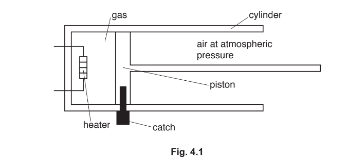

The volume of the trapped gas is 1.9 × 10–4 m3.

An electrical heater is used to increase the temperature of the trapped gas by 550 °C.

The specific heat capacity of the gas is 0.72 J / (g °C).

(i) Calculate the energy required to increase the temperature of the trapped gas by 550 °C.

energy = ......................................................... [2]

(ii) The power of the heater is 2.4 W.

1. Calculate how long it takes for the heater to supply the energy calculated in (a)(i).

time = ......................................................... [2]

2. In practice, it takes much longer to increase the temperature of the gas by 550 °C using the heater. Suggest **one **reason for this.

[1]

*Source: 2019 May/June 0972/41 Q4A*

**Q6** [5 marks]

**Extract:**

Gas of mass 0.23 g is trapped in a cylinder by a piston. The gas is at atmospheric pressure which is 1.0 × 10^5 Pa. The volume of the trapped gas is 1.9 × 10^–4 m^3. An electrical heater is used to increase the temperature of the trapped gas by 550 °C.

When the temperature of the gas has increased by 550 °C, its pressure is 2.9 × 10^5 Pa.

#### Extended

When the temperature of the gas has increased by 550 °C, its pressure is 2.9 × 105 Pa. The catch is then released allowing the piston to move. As the piston moves, the temperature of the gas remains constant.

(i) State and explain what happens to the piston.

[2]

(ii) Determine the volume of the gas when the piston stops moving.

volume = ......................................................... [3]

*Source: 2019 May/June 0972/41 Q4B*

### Q7 — medium — 5 marks

**Q7** [3 marks]

#### Extended

State three factors that determine the rate of evaporation of water.

*Source: 2018 (Series 1) 0625/41 Q6A*

**Q7** [2 marks]

#### Extended

A person climbs out of a swimming pool and stands in the open air.

Explain why evaporation of water from the surface of the person’s body causes the person to feel cold.

*Source: 2018 (Series 1) 0625/41 Q6B*

### Q8 — easy — 10 marks

**Q8** [2 marks]

#### Extended

State what is meant by *specific heat capacity*.

**Q8** [1 mark]

#### Extended

A student uses the equipment shown in Fig. 1.1 to determine the specific heat capacity of aluminium.

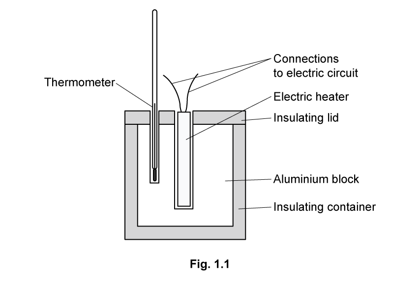

The student took the following readings:

mass of aluminium block = 0.796 kg

energy supplied = 18 792 J

State the other readings that the student needs to take.

**Q8** [3 marks]

**Extract:**

Initial temperature = 20°C
Final temperature = 46°C
Change in temperature = final − initial
Change in temperature = 46 − 20 = 26°C

#### Extended

Fig. 1.2 shows the reading before the heater was switched on. Fig. 1.3 shows the reading at the end of the investigation.

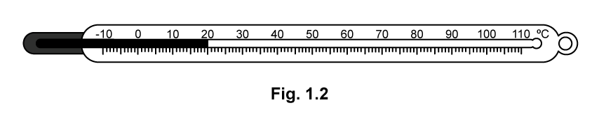

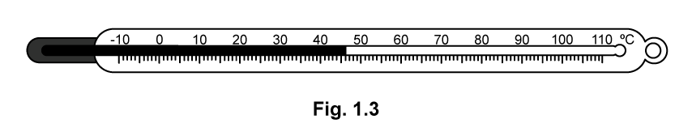

Calculate the change in temperature.

change in temperature = ....................................

**Q8** [4 marks]

**Extract:**

mass of aluminium block = 0.796 kg
energy supplied = 18 792 J
Change in temperature = 26°C

#### Extended

Use the information from parts (b) and (c) to calculate the specific heat capacity of aluminium.

Give the correct units in your answer.

specific heat capacity = ....................................

### Q9 — medium — 6 marks

**Q9** [3 marks]

The arrows on Fig. 5.1 represent changes of state.

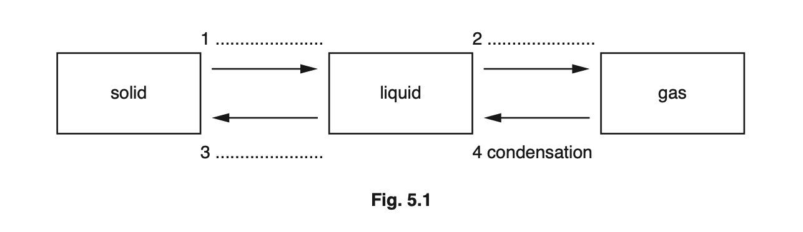

One of the arrows is labelled. Label each of the other arrows with the correct change of state. Write the change of state on the dotted lines next to each arrow.

*Source: Oct 2019 0625/33 Q5A*

**Q9** [3 marks]

**Extended**

A beaker contains some liquid with a low boiling point. The beaker is placed onto a small amount of water, as shown in Fig. 5.2.

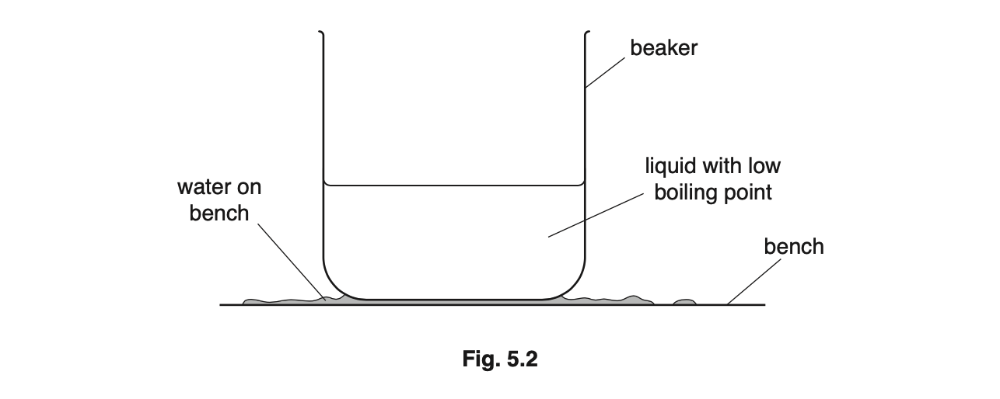

The liquid in the beaker evaporates quickly. The water on the bench cools and turns to ice.

Explain why the water cools.

*Source: Oct 2019 0625/33 Q5B*

### Q10 — medium — 8 marks

**Q10** [4 marks]

#### Extended

Fig. 4.1 shows apparatus used by a student to measure the specific heat capacity of iron.

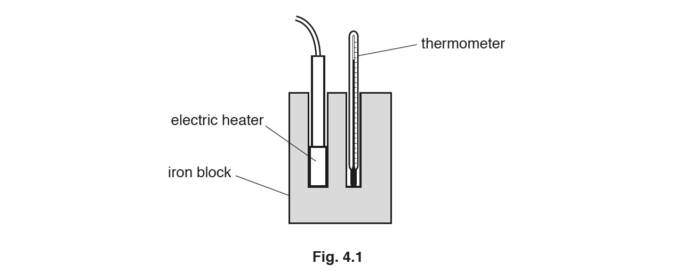

The student improves the accuracy of the experiment by placing material around the block, as shown in Fig. 4.2.

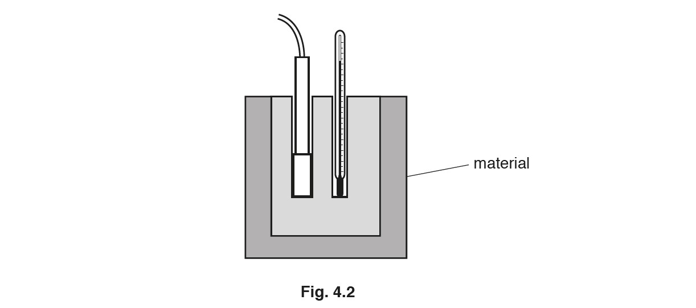

(i) Suggest the name of a possible material the student could use and explain how it improves the accuracy of the experiment.

[3]

(ii) State how the student could further improve the accuracy of the experiment by using more of the material used in Fig. 4.2.

[1]

*Source: Oct/Nov2018  (Series 2) 0625/42 Q4A*

**Q10** [4 marks]

**Extended**

The current in the heater is 3.8 A and the potential difference (p.d.) across it is 12 V. The iron block has a mass of 2.0 kg. When the heater is switched on for 10 minutes, the temperature of the block rises from 25 °C to 55 °C.

Calculate the specific heat capacity of iron.

specific heat capacity = ...........................................................

*Source: Oct/Nov2018  (Series 2) 0625/42 Q4B*

### Q11 — hard — 11 marks

**Q11** [1 mark]

#### Extended

A group of students were given the equipment shown in Fig. 1.1 and were asked to identify an unknown clear liquid by its specific heat capacity.

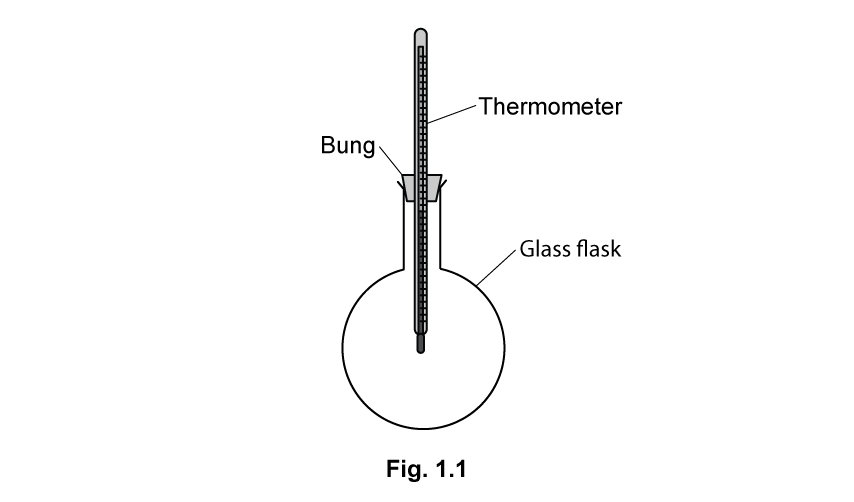

The students were provided with the unknown substance, an electric water bath, and were allowed to use water from the tap.

Suggest why the students were given an electric water bath rather than a Bunsen burner.

**Q11** [3 marks]

**Extract:**

A group of students were given the equipment shown in Fig. 1.1 and were asked to identify an unknown clear liquid by its specific heat capacity.

The students were provided with the unknown substance, an electric water bath, and were allowed to use water from the tap.

#### Extended

List the quantities that the students must measure to determine the specific heat capacity of the unknown liquid.

**Q11** [2 marks]

**Extract:**

A group of students were given the equipment shown in Fig. 1.1 and were asked to identify an unknown clear liquid by its specific heat capacity.

The students were provided with the unknown substance, an electric water bath, and were allowed to use water from the tap.

List the quantities that the students must measure to determine the specific heat capacity of the unknown liquid.

#### Extended

The students are given Table 1.2 to help with their investigation.

| **Substance** | **Specific heat capacity (J/kg °C)** |
|---|---|
| water | 4190 |
| ethanol | 2460 |
| salt water | 3930 |
| acetic acid | 2180 |
| glycerine | 2430 |

**Table 1.2 **

Suggest a method for measuring the energy transferred from the water bath to the unknown substance.

**Q11** [5 marks]

**Extract:**

Initial temperature of unknown substance = 22°C
Final temperature of unknown substance = 34°C
Mass of unknown substance = 0.41 kg
Energy transferred = 11 070 J

| Substance     | Specific heat capacity (J/kg °C) |
| water        | 4190                             |
| ethanol      | 2460                             |
| salt water   | 3930                             |
| acetic acid  | 2180                             |
| glycerine    | 2430                             |

#### Extended

The student recorded the following measurements.

Initial temperature of unknown substance = 22°C

Final temperature of unknown substance = 34°C

Mass of unknown substance = 0.41 kg

Energy transferred = 11 070 J

(i) Identify the unknown substance.

[4]

(ii) Suggest a reason why the value calculated is different to the value given in the table.

[1]

### Q12 — easy — 6 marks

**Q12** [4 marks]

Describe, in terms of the behaviour of the molecules, what happens when a liquid evaporates.

*Source: May/June 2020 (Series 3) 0625/43 Q4A*

**Q12** [2 marks]

#### Extended

Fig. 4.1 shows wet clothes drying on a washing line in an outside area.

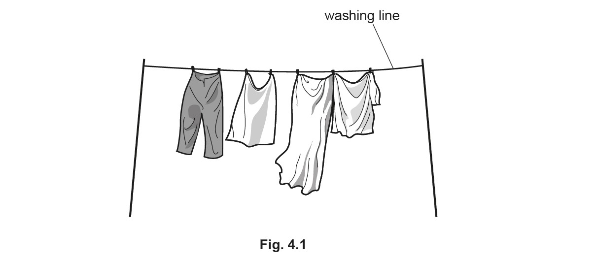

State two changes in the weather that help the wet clothes to dry more quickly.

*Source: May/June 2020 (Series 3) 0625/43 Q4B*

### Q13 — medium — 2 marks

**Q13** [2 marks]

**Extended**

In a laboratory at normal room temperature, 200 g of water is poured into a beaker. A thermometer placed in the water has a reading of 22 °C.

Small pieces of ice at 0 °C are added to the water one by one. The mixture is stirred after each addition until the ice has melted. This process is continued until the temperature recorded by the thermometer is 0 °C.

The total mass of ice added to the water is found to be 60 g.

The specific heat capacity of water is 4.2J/(g °C).

Calculate the energy transferred from the water's thermal energy store originally in the beaker.

thermal energy = ...........................................................

*Source: 2018 0625/41 Q8A*

### Q14 — medium — 9 marks

**Q14** [7 marks]

**Extended tier only**

Fig. 5.1 shows a plastic cup. The cup contains sand, an electric heater and a thermometer.

The power of the heater is 50 W. The mass of the sand in the cup is 550 g. The initial temperature of the sand is 20 °C. The heater is switched on for 2.0 minutes.

The temperature is recorded until the temperature stops increasing. The highest temperature recorded by the thermometer is 33 °C.

(i) Calculate the energy supplied by the heater.

energy = ......................................................... [2]

(ii) Calculate a value for the specific heat capacity of the sand, using your answer to (a)(i) and the data in the question.

specific heat capacity = ......................................................... [3]

(iii) Explain why the specific heat capacity of sand may be different from the value calculated in **(a)(ii)**.

[2]

*Source: May/June 2020 (Series 3) 0625/43 Q5A*

**Q14** [2 marks]

**Extended tier only**

On a sunny day, the temperature of the sand on a beach is much higher than the temperature of the sea.

Explain why.

*Source: May/June 2020 (Series 3) 0625/43 Q5B*

### Q15 — easy — 7 marks

**Q15** [1 mark]

Equal volumes of steel, oil and hydrogen are heated from 20 °C to 60 °C.

Their volumes increase by thermal expansion.

State which of these substances has the greatest increase in volume.

*Source: 2020 Feb/March 0625/32 Q7A*

**Q15** [3 marks]

Fig. 7.1 shows a liquid-in-glass thermometer.

(i) State the temperature **reading **on the thermometer.

[1]

(ii) State the temperature **range **of the thermometer.

[1]

(iii) State the values of the fixed points of the Celsius scale of temperature.

[1]

*Source: 2020 Feb/March 0625/32 Q7B*

**Q15** [3 marks]

The liquid-in-glass thermometer uses the thermal expansion of mercury.

State and explain one other application or consequence of thermal expansion in science or engineering.

*Source: 2020 Feb/March 0625/32 Q7C*

### Q16 — easy — 6 marks

**Q16** [2 marks]

Explain, in terms of molecular behaviour, how thermal expansion takes place in a liquid.

**Q16** [2 marks]

Table 1.1 shows the relative expansion of solids and gases for equal volumes at equal pressures for equal temperature rises, when compared to a liquid.

| **state of matter** | **expansion compared to liquids** |
|---|---|
| solid |   |
| gases |   |

**Table 1.1**

Complete the table choosing words from the following list:

much less
slightly less
slightly more
much more

**Q16** [1 mark]

State **one** use of thermal expansion.

**Q16** [1 mark]

Metal railway tracks, road surfaces and bridges can all suffer thermal expansion in high temperatures.

State one way that engineers minimise this issue in their design of such structures.

### Q17 — hard — 9 marks

**Q17** [3 marks]

**Extended Tier Only**

A beaker contains some water at room temperature. A student places a mercury-in-glass thermometer in the water with the bulb of the thermometer just beneath the surface of the water.

Fig. 4.1 shows the arrangement.

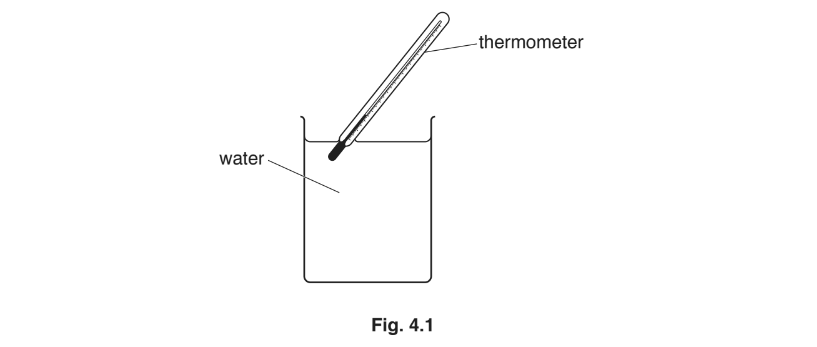

The student uses an electric fan to blow air across the open top of the beaker. She notices that the reading on the thermometer begins to decrease.

Explain, in terms of water molecules, why the temperature of the water at the surface begins to decrease.

*Source: 2018 0625/43 Q4A*

**Q17** [3 marks]

**Extract:**

A beaker contains some water at room temperature. A student places a mercury-in-glass thermometer in the water with the bulb of the thermometer just beneath the surface of the water.

Fig. 4.1 shows the arrangement.

The student uses an electric fan to blow air across the open top of the beaker. She notices that the reading on the thermometer begins to decrease.

The student places the thermometer near the bottom of the beaker. The electric fan continues to blow air across the top of the beaker. After some time, the student observes that the temperature of the water at the bottom of the beaker is decreasing.

State the name of the thermal transfer method causing this and explain what is happening in the water.

*Source: 2018 0625/43 Q4B*

**Q17** [3 marks]

**Extract:**

A beaker contains some water at room temperature. A student places a mercury-in-glass thermometer in the water with the bulb of the thermometer just beneath the surface of the water.

Fig. 4.1 shows the arrangement.

The student uses an electric fan to blow air across the open top of the beaker. She notices that the reading on the thermometer begins to decrease.

The student places the thermometer near the bottom of the beaker. The electric fan continues to blow air across the top of the beaker. After some time, the student observes that the temperature of the water at the bottom of the beaker is decreasing.

The thermometer used in this experiment has a small range and a large sensitivity.

(i) State what is meant by:

1. range

[1]

2. sensitivity

[1]

(ii) State and explain the effect on the range of the thermometer of using a smaller bulb that contains less mercury.

[1]

*Source: 2018 0625/43 Q4C*

### Q18 — hard — 4 marks

**Q18** [2 marks]

State and explain any effect on the sensitivity of a liquid-in-glass thermometer of reducing the diameter of the capillary tube.

*Source: 2018 (Series 1) 0625/41 Q5B*

**Q18** [2 marks]

State and explain any effect on the sensitivity of a liquid-in-glass thermometer of increasing the volume of the liquid-filled bulb.

*Source: 2018 (Series 1) 0625/41 Q5B*

