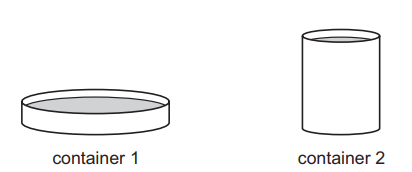
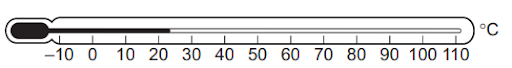
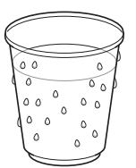
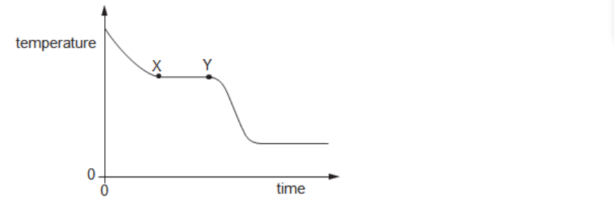
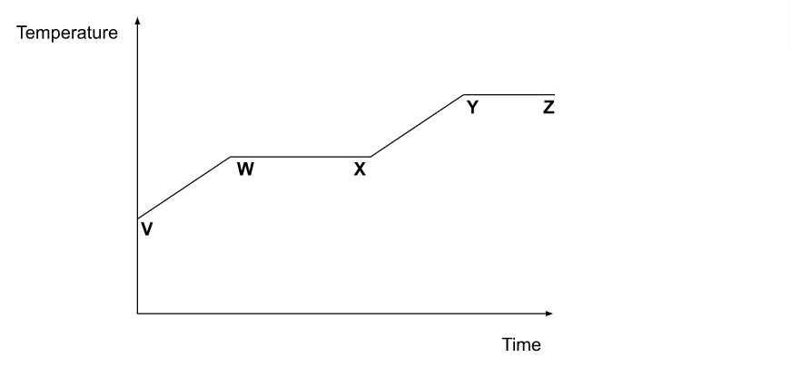
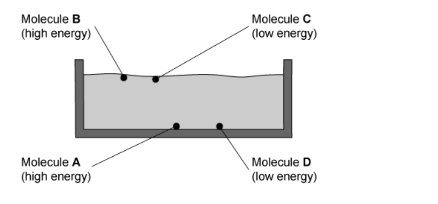
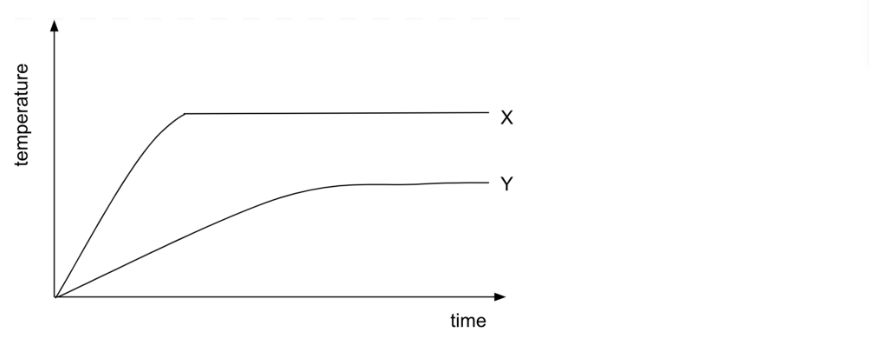
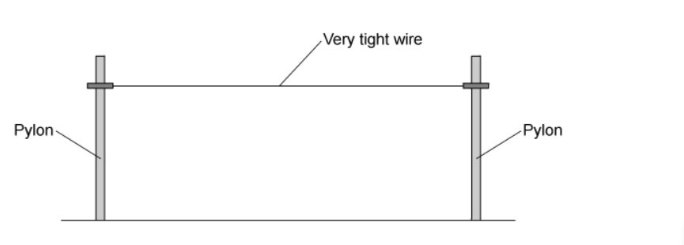

# Exam Questions — Thermal Properties & Temperature
**2. Thermal Physics** · Cambridge (CIE) IGCSE physics (0625 & 0972)
> Source: [https://www.savemyexams.com/igcse/physics/cie/23/topic-questions/](https://www.savemyexams.com/igcse/physics/cie/23/topic-questions/) · 34 questions across 1 sets

## Multiple Choice Questions (34 questions)

### Q1 — medium — 1 marks

**Q1** [1 mark]

An electric heater supplies $12600J$ of energy to $0.50\mathrm{kg}$ of a liquid. The temperature of the liquid rises from $20^{\circ}C$ to $50^{\circ}C$.

What is the specific heat capacity of the liquid?

### Q2 — medium — 1 marks

**Q2** [1 mark]

A liquid evaporates from an open dish.

Which change would increase the rate of evaporation?

### Q3 — medium — 1 marks

**Q3** [1 mark]

A beaker of water is heated from room temperature until the water boils.

Which statement about the water is correct?

### Q4 — medium — 1 marks

**Q4** [1 mark]

On a warm day, water evaporates from a puddle on a road.

Which row explains what happens to the average speed of the remaining water molecules?

|   | average speed of the remaining molecules | explanation |
|---|---|---|
| **A** | decreases | the more energetic molecules escape from the surface |
| **B** | decreases | the less energetic molecules escape from the surface |
| **C** | increases | the more energetic molecules escape from the surface |
| **D** | increases | the less energetic molecules escape from the surface |

### Q5 — medium — 1 marks

**Q5** [1 mark]

The diagram shows air trapped in a cylinder by a frictionless piston.

The air inside the cylinder is heated, and the piston moves as shown. The pressure of the air remains constant.

Which statement about the trapped air in the cylinder is correct?

### Q6 — medium — 1 marks

**Q6** [1 mark]

** **Which statements about evaporation of water are correct?

1. Evaporation causes the remaining liquid to cool.
2. During evaporation, the more energetic particles escape from the surface of the liquid.
3. Evaporation only happens at 100 °C.

*Source: June 2023 0972/11 Q15*

### Q7 — medium — 1 marks

**Q7** [1 mark]

**Extended Tier Only**

Two open containers are filled with water at room temperature. The containers have different shapes.

From which container does the water evaporate at the greater rate and how can the rate of evaporation be increased?

| ** ** | **container with the greater rate of evaporation** | **how the rate of evaporation can be increased** |
|---|---|---|
| **A** | 1 | decrease the water temperature |
| **B** | 1 | increase the water temperature |
| **C** | 2 | decrease the water temperature |
| **D** | 2 | increase the water temperature |

*Source: June 2022 paper 2 Q16*

### Q8 — medium — 1 marks

**Q8** [1 mark]

What happens to the volumes of liquid metal and of solid metal when heated at constant pressure?

| ** ** | **volume of liquid metal** | **volume of solid metal** |
|---|---|---|
| **A** | decreases | increases |
| **B** | decreases | no change |
| **C** | increases | increases |
| **D** | increases | no change |

*Source: June 2022 paper 1 Q15*

### Q9 — medium — 1 marks

**Q9** [1 mark]

** **The diagram shows a liquid-in-glass thermometer. ** **

A student wishes to check the marking of the upper fixed point on this thermometer.

*Source: June 2022 paper 1 Q16*

### Q10 — medium — 1 marks

**Q10** [1 mark]

Two thermometers, P and Q, give the same reading at room temperature.

The bulb of thermometer Q is wrapped in gauze and dipped in a beaker of water at room temperature.

Air at room temperature is blown over the two thermometer bulbs.

Which statement correctly describes and explains what happens?

*Source: June 2022 paper 1 Q14*

### Q11 — medium — 1 marks

**Q11** [1 mark]

**Extended Tier Only**

Which row about boiling and about evaporation is correct? ** **

| ** ** | **boiling** | **evaporation** |
|---|---|---|
| **A** | takes place only at the surface | takes place only at the surface |
| **B** | takes place only at the surface | takes place throughout the liquid |
| **C** | takes place throughout the liquid | takes place only at the surface |
| **D** | takes place throughout the liquid | takes place throughout the liquid |

*Source: specimen 2023 paper 2 Q18*

### Q12 — medium — 1 marks

**Q12** [1 mark]

**Extended Tier Only**

Copper is a type of metal.

A block of copper has a mass of 2.0 kg.

The block of copper absorbs 12 000 J of thermal energy.

The specific heat capacity of copper is 385 J/(kg °C).

What is the temperature rise of the copper?

*Source: specimen 2023 paper 2 Q16*

### Q13 — medium — 1 marks

**Q13** [1 mark]

A glass bottle has a metal cap. The cap fits very tightly and is difficult to remove.

The cap and the neck of the bottle are lowered into a bowl of hot water. The cap can be removed more easily.

What happens to allow the cap to be removed more easily from the bottle?

*Source: specimen 2023 paper 1 Q15*

### Q14 — easy — 1 marks

**Q14** [1 mark]

**  **A glass contains an iced drink on a warm and humid day. Water starts to form on the outside of the glass.

What is the name of the effect by which the water forms?

*Source: june 2022 paper 1 Q17*

### Q15 — easy — 1 marks

**Q15** [1 mark]

Which statement best describes a metal experiencing thermal expansion?

### Q16 — easy — 1 marks

**Q16** [1 mark]

Below are four statements about evaporation. One of them is correct.

Which statement is correct?

### Q17 — easy — 1 marks

**Q17** [1 mark]

A rise in temperature of a substance increases its

### Q18 — easy — 1 marks

**Q18** [1 mark]

What are the upper and lower fixed points on a Celsius scale thermometer?

|   | **Upper** | **Lower** |
|---|---|---|
| **A** | The boiling point of saturated salt solution | The freezing point of salt-water |
| **B** | The normal temperature of the human body | The freezing point of salt-water |
| **C** | The boiling point of pure water | The freezing point of pure water |
| **D** | The boiling point of pure water | Absolute zero |

### Q19 — easy — 1 marks

**Q19** [1 mark]

A substance is cooled. The graph below shows how its temperature changes over time.

What is happening in the portion of the graph between X and Y?

### Q20 — easy — 1 marks

**Q20** [1 mark]

A substance, which is initially in its solid form, is heated at a constant rate.

The graph shows how its temperature changes with time.

Between which points is the substance partly a liquid and partly a gas?

### Q21 — medium — 1 marks

**Q21** [1 mark]

The diagram shows four water molecules in a swimming pool. It also shows how much energy each molecule has.

Which of the water molecules is most likely to *evaporate* from the liquid?

### Q22 — hard — 1 marks

**Q22** [1 mark]

**Extended tier only**

Two beakers, X and Y, containing different liquids are heated by a student.

Both beakers contain the same mass of liquid, and are heated using the same heater set to the same power.

The graph shows how the temperature of each liquid changes with time.

What conclusion can be correctly drawn from the graph?

### Q23 — medium — 1 marks

**Q23** [1 mark]

Wooden barrels are often reinforced by putting tight iron rings around them.

What procedure would make it easier to get the iron ring onto the barrel?

### Q24 — hard — 1 marks

**Q24** [1 mark]

**Extended tier only**

In a children’s experiment, a saucer of water is left outside to evaporate.

Which row shows weather conditions that will each cause the rate of evaporation from the saucer to increase?

|   | **Temperature** | **Wind speed** |
|---|---|---|
| **A** | warm | windy |
| **B** | warm | still |
| **C** | cool | windy |
| **D** | cool | still |

### Q25 — medium — 1 marks

**Q25** [1 mark]

A National Grid engineer connects an electrical cable between two pylons.

The cable is a bit too tight.

What could happen to the wire if the weather became very cold, and why?

|   | **What could happen?** | **Why?** |
|---|---|---|
| **A** | The wire sags low | It expands |
| **B** | The wire breaks | It contracts |
| **C** | The wire breaks | It becomes brittle |
| **D** | The wire’s resistance increases | It contracts |

### Q26 — hard — 1 marks

**Q26** [1 mark]

Drinks are often cooled by putting ice cubes into them.

A delicious cocktail is initially at a temperature of 12℃, when a few ice cubes are put into the drink.

After some time has passed, some of the ice has melted, and the temperature of the cocktail has dropped to 7 ℃.

What is the temperature of the remaining, unmelted ice?

### Q27 — hard — 1 marks

**Q27** [1 mark]

**Extended tier only**

A student takes two blocks, block 1 and block 2, of different metals and heats them until the temperature of both has risen by 20℃.

She then leaves both blocks on the desk to cool.

Block 2 has a greater thermal capacity than block 1.

Which of the blocks loses more energy as it cools to room temperature, and which of the blocks required more energy to raise its temperature by 20℃?

|   | **Lost more energy when cooling** | **Required more energy to heat up.** |
|---|---|---|
| **A** | block 1 | block 1 |
| **B** | block 1 | block 2 |
| **C** | block 2 | block 1 |
| **D** | block 2 | block 2 |

### Q28 — medium — 1 marks

**Q28** [1 mark]

The water in outdoor swimming pools gradually evaporates.

How does the process of evaporation affect the temperature of the water in the swimming pool and what is the effect on the average kinetic energy of the water molecules?

|   | **Temperature** | **Average kinetic energy per molecule** |
|---|---|---|
| **A** | reduces | reduces |
| **B** | stays the same | stays the same |
| **C** | increases | increases |
| **D** | reduces | stays the same |

### Q29 — hard — 1 marks

**Q29** [1 mark]

**Extended tier only**

A pan, containing 0.750 kg of water which is initially at 13 ℃ is heated by an electric hob. 35 kJ of thermal energy is put into the water and its temperature rises.

You can assume that all the energy supplied by the hob goes into raising the temperature of the water.

The specific heat capacity of water is 4200 J/kg ℃.

To the nearest ℃, what is the final temperature of the water?

### Q30 — medium — 1 marks

**Q30** [1 mark]

In order to calibrate a degrees Celsius thermometer, the lowest fixed point can be found by placing the thermometer in:

### Q31 — medium — 1 marks

**Q31** [1 mark]

An iron cube is heated by a Bunsen burner.

Which of its properties decreases?

### Q32 — medium — 1 marks

**Q32** [1 mark]

Internal energy is affected by two properties of the particles which make up a substance.

Identify the two properties.

### Q33 — hard — 1 marks

**Q33** [1 mark]

**Extended tier only**

Which of the following statements defines the **specific heat capacity** of a substance?

### Q34 — hard — 1 marks

**Q34** [1 mark]

**Extended tier only**

Two metal cylinders, P and Q, are heated using an electric heater. Both of the cylinders receive exactly the same amount of thermal energy.

The temperature of P increases by a smaller amount than the temperature of Q.

What conclusion can be drawn?
