# Mark Schemes — Transfer of Thermal Energy
**2. Thermal Physics** · Cambridge (CIE) IGCSE physics (0625 & 0972)

## Alternative To Practical Questions (8 questions)

### Q1
To investigate the effect of different insulating materials on a plastic lid on the cooling rate of hot liquids in a container:

Draw or describe the set-up:

- Beaker **AND** plastic lid  **AND** insulating material wrapped around the beaker **AND** a thermometer **AND** stop clock drawn and labelled **[1 mark]**

Outline the method:

- Pour hot water into each container and measure the temperature of the water over a period of time **[1 mark]**
- Repeat with different insulating materials wrapped around the container **[1 mark]**

List the control variables:

Any **two **from:

- The initial temperature of the water should be the same
- The same volume of water should be used
- The volume / material / thickness of the beaker should be the same
- The same plastic lid should be used for each test
- The thickness of each insulating material should be the same
- The same time intervals should be measured for each material
- The room temperature should be the same for each beaker

**[2 marks]**

Design a results table:

A results table scoring one mark:

| Time/min | 0 | 1 | 2 | 3 | 4 | 5 |
|---|---|---|---|---|---|---|
| Temp/°C Material 1 |   |   |   |   |   |   |
| Temp/°C Material 2 |   |   |   |   |   |   |
| Temp/°C Material 3 |   |   |   |   |   |   |

- Results table drawn with suitable headings and units given **[1 mark]**

Explain how you would use your results to form a conclusion:

Any **one **from:

- Compare the temperature decrease with the different insulating materials
- Plot a graph of temperature over time (with three lines for the three different materials)

**[1 mark]**

### Q2
The room temperature is:

- 21 °C **[1 mark]**

**[Total: 1 mark]**

Each division on the thermometer represents 1 °C
An example of a table gaining two marks:

|   | beaker with lid A | beaker with lid B |
|---|---|---|
| t/....**s.**.. | $θ$/...**°C**.... | $θ$/....**°C**... |
| 0 | 80.0 | 81.0 |
| **Final answer:** **30** | 77.0 | 79.0 |
| **Final answer:** **60** | 74.5 | 77.5 |
| **Final answer:** **90** | 72.5 | 76.0 |
| **Final answer:** **120** | 70.5 | 75.0 |
| **Final answer:** **150** | 69.0 | 74.0 |
| **Final answer:** **180** | 68.0 | 73.5 |

- Units of s, °C and °C correct; **[1 mark]**
- Times of 30, 60, 90, 120, 150 and 180 correct; **[1 mark]**

**[Total: 2 marks]**
A precaution for accuracy of temperature readings:

Any **one** from:

- Read level with the thermometer to avoid parallax error; **[1 mark]**
- Wait until the reading stops rising; **[1 mark]**
- Always measure from the same position in the beaker; **[1 mark]**

**[Total: 1 mark]**
(i) A conclusion for the experiment:

State which lid has a greater cooling rate:

- The beaker with lid **A** has a greater rate of cooling; **[1 mark]**

Justify this with the results:

- <u>From 0 s to 180 s</u>, lid **A** has a temperature drop of 12.0 °C <u>whereas</u> lid **B** has a temperature drop of only 7.5 °C; **[1 mark]**

(ii) Suggest a change to apparatus for a greater difference in cooling rates:

**EITHER**

- Insulate sides **OR** stand the beaker on a mat; **[1 mark]**
- Ensures all thermal energy is lost through the surface / uncovered area; **[1 mark]**

**OR**

- Use a plastic beaker; **[1 mark]**
- No thermal energy is lost through the sides / base of the beaker; **[1 mark]**

**OR**

- Use thicker lids;**[1 mark]**
- Less conduction through the lid; **[1 mark]**

**OR**

- Use a fan; **[1 mark]**
- More evaporation occurs due to air movement; **[1 mark]**

**OR**

- Use a wider beaker; **[1 mark]**
- More evaporation occurs due to a larger surface area; **[1 mark]**

**[Total: 4 marks]**

> *For the second mark in part (i), the justification must be comparative and use time and temperature values.*

> *In part (ii), if more heat loss occurs via evaporation through the uncovered areas in the lids, the difference in cooling rates will be more pronounced. This can either happen by increasing the amount of evaporation overall (using fans or a larger surface area) or by minimising the other routes of heat loss (insulating the beaker, thickening the lids).*
The graph line can show that cooling rate is proportional to percentage covered if it is:

- A straight line; **[1 mark]**
- Through the origin; **[1 mark]**

**[Total: 2 marks]**
A factor that must be kept constant is:

Any **one** from:

- Volume of water;
- Initial temperature of water;
- The lid shapes / materials used;
- Type / material / size of beaker;
- Room temperature / wind speed / humidity;

**[Total: 1 mark]**

### Q3
Record the room temperature *θ*R in °C shown on the thermometer in Fig. 2.1.

- *θ*R = 23 (°C) **[1 mark]**

**[Total: 1 mark]**
A correctly completed table would look like:

**Table 2.1**

|   | beaker **A** with insulation | beaker **B** with a lid |
|---|---|---|
| t/**s** | *θ/***°C** | *θ/***°C** |
| 0 | 83.0 | 86.0 |
| **Final answer:** **30** | 79.0 | 84.0 |
| **Final answer:** **60** | 75.5 | 82.5 |
| **Final answer:** **90** | 73.0 | 81.0 |
| **Final answer:** **120** | 71.0 | 80.0 |
| **Final answer:** **150** | 69.5 | 79.0 |
| **Final answer:** **180** | 68.5 | 78.5 |

- <u>All</u> units correct: s, °C, °C **[1 mark]**
- <u>All</u> times correct: 30, 60, 90, 120, 150, 180 **[1 mark]**

**[Total: 2 marks]**

> *It is important to note that **all** the units need to be right to get the first mark, and **all **the times have to be right to get the second mark.*
Conclude whether the the insulation or the lid is more effective:

- The lid is more effective; **[1 mark]**

Justify your answer:

Identify the pattern:

- The temperature loss over time with the lid is less

**AND**

Give an example:

- The overall temperature loss with the lid is (86.0−78.5) 7.5 °C but with the insulation it is (83.0−68.5) 14.5 °C **[1 mark]**

**[Total: 2 marks]**

If you are asked to refer to the results then you absolutely have to to get full marks!
Suggest an additional experiment which could be used to show how effective a lid or insulation is:

- Experiment repeated but using both the lid and the insulation; **[1 mark]**

**OR**

- Experiment completed using neither the lid nor the insulation; **[1 mark]**

Explain how the additional results could be used:

- Compare the results of the previous experiment with the results of the additional experiment; **[1 mark]**

**[Total: 2 marks]**

The original experiment doesn't have a control, and so this is what is needed to draw a full conclusion. The additional experiment will give this control.
(i) To calculate  *x*A, the average cooling rate for beaker **A** over the whole experiment:

Obtain the values from the table:

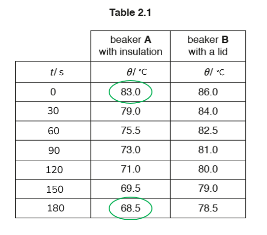

List the known values:

- *θ*0 = 83.0 °C
- *θ*180 = 68.5 °C
- *T* = 180 s

From the question:

- $x_{A}=\frac{θ_{0}-θ_{180}}{T}$

Substitute in the known values:

- $x_{A}=\frac{83.0-68.5}{180}$
- *x*A = 0.081 **[1 mark]**

State the unit:

- °C / s **[1 mark]**

(ii) State why the initial temperature of the water should be controlled:

- Because cooling is more rapid at higher temperatures; **[1 mark]**

Explain why:

- The rate of cooling over the first 30 seconds is greater than over the final 30 seconds

**AND**

- For beaker A the temperature drop is 4 °C in the first 30 s and 1 °C in the final 30 s; **[1 mark]**

**OR**

- For beaker B the temperature drop is 2 °C in the first 30 s and 0.5 °C in the final 30 s; **[1 mark]**

**[Total: 4 marks]**

Using specific examples will enable you to gain maximum marks in questions like this one!

### Q4
To investigate the effect of surface colour on rate of heat loss:

Draw a labelled diagram to show how to set up the equipment:

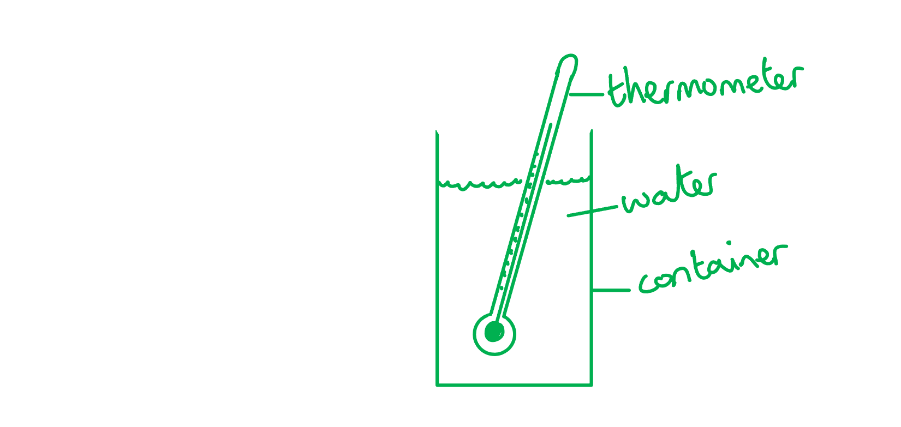

- Thermometer shown in the container; **[1 mark]**

Briefly outline the method:

- Put hot water in container **AND** record starting temperature **AND** temperature at regular intervals; **[1 mark]**
**OR**
- Put hot water in container **AND** record starting temperature **AND** temperature after a named amount of time; **[1 mark]**

Specify the range:

- Repeat with at least three colours; **[1 mark]**

Identify the control variables and state at least two:

- Same starting temperature of the water; **[1 mark]**
**OR**
Same room temperature; **[1 mark]**
- Use of a lid; **[1 mark]**
**OR** Three (or more) named colours; **[1 mark]**
**OR** Same thickness of paint; **[1 mark]**

Draw a table showing columns and units:

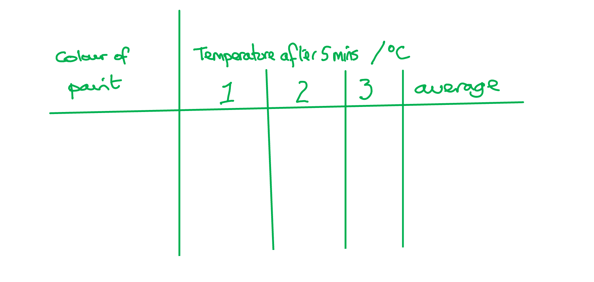

- Correctly labelled columns for all variables **AND**** **units; **[1 mark]**

Explain how to draw a conclusion from the results:

- Greatest loss of temperature is best radiator **OR**** **least loss of temperature is worst radiator / best insulator: **[1 mark]** **                           **

**An example of an answer which would score 7 marks is:**

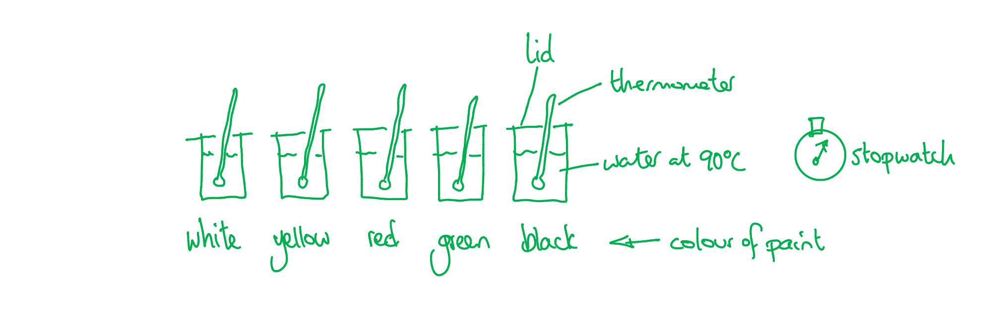

**[diagram with thermometers in containers: 1 mark]**

The student should take the black and white containers and place them on the bench at the same time (same room temperature). **[1 mark]**

Then they take three identical containers but choosing three colours, for example yellow, red and green. **[1 mark] **Make sure that the thickness of paint **[1 mark] **and material of the container are the same.

The student adds a measured volume of boiling water to each container, and decides a starting temperature for the experiment, say 90 °C.

Put a thermometer into each container and watch the temperature until it drops to 90 °C. Use a lid to stop heat loss.

Start the stopwatch and time for 5 minutes. After five minutes record the new temperature. **[1 mark]**

Finally empty the water out (taking care with hot water - wear safety glasses) and repeat the whole experiment two more times.

Record the results in the table and plot a graph. The paint colour with the higest drop in temperature is the best radiator of heat.  **[1 mark]**

**[table with correct columns and ****units****; 1 mark]**

The example above shows the kind of short descriptions which easily score full marks in the exam. An alternative method would be to take the temperature every minute and this would also score full marks.

The most common mistakes with the investigation question are;

- Saying what the result will be, rather than how to draw the conclusion;
- Forgetting that only one variable can change, and changing all of them;
- Showing repeat readings or the range in the table, but not mentioning them in the description (it seems unfair, but this won't get you the mark);
- Wasting time by inventing data for the table.

If you find yourself doing one of these - stop!

And finally, the examiner will award marks for the diagram, so anything which is explained there will count. Our diagram above would actually score four marks of the seven. Here is how the examiner would see it:

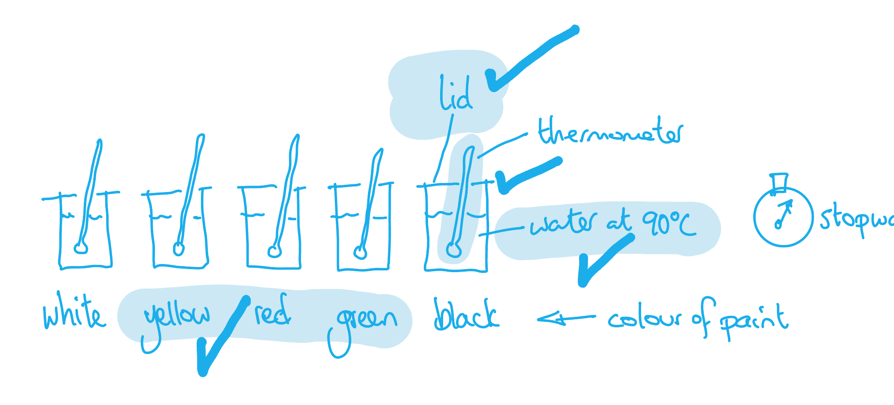

### Q5
(i) In the first row of Table 2.1, record the temperature θA and  θB for time *t* = 0:

A table that would score 1 mark should look like:

**Table 2.1**

|   | beaker **A** with 200 cm3 of water | beaker **B** with 100 cm3 of water |
|---|---|---|
| *t*/ | *θ*A/ | *θ*B/ |
| 0 | **Final answer:** **87.0** | **Final answer:** **89.0** |
|   | 85.0 | 86.0 |
|   | 83.0 | 83.0 |
|   | 81.5 | 80.5 |
|   | 80.0 | 78.0 |
|   | 78.5 | 76.0 |
|   | 77.5 | 74.5 |

- *θ*A = 87(.0)(°C) **AND** *θ*B = 89(.0)(°C) **[1 mark]**

(ii) Complete the headings and the time column in the table:

A table that would score 2 marks should look like:

|   | beaker **A** with 200 cm3 of water | beaker **B** with 100 cm3 of water |
|---|---|---|
| *t*/**s** | *θ*A/**°C** | *θ*B/**°C** |
| 0 | **87.0** | **89.0** |
| **Final answer:** **30** | 85.0 | 86.0 |
| **Final answer:** **60** | 83.0 | 83.0 |
| **Final answer:** **90** | 81.5 | 80.5 |
| **Final answer:** **120** | 80.0 | 78.0 |
| **Final answer:** **150** | 78.5 | 76.0 |
| **Final answer:** **180** | 77.5 | 74.5 |

- s, °C, °C in correct columns; **[1 mark]**
- Times *t *30, 60, 90, 120, 150 in the first column; **[1 mark]**

**[Total: 3 marks]**
One precaution which should be taken to ensure that the temperature readings in the experiment are as accurate as possible is

**Any one from:**

- Read (the values) at 90° / at right angles / perpendicular to the scale;** [1 mark]**
- Stir (before reading);** [1 mark]**
- Wait under the reading stops rising (on the thermometer) (at the start);** [1 mark]**

**[Total: 1 mark]**
A conclusion stating how the volume of water in the beaker affects the rate of cooling of the water is:

- The lower the <u>volume</u> of water, the faster the rate of cooling; **[1 mark]**

Justification by reference to the results:

- <u>From </u><u>*t*</u><u> = 0 s to </u><u>*t*</u><u> = 180 s</u>, for beaker **A** / 200 cm3, the temperature change was (87.0 – 77.5 =) 9.5 °C whilst for beaker **B **/ 100 cm3, the temperature change was (89.0 – 74.5 =) 14.5 °C **[1 mark]**

**[Total: 2 marks]**

> *Make sure to answer **all** parts of the question. Your justification must reference the results, so try and use values from the table (or graph in some cases) to match your conclusion.*

> *The opposite conclusion will also be accepted i.e. the larger the volume of water, the slower the rate of cooling.*

> *In the mark scheme, a conclusion matching the results will be enough. This is just an example of what an ideal answer would be.*
(i) Calculate the average rate of cooling* x*1 for the first 90 s of the experiment:

List the known quantities:

- Temperature at *t* = 0 s, *θ*0 = 89.0 °C
- Temperature at *t* = 90 s, *θ*90 = 80.5 °C
- Time, *t* = 90 s

Substitute the values into the equation:

- $x_{1}=\frac{θ_{0}--θ_{90}}{t}=\frac{89.0--80.5}{90}$
- *x*1 = 0.094

(ii) Calculate the average rate of cooling *x*2 in the last 90 s of the experiment:

List the known quantities:

- Temperature at *t* = 90 s, *θ*90 = 80.5 °C
- Temperature at *t* = 180 s, *θ*180 = 74.5 °C
- Time, *t* = 90 s

Substitute the values into the equation:

- $x_{2}=\frac{θ_{90}--θ_{180}}{t}=\frac{80.5--74.5}{90}$
- *x*2 = 0.067 **[1 mark]**

State the correct unit for both *x*1 and *x*2:

- °C/s **[1 mark]**

**[Total: 2 marks]**

> *The marks are allocated slightly differently here that what you may be used to. 1 mark is given for the correct values of **x**1** and **x**2** and the second mark is given for the correct unit on **both **values.*

> *The way to work out the unit is by looking at the equations for **x**1** and **x**2**. *

- *The numerator (top half) of the fraction has units of °C as **θ** is the temperature*
- *The denominator (bottom half) of the fraction has units of s as **t** is the time*

  - *Therefore, the units are °C/s*

> *With all units the '/' means 'per unit'. Therefore, if the unit is for the value on the denominator of a fraction it is always / unit (per unit). E.g. m/s is 'metres **per** second'*
State whether your values for *x*1 and *x*2 support this suggestion:

- *x*1 and *x*2 do not support this suggestion; **[1 mark]**

Justify your statement with reference to your results:

- Because they are calculated from the difference in temperatures (*θ*0 – *θ*90 and *θ*90 – *θ*180) so the difference in starting temperature of either 89.0 °C and 80.5 °C doesn't matter; **[1 mark]**

**[Total: 2 marks]**
Describe an experiment to investigate whether more thermal energy is lost from the water surface than from the sides of the beakers:

- With the same volume of water, measure the difference in temperature of a beaker with a lid <u>and</u> no insulation; **[1 mark]**
- Repeat the experience but now with a beaker with no lid <u>and</u> insulation; **[1 mark]**

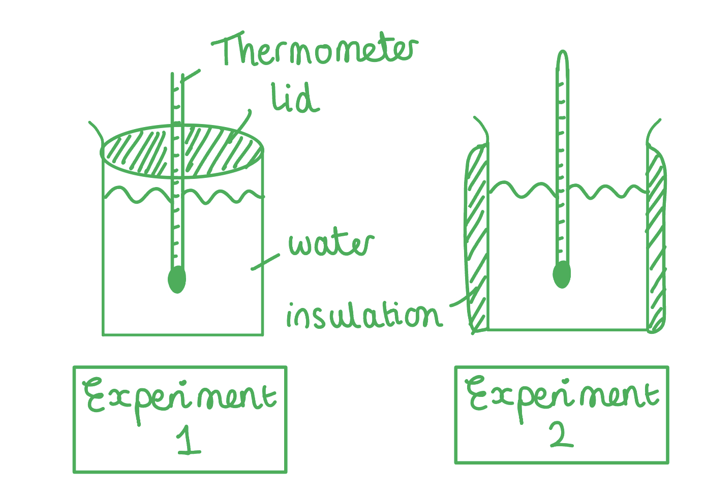

**[Total: 2 marks]**

### Q6
Record* θ*R in °C from Fig. 3.2.:

- *θ*R = 24°C **[1 mark]**

**[Total: 1 mark]**
(i) Complete the column headings in Table 3.1 and in Table 3.2:

Tables scoring two marks:

Table 3.1: Beaker

| *t */ **s** | *θ */ **°C** |
|---|---|
| 0 | 94 |
| 30 | 93 |
| 60 | 92 |
| 90 | 91 |
| 120 | 90 |
| 150 | 89 |

Table 3.2: Can

| t / **s** | θ / **°C** |
|---|---|
| 0 | 93 |
| 30 | 91 |
| 60 | 90 |
| 90 | 89 |
| 120 | 88 |
| 150 | 87 |

- *t */ <u>s</u> shown in both tables; **[1 mark]**
- *θ* / <u>°C</u> shown in both tables; **[1 mark]**

(ii) Tick the box to show your conclusion from the readings:

`square` The water in the beaker has a greater rate of cooling than the water in the can.

`square` The water in the beaker has a smaller rate of cooling than the water in the can.

**✓** There is no significant difference between the rates of cooling of the water in the beaker and the can; **[1 mark]**

** **

(iii) Justify your conclusion by reference to the readings:

Any **one** from:

- The beaker cooled by a total of 5°C over 150 s and the can cooled by 6°C over 150 s, which is not a significant difference; **[1 mark]**
- Between *t* = 30 s and* t* = 60 s the beaker cooled from 93°C to 92°C, and the can cooled from 91°C to 90°C, which is the same rate of cooling; **[1 mark]**

**For the second mark:**

- The total cooling only differed by 1°C between the beaker and the can

**OR**

- The difference in the rate of cooling between the beaker and the can was small; **[1 mark]**

**[Total: 4 marks]**

> *For the first marking point of part (iii) any similar comparative values from the table may be used to gain the mark.*
(i) Suggest two suitable changes to the apparatus that the student could make:

- Use a black painted beaker and a black painted can; **[1 mark]**
- Use a shiny can and an unpainted beaker; **[1 mark]**

(ii) Suggest two variables that should be controlled in order to make the experiment a fair test:

**Any two from:**

- Room temperature; **[1 mark]**
- The volume of the water used; **[1 mark]**
- The initial temperature of the water; **[1 mark]**

**[Total: 4 marks]**

> *The suggestions made in part (i) increase the **validity** of the investigation. In the previous investigation, there were two factors that changed: the material of the container and whether or not they were painted black. Both of these factors could be affecting the rate of cooling. This is called a confounding variable. It is impossible to tell which factor is producing the results. This is why is it important to have **control variables**, so only one factor is being changed and the results can be attributed to that change alone.*
State **one** precaution that you would take in order to record accurate temperature readings:

**Any one from:**

- View the thermometer at eye level at an angle perpendicular to the reading (to reduce parallax error); **[1 mark]**
- Stir the water prior to taking a reading (to ensure even heat distribution throughout the water); **[1 mark]**
- Ensure the thermometer is not touching the beaker when the readings are taken (as the beaker might be at a different temperature to the water); **[1 mark]**

**[Total: 1 mark]**

> *The image below shows how viewing the thermometer from different angles can change the measurement recorded. This is known as parallax error. Readings should always be taken from eye level and at a right angle to the object.*

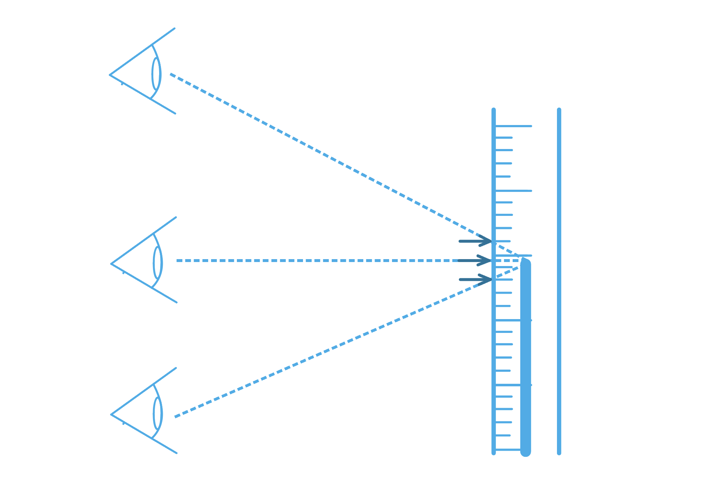

### Q7
Room temperature *θ*R shown on the thermometer is:

- 21 (°C) **[1 mark]**

**[Total: 1 mark]**

> *This is a straightforward mark to obtain, but it is important to take care, as this value will then be used in subsequent question parts!*
(i) The competed headings should look like:

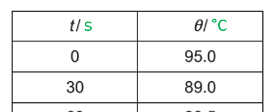

- Unit for t = s **AND** unit for *θ* = °C; **[1 mark]**

(ii) To describe a precaution to ensure the accuracy of the temperature readings:

**Any one from:**

- Line of sight is perpendicular to scale (when taking a reading); **[1 mark]**
- Wait until the reading stops rising (at start); **[1 mark]**
- Stir before reading; **[1 mark]**
- Keep the thermometer at same depth; **[1 mark]**

**[Total: 2 marks]**

> *It is important to be able to identify the units for different variables.*
(i) To calculate the average cooling rate x1 during the first 90 s of the experiment:

Read the values from the table:

**Table 2.1**

| t/s | *θ/*°C |
|---|---|
| 0 | **Final answer:** **95.0** |
| 30 | 89.0 |
| 60 | 83.5 |
| 90 | **Final answer:** **79.0** |
| 120 | 75.0 |
| 150 | 71.5 |
| 180 | 68.5 |
| 210 | 66.0 |
| 240 | 64.0 |
| 270 | 62.5 |

- *θ*0 = 95.0 (°C)
- *θ*90 = 79.0 (°C)

Substitute values into the equation:

- $x_{1}=\frac{95.0-79.0}{90}$
- *x*1 = 0.18 **AND** state the units: °C/s **[1 mark]**

** **

(ii) To calculate the average cooling rate x2 during the middle 90 s of the experiment:

Read the values from the table:

**Table 2.1**

| t/s | *θ/*°C |
|---|---|
| 0 | 95.0 |
| 30 | 89.0 |
| 60 | 83.5 |
| 90 | **Final answer:** **79.0** |
| 120 | 75.0 |
| 150 | 71.5 |
| 180 | **Final answer:** **68.5** |
| 210 | 66.0 |
| 240 | 64.0 |
| 270 | 62.5 |

- *θ*90 = 79.0 (°C)
- *θ*180 = 68.5 (°C)

Substitute values into the equation:

- $x_{2}=\frac{79.0-68.5}{90}$
- *x*2 = 0.12 (°C/s) **[1 mark]**

** **

(iii) To calculate the average cooling rate x3 during the last 90 s of the experiment:

Read the values from the table:

**Table 2.1**

| t/s | *θ/*°C |
|---|---|
| 0 | 95.0 |
| 30 | 89.0 |
| 60 | 83.5 |
| 90 | 79.0 |
| 120 | 75.0 |
| 150 | 71.5 |
| 180 | **Final answer:** **68.5** |
| 210 | 66.0 |
| 240 | 64.0 |
| 270 | **Final answer:** **62.5** |

- *θ*180 = 68.5 (°C)
- *θ*270 = 62.5 (°C)

Substitute values into the equation:

- $x_{3}=\frac{68.5-62.5}{90}$
- *x*3 = 0.07 (°C/s) **[1 mark]**

**[Total: 3 marks]**

> *Reading carefully off the table is really important, as is giving the value to an appropriate number of significant figures.*

> *Giving the wrong unit at any point will negate the first mark.*
(i) To describe the pattern of the rate of cooling:

State the pattern:

- The cooling rate decreases (over time)

**AND**

Use an example from the results:

Any **one** from:

- Over the first 90 seconds the cooling rate is 0.18 °C/s but over the middle 90 s the cooling rate is 0.12 °C/s **[1 mark]**
- Over the first 90 seconds the cooling rate is 0.18 °C/s but over the last 90 s the cooling rate is 0.07 °C/s **[1 mark]**
- Over the middle 90 seconds the cooling rate is 0.12 °C/s but over the last 90 s the cooling rate is 0.07 °C/s **[1 mark]**

** **

(ii) To give an estimate of the probable final temperature:

- *θ*F = *θ*R **[1 mark]**

**[Total: 2 marks]**

> *Over time the rate of cooling decreases. Once the temperature has reached the temperature of the room, **θ**R** there will be no further cooling experienced as the water and the room are in thermal equilibrium.*
(i) If a lower starting temperature of water was used:

**EITHER**

Compare cooling rates:

- There would be smaller cooling rates (at equivalent times); **[1 mark]**

Use the results to explain your answer:

**Any one from:**

- Over the first 90 seconds the cooling rate is 0.18 °C/s but over the middle 90 s the cooling rate is 0.12 °C/s
- Over the first 90 seconds the cooling rate is 0.18 °C/s but over the last 90 s the cooling rate is 0.07 °C/s
- Over the middle 90 seconds the cooling rate is 0.12 °C/s but over the last 90 s the cooling rate is 0.07 °C/s

**AND**

- So the cooling rate is less at lower temperatures; **[1 mark]**

** **

**OR**

Compare cooling rates:

- There would be a smaller difference in cooling rates (between equivalent times); **[1 mark]**

Use the results to explain your answer:

Any **one** from:

- Over the middle 90 seconds the cooling rate is <u>greater</u> at 0.18 °C/s but over the last 90 s the cooling rate is <u>smaller</u> at 0.012 °C/s; **[1 mark]**
- Over the middle 90 seconds the cooling rate is <u>greater</u> at 0.18 °C/s but over the last 90 s the cooling rate is <u>smaller</u> at 0.07 °C/s; **[1 mark]**
- Over the middle 90 seconds the cooling rate is <u>greater</u> at 0.12 °C/s but over the last 90 s the cooling rate is <u>smaller</u> at 0.07 °C/s; **[1 mark]**

** **

(ii) Control variables which the student should control are:

**Any one from:**

- (same) volume of water; **[1 mark]**
- (same) material of beaker; **[1 mark]**
- (same) duration of experiment; **[1 mark]**
- (same) room temp / named appropriate environmental condition; **[1 mark]**

**[Total: 3 marks]**

> *Comparison saying that (**x**2 **to **x**3**) is smaller than (**x**1** to **x**2**) is what gains you the second mark. It's important to state both the relationship AND use data from the experiment to draw your conclusions.*

### Q8
To investigate the effect of lids of different thicknesses on the cooling rate of hot liquids in a container:

Draw a labelled diagram to show how to set up the equipment:

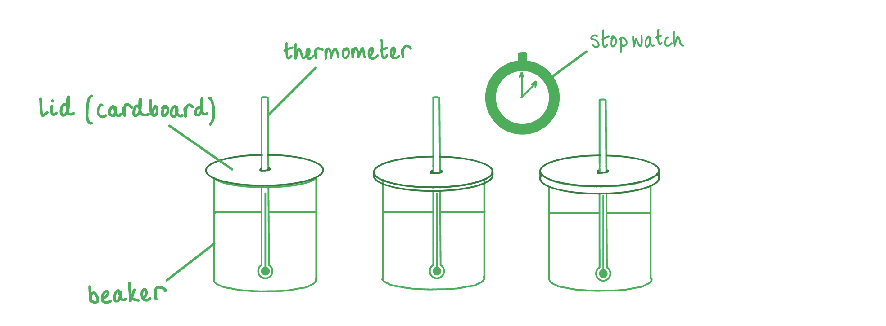

- Beaker **AND** lid **AND** thermometer **AND** stop clock drawn and labelled; **[1 mark]**

Outline the method:

- Pour hot water into a container and measure the temperature of the water over a period of time; **[1 mark]**
- Repeat with different thicknesses of lids; **[1 mark]**

List the control variables:

**Any two from:**

- The initial temperature of the water should be the same; **[1 mark]**
- The same volume of water should be used; **[1 mark]**
- The volume / material / thickness of the beaker should be the same; **[1 mark]**
- The material for each lid should be the same; **[1 mark]**
- The same time intervals should be measured for each lid; **[1 mark]**
- The room temperature should be the same for each beaker; **[1 mark]**

Design a results table:

A results table scoring one mark:

| Time/min | 0 | 1 | 2 | 3 | 4 | 5 |
|---|---|---|---|---|---|---|
| Temp/°C  Lid 1 |   |   |   |   |   |   |
| Temp/°C  Lid 2 |   |   |   |   |   |   |
| Temp/°C  Lid 3 |   |   |   |   |   |   |

- Results table drawn with suitable headings and units given; **[1 mark]**

Explain how you would use your results to form a conclusion:

**Any one from:**

- Compare the temperature decrease with the thickness of the different lids; **[1 mark]**
- Plot a graph of temperature over time (with three lines for the three different lids); **[1 mark]**

**[Total: 7 marks] **

> *The instruction to list the equipment needed can be done as a labelled diagram. *

> *Control variables should only be factors that would affect the results, make sure you chose ones that are contextually relevant!*

> *Remember that you do **not **need to waste time making up data to put in your results table!*

> *The mark scheme shows the kind of short descriptions which easily score full marks in the exam.*

> *An alternative method would be to record the times at which the water cooled by 1°C, and this would also score full marks.*

> *The most common mistakes with investigation questions are;*

- *Saying what the result will be, rather than how to draw the conclusion;*
- *Forgetting that only one variable can change, and changing all of them;*
- *Showing repeat readings or the range in the table, but not mentioning them in the description (it seems unfair, but this won't get you the mark);*
- *Wasting time by inventing data for the table.*

> *If you find yourself doing one of these - stop!*

> *And finally, the examiner will award marks for the diagram, so anything which is explained there will count. *

## Multiple Choice Questions (26 questions)

### Q1
**Final answer:** **The correct answer is B**

- The base of the saucepan needs to transfer thermal energy efficiently from the stove to the water, so it must be a good thermal conductor

  - **Copper **is an excellent thermal conductor because it has free electrons that can transfer kinetic energy quickly through the material
- The handle of the saucepan must not transfer thermal energy to the user's hand, so it must be a good thermal insulator (poor conductor)

  - **Wood **is a poor thermal conductor because it does not have free electrons, so energy is transferred slowly through molecular vibrations

**A** is incorrect because glass is a poor thermal conductor, so it would not efficiently transfer heat to the water. Copper in the handle would burn the user's hand.

**C** is incorrect because it reverses the correct materials. Wood in the base would not conduct heat well, and copper in the handle would get too hot to hold.

**D** is incorrect because glass is a poor conductor for the base. While wood is correct for the handle, the base needs a metal such as copper

### Q2
**Final answer:** **The correct answer is B**

- The ice at the bottom of the tube does not melt even though the water at the top is boiling
- This demonstrates that thermal energy is not being transferred effectively from the top to the bottom through the liquid by conduction
- Convection cannot transfer the energy downwards because the heated water at the top becomes less dense and stays at the top

**A** is incorrect because if water were a good conductor, the thermal energy would have reached the bottom and melted the ice.

**C** is incorrect because convection currents are caused by heated fluids rising, not sinking.

**D** is incorrect because metals are good conductors; the gauze is only used to keep the ice submerged at the bottom of the tube.

### Q3
**Final answer:** **The correct answer is A**

- The containers are identical, and each contains the same amount of water at the same initial temperature
- This means that the only thing that affects the rate of emission of thermal radiation (how quickly the temperature falls) is the type of surface

  - Black surfaces are better emitters of radiation than white surfaces
  - Dull surfaces are better emitters of radiation than shiny surfaces
- The surface that is the best emitter of radiation will lose energy at the fastest rate, which is shown by the **steepest **curve on the graph

  - Dull black surfaces are the best emitters of thermal radiation, so this must be surface **Z**
- The surface that is the worst emitter of radiation will lose energy at the slowest rate, which is shown by the **shallowest **curve on the graph

  - Shiny white surfaces are the worst emitters of thermal radiation, so this must be surface **W**
- The rate of cooling, from fastest to slowest, by surface is:

  - dull black (Z)  >  shiny black (Y)  > dull white (X) > shiny white (W)
- This is shown by option **A**

### Q4
**Final answer:** **The correct answer is ****B**** because:**

- The water is inside the can and so the thermal energy needs to travel through the metal can
- Thermal energy travels through solids by thermal conduction
- The hot can is surrounded by a vacuum (empty space) which cannot transfer energy by thermal convection or thermal conduction and there are no particles
- The outer surface of the metal can is a solid metal and so it cannot evaporate
- The metal can must be cooling by emitting thermal radiation because no other process is possible
- So, the energy is transferred by conduction (through the metal can) and then by radiation (through the vacuum)

**A** is incorrect as there is no convection through empty space as there are no particles to move.

**C** is incorrect because the hot water cannot evaporate through the solid metal can and there is no convection in empty space.

**D** is incorrect as the hot water cannot evaporate through the solid metal can.

### Q5
**Final answer:** **The correct answer is ****D****, because:**

- White surfaces are worse absorbers of radiation than black surfaces
- Shiny surfaces are slightly worse absorbers than dull surfaces
- That means a shiny white surface is worse than all the other options

The rate of absorption and emission of radiation depends on several factors including surface colour and surface texture.

Effect of surface colour: black surfaces are better absorbers and emitters of radiation than white surfaces.

Effect of surface texture: shiny surfaces are the best reflectors of radiation, meaning they are the worst absorbers and emitters.

### Q6
**Final answer:** **The correct answer is B**

- When one end of a copper bar is heated to a high temperature, thermal energy is transferred to the other end by **conduction**
- Heat transfer via conduction occurs due to the lattice vibrations of copper ions **and** the movement of free electrons

**A** and **D** are incorrect because metals, such as copper, have a large number of free electrons, so when one end is heated, the lattice ions and the electrons both gain kinetic energy, which they both transfer to the other end through vibrations and movement

**C** is incorrect because the copper ions are fixed, so they do not move along the bar

### Q7
**Final answer:** **The correct answer is B**

- The material allowing the quickest transfer of thermal energy is the best conductor
- Metals (such as iron) are the best conductors of the materials listed

**A **is incorrect as metals conduct thermal energy much better than gases, due to the large spacing of particles in a gas

**C **is incorrect as a vacuum cannot transfer thermal energy via conduction (there are no particles to collide and transfer energy)

**D **is incorrect as metals conduct thermal energy better than liquids, due to particles being able to move past each other in a liquid

### Q8
**Final answer:** **The correct answer is B**

- The cubes are identical, so they are made from the same metal, meaning they conduct heat equally well

  - This eliminates option **A**
- Black surfaces are the best** absorbers **and **emitters** of radiation

  - This eliminates option **C**
- Shiny surfaces are the best** reflectors** of radiation, therefore, they are the **worst** absorbers and emitters of radiation

  - This eliminates option **D**
- Therefore, black surfaces are **better emitters** of radiation than shiny surfaces

  - Therefore, option **B** is correct

### Q9
**Final answer:** **The correct answer is A**

- Metal is a better thermal conductor than plastic
- This means it more readily absorbs thermal energy from a hand, making it feel cooler

**B **is incorrect as convection only occurs in liquids and gases, not solids

**C **is incorrect as plastic is a better insulator than metal

**D **is incorrect as plastic radiates thermal energy better than metal does

### Q10
**Final answer:** **The correct answer is C**

- A convection current occurs in a liquid when a difference in temperature causes a change in density
- When the piece of ice is added to the beaker of water, it cools the region of water around it
- As a result, the water molecules lose energy and move closer together, making the water more dense
- The denser, cooler water then sinks downwards to point P
- This causes the warmer, less dense water to rise upwards to point Q
- Therefore, at point P:

  - the temperature of the water is **lower **than at Q
  - the density of the water is **higher **than at Q

### Q11
**Final answer:** **The correct answer is ****D**** because:**

- Convection happens because warmer fluids are less dense than cooler fluids.

- The ice cools the air, making it more dense.
- This denser air falls to the ground.

The other answers get one or both of the statements incorrect.

### Q12
**Final answer:** **The correct answer is ****D**** because:**

- Between the Sun and the Earth lies approximately 1.5 x 108 m of empty space.
- Space is a vacuum.
- Vacuums contain no particles.
- Thermal energy cannot travel via conduction or convection through a place that does not contain any particles, as these methods of heat transfer rely on particles.
- Infrared radiation can travel through a vacuum.
- Therefore, the only possible method is radiation.

**A **is incorrect as conduction and convection cannot happen in the vacuum of space.

**B **is incorrect as conduction and convection cannot happen in the vacuum of space.

**C **is incorrect as convection cannot happen in the vacuum of space; there is nothing to convect, and even if there was, which way is up?

### Q13
**Final answer:** **The correct answer is ****B**** because:**

- This is the only diagram that shows liquid **near** the heat source rising **and** cooled liquid at the top sinking back to the bottom

### Q14
**Final answer:** **The correct answer is ****A**** because:**

- Thermal radiation is the transfer of heat via infrared radiation.
- Infrared is a type of electromagnetic radiation.

**B **is incorrect as it *can* happen in a vacuum, but it can also happen anywhere else as well.

**C **is incorrect as this answer describes convection.

**D **is incorrect as this answer describes conduction through a metal.

### Q15
**Final answer:** **The correct answer is ****B**** because:**

- As the temperature of air molecules increases, they move more quickly, and tend to be further apart, on average.
- This makes the air less dense.
- Less dense substances float on more dense substances.

**A **is incorrect as the molecules themselves remain exactly the same size and shape. They absolutely do **not** expand. This is a very common misconception among students.

**C **is incorrect as the air molecules do not contract, either.

**D **is incorrect as if the air molecules moved closer together, the density of the air would **increase**.

### Q16
**Final answer:** **The correct answer is ****B**** because:**

- **Conduction** in **non-metals** happens because lattice **vibrations** are passed between neighbouring **atoms**.
- In metals, this process is assisted by free electrons being transferred between the lattice sites as well, but this question asks about **non-metals**.
- Nuclei do not move (in a translational way, they do vibrate) at all in solids, so nuclei are **never** transferred.

**A **is incorrect as electrons are only transferred in metals.

**C **is incorrect as nuclei are not transferred in the process of conduction. They do move in convection, though. Electrons are only transferred for conduction in metals.

**D **is incorrect as nuclei are not transferred in the process of conduction. They do move in convection, though.

### Q17
**Final answer:** **The correct answer is ****D ****because:**

- Flames have their shape because they heat air, and that air rises, pulling the flame upwards with it and creating the characteristic flame shape.
- Convection involves hot fluids rising. Upwards.
- In zero gravity (or **freefall **in the case of the ISS), upwards does not exist, and so convection cannot happen.
- Therefore, the flame burns equally in all directions, in a sphere.
- It very quickly uses up all the oxygen in the area, and no more is ‘convected’ in to replace that which is used in combustion. Therefore, it goes out.

There is a fascinating video on a well known video hosting website about this and that should be easy for you to find. It is well worth a watch.

### Q18
**Final answer:** **The correct answer is ****A**** because:**

- Darker coloured objects emit **and **absorb infrared radiation at a greater rate than their light coloured counterparts.
- A **greater rate of absorption** of infrared radiation raises the temperature more quickly.
- A **greater rate of emission** of infrared radiation lowers the temperature more quickly.

In general: black objects **change temperature** quickly, while white objects change temperature slowly.

**B** is incorrect as the white car will cool more slowly at night.

**C **is incorrect as the white car will heat up more slowly during the day.

**D **is incorrect as the white car will both heat up and cool more slowly than the black car.

### Q19
**Final answer:** **The correct answer is ****C**** because:**

- This statement correctly describes convection.
- Higher temperature particles are further apart, on average, and this reduces the density of the fluid, causing it to rise.

**A **is incorrect as some electrons in metals **are** free to move, which makes them good conductors.

**B **is incorrect as infrared radiation is the only means of transferring thermal energy through a vacuum.

**D **is incorrect as convection can happen in liquids or gases.

### Q20
**Final answer:** **The correct answer is ****D**** because:**

- The vacuum is helpful because it contains no particles at all.
- This means that the methods of **thermal** energy transfer that involve **particles**: **conduction** and **convection**, cannot take place in a vacuum.

**A **is incorrect as radiation can still travel through a vacuum.

**B **is incorrect as radiation can still travel through a vacuum, though conduction is prevented.

**C **is incorrect as it *does* prevent convection, but radiation can still travel through the vacuum.

### Q21
**Final answer:** **The correct answer is ****D**** because:**

- Air is a terrible thermal conductor.
- Convection only transfers heat in an upwards direction, and the thermometer is being held **beneath** the match.
- Infrared radiation is emitted equally in all directions, so this is the only one that can reach the match.

Always look for a **direction** when dealing with convection questions. **Convection** always transfers heat **upwards**.

### Q22
**Final answer:** **The correct answer is ****C ****because:**

- Note that the question asks for **speed** and not **rate**.
- **Thermal radiation** is transferred by infrared waves, which, being electromagnetic, travel at the **speed of light**.
- This is significantly faster than any of the other methods.

You have probably seen classroom experiments that show the speed of conduction (balls held onto a copper bar with wax) and convection (purple dye in a rectangular tube). The ‘speed’ of evaporation doesn’t really make sense.

Do not confuse **rate** with **speed**. The **rate** of energy transfer is the amount of energy transferred per second. It is entirely possible for an object to transfer more energy per second by conduction than by radiation, but the means of travel goes at a faster speed for radiation.

### Q23
**Final answer:** **The correct answer is ****B ****because:**

- Black coloured objects emit **and** absorb infrared radiation at a greater rate than white objects.
- The only correct statement is B, white houses in the hot countries would absorb infrared more slowly than black ones, so they would keep their occupants cool.

**A **is incorrect as a black coffee mug would emit IR more quickly, cooling the coffee faster.

**C **is incorrect as white clothing would emit IR more slowly, keeping you warmer for longer.

**D **is incorrect as white solar heating panels would absorb IR more slowly, heating the water more slowly.

### Q24
**Final answer:** **The correct answer is ****C ****because:**

- The fact that hotter air is less dense, and so it rises, is what makes underfloor heating the best.
- Heat given off from underfloor heating will rise to the ceiling, and heat the whole room on the way up.
- If the heater were in the ceiling, on the other hand, all the warm air would be created at the ceiling, and would stay there, leaving the floor rather cold.
- It's also nice on your toes!

Ceiling-mounted heaters *are* a thing, but you tend to need a fan with them to blow the hot air back down to the ground. Or at least really, really good air circulation.

**A** is incorrect as hot air is less dense, not more dense.

**B** is incorrect as hot air is less dense, but it does not fall

**D** is incorrect as hot air is less dense, not more dense.

### Q25
**Final answer:** **The correct answer is ****A**** because:**

- This is a convection question. Therefore we’re concerned with the fact that cooler air is more dense, and falls.
- A slightly crude way of describing this is that, if both packs are at the top of the box, “the cold will fall” and affect all of the food.
- A better way to phrase this, if you’re writing a written answer would be: “the ice packs cool the air next to them, which becomes more dense and falls, cooling all the food in the hamper.”

**B **is incorrect as the lower ice pack will only chill the bit of food that is touching it. It will have little further effect.

**C **is incorrect as both ice packs will only chill the food they are touching

**D **is incorrect as the air that is cooled by the ice packs will travel downwards, leaving the food at the top of the hamper warmer.

### Q26
**Final answer:** **The correct answer is ****B**** because:**

- Copper is a significantly better **conductor** of heat than wood.
- This means that the heat will be conducted towards balls B and A more quickly than it will towards C and D.
- Since ball B is closest to the heat source, its wax will melt first, and it will be the first to fall

**A **is incorrect as **A** is further from the heat source than **B**

**C** is incorrect as wood is a worse conductor of heat than copper

**D** is incorrect as wood is a worse conductor of heat than copper and the ball is further from the heat source.

## Theory Questions (19 questions)

### Q1
Energy from the Sun reaches the Earth and warms the road by:

Any **three **from:

- Radiation; **[1 mark]**
- Light / infrared / electromagnetic (radiation); **[1 mark]**
- Travelling through space / a vacuum; **[1 mark]**
- Being absorbed by the road; **[1 mark]**

**Total: [3 marks]**
The temperature of the road is greater than that of the sea because:

- The road / black surfaces are good absorbers (of radiation) **OR** the sea is a poor absorber (of radiation); **[1 mark]**

**Total: [1 mark]**
(i) When the warm road heats the air above it, the air molecules:

- Speed up **OR** gain kinetic energy;**[1 mark]**
- Move further apart; **[1 mark]**

(ii) Convection produces a breeze because:

- The density of the (hot) air (above the road) decreases; **[1 mark]**
- The (hot) air (above the road) rises; **[1 mark]**
- The (hot) air (above the road) is replaced by cool air / air from above the sea; **[1 mark]**

**Total: [5 marks]**

### Q2
(i) The process of transferring thermal energy through the copper can is:

- Conduction; **[1 mark]**

(ii) The graph in Fig. 6.1 shows:

- On the temperature axis, each small square represents 5°C
- On the time axis, each small square represents 1 minute

- **1.**  Melting point of the wax = 80 °C **[1 mark]**

  - *Allow 75°C to 85°C*
- **2.**  Boiling point of the wax = 170 °C **[1 mark]**

  - *Allow 165°C to 175°C*
- **3.**  Time at which the wax starts to boil = 26 minutes **[1 mark]**

  - *Allow 25 to 27 minutes*

**Total: [4 marks]**

A tolerance of ∓½ a small square is allowed when reading data from graphs.

### Q3
Electrons transfer thermal energy by conduction which is when:

Any **three **from:

- (Lattice) atoms / ions vibrate; **[1 mark]**
- (Vibrating) atoms / ions collide with electrons; **[1 mark]**
- (In a metal) many electrons are free / delocalised; **[1 mark]**
- So they can travel / move through the metal; **[1 mark]**
- And collide with (distant) atoms / ions; **[1 mark]**

**Total: [3 marks]**

### Q4
Explain three features that maximise final temperature:

**Any three from:**

- Copper / metal is a <u>good</u> conductor (of heat); **[1 mark]**
- Black is a <u>good</u> absorber / <u>bad</u> reflector; **[1 mark]**
- Insulating material <u>reduces</u> heat loss; **[1 mark]**
- Glass / trapped air reduces convection / warm air being blown away; **[1 mark]**
- Glass produces greenhouse effect / reflects some IR radiation back; **[1 mark]**

**[Total: 3 marks]**

> *Most materials conduct or insulate to an extent, so just saying "metal is a conductor" is not going to get you the mark here. You must state explicitly that something is **better or worse** at conducting or insulating **compared to most materials**.*
Calculate the energy incident on the solar panel during that day:

List the known quantities:

- Mass of water, $m$ = 250 kg
- Initial temperature = 16 °C
- Final temperature = 38 °C ** **
- Efficiency of panel = 25 % = 0.25
- Specific heat capacity of water, $c$ = 4200 J/kg °C

Calculate the energy transferred to the water, $ΔE$:

- $c=\frac{\DeltaE}{m\Deltaθ}$
- $ΔE=mcΔθ$ **[1 mark]**
- `capital delta E = 250 x 4200 x ( 38 - 16 )` **[1 mark]**
- $ΔE=2.31\times10^{7}J$ **[1 mark]**

Calculate the energy transferred to the solar panel, $E_{s}$:

- $\mathrm{efficiency}=\frac{\mathrm{useful} \mathrm{energy} \mathrm{out}}{\mathrm{total} \mathrm{energy} \mathrm{in}}=\frac{ΔE}{E_{s}}$
- $E_{s}=\frac{ΔE}{\mathrm{efficiency}}=\frac{2.31\times10^{7}}{0.25}$ **[1 mark]**
- $E_{s}=9.24\times10^{7}$

Give the answer with units and to two significant figures:

- Energy incident on the solar panel = 9.2 × 107 J **[1 mark]**

**[Total: 5 marks]**
Name and describe the process by which the thermal energy is transferred from the hot water to the air:

- The process is <u>conduction</u>; **[1 mark]**
- (Vibrating) water molecules hit the copper atoms / tank; **[1 mark]**
- The vibrating (copper) atoms hit neighbouring atoms **OR** the vibrating (copper) atoms hit (free) electrons; **[1 mark]**
- The (outer) copper atoms / electrons hit air particles (causing them to vibrate); **[1 mark]**

**[Total: 4 marks]**
Describe an experiment that shows whether a container with a bright and shiny surface is better at keeping its contents warm than one with a dull and dark surface:

Describe the two vessels:

- One vessel shiny / bright **AND** one vessel dull / dark; **[1 mark]**

Describe how to fill the vessels:

- Fill (the vessels) with the <u>same mass / volume</u> of hot water; **[1 mark]**
- With the <u>same initial temperature</u>; **[1 mark]**

Describe the comparison:

- Measure the final temperature **AND** compare the temperature change;** [1 mark]**
- After the same period of time;** [1 mark]**

**[Total: 5 marks]**

> *Multiple methods exist for determining this - for example, painting the same vessel different colours and repeating the experiment with the same vessel, or the Leslie cube experiment. *

### Q5
The temperature of the whole spoon increases because:

- The molecules of hot liquid collide with the surface of the spoon; **[1 mark]**
- Energy / heat is transferred from the hot liquid to the molecules of the spoon; **[1 mark]**
- The amplitude of the vibration of the spoon's molecules increases / gets faster, this increases the spoon's temperature; **[1 mark]**

**[Total: 3 marks]**

> *The question says "Define in terms of molecules", so you must mention **molecules **in your final answer.*
An additional process by which the temperature of the whole spoon increases is:

- The molecules of hot liquid also transfer energy to the free electrons in the metal spoon;** [1 mark]**
- These free electrons move through the metal; **[1 mark]**

**[Total: 2 marks]**

> *Notice that the question asks you to describe the process not 'state the name of it'. You may have written conduction and thought that covered it. In this case the first part of the question has already asked you about conduction. Be careful to note the command word used!*

> *Metals are great conductors of heat and electricity because of the electrons that are free to move around away from the nucleus.*
List the known quantities:

- Mass of liquid, *m *= 150 g
- Specific heat capacity, *c *= 4.2 J / (g°C)
- Starting temperature of liquid, *T**1* = 80 °C
- Final temperature of liquid, *T**2* = 56 °C

Recall the equation to calculate the specific heat capacity of the liquid:

- Loss of thermal energy, $Q=mcΔθ$* ***[1 mark]**

Substitute the known quantities into the equation:

- $Q = 150 \times 4.2 \times ( 80 - 56 )$ **[1 mark]**

Calculate the loss of thermal energy, *Q*:

- *Q *= 15 000 J **[1 mark]**

**[Total: 3 marks]**

> *To calculate the amount of thermal energy lost you must find the temperature difference.*

### Q6
(i) Read the temperature from the picture of the thermometer:

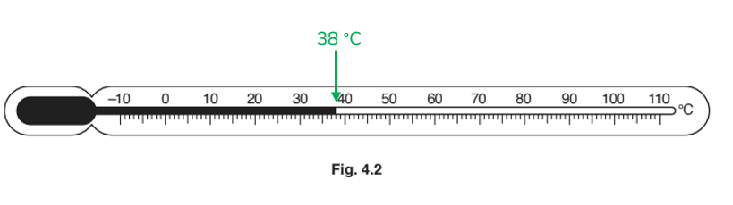

- The temperature is 38 °C; **[1 mark]**

(ii) The measurable property that changes with temperature is:

- Expansion / volume of the liquid; **[1 mark]**

**[2 marks]**
State the name given to this process:

- Conduction; **[1 mark]**

**[1 mark]**

Transfer of heat through a solid happens by the means of conduction. Since glass is a solid, this must be an example of conduction.
To describe and explain how thermal energy transfers throughout the water in the beaker:

**Any three from:**

- Water is a fluid; **[1 mark]**
- Energy is transferred into the kinetic energy store of the water molecules / The water molecules more faster; **[1 mark]**
- The volume of the water increases; **[1 mark]**
- The warm / hot water rises; **[1 mark]**
- A convection current is created; **[1 mark]**
- The cooler water falls; **[1 mark]**

**AND**** ****for the final mark:**

- The density of the water decreases when it is heated** ****OR **The density of the water increases as it cools; **[1 mark]**

**An example of an answer which would gain 4 marks is:**

As the water is heated, energy is transferred to the kinetic energy store of the water molecules, causing them to move faster **[1 mark]**. This increases the volume of the water, and hence decreases its density **[1 mark]**. The warm water rises **[1 mark]**. Away from the heat the water cools, decreases in volume and falls, creating a convection current **[1 mark]**.

**[Total: 4 marks]**

> *It is incredibly important that you don't say 'the molecules expand' as it is the space between the molecules that increases, not the size of the molecules themselves!*

### Q7
State the term that describes materials that are poor conductors of thermal energy:

- Insulators; **[1 mark]**

**[Total: 1 mark]**

> *Good thermal conductors are solids which easily transfer heat, for example, a metal pan or a ceramic tea cup.*

> *Bad thermal conductors (also called insulators) are solids which do not transfer heat well, for example, a woollen blanket or layers of cardboard or paper.*
Draw a ring around each material that is a good conductor of thermal energy:

**One mark if both are correct:**

**[Total: 1 mark]**

> *Metals are especially good at conducting heat as the delocalised electrons can collide with the atoms, helping to transfer the vibrations through the material and hence transfer heat better.*
Describe an experiment to identify which material is the better conductor of thermal energy:

An example of a diagram that would help clarify description:

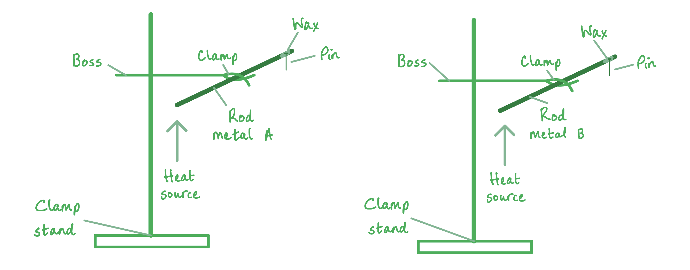

- Attach a pin / drawing pin / paper clip to the rod with some melted wax / petroleum jelly / Vaseline; **[1 mark]**
- Heat one end of both metal rods with the same type of heat source / Bunsen burner; **[1 mark]**
- The first pin to fall shows the metal rod which is the best conductor; **[1 mark]**

**[Total: 3 marks]**

> *Any reasonable version of this experiment will get you the marks. You may have stuck birthday candles on the ends of the rods with melted wax which fall of when the rod is heated.  You may have placed a large blob of petroleum jelly on the end of the rod which falls off when heated. The apparatus itself is less important, what matters is that you were doing a** fair test**, and how you measure the result.*

### Q8
(i) The heater is switched on. On Fig. 1.1, mark clearly where the two liquid levels might be a short time later:

A diagram scoring one mark:

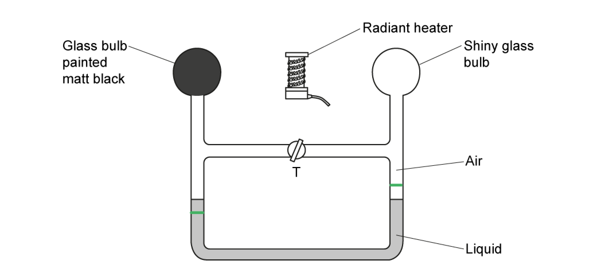

- Left side down **AND** right side up **AND** by equal amounts (by eye); **[1 mark]**

(ii) Explain your answer to **(a)(i)**:

- The left / black side has a greater temperature rise / absorbs more energy; **[1 mark]**
- (Therefore) on the left / black side there is a greater <u>expansion</u> of air / greater <u>pressure</u> of air; **[1 mark]**

**[Total: 3 marks]**
Describe and explain the subsequent motion of air in the gym:

- The heat causes (nearby) air <u>particles</u> to move further apart **OR** the (nearby) air <u>expands</u> / increases in <u>volume</u>; **[1 mark]**
- This hot air is <u>less dense</u>; **[1 mark]**
- This less dense air <u>rises</u>; **[1 mark]**
- The <u>cooler / more dense</u> air replaces it; **[1 mark]**
- This forms a <u>convection current</u>; **[1 mark]**

**[Total: 5 marks]**
(i) Explain why this could be dangerous:

- Heat is transferred / radiated from the athlete to the sweat; **[1 mark]**
- The sweat evaporates; **[1 mark]**
- The temperature of the athlete reduces; **[1 mark]**

**   **

(ii) Some athletes choose to wear a shiny foil blanket immediately after a race. Explain why:

- They lose heat by emitting thermal <u>radiation</u>; **[1 mark]**
- Shiny surfaces reflect radiation; **[1 mark]**
- (Therefore) the athletes lose less thermal energy / retain more thermal energy; **[1 mark]**

**[Total: 3 marks]**
Explain how thermal energy is transferred from the hot liquid through the lid over time:

Discuss thermal energy transfer from radiation:

- The hot liquid emits <u>radiation</u>; **[1 mark]**
- The black lid is a <u>good absorber</u> / <u>poor reflector</u>; **[1 mark]**

Discuss convection and conduction:

- The air (near the lid) is heated by <u>convection</u>; **[1 mark]**
- (A small amount of) thermal energy is transferred from the <u>air</u> to the <u>lid</u> by thermal <u>conduction</u>; **[1 mark]**

**[Total: 4 marks]**

### Q9
(i) State how the intensity of radiation the object receives from the Sun at this point differs from the intensity at the Earth's surface:

- This point in space receives a <u>greater</u> amount of radiation (from the Sun); **[1 mark]**

(ii) Explain why the temperature of space here is lower than that of Earth:

- Earth is insulated by its <u>atmosphere</u>; **[1 mark]**
- The gases <u>absorb</u> radiation <u>reflected</u> by Earth **OR** the <u>greenhouse effect</u> occurs; **[1 mark]**

**[Total: 3 marks]**

> *If an object is closer to a source of radiation, it receives more radiation that if it was further away. This is intuitive - think of when you have been close to a hot object compared to when you are further away.*

> *Closer object:*

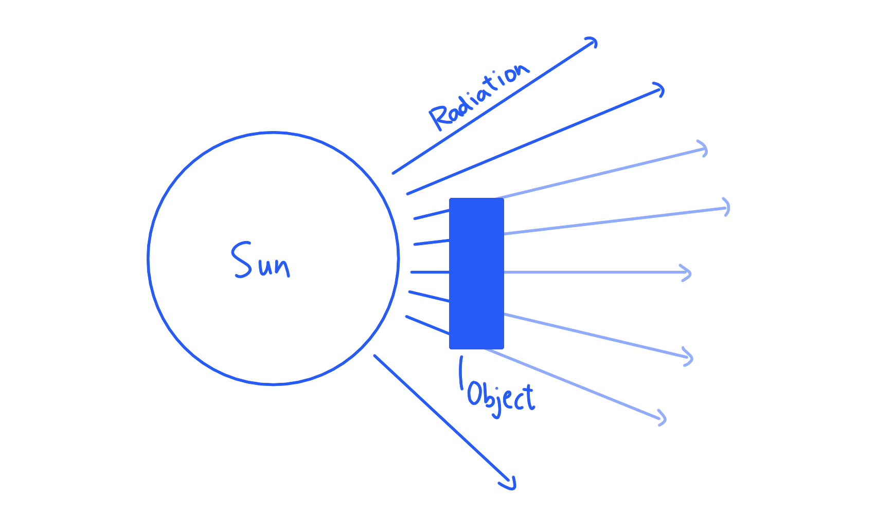

> *Further object:*

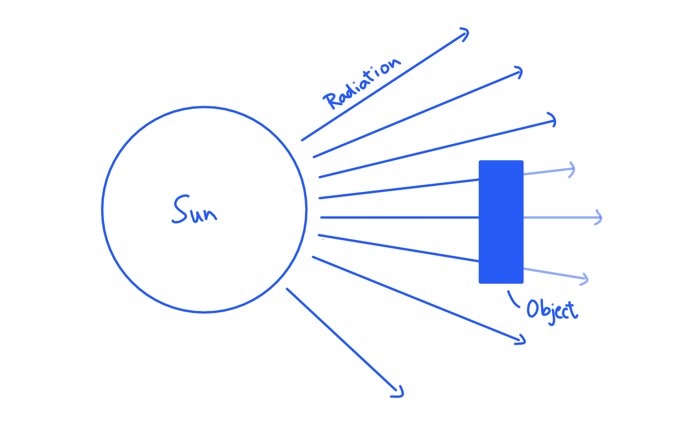
Referring to these data, explain why the surface temperature of Venus is much higher than Earth's:

Discuss the atmosphere of Venus:

- Venus' atmosphere makes its temperature <u>440 °C</u> hotter / a factor of <u>14</u> hotter than if it had Earth's atmosphere; **[1 mark]**
- (Therefore) the atmosphere must be <u>denser</u> than Earth's / have a strong greenhouse effect; **[1 mark]**

Discuss Venus' distance to the Sun:

- Venus' proximity to the Sun makes its temperature <u>248 °C</u> hotter / a factor of <u>2</u> hotter than if it had Earth's orbit; **[1 mark]**

Compare the effect of each:

- Venus' atmosphere contributes to its high temperature <u>more</u> than its proximity to the Sun; **[1 mark]**

**[Total: 4 marks]**
Explain the origin of the Earth's magnetic field:

- The inner core heats the (innermost part of the molten) outer core; **[1 mark]**
- This molten core becomes <u>less</u> <u>dense</u>; **[1 mark]**
- It rises (and is replaced by cooler molten core); **[1 mark]**
- This forms a <u>convection current</u> (which causes the motion of iron, creating the magnetic field); **[1 mark]**

**[Total: 4 marks]**

> *Often, exam questions will have complicated contexts to test whether you can **apply** your knowledge. This was really just a convection question, but spotting that is the tricky part!*

### Q10
Draw a diagram of the set-up:

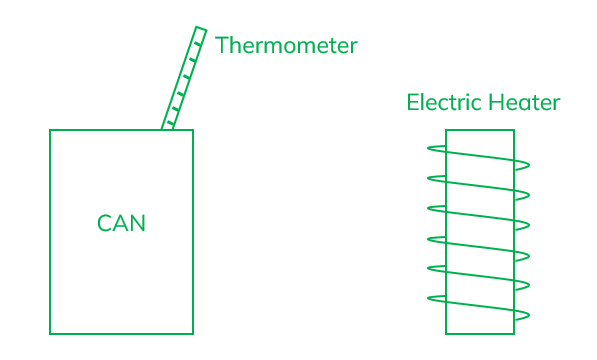

- Diagram shows the cans placed near a heater; **[1 mark]**

Explain how the student could use the apparatus she has available to carry out her investigation:

- Thermometers are placed in <u>water</u> **AND** readings observed; **[1 mark]**

Explain how to make it a fair test:

**Any one from:**

- Cans placed at equal distances from heater; **[1 mark]**
- Cans have the same water volumes / levels; **[1 mark]**
- Thermometers have the same positions in cans; **[1 mark]**

Describe the results:

- The (painted) black can will have the higher thermometer reading; **[1 mark]**

**OR**

- The black (surface) is a good / the best/ better absorber; **[1 mark]**

**[Total: 4 marks]**

> *Make sure you lay out practical method in a logical order and remember to include how to make it a fair test.*

### Q11
(i) Determine the drop in temperature for can X in the first 5 minutes:

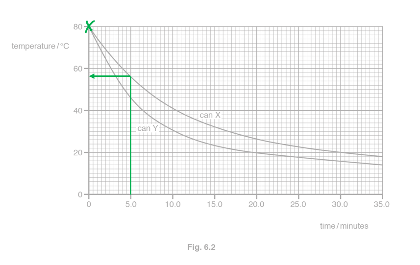

- Initial temperature = 80 °C

  - *Allow 78 °C to 82 °C*
- Final temperature = 56 °C

  - *Allow 54 °C to 58 °C*
- Change in temperature = 80 − 56 = 24 °C **[1 mark]**

(ii) Determine the drop in temperature for can X in the last 5 minutes:

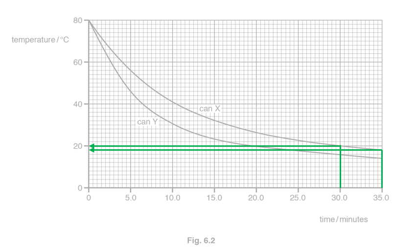

- Initial temperature = 20 °C

  - *Allow 18 °C to 22 °C*
- Final temperature = 18 °C

  - *Allow 16 °C to 20 °C*
- Change in temperature = 20 − 18 = 2 °C **[1 mark]**

**[Total: 2 marks]**

> *A tolerance of ∓½ a small square is generally allowed when reading data from graphs. Therefore, if you read the initial temperature as 22 °C and then correctly use that value in your calculation, you will still gain the mark.*

> *Being able to read and interpret graphs is a key skill. Using a ruler to draw onto the graph can help prevent errors. Sometimes questions can have a lot of information to 'set the scene'. Make sure you careful check the specifics of the question.*
To explain why the water cools at a greater rate during the first five minutes compared with the last five minutes:

- The water is hotter at the start; **[1 mark]**
- So there is a greater temperature difference between the can and the surroundings; **[1 mark]**

**[Total: 2 marks]   **

> *The greater the temperature difference between an object and the surroundings, the faster the rate of cooling.*
State the colour of can Y:

- (Dull) black; **[1 mark]**

Explain this answer:

- There is a greater rate of loss of thermal energy from dark colours; **[1 mark]**

**OR**

- Black or it is better radiator / emitter of thermal energy; **[1 mark]**

**[Total: 2 marks]**

### Q12
A physical property that varies with temperature and can be used in a thermometer:

**Any one from:**** **

- volume (of liquid); **[1 mark]**
- expansion; **[1 mark]**
- voltage; **[1 mark]**
- potential difference; **[1 mark]**
- emf; **[1 mark]**
- length; **[1 mark]**
- colour; **[1 mark]**
- pressure; **[1 mark]**
- resistance; **[1 mark]**
- density; **[1 mark]**

**[Total: 1 mark]**

> *There are many different types of "thermometer". A lot of these properties are related to electrical thermometers. The easiest thermometer for you to familiarise yourself with is a traditional thermometer containing liquid. When the temperature increases the liquid moves up, so its volume increases. *
(i) To suggest the time at which the heater is switched off.

Draw lines on the graph to find the time when the heater is switched off:

- Identify the peak temperature on the graph
- Draw a line from the peak temperature to the time

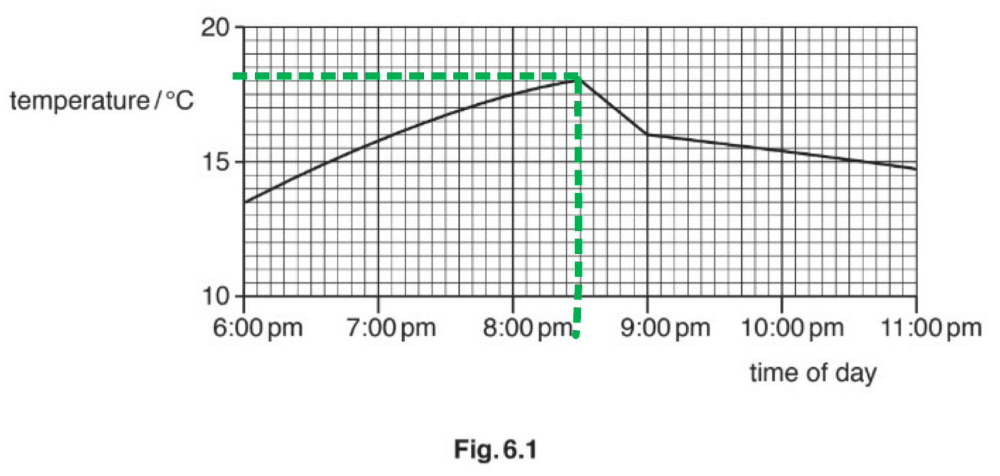

Check the temperature of the room after the peak temperature has been reached:

- The temperature decreases following this peak

Identify the time the heater was switched off:

- Hence, the heater was switched off at 8.30 pm; **[1 mark]**

(ii) To suggest the time at which the curtains were closed:

Draw a line on the graph to identify when the curtains were closed:

- Identify the point at the change in rate of heat loss from the room
- Draw a line from this point to the time

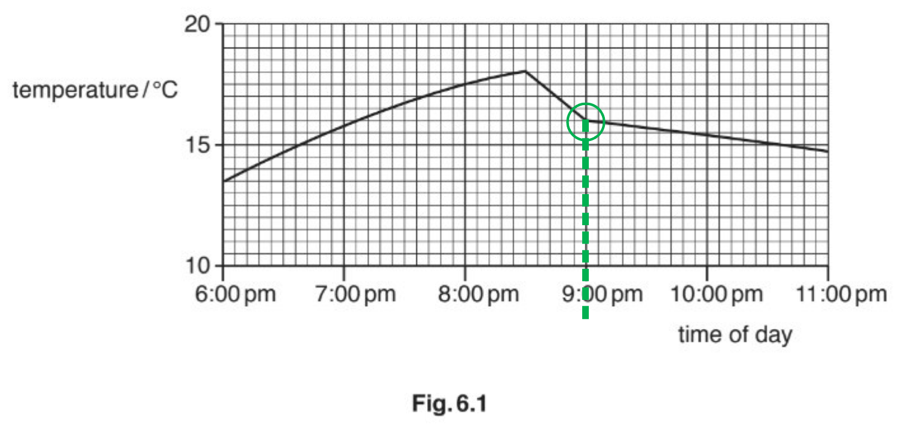

Identify the time the curtains were closed:

- Hence, the curtains were drawn at 9.00 pm; **[1 mark]**

Explanation:

- The slope / gradient of the graph is less after this time; **[1 mark]**

**   OR **

- Temperature drops / falls more slowly / slower after this time; **[1 mark]**

**[Total: 3 marks]**

> *A tolerance of ∓½ a small square is generally allowed when reading data from graphs. Therefore, in part (i), you would gain the mark for a time between 8.24 pm and 8.36 pm. And for part (ii), you would gain a mark for an answer between 8.54 pm and 9.06 pm.*

> *Don't panic when you see questions about graphs. Start by reading the axis carefully, and then think about what it means as the gradient increases/decreases. *
Sentences that would score 3 marks should look like this:

- Air is a good **insulator**; **[1 mark].**
- When air is trapped between fibres, it reduces heat loss by:

  - **conduction** **[1 mark] **and by
  - **convection**;** ****[1 mark]**.

**[Total: 3 marks]**

### Q13
Complete the sentence:

- Thermal (heat) energy moves through the metal can by **conduction**; **[1 mark]**

**[Total: 1 marks]**
Describe how thermal energy is transferred throughout the water:

**Any three from:**

- Heat causes water molecules to move further apart **OR **the water expands / volume increases; **[1 mark]**
- The hot <u>water is less dense</u>; **[1 mark]**
- This less dense <u>water rises</u> (and is replaced by colder water); **[1 mark]**
- This is <u>convection</u> / a <u>current</u> in the water; **[1 mark]**

**[Total: 3 marks]**

> *You won't score a mark for saying that particles become less dense or expand - the size of water molecules never changes, only the distances between them and their motion. As the particles move further apart, the **water** becomes less dense. *

### Q14
(i) On Fig. 6.1, draw two arrows to show how thermal energy moves throughout the oven by convection.

A diagram that would score 2 marks should look like:

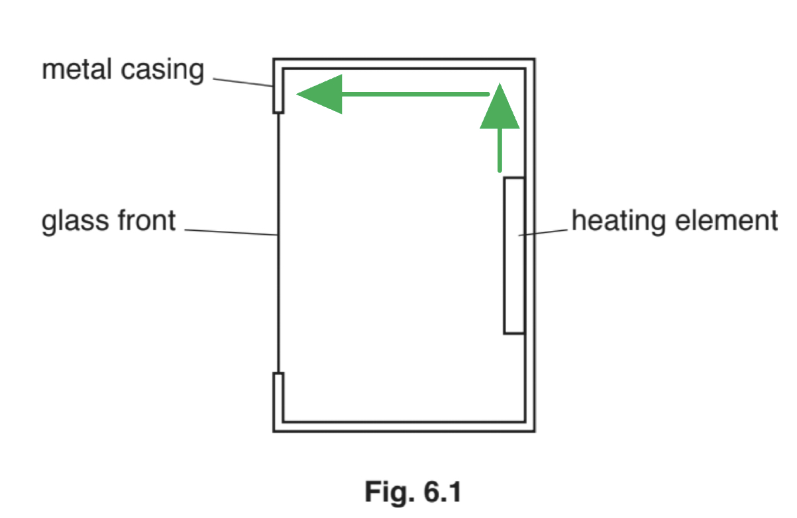

- Arrow upwards from heating element; **[1 mark]**
- Arrow across top **OR** down on opposite side; **[1 mark]**

(ii) Thermal energy moves throughout the oven by convection by:

- Warm air <u>expands</u>; **[1 mark]**
- Which makes it become <u>less dense</u>; **[1 mark]**
- So makes it <u>rise</u>; **[1 mark]**

** **

(iii) Use a word from the box to complete the sentence.

- Thermal energy travels at the speed of light by **radiation****;**** [1 mark]**

**[Total: 6 marks]**

Radiation is how, although space is a vacuum with no particles, we are still able to receive heat energy from the sun. Radiation does not require particles to transfer heat energy, unliked conduction and convection.

When talking about convection, remember to refer to the change in **density** of the air. Less dense air (air molecules are further apart) rise whilst more dense air (air molecules become closer together) falls. Air becomes less dense when** heated** and more dense when it **cools down**.
The best position for the smoke detector in the kitchen would be:

- (On the) ceiling; **[1 mark]**

**[Total: 1 mark]**

> *Convection causes the warm air (and the smoke particles) to **rise**. Therefore, the detector must be in a position where the smoke particles will be incident upon, which will be on the highest point in the room i.e. the ceiling.*

### Q15
To explain the experimental results:

(i) The metal disc on the plate with a dull black side falls before the metal disc on the plate with a shiny metal side because:

- Black is a better/the best absorber; **[1 mark]**
- Therefore, the temperature of the wax rises faster on the black plate; **[1 mark]**

(ii) The experiment is not fair because:

- For a fair test, all independent variables must be the same; **[1 mark]**
- The plates/discs should be at equal distances (from the heater); **[1 mark]**

**[Total: 4 marks]**

> *A fair test is all about keeping all variables, that are not the independent (the colour of the face of the plate facing the heater) and the dependent (time taken for the disc to fall) **constant**. In this case, the distance of the discs from the heater are different, which would interfere with the results as the only variable affecting the time taken the disc to fall is no longer just the colour of the plates, but the distance too!*

### Q16
- Dependent variable is <u>temperature</u>; **[1 mark]**
- Independent variable is <u>colour</u>; **[1 mark]**

**[Total: 2 marks]**

> *Independent variable: the variable **you** change, it is unaffected by others.*

> *Dependent variable: the variable you **measure**, it depends on other variables.*
Two control variables:

**Any two from:**

- Same room temperature; **[1 mark]**
- Identical flasks (apart from colour); **[1 mark]**
- Same <u>volume</u> of hot water; **[1 mark]**
- Same initial temperature; **[1 mark]**
- Same time interval; **[1 mark]**
- Same depth of thermometer; **[1 mark]**

**[Total: 2 marks]**
(i) State the letter of the curve with the lowest temperature change per second:

- A; **[1 mark]**

(ii) State the letter of the flask covered in the best conductor:

- D; **[1 mark]**

**[Total: 2 marks]**
(i)

**One mark for each correct line; [4 marks]**

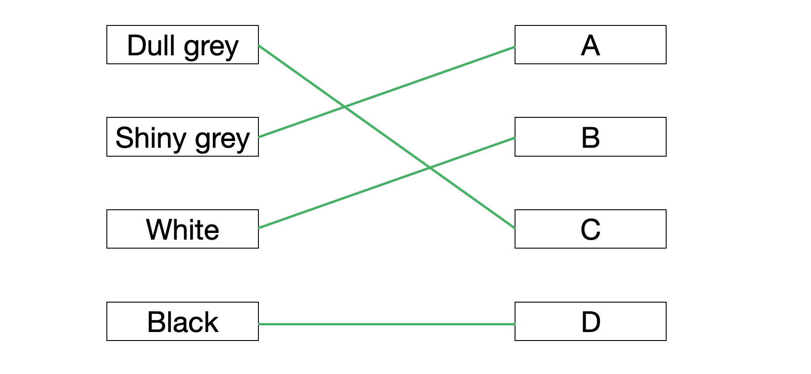

(ii) Suggest why the temperature of flask D does not drop below 23 °C:

- 23 °C is room temperature **OR** the flask cannot get colder than its surroundings;** [1 mark]**

**[Total: 5 marks]**

### Q17
To determine the rise in temperature of the water:

Read the values off the thermometers:

- Tank A temperature = 23 °C
- Tank B temperature = 26 °C

Determine the change in temperature:

- 26 − 23 = 3 °C **[1 mark]**

**[Total: 1 mark]**
Improvements which can be made to increase the thermal energy absorbed:

**Any three from:**

- Use a metal pipe; **[1 mark]**
- Paint the pipe black **OR** use a black pipe; **[1 mark]**
- Use matt / dull paint; **[1 mark]**
- Place a reflector behind the pipe; **[1 mark]**
- Use a long(er) pipe; **[1 mark]**
- Use a pipe with a great(er) surface area; **[1 mark]**
- Use a slow(er) flow rate; **[1 mark]**
- Place glass  or a clear plastic cover over pipe; **[1 mark]**

**[Total: 3 marks]**
To describe how the thermal energy is transferred from the Sun to the water inside the pipe:

- Thermal energy is transferred by <u>infra-red</u>** **radiation (from the Sun to the pipe); **[1 mark]**
- The heat transfers by <u>conduction</u> (through the material of the pipe); **[1 mark]**

**[Total: 2 marks]**

### Q18
> **[mark-scheme]**
> (i) Shiny silver surface:
> 
> - Reflects / does not allow transmission of / is a poor emitter of / is a poor absorber of **[1 mark]**
> - Infrared / thermal radiation **[1 mark]**
> 
> Accept "good reflector" for the first mark
> 
> Do not accept "heat" alone for the second mark: "infrared", "thermal radiation" or "heat radiation" is needed

> **[mark-scheme]**
> (ii) The vacuum between the silvered surfaces:
> 
> - Conduction cannot take place (through the vacuum) **[1 mark]**
> - Convection cannot take place (through the vacuum) **[1 mark]**
> - Because there are no particles in a vacuum, and particles / a medium are needed for conduction and convection **[1 mark]**
> 
> Accept "prevents" or "reduces" for the first two marks
> 
> Accept "no particles / no molecules / no medium in the vacuum" or "only radiation can travel through a vacuum" for the third mark
> 
> Do not accept "the vacuum stops radiation": radiation does not need a medium

> **[exam-tip]**
> Match each feature to its own processes: the silvered surface deals with radiation and the vacuum deals with conduction and convection. Name conduction and convection separately, then give the reason, which is that a vacuum contains no particles to carry them. Never say the vacuum stops radiation, because radiation is the one process that crosses a vacuum.
> **[mark-scheme]**
> (i) A suitable material for the stopper:
> 
> - Any non-metal, e.g. plastic / cork / rubber **[1 mark]**
> 
> Accept "an insulator"

> **[mark-scheme]**
> (ii) The reason:
> 
> - Non-metals are poor conductors of heat / good insulators **OR** metals are good conductors of heat **[1 mark]**

> **[exam-tip]**
> Name a specific everyday material and then give the property that matters: a poor conductor slows the transfer of thermal energy out through the top of the flask. "It keeps the heat in" repeats the question and does not score the reason mark.

### Q19
Recall that **conduction **happens in solids, and **radiated **heat travels in all directions:

- A man goes for a walk on a cold day. He touches a metal gate, which removes energy from his hands by **conduction**; **[1 mark]**
- He holds the sides of a cup containing a hot drink. His hands gain energy by **conduction**; **[1 mark]**
- Some farm workers have lit a fire. The man warms his hands by the side of the fire. His hands gain energy by **radiation**; **[1 mark]**

**[Total: 3 marks]**
To describe thermal conduction in terms of particles:

Any **three** from:

- The particles/atoms in the metal near the man's hands gain thermal energy from the hands; **[1 mark]**
- These particles/atoms vibrate faster / with a larger amplitude;**[1 mark]**
- These vibrating particles pass on energy/vibration to neighbouring atoms/particles by collision;**[1 mark]**
- Metal contains free/delocalised electrons;**[1 mark]**
- These electrons gain (thermal/kinetic) energy from the hotter region (near the hands);**[1 mark]**
- The energized electrons move through the metal; **[1 mark]**
- They then collide with distant ions/particles or transfer energy to distant atoms/particles; **[1 mark]**

**[Total: 2 marks]**

> *The terminology for free or delocalised electrons which you may have heard in chemistry is also useful here in physics. Look out for links between your subjects - especially the sciences and maths.*
The most suitable material is:

- Shiny white; **[1mark]**

Explain why:

- To reduce the temperature the object needs to reflect incoming thermal radiation
- Shiny surfaces and white surfaces are the <u>best reflectors</u>; **[1 mark]**

**[Total: 2 marks]**

> *The best reflectors are shiny and white / silver and the best emitters are black and matt (rough). If you have trouble remembering which is which then simply think about sunglasses (shiny) and laptop chargers (black - usually!). These objects have been designed to reflect or emit heat.*
