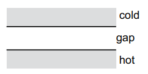
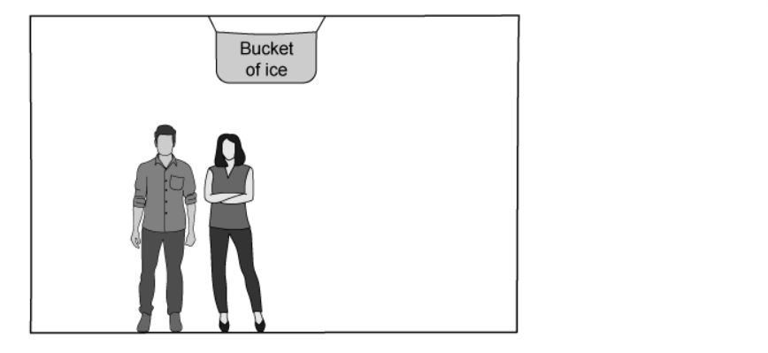
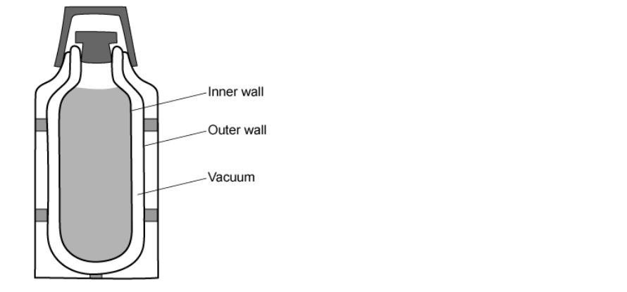
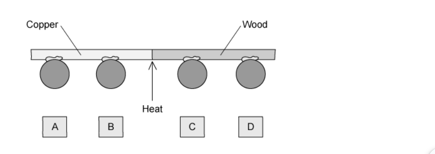

# Exam Questions — Transfer of Thermal Energy
**2. Thermal Physics** · Cambridge (CIE) IGCSE physics (0625 & 0972)
> Source: [https://www.savemyexams.com/igcse/physics/cie/23/topic-questions/](https://www.savemyexams.com/igcse/physics/cie/23/topic-questions/) · 26 questions across 1 sets

## Multiple Choice Questions (26 questions)

### Q1 — medium — 1 marks

**Q1** [1 mark]

A saucepan is used to heat water on a stove.

Which row correctly describes the best materials for the base and the handle of the saucepan?

|   | base of saucepan | handle of saucepan |
|---|---|---|
| **A** | glass | copper |
| **B** | copper | wood |
| **C** | wood | copper |
| **D** | glass | wood |

### Q2 — medium — 1 marks

**Q2** [1 mark]

A student heats the top of a test tube of water until the water boils. A piece of ice, held at the bottom of the test tube by a metal gauze, remains frozen.

Which of the following statements is a correct conclusion from this experiment?

### Q3 — hard — 1 marks

**Q3** [1 mark]

A student investigates the rate of emission of thermal radiation by four metal containers, W, X, Y, and Z. The metal containers are identical except for the texture and colour of their surfaces.

The student fills the metal containers with equal volumes of water at the same temperature.

The graph shows how the temperature of the water in the containers varies with time.

Which row correctly identifies the four surfaces?

|   | **W** | **X** | **Y** | **Z** |
|---|---|---|---|---|
| **A** | shiny white | dull white | shiny black | dull black |
| **B** | dull black | shiny black | dull white | shiny white |
| **C** | shiny black | dull black | shiny white | dull white |
| **D** | dull white | shiny white | dull black | shiny black |

### Q4 — hard — 1 marks

**Q4** [1 mark]

Some hot water is sealed inside a metal can. The can is in a vacuum in outer space. The hot water slowly cools down.

How does the thermal energy escape into space?

*Source: June 2023 0972/21 Q16*

### Q5 — medium — 1 marks

**Q5** [1 mark]

** **Which surface is the worst absorber of infrared radiation?

*Source: June 2023 0972/11 Q16*

### Q6 — medium — 1 marks

**Q6** [1 mark]

**Extended Tier Only**

One end of a copper bar is heated to a high temperature.

Which mechanism is responsible for the transfer of thermal energy to the other end of the copper bar?

*Source: june 2022 paper 2 Q19*

### Q7 — medium — 1 marks

**Q7** [1 mark]

The diagram shows the gap between a hot surface and a cold surface. The gap can contain air (gas), iron (solid), a vacuum or water (liquid).

Which material in the gap allows the quickest transfer of thermal energy between the surfaces by conduction?

*Source: 2023 specimen paper 1 Q17*

### Q8 — medium — 1 marks

**Q8** [1 mark]

The outside of one of two identical shiny metal containers is painted dull black. The containers are filled with equal masses of hot water at the same temperature.

Why does the dull black container cool more quickly?

*Source: June 2022 paper 1 Q19*

### Q9 — medium — 1 marks

**Q9** [1 mark]

On a cold day, a metal door handle X and a similar plastic door handle Y are at the same temperature.

Why does X feel cooler to the touch than Y?

*Source: 2023 specimen paper 1 Q18*

### Q10 — medium — 1 marks

**Q10** [1 mark]

** **The diagram shows a convection current caused by a piece of ice placed in a beaker of water at room temperature.

Which row correctly compares the temperatures and densities at water points P and Q?

| ** ** | **temperature at P** | **density at P** |
|---|---|---|
| **A** | higher than at Q | higher than at Q |
| **B** | higher than at Q | lower than at Q |
| **C** | lower than at Q | higher than at Q |
| **D** | lower than at Q | lower than at Q |

*Source: June 2022 paper 1 Q18*

### Q11 — easy — 1 marks

**Q11** [1 mark]

The diagram shows a bucket of ice which is hanging from the ceiling of a room as a makeshift air-conditioner. This is a cheaper, less effective means of cooling the room.

The ice cools the air next to it. What happens to the cold air and why?

|   | **What happens** | **Explanation** |
|---|---|---|
| **A** | the cold air rises | it is less dense than the warmer air in the room |
| **B** | the cold air rises | it is more dense than the warmer air in the room |
| **C** | the cold air falls | it is less dense than the warmer air in the room |
| **D** | the cold air falls | it is more dense than the warmer air in the room |

### Q12 — easy — 1 marks

**Q12** [1 mark]

The Sun is the source of the majority of the energy on Earth.

How does thermal energy from the Sun travel to the Earth?

### Q13 — easy — 1 marks

**Q13** [1 mark]

Which diagram correctly shown the motion of particles in a beaker filled with liquid heated from the base?

### Q14 — easy — 1 marks

**Q14** [1 mark]

Which of the following statements about thermal radiation is correct?

### Q15 — easy — 1 marks

**Q15** [1 mark]

Which of the following statements about convection is correct?

Warm air rises because:

### Q16 — hard — 1 marks

**Q16** [1 mark]

**Extended Tier Only**

Which of the following processes take place in a non-metal to allow the **conduction** of thermal energy?

|   | **Transfer of electrons** | **Lattice vibrations** | **Transfer of nuclei** |
|---|---|---|---|
| **A** | yes | yes | no |
| **B** | no | yes | no |
| **C** | yes | yes | yes |
| **D** | no | yes | yes |

### Q17 — hard — 1 marks

**Q17** [1 mark]

An astronaut aboard the International Space Station (ISS) lights a match.

Using ideas about convection, what does the flame look like?

### Q18 — hard — 1 marks

**Q18** [1 mark]

Two cars sit side by side, a black car and a white car. It is Summer.

During the day both cars absorb infrared radiation from the Sun, and during the night, both cars lose energy by emitting infrared radiation.

Which car heats up more quickly during the day, and which car cools down more quickly at night?

|   | **Car which heats up more quickly during the day** | **Car which cools down more quickly at night** |
|---|---|---|
| **A** | black | black |
| **B** | black | white |
| **C** | white | black |
| **D** | white | white |

### Q19 — medium — 1 marks

**Q19** [1 mark]

**Extended tier only**

Which of the following statements about energy transfer is correct?

### Q20 — medium — 1 marks

**Q20** [1 mark]

**Extended tier only**

The walls of a vacuum flask contain two layers of glass, separated by a vacuum.

Which method(s) of thermal energy transfer are prevented by the vacuum?

### Q21 — medium — 1 marks

**Q21** [1 mark]

A lit match is placed above a thermometer.

Which row in the table shows how the thermal energy from the lit match reaches the thermometer?

|   | **Convection** | **Conduction** | **Radiation** |
|---|---|---|---|
| **A** | yes | yes | yes |
| **B** | yes | yes | no |
| **C** | no | yes | yes |
| **D** | no | no | yes |

### Q22 — hard — 1 marks

**Q22** [1 mark]

Of the following modes of thermal energy transfer, which one transfers energy at the greatest speed?

### Q23 — hard — 1 marks

**Q23** [1 mark]

A student suggests some uses for the knowledge that black and white objects emit and absorb different amounts of infrared radiation.

Which of her suggestions is correct?

### Q24 — medium — 1 marks

**Q24** [1 mark]

In modern housing, it is convenient to locate heaters so they are not on the walls, taking up valuable wall space for furniture.

Other than wall-mounted radiators, two other options would be viable: ceiling heaters or underfloor heaters.

Which of the two options would heat the room more effectively and why?

|   | **Option** | **Explanation** |
|---|---|---|
| **A** | ceiling-mounted | hot air is more dense and falls |
| **B** | ceiling-mounted | hot air is less dense and falls |
| **C** | underfloor | hot air is less dense and rises |
| **D** | underfloor | hot air is more dense and rises |

### Q25 — hard — 1 marks

**Q25** [1 mark]

A family goes on a picnic and they want their food to stay cold.

In order to achieve this, they put two ice packs with the picnic food in a hamper.

Where should both ice packs be placed in order to keep the food as cool as possible?

### Q26 — medium — 1 marks

**Q26** [1 mark]

In a very common classroom Physics demonstration, a teacher sets up a rod, as shown in the diagram. Half of the rod is copper, the other half is wood.

She sticks four lead balls to the rod using wax. The wax melts when its temperature rises a small amount, causing the ball to fall off.

The teacher heats the rod in the centre, with something more gentle than a Bunsen burner, that will not burn the wood.

Which ball falls off first?
