# Exam Questions — Transfer of Thermal Energy
**2. Thermal Physics** · Cambridge (CIE) IGCSE physics (0625 & 0972)
> Source: [https://www.savemyexams.com/igcse/physics/cie/23/topic-questions/](https://www.savemyexams.com/igcse/physics/cie/23/topic-questions/) · 53 questions across 3 sets

## Alternative To Practical Questions (8 questions)

### Q1 — medium — 7 marks

**Q1** [7 marks]

A student is investigating ways of reducing heat loss from hot liquids in a container. The student knows that using a plastic lid will reduce the rate of cooling. She wants to find out if wrapping the container in different insulating materials makes any difference to the rate of cooling.

Plan an experiment which will enable her to compare the effects of different insulating materials around the container.

In your plan, you should:

- list the apparatus needed
- explain briefly how you would carry out the investigation, including the measurements to be taken
- state any key variables that would need to be kept the same
- draw a suitable table or tables, with column headings, to show how the readings would be displayed (you are not required to enter any readings in the table)
- explain how you would use your readings to reach a conclusion.

You may draw a diagram if it helps to explain your plan.

### Q2 — medium — 11 marks

**Q2** [1 mark]

A student investigates how partly covering the top of a beaker of water affects the rate at which the water cools.

The apparatus used is shown in Fig. 1.1.

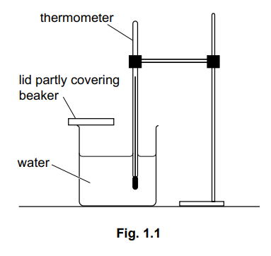

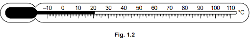

Read and record the room temperature *θ*R, shown on the thermometer in Fig. 1.2.

*θ*R = ................................................

*Source: specimen 2023 paper 6 Q1A*

**Q2** [2 marks]

The student pours 100 cm3 of hot water into a beaker. She places lid** A** on the beaker. This leaves half of the top of the beaker uncovered, as shown in Fig. 1.3.

She records the temperature of the water in the beaker and immediately starts a stopwatch. She records the temperature* θ *of the water every 30 s. Her readings are shown in Table 1.1.

She repeats the procedure using lid **B**. This leaves a quarter of the top of the beaker uncovered, as shown in Fig. 1.4.

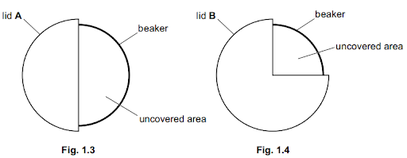

Complete the headings row in Table 1.1.

Complete the time *t* column in Table 1.1.

**Table 1.1**

|   | beaker with lid A | beaker with lid B |
|---|---|---|
| t/....... | $θ$/....... | $θ$/....... |
| 0 | 80.0 | 81.0 |
|   | 77.0 | 79.0 |
|   | 74.5 | 77.5 |
|   | 72.5 | 76.0 |
|   | 70.5 | 75.0 |
|   | 69.0 | 74.0 |
|   | 68.0 | 73.5 |

*Source: specimen 2023 paper 6 Q1B*

**Q2** [1 mark]

**Extract:**

A student investigates how partly covering the top of a beaker of water affects the rate at which the water cools. The apparatus used is shown in Fig. 1.1.

Read and record the room temperature θ_R, shown on the thermometer in Fig. 1.2.

The student pours 100 cm^3^ of hot water into a beaker. She places lid A on the beaker. This leaves half of the top of the beaker uncovered, as shown in Fig. 1.3.

She records the temperature of the water in the beaker and immediately starts a stopwatch. She records the temperature θ of the water every 30 s. Her readings are shown in Table 1.1.

She repeats the procedure using lid B. This leaves a quarter of the top of the beaker uncovered, as shown in Fig. 1.4.

Describe a precaution that should be taken to ensure that the temperature readings are as accurate as possible in the experiment.

*Source: specimen 2023 paper 6 Q1C*

**Q2** [4 marks]

**Extract:**

The student pours 100 cm^3^ of hot water into a beaker. She places lid A on the beaker. This leaves half of the top of the beaker uncovered, as shown in Fig. 1.3.
She records the temperature of the water in the beaker and immediately starts a stopwatch. She records the temperature θ of the water every 30 s. Her readings are shown in Table 1.1. 
She repeats the procedure using lid B. This leaves a quarter of the top of the beaker uncovered, as shown in Fig. 1.4.

|   | beaker with lid A | beaker with lid B |
| --- | --- | --- |
| t/s | θ/°C | θ/°C |
| 0 | 80.0 | 81.0 |
| 30 | 77.0 | 79.0 |
| 60 | 74.5 | 77.5 |
| 90 | 72.5 | 76.0 |
| 120 | 70.5 | 75.0 |
| 150 | 69.0 | 74.0 |
| 180 | 68.0 | 73.5 |

**Extended Tier Only**

(i)** ** Write a conclusion to this experiment, stating for which lid the rate of cooling is greater. Justify your answer with reference to the results.

[2]

(ii)** **Suggest a change to the **apparatus **that produces a greater difference between the rates of cooling for lid **A** and lid** B.** Explain why the change produces a greater difference.

[2]

*Source: specimen 2023 paper 6 Q1D*

**Q2** [2 marks]

Another student thinks that the cooling rate is directly proportional to the percentage of the surface area uncovered. He draws a graph of cooling rate against the percentage of uncovered area to investigate this.

Describe how his graph line shows whether the rate of cooling and the percentage of uncovered surface area are directly proportional.

*Source: specimen 2023 paper 6 Q1E*

**Q2** [1 mark]

**Extract:**

A student investigates how partly covering the top of a beaker of water affects the rate at which the water cools.

The student pours 100 cm^3 of hot water into a beaker. She places lid A on the beaker. This leaves half of the top of the beaker uncovered, as shown in Fig. 1.3.

She records the temperature of the water in the beaker and immediately starts a stopwatch. She records the temperature θ of the water every 30 s. Her readings are shown in Table 1.1.

She repeats the procedure using lid B. This leaves a quarter of the top of the beaker uncovered, as shown in Fig. 1.4.

Read and record the room temperature θ_R, shown on the thermometer in Fig. 1.2.

θ_R = ................................................

Students in other countries are doing the same experiment.

State **one** factor they must keep the same to obtain similar readings.

*Source: specimen 2023 paper 6 Q1F*

### Q3 — medium — 11 marks

**Q3** [1 mark]

Students are investigating how the use of a lid or insulation affects the rate of cooling of hot water in a beaker. They use the apparatus shown in Fig. 2.1.

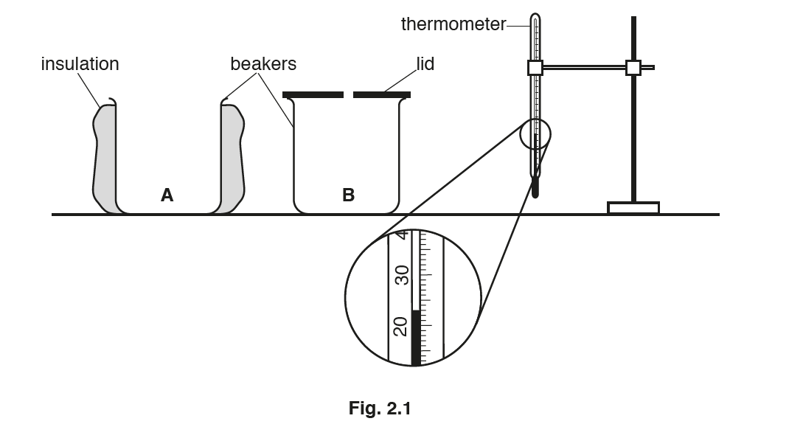

Record the room temperature *θ*R in °C shown on the thermometer in Fig. 2.1.

*θ*R = ........................................................

*Source: Feb 2019 0625/62 Q2A*

**Q3** [2 marks]

- 100 cm3 of hot water is poured into beaker **A** and the initial temperature* θ* is recorded in Table 2.1.
- The temperature *θ* of the water at times *t *= 30 s, 60 s, 90 s, 120 s, 150 s and 180 s are shown in Table 2.1.
- This process is repeated for beaker **B**.

Complete the headings and the time column in Table 2.1.

**Table 2.1**

|   | beaker **A** with insulation | beaker **B** with a lid |
|---|---|---|
| t/ | *θ/* | *θ/* |
| 0 | 83.0 | 86.0 |
|   | 79.0 | 84.0 |
|   | 75.5 | 82.5 |
|   | 73.0 | 81.0 |
|   | 71.0 | 80.0 |
|   | 69.5 | 79.0 |
|   | 68.5 | 78.5 |

*Source: Feb 2019 0625/62 Q2B*

**Q3** [2 marks]

**Extract:**

|   | beaker **A** with insulation | beaker **B** with a lid |
| t/s | *θ/*°C | *θ/*°C |
| 0 | 83.0 | 86.0 |
| 30 | 79.0 | 84.0 |
| 60 | 75.5 | 82.5 |
| 90 | 73.0 | 81.0 |
| 120 | 71.0 | 80.0 |
| 150 | 69.5 | 79.0 |
| 180 | 68.5 | 78.5 |

Write a conclusion stating whether the insulation or the lid is more effective in reducing the cooling rate of the water in the beakers in this experiment.

Justify your answer by reference to the results.

*Source: Feb 2019 0625/62 Q2C*

**Q3** [2 marks]

**Extract:**

- 100 cm^3^ of hot water is poured into beaker A and the initial temperature θ is recorded in Table 2.1.
- The temperature θ of the water at times t = 30 s, 60 s, 90 s, 120 s, 150 s and 180 s are shown in Table 2.1.
- This process is repeated for beaker B.
|   | beaker A with insulation | beaker B with a lid |

One student thinks that the experiment does not show how effective insulation is on its own or how effective a lid is on its own.

Suggest an additional experiment which could be used to show how effective a lid or insulation is.

Explain how the additional results could be used.

*Source: Feb 2019 0625/62 Q2D*

**Q3** [4 marks]

**Extract:**

| t/s | θ/°C (beaker A with insulation) |
| 0   | 83.0 |
| 30  | 79.0 |
| 60  | 75.5 |
| 90  | 73.0 |
| 120 | 71.0 |
| 150 | 69.5 |
| 180 | 68.5 |

Use the equation: x_A = (θ_0 - θ_180) / T, where T = 180 s, θ_0 = 83.0 °C, θ_180 = 68.5 °C.

(i) Calculate *x*A, the average cooling rate for beaker **A** over the whole experiment. Use the readings for beaker **A** from Table 2.1 and the equation

$x_{A}=\frac{θ_{0}-θ_{180}}{T}$

where *T* = 180 s and *θ*0 and *θ*180 are the temperatures at time *t* = 0 and time *t* = 180 s. Include the unit for the cooling rate.

*x*A = ........................................................ [2]

(ii) Students in another school are carrying out this experiment using identical equipment.

State why they should make the initial temperature of the water the same as in this experiment if they are to obtain average cooling rates that are the same as in Table 2.1. Assume that the room temperature is the same in each case.

Use the results from beaker **A** to explain why this factor should be controlled.

[2]

*Source: Feb 2019 0625/62 Q2E*

### Q4 — medium — 7 marks

**Q4** [7 marks]

A student investigates the effect of the colour of the surface of a metal container on the rate of loss of heat from the container. She knows that black surfaces are better radiators of thermal energy than white surfaces and wants to investigate the effect of other colours.

The following apparatus is available:

- metal containers each with the outer surface painted a different colour
- a thermometer
- a stop-watch
- a supply of hot water.

She can also use other apparatus and materials that are usually available in a school laboratory.

Plan an experiment to investigate the effect of the colour of the surface of a metal container on the rate of loss of heat from the container.

You should:

- draw a diagram of the apparatus used
- explain briefly how you would carry out the investigation
- state the key variables to be kept constant
- draw a table, or tables, with column headings, to show how you would display your readings (you are not required to enter any readings in the table)
- explain how you would use your readings to reach a conclusion.

*Source: 2020 May/June Series 1 0625/61 Q4A*

### Q5 — medium — 11 marks

**Q5** [3 marks]

Some students are investigating how the volume of water affects the rate at which water in a beaker cools.

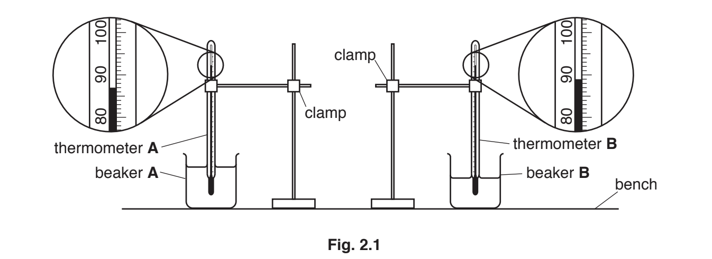

They are using the apparatus shown in Fig. 2.1.

(i) 200 cm3 of hot water is poured into beaker **A** and the initial temperature rises to the value shown on thermometer **A** in Fig. 2.1.

In the first row of Table 2.1, record this temperature θA for time *t* = 0.

100 cm3 of hot water is poured into beaker **B**. The temperature rises to the value shown on thermometer **B** in Fig. 2.1.

In the first row of the table, record this temperature θB for time *t* = 0.

[1]

(ii) The temperatures *θ*A and *θ*B of the water in each experiment at times t = 30 s, 60 s, 90 s, 120 s, 150 s and 180 s are shown in the table.

Complete the headings and the time column in the table.

[2]

**Table 2.1**

|   | beaker **A** with 200 cm3 of water | beaker **B** with 100 cm3 of water |
|---|---|---|
| *t*/ | *θ*A/ | *θ*B/ |
| 0 |   |   |
|   | 85.0 | 86.0 |
|   | 83.0 | 83.0 |
|   | 81.5 | 80.5 |
|   | 80.0 | 78.0 |
|   | 78.5 | 76.0 |
|   | 77.5 | 74.5 |

*Source: March 2018 0625/62 Q2A*

**Q5** [1 mark]

**Extract:**

Some students are investigating how the volume of water affects the rate at which water in a beaker cools.

They are using the apparatus shown in Fig. 2.1.

(i) 200 cm3 of hot water is poured into beaker **A** and the initial temperature rises to the value shown on thermometer **A** in Fig. 2.1.

In the first row of Table 2.1, record this temperature θA for time *t* = 0.

100 cm3 of hot water is poured into beaker **B**. The temperature rises to the value shown on thermometer **B** in Fig. 2.1.

(ii)

The temperatures *θ*A and *θ*B of the water in each experiment at times t = 30 s, 60 s, 90 s, 120 s, 150 s and 180 s are shown in the table.

**Table 2.1**

|   | beaker **A** with 200 cm3 of water | beaker **B** with 100 cm3 of water |
|---|---|---|
| *t*/ | *θ*A/ | *θ*B/ |
| 0 |   |   |
|   | 85.0 | 86.0 |
|   | 83.0 | 83.0 |
|   | 81.5 | 80.5 |
|   | 80.0 | 78.0 |
|   | 78.5 | 76.0 |
|   | 77.5 | 74.5 |

Describe one precaution which should be taken to ensure that the temperature readings in the experiment are as accurate as possible.

*Source: March 2018 0625/62 Q2B*

**Q5** [2 marks]

**Extract:**

|   | beaker A with 200 cm^3 of water | beaker B with 100 cm^3 of water |
| t/s | θ_A_/°C | θ_B_/°C |
| 0 | 87.0 | 89.0 |
| 30 | 85.0 | 86.0 |
| 60 | 83.0 | 83.0 |
| 90 | 81.5 | 80.5 |
| 120 | 80.0 | 78.0 |
| 150 | 78.5 | 76.0 |
| 180 | 77.5 | 74.5 |

Write a conclusion stating how the volume of water in the beaker affects the rate of cooling of the water. Justify your answer by reference to the results.

*Source: March 2018 0625/62 Q2C*

**Q5** [2 marks]

**Extract:**

|   | beaker A with 200 cm^3 of water | beaker B with 100 cm^3 of water |
| t/s | θ_A/°C | θ_B/°C |
| 0 | 87.0 | 89.0 |
| 30 | 85.0 | 86.0 |
| 60 | 83.0 | 83.0 |
| 90 | 81.5 | 80.5 |
| 120 | 80.0 | 78.0 |
| 150 | 78.5 | 76.0 |
| 180 | 77.5 | 74.5 |

(i) Using the results for 100 cm3 of water, calculate the average rate of cooling* x*1 for the **first** 90 s of the experiment. Use the readings from the table and the equation

$x_{1}=\frac{θ_{0}--θ_{90}}{t}$

where t = 90 s and *θ*0 and *θ*90 are the temperatures at time 0 and at time 90 s. Include the unit for the rate of cooling.

*x*1 = ...........................................................[1]

(ii) Using the results for 100 cm3 of water, calculate the average rate of cooling *x*2 in the **last** 90 s of the experiment. Use the readings from the table and the equation

$x_{2}=\frac{θ_{90}--θ_{180}}{t}$

where t = 90 s and *θ*90 and *θ*180 are the temperatures at time 90 s and at time 180 s. Include the unit for the rate of cooling.

*x*2 = ............................................................[1]

*Source: March 2018 0625/62 Q2D*

**Q5** [1 mark]

**Extract:**

(i) Calculate the average rate of cooling x1 for the first 90 s of the experiment:

List the known quantities:

- Temperature at t = 0 s, θ0 = 89.0 °C
- Temperature at t = 90 s, θ90 = 80.5 °C
- Time, t = 90 s

Substitute the values into the equation:

- x1 = (θ0 – θ90) / t = (89.0 – 80.5) / 90
- x1 = 0.094

(ii) Calculate the average rate of cooling x2 in the last 90 s of the experiment:

List the known quantities:

- Temperature at t = 90 s, θ90 = 80.5 °C
- Temperature at t = 180 s, θ180 = 74.5 °C
- Time, t = 90 s

Substitute the values into the equation:

- x2 = (θ90 – θ180) / t = (80.5 – 74.5) / 90
- x2 = 0.067

State the correct unit for both x1 and x2:

- °C/s

A student suggests that it is important that the experiments with the two volumes of water should have the same starting temperatures.

State whether your values for *x*1 and *x*2 support this suggestion. Justify your statement with reference to your results.

*Source: March 2018 0625/62 Q2E*

**Q5** [2 marks]

**Extract:**

Some students are investigating how the volume of water affects the rate at which water in a beaker cools.

They are using the apparatus shown in Fig. 2.1.

(i) 200 cm3 of hot water is poured into beaker **A** and the initial temperature rises to the value shown on thermometer **A** in Fig. 2.1.

In the first row of Table 2.1, record this temperature θA for time *t* = 0.

100 cm3 of hot water is poured into beaker **B**. The temperature rises to the value shown on thermometer **B** in Fig. 2.1.

(ii)

The temperatures *θ*A and *θ*B of the water in each experiment at times t = 30 s, 60 s, 90 s, 120 s, 150 s and 180 s are shown in the table.

**Table 2.1**

|   | beaker **A** with 200 cm3 of water | beaker **B** with 100 cm3 of water |
|---|---|---|
| *t*/ | *θ*A/ | *θ*B/ |
| 0 |   |   |
|   | 85.0 | 86.0 |
|   | 83.0 | 83.0 |
|   | 81.5 | 80.5 |
|   | 80.0 | 78.0 |
|   | 78.5 | 76.0 |
|   | 77.5 | 74.5 |

Another student plans to investigate whether more thermal energy is lost from the water surface than from the sides of the beakers.

Describe an experiment that could be done to investigate this.

You may draw a diagram to help your description.

*Source: March 2018 0625/62 Q2F*

### Q6 — medium — 10 marks

**Q6** [1 mark]

A student is investigating the rate of cooling of water under different conditions. A greater rate of cooling occurs if there is a greater change in the temperature during the same period of time.

Fig. 3.1 shows some of the apparatus.

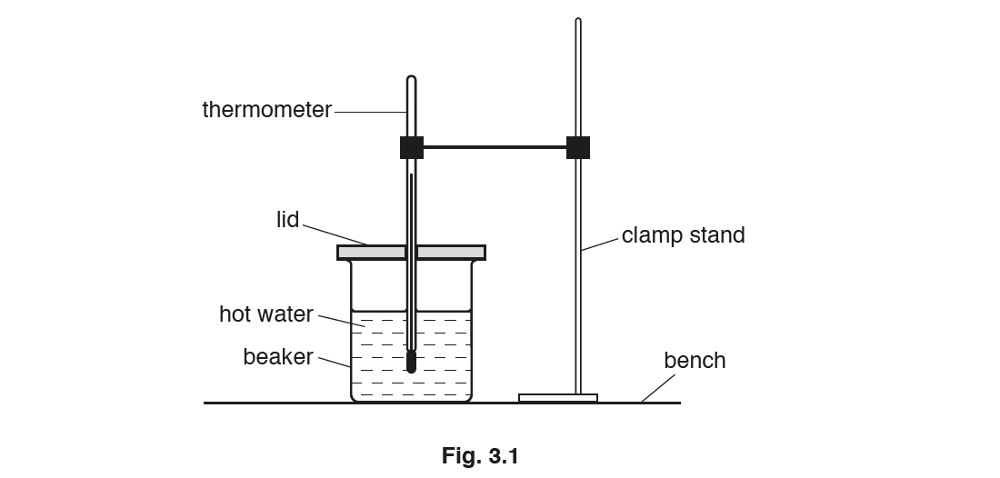

The thermometer in Fig.3.2 shows the room temperature *θ*R at the beginning of the experiment. Record *θ*R in °C.

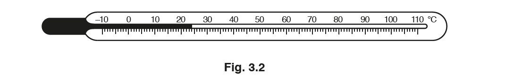

*θ*R = ........................................................

*Source: May 2019 0625/61 Q3A*

**Q6** [4 marks]

The student pours 200 cm3 of hot water into the beaker.

She records the temperature *θ* of the hot water at time *t *= 0. She immediately starts a stopclock.

She continues recording the time and the temperature readings every 30 s. The readings are shown in Table 3.1.

**Table 3.1**

Beaker

| *t */ | *θ */ |
|---|---|
| 0 | 94 |
| 30 | 93 |
| 60 | 92 |
| 90 | 91 |
| 120 | 90 |
| 150 | 89 |

**Table 3.2**

Can

| t / | θ / |
|---|---|
| 0 | 93 |
| 30 | 91 |
| 60 | 90 |
| 90 | 89 |
| 120 | 88 |
| 150 | 87 |

The student repeats the procedure using a metal can, painted matt black, in place of the beaker.

The readings are shown in Table 3.2.

(i) Complete the column headings in Table 3.1 and in Table 3.2.

[1]

(ii) Look carefully at the readings in Table 3.1 and in Table 3.2.

Tick the box to show your conclusion from the readings.

`square` The water in the beaker has a greater rate of cooling than the water in the can.

`square` The water in the beaker has a smaller rate of cooling than the water in the can.

`square` There is no significant difference between the rates of cooling of the water in the beaker and the can.

[1]

(iii) Justify your conclusion by reference to the readings.

[2]

*Source: May 2019 0625/61 Q3B*

**Q6** [4 marks]

**Extract:**

The student pours 200 cm^3^ of hot water into the beaker. She records the temperature θ of the hot water at time t = 0. She immediately starts a stopclock. She continues recording the time and the temperature readings every 30 s. The readings are shown in Table 3.1. The student repeats the procedure using a metal can, painted matt black, in place of the beaker. The readings are shown in Table 3.2.

A student in another school carries out the experiment and reports that the rate of cooling of the water in the can is different from the rate of cooling of the water in the beaker. He plans a change to the experiment to find out whether this difference in the rates of cooling is caused by

- the matt black surface of the can being a better radiator of thermal energy than the shiny surface of the beaker
- the metal of the can being a better conductor of thermal energy than the material of the beaker.

(i) Suggest two suitable changes to the apparatus that the student could make.

[2]

(ii) Suggest two variables that should be controlled in order to make the experiment a fair test.

[2]

*Source: May 2019 0625/61 Q3C*

**Q6** [1 mark]

**Extract:**

The student pours 200 cm3 of hot water into the beaker.

She records the temperature *θ* of the hot water at time *t *= 0. She immediately starts a stopclock.

She continues recording the time and the temperature readings every 30 s. The readings are shown in Table 3.1.

**Table 3.1**

Beaker

| *t */ | *θ */ |
|---|---|
| 0 | 94 |
| 30 | 93 |
| 60 | 92 |
| 90 | 91 |
| 120 | 90 |
| 150 | 89 |

**Table 3.2**

Can

| t / | θ / |
|---|---|
| 0 | 93 |
| 30 | 91 |
| 60 | 90 |
| 90 | 89 |
| 120 | 88 |
| 150 | 87 |

The student repeats the procedure using a metal can, painted matt black, in place of the beaker.

The readings are shown in Table 3.2.

The water in the beaker has a greater rate of cooling than the water in the can.

The water in the beaker has a smaller rate of cooling than the water in the can.

There is no significant difference between the rates of cooling of the water in the beaker and the can.

State **one** precaution that you would take in order to record accurate temperature readings.

*Source: May 2019 0625/61 Q3D*

### Q7 — medium — 11 marks

**Q7** [1 mark]

Students are investigating the cooling of hot water in a beaker.

They are using the apparatus shown in Fig. 2.1.

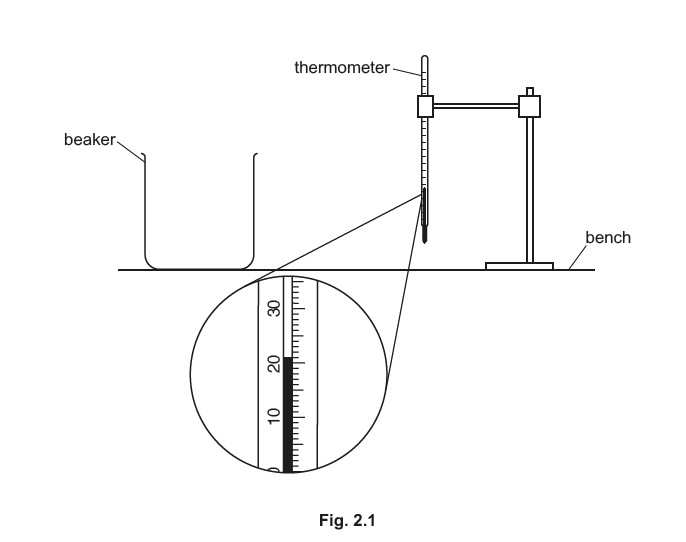

Record room temperature *θ*R in °C shown on the thermometer in Fig. 2.1.

*θ*R = ........................................................

*Source: 2020 0625/62 Q2A*

**Q7** [2 marks]

A volume of 150 cm3 of hot water is poured into the beaker and the initial temperature* θ* is recorded in Table 2.1.

The temperature of the water is recorded every 30 s. The values are shown in Table 2.1.

(i) Complete the headings in Table 2.1.

[1]

**Table 2.1**

| t/ | *θ/* |
|---|---|
| 0 | 95.0 |
| 30 | 89.0 |
| 60 | 83.5 |
| 90 | 79.0 |
| 120 | 75.0 |
| 150 | 71.5 |
| 180 | 68.5 |
| 210 | 66.0 |
| 240 | 64.0 |
| 270 | 62.5 |

(ii) Describe one precaution that you would take to ensure that the temperature readings in the experiment are as accurate as possible.

[1]

*Source: 2020 0625/62 Q2B*

**Q7** [3 marks]

**Extract:**

Table 2.1

t/s   θ/°C
0     95.0
30    89.0
60    83.5
90    79.0
120   75.0
150   71.5
180   68.5
210   66.0
240   64.0
270   62.5

(i) Calculate the average cooling rate *x*1 during the first 90s of the experiment. Use the readings from Table 2.1 and the equation

$x_{1}=\frac{θ_{0}-θ_{90}}{T}$

where* T* = 90 s and *θ*0 and *θ*90 are the temperatures at *t* = 0 and *t *= 90 s.

Include the unit for the cooling rate.

*x*1 = ........................................................ [1]

(ii) Calculate the average cooling rate *x*2 during the middle 90 s of the experiment. Use the readings from Table 2.1 and the equation

$x_{2}=\frac{θ_{90}-θ_{180}}{T}$

where* T* = 90 s and *θ*90 and *θ*180 are the temperatures at *t* = 90 and *t *= 180 s.

*x*2 = ........................................................ [1]

(iii) Calculate the average cooling rate *x*3 during the last 90 s of the experiment. Use the readings from Table 2.1 and the equation

$x_{3}=\frac{θ_{180}-θ_{270}}{T}$

where* T* = 90 s and *θ*180 and *θ*270 are the temperatures at *t* = 180 and *t *= 270 s.

*x*3 = ........................................................ [1]

*Source: 2020 0625/62 Q2C*

**Q7** [2 marks]

**Extract:**

(From part c)
Table 2.1
| t/s | θ/°C |
| 0   | 95.0 |
| 30  | 89.0 |
| 60  | 83.5 |
| 90  | 79.0 |
| 120 | 75.0 |
| 150 | 71.5 |
| 180 | 68.5 |
| 210 | 66.0 |
| 240 | 64.0 |
| 270 | 62.5 |

x₁ = 0.18 °C/s (first 90 s)
x₂ = 0.12 °C/s (middle 90 s)
x₃ = 0.07 °C/s (last 90 s)

(From part a)
Room temperature θ_R shown on the thermometer is: 21 (°C)

(i) The temperature of the water falls as time passes. Use the results from **(c)** to describe the pattern of the rate of cooling of the water during the experiment.

Justify your answer by reference to the results.

[1]

(ii) Give an estimate of the probable final temperature *θ*F of the water if left to cool for many hours.

*θ*F = ........................................................ [1]

*Source: 2020 0625/62 Q2D*

**Q7** [3 marks]

**Extract:**

Table 2.1:
| t/s | θ/°C |
| 0 | 95.0 |
| 30 | 89.0 |
| 60 | 83.5 |
| 90 | 79.0 |
| 120 | 75.0 |
| 150 | 71.5 |
| 180 | 68.5 |
| 210 | 66.0 |
| 240 | 64.0 |
| 270 | 62.5 |

Cooling rates calculated:
x1 = 0.18 °C/s (first 90 s)
x2 = 0.12 °C/s (middle 90 s)
x3 = 0.07 °C/s (last 90 s)

The cooling rate decreases over time (and as temperature decreases):
- Over the first 90 seconds the cooling rate is 0.18 °C/s but over the middle 90 s the cooling rate is 0.12 °C/s
- Over the first 90 seconds the cooling rate is 0.18 °C/s but over the last 90 s the cooling rate is 0.07 °C/s
- Over the middle 90 seconds the cooling rate is 0.12 °C/s but over the last 90 s the cooling rate is 0.07 °C/s

(i) A student in another school carries out a similar experiment.

She starts with the hot water at a lower initial temperature.

Suggest how her cooling rates are likely to compare with those calculated in **(c)**.

Use the results to explain your answer.

[2]

(ii) State one variable, other than the initial temperature, which the student should control.

[1]

*Source: 2020 0625/62 Q2E*

### Q8 — medium — 7 marks

**Q8** [7 marks]

A student is investigating ways of slowing the rate of cooling of hot liquids in a container. The student knows that a lid will reduce the rate of cooling. He wants to find out if the thickness of the lid makes any difference to the rate of cooling.

Plan an experiment which will enable him to compare the effects of lids of different thicknesses.

In your plan, you should:

- list the apparatus needed
- explain briefly how you would carry out the investigation, including the measurements to be taken
- state any key variables that would need to be kept the same
- draw a suitable table or tables, with column headings, to show how the readings would be displayed (you are not required to enter any readings in the table)
- explain how you would use your readings to reach a conclusion.

You may draw a diagram if it helps to explain your plan.

*Source: Nov 2019 0625/63 Q4*

## Multiple Choice Questions (26 questions)

### Q1 — medium — 1 marks

**Q1** [1 mark]

A saucepan is used to heat water on a stove.

Which row correctly describes the best materials for the base and the handle of the saucepan?

|   | base of saucepan | handle of saucepan |
|---|---|---|
| **A** | glass | copper |
| **B** | copper | wood |
| **C** | wood | copper |
| **D** | glass | wood |

### Q2 — medium — 1 marks

**Q2** [1 mark]

A student heats the top of a test tube of water until the water boils. A piece of ice, held at the bottom of the test tube by a metal gauze, remains frozen.

Which of the following statements is a correct conclusion from this experiment?

### Q3 — hard — 1 marks

**Q3** [1 mark]

A student investigates the rate of emission of thermal radiation by four metal containers, W, X, Y, and Z. The metal containers are identical except for the texture and colour of their surfaces.

The student fills the metal containers with equal volumes of water at the same temperature.

The graph shows how the temperature of the water in the containers varies with time.

Which row correctly identifies the four surfaces?

|   | **W** | **X** | **Y** | **Z** |
|---|---|---|---|---|
| **A** | shiny white | dull white | shiny black | dull black |
| **B** | dull black | shiny black | dull white | shiny white |
| **C** | shiny black | dull black | shiny white | dull white |
| **D** | dull white | shiny white | dull black | shiny black |

### Q4 — hard — 1 marks

**Q4** [1 mark]

Some hot water is sealed inside a metal can. The can is in a vacuum in outer space. The hot water slowly cools down.

How does the thermal energy escape into space?

*Source: June 2023 0972/21 Q16*

### Q5 — medium — 1 marks

**Q5** [1 mark]

** **Which surface is the worst absorber of infrared radiation?

*Source: June 2023 0972/11 Q16*

### Q6 — medium — 1 marks

**Q6** [1 mark]

**Extended Tier Only**

One end of a copper bar is heated to a high temperature.

Which mechanism is responsible for the transfer of thermal energy to the other end of the copper bar?

*Source: june 2022 paper 2 Q19*

### Q7 — medium — 1 marks

**Q7** [1 mark]

The diagram shows the gap between a hot surface and a cold surface. The gap can contain air (gas), iron (solid), a vacuum or water (liquid).

Which material in the gap allows the quickest transfer of thermal energy between the surfaces by conduction?

*Source: 2023 specimen paper 1 Q17*

### Q8 — medium — 1 marks

**Q8** [1 mark]

The outside of one of two identical shiny metal containers is painted dull black. The containers are filled with equal masses of hot water at the same temperature.

Why does the dull black container cool more quickly?

*Source: June 2022 paper 1 Q19*

### Q9 — medium — 1 marks

**Q9** [1 mark]

On a cold day, a metal door handle X and a similar plastic door handle Y are at the same temperature.

Why does X feel cooler to the touch than Y?

*Source: 2023 specimen paper 1 Q18*

### Q10 — medium — 1 marks

**Q10** [1 mark]

** **The diagram shows a convection current caused by a piece of ice placed in a beaker of water at room temperature.

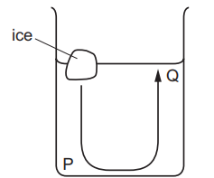

Which row correctly compares the temperatures and densities at water points P and Q?

| ** ** | **temperature at P** | **density at P** |
|---|---|---|
| **A** | higher than at Q | higher than at Q |
| **B** | higher than at Q | lower than at Q |
| **C** | lower than at Q | higher than at Q |
| **D** | lower than at Q | lower than at Q |

*Source: June 2022 paper 1 Q18*

### Q11 — easy — 1 marks

**Q11** [1 mark]

The diagram shows a bucket of ice which is hanging from the ceiling of a room as a makeshift air-conditioner. This is a cheaper, less effective means of cooling the room.

The ice cools the air next to it. What happens to the cold air and why?

|   | **What happens** | **Explanation** |
|---|---|---|
| **A** | the cold air rises | it is less dense than the warmer air in the room |
| **B** | the cold air rises | it is more dense than the warmer air in the room |
| **C** | the cold air falls | it is less dense than the warmer air in the room |
| **D** | the cold air falls | it is more dense than the warmer air in the room |

### Q12 — easy — 1 marks

**Q12** [1 mark]

The Sun is the source of the majority of the energy on Earth.

How does thermal energy from the Sun travel to the Earth?

### Q13 — easy — 1 marks

**Q13** [1 mark]

Which diagram correctly shown the motion of particles in a beaker filled with liquid heated from the base?

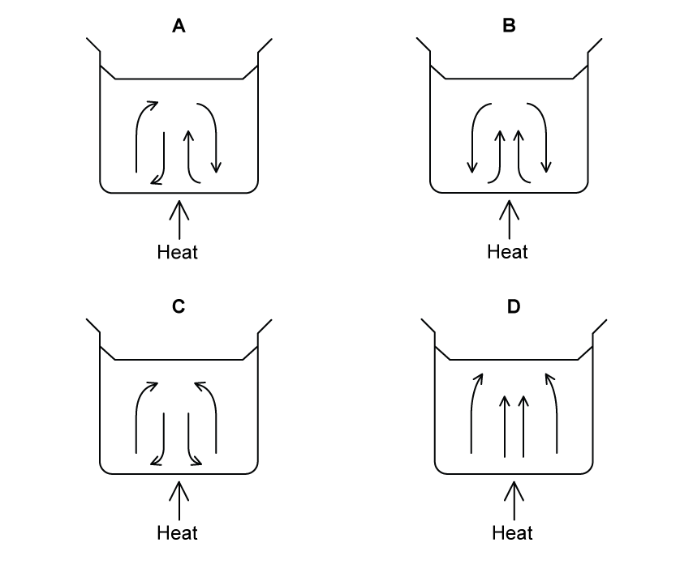

### Q14 — easy — 1 marks

**Q14** [1 mark]

Which of the following statements about thermal radiation is correct?

### Q15 — easy — 1 marks

**Q15** [1 mark]

Which of the following statements about convection is correct?

Warm air rises because:

### Q16 — hard — 1 marks

**Q16** [1 mark]

**Extended Tier Only**

Which of the following processes take place in a non-metal to allow the **conduction** of thermal energy?

|   | **Transfer of electrons** | **Lattice vibrations** | **Transfer of nuclei** |
|---|---|---|---|
| **A** | yes | yes | no |
| **B** | no | yes | no |
| **C** | yes | yes | yes |
| **D** | no | yes | yes |

### Q17 — hard — 1 marks

**Q17** [1 mark]

An astronaut aboard the International Space Station (ISS) lights a match.

Using ideas about convection, what does the flame look like?

### Q18 — hard — 1 marks

**Q18** [1 mark]

Two cars sit side by side, a black car and a white car. It is Summer.

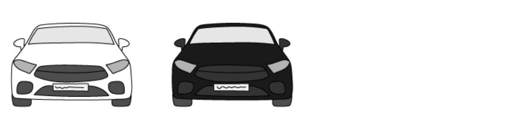

During the day both cars absorb infrared radiation from the Sun, and during the night, both cars lose energy by emitting infrared radiation.

Which car heats up more quickly during the day, and which car cools down more quickly at night?

|   | **Car which heats up more quickly during the day** | **Car which cools down more quickly at night** |
|---|---|---|
| **A** | black | black |
| **B** | black | white |
| **C** | white | black |
| **D** | white | white |

### Q19 — medium — 1 marks

**Q19** [1 mark]

**Extended tier only**

Which of the following statements about energy transfer is correct?

### Q20 — medium — 1 marks

**Q20** [1 mark]

**Extended tier only**

The walls of a vacuum flask contain two layers of glass, separated by a vacuum.

Which method(s) of thermal energy transfer are prevented by the vacuum?

### Q21 — medium — 1 marks

**Q21** [1 mark]

A lit match is placed above a thermometer.

Which row in the table shows how the thermal energy from the lit match reaches the thermometer?

|   | **Convection** | **Conduction** | **Radiation** |
|---|---|---|---|
| **A** | yes | yes | yes |
| **B** | yes | yes | no |
| **C** | no | yes | yes |
| **D** | no | no | yes |

### Q22 — hard — 1 marks

**Q22** [1 mark]

Of the following modes of thermal energy transfer, which one transfers energy at the greatest speed?

### Q23 — hard — 1 marks

**Q23** [1 mark]

A student suggests some uses for the knowledge that black and white objects emit and absorb different amounts of infrared radiation.

Which of her suggestions is correct?

### Q24 — medium — 1 marks

**Q24** [1 mark]

In modern housing, it is convenient to locate heaters so they are not on the walls, taking up valuable wall space for furniture.

Other than wall-mounted radiators, two other options would be viable: ceiling heaters or underfloor heaters.

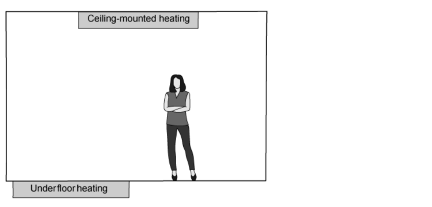

Which of the two options would heat the room more effectively and why?

|   | **Option** | **Explanation** |
|---|---|---|
| **A** | ceiling-mounted | hot air is more dense and falls |
| **B** | ceiling-mounted | hot air is less dense and falls |
| **C** | underfloor | hot air is less dense and rises |
| **D** | underfloor | hot air is more dense and rises |

### Q25 — hard — 1 marks

**Q25** [1 mark]

A family goes on a picnic and they want their food to stay cold.

In order to achieve this, they put two ice packs with the picnic food in a hamper.

Where should both ice packs be placed in order to keep the food as cool as possible?

### Q26 — medium — 1 marks

**Q26** [1 mark]

In a very common classroom Physics demonstration, a teacher sets up a rod, as shown in the diagram. Half of the rod is copper, the other half is wood.

She sticks four lead balls to the rod using wax. The wax melts when its temperature rises a small amount, causing the ball to fall off.

The teacher heats the rod in the centre, with something more gentle than a Bunsen burner, that will not burn the wood.

Which ball falls off first?

## Theory Questions (19 questions)

### Q1 — medium — 9 marks

**Q1** [3 marks]

Fig. 6.1 shows a road next to the sea.

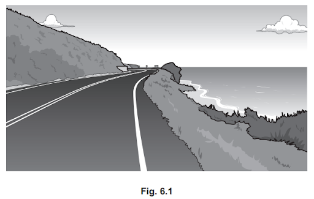

On a sunny day, the Sun warms the road.

Describe how energy from the Sun reaches the Earth and warms the road.

*Source: June 2022 paper 4 Q6A*

**Q1** [1 mark]

The temperature of the road is greater than the temperature of the sea.

The surface of the road is black.

Suggest **one **reason why the temperature of the road is greater than that of the sea.

*Source: June 2022 paper 4 Q6B*

**Q1** [5 marks]

**Extract:**

Fig. 6.1 shows a road next to the sea.
On a sunny day, the Sun warms the road.
The temperature of the road is greater than the temperature of the sea.
The surface of the road is black.

The air above the road is heated by the warm road.

(i)** **Describe how this affects the molecules of the air.

[2]

(ii)** **A cyclist travelling along the road notices that a cool breeze is blowing from the sea to the land.

Explain how convection produces this breeze. You may include a diagram if it helps your answer.

[3]

*Source: June 2022 paper 4 Q6C*

### Q2 — medium — 4 marks

**Q2** [4 marks]

A teacher fills a copper can with solid wax and heats the can. She measures the temperature of the wax every minute. She continues heating once the wax has melted and stops heating when the wax is boiling.

(i) State the term used for the process that transfers thermal energy through the copper.

[1]

(ii) Fig. 6.1 shows how the temperature of the wax changes as it is heated.

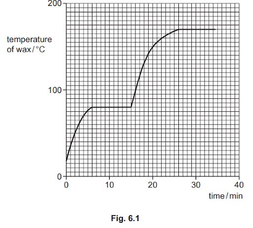

Using the graph in Fig. 6.1, determine:

1. the melting point of the wax ...................................................... °C

[1]

2. the boiling point of the wax ...................................................... °C

[1]

3. the time at which the wax starts to boil. .................................................... min

[1]

*Source: June 2022 paper 3 Q6A*

### Q3 — medium — 3 marks

**Q3** [3 marks]

**Extended Tier Only**

During a picnic on a warm, dry day, a metal can of lemonade is wrapped in a damp cloth.

Evaporation cools the water in the cloth.

As the water in the cloth cools, so does the lemonade.

Explain how electrons transfer thermal energy through the metal of the can.

*Source: June 2022 paper 4 Q3B*

### Q4 — hard — 17 marks

**Q4** [3 marks]

A solar panel is mounted on the roof of a house. Fig. 1.1 shows a section through part of the solar panel.

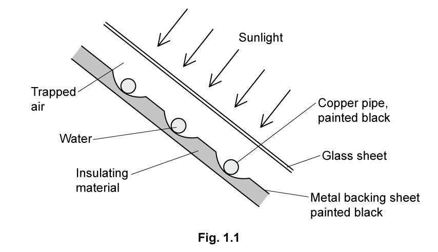

A pump makes water flow through the copper pipes. The water is heated by passing through the solar panel.

Select and explain three features of the solar panel that maximise the final temperature of the water.

**Q4** [5 marks]

**Extract:**

A solar panel is mounted on the roof of a house. Fig. 1.1 shows a section through part of the solar panel.

A pump makes water flow through the copper pipes. The water is heated by passing through the solar panel.

**Extended tier only**

During one day, 250 kg of water is pumped through the solar panel. The temperature of this water rises from 16 °C to 38 °C.

The water absorbs 25% of the energy incident on the solar panel. The specific heat capacity of water is 4200 J/(kg °C)

Calculate the energy incident on the solar panel during that day.

**Q4** [4 marks]

**Extract:**

A solar panel is mounted on the roof of a house. Fig. 1.1 shows a section through part of the solar panel.

A pump makes water flow through the copper pipes. The water is heated by passing through the solar panel.

**Extended tier only**

The heated water is stored in a sealed copper hot-water tank. During the day, the water cools as thermal energy (heat) passes from the water to the air surrounding the tank.

Name and describe the process by which the thermal energy is transferred from the hot water to the air.

**Q4** [5 marks]

**Extract:**

A solar panel is mounted on the roof of a house. Fig. 1.1 shows a section through part of the solar panel.

A pump makes water flow through the copper pipes. The water is heated by passing through the solar panel.

**Extended tier only**

The manufacturer of the hot-water tank says that when the outside surface is polished regularly and kept bright and shiny, the hot water will cool more slowly.

Describe an experiment that shows whether a container with a bright and shiny surface is better at keeping its contents warm than one with a dull and dark surface.

### Q5 — medium — 8 marks

**Q5** [3 marks]

#### Extended

Fig. 4.1 shows a cold plastic spoon that has just been placed in hot liquid in a cup.

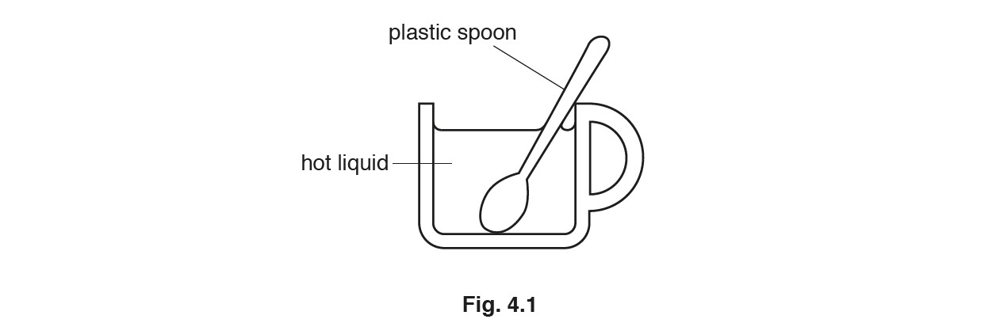

Describe, in terms of molecules, why the temperature of the whole of the spoon increases.

*Source: February/March 2018 0625/42 Q4A*

**Q5** [2 marks]

**Extract:**

The temperature of the whole spoon increases because:

- The molecules of hot liquid collide with the surface of the spoon; [1 mark]
- Energy / heat is transferred from the hot liquid to the molecules of the spoon; [1 mark]
- The amplitude of the vibration of the spoon's molecules increases / gets faster, this increases the spoon's temperature; [1 mark]

The question says "Define in terms of molecules", so you must mention **molecules **in your final answer.

**Extended**

The plastic spoon is replaced by a metal spoon.

Describe an additional process by which the temperature of the whole of this spoon increases.

*Source: February/March 2018 0625/42 Q4B*

**Q5** [3 marks]

**Extract:**

Fig. 4.1 shows a cold plastic spoon that has just been placed in hot liquid in a cup.

**Extended**

The cup contains 150 g of liquid of specific heat capacity 4.2 J / (g°C). When the cold spoon is placed into the hot liquid, the temperature of the liquid decreases from 80 °C to 56 °C.

Calculate the loss of thermal energy from the liquid.

energy loss = .........................................................

*Source: February/March 2018 0625/42 Q4C*

### Q6 — easy — 7 marks

**Q6** [2 marks]

A Bunsen burner heats a beaker of water, as shown in Fig. 4.1.

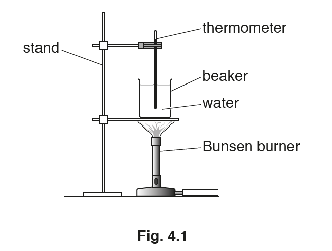

(i) Fig. 4.2 shows the thermometer used in Fig. 4.1.

State the temperature shown on the thermometer.

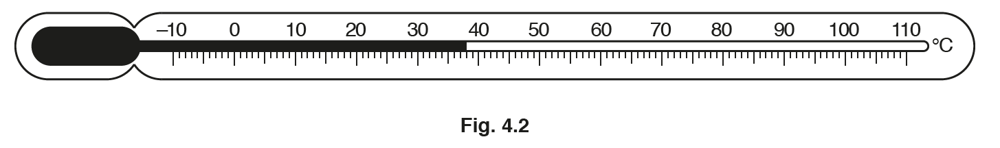

temperature = .................................................... °C [1]

(ii) The thermometer shown in Fig. 4.2 uses a physical property that changes with temperature.

Indicate the measurable property that changes with temperature. Tick **one** box.

`square` expansion of glass

`square` expansion of liquid

`square` colour of liquid

`square` colour of glass

[1]

*Source: 2018 0625/32 Q4A*

**Q6** [1 mark]

**Extract:**

A Bunsen burner heats a beaker of water, as shown in Fig. 4.1.

(i) Fig. 4.2 shows the thermometer used in Fig. 4.1.

(ii) The thermometer shown in Fig. 4.2 uses a physical property that changes with temperature.

Thermal energy (heat) transfers through the bottom of the beaker to the water.

State the name given to this process.

*Source: 2018 0625/32 Q4B*

**Q6** [4 marks]

**Extract:**

A Bunsen burner heats a beaker of water, as shown in Fig. 4.1.

Thermal energy transfers throughout the water in the beaker.

Describe and explain how this happens.

*Source: 2018 0625/32 Q4C*

### Q7 — medium — 5 marks

**Q7** [1 mark]

Some materials are poor conductors of thermal energy (heat energy).

State the term that describes materials that are poor conductors of thermal energy.

*Source: Nov 2018 (S1) 0625/31 Q6A*

**Q7** [1 mark]

Some materials are good conductors of thermal energy.

Draw a ring around each material that is a good conductor of thermal energy.

| air | aluminium | copper | glass | plastic | water |
|---|---|---|---|---|---|

*Source: Nov 2018 (S1) 0625/31 Q6B*

**Q7** [3 marks]

A student has two rods made of different materials. The rods are the same size.

Describe an experiment to identify which material is the better conductor of thermal energy.

You may draw a diagram in the space below.

*Source: Nov 2018 (S1) 0625/31 Q6C*

### Q8 — hard — 18 marks

**Q8** [3 marks]

**Extended tier only**

The apparatus shown in Fig. 1.1 is known as Leslie’s Differential Air Thermometer.

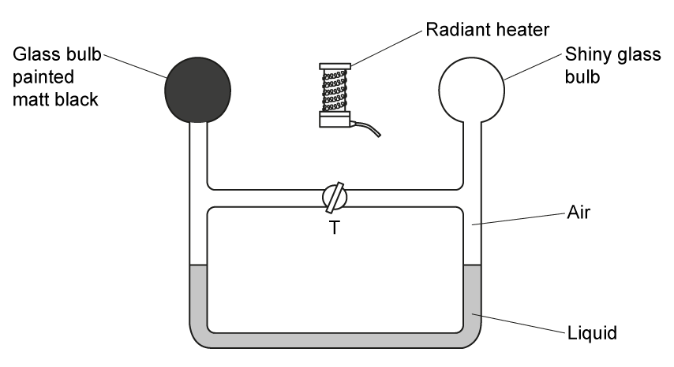

**Fig. 1.1**

The heater is switched off. Tap T is opened so that the air on the two sides of T has the same pressure. Tap T is then closed.

(i) The heater is switched on. On Fig. 1.1, mark clearly where the two liquid levels might be a short time later.

[1]

(ii) Explain your answer to **(a)(i)**.

[2]

**Q8** [5 marks]

A gym has a low initial temperature. A larger radiant heater is placed on the floor in the centre of a gym to heat the room. The room has no open windows or ventilation.

Describe and explain the subsequent motion of air in the gym, naming any processes.

**Q8** [6 marks]

After a marathon in winter, the athlete has sweated a large amount.

(i) Explain why this could be dangerous.

[3]

(ii) Some athletes choose to wear a shiny foil blanket immediately after a race. Explain why.

[3]

**Q8** [4 marks]

**Extended tier only**

For the end of the marathon, the athlete's coach has a double-walled vacuum flask (Fig. 1.2), which is designed to maintain the temperature of its contents. It is partially filled with a hot liquid.

The lid is made of black plastic and sealed tight. The walls are silvered metal.

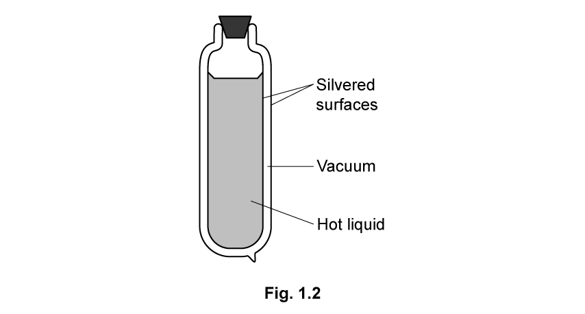

Eventually the liquid cools. Explain how thermal energy is transferred from the hot liquid through the lid over time.

### Q9 — hard — 11 marks

**Q9** [3 marks]

**Extended tier only**

An object in the space between Earth and the Sun has an average temperature of 3 K.

(i) State how the intensity of radiation the object receives from the Sun at this point differs from the intensity at the Earth's surface.

[1]

(ii) Explain why the temperature of the object in space here is lower than if it was on Earth.

[2]

**Q9** [4 marks]

**Extended tier only**

The average surface temperature of Venus is 475 °C.

The average surface temperature of Earth is 13 °C.

If Venus had an atmosphere the same as Earth's, it would have a maximum surface temperature of 35 °C.

If Venus had an orbital radius the same as Earth's, it would have a surface temperature of 227 °C.

Venus is ~30% closer to the Sun that the Earth is.

Referring to these data, explain why the surface temperature of Venus is much higher than Earth's.

**Q9** [4 marks]

The Earth's magnetic field arises from its iron-rich molten core, shown in Fig. 1.2.

Molten iron must be **in motion** to generate a magnetic field.

The inner core is very hot and solid. The outer core is also iron-rich and liquid.

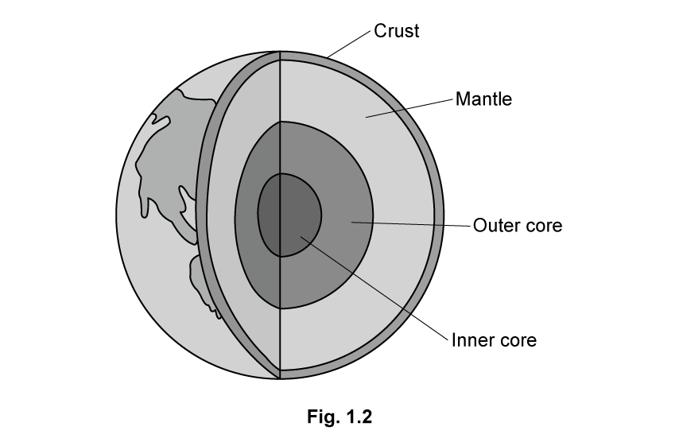

Explain the origin of the Earth's magnetic field, referring to density in your answer.

### Q10 — hard — 4 marks

**Q10** [4 marks]

**Extended tier only**

A student wants to investigate good and bad absorbers of thermal radiation. She has the apparatus shown in Fig. 5.1, a supply of cold water and a metre rule.

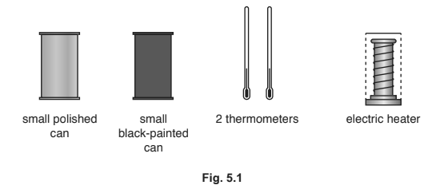

Explain how the student could use the apparatus she has available to carry out her investigation.

Describe the results she would expect to obtain. Draw a diagram of the set-up.

*Source: 2018 0625/42 Q5A*

### Q11 — medium — 6 marks

**Q11** [2 marks]

A student investigates the thermal energy lost from two metal cans, X and Y. The cans are identical apart from their outside colour.

The student pours the same volume of hot water into each can and seals each can. The student records the temperature of the water in each can at regular time intervals for a period of 35 minutes.

The equipment is shown in Fig. 6.1.

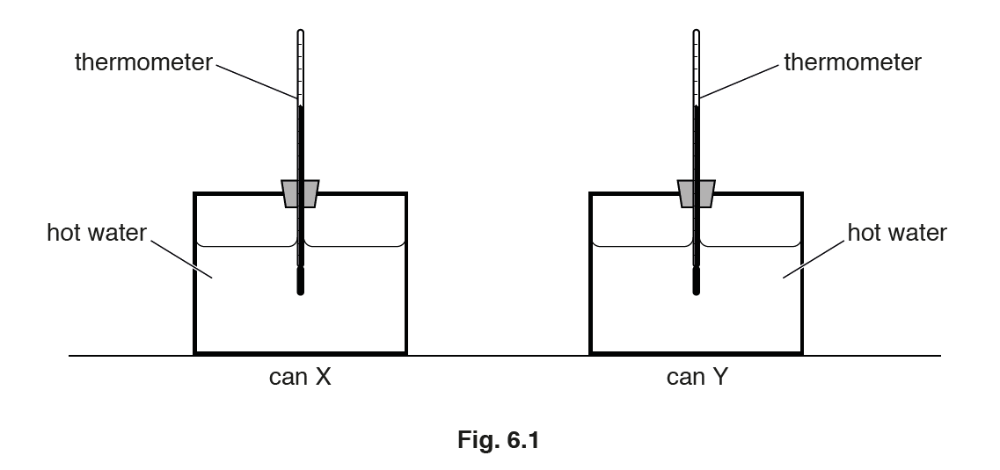

Fig. 6.2 is a graph of the results from the investigation.

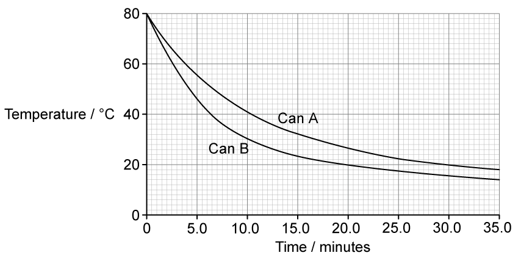

*Fig. 6.2*

For can X, use Fig. 6.2 to determine the drop in temperature of the water

(i) in the **first **five minutes

[1]

(ii) in the **last **five minutes

[1]

*Source: 2018 0625/33 Q6A*

**Q11** [2 marks]

**Extract:**

A student investigates the thermal energy lost from two metal cans, X and Y. The cans are identical apart from their outside colour.

The student pours the same volume of hot water into each can and seals each can. The student records the temperature of the water in each can at regular time intervals for a period of 35 minutes.

The equipment is shown in Fig. 6.1.

Fig. 6.2 is a graph of the results from the investigation.

For can X, use Fig. 6.2 to determine the drop in temperature of the water

Explain why the water cools at a greater rate during the first five minutes of the experiment, compared with the last five minutes.

*Source: 2018 0625/33 Q6B*

**Q11** [2 marks]

**Extract:**

A student investigates the thermal energy lost from two metal cans, X and Y. The cans are identical apart from their outside colour.

The student pours the same volume of hot water into each can and seals each can. The student records the temperature of the water in each can at regular time intervals for a period of 35 minutes.

The equipment is shown in Fig. 6.1.

Fig. 6.2 is a graph of the results from the investigation.

For can X, use Fig. 6.2 to determine the drop in temperature of the water

The outside of one can is dull black and the outside of the other is shiny white.

State the colour of can Y.

Explain your answer.

*Source: 2018 0625/33 Q6C*

### Q12 — hard — 7 marks

**Q12** [1 mark]

A thermometer is used to measure the temperature inside a room in a house.

State a physical property that varies with temperature and can be used in a thermometer.

*Source: February/March 2018 0625/32 Q6A*

**Q12** [3 marks]

**Extract:**

A thermometer is used to measure the temperature inside a room in a house.

Fig. 6.1 shows how the temperature of the room changes between 6:00 pm and 11:00 pm.

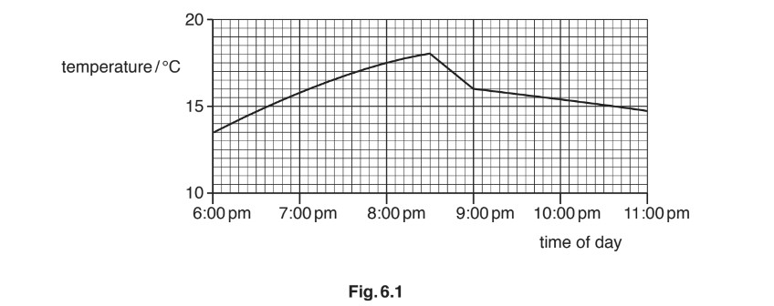

A heater in the room is switched on at 6 pm. The room has a large window. A large amount of thermal energy is transferred through the window. The window in the room has thick curtains.

Closing the curtains reduces the loss of thermal energy from the room.

(i) Suggest the time at which the heater is switched off.

[1]

(ii) Suggest the time at which the curtains were closed and explain your answer. Use information from the graph.

[2]

*Source: February/March 2018 0625/32 Q6B*

**Q12** [3 marks]

In cool climates, people use mineral wool to reduce heat loss from houses. Mineral wool is made of fibres and trapped air, as shown in Fig.6.2.

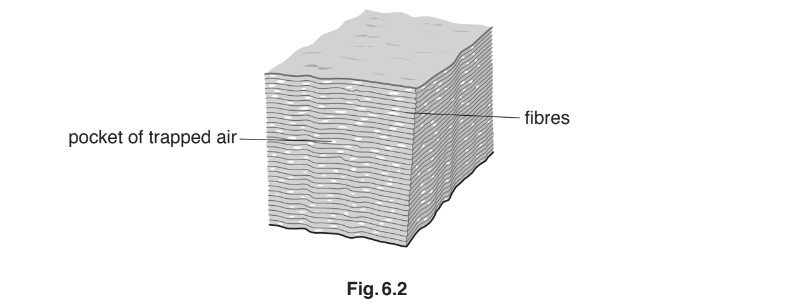

Use words from the box to complete the sentences. Each word may be used once, more than once, or not at all.

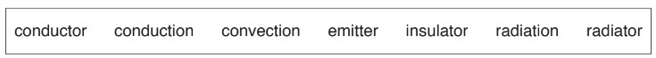

Air is a good ............................................ .

When air is trapped between fibres, it reduces heat loss by ..................................... and by ........................................ .

*Source: February/March 2018 0625/32 Q6C*

### Q13 — medium — 4 marks

**Q13** [1 mark]

A student heats some water in a metal can, as shown in Fig. 6.2.

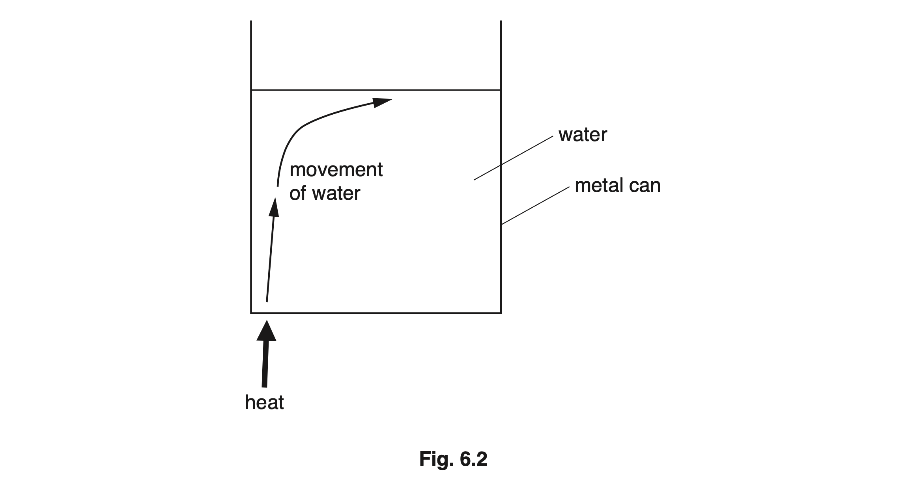

Complete the sentence. Choose a word from the box.

Thermal (heat) energy moves through the metal can by ............................................

*Source: Oct 2019 0625/32 Q6B*

**Q13** [3 marks]

**Extract:**

A student heats some water in a metal can, as shown in Fig. 6.2.

Describe how thermal energy is transferred throughout the water. Include your ideas about density changes.

*Source: Oct 2019 0625/32 Q6B*

### Q14 — easy — 7 marks

**Q14** [6 marks]

Fig. 6.1 is a diagram of the inside of an electric oven. The diagram shows a side view of the oven.

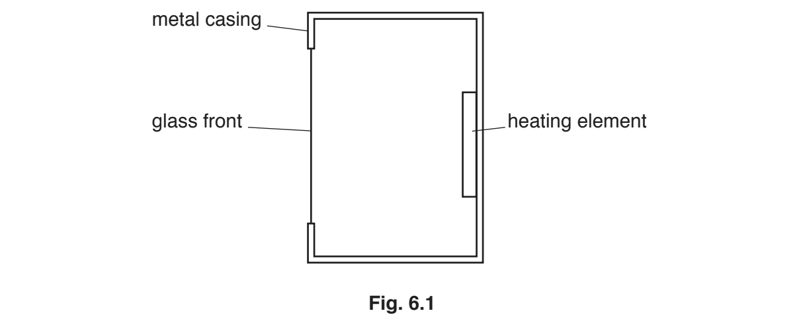

The heater is switched on.

(i) On Fig. 6.1, draw two arrows to show how thermal energy moves throughout the oven by convection.

[2]

(ii) Explain how thermal energy moves throughout the oven by convection. Use your ideas about density and expansion.

[3]

(iii) Use a word from the box to complete the sentence.

| conduction  expansion   insulation  radiation |
|---|

Thermal energy travels at the speed of light by .....................................

[1]

*Source: 2019 0625/32 Q6A*

**Q14** [1 mark]

**Extract:**

Fig. 6.1 is a diagram of the inside of an electric oven. The diagram shows a side view of the oven.

The heater is switched on.

The oven is in a kitchen that is fitted with a smoke detector.

Warm, moving air can carry smoke particles.

Suggest the best position for the smoke detector in the kitchen.

*Source: 2019 0625/32 Q6B*

### Q15 — hard — 4 marks

**Q15** [4 marks]

A student is testing how different surfaces absorb radiant heat.

The student puts two metal plates in holders and places them on either side of a radiant heater as shown in Fig. 6.2. One plate has a shiny metal side facing towards the heater and the other plate has a dull black side facing towards the heater.

A metal disc is attached to each plate using wax.

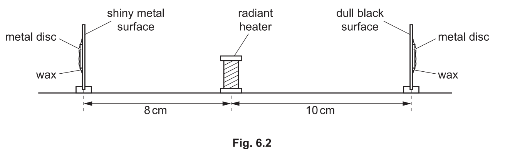

(i) The student turns on the radiant heater and starts a stop-clock. The wax on the plate with a dull black side melts and the metal disc falls off the plate 53 seconds after the stop-clock is started.

The metal disc on the plate with a shiny metal side remains attached for another 32 seconds after the metal disc on the first plate falls.

Explain why the metal disc on the plate with a dull black side falls before the metal disc on the plate with a shiny metal side.

[2]

(ii) Another student observes the experiment shown in Fig. 6.2 and says that the comparison of the two plates is not fair.

Suggest why the experiment is not fair.

[2]

*Source: 2020 0625/31 Q6C*

### Q16 — easy — 11 marks

**Q16** [2 marks]

#### Extended

A student is performing an experiment to investigate how much infrared radiation is radiated by different coloured surfaces.

Four conical flasks are painted shiny grey, dull drey, black and white, see Fig. 1.1.

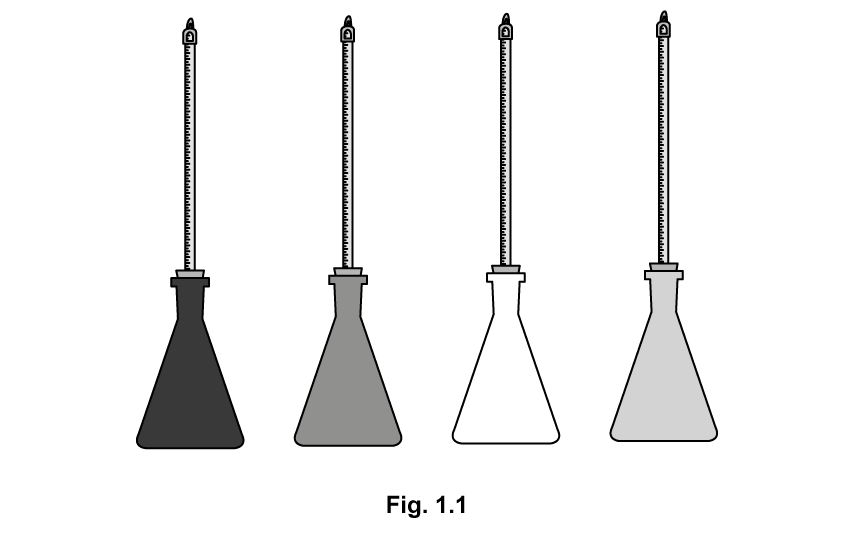

They fill the four conical flasks with boiling water and record the subsequent temperature every 30 s.

State the dependent and independent variables in this experiment.

**Q16** [2 marks]

**Extract:**

A student is performing an experiment to investigate how much infrared radiation is radiated by different coloured surfaces.

Four conical flasks are painted shiny grey, dull drey, black and white, see Fig. 1.1.

They fill the four conical flasks with boiling water and record the subsequent temperature every 30 s.

#### Extended

State two control variables in this investigation.

**Q16** [2 marks]

**Extract:**

A student is performing an experiment to investigate how much infrared radiation is radiated by different coloured surfaces. Four conical flasks are painted shiny grey, dull grey, black and white, see Fig. 1.1. They fill the four conical flasks with boiling water and record the subsequent temperature every 30 s.

#### Extended

The results of the experiment are plotted in Fig. 1.2 below. Each line represents the temperature loss of a different flask.

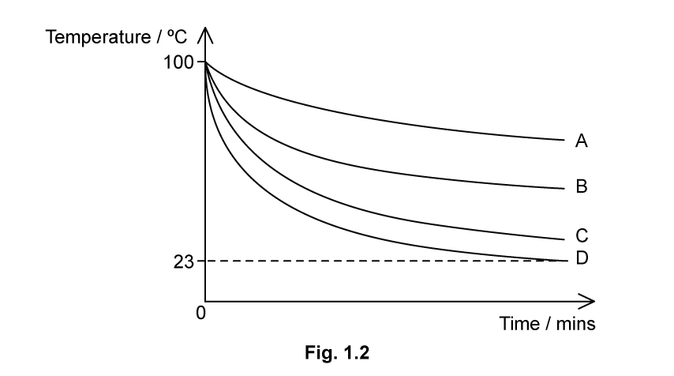

**Fig. 1.2**

(i) State the letter of the curve with the lowest temperature change per second.

[1]

(ii) State the letter of the flask covered in the best conductor.

[1]

**Q16** [5 marks]

**Extract:**

A student is performing an experiment to investigate how much infrared radiation is radiated by different coloured surfaces. Four conical flasks are painted shiny grey, dull grey, black and white. They fill the four conical flasks with boiling water and record the subsequent temperature every 30 s. The results of the experiment are plotted in Fig. 1.2 below. Each line represents the temperature loss of a different flask. (i) State the letter of the curve with the lowest temperature change per second: - A. (ii) State the letter of the flask covered in the best conductor: - D.

#### Extended

(i) Draw **four** lines between the labels from Fig. 1.2 and the different flask colours.

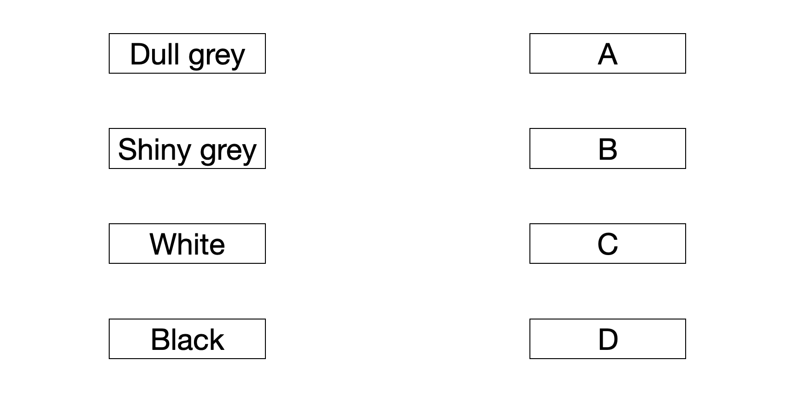

[4]

(ii) Suggest why the temperature of flask D does not drop below 23 °C.

[1]

### Q17 — medium — 6 marks

**Q17** [1 mark]

A student constructs a device for absorbing thermal energy from the Sun. Fig. 6.1 shows the device.

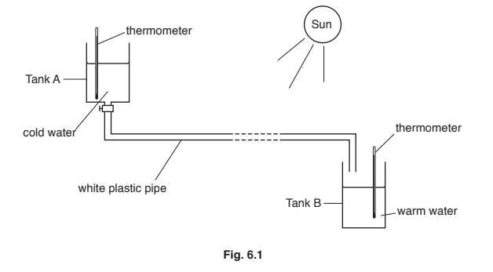

The student places the white plastic pipe in sunlight. The cold water flows slowly from Tank A to Tank B. Energy from the Sun heats the water in the pipe.

Fig. 6.2 shows the temperatures in Tank A and Tank B.

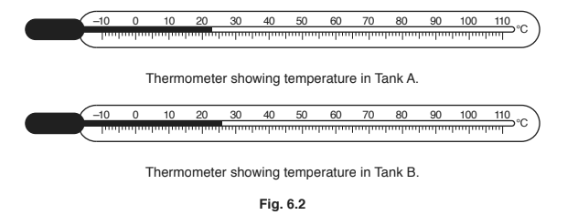

Determine the rise in temperature of the water.

temperature rise = .................................................... °C

*Source: 2018 0625/31 Q6A*

**Q17** [3 marks]

**Extract:**

A student constructs a device for absorbing thermal energy from the Sun. The student places the white plastic pipe in sunlight. The cold water flows slowly from Tank A to Tank B. Energy from the Sun heats the water in the pipe.

The student wants to increase the thermal energy absorbed by the water in the pipe. Suggest three improvements he can make to increase the thermal energy absorbed.

*Source: 2018 0625/31 Q6B*

**Q17** [2 marks]

**Extract:**

A student constructs a device for absorbing thermal energy from the Sun. The student places the white plastic pipe in sunlight. The cold water flows slowly from Tank A to Tank B. Energy from the Sun heats the water in the pipe.

Describe how the thermal energy is transferred from the Sun to the water inside the pipe.

*Source: 2018 0625/31 Q6C*

### Q18 — easy — 7 marks

**Q18** [5 marks]

**Extract:**

(i) Shiny silver surface, 2 marks. First mark: reflects / does not allow transmission of / poor emitter / poor absorber / good reflector. Second mark: infrared / thermal radiation / heat radiation; do not accept "heat" alone. (ii) Vacuum, 3 marks. 1 mark: conduction cannot take place (accept prevents or reduces). 1 mark: convection cannot take place (accept prevents or reduces). 1 mark: no particles / no medium in a vacuum, so conduction and convection cannot occur; accept "only radiation can travel through a vacuum". Do not credit "the vacuum stops radiation".

Fig. 6.1 shows a hot liquid in a vacuum flask. The vacuum flask keeps the temperature of the liquid in the flask constant for a long time.

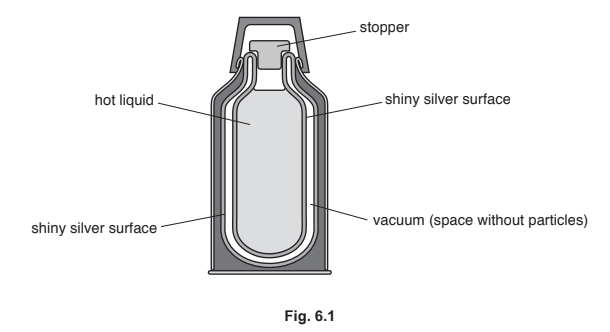

Describe how each feature helps to keep the liquid hot for longer.

(i) shiny silver surface

[2]

(ii) the vacuum between the silvered surfaces

[3]

*Source: 2020 0625/32 Q6A*

**Q18** [2 marks]

**Extract:**

(i) Expected: any non-metal or insulator, e.g. plastic, cork, rubber. (ii) Expected: non-metals are poor conductors of heat / good insulators, or metals are good conductors of heat. Do not credit "keeps the heat in" alone for the reason.

(i) Suggest a material for the stopper that will help to keep the liquid hot for longer.

[1]

(ii) Give a reason for your answer.

[1]

*Source: 2020 0625/32 Q6B*

### Q19 — easy — 8 marks

**Q19** [3 marks]

Complete the sentences with words that describe the main process of energy transfer by heating in each case.

A man goes for a walk on a cold day. He touches a metal gate, which removes energy from his hands by ................................. . He holds the sides of a cup containing a hot drink. His hands gain energy by ................................. . Some farm workers have lit a fire. The man warms his hands by the side of the fire. His hands gain energy by ................................. .

*Source: 2020 Feb/March 0625/42 Q5A*

**Q19** [3 marks]

**Extract:**

A man goes for a walk on a cold day. He touches a metal gate, which removes energy from his hands by conduction.

#### Extended

Describe in terms of particles the transfer of energy from the thermal store of the man's hands through the metal of the gate.

*Source: 2020 Feb/March 0625/42 Q5B*

**Q19** [2 marks]

Fig. 5.1 shows a car on a sunny day in a hot country.

The object labelled A is placed inside the windscreen. It is used by the owner of the car to reduce the temperature rise of the air in the car.

Select the most suitable material for the outer surface of object A. Explain your choice.

| **dull black** | **dull white** | **shiny black** | **shiny white** |
|---|---|---|---|

*Source: 2020 Feb/March 0625/42 Q5C*

