# Mark Schemes — General Properties of Waves
**3. Waves** · Cambridge (CIE) IGCSE physics (0625 & 0972)

## Multiple Choice Questions (29 questions)

### Q1
**Final answer:** **The correct answer is A**

- Diffraction is the spreading of waves as they pass through a gap or around an obstacle
- Diffraction increases when:

  - the wavelength increases (or frequency decreases, since v = fλ and wave speed is constant)
  - the gap width decreases (becomes closer to the wavelength)
- Maximum diffraction occurs when the gap width is approximately equal to the wavelength
- Decreasing the frequency increases the wavelength, and making the gap narrower brings it closer to the wavelength — both changes increase diffraction

**B** is incorrect because making the gap wider reduces diffraction. Although decreasing the frequency helps, a wider gap means the wavelength is much smaller than the gap, so less spreading occurs.

**C** is incorrect because increasing the frequency decreases the wavelength, which reduces diffraction. A narrower gap helps, but the shorter wavelength works against it.

**D** is incorrect because both changes reduce diffraction. Higher frequency means shorter wavelength, and a wider gap means the waves pass through without significant spreading.

### Q2
**Final answer:** ** The correct answer is A**

- In transverse waves, the vibrations are perpendicular to the direction of energy transfer

  - Examples of transverse waves include electromagnetic waves, such as light, and seismic S-waves
- In longitudinal waves, the vibrations are parallel to the direction of energy transfer

  - Examples of longitudinal waves include sound and seismic P-waves

### Q3
**Final answer:** **The correct answer is C**

- When water waves enter a shallower region, the increased interaction with the bottom of the tank causes the waves to travel more slowly
- The frequency of a wave is determined solely by its source and does not change when the wave enters a different depth
- According to the wave equation $v = f λ$, if the speed $v$ decreases while the frequency $f$ remains constant, the wavelength $λ$ must also decrease

**A** is incorrect because waves travel more slowly in shallow water, not more quickly.

**B** is incorrect as both the speed and the wavelength decrease when moving from deep to shallow water.

**D** is incorrect because wavelength decreases when waves slow down at a constant frequency.

> **[exam-tip]**
> Remember that frequency is determined by the source and remains constant when waves travel between different media. This means that any change in wave speed must be accompanied by a proportional change in wavelength. A useful way to remember this is: when waves slow down, they 'bunch up', resulting in a shorter wavelength.

### Q4
**Final answer:** **The correct answer is A**

- Sound is a **longitudinal **wave that requires a medium (solid, liquid, or gas) to travel
- In a longitudinal wave, the particles of the medium vibrate back and forth along the same line, i.e. **parallel **to the direction of wave travel

**B** is incorrect as longitudinal waves have vibrations parallel to the direction of wave travel, not at right angles.

**C** & **D** are incorrect as sound is a longitudinal wave, not a transverse wave.

> **[exam-tip]**
> Remember that sound waves are always longitudinal. A useful way to recall the direction of vibrations is to think about how a slinky spring behaves when you push and pull it along its length—the compressions and rarefactions move parallel to the direction of energy transfer. Transverse waves, such as light or water waves, have vibrations perpendicular (at right angles) to the direction of travel.

### Q5
**Final answer:** **The correct answer is C**

- Frequency is a measure of how many cycles or crests pass a specific point in a given amount of time
- It is usually measured in hertz (Hz), where 1 Hz equals one wave per second

**A** is incorrect as it describes the amplitude of the wave.

**B** is incorrect as it describes the wavelength.

**D** is incorrect as it describes the period of the wave (the time for one complete cycle).

### Q6
**Final answer:** **The correct answer is D**

- Recall the equation for wave speed:

$v = f λ$

- Rearrange for wavelength:

$λ = \frac{v}{f}$

- The wave speed given is 2.25 × 108 m/s and frequency is 4.5 × 1014 Hz

$λ=\frac{2.25\times10^{8}}{4.5\times10^{14}}=5.0\times10^{-7}m$

- This is option **D**

### Q7
**Final answer:** **The correct answer is ****A**** because:**

- The amplitude of the wave is the maximum displacement from the undisturbed position (or zero displacement)
- Graphs **A** and **B** have the largest displacements

  - Therefore, graphs **C** and **D** can be eliminated
- The frequency is the number of oscillations or waves passing a point per second
- Graph **A** shows more complete oscillations per second than Graph B

  - Therefore, graph **A** has the highest amplitude and has the highest frequency

The graphs shown have no numerical values on the scales, so you need to compare them to each other directly. Look for differences in amplitude first, as these are easiest to spot. Graphs **A** and **B** have higher amplitude than graphs **C** and **D**, so you can ignore **C** and **D**. Next, look at the number of complete waves/oscillations produced in the time shown.

Wave **A** clearly has far more waves than wave **B**, so it must have the highest frequency.** **

**B** is incorrect as it has a lower frequency than **A** or **C**.

**C** is incorrect because it has a lower amplitude than **A** and **B**.

**D** is incorrect as it has a low amplitude and a low frequency.

### Q8
**Final answer:** **The correct answer is A because:**

- The wave equation relates the speed, frequency, and wavelength of a wave

$v=fλ$

- Convert the frequency of the sound wave into Hz (vibrations per second) by dividing by 60 seconds:

$f=\frac{96000}{60}=1600$ Hz

- Rearrange for wavelength and calculate:

$λ=\frac{v}{f}=\frac{320}{1600}=0.20$ m

- This is option **A**

### Q9
**Final answer:** **The correct answer is D because:**

- In the diagram, waves pass through a gap and then spread out
- Diffraction is the spreading out of waves when passing around or through an obstacle

**A **is incorrect as reflection involves waves bouncing off a surface and reversing direction

**B **is incorrect as dispersion involves different wavelengths of light bending to different degrees (often through a prism)

**C **is incorrect as refraction involves light bending as it passes through a different medium

### Q10
**Final answer:** **The correct answer is D because:**

- Recall the equation for wave speed is

$v=fλ$

- Rearrange for frequency

$f=\frac{v}{λ}$

- The wave speed given is 2.0 × 108 m/s and wavelength is 4.0 × 10–7m

$f=\frac{2.0\times10^{8}}{4.0\times10^{-7}}=5.0\times10^{14}$ Hz

- This is option **D**

Use the fraction function on your calculator, not the divide symbol. When dealing with values in standard form, like in this question, this can lead to the power of 10 being divided instead of the whole value.

### Q11
**Final answer:** **The correct answer is B because:**

- Amplitude is defined as the maximum displacement from the equilibrium position
- The x-axis represents the equilibrium position, where displacement is zero
- Therefore, **B** represents the amplitude

**A **is incorrect as this is twice the value of the amplitude

**C **is incorrect as this is half the wavelength, not the amplitude

**D **is incorrect as this is the wavelength, not the amplitude

### Q12
**Final answer:** **The correct answer is D because:**

- In the diagram, waves pass through a gap and then spread out
- Diffraction is the spreading out of waves when passing around or through an obstacle

**A **is incorrect as reflection involves waves bouncing off a surface and reversing direction

**B **is incorrect as dispersion involves different wavelengths of light bending to different degrees (often through a prism)

**C **is incorrect as refraction involves light bending as it passes through a different medium

### Q13
**Final answer:** **The correct answer is B because:**

- The **amplitude **of the wave is the displacement (vertical axis) from zero to a peak (or trough)

  - Therefore, amplitude = 1.0 cm
- The **wavelength **of the wave is the distance (horizontal axis) from one point on the wave to the same point on the next wave

  - Therefore, wavelength = 8.0 cm

### Q14
**Final answer:** **The correct answer is A because:**

- Frequency is defined as the number of waves passing a point in a second
- If five complete wavelengths pass a point in 20 seconds, this corresponds to a frequency of:

$f=\frac{5}{20}=0.25$ Hz

### Q15
**Final answer:** **The correct answer is ****D**** because:**

- Amplitude is shown on the diagram, as is wavelength.
- Amplitude is the maximum distance from the equilibrium position of any point on a wave.

**A **is incorrect as this is the definition of frequency.

**B **is incorrect as this is the definition of wavelength.

**C **is incorrect as this is the standard error made by students when defining amplitude.

### Q16
**Final answer:** **The correct answer is ****C**** because:**

- A wavelength is the distance between two identical points on a wave.
- Q and S are identical points because they are both in the equilibrium position **and** the string is pointing in identical directions to their left and right, i.e. up on the left and down on the right.
- A common mistake is to think Q and R are 1 wavelength apart because they are both on the equilibrium line. However, the string is pointing in opposite directions at each of these points.
- There are plenty more ways to explain wavelength, like: to complete a wave you have to go up, down and back up again, but I rather like the first explanation.
- It’s much easier to explain with a diagram:

**A **is incorrect as P and S are 1.25 wavelengths apart.

**B **is incorrect as Q and R are half a wavelength apart.

**D **is incorrect as P and R are 0.75 wavelengths apart.

### Q17
**The correct answer is ****C**** **because** **diffraction is the name given to the spreading out of waves as they pass through a gap, as shown in the diagram below.

**A **is incorrect as reflection is what happens when waves bounce off a boundary.

**B **is incorrect as refraction is what happens when waves change speed and (usually) direction when they cross a boundary.

**D **is incorrect as dispersion is the spreading out of the different colours of (usually) light when they are passed through a prism.

### Q18
**Final answer:** **The correct answer is ****D**** because:**

- Wave speed is a measure of how much distance a wave crosses per second.
- The units are, therefore, of distance / time, or metres / seconds, metres per second.

**A **is incorrect as this is the unit of frequency.

**B **is incorrect as this is the unit of wavelength, and sometimes amplitude as well.

**C **is incorrect as this is the unit of time period.

### Q19
**Final answer:** **The correct answer is ****B**** because:**

- **Sound** is a **longitudinal** wave.
- All **electromagnetic** waves are **transverse**.
- Both infrared and red light waves are electromagnetic waves, so they are transverse.

### Q20
**Final answer:** **The correct answer is ****D**** because:**

- This one’s a bit tricky. You have to realise the relationship between speed, frequency and wavelength, and you need to know what remains the same and what changes during each phenomenon.
- **Speed = frequency x wavelength.**

- Frequency is always the same during any interaction.
- When a wave is reflected, its speed remains the same. Therefore, its wavelength remains the same
- When a wave is diffracted, its speed remains the same. Therefore, its wavelength remains the same
- When a wave is refracted, its speed *always* changes. Therefore, its wavelength changes

**A **is incorrect as wavelength does not change during reflection or diffraction.

**B **is incorrect as wavelength does change during refraction.

**C **is incorrect as wavelength does not change during reflection.

### Q21
**Final answer:** **The correct answer is ****B ****because:**

- Every wavefront that hits the boundary has to leave the boundary.
- Since frequency is defined as the number of waves (or wavefronts) that pass a point per second, this has to be the same on both sides of the boundary.
- Anything else can change.

**A** is incorrect as wavelength changes when a wave refracts.

**C** is incorrect as amplitude can change when a wave refracts, especially if the water's depth changes.

**D** is incorrect as by definition, speed changes when a wave refracts.

### Q22
**Final answer:** **The correct answer is ****D**** because:**

- As light rays leave the glass, they refract away from the normal.
- The normal is drawn at 900 to the surface of the glass, shown by a dotted line.
- The direction of travel is at 900 to the wavefronts, as shown.

**A **is incorrect as this is what would happen if the wave slowed down when leaving the glass.

**B **is incorrect as the wavefronts do not continue in a straight line, they change direction.

**C **is incorrect as note that every other wavefront in the air has no wavefront in the glass to line up with; wavefronts have been created from nowhere. This is not possible.

### Q23
**Final answer:** **The incorrect answer is ****C**** because:**

- Sound waves, just like all waves, transfer energy without transferring matter.
- The idea that sound waves push air away from the source is incorrect.

**A **is incorrect as sound waves *are* longitudinal.

**B **is incorrect as sound waves *do* transfer energy away from the source.

**D **is incorrect as sound waves *do* cause objects to vibrate

### Q24
**Final answer:** **The correct answer is ****A**** because:**

- The wave equation $v=fλ$ applies here.
- Rearrange $λ=\frac{v}{f}$:
- If *v* doubles, and *f* stays the same: $λ=\frac{2v}{f}$
- $\frac{2v}{f}$ is twice as big as $\frac{v}{f}$, the original wavelength.

The other answers are incorrect because they do not get the algebra correct.

### Q25
**Final answer:** **The correct answer is ****C**** because:**

- ** **Sound waves are always longitudinal.
- All the other waves are transverse.

### Q26
**Final answer:** **The correct answer is ****A**** because:**

- The wave equation $v=fλ$, applies here
- $1500=f\times0.05m$(don’t forget to convert cm to m)
- $\frac{1500}{0.05}==30,000\mathrm{Hz}=30\mathrm{kHz}$

**B **is incorrect as the speed has been incorrectly multiplied by the distance in metres.

**C **is incorrect as the speed has been incorrectly multiplied by the distance in cm.

**D **is incorrect as the wavelength has not been converted to metres.

### Q27
**Final answer:** **The correct answer is ****D**** because:**

- Maximum diffraction occurs when the wavelength is comparable in size to the gap through which the waves are travelling.
- Therefore, making the gap a little bigger, will mean that the gap size does not match the wavelength size to an even greater extent, and the effect will lessen.

**A **is incorrect as changing the speed would have no effect on the diffraction (although changing the wavelength would).

**B **is incorrect as changing the speed would have no effect on the diffraction (although changing the wavelength would).

**C **is incorrect as the gap is slightly larger than the wavelength. Making it smaller, and, therefore, closer in size to the wavelength, would increase the diffraction effect.

### Q28
**Final answer:** **The correct answer is ****D**** because in this case, frequency is given by: **
$\mathrm{frequency}=\frac{\mathrm{number} \mathrm{of} \mathrm{waves}}{\mathrm{time} \mathrm{taken}}=\frac{6}{3.20}=1.88\mathrm{Hz}$

**A **is incorrect as this is not the correct answer.

**B **is incorrect as the number of waves has incorrectly been multiplied by the time.

**C **is incorrect as the time has been incorrectly divided by the number of waves. This would give the time period, not the frequency.

### Q29
**Final answer:** **The correct answer is ****B**** because**

- Water waves travel more quickly on the surface of water when the water is deep compared to when it is shallow.
- The change in speed causes the change in direction**.**

**A **is incorrect as the speed decreases, it does not increase.

**C **& **D **are incorrect as the frequency remains constant when a wave crosses a boundary.

## Theory Questions (19 questions)

### Q1
A more accurate method for determining the wavelength is:

- Measure more than one wavelength; **[1 mark]**
- Divide the measurement by the number of wavelengths (measured); **[1 mark]**

An example full answer could be:

*Measure the distance between five wave peaks. Divide the distance by four (the number of wavelengths between the five peaks).*

**[Total: 2 marks]**

> **[exam-tip]**
> This question asks you to **describe** a method. This question is about increasing accuracy. Using a ruler may give a measurement to the nearest centimetre, but if you are measuring something small this will give quite a large percentage error in the measurement. By measuring several waves, you are measuring a larger distance and the percentage error in your measurement will be much smaller. This will give you a more accurate measurement of wavelength.
List the known quantities:

- Wavelength = 4.0 cm
- Frequency = 6.0 Hz

Write down the equation that links wavelength, wave speed and frequency:

- $\mathrm{wave} \mathrm{speed}=\mathrm{frequency}\times\mathrm{wavelength}$ **OR**
- $v=fλ$ **[1 mark]**

Substitute in the values given in the question and calculate the answer:

- $\mathrm{wave} \mathrm{speed}=6.0\times4.0$** [1 mark]**
- $\mathrm{wave} \mathrm{speed}=24\mathrm{cm}/s$ **[1 mark]**

**[Total: 3 marks]**

> **[exam-tip]**
> The units required for the final answer in calculations are often given, but not always. You need to check these because sometimes the question requires you to convert units. For example, the units required here were cm/s and so no conversion is needed. However, if the question had provided units of m/s, you would have needed to convert 24 cm/s into m/s by dividing by 100, giving an answer of 0.24 m/s.
When waves change direction at a boundary:

- (Name of effect) refraction; **[1 mark]**
- (Explanation) the waves are changing speed; **[1 mark]**

**[Total: 2 marks]**

> **[exam-tip]**
> To answer this question, you need to **state** a fact and then **explain** it. Looking at the diagram should tell you that the waves are reaching a boundary and passing through it. As they pass through the boundary the waves change their direction of travel, this is refraction.
> 
> Some students confuse the words ‘reflection’ and ‘refraction’, so be careful with your language here. During refraction, a wave passes from one material to another and changes speed. During reflection, the wave reaches a boundary but does not enter the new medium; instead, it changes direction but not speed.

### Q2
Use Fig. 7.1 to determine the wavelength and amplitude of the wave:

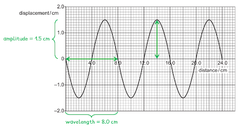

(i) The wavelength of the wave is:

- Wavelength = 8.0 cm;** [1 mark]**

(ii) The amplitude of the wave is:

- Amplitude = 1.5 cm; **[1 mark]**

  - *Allow 1.4 cm to 1.6 cm*

**[Total: 2 marks]**

> *A tolerance of ∓½ a small square is generally allowed when reading data from graphs. *

> *Remember, the wavelength is the horizontal distance from one point on the wave to the same point on the next wave. A very common mistake is to measure from a point where the wave crosses the horizontal axis to the next point it crosses the axis, but this is half the wavelength.*

> *Similarly, remember that amplitude is the vertical distance from zero to a peak (or trough). A very common mistake is to measure from a peak to a trough, but this is double the amplitude.*

### Q3
Three wavefronts after the gap:

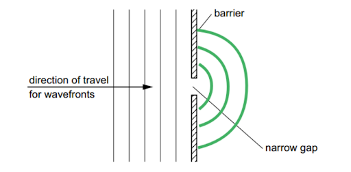

- Three curved waves after the gap; **[1 mark]**
- Wavefronts have same spacing as wavefronts given; **[1 mark]**
- Waves are diverging; **[1 mark]**

**[Total: 3 marks]**

### Q4
To label the wavelength:

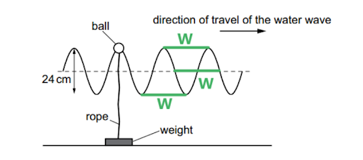

**Final answer:** **Any ****one**** from:**

- A line labelled ‘W’ from one trough to the next trough;** [1 mark]**
- A line labelled ‘W’ from one peak to the next trough; **[1 mark]**
- A line labelled ‘W’ from one equilibrium to the next <u>where the wave repeats</u>; **[1 mark]**

**[Total: 1 mark]**

> *A common error in this question is to mark wavelength from one equilibrium position to the next, however, this is only half a wavelength. To avoid any risk of this happening in your exam, label wavelength from peak to to next peak or trough to the next trough.*
To determine amplitude:

- Amplitude = 12 cm **[1 mark]**

**[Total: 1 mark]**

> *Amplitude is the distance from peak to equilibrium. This is half of the distance from peak to trough, or maximum to minimum.*
To calculate frequency:

Recall the definition of frequency:

- Frequency is the number of cycles completed in one second

Calculate frequency:

- One cycle occurs each time the ball reaches maximum height
- 40 cycles occur in 60 seconds
- $f=\frac{40}{60}$ **[1 mark]**
- $f=0.67$ Hz **[1 mark]**

**[Total: 2 marks]**
To show the waves are transverse:

- The oscillation of the ball is <u>perpendicular</u> to the direction of travel of the water wave;** [1 mark]**

**[Total: 1 mark]**
Another transverse wave is:

Any **one** from:

- Electromagnetic wave; **[1 mark]**
- Radio wave;** [1 mark]**
- Microwave;** [1 mark]**
- Infrared radiation; **[1 mark]**
- Visible light;** [1 mark]**
- Ultraviolet; **[1 mark]**
- X-rays;** [1 mark]**
- Gamma rays;** [1 mark]**
- Seismic S-wave; **[1 mark]**

**[Total: 1 mark]**

### Q5
(i) A correctly completed diagram looks like:

- 3 straight crests, to the right of A **AND**** **parallel to incident crests **AND** same wavelength (by eye); **[1 mark]**
- Waves curving round correct way below A; **[1 mark]**

(ii) The wave process that occurs as the wave passes point A is:

- Diffraction; **[1 mark]**

**[Total: 3 marks]**

> *When sketching the continuation of a wave pattern as in part (i) of this question **there will always be a mark for getting the wavelength** (the distance between the lines you draw) correct.*

- *If the wave speed stays the same, wavelength stays the same.*
- *If the wave gets slower then wavelength shrinks (as the waves catch up with each other).*
- *If the wave gets faster then wavelength extends (as the leading wavefronts get away from those following).*
(i) An arrow showing the direction of the wave after it has passed into the shallow water looks like:

- Arrow pointing away from deep water **AND**** **perpendicular to the wavefronts; **[1 mark]**

**   **

(ii) As waves pass into shallow water:

- The process they undergo is called <u>refraction</u>; **[1 mark]**

**   **

(iii) A correctly completed table looks like:

- **One mark** for each correct answer

**[Total: 5 marks]**

> *When waves enter shallow water they slow down, so the wavelength decreases. You can see this in the diagram as the wavefronts are closer together. *

> *Frequency is the number of waves per second and is caused by the source. It isn't affected by the wave encountering changing conditions.*

> *The wave slows down which you can see because the wavelength is shorter - the gap between waves shrinks as the waves at the back catch up with the ones at the front.*

### Q6
(i) Mark clearly the directions in which point X moves:

A diagram that would score 1 mark should look like:

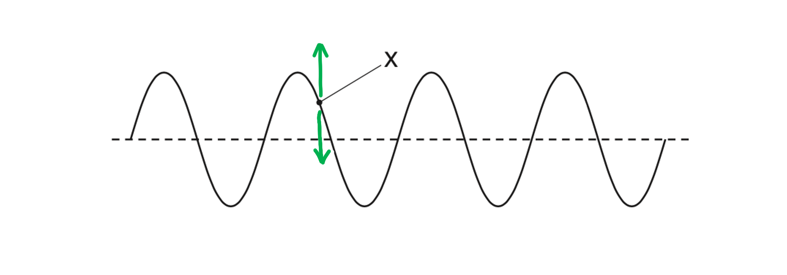

- A vertical arrow of roughly the same size pointing <u>up</u> **AND** one pointing <u>down</u>; **[1 mark]**

(ii) Measure the wavelength of the wave:

- Use a ruler to measure the wavelength of all four complete waves

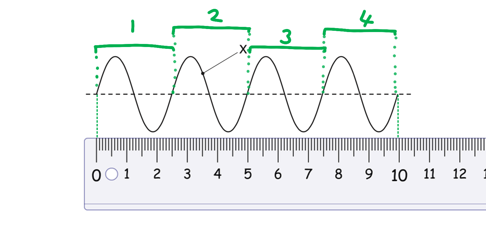

- $4waves=10\mathrm{cm}$
- $wavelength=\frac{10\mathrm{cm}}{4}$
- wavelength = 2.5 cm **[1 mark]**

(iii) Describe how the wave pattern in Fig. 6.1 would be different if the frequency increased:

Any **one **from:

- The diagram would have more waves; **[1 mark]**
- The waves would be closer together; **[1 mark]**
- The wavelength would be shorter; **[1 mark]**

**[Total: 3 marks]**

> *Depending on your screen size or the type of paper you may have printed onto, the size you measured for the wavelength will differ from the one given in the model answer. In your exam, all papers will be printed the same size so you don't need to worry about this!*

> *The method is the important part - make sure you align 0 cm (not the very end of your ruler) with your start point and measure **more than one** wavelength, then divide by the number of waves. Measuring a single wave's length is fine, but less accurate than measuring the length of four waves and dividing that length by four. It is easier to measure a longer length than a smaller one, so you are less likely to find an error in your measurement this way. *
(i) Place a tick in a box next to any transverse wave:

**✓**   light

`square`  sound

**AND**

**✓**  radio; **[1 mark]**

.

(ii) A type of wave that cannot travel in a vacuum is:

**Any one from:**

- Sound waves; **[1 mark]**
- Ultrasound waves; **[1 mark]**
- Longitudinal waves; **[1 mark]**
- Seismic waves; **[1 mark]**

**[Total: 2 marks]**

> *Electromagnetic waves are transverse waves and they are the **only** type of wave that can travel in a vacuum and do not need a medium (a material to travel through). *

### Q7
**Any four from:**

- Produce a sharp sound; **[1 mark]**
- Use a suitable reflecting surface (from which to reflect the sound off); **[1 mark]**
- Measure the distance travelled by sound; **[1 mark]**
- Measure the time for sound to travel the measured distance; **[1 mark]**
- Use speed = distance / time equation to calculate the speed of sound; **[1 mark]**

**[Total: 4 marks]**

> *You may be asked to describe a range of experiments to measure certain quantities in your examination. To create your method consider the equation you need to use and how you would obtain the values for each quantity. *

### Q8
(i) A drawing which would gain **two** marks would look like:

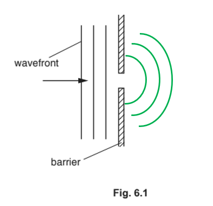

- At least 3 circular wavefronts centred on gap extending to at least half of semicircle; **[1 mark]**
- With the same spacing as incident wavefronts; **[1 mark]**

(ii) A drawing which would gain **two**** **marks would look like:

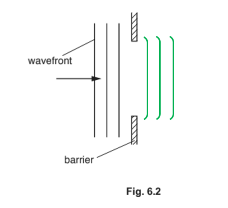

- At least 3 straight, parallel, wavefronts, approximately same length as width of gap; **[1 mark]**
- Ends of straight lines curving towards but not reaching barrier; **[1 mark]**

**[Total: 4 marks]**

> *The greatest diffraction effect is seen when the width of the gap is approximately the same as the wavelength (the gap between each wavefront).*
To describe an experiment using water waves:

Any **four** from:

- Diagram to show: labelled barrier, incident straight or curved waves; **[1 mark]**
- Diagram shows appropriately reflected waves; **[1 mark]**
- Water surface e.g. tank of water/ripple tank/pond/acceptable alternative; **[1 mark]**
- How waves are produced: e.g., moving end or length of solid rod dipping into surface **OR** small solid object thrown in; **[1 mark]**
- Detail of barrier: made of metal, glass or wood fixed in position; **[1 mark]**
- How observed: by eye, video, film, stroboscope; **[1 mark]**

An example of a diagram which would obtain **four **marks is:

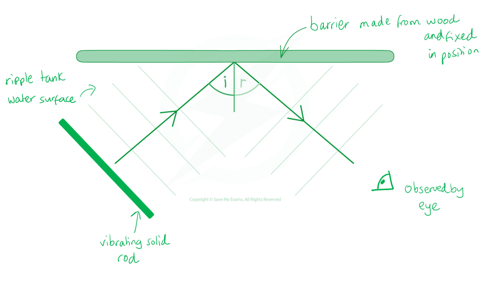

**[Total: 4 marks]**

### Q9
The completed sentence is:

Waves transfer **energy **without transferring **matter**

> **[mark-scheme]**
> - energy** [1 mark]**
> - matter **[1 mark]**
Select suitable labels for Fig. 1 by selecting from the list :

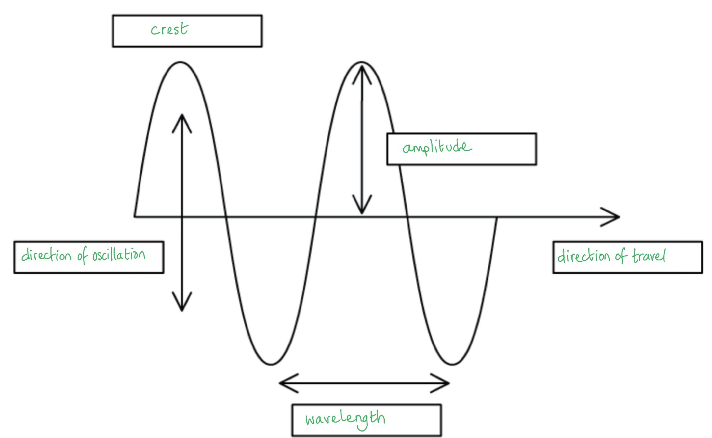

**[5 marks]**

> **[mark-scheme]**
> 1 mark for each correct label, up to a maximum of 5 marks.
> **[mark-scheme]**
> (i) Amplitude:
> 
> - Metres **[1 mark]**
> 
> (ii) Wavelength:
> 
> - Metres **[1 mark]**
> 
> For both parts, accept: m / cm / mm / any correct unit of length

> **[exam-tip]**
> 'State the unit' wants a unit, not a definition. Both amplitude and wavelength are distances, so they need a unit of length: not amps, decibels or m/s.
> 
> Try to use the correct British spelling of words such as metres instead of the American spelling of meters. You will still be awarded the marks for either spelling.
List the known quantities:

- Time period = 2.0 s
- Wave speed = 0.25 m/s

(i) To calculate frequency of the wave:

- Use the equation for frequency:

$f=\frac{1}{T}=\frac{1}{2}$ **[1 mark]**

- Write the answer with units:

$f=$ $0.5\mathrm{Hz}$ **[1 mark]**

(ii) Calculate the wavelength of the wave:

- Use the wave equation:

$v=fλ$ **[1 mark]**

- Rearrange and substitute:

$λ=\frac{v}{f}=\frac{0.25}{0.5}$ **[1 mark]**

- Write the answer with units:

$λ=$ $0.5m$ **[1 mark]**

> **[exam-tip]**
> Never submit a final answer as a fraction in your physics exam, unless the question explicitly asks you to do so.
> 
> In part (i), the answer 1/2 is correct but must be written 0.5 to get the mark.

### Q10
To explain why the light changes direction:

- One side of the wavefront enters the solid first **OR**** **wavefront does not reach/hit the solid all at once; **[1 mark]**
- This side slows down first / compared to the other side; **[1 mark]**
- The angle of wave(front) changes **OR**** **the other side continues to move at the original speed (causing turning); **[1 mark]**

**[Total: 3 marks]**
(i) To calculate the angle of refraction:

List the known quantities:

- Refractive index, *n* = 1.3
- Angle of incidence, *i* = 67°

Recall the equation linking refractive index with angles of incidence and refraction:

- $n=\frac{\mathrm{sin}i}{\mathrm{sin}r}$ **[1 mark]**

Rearrange to make sin *r* the subject:

- $\mathrm{sin}r=\frac{\mathrm{sin}i}{n}$

Calculate to find sin *r* :

- $\mathrm{sin}r=\frac{\mathrm{sin}67}{1.3}=0.7081$

Use sin−1 to find the value of *r* :

- $\sin ^{- 1} ( 0.7081 ) = 45.1$

Round the answer to two significant figures and include the units

- Angle of refraction, *r* = 45° **[1 mark]**

(ii) To determine wavelength:

List the known quantities:

- Speed of light in air, *v**a* = 3.0 × 108 m/s (from part (a))
- Frequency of light, *f* = 5.7 × 1014 Hz (from part (a))
- Refractive index, *n* = 1.3

Recall the equation linking refractive index with speed in a more dense medium:

- $n=\frac{v_{a}}{v_{g}}$ where *v**a** *is the speed in the air and *v**g* is the speed in the glass prism; **[1 mark]**

Rearrange to make the speed in the solid the subject:

- $v_{g}=\frac{v_{a}}{n}$

Calculate the speed in the solid:

- $v_{g}=\frac{3.0\times10^{8}}{1.3}=2.3\times10^{8}$m/s **[1 mark]**

Recall the wave equation;

- $v=fλ$ **[1 mark]**

Rearrange to make wavelength the subject:

- $λ=\frac{v}{f}$

Substitute the values and calculate:

- $λ=\frac{2.3\times10^{8}}{5.7\times10^{14}}=4.0\times10^{-7}$m **[1 mark]**

**[Total: 6 marks]**

> *The final part of this question is quite difficult and has a lot of steps. However, did you notice that two of the four marks are simply for remembering the equations?*

> *Make sure you have memorised all the equations your teacher gives you. Writing them down will usually get you marks, and may help you to see how to solve a problem which you can't easily see a way into.*

### Q11
(i) To find the amplitude of the wave:

Use the graph to find the maximum displacement from the mean (equilibrium) position:

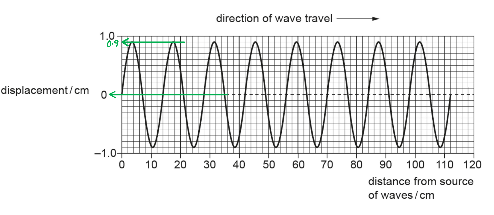

- Amplitude = 0.9 cm; **[1 mark]**

(ii) To find the wavelength of the wave:

Recall the definition of wavelength:

- One wavelength is the distance between two successive peaks

Use the best measuring method:

- Measure the distance of eight wavelengths and take the average
- $averagewavelength=\frac{distanceofeightwaves}{8}$
- $wavelength=\frac{112}{8}$

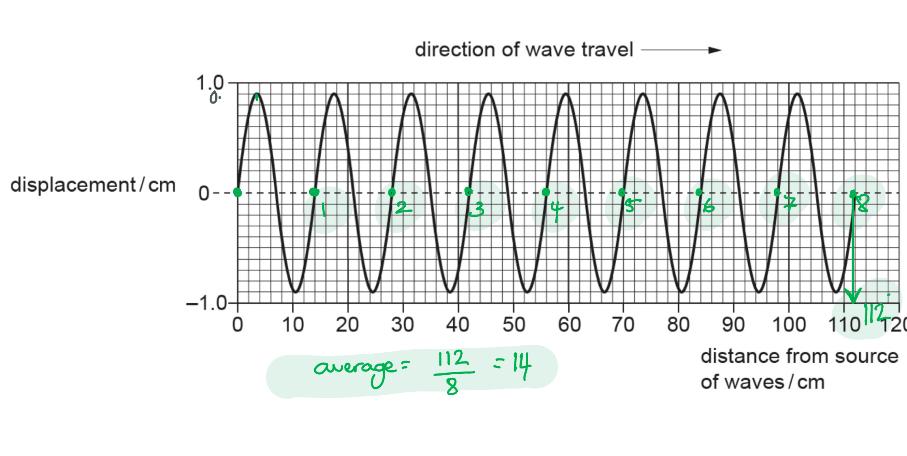

- Wavelength = 14 cm; **[1 mark]**

(iii) To find the frequency of the wave:

List the known quantities:

- Number of waves = 8 (from the graph)
- Time = 2.0 s (from the question)

Recall the definition of frequency:

- Frequency is the number of complete oscillations per second

Calculate for this wave:

- $frequency=\frac{numberofwaves}{time}$
- $frequency=\frac{8}{2}$ ; **[1 mark]**
- frequency = 4.0 Hz; **[1 mark]**

**[Total: 5 marks]**

> *When given a graph in your exam paper, feel free to write and make notes all over it. Not only will this help you, but if you have done the work correctly the examiner will look at it and award any marks you earned.*

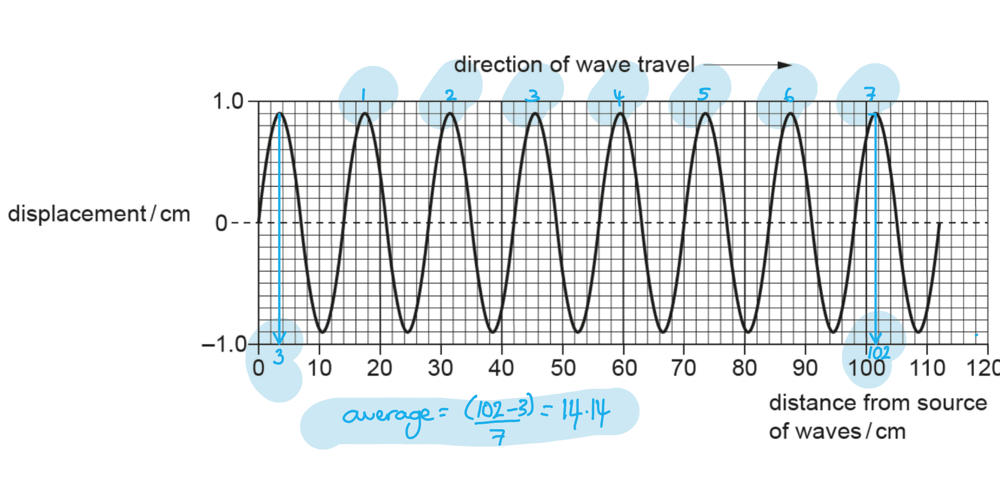
(i) The correctly labelled diagram looks like:

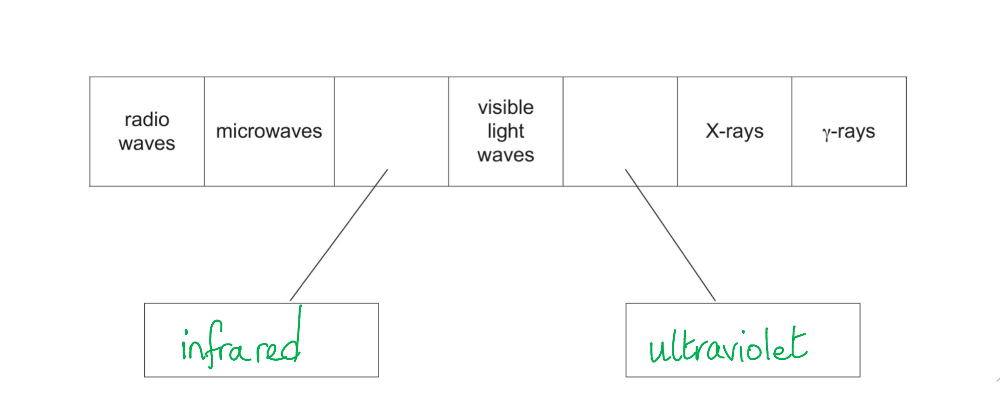

- **One mark** for each correct label

(ii) One use of γ-rays is:

Gamma rays are used for:

Any **one **from:

- Treating cancer; **[1 mark]**
- Identifying cancer; **[1 mark]**
- Gamma ray photography; **[1 mark]**
- Sterilising medical equipment; **[1 mark]**

**[Total: 3 marks]**

> *The topic of electromagnetic radiation has a lot of information in it which you need to memorise. With the uses of parts of the EM spectrum, learn one or two for each region, you won't be asked for more.*

> *When you are trying to learn the order of the electromagnetic spectrum, this mnemonic about a Grandmother who works as a spy using a secret umbrella-gadget may help!*

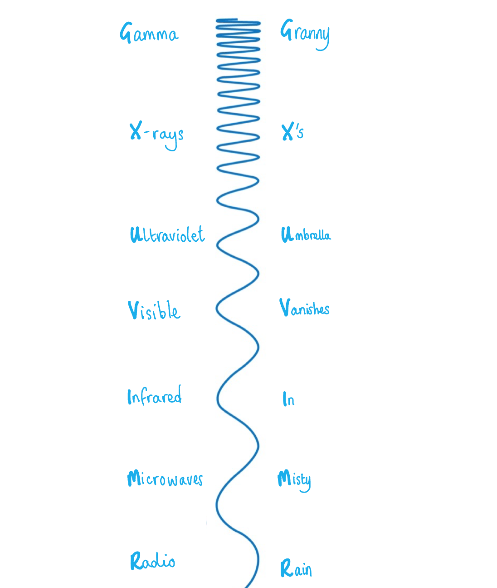

### Q12
A diagram of a longitudinal wave which would score three marks is:

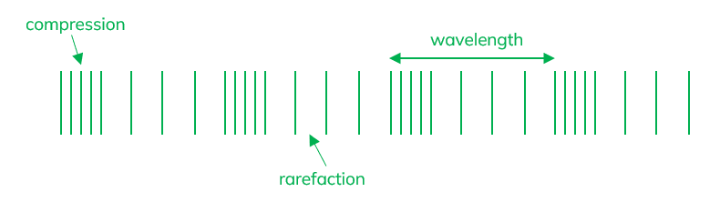

- Attempt at compressions and rarefactions; **[1 mark]**
- At least one compression labelled **AND** at least one rarefaction labelled; **[1 mark]**
- Wavelength labelled; **[1 mark]**

**[Total: 3 marks]**

> *Drawing a longitudinal wave can be quite tricky. Use a ruler and try to evenly space the lines with each compression and rarefaction.*
When a longitudinal wave slows down on passing into a different medium:

(i) The frequency:

- Remains constant; **[1 mark]**

(ii) The wavelength:

- Decreases; **[1 mark]**

**[Total: 2 marks]**

> *Since wavespeed is equal to frequency and wavelength (*$v=fλ$*), a change in speed will cause one of them to change. It is a fact that the frequency remains constant but the wavelength changes in order to maintain this constant frequency.*
State a value for the speed of sound in air:

- A value in the range 320 to 350 m/s (e.g. 340 m/s); **[1 mark]**

**[Total: 1 mark]**

> *The value of the speed of sound in air is a fact you need to memorise.*

### Q13
When a ray of light strikes a glass block at an angle:

- One side of wave(front) slows down before the other side; **[1 mark]**
- The wave(front) moves around **OR** bends at the boundary; **[1 mark]**
- (The causes the wave to) bend towards the normal **OR** bend towards the side that slows first; **[1 mark]**

**[Total: 3 marks]**

> *Refraction is the bending of a wave due to this staggered impact of the wavefront with the boundary. *

### Q14
Describe a method of using water waves to demonstrate refraction:

Any **four **from:

- Use of shallow water; **[1 mark]**
- Use of a flat lamina / shape below the surface (to change depth) **OR **use different depths (of water); **[1 mark]**
- Idea of waves hitting shallow water / the shape at an angle (other than 90°); **[1 mark]**
- Waves change direction; **[1 mark]**
- (Due to the) change in speed; **[1 mark]**

**An example of an answer that would gain 4 marks:**

Generate waves in a tank filled with shallow **[1 mark]** water. Place a flat object under the surface of the water to change the depth **[1 mark] **partway along the tank. Ensure that the waves are hitting the boundary of the shallower water at a non-perpendicular angle **[1 mark]**. This will cause the waves to change direction **[1 mark] **as a result of their change in speed **[1 mark]**.

### Q15
For each label draw a straight line connecting it to the correct diagram.

**One mark** for each correct line.

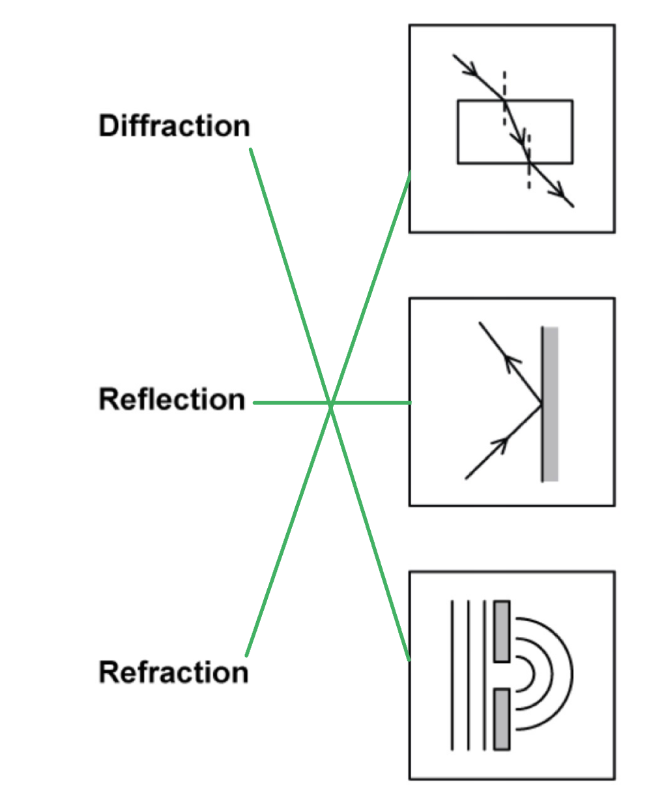

**[Total: 3 marks]**
State two changes which would make the angle of refraction increase:

Any **two **from:

- Use a block with lower density; **[1 mark]**
- Increase the angle of incidence; **[1 mark]**
- Decrease frequency / increase wavelength; **[1 mark]**

**[Total: 2 marks]**

> *It is best to learn how the angle of refraction, **r** changes when other variables such as refractive index, **n**, wave speed, **v**, frequency, **f**, and wavelength, **λ **also change. If you cannot remember then use the equation for refractive index:*

$n = \frac{\sin ( i )}{\sin ( r )}$

> *Rearrange the equation to make sin(**r**) the subject:*

$\sin ( r ) = \frac{\sin ( i )}{n}$

> *It is easy to see that:*

- *decreasing the refractive index, **n** then sin(**r**) will increase*
- *increasing sin(**i**) then sin(**r**) will also increase*

> *If **n** decreases then the density of the block decreases. If sin(**i**) increases then the angle of incidence, **i **increases.*

> *Remember that decreasing wave frequency or increasing wavelength increases the angle of refraction.*
State two changes which would make the amount of diffraction decrease:

- Increase the size of the gap; **[1 mark]**
- Reduce the wavelength (relative to the gap size) / increase the frequency of the wave;** [1 mark]**

**[Total: 2 marks]**
Complete the diagram to show the waves after they have passed the edge:

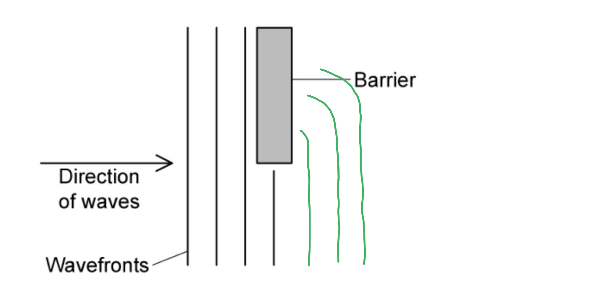

- At least three wavefronts; **[1 mark]**
- Central part of the wavefronts is a straight line; **[1 mark]**
- Wavelength the same after the barrier as it was before; **[1 mark]**
- Wavefronts curve at the end near the barrier (as shown); **[1 mark]**

**[Total: 4 marks]**

### Q16
Draw a line from each statement to the correct term that describes it.

The correct lines drawn that score 5 marks should look like:

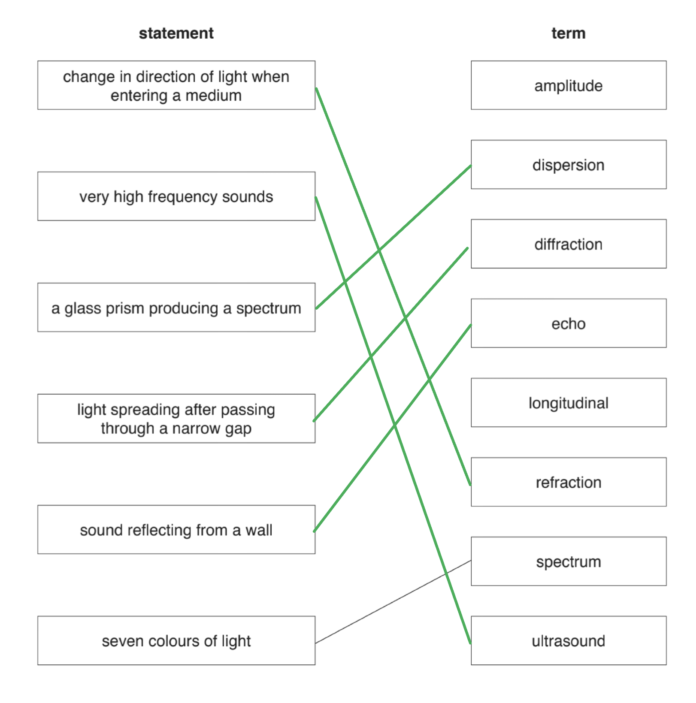

- Change in direction of light when entering a medium = refraction; **[1 mark]**
- Very high frequency sounds = ultrasound; **[1 mark]**
- A glass prism producing a spectrum = dispersion; **[1 mark]**
- Light spreading after passing through a narrow gap = diffraction; **[1 mark]**
- Sound reflecting from a wall = echo; **[1 mark]**

**[Total: 5 marks]**

> *It is important you know the difference between all the wave phenomena you could encounter in your exam. The key ones are:*

- *Dispersion*
- *Diffraction*
- *Refraction*
- *Reflection*
- *Interference*

### Q17
Draw three crests of the reflected wave:

A diagram that would score 3 marks should look like:

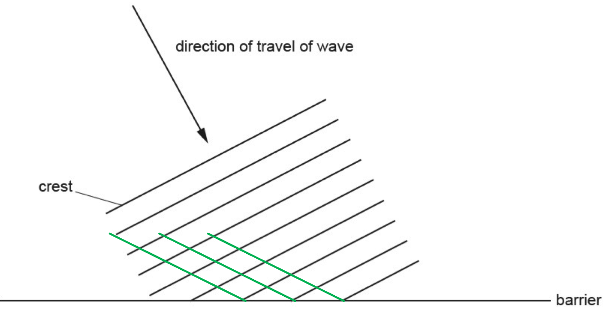

- Three rays are parallel to each other **AND **the angle of incident is the same as the angle of reflection by eye; **[1 mark]**

- Two wavelengths are the same as the original wavelength by eye; **[1 mark]**
- Three reflected waves meet incident waves at the barrier; **[1 mark]**

**[Total: 3 marks]**

> *The diagram below should make the mark requirements a little clearer.*

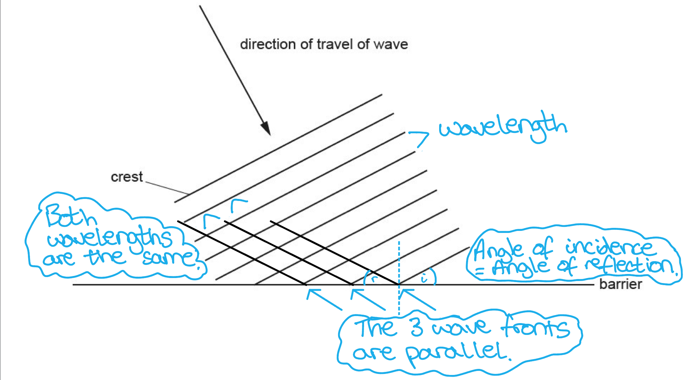
Calculate the frequency of the wave:

List the known quantities:

- Wavelength, *λ *= 36 cm
- Wave speed, *v *= 1.2 m / s

Convert the wavelength from cm into m:

- $100cm=1m$

  - $36cm=\frac{36}{100}=0.36m$

Recall the wave speed equation:

- $v=fλ$** ****OR**** **$wavespeed=frequency\timeswavelength$ **[1 mark]**

Rearrange for the frequency, *f*:

- $f=\frac{v}{λ}$

Substitute the known quantities into the equation:

- $f=\frac{1.2}{0.36}$**[1 mark]**
- *f *= 3.3 Hz **[1 mark]**

**[Total: 3 marks]**

> *Remember to convert measurements into m **before** substituting in your values. For the frequency to be in hertz, the speed must be in m/s and the wavelength in m.*
The following complete sentences are:

- An echo is the name for a reflected **sound/ultrasound**** **wave. **[1 mark]**
- The waves that form an echo are a type of longitudinal wave. Longitudinal waves are made up of **compressions** and rarefactions. **[1 mark]**

**[Total: 2 marks]**

> *Use the revision notes to clearly understand the differences between longitudinal and transverse waves. *

### Q18
(i) The wavelength of the sound wave is:

- 40 cm **[1 mark]**

(ii) Draw a wave representing a louder sound of the same wavelength:

A sketch that would score 1 mark should look like:

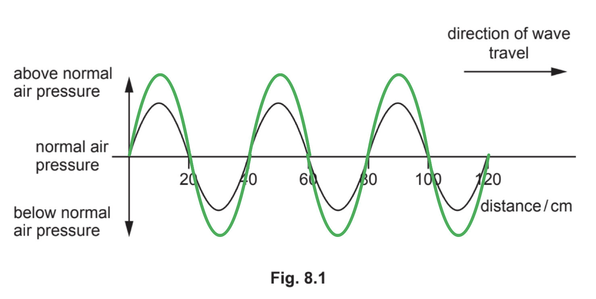

- Wave drawn with greater amplitude; **[1 mark]**

**[Total: 2 marks]**

> *1 wavelength (λ) is the distance for one full cycle of a wave. Since the horizontal axis represents 'distance', the wavelength can be read straight from the axis.*

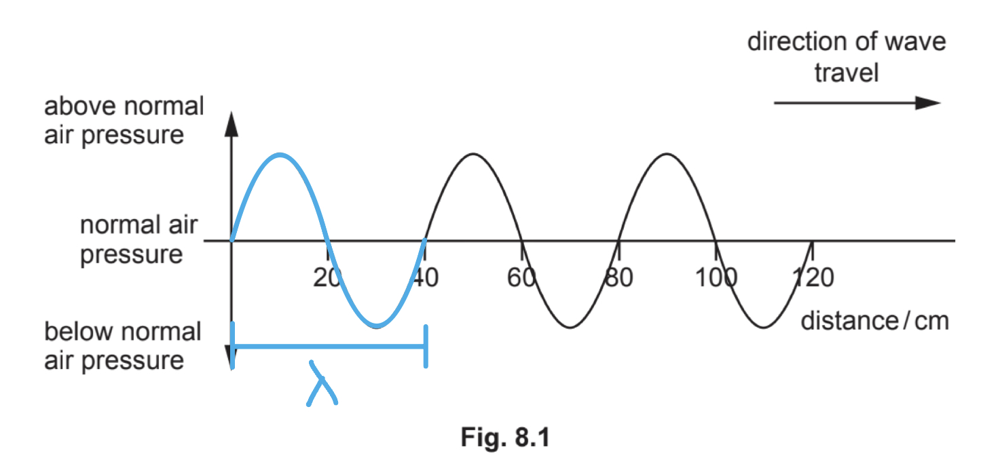

> *For (ii), a louder sound creates much **higher **and **lower** values of air pressure. This increases the **amplitude **(the distance between the axis and the crest/trough) of the wave. Make sure that this is the **only** change you make in your diagram though, as the wavelength will not change.*
The range of audible frequency for a healthy human ear is:

- 20 to 20 000 **[1 mark]**
- (In units of) Hz / Hertz **[1 mark]**

**[Total: 2 marks]**

### Q19
(i) State which angle is the angle of refraction:

- (Angle) Z; **[1 mark]**

(ii)

State another example of a transverse wave:

Any **one **from:

- Radio (Waves); **[1 mark]**
- Microwaves; **[1 mark]**
- Ultraviolet; **[1 mark]**
- Infrared; **[1 mark]**
- Gamma; **[1 mark]**
- X-Rays; **[1 mark]**
- Seismic Waves (S-waves); **[1 mark]**
- Water wave; **[1 mark]**

**[Total: 2 marks]**

> *It is vital in your understanding of the waves topic to know that transverse waves include all electromagnetic waves in the EM spectrum. You can learn these and their order of longest to shortest wavelength from the revision notes. *
(i) To draw three wavefronts that have passed through the gap:

A diagram that would score 2 marks should look like this:

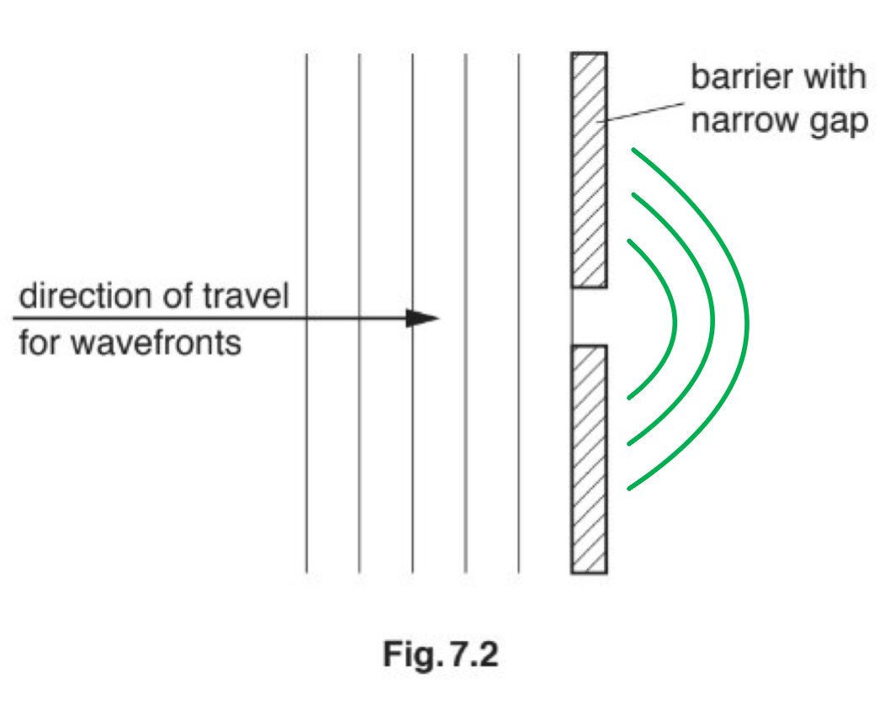

- 3 curved waves after the gap; **[1 mark]**
- Waves are evenly spaced and centre on the gap (by eye); **[1 mark]**

(ii)

The name of the effect is:

- Diffraction; **[1 mark]**

**[Total: 3 marks]**
