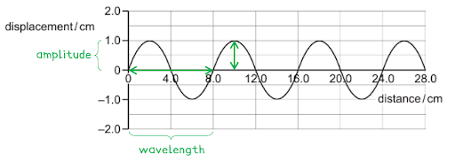
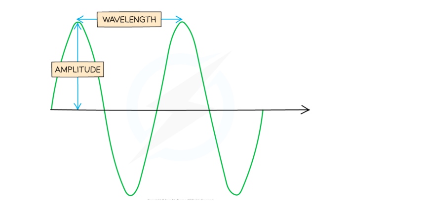
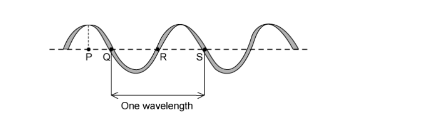

# Mark Schemes — General Properties of Waves
**3. Waves** · Cambridge (CIE) IGCSE physics (0625 & 0972)

## Multiple Choice Questions (29 questions)

### Q1
**Final answer:** **The correct answer is A**

- Diffraction is the spreading of waves as they pass through a gap or around an obstacle
- Diffraction increases when:

  - the wavelength increases (or frequency decreases, since v = fλ and wave speed is constant)
  - the gap width decreases (becomes closer to the wavelength)
- Maximum diffraction occurs when the gap width is approximately equal to the wavelength
- Decreasing the frequency increases the wavelength, and making the gap narrower brings it closer to the wavelength — both changes increase diffraction

**B** is incorrect because making the gap wider reduces diffraction. Although decreasing the frequency helps, a wider gap means the wavelength is much smaller than the gap, so less spreading occurs.

**C** is incorrect because increasing the frequency decreases the wavelength, which reduces diffraction. A narrower gap helps, but the shorter wavelength works against it.

**D** is incorrect because both changes reduce diffraction. Higher frequency means shorter wavelength, and a wider gap means the waves pass through without significant spreading.

### Q2
**Final answer:** ** The correct answer is A**

- In transverse waves, the vibrations are perpendicular to the direction of energy transfer

  - Examples of transverse waves include electromagnetic waves, such as light, and seismic S-waves
- In longitudinal waves, the vibrations are parallel to the direction of energy transfer

  - Examples of longitudinal waves include sound and seismic P-waves

### Q3
**Final answer:** **The correct answer is C**

- When water waves enter a shallower region, the increased interaction with the bottom of the tank causes the waves to travel more slowly
- The frequency of a wave is determined solely by its source and does not change when the wave enters a different depth
- According to the wave equation $v = f λ$, if the speed $v$ decreases while the frequency $f$ remains constant, the wavelength $λ$ must also decrease

**A** is incorrect because waves travel more slowly in shallow water, not more quickly.

**B** is incorrect as both the speed and the wavelength decrease when moving from deep to shallow water.

**D** is incorrect because wavelength decreases when waves slow down at a constant frequency.

> **[exam-tip]**
> Remember that frequency is determined by the source and remains constant when waves travel between different media. This means that any change in wave speed must be accompanied by a proportional change in wavelength. A useful way to remember this is: when waves slow down, they 'bunch up', resulting in a shorter wavelength.

### Q4
**Final answer:** **The correct answer is A**

- Sound is a **longitudinal **wave that requires a medium (solid, liquid, or gas) to travel
- In a longitudinal wave, the particles of the medium vibrate back and forth along the same line, i.e. **parallel **to the direction of wave travel

**B** is incorrect as longitudinal waves have vibrations parallel to the direction of wave travel, not at right angles.

**C** & **D** are incorrect as sound is a longitudinal wave, not a transverse wave.

> **[exam-tip]**
> Remember that sound waves are always longitudinal. A useful way to recall the direction of vibrations is to think about how a slinky spring behaves when you push and pull it along its length—the compressions and rarefactions move parallel to the direction of energy transfer. Transverse waves, such as light or water waves, have vibrations perpendicular (at right angles) to the direction of travel.

### Q5
**Final answer:** **The correct answer is C**

- Frequency is a measure of how many cycles or crests pass a specific point in a given amount of time
- It is usually measured in hertz (Hz), where 1 Hz equals one wave per second

**A** is incorrect as it describes the amplitude of the wave.

**B** is incorrect as it describes the wavelength.

**D** is incorrect as it describes the period of the wave (the time for one complete cycle).

### Q6
**Final answer:** **The correct answer is D**

- Recall the equation for wave speed:

$v = f λ$

- Rearrange for wavelength:

$λ = \frac{v}{f}$

- The wave speed given is 2.25 × 108 m/s and frequency is 4.5 × 1014 Hz

$λ=\frac{2.25\times10^{8}}{4.5\times10^{14}}=5.0\times10^{-7}m$

- This is option **D**

### Q7
**Final answer:** **The correct answer is ****A**** because:**

- The amplitude of the wave is the maximum displacement from the undisturbed position (or zero displacement)
- Graphs **A** and **B** have the largest displacements

  - Therefore, graphs **C** and **D** can be eliminated
- The frequency is the number of oscillations or waves passing a point per second
- Graph **A** shows more complete oscillations per second than Graph B

  - Therefore, graph **A** has the highest amplitude and has the highest frequency

The graphs shown have no numerical values on the scales, so you need to compare them to each other directly. Look for differences in amplitude first, as these are easiest to spot. Graphs **A** and **B** have higher amplitude than graphs **C** and **D**, so you can ignore **C** and **D**. Next, look at the number of complete waves/oscillations produced in the time shown.

Wave **A** clearly has far more waves than wave **B**, so it must have the highest frequency.** **

**B** is incorrect as it has a lower frequency than **A** or **C**.

**C** is incorrect because it has a lower amplitude than **A** and **B**.

**D** is incorrect as it has a low amplitude and a low frequency.

### Q8
**Final answer:** **The correct answer is A because:**

- The wave equation relates the speed, frequency, and wavelength of a wave

$v=fλ$

- Convert the frequency of the sound wave into Hz (vibrations per second) by dividing by 60 seconds:

$f=\frac{96000}{60}=1600$ Hz

- Rearrange for wavelength and calculate:

$λ=\frac{v}{f}=\frac{320}{1600}=0.20$ m

- This is option **A**

### Q9
**Final answer:** **The correct answer is D because:**

- In the diagram, waves pass through a gap and then spread out
- Diffraction is the spreading out of waves when passing around or through an obstacle

**A **is incorrect as reflection involves waves bouncing off a surface and reversing direction

**B **is incorrect as dispersion involves different wavelengths of light bending to different degrees (often through a prism)

**C **is incorrect as refraction involves light bending as it passes through a different medium

### Q10
**Final answer:** **The correct answer is D because:**

- Recall the equation for wave speed is

$v=fλ$

- Rearrange for frequency

$f=\frac{v}{λ}$

- The wave speed given is 2.0 × 108 m/s and wavelength is 4.0 × 10–7m

$f=\frac{2.0\times10^{8}}{4.0\times10^{-7}}=5.0\times10^{14}$ Hz

- This is option **D**

Use the fraction function on your calculator, not the divide symbol. When dealing with values in standard form, like in this question, this can lead to the power of 10 being divided instead of the whole value.

### Q11
**Final answer:** **The correct answer is B because:**

- Amplitude is defined as the maximum displacement from the equilibrium position
- The x-axis represents the equilibrium position, where displacement is zero
- Therefore, **B** represents the amplitude

**A **is incorrect as this is twice the value of the amplitude

**C **is incorrect as this is half the wavelength, not the amplitude

**D **is incorrect as this is the wavelength, not the amplitude

### Q12
**Final answer:** **The correct answer is D because:**

- In the diagram, waves pass through a gap and then spread out
- Diffraction is the spreading out of waves when passing around or through an obstacle

**A **is incorrect as reflection involves waves bouncing off a surface and reversing direction

**B **is incorrect as dispersion involves different wavelengths of light bending to different degrees (often through a prism)

**C **is incorrect as refraction involves light bending as it passes through a different medium

### Q13
**Final answer:** **The correct answer is B because:**

- The **amplitude **of the wave is the displacement (vertical axis) from zero to a peak (or trough)

  - Therefore, amplitude = 1.0 cm
- The **wavelength **of the wave is the distance (horizontal axis) from one point on the wave to the same point on the next wave

  - Therefore, wavelength = 8.0 cm

### Q14
**Final answer:** **The correct answer is A because:**

- Frequency is defined as the number of waves passing a point in a second
- If five complete wavelengths pass a point in 20 seconds, this corresponds to a frequency of:

$f=\frac{5}{20}=0.25$ Hz

### Q15
**Final answer:** **The correct answer is ****D**** because:**

- Amplitude is shown on the diagram, as is wavelength.
- Amplitude is the maximum distance from the equilibrium position of any point on a wave.

**A **is incorrect as this is the definition of frequency.

**B **is incorrect as this is the definition of wavelength.

**C **is incorrect as this is the standard error made by students when defining amplitude.

### Q16
**Final answer:** **The correct answer is ****C**** because:**

- A wavelength is the distance between two identical points on a wave.
- Q and S are identical points because they are both in the equilibrium position **and** the string is pointing in identical directions to their left and right, i.e. up on the left and down on the right.
- A common mistake is to think Q and R are 1 wavelength apart because they are both on the equilibrium line. However, the string is pointing in opposite directions at each of these points.
- There are plenty more ways to explain wavelength, like: to complete a wave you have to go up, down and back up again, but I rather like the first explanation.
- It’s much easier to explain with a diagram:

**A **is incorrect as P and S are 1.25 wavelengths apart.

**B **is incorrect as Q and R are half a wavelength apart.

**D **is incorrect as P and R are 0.75 wavelengths apart.

### Q17
**The correct answer is ****C**** **because** **diffraction is the name given to the spreading out of waves as they pass through a gap, as shown in the diagram below.

**A **is incorrect as reflection is what happens when waves bounce off a boundary.

**B **is incorrect as refraction is what happens when waves change speed and (usually) direction when they cross a boundary.

**D **is incorrect as dispersion is the spreading out of the different colours of (usually) light when they are passed through a prism.

### Q18
**Final answer:** **The correct answer is ****D**** because:**

- Wave speed is a measure of how much distance a wave crosses per second.
- The units are, therefore, of distance / time, or metres / seconds, metres per second.

**A **is incorrect as this is the unit of frequency.

**B **is incorrect as this is the unit of wavelength, and sometimes amplitude as well.

**C **is incorrect as this is the unit of time period.

### Q19
**Final answer:** **The correct answer is ****B**** because:**

- **Sound** is a **longitudinal** wave.
- All **electromagnetic** waves are **transverse**.
- Both infrared and red light waves are electromagnetic waves, so they are transverse.

### Q20
**Final answer:** **The correct answer is ****D**** because:**

- This one’s a bit tricky. You have to realise the relationship between speed, frequency and wavelength, and you need to know what remains the same and what changes during each phenomenon.
- **Speed = frequency x wavelength.**

- Frequency is always the same during any interaction.
- When a wave is reflected, its speed remains the same. Therefore, its wavelength remains the same
- When a wave is diffracted, its speed remains the same. Therefore, its wavelength remains the same
- When a wave is refracted, its speed *always* changes. Therefore, its wavelength changes

**A **is incorrect as wavelength does not change during reflection or diffraction.

**B **is incorrect as wavelength does change during refraction.

**C **is incorrect as wavelength does not change during reflection.

### Q21
**Final answer:** **The correct answer is ****B ****because:**

- Every wavefront that hits the boundary has to leave the boundary.
- Since frequency is defined as the number of waves (or wavefronts) that pass a point per second, this has to be the same on both sides of the boundary.
- Anything else can change.

**A** is incorrect as wavelength changes when a wave refracts.

**C** is incorrect as amplitude can change when a wave refracts, especially if the water's depth changes.

**D** is incorrect as by definition, speed changes when a wave refracts.

### Q22
**Final answer:** **The correct answer is ****D**** because:**

- As light rays leave the glass, they refract away from the normal.
- The normal is drawn at 900 to the surface of the glass, shown by a dotted line.
- The direction of travel is at 900 to the wavefronts, as shown.

**A **is incorrect as this is what would happen if the wave slowed down when leaving the glass.

**B **is incorrect as the wavefronts do not continue in a straight line, they change direction.

**C **is incorrect as note that every other wavefront in the air has no wavefront in the glass to line up with; wavefronts have been created from nowhere. This is not possible.

### Q23
**Final answer:** **The incorrect answer is ****C**** because:**

- Sound waves, just like all waves, transfer energy without transferring matter.
- The idea that sound waves push air away from the source is incorrect.

**A **is incorrect as sound waves *are* longitudinal.

**B **is incorrect as sound waves *do* transfer energy away from the source.

**D **is incorrect as sound waves *do* cause objects to vibrate

### Q24
**Final answer:** **The correct answer is ****A**** because:**

- The wave equation $v=fλ$ applies here.
- Rearrange $λ=\frac{v}{f}$:
- If *v* doubles, and *f* stays the same: $λ=\frac{2v}{f}$
- $\frac{2v}{f}$ is twice as big as $\frac{v}{f}$, the original wavelength.

The other answers are incorrect because they do not get the algebra correct.

### Q25
**Final answer:** **The correct answer is ****C**** because:**

- ** **Sound waves are always longitudinal.
- All the other waves are transverse.

### Q26
**Final answer:** **The correct answer is ****A**** because:**

- The wave equation $v=fλ$, applies here
- $1500=f\times0.05m$(don’t forget to convert cm to m)
- $\frac{1500}{0.05}==30,000\mathrm{Hz}=30\mathrm{kHz}$

**B **is incorrect as the speed has been incorrectly multiplied by the distance in metres.

**C **is incorrect as the speed has been incorrectly multiplied by the distance in cm.

**D **is incorrect as the wavelength has not been converted to metres.

### Q27
**Final answer:** **The correct answer is ****D**** because:**

- Maximum diffraction occurs when the wavelength is comparable in size to the gap through which the waves are travelling.
- Therefore, making the gap a little bigger, will mean that the gap size does not match the wavelength size to an even greater extent, and the effect will lessen.

**A **is incorrect as changing the speed would have no effect on the diffraction (although changing the wavelength would).

**B **is incorrect as changing the speed would have no effect on the diffraction (although changing the wavelength would).

**C **is incorrect as the gap is slightly larger than the wavelength. Making it smaller, and, therefore, closer in size to the wavelength, would increase the diffraction effect.

### Q28
**Final answer:** **The correct answer is ****D**** because in this case, frequency is given by: **
$\mathrm{frequency}=\frac{\mathrm{number} \mathrm{of} \mathrm{waves}}{\mathrm{time} \mathrm{taken}}=\frac{6}{3.20}=1.88\mathrm{Hz}$

**A **is incorrect as this is not the correct answer.

**B **is incorrect as the number of waves has incorrectly been multiplied by the time.

**C **is incorrect as the time has been incorrectly divided by the number of waves. This would give the time period, not the frequency.

### Q29
**Final answer:** **The correct answer is ****B**** because**

- Water waves travel more quickly on the surface of water when the water is deep compared to when it is shallow.
- The change in speed causes the change in direction**.**

**A **is incorrect as the speed decreases, it does not increase.

**C **& **D **are incorrect as the frequency remains constant when a wave crosses a boundary.
