# Exam Questions — General Properties of Waves
**3. Waves** · Cambridge (CIE) IGCSE physics (0625 & 0972)
> Source: [https://www.savemyexams.com/igcse/physics/cie/23/topic-questions/](https://www.savemyexams.com/igcse/physics/cie/23/topic-questions/) · 48 questions across 2 sets

## Multiple Choice Questions (29 questions)

### Q1 — medium — 1 marks

**Q1** [1 mark]

Water waves approach a narrow gap in a barrier. The diagram shows what happens to the wavefronts as they pass through the gap.

Which change causes the waves to diffract more?

### Q2 — easy — 1 marks

**Q2** [1 mark]

Which row correctly classifies each wave type?

|   | light | sound | seismic S-waves |
|---|---|---|---|
| **A** | transverse | longitudinal | transverse |
| **B** | longitudinal | transverse | transverse |
| **C** | transverse | transverse | longitudinal |
| **D** | longitudinal | longitudinal | transverse |

### Q3 — medium — 1 marks

**Q3** [1 mark]

Water waves in a ripple tank travel from a region of deep water into a region of shallow water.

Which row correctly describes what happens to the speed and the wavelength of the water waves?

|   | speed | wavelength |
|---|---|---|
| **A** | increases | decreases |
| **B** | increases | increases |
| **C** | decreases | decreases |
| **D** | decreases | increases |

### Q4 — medium — 1 marks

**Q4** [1 mark]

Which row correctly classifies a sound wave and describes the direction of its vibrations?

|   | type of wave | direction of vibrations |
|---|---|---|
| **A** | longitudinal | parallel to the direction of wave travel |
| **B** | longitudinal | at right angles to the direction of wave travel |
| **C** | transverse | parallel to the direction of wave travel |
| **D** | transverse | at right angles to the direction of wave travel |

### Q5 — easy — 1 marks

**Q5** [1 mark]

Which statement is the correct definition of the frequency of a wave?

### Q6 — medium — 1 marks

**Q6** [1 mark]

Light travels at a speed of 2.25 × 108 m/s in water.

The frequency of the light is 4.5 × 1014 Hz.

What is the wavelength of the light in water?

### Q7 — medium — 1 marks

**Q7** [1 mark]

** **The diagrams show graphs of displacement against time for four waves. All the graphs are drawn to the same scale.

Which wave has the largest amplitude and the highest frequency?

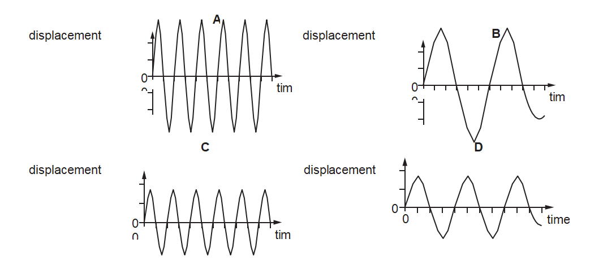

*Source: June 2023 0972/11 Q17*

### Q8 — medium — 1 marks

**Q8** [1 mark]

A sound wave is created by a loudspeaker that vibrates backwards and forwards   96 000 times per minute.

The speed of sound is 320 m/s.

What is the wavelength of the sound wave?

*Source: june 2022 paper 2 Q22*

### Q9 — medium — 1 marks

**Q9** [1 mark]

In a shallow tank, a water wave moves through a barrier with a narrow gap. The diagram shows the waves on the left-hand side and the right-hand side of the barrier.

** **Which term describes the effect shown?

*Source: specimen 2023 paper 2 Q20*

### Q10 — medium — 1 marks

**Q10** [1 mark]

Light travels at a speed of 2.0 $\times$108 m/s in a glass block.

In the glass, the wavelength of the light is 4.0$\times$ 10–7 m.

What is the frequency of the light?

*Source: specimen 2023 paper 2 Q19*

### Q11 — easy — 1 marks

**Q11** [1 mark]

Which arrow on the graph shows the amplitude of the wave?

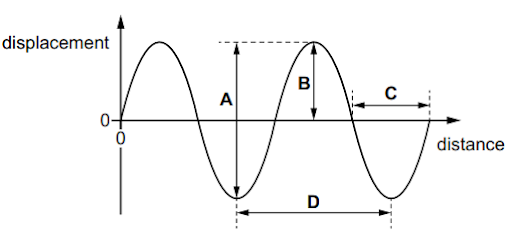

*Source: 2023 specimen paper 1 Q19*

### Q12 — easy — 1 marks

**Q12** [1 mark]

In a shallow tank, a water wave moves through a barrier with a narrow gap. The diagram shows the waves on the left-hand side and the right-hand side of the barrier.

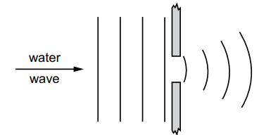

Which term describes the effect shown?

*Source: 2023 specimen paper 1 Q20*

### Q13 — easy — 1 marks

**Q13** [1 mark]

The diagram shows a wave.

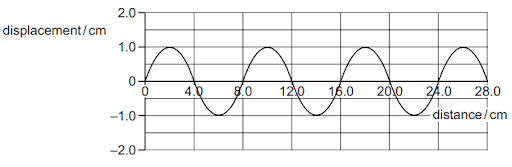

Which row is correct?

| ** ** | **amplitude of the wave / cm** | **wavelength of the wave / cm** |
|---|---|---|
| **A** | 1.0 | 4.0 |
| **B** | 1.0 | 8.0 |
| **C** | 2.0 | 4.0 |
| **D** | 2.0 | 8.0 |

*Source: June 2022 paper 1 Q20*

### Q14 — easy — 1 marks

**Q14** [1 mark]

A girl is sitting on a rock in the sea looking at passing waves. She notices that five complete wavelengths pass her in 20 s.

What is the frequency of this wave?

*Source: June 2022 paper 1 Q21*

### Q15 — easy — 1 marks

**Q15** [1 mark]

What is the definition of the word **amplitude**?

### Q16 — easy — 1 marks

**Q16** [1 mark]

Which two points on the wave are exactly one wavelength apart?

### Q17 — easy — 1 marks

**Q17** [1 mark]

What is the name given to the effect that allows the wavefronts to reach point X, shown on the diagram?

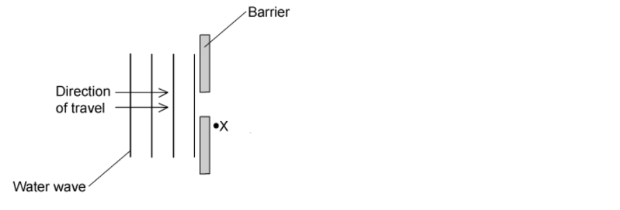

### Q18 — easy — 1 marks

**Q18** [1 mark]

What is the unit of wave speed?

### Q19 — easy — 1 marks

**Q19** [1 mark]

The following table shows some examples of waves

Which row correctly lists the nature of each of the wave types?

|   | **Sound waves** | **Infrared waves** | **Red light waves** |
|---|---|---|---|
| **A** | transverse | longitudinal | transverse |
| **B** | longitudinal | transverse | transverse |
| **C** | longitudinal | longitudinal | transverse |
| **D** | transverse | transverse | longitudinal |

### Q20 — hard — 1 marks

**Q20** [1 mark]

With skillful use of particular laboratory equipment, water can be used to demonstrate reflection, refraction and diffraction.

For each of these, which row shows whether or not the wavelength of the water waves changes?

|   | **Reflection** | **Refraction** | **Diffraction** |
|---|---|---|---|
| **A** | yes | yes | yes |
| **B** | no | no | no |
| **C** | yes | yes | no |
| **D** | no | yes | no |

### Q21 — medium — 1 marks

**Q21** [1 mark]

Water waves travel from deeper water to more shallow water. This causes them to refract.

Which wave property always remains the same when refraction occurs?

### Q22 — hard — 1 marks

**Q22** [1 mark]

The diagrams below show the wavefront diagrams of light as it passes from glass into air. They are magnified many times.

Which diagram correctly shows what happens to the wavefronts as they pass the glass-air boundary?

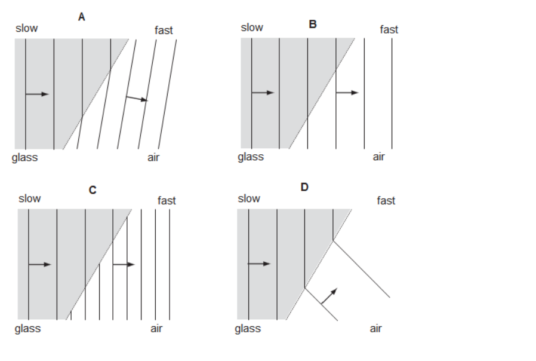

### Q23 — medium — 1 marks

**Q23** [1 mark]

Which of the following statements about sound waves is incorrect?

### Q24 — medium — 1 marks

**Q24** [1 mark]

The speed of a wave is doubled. The frequency remains the same.

What happens to the wavelength of the wave?

### Q25 — medium — 1 marks

**Q25** [1 mark]

Which of the following waves are longitudinal?

### Q26 — hard — 1 marks

**Q26** [1 mark]

Sound waves travel at a speed of 1500 m/s through a substance. Their wavelength is 5.00 cm.

What is their frequency?

### Q27 — hard — 1 marks

**Q27** [1 mark]

The diagram shows a plane water wave approaching a gap as viewed from above.

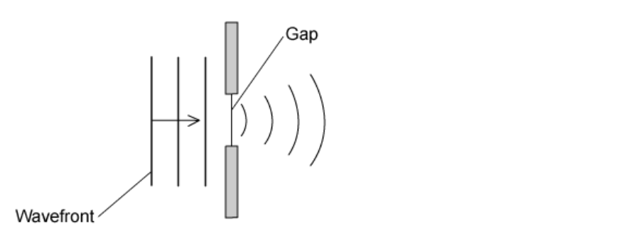

How could the situation be changed so that the waves on the far side of the gap do not spread out as far?

### Q28 — hard — 1 marks

**Q28** [1 mark]

A small child throws a stone into a very still pond.

Where the stone hits the water, waves travel outwards in a circular pattern until they reach the side of the pond.

Six waves arrive in a time of 3.20 s.

To 3 significant figures, what is the frequency of the waves?

### Q29 — medium — 1 marks

**Q29** [1 mark]

When water waves travel from deeper water into more shallow water they are refracted.

Why does the wave change direction in the manner shown?

## Theory Questions (19 questions)

### Q1 — medium — 7 marks

**Q1** [2 marks]

A student observes waves on the surface of water in a tank. The waves all have the same wavelength.

The student measures the wavelength of the waves by measuring the distance between one peak and the next peak.

Describe a more accurate method for determining the wavelength.

*Source: June 2023 0972/31 Q6A*

**Q1** [3 marks]

The wavelength of the waves is 4.0 cm and their frequency is 6.0 Hz.

Calculate the wave speed.

wave speed = ................................................ cm / s

*Source: June 2023 0972/31 Q6B*

**Q1** [2 marks]

** **Fig. 6.1 shows water waves in the tank travelling from deep water to shallow water.

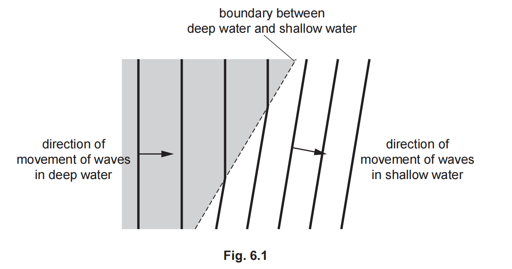

State and explain what happens to the waves as they move from deep water to shallow water.

name of effect ..........................................................................................

explanation ...............................................................................................

*Source: June 2023 0972/31 Q6C*

### Q2 — medium — 2 marks

**Q2** [2 marks]

Fig. 7.1 shows the displacement of particles in a water wave

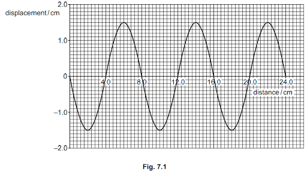

Using the information in Fig. 7.1, determine:

(i) the wavelength of the wave

wavelength = ................................................... cm [1]

(ii)** **the amplitude of the wave.

amplitude = ................................................... cm [1]

*Source: June 2022 Paper 3 Q7A*

### Q3 — medium — 3 marks

**Q3** [3 marks]

Fig. 8.2 represents some wavefronts approaching a barrier with a narrow gap.

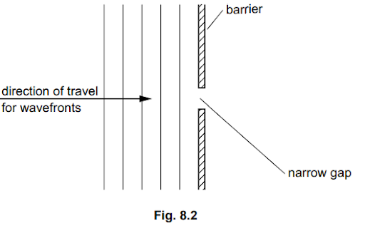

On Fig. 8.2, draw **three **wavefronts that have passed through the gap.

*Source: 2023 specimen paper 3 Q8B*

### Q4 — medium — 6 marks

**Q4** [1 mark]

Fig. 7.1 shows a floating plastic ball attached by a long rope to a weight on the bottom of a lake.

A water wave on the surface of the lake causes the ball to move vertically up and down.

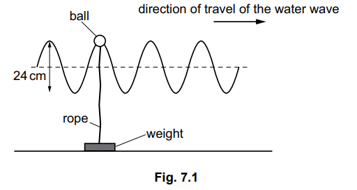

On Fig. 7.1, show the wavelength of the wave. Label the distance W

*Source: 2023 specimen paper 3 Q7A*

**Q4** [1 mark]

Determine the amplitude of the wave.

amplitude = ....................................................  cm

*Source: 2023 Specimen paper 3 Q7B*

**Q4** [2 marks]

The ball reaches its maximum height 40 times in 60 seconds. Calculate the frequency of the wave.

frequency = ..................................................... Hz

*Source: specimen 2023 paper 3 Q7C*

**Q4** [1 mark]

**Extract:**

Fig. 7.1 shows a floating plastic ball attached by a long rope to a weight on the bottom of a lake. 

A water wave on the surface of the lake causes the ball to move vertically up and down.

Explain how the motion of the ball shows that the water wave is transverse.

*Source: specimen 2023 paper 3 Q7D*

**Q4** [1 mark]

State another example of a transverse wave.

*Source: specimen 2023 paper 3 Q7E*

### Q5 — medium — 8 marks

**Q5** [3 marks]

Fig. 6.1 shows crests of a water wave moving from left to right in a harbour.

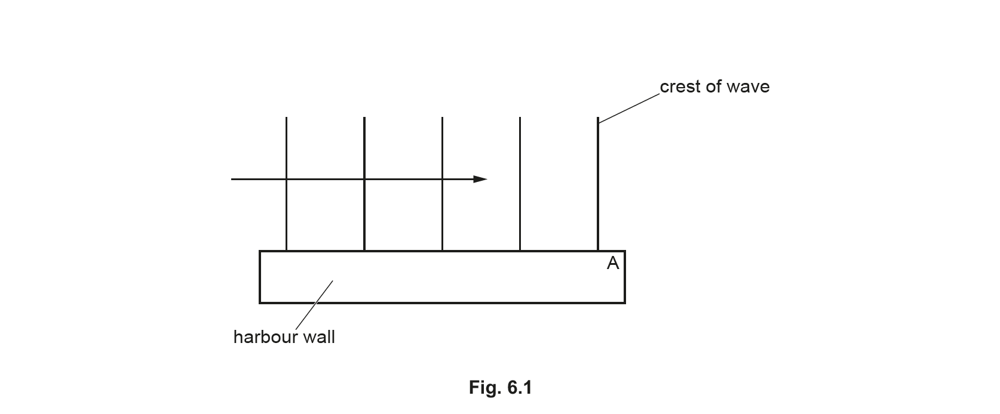

(i) On Fig. 6.1, draw three more crests to the right of point A.

[2]

(ii) State the name of the wave process that occurs as the wave passes point A.

[1]

*Source: 2020 Feb/March 0625/42 Q6A*

**Q5** [5 marks]

**Extract:**

Fig. 6.1 shows crests of a water wave moving from left to right in a harbour.

Fig. 6.2 shows the crests of another wave moving from left to right in a different part of the harbour. This wave moves from deep water to shallow water.

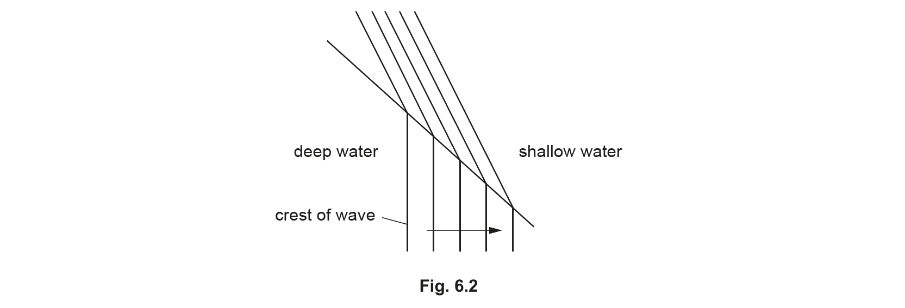

(i) On Fig. 6.2, draw an arrow to show the direction of movement of the wave after it has passed into the shallow water.

[1]

(ii) State the name of the process that occurs as the wave passes into the shallow water.

[1]

(iii) Complete Table 6.1 to state whether each of the properties of the wave increases, decreases or stays the same as the wave passes into the shallow water.

[3]

*Source: 2020 Feb/March 0625/42 Q6B*

### Q6 — medium — 5 marks

**Q6** [3 marks]

Fig. 6.1 represents a transverse wave drawn full size. Point X represents a point on the wave.

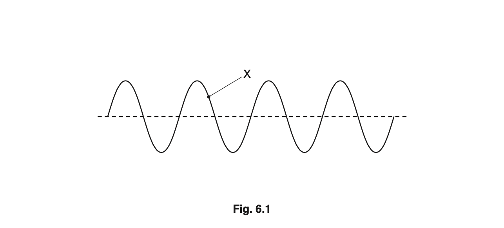

(i) On Fig. 6.1, mark clearly the directions in which point X moves.

[1]

(ii) Use Fig. 6.1 to measure the wavelength of the wave.

wavelength = ................................................... cm [1]

(iii) The frequency of the wave is increased. Describe how the wave pattern in Fig. 6.1 would be different.

[1]

*Source: Oct 2019 0625/33 Q6A*

**Q6** [2 marks]

(i) Place a tick in a box next to any transverse wave.

`square`  light

`square`  sound

`square`  radio

[1]

(ii) State a type of wave that **cannot** travel in a vacuum.

[1]

*Source: Oct 2019 0625/33 Q6B*

### Q7 — hard — 4 marks

**Q7** [4 marks]

A group of students want to determine the speed of sound in air.

Describe a method they can use. State the measurements they need to make.

*Source: February/March 2018 0625/32 Q9C*

### Q8 — hard — 8 marks

**Q8** [4 marks]

**Extended tier only**

Fig. 6.1 shows wavefronts approaching a gap in a barrier.

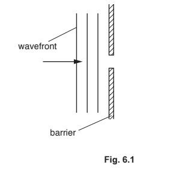

(i) On Fig. 6.1, draw three wavefronts to the right of the barrier.

[2]

(ii) Fig. 6.2 shows the gap in the barrier increased to five times the gap in Fig. 6.1.

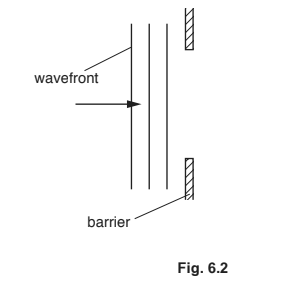

On Fig. 6.2, draw three wavefronts to the right of the barrier.

[2]

*Source: 2018 0625/41 Q6A*

**Q8** [4 marks]

**Extract:**

Fig. 6.1 shows wavefronts approaching a gap in a barrier.

Describe, with a labelled diagram, an experiment using water waves that shows the reflection of wavefronts that occur at a straight barrier.

*Source: 2018 0625/41 Q6B*

### Q9 — easy — 14 marks

**Q9** [2 marks]

Complete the sentence which describes all waves.

Waves transfer ______ **without **transferring ______

**Q9** [5 marks]

Select suitable labels for Fig. 1 by selecting from the list below.

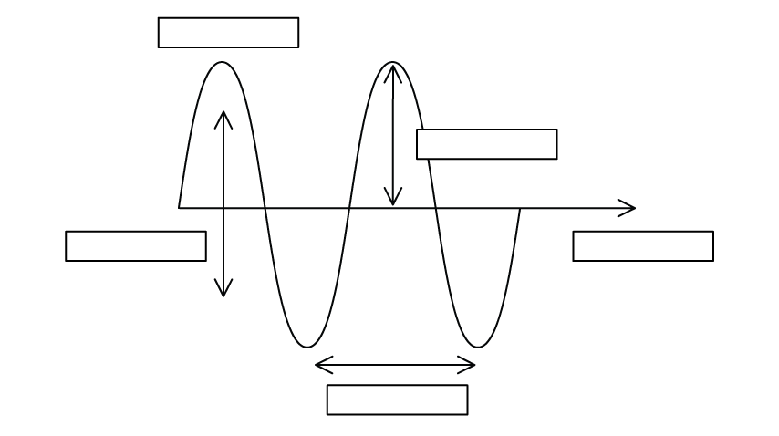

**Fig. 1**

amplitude

crest

direction of oscillation

direction of travel of wave

frequency

time period

trough

wavelength

**Q9** [2 marks]

For two of the quantities in the previous answer, state the correct unit for

(i) amplitude

[1]

(ii) wavelength.

[1]

**Q9** [5 marks]

A wave on a rope has a speed of 0.25 m/s and a time period of 2 seconds.

Calculate

(i) the frequency of the wave

[2]

(ii) the wavelength of the wave.

[3]

### Q10 — hard — 9 marks

**Q10** [3 marks]

Green light of frequency 5.7 × 1014 Hz is travelling in air at a speed of 3.0 × 108 m/s. The light is incident on the surface of a transparent solid.

Fig. 6.1 shows the wavefronts and the direction of travel of the light in the air.

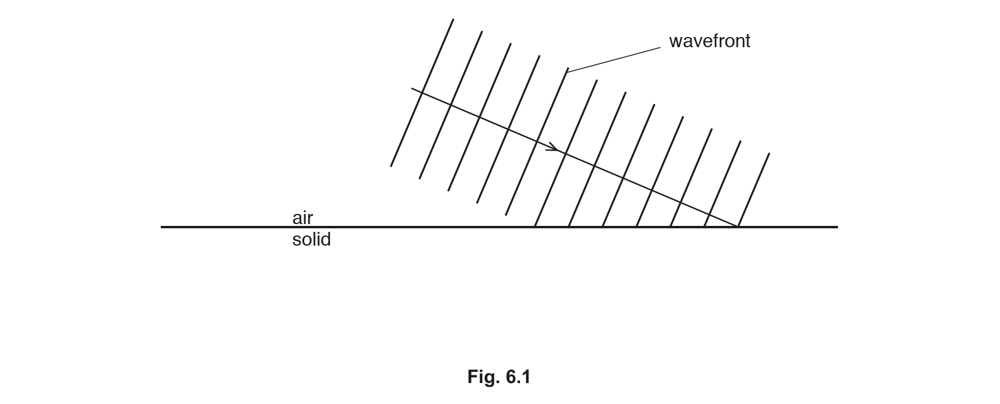

The light travels more slowly in the transparent solid.

Explain, in terms of the wavefronts, why the light changes direction as it enters the solid. You may draw on Fig. 6.1 as part of your answer.

*Source: 2019 May/June 0972/41 Q6A*

**Q10** [6 marks]

**Extract:**

Green light of frequency 5.7 × 10^14 Hz is travelling in air at a speed of 3.0 × 10^8 m/s.

**Extended tier only**

The refractive index of the transparent solid is 1.3.

(i) The light is incident on the surface of the solid at an angle of incidence of 67°.

Calculate the angle of refraction of the light in the solid.

angle of refraction = ......................................................... [2]

(ii) Determine the wavelength of the green light in the transparent solid.

wavelength = ......................................................... [4]

*Source: 2019 May/June 0972/41 Q6B*

### Q11 — medium — 8 marks

**Q11** [5 marks]

Fig. 8.1 represents a travelling wave at an instant in time.

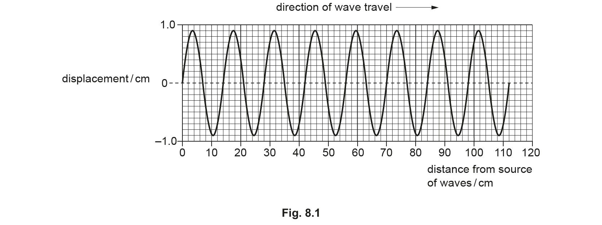

(i) Determine the amplitude of the wave.

amplitude = .................................................. cm [1]

(ii) Determine the wavelength of the wave.

wavelength = .................................................. cm [2]

(iii) It takes 2.0 s for a source to emit the wave shown in Fig. 8.1.

Calculate the frequency of the wave.

frequency = .................................................. Hz [2]

*Source: 2020 Feb/March 0625/32 Q8A*

**Q11** [3 marks]

Fig. 8.2 shows the main regions of the electromagnetic spectrum.

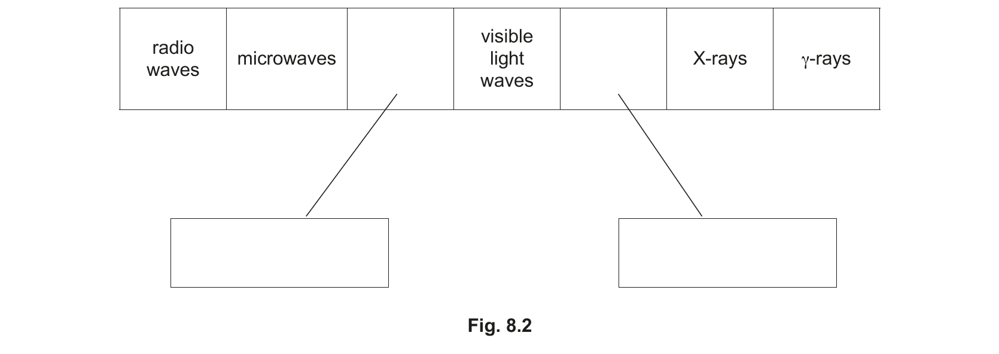

(i) Two of the regions are not labelled.

Add the correct label to each of the unlabelled regions by writing in each box.

[2]

(ii) Describe one use of γ-rays.

[1]

*Source: 2020 Feb/March 0625/32 Q8B*

### Q12 — medium — 6 marks

**Q12** [3 marks]

Sound is a longitudinal wave.

Sketch a representation of a longitudinal wave. On your sketch

- indicate and label a distance to show the wavelength,
- mark and label the centre of one compression,
- mark and label the centre of one rarefaction.

*Source: 2018 0625/43 Q6A*

**Q12** [2 marks]

A longitudinal wave passes from one medium into another medium. The speed of the wave is slower in the second medium.

State what happens to

(i) the frequency of the wave

[1]

(ii) the wavelength of the wave.

[1]

*Source: 2018 0625/43 Q6B*

**Q12** [1 mark]

State a typical value for the speed of sound in air.

*Source: 2018 0625/43 Q6C*

### Q13 — medium — 3 marks

**Q13** [3 marks]

A ray of light travelling in air strikes a glass block at an angle of 30° to the normal. The light slows down as it enters the glass block.

State and explain, in terms of wavefronts, what happens to the light.

*Source: 2018 0625/43 Q7A*

### Q14 — hard — 4 marks

**Q14** [4 marks]

Describe a method of using water waves to demonstrate refraction.

*Source: Oct 2019 3 Q8C*

### Q15 — easy — 11 marks

**Q15** [3 marks]

For each label draw a straight line connecting it to the correct diagram.

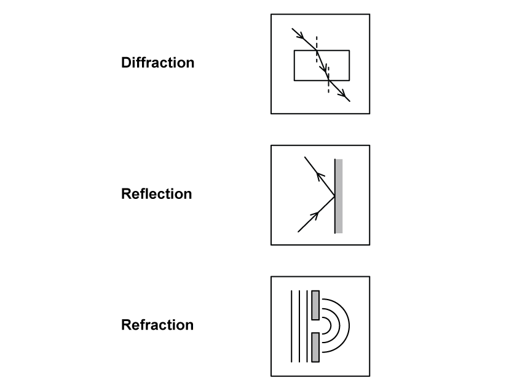

**Q15** [2 marks]

A wave of light is passing from air into a clear plastic prism. The wave is refracted.

State two changes which would make the angle of refraction inside the plastic prism increase.

**Q15** [2 marks]

**Extended tier only**

A water wave is passing through a gap and being diffracted.

State two changes which would make the amount of diffraction decrease.

**Q15** [4 marks]

**Extended tier only**

Fig. 1.1 shows a water wave meeting a barrier.

**Fig 1.1       **

Complete the diagram to show the waves after they have passed the barrier.

### Q16 — easy — 5 marks

**Q16** [5 marks]

Light and sound both travel as waves.

Draw a line from each statement to the correct term that describes it. One has been done for you.

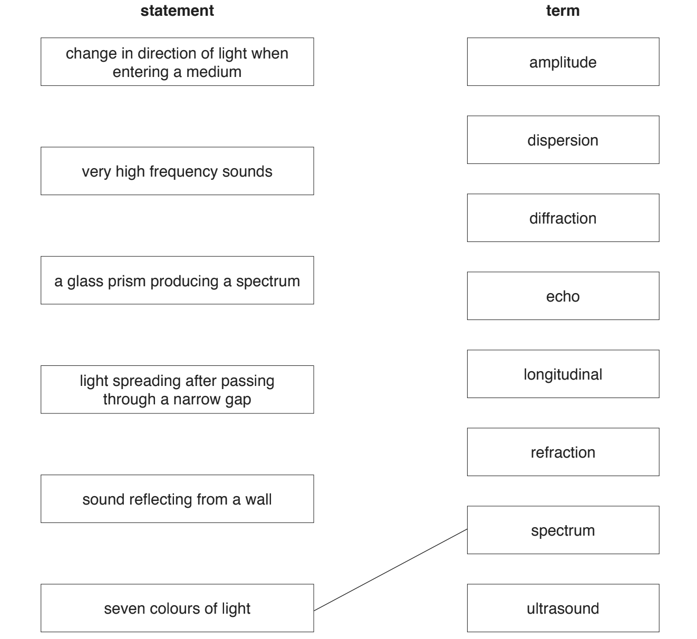

*Source: 2019 0625/32 Q7*

### Q17 — hard — 8 marks

**Q17** [3 marks]

Fig. 5.1 shows crests of a wave approaching a barrier where the wave is reflected.

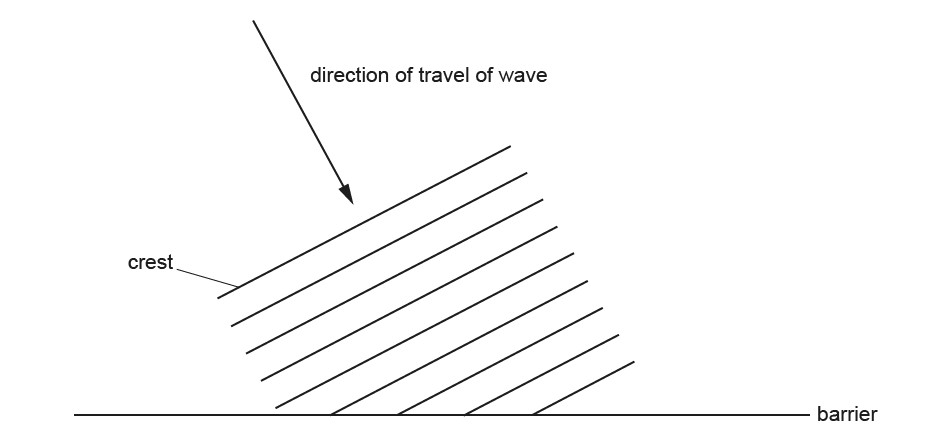

On Fig. 5.1, draw three crests of the reflected wave.

*Source: May/June 2020 (Series 2) 0625/42 Q5A*

**Q17** [3 marks]

**Extract:**

Fig. 5.1 shows crests of a wave approaching a barrier where the wave is reflected.

The wave has a wavelength of 36 cm and a speed of 1.2 m/s.

Calculate the frequency of the wave.

frequency = .........................................................

*Source: February/March 2018 0625/42 Q5B*

**Q17** [2 marks]

Complete the following sentences.

An echo is the name for a reflected .................................................................. wave.

The waves that form an echo are a type of longitudinal wave. Longitudinal waves are made up of .................................................................. and rarefactions.

*Source: May/June 2020 (Series 2) 0625/42 Q5C*

### Q18 — easy — 4 marks

**Q18** [2 marks]

Fig. 8.1 represents the pressure at one instant along part of a sound wave.

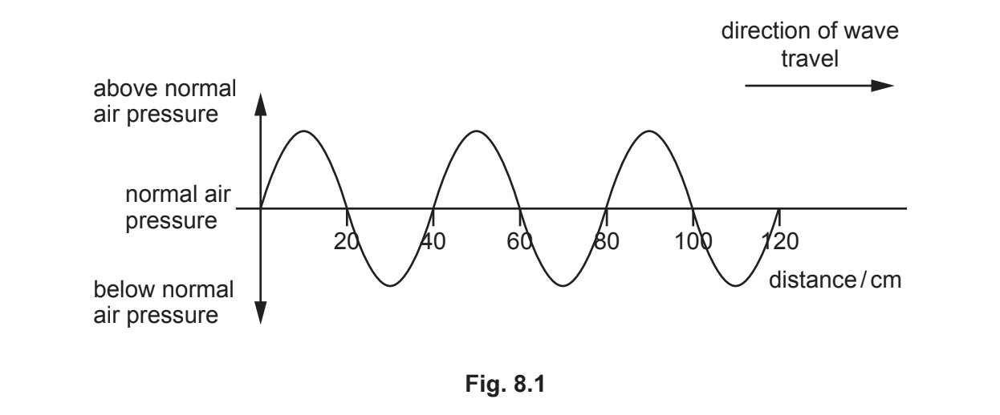

(i) Determine the wavelength of the sound wave.

wavelength of the sound wave = .................................................. cm [1]

(ii) On Fig. 8.1, draw a wave representing a louder sound of the same wavelength.

[1]

*Source: 2020 0625/31 Q8A*

**Q18** [2 marks]

State the range of audible frequencies for a healthy human ear. Include the unit.

*Source: 2020 0625/31 Q8B*

### Q19 — easy — 5 marks

**Q19** [2 marks]

A ray of light refracts as it travels from air into glass, as shown in Fig.7.1.

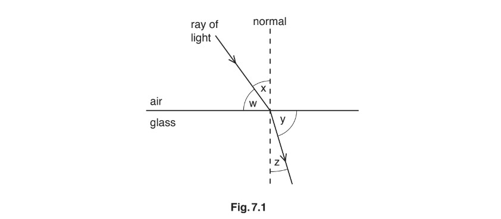

(i) State which angle w, x, y or z, is the angle of refraction.

[1]

(ii) Light is a transverse wave. State another example of a transverse wave.

[1]

*Source: February/March 2018 0625/32 Q7A*

**Q19** [3 marks]

Fig.7.2 represents some wavefronts approaching a barrier with a narrow gap.

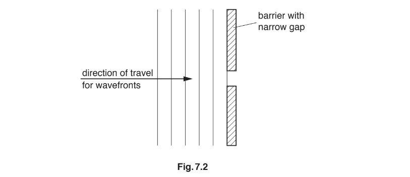

(i) On Fig.7.2, draw three wavefronts that have passed through the gap.

[2]

(ii) State the name of the effect in **(b)(i)**.

[1]

*Source: February/March 2018 0625/32 Q7B*

