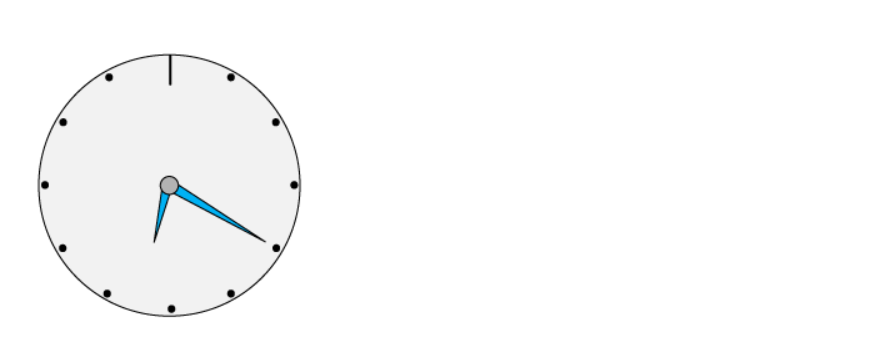
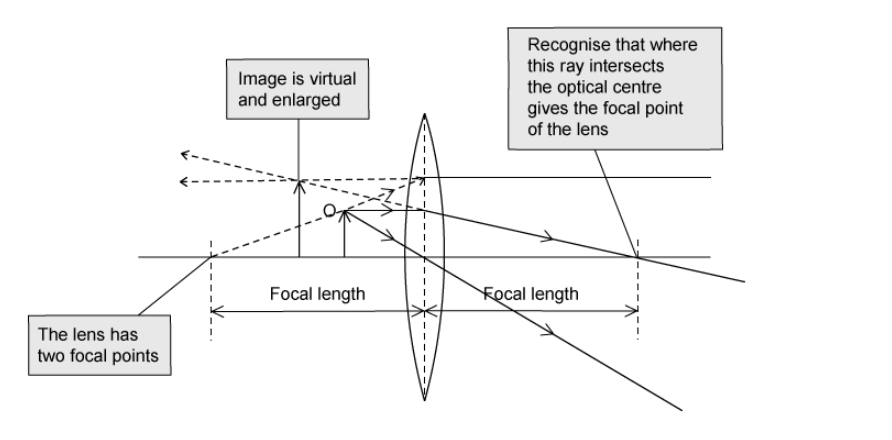

# Mark Schemes — Light
**3. Waves** · Cambridge (CIE) IGCSE physics (0625 & 0972)

## Multiple Choice Questions (35 questions)

### Q1
**Final answer:** **The correct answer is D**

- In a plane mirror, the image is formed the same distance behind the mirror as the object is in front of it
- After stepping back, the person is 3.0 m in front of the mirror
- The image is therefore 3.0 m behind the mirror
- The distance between the person and their image is:

$\text{distance} = 3 . 0 + 3 . 0 = 6 . 0 \text{m}$

**A** is incorrect because 3.0 m is only the distance from the person to the mirror, not from the person to their image.

**B** is incorrect because this would be the distance between the person and their image at the original position (2.0 + 2.0 = 4.0 m), before they stepped back.

**C** is incorrect because it adds the old distance to the new distance (2.0 + 3.0 = 5.0 m).

### Q2
**Final answer:** **The correct answer is A**

- The scale on the diagram shows that 1 large grid square represents a distance of $6 . 0 \text{cm}$
- The focal length is the distance between the centre of the lens and the principal focus
- A ray that travels parallel to the principal axis refracts and passes through the principal focus on the other side of the lens
- On the diagram, the parallel ray crosses the principal axis exactly 1 large square from the centre of the lens, so the focal length is:

$\mathrm{focal} \mathrm{length}=1\times6.0=6.0\text{cm}$

- The image is formed where the two rays meet
- The horizontal distance from the centre of the lens to the image is 3 large squares, so the distance of the image from the lens is:

$\mathrm{distance} \mathrm{of} \mathrm{image}=3\times6.0=18.0\text{cm}$

> **[exam-tip]**
> Remember the two standard rays used to locate an image for a converging lens. A ray travelling through the optical centre of the lens does not change direction. A ray travelling parallel to the principal axis will refract and pass through the principal focus. Identifying these rays will help you locate the principal focus and measure the focal length accurately.

### Q3
**Final answer:** **The correct answer is C**

- The characteristics of an image formed by a converging lens depend on the position of the object relative to the focal length $f$
- To produce a real, inverted, and magnified image, the object must be placed between $f$ and $2f$
- In this case, $f=10\text{cm}$ and $2f=20\text{cm}$, so the object distance must be between $10\text{cm}$ and $20\text{cm}$
- Therefore, the distance must be $15\text{cm}$ from the lens, which is option **C**

**A** is incorrect because placing the object closer than $f$ ($5 \text{cm}$) would produce a virtual, upright, and magnified image.

**B** is incorrect because when an object is exactly at the focal point $f$ ($10 \text{cm}$), the rays emerge parallel and no image is formed.

**D** is incorrect because when the object is beyond $2 f$ ($25 \text{cm}$), the image formed is real and inverted, but it is diminished (smaller).

> **[exam-tip]**
> Remember the key positions for a converging lens:
> 
> - objects placed closer than $f$ give virtual, upright, magnified images
> - objects between $f$ and $2 f$ give real, inverted, magnified images
> - objects beyond $2 f$ give real, inverted, diminished images
> 
> A quick sketch of ray diagrams for each region can help you visualise and remember these relationships.

### Q4
**Final answer:** **The correct answer is B**

- When light travels from an optically denser medium (glass) to a less dense medium (air), it refracts away from the normal
- Total internal reflection only occurs if the angle of incidence is greater than the critical angle
- In this case, the angle of incidence ($25 ^{\circ}$) is less than the critical angle ($42 ^{\circ}$), so the light will refract out into the air
- Path **B** shows the ray bending away from the normal as it enters the air

**A** is incorrect as it shows the ray bending towards the normal.

**C** is incorrect as the light only travels along the boundary if the angle of incidence is exactly $42 ^{\circ}$.

**D** is incorrect as total internal reflection only occurs if the angle of incidence is greater than $42 ^{\circ}$.

> **[exam-tip]**
> Remember the key rule: when light passes from a denser to a less dense medium, it bends away from the normal. Always compare the angle of incidence to the critical angle first:
> 
> - if the angle of incidence is less than the critical angle $( i < c )$, refraction occurs
> - if the angle of incidence is equal to the critical angle $( i = c )$, light travels along the boundary
> - if the angle of incidence exceeds the critical angle $( i > c )$, total internal reflection occurs

### Q5
**Final answer:** **The correct answer is ****A**** because:**

- The refractive index of a material is given by:

$\text{refractive} \text{index} = \frac{ \text{sin} ( \text{angle} of \text{incidence} ) }{ \text{sin} ( \text{angle} of \text{refraction} ) } or \mathrm{n} = \frac{ \text{sin} \mathrm{i} }{ \text{sin} \mathrm{r} }$

- These angles must be measured from the normal, the dotted line at right angles to the surface.
- The angle of incidence (the incoming ray) is 90°− 50° = 40°
- The angle of refraction is 40°
- This gives the calculation for the refractive index *n* as: $n=\frac{\mathrm{sin}40^{\circ}}{\mathrm{sin}25^{\circ}}$

### Q6
**Final answer:** **The correct answer is ****B**** because:**

- The colours in white light will refract at different angles at every boundary, because they have different frequencies and wavelengths
- The spreading of white light into its component colours is called dispersion
- The first boundary causes the white light to disperse into its different colours
- The second boundary causes further dispersion of the colours
- Violet light refracts through a greater angle than red light

**A** is incorrect as the white light is not dispersing at the first boundary.

**C** is incorrect as the violet light is refracting in the wrong direction.

**D** is incorrect as the violet light is not refracting at the second boundary.

### Q7
**Final answer:** **The correct answer is ****B**** because:**

- For a converging lens, an object placed further than one focal length F will always produce an inverted image

  - Therefore, options **C** and **D** can be eliminated
- The closer the object is placed to the lens, the larger the size of the image

  - Therefore, the image produced when the object is at point Q will be inverted and enlarged compared to when the object is at point P

The difficult part of the question is ignoring the rays drawn on the diagram for the object at point P, as the question asks you to move it to point Q. The rays shown give an inverted image that is diminished (smaller), but this is not what the question asks about.

To find the properties of the image you can draw a new object at point Q and then draw two rays from the tip of the object. One should pass through the centre of the lens and one should travel parallel to the optical axis up to the lens and then through focal point F, as shown by the red rays in the diagram. The image is formed where these two lines cross.

### Q8
**Final answer:** **The correct answer is ****C**** because:**

- The normal is a line at right angles to a surface, this is line 2 in the diagram

  - Therefore options **A** and **B** are eliminated
- An incident ray is the ray approaching the surface. This is line 1 in the diagram
- A reflected ray is a line leaving a surface. This is line 3 in the diagram

The arrow on a ray shows the direction of travel. You should use this to see which way the light is going, and this will make it easy to identify the incident ray and other rays.

### Q9
**Final answer:** **The correct answer is A because:**

- A real image is one formed by the convergence of rays of light and can be projected onto a screen

  - In this case, since the object is on the left of the lens, the projected image would be on the right of the lens
- To produce a real image that is smaller than the object, the object should be placed further than 2*f*

**B** & **C** are incorrect because an object placed at *f*, or between *f* and 2*f*, would produce a real image that is larger than the object

**D** is incorrect because an object placed closer than f would produce a virtual image that is larger than the object

### Q10
**Final answer:** **The correct answer is C because:**

- Light is passing from a more dense (water) to a less dense (air) medium
- This means light should bend away from the normal

  - Eliminate options **A** and **D**
- Light travels in straight lines

  - Eliminate option **B**

### Q11
**Final answer:** **The correct answer is A because:**

- The refractive index of the material is related to the critical angle by

$n=\frac{1}{sinc}=\frac{1}{sin37}=1.66$

- The speed of light in a plastic material can be found using refractive index

$n=\frac{speedoflightinair}{speedoflightinmaterial}$

- Therefore, the speed of light in the plastic material is

$speedoflightinmaterial=\frac{speedoflightinair}{n}$

$speedoflightinmaterial=\frac{3.0\times10^{8}}{1.66}=1.81\times10^{8}$ m/s

- This is option** A**

### Q12
**Final answer:** **The correct answer is D because:**

- If the ray is travelling along the air-plastic interface, it must be at the critical angle, *c*

$sin(c)=\frac{1}{n}$

- The refractive index, *n*, is 1.25
- Use the inverse sine operation to find *c*

$c=sin^{-1}(\frac{1}{1.25})=53^{\circ}$

Remember to use the degrees mode on your calculator when asked for an angle in degrees.

### Q13
**Final answer:** **The correct answer is D because:**

- A real image is defined as:

  - An image that is formed when the light rays from an object converge and meet each other
- **D** is the only diagram in which light rays from the object converge and meet

**A **and **C **are incorrect as these would form virtual images

**B **is incorrect as the rays are parallel and do not converge

### Q14
**Final answer:** **The correct answer is A because:**

- Converging lenses form real images when the object is at a distance greater than *f*
- The object is 3 cm further from the lens than the focal distance
- Real images formed by a converging lens are always inverted

Drawing a ray diagram confirms that the rays converge below the principal axis, so the image is real and inverted.

### Q15
**Final answer:** **The correct answer is B because:**

- In the term ‘monochromatic’:

  - The prefix ‘mono-’ means ‘one’
  - ‘-chromatic’ refers to colour
  - ‘Monochromatic’ means ‘one colour’
- Monochromatic light is light of a single colour

  - Frequency determines the colour of visible light
  - Monochromatic light has a single frequency

**A **is incorrect as light of any frequency can be made to diffract

**C **is incorrect as it is white light (which consists of many frequencies) which spreads out when passed through a prism

**D **is incorrect as all light travels at different speeds in different materials

### Q16
**Final answer:** **The correct answer is B because:**

- Both incident rays have the same angle of incidence
- The rays are reflected by the mirror, so the angle of reflection is equal to the angle of incidence
- The rays should still be parallel once they have both been reflected

**A **is incorrect as the angles of incidence and reflection for the left beam are not equal

**C **is incorrect as the angles of incidence and reflection for the left beam are not equal

**D **is incorrect as dispersion is being shown here, but the rays are not passing through a medium which would cause this phenomenon

### Q17
**Final answer:** **The correct answer is B because:**

- When a real image forms

  - the light rays **converge **to form the image
  - the image **can **be projected onto a screen
- Therefore, options **C** and **D** can be eliminated
- When a virtual image forms

  - the light rays **diverge **to form the image
  - the image **cannot **be projected onto a screen
- Therefore, option **A** can be eliminated

### Q18
**Final answer:** **The correct answer is C because:**

- When an image is formed by a plane mirror, to an observer it will be

  - the same size
  - the same distance from the mirror
  - a virtual image
- Virtual images are always upright

  - This eliminates options **B** and **D**, as the letter i appears inverted on these images
- When viewed by the observer, the letters in the reflected image will appear backwards and in the reverse order

  - This eliminates option **A** as the letters are backwards, but are still in the same order

### Q19
**Final answer:** **The correct answer is ****B**** because:**

- The ray diagram demonstrates how the image is formed.
- Where the projected rays cross, is where a virtual image is formed.
- Virtual images are formed by projected rays, while real images are formed by the convergence of actual light rays.
- Plane mirrors always form virtual images.

**Y** is the location at which the eye would be positioned in order to see the image clearly.

### Q20
**The correct answer is ****D**** **because images in a plane mirror are always reflected left to right but not top to bottom.

This diagram shows the actual clock:

### Q21
**Final answer:** **The correct answer is ****D**** because:**

- The white light is split into its constituent colours because different colours are refracted through different angles.
- From least refracted (closer to B) to most refracted (closer to A) the colours run in the order you have probably learned them: **red**, orange, yellow, **green**, blue, indigo, **violet**.
- As the question asks us to list them in order from A to B, we reverse this list.

### Q22
**Final answer:** **The correct answer is**** D**** because:**

- When light passes from a denser medium into a less dense medium

  - It speeds up
  - It bends away from the normal

### Q23
**Final answer:** **The correct answer is ****A**** because:**

- The critical angle is the angle of **incidence** when the angle of **refraction** is exactly 90° and light is **refracted** along the boundary

It would be useful to learn this definition by heart, so that you are entirely confident when you sit the exam

### Q24
**Final answer:** **The correct answer is ****C**** because:**

- $n=\frac{sini}{sinr}$
- $sinr=\frac{sini}{n}$
- $r = s i n^{- 1} ( \frac{s i n i}{n} )$
- $r = s i n^{- 1} ( \frac{s i n 27}{1.33} )$
- $r=19.95^{\circ}$

Each of the other answers contains a common mistake made by students.

**A** is incorrect as the arcsin of the final answer was not found.

**B** is incorrect as sin was not used at all, the student divided angle of incidence by refractive index. Be careful, this one can give you a misleadingly close answer for small angles!

**D** is incorrect as the equation was incorrectly rearranged to obtain this answer.

### Q25
**Final answer:** **The correct answer is ****B**** because:**

- This is a question about total internal reflection and the critical angle. We know this because light is being reflected **inside** a material, rather than from its surface.
- $n=\frac{1}{sinc}$
- The angle of incidence (in this case, the critical angle, *c*) is the angle **between the normal and the incident ray**. We are given the other angle. Therefore:
- $c=90-48=42^{\circ}$
- $n=\frac{1}{sin42}$
- $n=1.494$

Each of the other answers contains a common mistake made by students.

**A** is incorrect as sin was not used.

**C** is incorrect as sin was not used in the calculation of this answer, and a number of decimal places were ignored.

**D** is incorrect as the wrong angle was used in the calculation

### Q26
**Final answer:** **The correct answer is ****A**** because:**

- We know the image is virtual because the light rays do not converge anywhere.
- For an image to be real, light rays must converge, these diverge (get further apart).
- The image is seen at a position which is a backward projection of the diverging light rays that pass through the lens.
- No light gets to X, so the image cannot be seen there. An image can only be seen at a position that light actually reaches.
- The dashed lines represent *projections* of the real light rays that pass through the lens, not actual light.

**B** is incorrect as the image is not inverted. Inverted means upside-down.

**C** is incorrect as the image is not real, since no light rays converge on its position.

**D** is incorrect as the image cannot be seen at X.

### Q27
**Final answer:** **The correct answer is ****D ****because:**

- The top, horizontal ray is redirected through the focal point as it leaves the lens.
- The ray through the centre of the lens continues in a straight line.
- Where the two rays converge, a real image is formed.

Each of the other diagrams makes a mistake with the drawing of the diagram.

### Q28
**Final answer:** **The correct answer is ****B ****because:**

- This question is about total internal reflection.
- If the angle of incidence is greater than the critical angle, 42**o** in this case, the light will be totally internally reflected, and no light will escape the rod.
- The angle of incidence is 44**o**, which is 2**o** greater than the critical angle. Therefore, no light is refracted and all the light is reflected.

**A** is incorrect as no light is refracted out of the perspex rod.

**C** is incorrect as light is reflected. Some light is always reflected, whether or not the angle of incidence is greater than the critical angle.

**D** is incorrect as light is reflected. Some light is always reflected, whether or not the angle of incidence is greater than the critical angle.

### Q29
**Final answer:** **The correct answer is ****A ****because:**

- Light refracts as it moves from air to glass

  - This is demonstrated by a change in speed
  - Light slows down when it enters glass
- Red light has the largest wavelength in the visible spectrum but it carries the least energy
- On the other hand, violet light has the shortest wavelength and carries the largest amount of energy

  - Therefore, red light slows down by less than violet light
- The change in speed is related to the change in angle

  - The slower the speed, the larger the angle of refraction
- When light passes from the glass to the air, all the light returns to the same speed as before

**B** is incorrect as light does not speed up as it enters the glass, it slows down as it moves through the glass and speeds up again as it leaves

**C **and** D** are incorrect as frequency does not change at all as light passes from air into glass or from glass into air

### Q30
**The correct answer is ****C****.**

The diagram shows how the ray diagram should be constructed:

### Q31
**Final answer:** **The correct answer is ****B ****because:**

- Light has to disperse a little as it passes through the prism.
- Light has to refract in the correct direction: towards the normal on the way in and away from the normal on the way out.

**A** is incorrect as light refracts in the wrong direction, and it does not disperse at all inside the prism.

**C** is incorrect as the light does not disperse in the prism, though it does refract in the right direction.

**D** is incorrect as light does disperse in the prism, but refracts in the wrong direction.

### Q32
**Final answer:** **The correct answer is ****A ****because:**

- This question is about total internal reflection.
- If the angle of incidence is greater than the critical angle, the light will be totally internally reflected.
- Total internal reflection only works when the substance the light is going from has a higher refractive index than the substance it is going to, from glass to air for example.

**B** is incorrect as substance A must have a greater refractive index than substance B.

**C and D** are incorrect as the angle of incidence must be greater than the critical angle.

### Q33
**Final answer:** **The correct answer is ****A**** because:**

- $n =. \frac{\sin ( a n g l e o f i n c i d e n c e )}{\sin ( a n g l e o f r e f r a c t i o n )}$
- P is the correct angle of incidence
- S is the correct angle of refraction

The other answers have one or more of the angles incorrect.

### Q34
**The correct answer is ****B **because the focal length is the distance from the lens at which parallel light rays would converge. This is shown in diagram B.

The other answers do not label the focal length correctly.

### Q35
**Final answer:** **The correct answer is ****D**** because:**

- This diagram shows how the image is produced and the correct path of the light ray.
- Note that the angle of incidence equals the angle of reflection, and no light passes through the mirror, as you would expect**.**

**A** is incorrect as the angle of incidence does not equal the angle of reflection.

**B** is incorrect as the image is not in the correct position.

**C** is incorrect as the angle of incidence does not equal the angle of reflection.
