# Mark Schemes — Light
**3. Waves** · Cambridge (CIE) IGCSE physics (0625 & 0972)

## Alternative To Practical Questions (7 questions)

### Q1
The height of *h*O is:

- 1.4 cm; **[1 mark]**

**[Total: 1 mark]**

> *This answer assumes you have printed this out onto A4 paper at the correct size. Printing some papers onto A4 can better simulate exam conditions, as it allows you to attempt questions like this. Some candidates may have arrangements to take their exam on A3 paper and this is accounted for by examiners.*
An example of a table gaining two marks is:

**Table 3.1**

| $u/\mathrm{cm}$ | $h_{I}/\mathrm{cm}$ | $M$ |
|---|---|---|
| 20.0 | **Final answer:** **4.5** | **Final answer:** **0.31** |
| 30.0 | 1.5 | 0.93 |
| 40.0 | 0.9 | 1.6 |
| 50.0 | 0.6 | 2.3 |
| 60.0 | 0.5 | 2.8 |

- Height of *h*I is 4.5 cm **AND** *M* = 0.31 **[1 mark]**
- *M* is given to two significant figures; **[1 mark]**

**[Total: 2 marks]**

> *E.c.f. Is allowed for an incorrect value of **h**O** in part (a).*
An example of a graph gaining four marks:

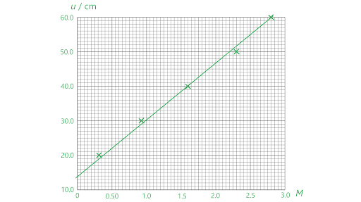

- Axes with correct orientation, both labelled with quantity and unit;** [1 mark]**
- Appropriate scales (plots occupying at least ½ grid); **[1 mark]**
- Plots all correct to ½ small square and precise plots;** [1 mark]**
- Well-judged line and thin line; **[1 mark]**

**[Total: 4 marks]**

> *When drawing a line of best fit on a graph have roughly even numbers of data points above and below the line. If not possible, try and ensure the combined distances of points above the line equal the combined distances of points below.*

> *Here, only one point is below the line while two are above, but the point below the line is further from the line than the two points above.*
To determine the gradient:

An example of a graph gaining one mark:

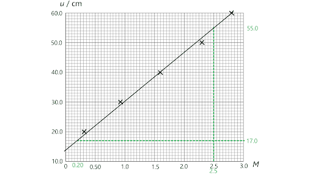

- Triangle method seen occupying more than half of the line; **[1 mark]**
- $gradient=\frac{55.0-17.0}{2.5-0.20}=16.5$ **[1 mark]**

**[Total: 2 marks]**

> *Any gradient value in the range of 15.0 to 17.0 is accepted*
A difficulty of measuring *h*I and a matching improvement to the apparatus:

**EITHER**

- Hand / ruler gets in the way of the light; **[1 mark]**
- Use a translucent screen and measure from behind
**OR**
- Fix ruler to screen
**OR**
- Mark image on screen (with pen) and measure later; **[1 mark]**

**OR**

- Some images too small to measure accurately; **[1 mark]**
- Use a larger object
**OR**
- Mark image on screen (with pen) and measure later; **[1 mark]**

**[Total: 2 marks]**

### Q2
(i) Calculate *V*:

List the known quantities:

- Measured distance *v* = 5.80 cm
- Scale of drawing to actual size = 1/5th

Calculate the actual distance, *V*:

- $V=5\timesv=5\times5.8=29.0$ cm **[1 mark]**

** **

(ii) Calculate the focal length *f**1* using the equation:

List the known quantities:

- Distance from lens to image,* V *= 29.0 cm
- Distance from lens to object, *U *= 20.0 cm

Substitute the known quantities into the equation for *f**1*:

- $f_{1} = \frac{U V}{( U + V )}$
- $f_{1} = \frac{20 \times 29}{( 20 + 29 )}$ **[1 mark]**

Calculate *f**1*:

- *f**1* = 11.83 cm = 11.8 cm (3 s.f.) **[1 mark]**

**[Total: 2 marks]**

> *This question requires no physics knowledge whatsoever! You just need to read and **follow the instructions**!*
Calculate the average value *f**A* of the focal length of the lens:

List the known quantities:

- Focal length 1,* f**1* = 11.8 cm (from part (a) (ii))
- Focal length 2,* f**2* = 12.2 cm

Obtain an equation for calculating the average focal length, *f**A*:

- There are two measurements for focal length

  - The sum of the focal lengths must therefore be divided by 2
- So, $f_{A} = \frac{( f_{1} + f_{2} )}{2}$

Substitute the known quantities into the equation to calculate *f**A*:

- $f_{A} = \frac{( 11.8 + 12.2 ) }{2}$
- *f**A** *= 12.0 cm **[1 mark]**

State the number of significant figures for the answer:

- The answer should be given to 3 s.f. as this is the least number given by the quantities in the question; **[1 mark]**

**[Total: 2 marks]**

> *All the answers you provide in your physics examinations must be provided to the **least number** of significant figures given by the quantities in the question. *
Suggest additional values for *U* that you would use:

- At least 3 new values are suggested; **[1 mark]**
- All new values between 15 cm and 70 cm with at least 5 cm between each value; **[1 mark]**

**An example of a model answer is:**

- Initial value of *U *= 20 cm
- So, additional values could be

  - *U**1** = *15 cm
  - *U**2** *= 25 cm
  - *U**3** *= 30 cm

**An additional example of a model answer is:**

- Initial value of *U *= 20 cm
- So, additional values could be

  - *U**1** = *30 cm
  - *U**2** *= 40 cm
  - *U**3** *= 50 cm
  - *U**4** *= 60 cm

**[Total: 2 marks]**

> *A question like this asks for additional values from which to take measurements. You always want to have:*

- *A **range** of values normally from slightly below where the question started*
- *All values to be an **equal amount apart*
- *Make at least **3 more** suggestions, you can do more*
State two precautions that you would take in this experiment to obtain accurate readings:

Any **two **from:

- Use a darkened room / a brighter lamp so it is easier to see the image; **[1 mark]**
- Mark the position of the centre of the lens holder so it is easier to measure *U *and *V*; **[1 mark]**
- Place a meter rule on the bench / clamp in position so it is easier to measure *U *and *V *; **[1 mark]**
- Ensure that the object and the centre of the lens are at the same height from the bench, so measurements of *U *and *V *are more accurate; **[1 mark]**
- Move the screen slowly / back and forth to obtain the best image; **[1 mark]**

**[Total: 2 marks]**

> *An experimental result that is **close** to the **accepted value** is considered accurate. Consider the following results for an accepted value of **t **= 2 seconds:*

- *SET A: **t** = 5 s, 1 s, 8 s*

> *   OR*

- *SET B: **t **= 2.1 s, 1.9 s, 2.0 s*

> *Which results are more accurate?*

> *Set B are more accurate, all the results are close to the accepted value. *

> *A great way to remember this is to consider a target, an accurate archer will hit the middle every time but an inaccurate one will not:*

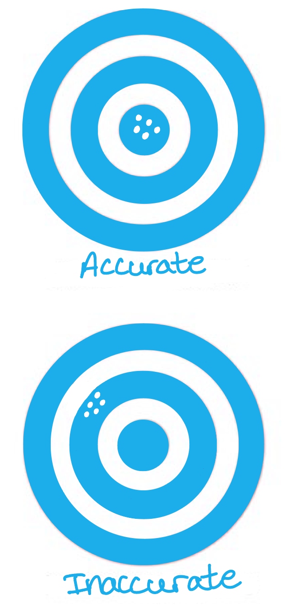

### Q3
Calculate, and record in Table 3.1, *uv* for each value of *D:*

A table that would score 1 mark should look like this:

**Table 3.1**

| **D/cm** | **u/cm** | **v/cm** | **uv/cm****2** |
|---|---|---|---|
| 70.0 | 22.0 | 48.4 | **Final answer:** **1065** |
| 75.0 | 20.7 | 54.5 | **Final answer:** **1128** |
| 80.0 | 20.0 | 60.0 | **Final answer:** **1200** |
| 85.0 | 19.5 | 65.8 | **Final answer:** **1283** |
| 90.0 | 19.0 | 71.2 | **Final answer:** **1353** |

- All values of *uv *correct; **[1 mark]**

**[Total: 1 mark]**

An example calculation to obtain *uv *is shown here:

*u* =  22 cm and *v *= 48.4 cm

*uv *= *u *× *v *= 22 × 48.4 = 1064.8 cm = 1065 cm (4 s.f.)
Plot a graph of* uv*/cm2 (y-axis) against *D*/cm (x-axis):

A graph that would score 4 marks should look like this:

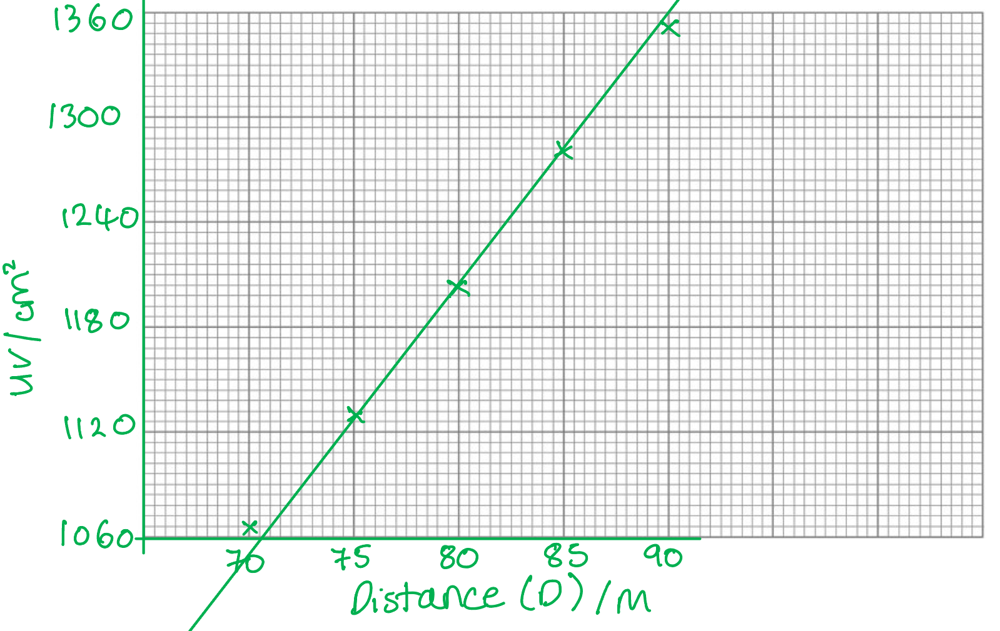

- Horizontal axis labelled distance, *D ****AND*** vertical axis, *uv*; **[1 mark]**
- Scale covers a reasonable range (so both the highest and lowest values are within the range of the axis) ***AND***** **increases in suitable even increments to cover more than half the axis space; **[1 mark]**
- All points plotted correctly using an 'x' ***AND***** **accurate to within ½ a small square; **[1 mark]**
- Line of best fit is drawn as a thin, continuous line using a ruler ***AND***** **with an equal number of points both above and below at an equidistance; **[1 mark]**

**[Total: 4 marks]**

> *Avoid these **main mistakes** with graphs in Paper 6:*

- *Using a scale that doesn’t fit, particularly using multiples of three (this is always marked incorrect). Stick with multiples of 1,2 or 5.*
- *Using a pen then have trouble correcting errors. Use a pencil*
- *Marking the plotting points with either thick lines or large blobs (even one of these will lose the mark). Draw an ‘x’ with a pencil.*
- *Making the line of best fit too thick. This will make it harder to read values from.*
- *Joining the plots up instead of making a thin line down the middle of them for the line of best fit.*

> *The key to this is **practice**. Try plotting graphs at home and compare your graph to our example. You can also ask your teacher to check your work. With practice, these are four very easy marks!*

> *Creating a scale for your graph:*

- *Step 1** consider distance, **D*

  - *From the question, distance is measured every 5 cm from 70 *$\rightarrow$* 90 cm*
  - *There are 5 measurements recorded*
  - *The x-axis has more than 5 sections*
  - *So, each square on the x-axis represents 5 cm*
- *Step 2** consider, **uv*

  - *uv** range = 1065  *$\rightarrow$*1353 *
  - *A more suitable range is 1060 *$\rightarrow$* 1360 = 300*
  - *There are 5 vertical spaces on the grid*
  - *So, each vertical space = 60 cm**2*
- *Step 3 **plotting the points  *

  - *If there are 60 values between each space and 10 lines*
  
    - *Then each line is worth 60 ÷ 10 = 6 values*
Determine the gradient *G* of the line:

A gradient triangle on the graph that would score two marks should look like this:

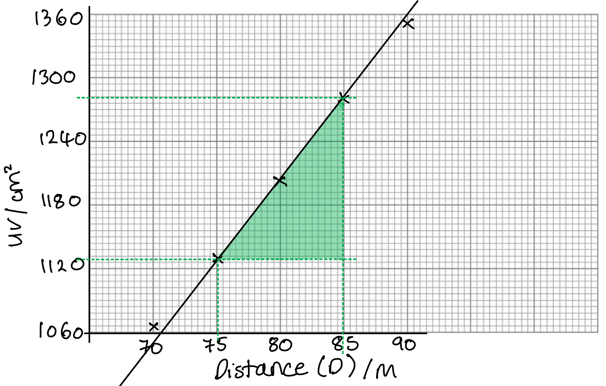

- The triangle method is clearly shown on the graph; **[1 mark]**
- The triangle uses at least half of the gradient line; **[1 mark]**

**An example calculation to determine gradient *****G*****:**

State the coordinates at the top and bottom of the triangle:

- $( x_{1} , y_{1} ) = ( 85 , 1283 )$
- $( x_{2} , y_{2} ) = ( 75 , 1128 )$

Recall the equation to calculate the gradient of a straight line:

- $Gradient,G=\frac{Changeiny}{Changeinx}=\frac{y_{1}-y_{2}}{x_{1}-x_{2}}$

Substitute the coordinates into the equation to calculate the gradient, *G*:

- $G = \frac{( 1283 - 1128 )}{( 85 - 75 )}$
- *G *= 15.5

** ****[Total: 2 marks]**

> *Remember the following when creating your **gradient triangle**:*

- *Make it as** large as possible*
- *Use points** that the line of best fit goes through as the start and end *
- *Form the triangle in the middle but **continue the lines** onto the horizontal and vertical axis, so it is easier to read the coordinates if you need to*

> *This question asks you to draw the triangle to obtain a value for **G **but no marks are awarded for your calculation or final answer. This comes in the **next part**! *
Write down a value for the focal length *f* of the lens:

List the known quantities:

- Gradient *G *= 15.5 (from part (c)); **[1 mark]**

**Accepted values in the range 14.0 - 16.0**

Hence, write down the value of focal length, *f*:

- *G* = *f *
- Therefore, *f *= 15.5 (3 s.f.) **[1 mark]**

**[Total: 2 marks]**

> *In this question you will be awarded **marks** for:*

- *Stating a gradient** between 14 and 16*
- *Stating that **f **= that gradient*

> *You may obtain slightly different values for the gradient because it is difficult to:*

- *Plot the coordinates precisely**, as the y-axis has a large range for the space on the scale*
- *Place the line of best fit exactly**, with the same number of points above, below and equidistant*
Suggest two difficulties in this experiment when trying to obtain accurate readings:

Any **two **from:

- Positioning the lens so the clearest image is formed on the screen; **[1 mark]**
- Measuring *u *and *v *from the centre of the lens; **[1 mark]**
- The room is too bright / the lamp too dim / the image is too faint to see on the screen; **[1 mark]**

**[Total: 2 marks]**

> *Have done a similar experiment with lenses in the lab? Think about what made it difficult; this is your answer!*

### Q4
Draw a normal to line **AB** at point **N** and extend the normal to line** CD**. Label the point at which the normal crosses line **CD** with the letter **L**:

A diagram scoring one mark:

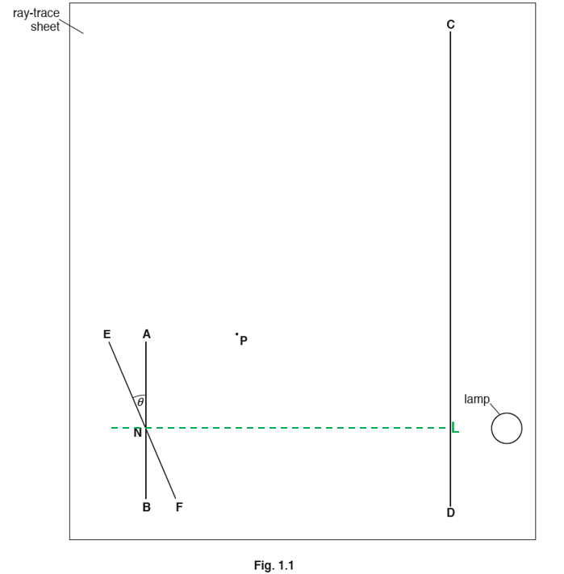

- Normal drawn perpendicular to line **AB**,** **extended to line **CD **and labelled L; **[1 mark]**

**[Total: 1 mark]**

> *In the exam you will be asked to measure the angle **θ **using a protractor. The has been given for the purposes of this question because it is difficult to measure an angle from a screen. Make sure you are comfortable measuring angles using protractors. *
State whether point **P**, shown on Fig. 1.1, is at a suitable distance from point **N **for this investigation:

- No, point **P** is not at a suitable distance from point **N**: **[1 mark]**

Explain why this is the case:

- Point **P** should be as far as possible from point **N**; **[1 mark]**

**[Total: 2 marks]**
(i) Draw a line joining point **N** and point **P**, extending the line until it meets line **CD** and label the point **G**:

A diagram that scores one mark:

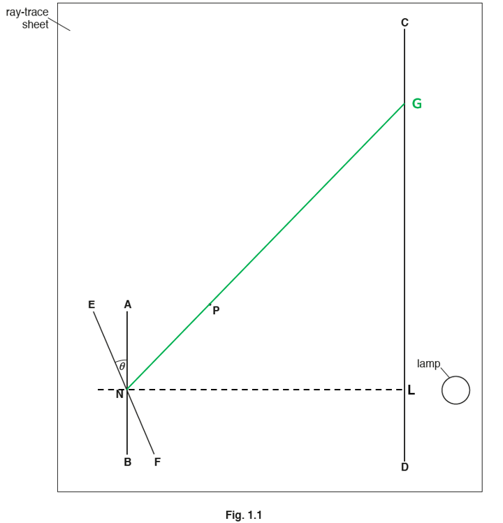

- Line drawn from **N** to line** CD** passing through **P AND **labelled **G**; **[1 mark]**

(ii) Measure the length *a* of line **LG**:

- 10.2 cm **OR** line measured correctly to within ±0.1 cm **[1 mark]**

**[Total: 2 marks]**

> *Depending on your device, screen or printer, the line will be a different size when you measure it. The official paper when printed measured the line to 10.2 cm, so this is the value we will use in the question. What ever value you measured the line to be is fine for this practice question. Although you may want to use the value 10.2 cm for the remainder of this question so that your answer aligns with ours.*

> *In the exam, you will get the mark as long as your measurement is within 0.1 cm of the true value.*

> *Here is an example of how to measure the line:*

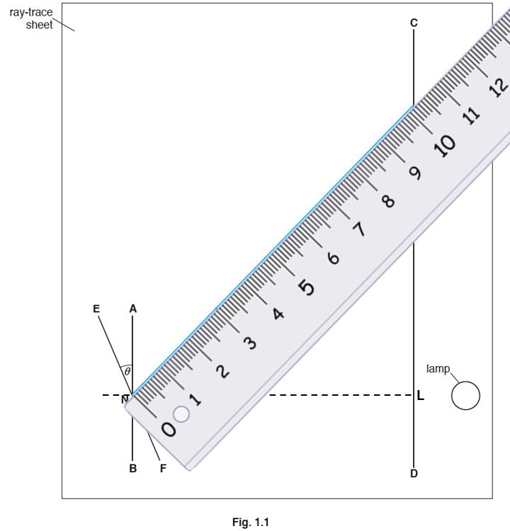
Use the values from Table 1.1 to plot a graph of *a */ cm (y-axis) against *θ */ ° (x-axis):

A graph scoring 4 marks:

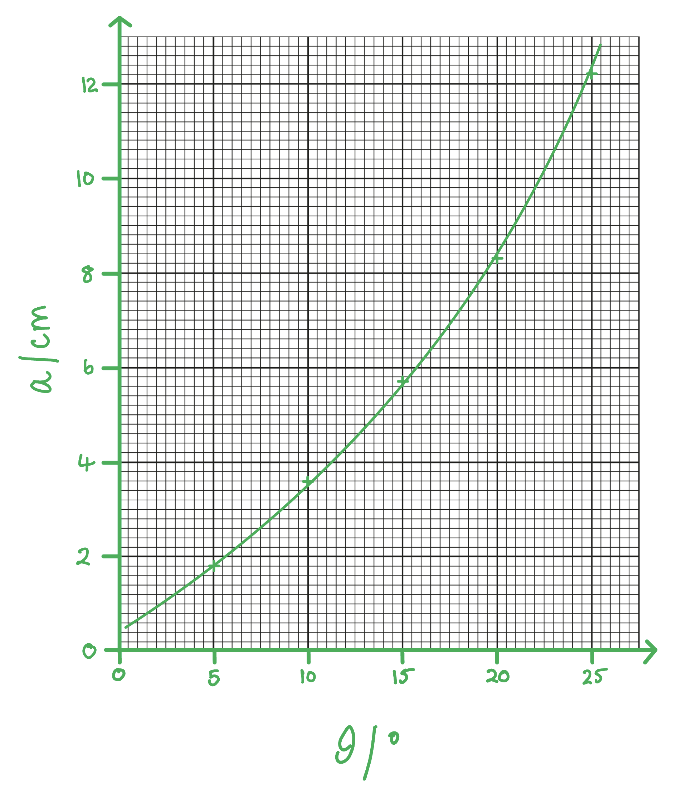

- *θ* on the x-axis and *a *on the y-axis

**AND**

- Both axes are correctly labelled with units given;** [1 mark]**
- Axes are drawn with appropriate scales that use at least half the grid;** [1 mark]**
- All data points are plotted correctly to within half a (small) square; **[1 mark]**
- A thin line of best fit is drawn with roughly equal numbers of data points above as below; **[1 mark]**

**[Total: 4 marks]**

> *Lots of students find choosing an appropriate scale the most intimidating part of drawing a graph. *

> *Once you have decided which quantity goes on which axis, you just need look at the range of the data. Make sure that you can fit the highest value on your axis! *

> *The scale needs to be chosen so that each increment increases by the **same amount**. In this example the x-axis, **θ**, goes up in 5° increments, and the y-axis, **a**, goes up in increments of 2 cm. You may have chosen a different scale to use and that is fine. As long as each axis takes up at least **half** of the width or height of the graph paper.*

> *Also remember that** the line of best fit is an average**. Therefore, there should be roughly equal numbers of data points above as below the line. As long as you follow this rule, your line of best fit will get the mark. Never try to force the shape of the line of best fit. Your pattern of data points will show you if it needs to be a curve or a straight line. They will also show you whether your line of best fit should go through the origin or not. Never force it to do so.*

> *Remember to always use one of the following notations to plot your data points to ensure you get the marks:  +  ×  *`circled dot`
Suggest a possible source of inaccuracy in this experiment, even if it is carried out carefully:

**Any one from:**

- It can be difficult to mark the position of the ray precisely (because the width of the ray may vary with distance from the source); **[1 mark]**
- Inaccuracies have a greater effect on smaller angles; **[1 mark]**
- Small variations in the angle of the mirror have a significant effect on length *a*; **[1 mark]**

**[Total: 1 mark]**

> *Any other reasonable source of inaccuracy would also get you the mark.*
Suggest how the student could improve the experiment, using the same apparatus, to check the reliability of his results:

- The student could reflect the ray at a point below **NL**

**AND**

- Take repeat readings and calculate a mean for each angle; **[1 mark]**

**[Total: 1 mark]**

### Q5
(i) To calculate the actual distances *U* and *V*:

- List the known quantities:

  - Distance on the diagram from the illuminated triangle to the lens, $u = 5 . 0 \text{cm}$
  - Distance on the diagram from the lens to the screen, $v = 7 . 5 \text{cm}$
  - The diagram is drawn to 1/5 scale, so 1 cm on the diagram represents 5 cm in the experiment
- Multiply each distance on the diagram by 5:

$U = 5 . 0 \times 5 =$$25 \text{cm}$

$V = 7 . 5 \times 5 =$$37 . 5 \text{cm}$

**[1 mark]**

> **[mark-scheme]**
> 1 mark for both *U* **AND** *V* correct
> 
> - Accept 25.0 cm for *U*
> - Accept 37.5 cm or 38 cm for *V*

(ii) To calculate the focal length $f_{1}$:

- Write down the equation:

`f_{1} = \frac{UV}{\left(U + V\right)}`

- Substitute the values from part (i):

`f_{1} = \frac{25 \times 37.5}{\left(25 + 37.5\right)} = \frac{937.5}{62.5}`

- Calculate the answer:

$f_{1} =$$15 \text{cm}$ **[1 mark]**

> **[mark-scheme]**
> 1 mark for $f_{1} = 15 \text{cm}$
> 
> - The answer must be given to two or three significant figures, so 15 cm or 15.0 cm
> - The unit is needed for this mark

> **[mark-scheme]**
> (iii) A technique to obtain an image that is as sharp as possible is:
> 
> - Move the screen slowly **OR** move the screen backwards and forwards (to find the position of the sharpest image) **[1 mark]**

> **[exam-tip]**
> In the real practical paper you measure *u* and *v* on the diagram yourself, so measure from the centre line of the lens and give each length to the nearest millimetre. Remember to scale up both lengths before you use them in the equation: if you substitute the lengths straight from the diagram, your focal length will be five times too small.
(i) To calculate the magnification *M*:

- List the known quantities:

  - Height of the image, $h_{I} = 2 . 4 \text{cm}$
  - Height of the illuminated triangle, $h_{O} = 1 . 5 \text{cm}$
- Substitute the known values:

$M = \frac{h_{I}}{h_{O}} = \frac{2.4}{1.5}$

- Calculate the answer:

$M =$$1 . 6$ **[1 mark]**

> **[mark-scheme]**
> 1 mark for *M* = 1.6 given with no unit

(ii) To calculate the second value $f_{2}$ for the focal length:

- List the known quantities:

  - From part (a)(i), $V = 37 . 5 \text{cm}$
  - From part (b)(i), *M* = 1.6
- Substitute the known values:

`f_{2} = \frac{V}{\left(M + 1\right)} = \frac{37.5}{\left(1.6 + 1\right)} = \frac{37.5}{2.6}`

- Calculate the answer:

$f_{2} =$$14 \text{cm}$ **[1 mark]**

> **[mark-scheme]**
> 1 mark for $f_{2} = 14 \text{cm}$
> 
> - Accept 14.4 cm
> - Also accept 15 cm or 14.6 cm, from *V* = 38 cm

> **[exam-tip]**
> Magnification is a ratio of two heights, so the units cancel and *M* has no unit. Leave your value of *M* as a bare number: writing cm after it is a mistake that can cost you the mark.
> **[mark-scheme]**
> A precaution that makes the measurements as reliable as possible is:
> 
> Any **one** from:
> 
> - Mark the position of the lens on the holder (and check it is in the same position each time)
> - Clamp the ruler / place the ruler on the bench
> - Make sure the screen, lens and illuminated triangle are all perpendicular to the bench / vertical
> - View the scale perpendicularly (to avoid parallax error)
> - Mark the top and bottom of the image on the screen and measure it afterwards
> 
> **[1 mark]**

### Q6
A correctly annotated diagram looks like:

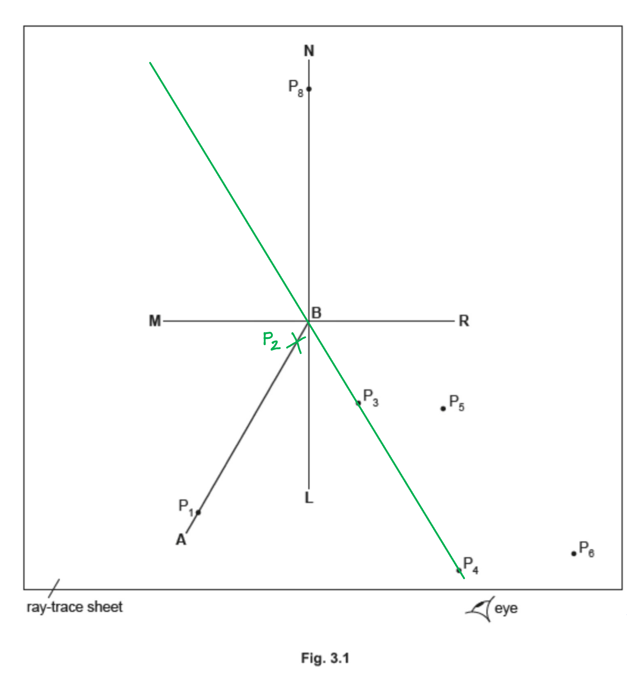

(i)

- P2 <u>at least 5.0 cm</u> from P1 **[1 mark]**

(ii)

- A <u>straight</u> line joining the pins; **[1 mark]**
- Line extends a long distance, <u>at least 7 cm</u> behind mirror; **[1 mark]**

> *With the ray diagram question you must practice as many as you can. You will soon see that they are much easier than they look. Just follow the steps one by one, ticking them off as you go.*

> *The examiner will measure the distances carefully, so make sure you have left at least 6 cm between pins (the rule is 5 cm - it's better to do more than less)*

> *All lines must be drawn with a sharp pencil and ruler and have a rubber to hand.*

> *If you follow these rules you will get the marks easily. Good luck!*
A correctly annotated diagram would look like:

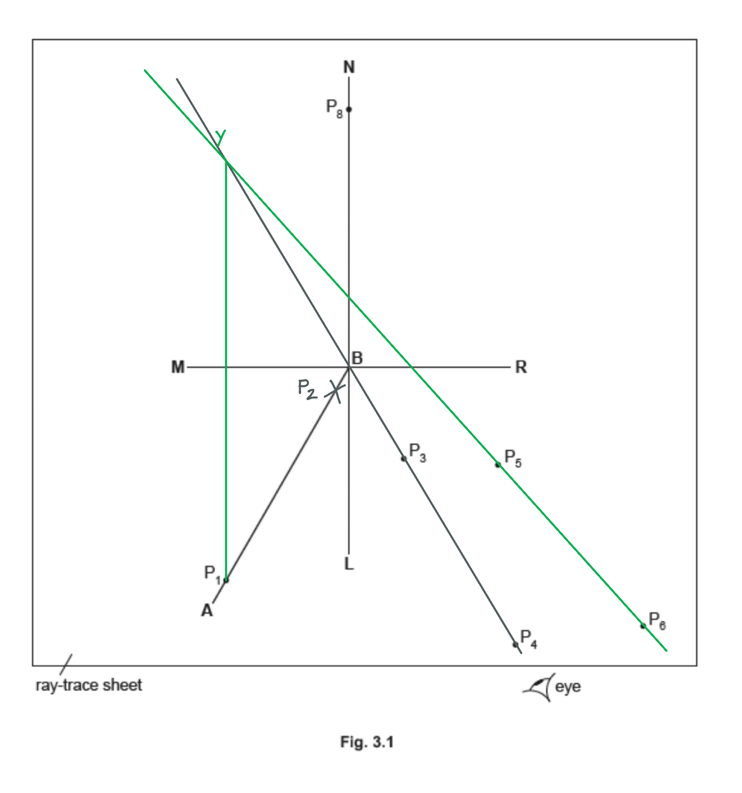

(i)

- Line is correct **AND**** **Y labelled; **[1 mark]**

(ii) To measure the line *a*:

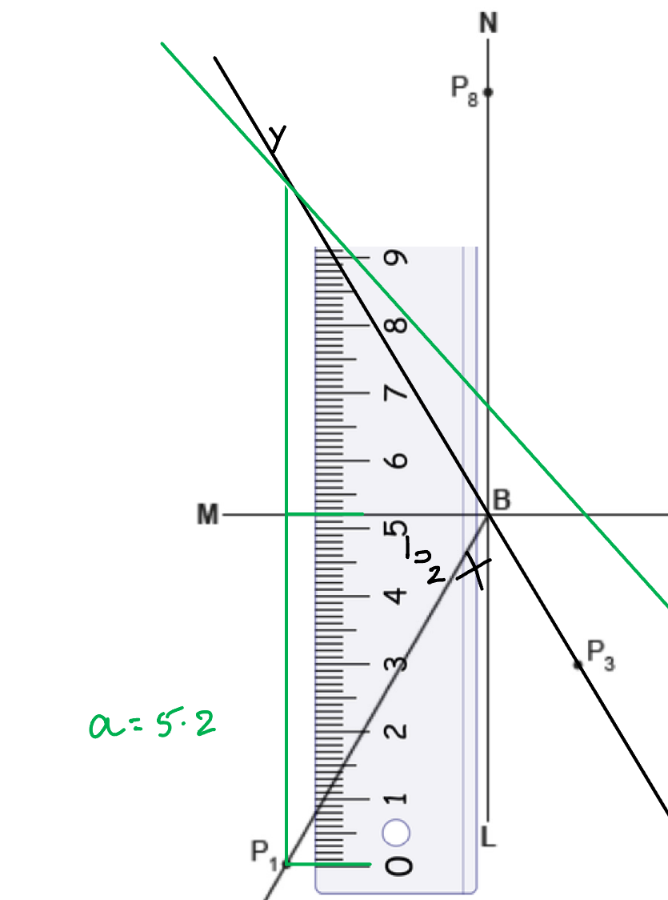

- Distance a measured correctly to <u>within ± 2 mm</u>; **[1 mark]**
- In our diagram *a* = 5.2 cm **OR** 52 mm

(iii) To measure the line *b*:

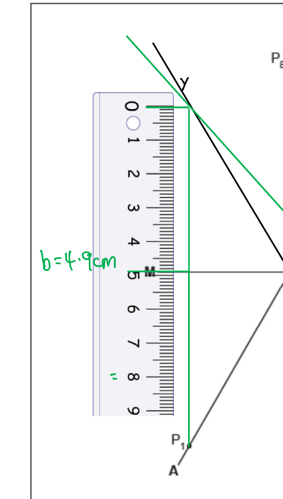

- Distance *b* measured correctly to <u>within ± 2 mm</u>; **[1 mark]**
- In our diagram *a* = 4.9 cm **OR** 49 mm

> *It isn't possible in an online format to know how long your lines are, since it depends on your printer or device. We suggest that you print out the diagram and work on it, then ask a friend or teacher to check your measurements.*

> *Your diagram must look like ours, and your measurements must be accurate to within 2 mm.** *
(i) To measure the distance *x* along the normal between P8 and the mirror:

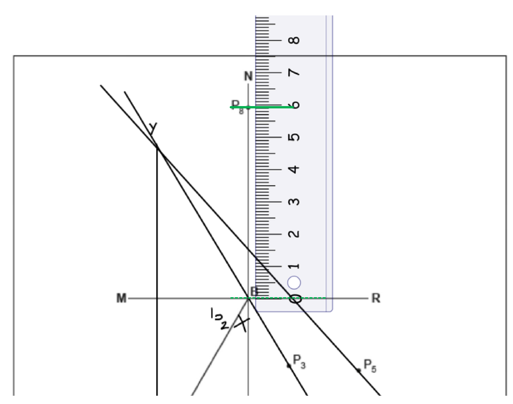

- Place the ruler <u>very close to</u> and <u>parallel to the normal</u>, with 0 cm on the mirror (MR) then read off the value at P8 to within 1 mm; **[1 mark]**
- On our diagram the distance *x* = 5.9 cm

(ii) To show the appearance of the image of pin P7 and pin P8:

A correct diagram looks like:

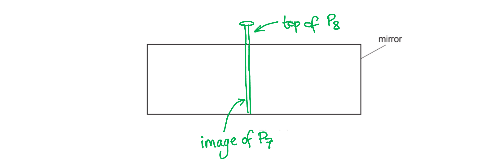

- The pins in the reflection and behind the mirror are in line; **[1 mark]**

**[Total: 2 marks]**

> *It isn't possible in an online format to know how long your lines are, since it depends on your printer or device. We suggest that you print out the diagram and work on it, then ask a friend or teacher to check your measurements.*

> *In the diagram we have labelled the reflection and the pin. You don't need to do this, but your lines must meet so that the diagram gives the appearance of just one pin. Hopefully you have done this simple investigation in school. If not, why not mention it to your teacher?*
To judge whether the readings support the theory:

Statement:

- <u>Yes</u>, the readings support the theory; **[1 mark]**

Justification

- The readings are <u>close enough</u> **OR**** **the readings <u>round up to the same value</u> **OR**** **there is a very <u>small percentage difference</u> between (4.9 cm and 5.2 cm **OR**** **5.9 cm and 6.0 cm); **[1 mark]**

**[Total: 2 marks]**

> *Your statement and justification must make sense together. The most common mistake in this question is to think that the numbers must be exactly the same. In fact, if **they are very close**, or **round to the same value** or **have a small percentage difference**, then they have proved the theory correct.*

> *However, if your answers were very different from each other then you should have said no, and stated that your values were very different.*

> *Any one of the phrases given in bold will show the examiner that you understand this. An even better proof is to work out and show the percentage difference if you can.*

> *In the real world of experimentation there will always be small differences. Understanding this idea is important when working in experimental science. *
The results may be inaccurate because:

**Any one from:**

- The thickness of the mirror (means that the lines don't match up); **[1 mark]**
- The thickness of lines (made the diagram harder to measure); **[1 mark]**
- Difficulty in judging exact lining up of pins; **[1 mark]**

**[Total: 1 mark]**

> *For a question like this one never state that 'the student might have done it wrong' or simply 'human error'. You need to think about why, even if the student was very careful, they could have got a wrong result. Imagine yourself doing the experiment or, even better, if you have done this or something like it, then think about what made it difficult.*

### Q7
(i) Draw a normal which passes through the centre of **AB** and passes through **CD**, labelling points **F** and **G**:

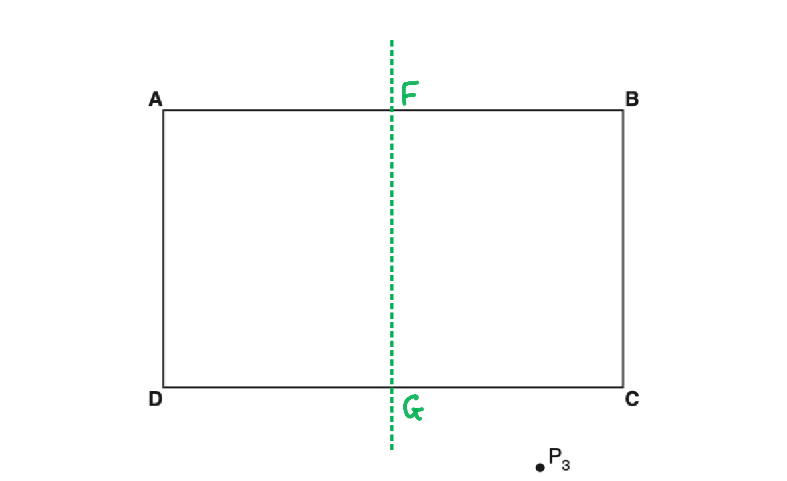

- The normal passes through the block **AND** through the centre of **AB AND **is perpendicular to **AB**; **[1 mark]**

(ii) Draw a line **EF** at an angle *i* = 30° to the left of the normal and above side **AB**:

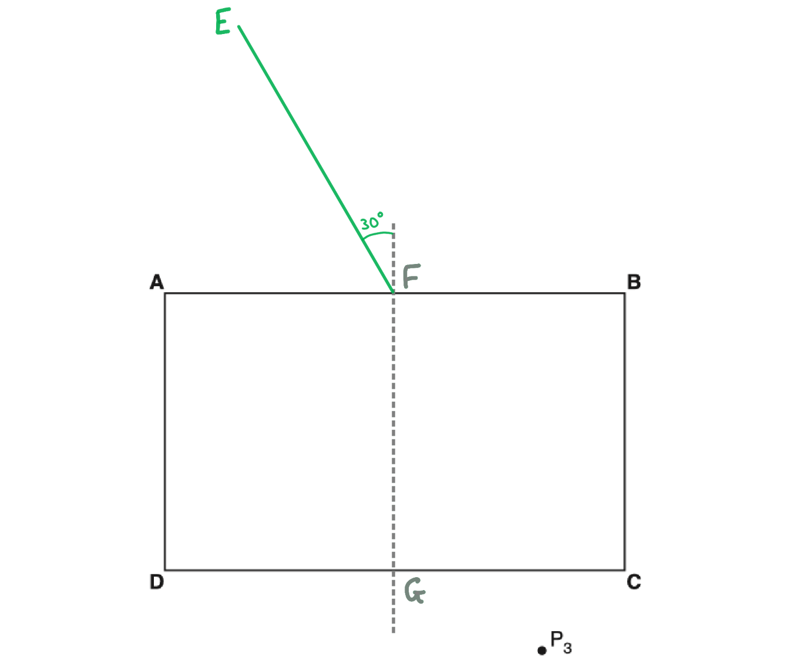

- Lines **EF **and **FG** are at an angle of 30° to each other **AND** **EF** is on the left side of **FG**; **[1 mark]**

(iii) Mark the positions of two pins P1 and P2 on line **EF** placed at a suitable distance apart:

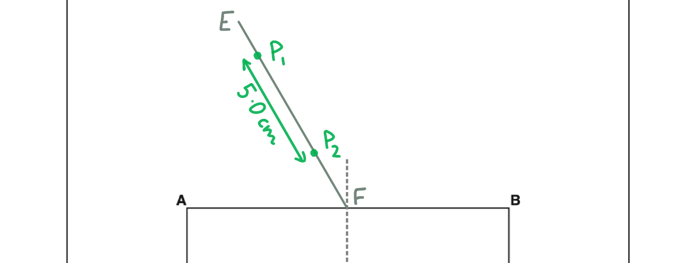

- Points P1 and P2 are <u>at least 5.0 cm apart</u>; **[1 mark]**
- This can either be indicated as above, or is measurably more than 5.0 cm

**[Total: 3 marks]**

> *When considering the position of the pins for this experiment, think practically. You place the pins so that when the light source is switched off, you can draw a straight line in the same place that the path of light was.*

> *If the pins are very close together, it is easy for your ruler to draw the wrong angle of line. With the pins further apart, your ruler is less likely to rotate around the pins, so the line will better represent the path of the light. *
(i) Draw a line joining the positions of P3 and P4 and continue the line until it meets the normal **NL**:

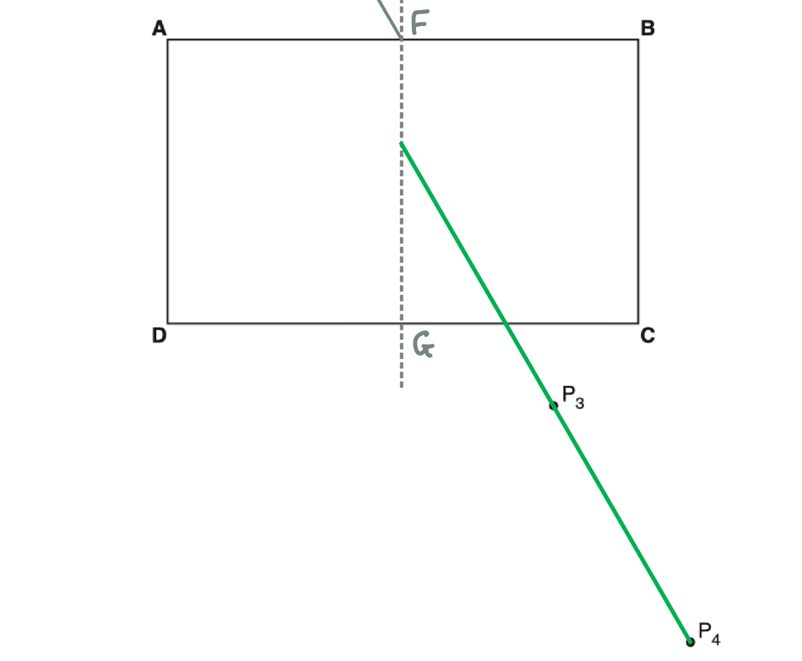

Label the point **H** where the line meets side **CD **and draw the line **FH**:

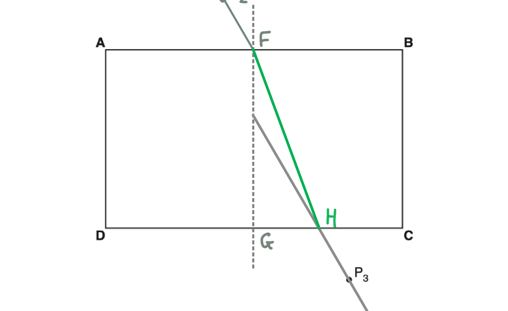

- Line drawn through P3 and P4 continued to normal **AND** line **FH** drawn as above; **[1 mark]**

**   **

(ii) Measure and record the length *a* of the line **GH**:

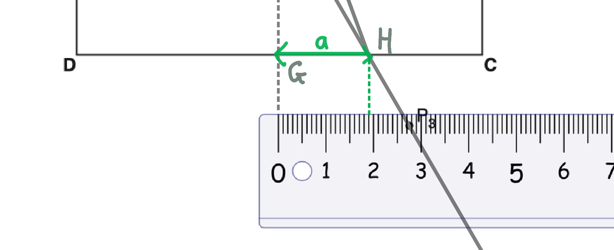

- The diagram shows a value for *a* of 19 mm
- **a** is between 17 mm and 21 mm; **[1 mark]  **

(iii) Measure and record the length *b* of the line **FH**:

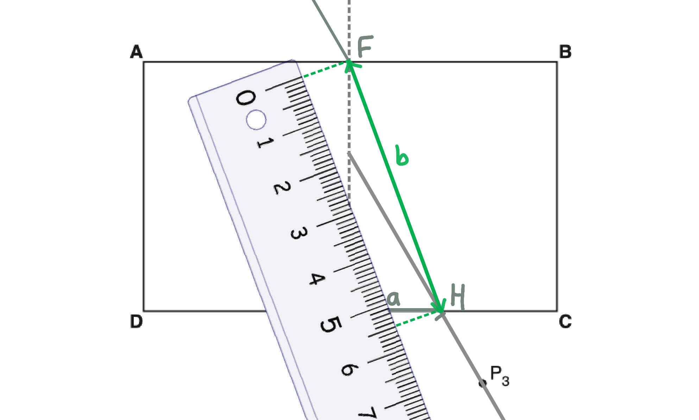

- The diagram shows a value of *b* of 55 mm
- *b* is between 55 mm and 56 mm; **[1 mark]**

(iv) Calculate the refractive index *n *:

List the known quantities:

- *a *= 19 mm (from part (b)(ii))
- *b* = 55 mm (from part (b)(iii))

Substitute the known quantities into the given equation to calculate *n*:

- $n=\frac{0.5b}{a}$
- $n=\frac{0.5\times55}{19}$
- *n* = 1.4474

Give the answer to the correct number of significant figures:

- *n* = 1.4
- *n *is in the range of 1.3 to 1.6 **AND** is given to <u>two</u> significant figures; **[1 mark]**

**[Total: 4 marks]**

> *It isn't possible online to know how long your measurements are, since it depends on your printer or device. We suggest that you **print** the diagram and use a **ruler** to measure the distance as shown in the model answer of this part (b). *

> *If you are unsure of your answers, check your measurement with a teacher or friend. In your real exam, all papers are the same size so the measurement you make on the paper will be correct. *

> *Interestingly for this question, regardless of the size of your screen or paper, you should end up with an answer for **n** that is very similar to the one in the model answer. This is because the equation uses a **ratio** of **a** and **b** to calculate **n**. Regardless of the size of the diagram, the ratio of **a** to **b** will be the same. *

> *   *

> *The mark can only be gained if you give your answer to **two** significant figures. This is because you **cannot** give an answer to a higher resolution than the data you used in your calculation. Your ruler will only measure distances to two significant figures, so your answer cannot be given to more than two significant figures. CIE have become more strict on this in recent years, so do this for every question:*

1. *Read through the question and find the piece of information given to you with the **smallest** number of significant figures. *
2. *Write down this number of significant figures.*
3. *When writing your answer, write it out to a large number of significant figures and **then round it** to the number of significant figures you wrote down in step two. *

> *Here is an example:*

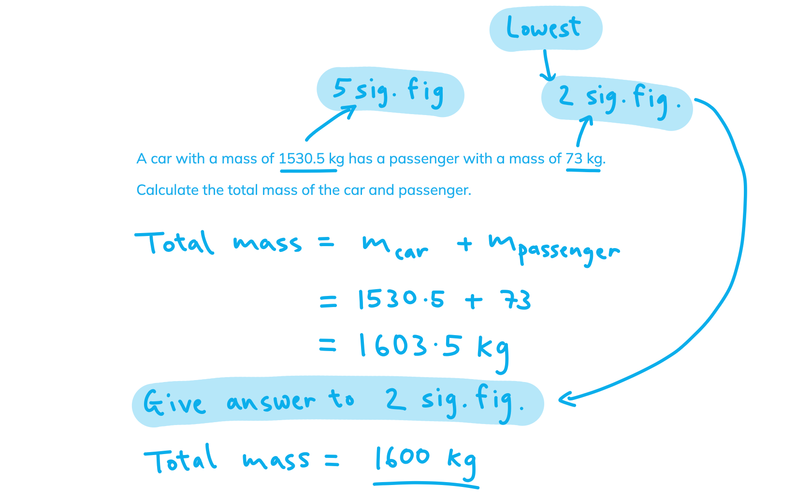
Calculate the refractive index *n *:

List the known quantities:

- *a* = 3.2 cm
- *b* = 6.9 cm

Substitute the known quantities into the equation to calculate *n *:

- $n=\frac{0.71b}{a}$
- $n=\frac{0.71\times6.9}{3.2}$

Give *n* to the appropriate number of significant figures:

- *n* = 1.531
- *n* = 1.5 **[1 mark]**

> *Information has been given to **two** significant figures so your answer must be written to **two** significant figures as well. Note that **n** has **no units** because it is a **ratio** of lengths - the units of cm cancel out in the fraction.*
State **two** difficulties with this type of experiment that could explain any difference in the two values of *n *:

**Any two from:**

- Aligning the pins vertically **OR** the pins bend; **[1 mark]**
- Lining up the pins exactly; **[1 mark]**
- Drawing accurate / thin lines; **[1 mark]**
- Replacing the block accurately on an outline **OR** the outline doesn't match the block; **[1 mark]**

**[Total: 2 marks]**
Tick one box to indicate the most sensible suggestion for reliable results:

`square`   Carry out the experiment in a darkened room.

`square`   Use pins that are taller than the height of the block.

**✓**  View the bases of the pins. **[1 mark]**

`square`   View the pins with one eye closed.

[1]

By observing the **base** of the pins (as opposed to the heads) as you place them, you will get a much more accurate idea of whether the pin is standing in the path of the light or not.

Using taller pins may mean they are less likely to stand vertically, viewing the pins with one eye closed will affect judgement of distance of the pins and the experiment may still be performed in a bright room if using a laser. If not using a laser and just using a light box, a darkened room is necessary for the experiment to work at all.

## Multiple Choice Questions (35 questions)

### Q1
**Final answer:** **The correct answer is D**

- In a plane mirror, the image is formed the same distance behind the mirror as the object is in front of it
- After stepping back, the person is 3.0 m in front of the mirror
- The image is therefore 3.0 m behind the mirror
- The distance between the person and their image is:

$\text{distance} = 3 . 0 + 3 . 0 = 6 . 0 \text{m}$

**A** is incorrect because 3.0 m is only the distance from the person to the mirror, not from the person to their image.

**B** is incorrect because this would be the distance between the person and their image at the original position (2.0 + 2.0 = 4.0 m), before they stepped back.

**C** is incorrect because it adds the old distance to the new distance (2.0 + 3.0 = 5.0 m).

### Q2
**Final answer:** **The correct answer is A**

- The scale on the diagram shows that 1 large grid square represents a distance of $6 . 0 \text{cm}$
- The focal length is the distance between the centre of the lens and the principal focus
- A ray that travels parallel to the principal axis refracts and passes through the principal focus on the other side of the lens
- On the diagram, the parallel ray crosses the principal axis exactly 1 large square from the centre of the lens, so the focal length is:

$\mathrm{focal} \mathrm{length}=1\times6.0=6.0\text{cm}$

- The image is formed where the two rays meet
- The horizontal distance from the centre of the lens to the image is 3 large squares, so the distance of the image from the lens is:

$\mathrm{distance} \mathrm{of} \mathrm{image}=3\times6.0=18.0\text{cm}$

> **[exam-tip]**
> Remember the two standard rays used to locate an image for a converging lens. A ray travelling through the optical centre of the lens does not change direction. A ray travelling parallel to the principal axis will refract and pass through the principal focus. Identifying these rays will help you locate the principal focus and measure the focal length accurately.

### Q3
**Final answer:** **The correct answer is C**

- The characteristics of an image formed by a converging lens depend on the position of the object relative to the focal length $f$
- To produce a real, inverted, and magnified image, the object must be placed between $f$ and $2f$
- In this case, $f=10\text{cm}$ and $2f=20\text{cm}$, so the object distance must be between $10\text{cm}$ and $20\text{cm}$
- Therefore, the distance must be $15\text{cm}$ from the lens, which is option **C**

**A** is incorrect because placing the object closer than $f$ ($5 \text{cm}$) would produce a virtual, upright, and magnified image.

**B** is incorrect because when an object is exactly at the focal point $f$ ($10 \text{cm}$), the rays emerge parallel and no image is formed.

**D** is incorrect because when the object is beyond $2 f$ ($25 \text{cm}$), the image formed is real and inverted, but it is diminished (smaller).

> **[exam-tip]**
> Remember the key positions for a converging lens:
> 
> - objects placed closer than $f$ give virtual, upright, magnified images
> - objects between $f$ and $2 f$ give real, inverted, magnified images
> - objects beyond $2 f$ give real, inverted, diminished images
> 
> A quick sketch of ray diagrams for each region can help you visualise and remember these relationships.

### Q4
**Final answer:** **The correct answer is B**

- When light travels from an optically denser medium (glass) to a less dense medium (air), it refracts away from the normal
- Total internal reflection only occurs if the angle of incidence is greater than the critical angle
- In this case, the angle of incidence ($25 ^{\circ}$) is less than the critical angle ($42 ^{\circ}$), so the light will refract out into the air
- Path **B** shows the ray bending away from the normal as it enters the air

**A** is incorrect as it shows the ray bending towards the normal.

**C** is incorrect as the light only travels along the boundary if the angle of incidence is exactly $42 ^{\circ}$.

**D** is incorrect as total internal reflection only occurs if the angle of incidence is greater than $42 ^{\circ}$.

> **[exam-tip]**
> Remember the key rule: when light passes from a denser to a less dense medium, it bends away from the normal. Always compare the angle of incidence to the critical angle first:
> 
> - if the angle of incidence is less than the critical angle $( i < c )$, refraction occurs
> - if the angle of incidence is equal to the critical angle $( i = c )$, light travels along the boundary
> - if the angle of incidence exceeds the critical angle $( i > c )$, total internal reflection occurs

### Q5
**Final answer:** **The correct answer is ****A**** because:**

- The refractive index of a material is given by:

$\text{refractive} \text{index} = \frac{ \text{sin} ( \text{angle} of \text{incidence} ) }{ \text{sin} ( \text{angle} of \text{refraction} ) } or \mathrm{n} = \frac{ \text{sin} \mathrm{i} }{ \text{sin} \mathrm{r} }$

- These angles must be measured from the normal, the dotted line at right angles to the surface.
- The angle of incidence (the incoming ray) is 90°− 50° = 40°
- The angle of refraction is 40°
- This gives the calculation for the refractive index *n* as: $n=\frac{\mathrm{sin}40^{\circ}}{\mathrm{sin}25^{\circ}}$

### Q6
**Final answer:** **The correct answer is ****B**** because:**

- The colours in white light will refract at different angles at every boundary, because they have different frequencies and wavelengths
- The spreading of white light into its component colours is called dispersion
- The first boundary causes the white light to disperse into its different colours
- The second boundary causes further dispersion of the colours
- Violet light refracts through a greater angle than red light

**A** is incorrect as the white light is not dispersing at the first boundary.

**C** is incorrect as the violet light is refracting in the wrong direction.

**D** is incorrect as the violet light is not refracting at the second boundary.

### Q7
**Final answer:** **The correct answer is ****B**** because:**

- For a converging lens, an object placed further than one focal length F will always produce an inverted image

  - Therefore, options **C** and **D** can be eliminated
- The closer the object is placed to the lens, the larger the size of the image

  - Therefore, the image produced when the object is at point Q will be inverted and enlarged compared to when the object is at point P

The difficult part of the question is ignoring the rays drawn on the diagram for the object at point P, as the question asks you to move it to point Q. The rays shown give an inverted image that is diminished (smaller), but this is not what the question asks about.

To find the properties of the image you can draw a new object at point Q and then draw two rays from the tip of the object. One should pass through the centre of the lens and one should travel parallel to the optical axis up to the lens and then through focal point F, as shown by the red rays in the diagram. The image is formed where these two lines cross.

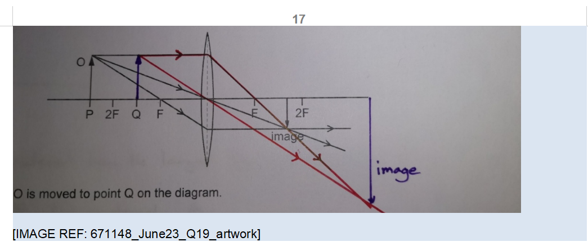

### Q8
**Final answer:** **The correct answer is ****C**** because:**

- The normal is a line at right angles to a surface, this is line 2 in the diagram

  - Therefore options **A** and **B** are eliminated
- An incident ray is the ray approaching the surface. This is line 1 in the diagram
- A reflected ray is a line leaving a surface. This is line 3 in the diagram

The arrow on a ray shows the direction of travel. You should use this to see which way the light is going, and this will make it easy to identify the incident ray and other rays.

### Q9
**Final answer:** **The correct answer is A because:**

- A real image is one formed by the convergence of rays of light and can be projected onto a screen

  - In this case, since the object is on the left of the lens, the projected image would be on the right of the lens
- To produce a real image that is smaller than the object, the object should be placed further than 2*f*

**B** & **C** are incorrect because an object placed at *f*, or between *f* and 2*f*, would produce a real image that is larger than the object

**D** is incorrect because an object placed closer than f would produce a virtual image that is larger than the object

### Q10
**Final answer:** **The correct answer is C because:**

- Light is passing from a more dense (water) to a less dense (air) medium
- This means light should bend away from the normal

  - Eliminate options **A** and **D**
- Light travels in straight lines

  - Eliminate option **B**

### Q11
**Final answer:** **The correct answer is A because:**

- The refractive index of the material is related to the critical angle by

$n=\frac{1}{sinc}=\frac{1}{sin37}=1.66$

- The speed of light in a plastic material can be found using refractive index

$n=\frac{speedoflightinair}{speedoflightinmaterial}$

- Therefore, the speed of light in the plastic material is

$speedoflightinmaterial=\frac{speedoflightinair}{n}$

$speedoflightinmaterial=\frac{3.0\times10^{8}}{1.66}=1.81\times10^{8}$ m/s

- This is option** A**

### Q12
**Final answer:** **The correct answer is D because:**

- If the ray is travelling along the air-plastic interface, it must be at the critical angle, *c*

$sin(c)=\frac{1}{n}$

- The refractive index, *n*, is 1.25
- Use the inverse sine operation to find *c*

$c=sin^{-1}(\frac{1}{1.25})=53^{\circ}$

Remember to use the degrees mode on your calculator when asked for an angle in degrees.

### Q13
**Final answer:** **The correct answer is D because:**

- A real image is defined as:

  - An image that is formed when the light rays from an object converge and meet each other
- **D** is the only diagram in which light rays from the object converge and meet

**A **and **C **are incorrect as these would form virtual images

**B **is incorrect as the rays are parallel and do not converge

### Q14
**Final answer:** **The correct answer is A because:**

- Converging lenses form real images when the object is at a distance greater than *f*
- The object is 3 cm further from the lens than the focal distance
- Real images formed by a converging lens are always inverted

Drawing a ray diagram confirms that the rays converge below the principal axis, so the image is real and inverted.

### Q15
**Final answer:** **The correct answer is B because:**

- In the term ‘monochromatic’:

  - The prefix ‘mono-’ means ‘one’
  - ‘-chromatic’ refers to colour
  - ‘Monochromatic’ means ‘one colour’
- Monochromatic light is light of a single colour

  - Frequency determines the colour of visible light
  - Monochromatic light has a single frequency

**A **is incorrect as light of any frequency can be made to diffract

**C **is incorrect as it is white light (which consists of many frequencies) which spreads out when passed through a prism

**D **is incorrect as all light travels at different speeds in different materials

### Q16
**Final answer:** **The correct answer is B because:**

- Both incident rays have the same angle of incidence
- The rays are reflected by the mirror, so the angle of reflection is equal to the angle of incidence
- The rays should still be parallel once they have both been reflected

**A **is incorrect as the angles of incidence and reflection for the left beam are not equal

**C **is incorrect as the angles of incidence and reflection for the left beam are not equal

**D **is incorrect as dispersion is being shown here, but the rays are not passing through a medium which would cause this phenomenon

### Q17
**Final answer:** **The correct answer is B because:**

- When a real image forms

  - the light rays **converge **to form the image
  - the image **can **be projected onto a screen
- Therefore, options **C** and **D** can be eliminated
- When a virtual image forms

  - the light rays **diverge **to form the image
  - the image **cannot **be projected onto a screen
- Therefore, option **A** can be eliminated

### Q18
**Final answer:** **The correct answer is C because:**

- When an image is formed by a plane mirror, to an observer it will be

  - the same size
  - the same distance from the mirror
  - a virtual image
- Virtual images are always upright

  - This eliminates options **B** and **D**, as the letter i appears inverted on these images
- When viewed by the observer, the letters in the reflected image will appear backwards and in the reverse order

  - This eliminates option **A** as the letters are backwards, but are still in the same order

### Q19
**Final answer:** **The correct answer is ****B**** because:**

- The ray diagram demonstrates how the image is formed.
- Where the projected rays cross, is where a virtual image is formed.
- Virtual images are formed by projected rays, while real images are formed by the convergence of actual light rays.
- Plane mirrors always form virtual images.

**Y** is the location at which the eye would be positioned in order to see the image clearly.

### Q20
**The correct answer is ****D**** **because images in a plane mirror are always reflected left to right but not top to bottom.

This diagram shows the actual clock:

### Q21
**Final answer:** **The correct answer is ****D**** because:**

- The white light is split into its constituent colours because different colours are refracted through different angles.
- From least refracted (closer to B) to most refracted (closer to A) the colours run in the order you have probably learned them: **red**, orange, yellow, **green**, blue, indigo, **violet**.
- As the question asks us to list them in order from A to B, we reverse this list.

### Q22
**Final answer:** **The correct answer is**** D**** because:**

- When light passes from a denser medium into a less dense medium

  - It speeds up
  - It bends away from the normal

### Q23
**Final answer:** **The correct answer is ****A**** because:**

- The critical angle is the angle of **incidence** when the angle of **refraction** is exactly 90° and light is **refracted** along the boundary

It would be useful to learn this definition by heart, so that you are entirely confident when you sit the exam

### Q24
**Final answer:** **The correct answer is ****C**** because:**

- $n=\frac{sini}{sinr}$
- $sinr=\frac{sini}{n}$
- $r = s i n^{- 1} ( \frac{s i n i}{n} )$
- $r = s i n^{- 1} ( \frac{s i n 27}{1.33} )$
- $r=19.95^{\circ}$

Each of the other answers contains a common mistake made by students.

**A** is incorrect as the arcsin of the final answer was not found.

**B** is incorrect as sin was not used at all, the student divided angle of incidence by refractive index. Be careful, this one can give you a misleadingly close answer for small angles!

**D** is incorrect as the equation was incorrectly rearranged to obtain this answer.

### Q25
**Final answer:** **The correct answer is ****B**** because:**

- This is a question about total internal reflection and the critical angle. We know this because light is being reflected **inside** a material, rather than from its surface.
- $n=\frac{1}{sinc}$
- The angle of incidence (in this case, the critical angle, *c*) is the angle **between the normal and the incident ray**. We are given the other angle. Therefore:
- $c=90-48=42^{\circ}$
- $n=\frac{1}{sin42}$
- $n=1.494$

Each of the other answers contains a common mistake made by students.

**A** is incorrect as sin was not used.

**C** is incorrect as sin was not used in the calculation of this answer, and a number of decimal places were ignored.

**D** is incorrect as the wrong angle was used in the calculation

### Q26
**Final answer:** **The correct answer is ****A**** because:**

- We know the image is virtual because the light rays do not converge anywhere.
- For an image to be real, light rays must converge, these diverge (get further apart).
- The image is seen at a position which is a backward projection of the diverging light rays that pass through the lens.
- No light gets to X, so the image cannot be seen there. An image can only be seen at a position that light actually reaches.
- The dashed lines represent *projections* of the real light rays that pass through the lens, not actual light.

**B** is incorrect as the image is not inverted. Inverted means upside-down.

**C** is incorrect as the image is not real, since no light rays converge on its position.

**D** is incorrect as the image cannot be seen at X.

### Q27
**Final answer:** **The correct answer is ****D ****because:**

- The top, horizontal ray is redirected through the focal point as it leaves the lens.
- The ray through the centre of the lens continues in a straight line.
- Where the two rays converge, a real image is formed.

Each of the other diagrams makes a mistake with the drawing of the diagram.

### Q28
**Final answer:** **The correct answer is ****B ****because:**

- This question is about total internal reflection.
- If the angle of incidence is greater than the critical angle, 42**o** in this case, the light will be totally internally reflected, and no light will escape the rod.
- The angle of incidence is 44**o**, which is 2**o** greater than the critical angle. Therefore, no light is refracted and all the light is reflected.

**A** is incorrect as no light is refracted out of the perspex rod.

**C** is incorrect as light is reflected. Some light is always reflected, whether or not the angle of incidence is greater than the critical angle.

**D** is incorrect as light is reflected. Some light is always reflected, whether or not the angle of incidence is greater than the critical angle.

### Q29
**Final answer:** **The correct answer is ****A ****because:**

- Light refracts as it moves from air to glass

  - This is demonstrated by a change in speed
  - Light slows down when it enters glass
- Red light has the largest wavelength in the visible spectrum but it carries the least energy
- On the other hand, violet light has the shortest wavelength and carries the largest amount of energy

  - Therefore, red light slows down by less than violet light
- The change in speed is related to the change in angle

  - The slower the speed, the larger the angle of refraction
- When light passes from the glass to the air, all the light returns to the same speed as before

**B** is incorrect as light does not speed up as it enters the glass, it slows down as it moves through the glass and speeds up again as it leaves

**C **and** D** are incorrect as frequency does not change at all as light passes from air into glass or from glass into air

### Q30
**The correct answer is ****C****.**

The diagram shows how the ray diagram should be constructed:

### Q31
**Final answer:** **The correct answer is ****B ****because:**

- Light has to disperse a little as it passes through the prism.
- Light has to refract in the correct direction: towards the normal on the way in and away from the normal on the way out.

**A** is incorrect as light refracts in the wrong direction, and it does not disperse at all inside the prism.

**C** is incorrect as the light does not disperse in the prism, though it does refract in the right direction.

**D** is incorrect as light does disperse in the prism, but refracts in the wrong direction.

### Q32
**Final answer:** **The correct answer is ****A ****because:**

- This question is about total internal reflection.
- If the angle of incidence is greater than the critical angle, the light will be totally internally reflected.
- Total internal reflection only works when the substance the light is going from has a higher refractive index than the substance it is going to, from glass to air for example.

**B** is incorrect as substance A must have a greater refractive index than substance B.

**C and D** are incorrect as the angle of incidence must be greater than the critical angle.

### Q33
**Final answer:** **The correct answer is ****A**** because:**

- $n =. \frac{\sin ( a n g l e o f i n c i d e n c e )}{\sin ( a n g l e o f r e f r a c t i o n )}$
- P is the correct angle of incidence
- S is the correct angle of refraction

The other answers have one or more of the angles incorrect.

### Q34
**The correct answer is ****B **because the focal length is the distance from the lens at which parallel light rays would converge. This is shown in diagram B.

The other answers do not label the focal length correctly.

### Q35
**Final answer:** **The correct answer is ****D**** because:**

- This diagram shows how the image is produced and the correct path of the light ray.
- Note that the angle of incidence equals the angle of reflection, and no light passes through the mirror, as you would expect**.**

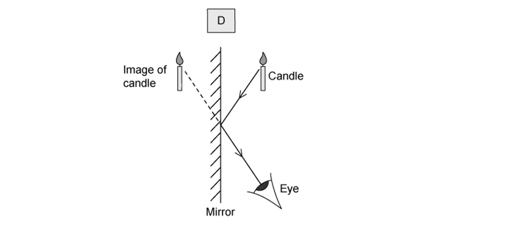

**A** is incorrect as the angle of incidence does not equal the angle of reflection.

**B** is incorrect as the image is not in the correct position.

**C** is incorrect as the angle of incidence does not equal the angle of reflection.

## Theory Questions (28 questions)

### Q1
> **[mark-scheme]**
> (i) The two conditions necessary for total internal reflection are:
> 
> - (Light must be travelling) from a denser (optically) medium to a less dense medium 
> **OR** 
> from a medium with a higher refractive index to one with a lower refractive index **[1 mark]**
> - The angle of incidence must be greater than the critical angle **[1 mark]**
> 
> (ii) A practical use of total internal reflection is:
> 
> Any **one **from:
> 
> - Optical fibres (e.g. for telecommunications)
> - Endoscopes
> - Periscopes (using prisms)
> - Bicycle/cat's eye reflectors
> - Binoculars (using prisms)
> 
> **[1 mark]**
> 
> Accept any valid application that uses total internal reflection
> 
> Do not accept "mirrors" — mirrors use reflection, not total internal reflection
> **[mark-scheme]**
> - The ray enters along the normal / perpendicular to the curved surface 
> **OR**
> The angle of incidence is $0 ^{\circ}$ (so no refraction occurs) **[1 mark]**
> 
> Accept: "the ray hits the curved surface at 90°" or "the ray is normal to the surface at that point"

> **[exam-tip]**
> A semicircular block is designed so that any ray aimed at the centre of the flat face enters the curved surface along the normal (perpendicular to the surface at the point of entry). When the angle of incidence is $0 ^{\circ}$, Snell's law gives an angle of refraction of $0 ^{\circ}$, so the ray passes straight through without bending.
> 
> Make sure you refer to the normal or the angle of incidence in your answer — simply saying "the ray goes straight in" is not enough to earn the mark.
To calculate the refractive index of the glass:

- Recall the equation for critical angle:

$\mathrm{sin}c=\frac{1}{n}$ **[1 mark]**

- Rearrange for $n$ and calculate:

$n=\frac{1}{\mathrm{sin}42^{\circ}}$

$n=$ $1.49$ **[1 mark]**

> **[mark-scheme]**
> 1 mark for the correct equation **OR** correct rearrangement **OR** correct substitution
> 
> - Accept $\mathrm{sin}c=\frac{1}{n}$ **OR** $n=\frac{1}{\mathrm{sin}c}$ **OR** $n=\frac{1}{\mathrm{sin}42^{\circ}}$
> 
> 1 mark for a correct answer of $1.49$
> 
> - Accept any value that rounds to 1.5
> 
> Working must be shown to gain both marks

> **[exam-tip]**
> When calculating refractive index, remember that the refractive index of air is 1, so for materials such as glass or plastic, if your answer is less than 1, you have the formula inverted.
Draw the path of the light in the glass block:

**[2 marks]**

> **[mark-scheme]**
> Marks are awarded as follows:
> 
> - Ray reflects at the straight edge with the angle of reflection equal to the angle of incidence ($50 ^{\circ}$), obeying the law of reflection **[1 mark]**
> - Reflected ray continues to the curved surface and exits without changing direction (along the normal to the curved surface) **[1 mark]**
> 
> The ray must reflect, not refract, at the straight edge — the angle of incidence ($50 ^{\circ}$) is greater than the critical angle ($42 ^{\circ}$)
> 
> Do not accept: a refracted ray leaving through the straight edge — this would only occur if the angle of incidence were less than $42 ^{\circ}$
> 
> Allow tolerance of $\pm 2 ^{\circ}$ on the drawn angles

> **[exam-tip]**
> The angle of incidence at the straight edge is $50 ^{\circ}$, which is greater than the critical angle of $42 ^{\circ}$. This means total internal reflection occurs — the ray does not pass through the straight edge but reflects back inside the block. Always check whether the angle of incidence exceeds the critical angle before deciding if the ray reflects or refracts.
> 
> If you draw the ray refracting out through the straight edge, you will score zero. Remember: the angle of reflection must equal the angle of incidence, and a ray hitting a curved surface along the normal will pass straight through without bending.

### Q2
> **[mark-scheme]**
> (i) The angle of incidence at the air-to-glass boundary is:
> 
> - 42° **[1 mark]**

(ii) Determine the angle of refraction at the air-to-glass boundary:

Angle between incident ray and glass block = 63°

Angle of refraction = 90 - 63

Angle of refraction = **27°** **[1 mark]**

> **[mark-scheme]**
> (iii) Suggest a value for the incident angle at the glass-to-air boundary:
> 
> - 27° **[1 mark]**
> 
> Justify your reasoning:
> 
> - The refracted ray from the air-to-glass boundary is the incident ray at the glass-to-air boundary **[1 mark]**
> - Light travels in straight lines **[1 mark]**
> - So the angle does not change **[1 mark]**
> **[mark-scheme]**
> Any **two **from (one mark for each point):
> 
> - All of the light/energy/wave/ray is reflected
> - At the boundary/interface/surface between two media
> - No light is refracted
> 
> **[2 marks]**
> **[mark-scheme]**
> State the angle of reflection:
> 
> - 48° **[1 mark]**
> 
> Justify your reasoning:
> 
> - The angle of incidence is 48° **[1 mark]**
> - The law of reflection states that the angle of incidence is equal to the angle of reflection **OR** $θ_{i}=θ_{r}$ **[1 mark]**

### Q3
Draw a normal **NL** to the side **AB** of the block at the point **S**:

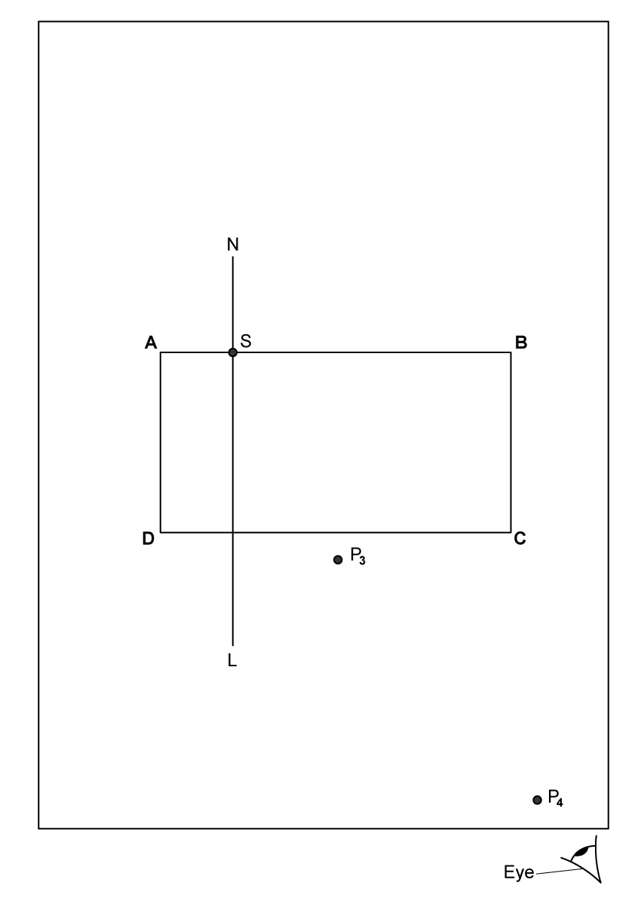

**[1 mark]**

> **[mark-scheme]**
> The normal must be perpendicular to side **AB** and pass through point **S**. The line must extend below **AB** into the glass block and pass through **CD**.

> **[exam-tip]**
> When drawing a normal line, always use a ruler to ensure it is straight and perpendicular to the surface. The normal should be clearly labelled and must pass through the exact point specified (in this case, point S). Many students lose marks by drawing the normal at an angle other than 90° or by not extending it into the block as instructed.
Draw a line **RS** at an angle $i=40^{\circ}$ to the normal:

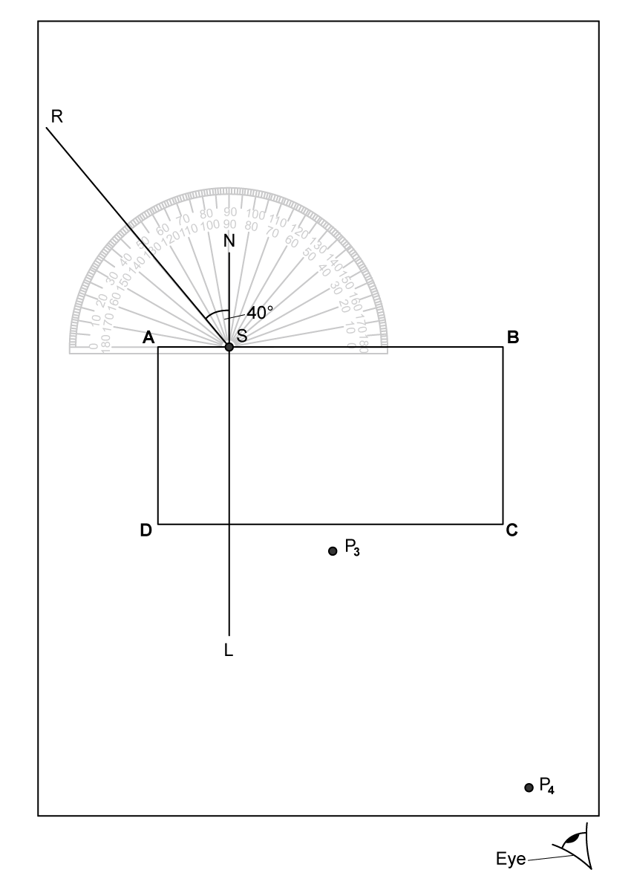

[**1 mark]**

> **[mark-scheme]**
> 1 mark for drawing line **RS** at $40 ^{\circ} \pm 1 ^{\circ}$ to the left of the normal.

> **[exam-tip]**
> When drawing angles of incidence, always measure from the normal (the perpendicular line to the surface), not from the surface itself. Use a protractor carefully and ensure your line is clearly labelled as **RS**. A tolerance of $\pm 1 ^{\circ}$ is typically allowed, so take your time to be as accurate as possible.
(i) Mark the positions of the two pins $P_{1}$ and $P_{2}$

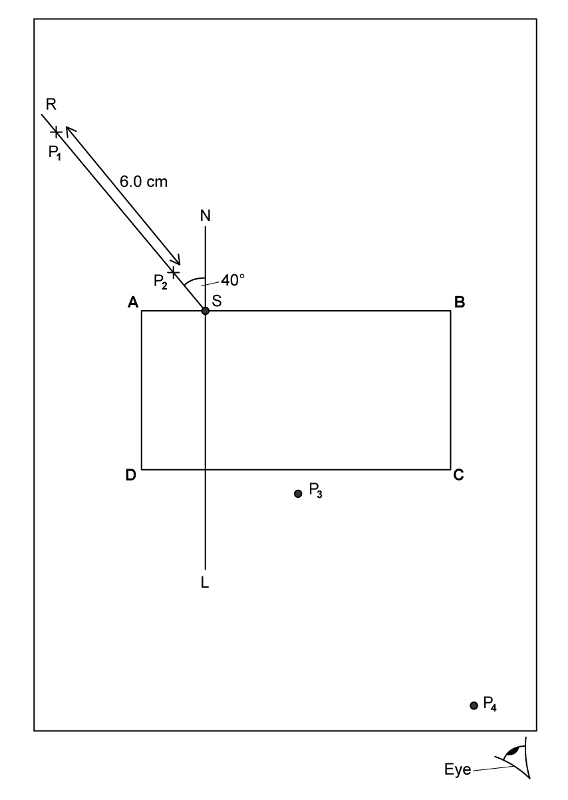

**[1 mark]**

> **[mark-scheme]**
> 1 mark for two points $P_{1}$ and $P_{2}$ marked on line **RS** separated by a distance of at least $5.0\text{cm}$.

> **[mark-scheme]**
> (ii) To produce an accurate ray-trace, the student should:
> 
> Any **two **from:
> 
> - Use thin pins
> - Draw thin lines / use a sharp pencil
> - Ensure the pins are vertical / view the bases of pins
> 
> **[2 marks]**

> **[exam-tip]**
> When placing pins for ray tracing experiments, always position them as far apart as possible along the line, at least 5 cm. This reduces the percentage error caused by the thickness of the pins or the line itself, making your measurements more accurate.
Draw a line joining $P_{3}$ and $P_{4}$ and the line **ST**:

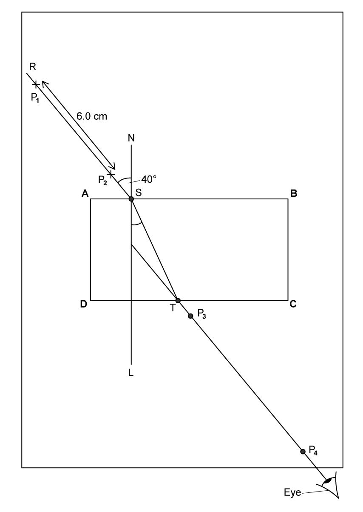

**[2 marks]**

Measure the angle $r$ between **ST** and the normal:

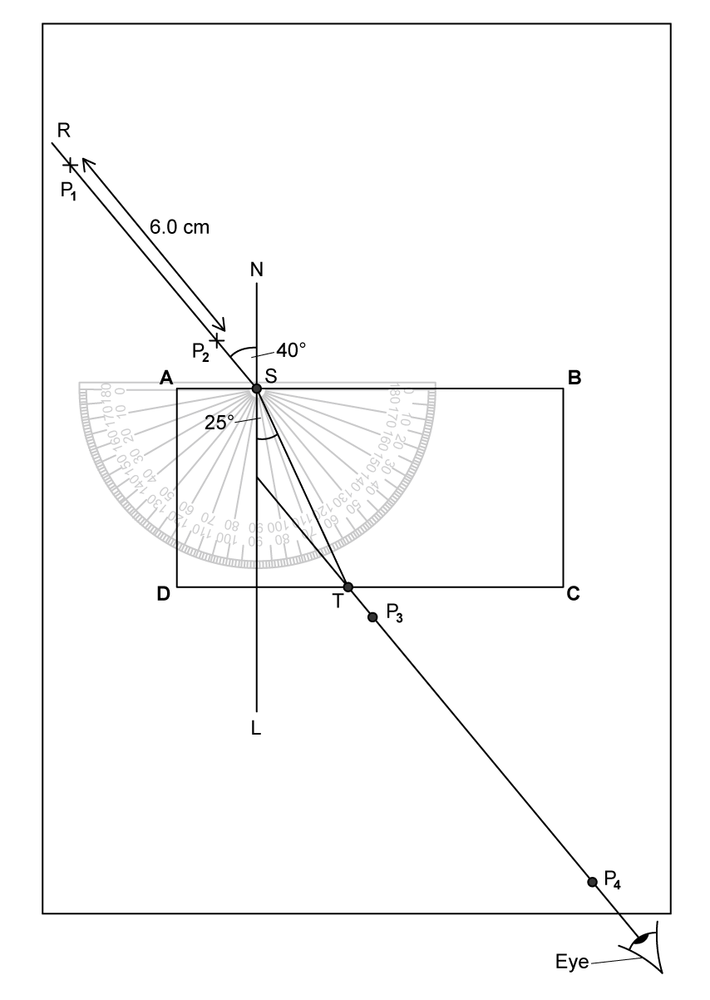

angle of refraction, $r=25^{\circ}$

**[1 mark]**

> **[mark-scheme]**
> 1 mark for drawing a straight line through $P_{3}$ and $P_{4}$ extended to meet the normal **NL**
> 
> 1 mark for labelling point **T** on **CD** and drawing line **ST**
> 
> 1 mark for measuring the angle of refraction $r=25^{\circ}$ ($\pm 1 ^{\circ}$)

> **[exam-tip]**
> When drawing lines through pins, always use a ruler to ensure the line is perfectly straight. Make sure your line is thin and clearly visible. For measuring angles, place the protractor carefully with its centre exactly on the point where the ray meets the normal, and read the scale accurately. Remember that the angle of refraction is measured from the normal, not from the surface.
(i) Other suitable values of angle $i$ that the student could use:

20°, 30°, 50°, 60°

**[2 marks]**

> **[mark-scheme]**
> 1 mark for suggesting at least 3 extra values of angle $i$ which are all less than 90°.
> 
> 1 mark for a range of values spread over at least 30°.

> **[mark-scheme]**
> (ii) To check the reliability of their results, the student could:
> 
> - Repeat the experiment with the ray entering from the opposite side **AND** Take repeat readings and calculate a mean for each angle **[1 mark]**

> **[exam-tip]**
> When suggesting values for angles in optics experiments, always ensure your values are physically possible (i.e. less than 90° for angles of incidence). Spreading your values over a wide range helps to establish a clear relationship between variables. For reliability, remember that repeating measurements and calculating means is a standard technique to reduce the effect of random errors.

### Q4
The completed paths of each ray after passing through the lens are as follows:

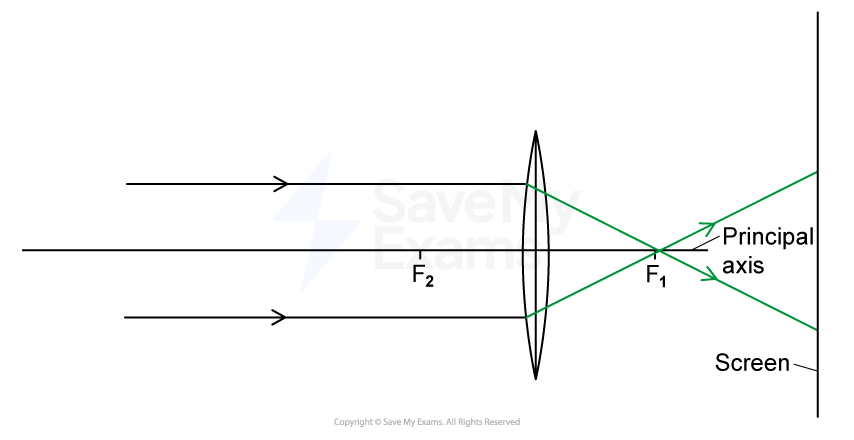

- The two rays drawn are refracted towards the principal axis; **[1 mark]**
- The two rays pass through F1 (one of the lens’s focal points); **[1 mark]**

**[Total: 2 marks]**

> **[exam-tip]**
> Rays must be drawn with a ruler, so that they are straight. You should use small arrows to show the direction of travel. Make sure that there are no gaps in the lines.

### Q5
When the light passes through the converging lens:

- (All the) light rays meet / focus / intersect (at a point); **[1 mark]**
- (All the) light rays travel towards a point; **[1 mark]**
- The light rays then diverge / spread out (from that point) **OR**
- The point of convergence is on XY / at F / the focal point / principal focus / 3.0 cm from the lens; **[1 mark]**

**[Total: 3 marks]**
The two principal focuses of the lens can be shown on Fig 7.1 as follows:

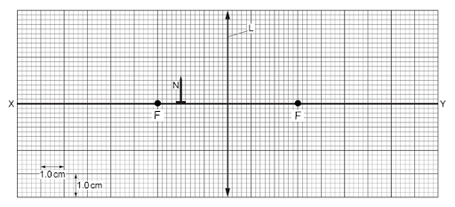

- Two marked points on XY 3.0 cm from the centre of the lens **AND **
- One point on the left and one point on the right (of the lens) **AND**
- Each point labelled F; **[1 mark]**

**[Total: 1 mark]**
(i) The image I of N can be shown on Fig 7.1 as follows:

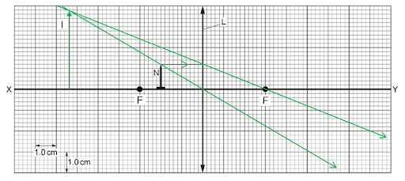

Rays drawn from the tip of nail N:

Any **two **from:

- A ray (that seems to come) from left-hand principal focus **AND **emerges from lens paraxially (parallel to XY); **[1 mark]**
- A paraxial ray to lens **AND **then towards right-hand principal focus; **[1 mark]**
- A ray towards / through the centre of lens;** ****[1 mark]**

Plus one mark for determining the location of image I:

- Two rays traced back to the intersection **AND **a** **line drawn from the intersection to axis labelled I; **[1 mark]**

(ii) Image I is

- <u>Virtual</u>

**AND **any **one **from:

- Light / rays do not pass through I; **[1 mark]**
- Light / rays only seem to come from I; **[1 mark]**
- I is produced by diverging rays;** [1 mark]**
- (Real) rays do not meet / intersect; **[1 mark]**

(iii) This type of lens can be used as a

- Magnifying glass; **[1 mark]**

**[Total: 5 marks]**

### Q6
(i) Three wavefronts to represent the waves in shallow water on Fig. 7.2:

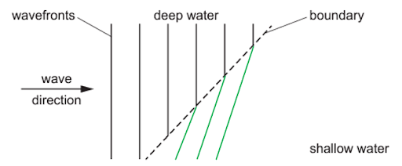

- Wavefronts drawn at a different angle to the boundary; **[1 mark]**
- Wavefronts angled towards the left **AND** all with smaller wavelength; **[1 mark]**

(ii) The process at the boundary in Fig. 7.2 is:

- Refraction; **[1 mark]**

**[Total: 3 marks]**

### Q7
The angle of refraction is:

- Angle *z*; **[1 mark]**

**[Total: 1 mark]**

> *Angles of incidence and refraction are measured from the normal, not the boundary. **X** is the angle of incidence.*

### Q8
(i) An example of an image gaining three marks:

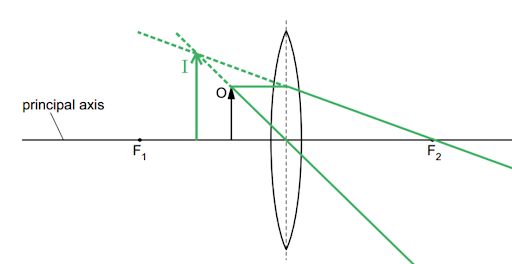

Draw two correct rays:

Any **two **from:

- A ray from the object passing through the centre of the lens undeviated; **[1 mark]**
- A ray from the object, parallel to the principal axis, then passes through F2; **[1 mark]**
- A ray from the object which appears to come from F1 then is parallel to the principal axis; **[1 mark]**

Extend these rays to show where the virtual image lies:

- Two correct rays traced back **AND** image indicated;** [1 mark]**

(ii) The new position of the object produces an image which is:

- Enlarged
- Real
- Inverted
- *Two correct; ***[1 mark]**
- *Third also correct; ***[1 mark]**

**[Total: 5 marks]**
An example of an image gaining two marks:

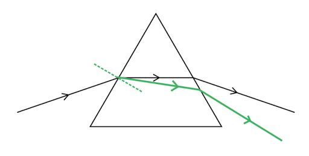

- Ray enters prism below yellow ray **AND** above normal; **[1 mark]**
- Ray exits the prism diverging from the yellow ray; **[1 mark]**

**[Total: 2 marks]**

> *Longer wavelengths bend to a lesser degree through a prism. In the diagram above, red would be at the top with violet at the bottom.*

### Q9
(i) State the name of the process that separates the colours in white light:

- The process is called <u>dispersion</u>; **[1 mark]**

(ii) State the colour of the light on the screen at points A and B:

- Point A: <u>red</u>; **[1 mark]**
- Point B: <u>violet;</u> **[1 mark]**

(iii) State the property of the glass of the prism that causes white light to be split into the different colours of the spectrum:

Any **one **from:

- The light from each colour travels at different speeds;** [1 mark]**
- The light from each colour has a different refractive index; **[1 mark]**
- The light from each colour refracts by different amounts; **[1 mark]**
- Different wavelengths of light refract by different amounts;** [1 mark]**

**[Total: 3 marks]**
(i) Continue the path of the ray of light up to the end of the fibre:

A diagram that would score 1 mark should look like this:

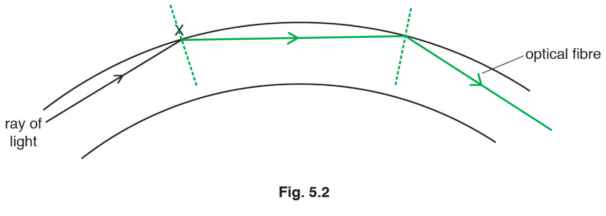

- Ray of light is reflected off the top wall of the fibre at X

**AND**

- Angle of incidence = angle of reflection by eye

  - So, the ray is not reflected onto the lower wall of the fibre
  - And, it reaches the end of the fibre; **[1 mark]**

** **

(ii) Calculate the critical angle of the material of the fibre:

List the known quantities:

- Refractive index of the material, *n *= 1.46

Recall the critical angle equation:

- $n = \frac{1}{\sin ( C )}$ **OR **$\sin ( C ) = \frac{1}{n}$**[1 mark]**

Rearrange the equation and substitute the known quantities to make critical angle *C *the subject:

- $C = \sin ^{- 1} ( \frac{1}{n} )$
- $C = \sin ^{- 1} ( \frac{1}{1.46} )$
- *C *= 43.23 ° = 43 ° (2 s.f.) **[1 mark]**

** **

(iii) State two uses of optical fibres:

**Any two from:**

- To carry telephone signals / communications; **[1 mark]**
- For medical diagnosis / imaging; **[1 mark]**
- For an artistic display; **[1 mark]**
- For a form of lighting; **[1 mark]**

**[Total: 5 marks]**

> *When drawing any ray diagram it is good practice to draw the normal at each boundary. This makes it easier to then draw the reflected ray by eye. *

### Q10
(i) 1. Continue the ray of light from the golfer towards the upper mirror of the periscope

2. Draw and label the normal at the point where the ray strikes the mirror:

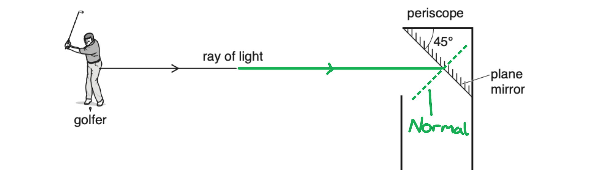

- Ray of light is a <u>straight line</u> to the mirror **AND** the normal is <u>perpendicular</u> to the plane of the mirror (45° to the ray of light); **[1 mark]**

(ii) Continue the ray of light after reflection at the upper mirror until it leaves the periscope:

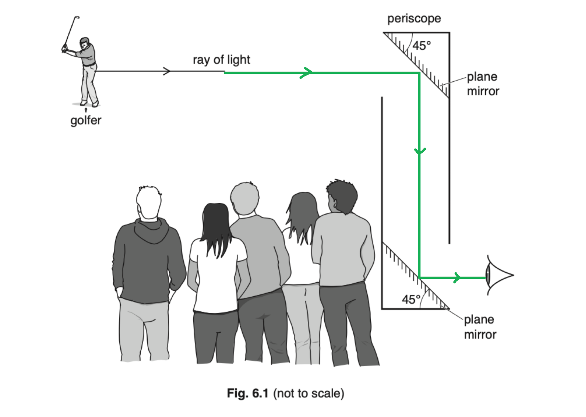

- First reflection is a 90° turn in the ray of light down the periscope **AND** second reflection is a 90° turn in the ray of light towards the eye; **[1 mark]**

(iii) State the law of reflection used to deduce the position of the ray of light after striking the mirrors:

- The angle of incidence is equal to the angle of reflection; **[1 mark]**

**  **

**[Total: 3 marks]**

*It is common practice to draw the normal as a dashed line, to avoid confusion with the ray itself. You can do this too if it helps you. What you **must **do is put an arrow on all rays of light.*
Complete the path of the ray for angle of incidence X:

- X is less than the critical angle
- The ray leaves the block and is refracted
- It moves from a more dense medium to a less dense medium so it bends <u>away</u> from the normal (i < r)

Complete the path of the ray for angle of incidence Y:

- Y is equal to the critical angle
- The ray leaves the block and is refracted 90°
- This means the beam of light travels along the boundary between the glass block and the air

Complete the path of the ray for angle of incidence Z:

- Z is greater than the critical angle
- The ray does not leave the block and it is totally internally reflected
- This means the beam of light is reflected back inside the block at the same angle as the angle of incidence

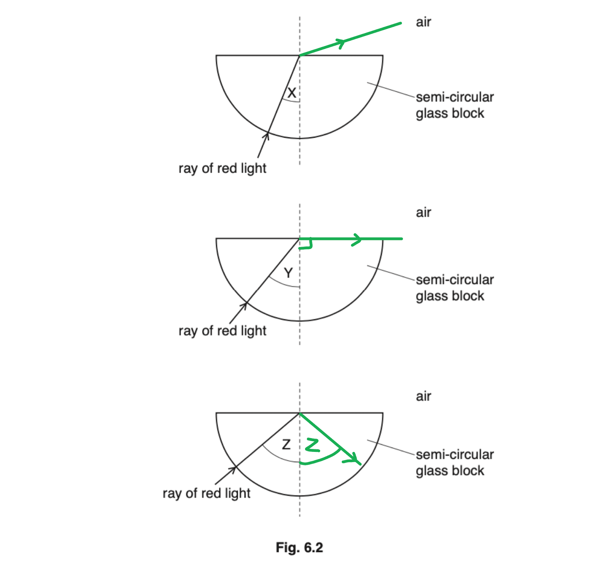

- Angle X: the ray is refracted away from the normal; **[1 mark]**
- Angle Y: the ray is refracted along the straight edge; **[1 mark]**
- Angle Z: the ray is totally internally reflected (the angle of reflection is equal to the angle of incidence by eye); **[1 mark]**

**  **

**[Total: 3 marks]**

### Q11
State what is meant by the term monochromatic:

- Light of a single colour / wavelength / frequency; **[1 mark]**

**[Total: 1 mark]**
(i) On Fig. 7.1 draw the wavefronts of the reflected wave:

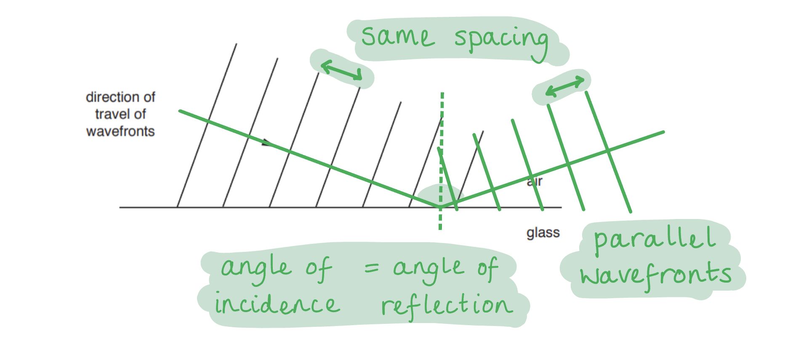

- At least 3 wavefronts drawn in air, parallel to each other; **[1 mark]**
- The same spacing between wavefronts on incident and reflected light; **[1 mark]**
- Angle of reflection equal (by eye) to the angle of incidence; **[1 mark]**

(ii) On Fig. 7.1 draw the wavefronts of the refracted wave:

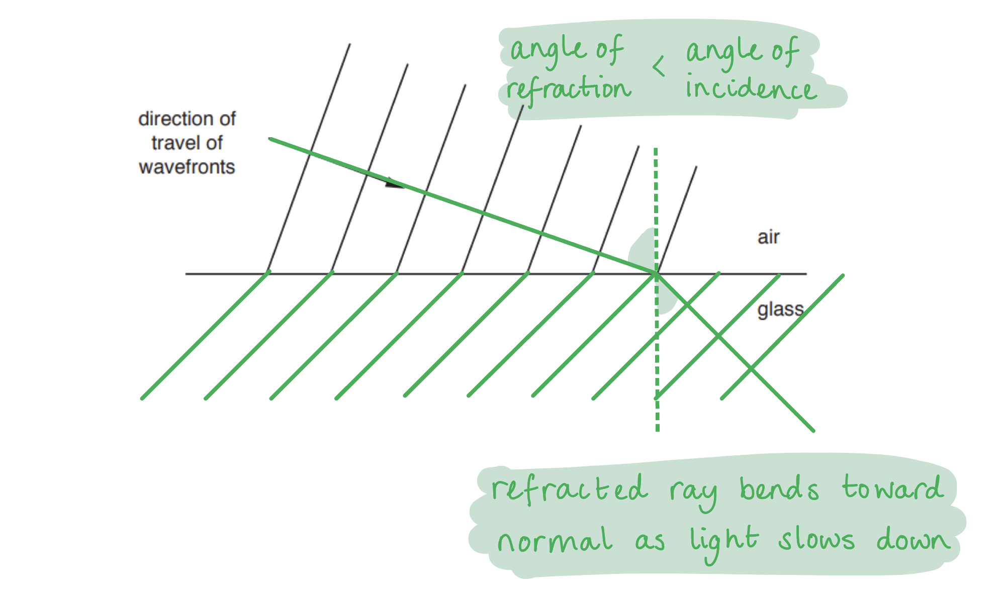

- At least 3 wavefronts drawn in glass, parallel to each other **AND** continuation of the incident wavefronts shown; **[1 mark]**
- Refracted wavefronts are equally spaced **AND** have a smaller wavelength than the incident light; **[1 mark]**
- The angle of refraction is less than the angle of incidence; **[1 mark]**

**[Total: 6 marks]**

> *Remember that when light enters a denser material it will slow down. You can remember this by thinking of moving from an empty corridor into a crowded one.*

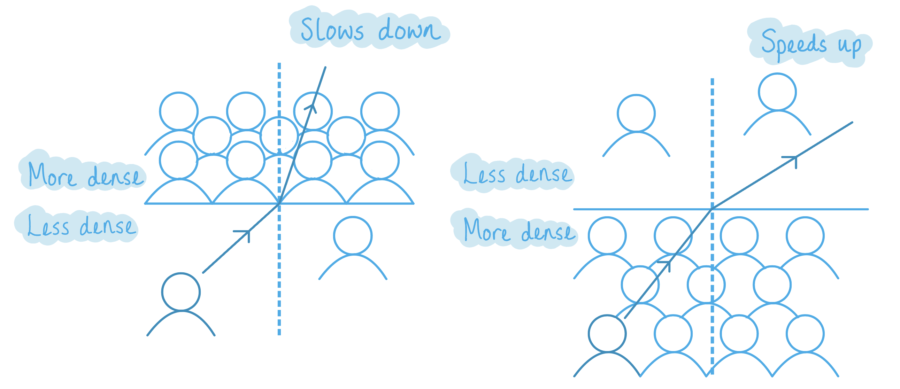

> *You can also use the acronym 'FAST' to know which direction the refracted ray will bend in. This stands for:*

- *'Faster' = 'away (from the normal)', 'slower' = 'towards (the normal)'*

> *Because the wave hits the boundary at an angle, one side of the wavefront slows down before the other side, and so it changes direction. When light slows down it bends toward the normal, when light speeds up it bends away from the normal. *

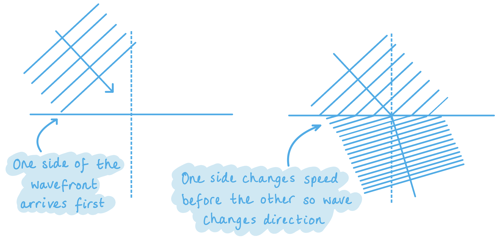
Sketch a diagram to show the appearance of the rope as the wave passes along it, labelling **two** important features of the wave:

A sketch that would score 2 marks should look like:

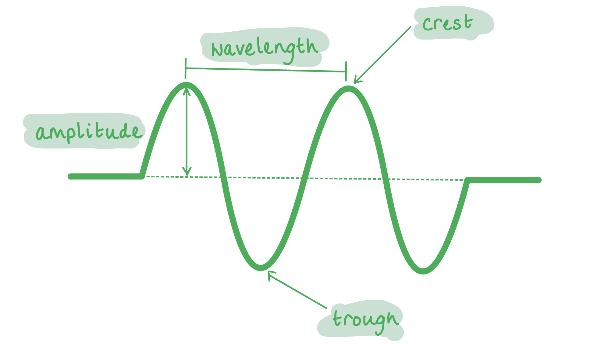

Any **two** from:

- Amplitude labelled from axis to crest or trough; **[1 mark]**
- Wavelength labelled for one full cycle; **[1 mark]**
- Crest **AND** trough correctly labelled as shown; **[1 mark]**

**[Total: 2 marks]**

### Q12
Complete the path of the ray through the device and show the ray as it emerges from the box:

A diagram that would score 3 marks should look like this:

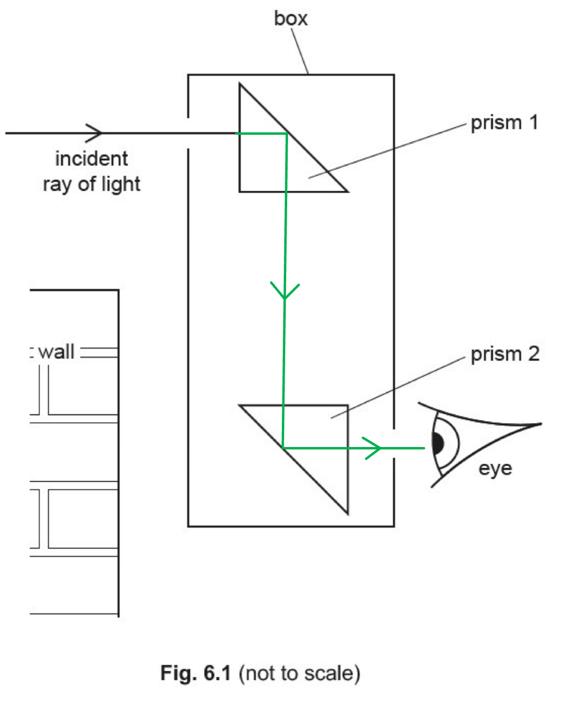

- Incident ray travels straight on at the first face of prism 1; **[1 mark]**
- Ray is reflected through 90° at the sloping face of prism 1 **AND **continues vertically downwards at the sloping face of prism 2; **[1 mark]**
- Ray is reflected through 90° at the sloping face **AND **leaves the box horizontally; **[1 mark]**

**[Total: 3 marks]**

> *Remember, when the incident ray is 90 ° to the boundary, it will **pass** **straight** **through**. There is no refraction, because if the angle of incidence is 0, then so is the angle of refraction.*

> *Use a sharp pencil and a ruler to show clearly the path of the ray and the angles of refraction in a ray diagram.*
Show that the refractive index of glass with a critical angle of 45° is 1.41:

List the known quantities:

- Critical angle, *C *= 45°

Recall the refractive index and critical angle equation:

- $n=\frac{1}{\mathrm{sin}C}$ **[1 mark]**

Substitute the known quantities into the equation and calculate the refractive index, *n*:

- $n = \frac{1}{\sin ( 45 )} = \frac{1}{0.707}$

** AND**

- *n *= 1.41 **[1 mark]**

**[Total: 2 marks]**

> *Use the revision notes to learn all equations related to the critical angle, refractive index and Snell's law. *

### Q13
To determine the focal length of the lens:

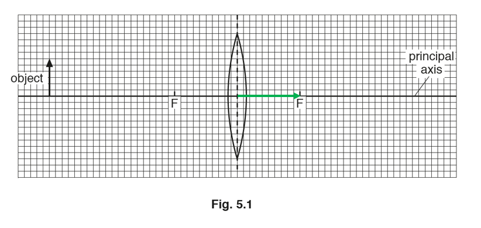

- The focal length is the distance between the centre of the lens and F
- There are 10 small squares between the centre of the lens and the focal point and each small square represents 0.5 cm
- Focal length = 10 × 0.5 cm = 5 cm **[1 mark]**

**[Total: 1 mark]**

> *The focal length is the distance between the centre of the lens and F, the focal point.*
(i) A diagram showing a ray from the top of the object that passes through a principal focus, then through the lens and beyond it would look like:

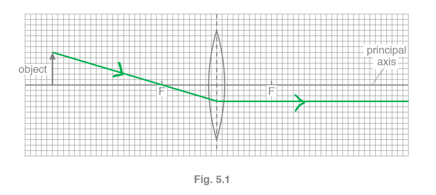

- A straight line drawn through F and then parallel to the principal axis from the centre of the lens; **[1 mark]**

(ii) A diagram showing a ray from the top of the object that passes through the centre of the lens would look like:

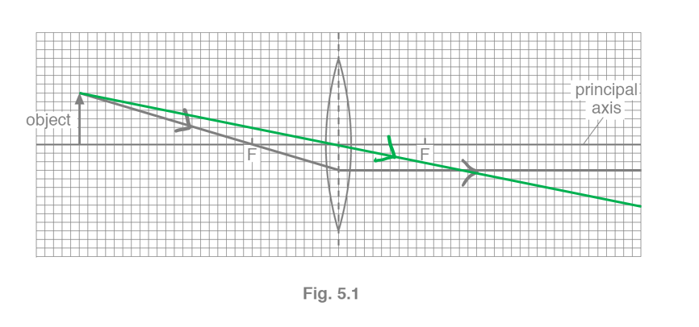

- A straight line drawn from the top of object through the centre of lens; **[1 mark]**

(iii) A diagram showing the position and nature of the image produced by the lens would look like:

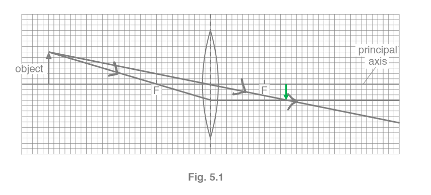

- An arrow should be drawn at the point where rays cross; **[1 mark]**
- The arrow should be on the right hand side of the lens, and pointing downwards (inverted); **[1 mark]**

**[Total: 4 marks]**

### Q14
(i) On Fig. 6.1, continue the path of the ray as it passes through the lens and emerges from it:

A diagram scoring two marks:

- Normal drawn perpendicular to the surface of the lens at each boundary
- Light ray shown bending toward the normal at the first boundary; **[1 mark]**
- Light ray shown bending away from the normal at the second boundary;** [1 mark]**

(ii) State the term used to describe the process as the ray enters and leaves the lens:

- Refraction;** [1 mark]**

**[Total: 3 marks]**

> *Remember that when light enters a denser material it will slow down. You can remember this by thinking of moving from an empty corridor into a crowded one.*

> *You can also use the acronym '**FAST**' to know which direction the refracted ray will bend in. This stands for:*

- *'**F**aster' = '**A**way (from the normal)', '**S**lower' = '**T**owards (the normal)'*
On Fig. 6.2, continue the path of the rays. Extend the rays for at least 5 cm beyond the lens:

A diagram scoring two marks:

- Rays inside the lens refract toward the normal;** [1 mark]**
- Converging rays meet at focal point; **[1 mark]**

**[Total: 2 marks]**

> *Even though there are no marks for drawing the normal, it really helps to draw it so that you can direct your rays more accurately. It should be clear on your diagram that the light is refracted inside the lens. The ray should then bend away from the normal as it emerges from the lens. This means that the focal point is quite far away. You can only really gauge this correctly if you draw the normals in. *

> *Remember that thin lenses have a longer focal distance because refraction inside the lens is less. Thicker lenses have a shorter focal distance because the ray is refracted more inside the lens. *

### Q15
State the term used for the dashed lines drawn in Fig. 8.1:

- The dashed line is the <u>normal</u>; **[1 mark]**

**[Total: 1 mark]**
Use Fig. 8.1 to identify the three angles in the list. Place the correct letter in the box to indicate each angle:

**N **Angle of incidence; **[1 mark]**

**S **Angle of reflection; **[1 mark]**

**P **Angle of refraction; **[1 mark]**

**[Total: 3 marks]**

> *You may be questioning whether angle **P** is an angle of refraction. It is important to realise that refraction occurs when light enters the block **and** when light exits the block. In both circumstances, the density of the medium changes and the speed of the light changes. *

> *The angle of refraction is the angle between the light ray in the second medium and the normal of the boundary between the two materials, therefore angle **P** is an angle of refraction. *
State the name of this effect and explain why it happens:

State the name of the effect:

- The effect is called <u>refraction</u>; **[1 mark]**

Explain why this occurs:

- The light changes speed; **[1 mark]**

**OR **

- (The glass black and the air have) difference refractive indices; **[1 mark]**

**[Total: 2 marks]**

> *Refraction is the bending of light when it travels through different mediums due to the change in speed. Each medium has a different index (**n**) which tells us how much light is slowed down in that medium. If the material is **more dense**, light is **slowed down**.*

### Q16
Determine the refractive index of ice:

Using Snell's law:

- $n=\frac{\mathrm{sin}i}{\mathrm{sin}r}$ **[1 mark]**
- $\mathrm{n} = \frac{\sin ( 46 )}{\sin ( 35 )}$ **[1 mark]**
- $n=1.25$** [1 mark]**

**[Total: 3 marks]**
Explain why the angle of refraction is smaller than the incident angle for the boundary from air to ice:

- Ice is denser than air **OR** air is less dense than ice; **[1 mark]**
- Light slows down as it passes from a less dense medium (air) to a denser medium (ice); **[1 mark]**
- So the light (changes direction and) bends toward the normal; **[1 mark]**

**[Total: 3 marks]**
The correct value for angle $θ$ is:

- The light ray will leave the ice block parallel to its incident pathway, therefore $θ=i$
- 46° **[1 mark]**

**[Total: 1 mark]**
Complete Table 1.2 by drawing a tick to show which properties of light change during refraction:

**One** mark for each correct tick:

| **Property** | **Does change** | **Does not change** |
|---|---|---|
| speed | **✓** |   |
| wavelength | **✓** |   |
| frequency |   | **✓** |

**[Total: 3 marks]**

### Q17
To calculate the speed of light in water

List the known quantities:

- Speed of light in air = 3.00 × 108 m / s
- Refractive index of water, *n *= 1.33

Recall the equation for the refractive index and speed of wave:

- $refractiveindex,n=\frac{speedinair}{speedinwater}$ **[1 mark]**

**OR**

Rearrange the equation and substitute the known quantities:

- $speedinwater=\frac{speedinair}{n}$
- $speedinwater=\frac{3\times10^{8}}{1.33}$ **[1 mark]**

Calculate the speed of the wave in water:

- Speed in water = 2.3 × 108 m / s **[1 mark]**

**[Total: 2 marks]**

> *The equation you need to use comes from the definition for refractive index, **n**:*

*The ratio of the speeds of a wave in two different regions*.
(i) To draw the positions of the four refracted wavefronts in the plastic:

A diagram that would score 3 marks should look like this:

- Wavefronts in the plastic meet the wavefronts in the air; **[1 mark]**
- The wavefronts in the air make a smaller angle with the boundary than the wavefronts in the plastic that is downwards to the left; **[1 mark]**
- Wavefronts are drawn parallel to each other; **[1 mark]**

** **

(ii) To draw an arrow to show the direction of travel of the refracted wave:

An addition to the diagram that would score 1 mark should look like this:

- The arrow(s) are perpendicular to wavefronts in plastic and downwards to the right; **[1 mark]**

** **

(iii) To label the angle of refraction *r* of the light wave:

An addition to the diagram that would score 1 mark should look like this:

- Angle of refraction *r* in the plastic is between the refracted wavefront and boundary; **[1 mark]**

**   ****OR**

- At a point where the refracted wavefront meets the boundary the normal to the boundary is drawn perpendicular to the boundary

**   ****AND**

- Angle of refraction, *r *is between the normal and the refracted wavefronts; **[1 mark]**

**[Total: 5 marks]**

> *Ray diagrams must be drawn as clearly as possible using a pencil and a ruler. In multi-part questions like this always check that you have included everything required. *

### Q18
(i) The normal for ray X looks like:

- The normal crosses the point where ray X meets the mirror, and is at 90° to it (by eye); **[1 mark]**

(ii) The path of ray Y looks like:

- The reflected ray for Y has angle of incidence = angle of reflection (by eye); **[1 mark]**

**[Total: 2 marks]**

> *You can see on our examples some things which are not in the mark scheme.*

> *(i) In the first diagram we drew a square to indicate a right angle. This shows the examiner what we intend, and ensures they know we understand the normal is perpendicular to the mirror.*

> *(ii) In the second diagram we drew the normal at ray Y. This lets us judge the incident and reflected angles. Again, it reassures the examiner we know what we are doing, as well as helping us to draw a better reflected ray.*
A correctly drawn ray diagram for a converging lens looks like:

- The horizontal ray <u>changes direction</u> and <u>passes through the focal point</u>, **F**; **[1 mark]**
- The ray to the centre of the lens <u>continues in a straight line</u> with no change in direction; **[1 mark]**
- The image is drawn correctly where rays cross, <u>with the arrow pointing to the place where the rays cross</u>; **[1 mark]**

> *It is essential that you draw ray diagrams using a ruler and sharp pencil. If you don't have these, then get them. If you find yourself in the exam without your proper equipment then ask to borrow items from the teachers invigilating the exam.*

### Q19
(i) Draw another ray from X to locate the position of the image:

- Ray is a straight line from X through the centre of the lens; **[1 mark]**

(ii) Draw an arrow to represent the image of OX and label it I:

- Arrow drawn from axis to the point where the rays cross **AND** pointing downwards **AND** labelled "I"; **[1 mark]**

(iii) Mark a principal focus for the lens and label it F:

- A point labelled F where the original ray crosses the principal axis of the lens; **[1 mark]**

(iv) Measure and record the focal length of the lens:

- Measured length of 2.7 cm ± 0.2 cm; **[1 mark]**

**[Total: 4 marks]**

> *In a converging lens, parallel rays of light are brought to a focus. The point at which they focus is called the principal focus. The more curved the lens, the closer the principal focus is to the lens. *

> *When a measurement question comes up on your paper, the exam board will ensure that it is to scale such that every student should measure the same length. On this website, however, you may be reading these questions on a laptop, a smartphone, a tablet or a PC monitor! As a result you are likely to not gain an answer of 2.7 cm here, but what is important is the method. Ensure you are measuring the right distance and using your ruler correctly - line up the 0 cm line and not the end of the ruler with the vertical axis of the lens. *
Choose two words from the list to describe image I:

`square` enlarged

**✓** diminished; **[1 mark]**

`square` same size

**✓** inverted; **[1 mark]**

`square` upright

**[Total: 2 marks]**

> *For a converging lens, the image is always inverted. The size of the image, however, depends on the distance between the object and the vertical axis on the lens. *

> *The distance between the principal focus and the lens' vertical axis is the **focal length**, which we shall denote as **f**.*

- *If the object is at a distance of more than 2**f ** from the lens' vertical axis, the image will be **smaller** than the object*
- *If the object is at a distance between **f** and 2**f** from the lens' vertical axis, the image will be **larger** than the object *
- *If the object is at a distance of 2**f** from the lens' vertical axis, the image is the **same size** as the object. *

> *In the question above, it can be seen using a ruler (regardless of the screen you are using) that the object is more than 2**f** from the lens' vertical axis. This means the image will be **inverted **and **diminished** (i.e. smaller). *

### Q20
(i) State the name of this effect:

- Refraction **OR** reflection; **[1 mark]**

(ii) State the cause of this effect:

If part (i) is given as refraction:

- Change / increase / decrease in speed of the wave; **[1 mark]**

**OR  **** **

- Change of refractive index; **[1 mark]**

If part (i) is given as reflection:

- The light hits the surface / boundary; **[1 mark]**

**[Total: 2 marks]**

> *Sometimes there can be more than one correct answer to a question - the key is being able to explain it properly.*

> *Refraction changes the direction of the ray due to a change in speed:*

> *Reflection changes the direction at the boundary:*

(i) A diagram which would score **one** mark is:

- F marked at 3.5 cm (17.5 small squares from the centre of the lens) on each side; **[1 mark]**

(ii) A diagram which would score** ****three** marks would look like:

**Any two from:**

- Ray drawn from the tip of O refracted at the centre of the lens to pass through the right hand / father focal point; **[1 mark]**
- Undeviated ray from tip of O through (optical) centre of lens; **[1 mark]**
- Ray drawn from the tip of O through the left hand / nearer focal point refracted horizontally; **[1 mark]**

Image drawn:

- At the intersection of the rays, with an arrow points downwards to indicate the image is inverted;  **[1 mark]**

(iii) To determine the height of the image:

Count the number of small squares:

- There are 19.5 small squares
- Each small square is worth 0.2 cm
- Therefore, $heightofimage=19.5\times0.2=3.9\mathrm{cm}$ (range 3.6 to 4.1 cm); **[1 mark]**

(iv) To state and explain whether the image is real or virtual:

- The image is real; **[1 mark]**

**AND**

**Any one from:**

- Light passes through the image; **[1 mark]**
- The light can be projected / seen on a screen; **[1 mark]**
- The refracted rays cross / meet; **[1 mark]**

**[Total: 6 marks]**

> *You may come across the word 'paraxial' in questions regarding lenses. This means parallel to the principal axis that goes through the centre of the lens horizontally. *

> *When drawing the rays, make sure you use a ruler. You only need to draw two rays in order to find an image. *

### Q21
On Fig. 1.1, complete the path of the light ray until it leaves the section of optical fibre:

A diagram scoring 2 marks:

- Internal reflection drawn **AND*** i = r* for the first reflection; **[1 mark]**

*Mark is not awarded if the ray emerges from the sides of the optical fibre*

- The ray reaches the end of the tube after 1 or 2 reflections; **[1 mark]**

**[Total: 2 marks]**
The type of reflection that occurs within an optical fibre is:

- <u>Total internal</u> reflection; **[1 mark]**

**[Total: 1 mark]**
Calculate the critical angle:

Using Snell's law:

- $\mathrm{sin}c=\frac{1}{n}$ **[1 mark]**
- $c = \sin ^{- 1} ( \frac{1}{1.52} )$ **[1 mark]**
- $c=41^{\circ}$ **[1 mark]**

**[Total: 3 marks]**
Calculate the speed of light in glass:

Using the equation for refractive index:

- $n=\frac{speedoflightinvacuum}{speedoflightinglass}$ **[1 mark]**
- $speedoflightinglass=\frac{speedoflightinvacuum}{n}=\frac{3.00\times10^{8}}{1.52}$ **[1 mark]**
- $speedoflightinglass=1.97\times10^{8}m/s$ **[1 mark]**

**[Total: 3 marks]**

### Q22
(i) A correctly completed diagram looks like:

- For one correct ray; **[1 mark]**
- For a second correct ray; **[1 mark]**
- The rays intersect above axis to left of A **AND **object drawn from axis to intersection; **[1 mark]**

**   **

(ii) The distances that are equal to the focal length are:

Recall that a refracted ray passes through the focal point:

- AC; **[1 mark]**
- CB; **[1 mark]**

**   **

**[Total: 5 marks]**

> *You may have to produce a simple ray diagram in the exam, so learn the basic rules;*

- *First ray passes through the focal point and the centre of the lens without changing direction*
- *Second ray goes parallel to the principal axis then is refracted through the focal point*
- *Where the rays meet, draw the arrowhead of the image, and attach the base of the arrow to the principal axis*
To complete the ray diagrams as light refracts through prisms:

(i)

- One ruled line showing a ray in the prism <u>refracted down less</u> than green ray;** [1 mark]**

(ii)

- One ruled line showing a ray in the rectangular block <u>refracted down less</u> than the first ray;** [1 mark]**

(iii)

One ruled ray leaving the rectangular block parallel to incident ray / the other emergent ray; **[1 mark]**

**[Total: 3 marks]**

> *For part (i) you can put your ray anywhere in an accepted range. The ray must refract (so it has to be below a straight continuation of the white light), but it has to refract less than the green light.*

> *If you weren't sure whether to refract your red ray above or below the green light then remind yourself of the order of colours of light in the rainbow.*

> *In parts (ii) and (iii) you notice that we draw a normal line, even though it wasn't asked for. Getting into good habits like this will help you draw accurate drawings more quickly. This is good exam strategy as well as good physics!*

> *The emergent ray from a block is always parallel to the incident ray, no matter how much refraction happened in between. This is because the ratio of direction change - the refractive index - has the same effect on entering and leaving the block.*

### Q23
State what happens to the speed of light as it enters the plastic block:

- (The speed) decreases; **[1 mark]**

Explain why:

**Any one from:**

- The refractive index is greater than 1.0; **[1 mark]**
- sin (*i*) is greater than sin (*r*); **[1 mark]**
- *i* is greater than *r*; **[1 mark]**
- Refraction **OR** the light bends towards the normal; **[1 mark]**
- $\frac{\mathrm{sin}i}{\mathrm{sin}r}=\frac{c_{w}}{c_{p}}$ **[1 mark]**

**[Total: 2 marks]**
(i) A diagram which would score two marks would look like:

- Paraxial ray refracts through F2; **[1 mark]**
- Ray through the centre continues straight; **[1 mark]**

** **

(ii) A diagram which would score two marks would look like:

- Rays from **(b)(i)** traced back to intersection; **[1 mark]**
- Image marked from intersection of the rays to the axis; **[1 mark]**

** **

(iii) To determine the height of the image:

- Count the number of small squares: 14; [1 mark]
- Each small square is worth 0.2 cm

  - Therefore, $heightoftheimage=14\times0.2=2.8\mathrm{cm}$ (range 2.7 to 3.3); **[1 mark]**

** **

(iv) State and explain the nature of the image:

- The image is virtual

**AND**

Any **one** from:

- Light does not pass through the image / cannot be projected on to a screen; **[1 mark]**
- Object distance is less than the focal length; **[1 mark]**
- The image is on the same side as the object; **[1 mark]**

**[Total: 6 marks]**

> *You may come across the word 'paraxial' in questions regarding lenses. This means parallel to the principal axis that goes through the centre of the lens horizontally. *

> *When drawing the rays, make sure you use a ruler. You only need to draw two rays in order to find an image. *

### Q24
(i) The value of the angle of incidence for the ray of light at point P is:

- The normal is at 90° to the boundary, and the angle of incidence is always measured between the ray and the normal
- $angleofincidence=90--30$
- angle of incidence = 60° **[1 mark]**

(ii) Draw a normal, the reflected ray and determine the angle of reflection all at point P:

A diagram that would score 2 of the 3 available marks should look like:

- Normal correctly position perpendicular to the boundary; **[1 mark]**
- Reflected ray at 60° to the normal;** [1 mark]**
- Angle of reflection = 60°** [1 mark]**

**[Total: 4 marks]**

> *The angle of incidence is always measured between the **ray **and the **normal**. The normal is also at 90° to the boundary.*

> *For ray diagrams, make sure you use a ruler (or a straight edge) and draw an arrow for the direction of the ray. Although the examiner is unlikely to measure the angle you've drawn exactly, you must draw it to your best judgement. The law of reflection states that angle of incidence = angle of reflection.*
Continue the paths of these two rays to show the position of image OB:

A diagram that would score 4 marks should look like:

- Top ray (initially horizontal) drawn to continue through F; **[1 mark]**
- Bottom ray (initially diagram through principal focus) continues parallel to axis; **[1 mark]**
- Image indicated by arrow where both rays intersect; **[1 mark]**
- Image upside down indicated by arrow pointed downwards; **[1 mark]**

**[Total: 4 marks]**

> *Ray diagrams essential to practice before the exam! Make sure you're using a sharp pencil and ruler to construct the most accurate diagram. *

> *It is important to remember that the top lines always goes through the principal force (F) and the bottom lines always travels parallel to the axis. Draw the lines for most/all of the length of the grid, and draw an arrow from the axis to the point where they intersect. This is the image.*

### Q25
(i) An answer on Fig. 7.1 which would score **two** marks would look like:

- Blue between indigo and green; **[1 mark]**
- Yellow between green and orange; **[1 mark]**

(ii) An answer on Fig. 7.1 which would score **one** mark would look like:

- An arrow pointing right; **[1 mark]**

**[Total: 3 marks]**
(i) To draw the path of the ray as it travels through the glass prism and enters the air.

A diagram which would score** **two** **marks would look like:

- Ray refracted down at the first boundary between the air and the glass; **[1 mark]**
- Ray refracted down on emergence from the glass;** [1 mark]**

(ii) To state the term used to describe what happens to the ray of red light as it enters and leaves the prism:

- The light is undergoing refraction; **[1 mark]**

**[Total: 3 marks]**

### Q26
Calculate angle *x*:

List the known quantities:

- Angle of incidence, *i* = 50°
- Refractive index, *n *= 2.42

Recall the equation for Snell's law:

- $\frac{s i n ( i )}{s i n ( r )} = n$ **[1 mark]**

Rearrange the equation to make the angle of refraction, *x* the subject:

- $x = s i n^{- 1} ( \frac{s i n ( i )}{n} )$

Substitute the known quantities into the equation for Snell's law:

- $x = s i n^{- 1} ( \frac{s i n ( 50 )}{2.42} )$

Calculate the value of *x*:

- *x *= 18.45° = 18° (2 s.f.) **[1 mark]**

**[Total: 2 marks]**

> *You can see below each step of the rearrangement. Note that the inverse of **p** = sin(**θ**) is **θ** = sin**−1**(**p**).*

Explain the term total internal reflection:

- When light travels from an (optically) more dense medium to an (optically) less dense medium; **[1 mark]**
- And the angle of incidence (of the light at the boundary) is greater than the critical angle (of the material creating the boundary); **[1 mark]**
- Then all light is reflected **OR **no light is refracted; **[1 mark]**

**[Total: 3 marks]**
Draw the path of the red light through and out of the prism after point A:

A diagram that should score 2 marks would look like this:

- The ray is reflected at boundary A with *i *= *r* by eye; **[1 mark]**
- The ray is refracted at the second boundary and bent away from the normal; **[1 mark]**

**[Total: 2 marks]**

> *The diagram below explains the mark scheme. *

### Q27
Tick the box which represents the focal length in Fig. 8.1:

**✓**  C to F1 **[1 mark]**

`square`  O to C

`square`  F2 to I

`square`  O to I

**[Total: 1 mark]**
Extend two rays to reach the position of the image:

- Diagonal (lower) ray travels through F1 to the lens **AND**** **then travels parallel to the optical axis to the position of the image, I; **[1 mark]**
- Another ray parallel to the to the principal axis **AND** then the ray is refracted through F2 to the position of the image, I; **[1 mark]**
- Both rays converge at the position (the arrowhead) of the image, I; **[1 mark]**

**[Total: 3 marks]**

> *Light rays don't change direction when travelling through free space or air, so the rays should be straight until they meet the lens and straight once thy have passed through it.*
State the effect on the position of the image when the object is moved away:

- The image moves closer to the lens / F2; **[1 mark]**

State the effect on the size of the image when the object is moved away:

- The image will be <u>smaller</u>; **[1 mark]**

**[Total: 2 marks]**

> *If you're not confident on how moving an object affects the image for a converging lens, be sure to reread the Save My Exams revision noters on the topic. The appearance of the image varies a lot depending on the position of the object. *

> *If, however, you end up in a situation in your exam where you can't remember the relations outlined in the revision notes, you can always sketch a new set of rays to show how the image will differ. The object has been drawn. further back and the blue lines represent the new rays from the object in the new position. *

> *With the blue lines following the same rules as the green lines from the solution, we can see that the new image formed is **closer to the lens and smaller**.*

### Q28
The radiation in each of the regions represented by A, B, C and D is:

A **Infrared**    B **Ultra-violet**    C **X-Rays**    D** Gamma Rays**

- *Two correct answers scores 1 mark*
- *Two further correct answers scores the second mark*

**[Total: 2 marks]**

> *Use the revision notes to learn the types of electromagnetic radiation in order of increasing/decreasing wavelength or frequency.*
(i) To calculate the angle of refraction in the glass at S:

List the known quantities:

- Angle of incidence, *i* = 35 °
- Refractive index of the glass, *n *= 1.5

Recall the equation for the refractive index of a material / substitute in the known quantities:

- $n = \frac{\sin ( i )}{\sin ( r )}$ **[1 mark]**

**  *** ***OR**

- $\sin ( r ) = \frac{\sin ( i )}{n}$ **[1 mark]**

**   OR**

- $s i n ( r ) = \frac{\sin ( 35 )}{1.5}$ **[1 mark]**

Calculate the angle of refraction, *r*:

- $r = \sin ^{- 1} ( \frac{\sin ( 35 )}{1.5} )$
- *r* = 22 ° **[1 mark]**

(ii) To draw the refracted ray at face XY and the ray emerging from face XZ of the prism:

A diagram that should score 2 marks would look like this:

- At XY angle of refraction is less than the angle of incidence, so i < r; **[1 mark]**
- At XZ angle of refraction is greater than the angle of incidence, so i > r; **[1 mark]**

(iii) To draw the path of the blue ray in the prism and emerging from the prism:

A diagram that should score 2 marks would look like this:

- Inside the prism blue ray is drawn below the red ray

**   AND**

- Blue ray is also drawn with r < i into the prism; **[1 mark]**
- To the right of the prism the blue ray diverges downwards from the red ray; **[1 mark]**

**[Total: 6 marks]**

> *Red light has a longer wavelength than blue light, so it undergoes less refraction as it passes into and out of the prism. *
