# Exam Questions — Light
**3. Waves** · Cambridge (CIE) IGCSE physics (0625 & 0972)
> Source: [https://www.savemyexams.com/igcse/physics/cie/23/topic-questions/](https://www.savemyexams.com/igcse/physics/cie/23/topic-questions/) · 70 questions across 3 sets

## Alternative To Practical Questions (7 questions)

### Q1 — medium — 11 marks

**Q1** [1 mark]

A student investigates the magnification produced by a converging lens.

He is using the apparatus shown in Fig. 3.1.

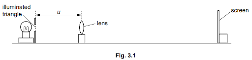

The illuminated object consists of a triangular-shaped hole in a piece of card. Fig. 3.2 shows, full size, the illuminated object.

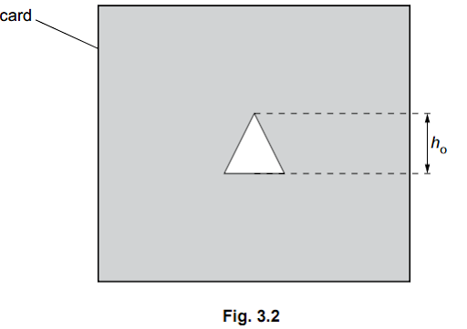

Measure and record the height *h*O of the triangular-shaped hole.

*h*O = .....................................................  cm

*Source: specimen 2023 paper 6 Q3A*

**Q1** [2 marks]

**Extract:**

The height of h_O is: 1.4 cm; [1 mark]

Using your results from (a) and the equation M = h_O / h_I, calculate a value M and record this value in Table 3.1.

**Extended Tier Only**

The distance between the illuminated object and the centre of the lens is set to *u* = 20.0 cm. The screen is moved until a focused image of the illuminated object is seen, as shown in Fig. 3.3.

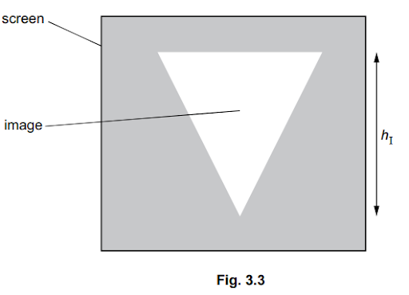

The student repeats the procedure for *u* = 30.0 cm, *u* = 40.0 cm, *u *= 50.0 cm and *u* = 60.0 cm. His results are shown in Table 3.1.

Measure, and record in the first row of Table 3.1, the height *h*I of the image.

Using your results from **(a) **and the equation* *$M=\frac{h_{o}}{h_{I}}$, calculate a value *M* and record this value in Table 3.1.

**Table 3.1**

| $u/\mathrm{cm}$ | $h_{I}/\mathrm{cm}$ | $M$ |
|---|---|---|
| 20.0 |   |   |
| 30.0 | 1.5 | 0.93 |
| 40.0 | 0.9 | 1.6 |
| 50.0 | 0.6 | 2.3 |
| 60.0 | 0.5 | 2.8 |

*Source: specimen 2023 paper 6 Q3B*

**Q1** [4 marks]

**Extract:**

Table 3.1

| u / cm | h_I / cm | M |
| 20.0   | 4.5      | 0.31 |
| 30.0   | 1.5      | 0.93 |
| 40.0   | 0.9      | 1.6  |
| 50.0   | 0.6      | 2.3  |
| 60.0   | 0.5      | 2.8  |

Plot a graph of *u*/cm (*y*-axis) against *M* (*x*-axis).

You do** not **have to start your axes at the origin (0, 0)

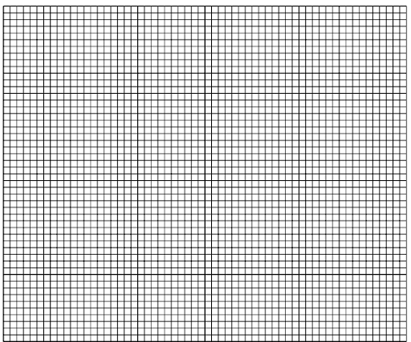

*Source: specimen 2023 paper 6 Q3C*

**Q1** [2 marks]

**Extract:**

Plot a graph of *u*/cm (*y*-axis) against *M* (*x*-axis). 

You do** not **have to start your axes at the origin (0, 0)

- Axes with correct orientation, both labelled with quantity and unit; [1 mark]
- Appropriate scales (plots occupying at least ½ grid); [1 mark]
- Plots all correct to ½ small square and precise plots; [1 mark]
- Well-judged line and thin line; [1 mark]

**[Total: 4 marks]**

When drawing a line of best fit on a graph have roughly even numbers of data points above and below the line. If not possible, try and ensure the combined distances of points above the line equal the combined distances of points below.

Here, only one point is below the line while two are above, but the point below the line is further from the line than the two points above.

Determine the gradient *G* of the graph.

Show clearly on the graph how you obtained the necessary information.

*G* = ....................................................

*Source: specimen 2023 paper 6 Q3D*

**Q1** [2 marks]

**Extract:**

The distance between the illuminated object and the centre of the lens is set to u = 20.0 cm. The screen is moved until a focused image of the illuminated object is seen, as shown in Fig. 3.3.

The student repeats the procedure for u = 30.0 cm, u = 40.0 cm, u = 50.0 cm and u = 60.0 cm. His results are shown in Table 3.1. 

Measure, and record in the first row of Table 3.1, the height h_I of the image.

**Extended Tier Only**

Describe** one **difficulty that might be experienced when measuring the height of the image *h*I .

Suggest an improvement to the **apparatus** to reduce this difficulty.

*Source: specimen 2023 paper 6 Q3E*

### Q2 — medium — 9 marks

**Q2** [3 marks]

A student is determining the focal length of a lens.

Fig. 3.1 shows the apparatus used.

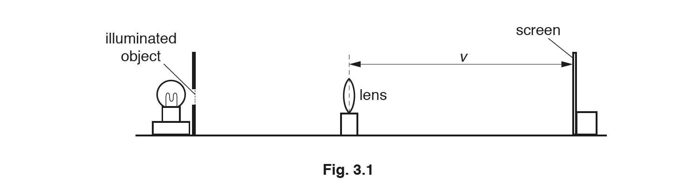

The student adjusts the position of the screen until a clearly focused image is formed on the screen.

The distance *v* on Fig. 3.1 is measured to be 5.80 cm.

(i) Fig. 3.1 is drawn 1/5th actual size.

Calculate *V*, the actual distance from the lens to the screen

*V* = ......................................................... [1]

(ii) With a clearly focused image formed on the screen, the actual distance from the centre of the lens to the illuminated object, *U* is 20.0 cm.

Calculate the focal length *f**1* of the lens using the equation $f_{1} = \frac{U V}{( U + V )}$

*f**1* = ......................................................... [2]

*Source: May/June 2018 (Series 2) 0625/62 Q3A*

**Q2** [2 marks]

**Extract:**

(ii) With a clearly focused image formed on the screen, the actual distance from the centre of the lens to the illuminated object, U is 20.0 cm.
Calculate the focal length f_1 of the lens using the equation f_1 = (U V) / (U + V)

Substitute the known quantities into the equation for f_1:
f_1 = (20 × 29) / (20 + 29)
Calculate f_1:
f_1 = 11.83 cm = 11.8 cm (3 s.f.)

The student repeats the procedure in **(a)**, using a different distance *U*. She obtains another value for the focal length *f**2*.

*f**2* = 12.2 cm

Calculate the average value *f**A* of the focal length of the lens, using *f**2* and your value for *f**1** *in **(a)(ii)**. Give your answer to a suitable number of significant figures for this experiment.

*f*A = .........................................................

*Source: May/June 2018 (Series 2) 0625/62 Q3B*

**Q2** [2 marks]

**Extract:**

the actual distance from the centre of the lens to the illuminated object, U is 20.0 cm.

The student states that taking more measurements improves the reliability of the value obtained for *f**A*.

Suggest additional values for *U* that you would use.

*Source: May/June 2018 (Series 2) 0625/62 Q3C*

**Q2** [2 marks]

**Extract:**

A student is determining the focal length of a lens. The student adjusts the position of the screen until a clearly focused image is formed on the screen. The distance V is measured from the lens to the screen. The actual distance from the centre of the lens to the illuminated object, U, is also measured. The experiment involves measuring U and V to calculate the focal length of the lens.

State **two** precautions that you would take in this experiment to obtain accurate readings.

*Source: May/June 2018 (Series 2) 0625/62 Q3D*

### Q3 — medium — 13 marks

**Q3** [3 marks]

A student is determining the focal length *f* of a lens.

Fig. 3.1 shows the apparatus.

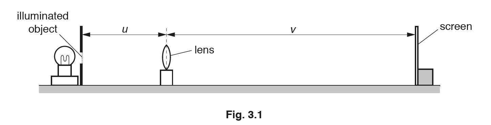

The student places the screen a distance* D *= 70.0 cm from the illuminated object.

He places the lens close to the screen and moves the lens slowly away from the screen until a clearly focused image is formed on the screen.

He measures the distance *u* between the centre of the lens and the illuminated object.

He measures the distance *v* between the centre of the lens and the screen.

He repeats the procedure using values for *D* of 75.0 cm, 80.0 cm, 85.0 cm and 90.0 cm.

The readings are shown in Table 3.1.

Calculate, and record in Table 3.1, *uv* for each value of *D*.

**Table 3.1**

| **D/cm** | **u/cm** | **v/cm** | **uv/cm****2** |
|---|---|---|---|
| 70.0 | 22.0 | 48.4 |   |
| 75.0 | 20.7 | 54.5 |   |
| 80.0 | 20.0 | 60.0 |   |
| 85.0 | 19.5 | 65.8 |   |
| 90.0 | 19.0 | 71.2 |   |

*Source: May/June 2018 (Series 1) 0625/61 Q3A*

**Q3** [4 marks]

**Extract:**

Table 3.1

| D/cm | u/cm | v/cm | uv/cm^2 |
| 70.0 | 22.0 | 48.4 | 1065 |
| 75.0 | 20.7 | 54.5 | 1128 |
| 80.0 | 20.0 | 60.0 | 1200 |
| 85.0 | 19.5 | 65.8 | 1283 |
| 90.0 | 19.0 | 71.2 | 1353 |

Plot a graph of* uv*/cm2 (y-axis) against *D*/cm (x-axis). You do not need to start your axes at the origin (0,0).

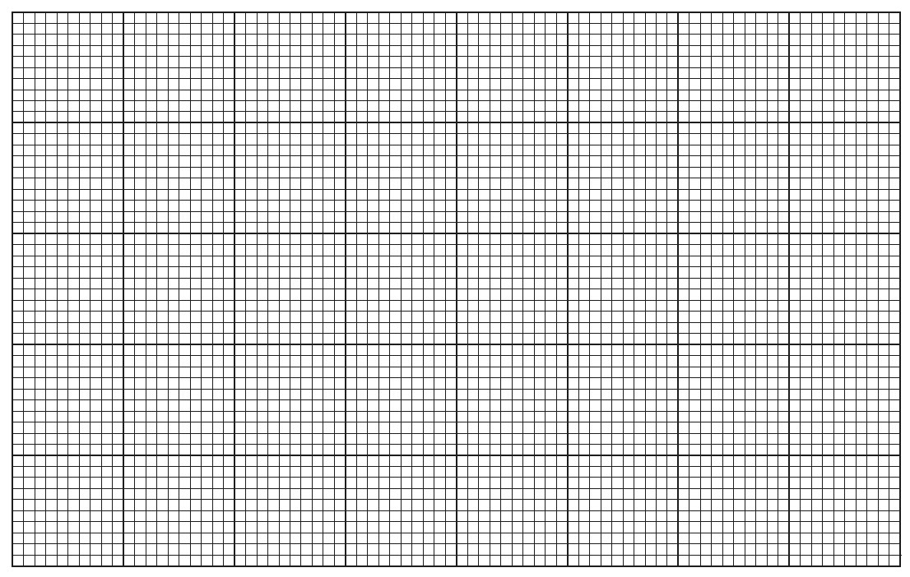

*Source: May/June 2018 (Series 1) 0625/61 Q3B*

**Q3** [2 marks]

**Extract:**

A student is determining the focal length *f* of a lens.

The student places the screen a distance* D *= 70.0 cm from the illuminated object.

He places the lens close to the screen and moves the lens slowly away from the screen until a clearly focused image is formed on the screen.

He measures the distance *u* between the centre of the lens and the illuminated object.

He measures the distance *v* between the centre of the lens and the screen.

He repeats the procedure using values for *D* of 75.0 cm, 80.0 cm, 85.0 cm and 90.0 cm.

The readings are shown in Table 3.1.

| **D/cm** | **u/cm** | **v/cm** | **uv/cm**^**2**^ |
| 70.0 | 22.0 | 48.4 | 1065 |
| 75.0 | 20.7 | 54.5 | 1128 |
| 80.0 | 20.0 | 60.0 | 1200 |
| 85.0 | 19.5 | 65.8 | 1283 |
| 90.0 | 19.0 | 71.2 | 1353 |

Plot a graph of* uv*/cm^2^ (y-axis) against *D*/cm (x-axis). You do not need to start your axes at the origin (0,0).

Determine the gradient *G* of the line. Show clearly on the graph how you obtained the necessary information.

State the coordinates at the top and bottom of the triangle:

- (x₁, y₁) = (85, 1283)
- (x₂, y₂) = (75, 1128)

Recall the equation to calculate the gradient of a straight line:

- Gradient, G = Change in y / Change in x = (y₁ - y₂) / (x₁ - x₂)

Substitute the coordinates into the equation to calculate the gradient, *G*:

- G = (1283 - 1128) / (85 - 75)
- G = 15.5

Remember the following when creating your gradient triangle:
- Make it as large as possible
- Use points that the line of best fit goes through as the start and end
- Form the triangle in the middle but continue the lines onto the horizontal and vertical axis, so it is easier to read the coordinates if you need to

Determine the gradient *G* of the line. Show clearly on the graph how you obtained the necessary information.

*G* = ........................................................

*Source: May/June 2018 (Series 1) 0625/61 Q3C*

**Q3** [2 marks]

**Extract:**

State the coordinates at the top and bottom of the triangle:
- (x₁, y₁) = (85, 1283)
- (x₂, y₂) = (75, 1128)

Recall the equation to calculate the gradient of a straight line:
- Gradient, G = (Change in y) / (Change in x) = (y₁ - y₂) / (x₁ - x₂)

Substitute the coordinates into the equation to calculate the gradient, G:
- G = (1283 - 1128) / (85 - 75)
- G = 15.5

The focal length *f* of the lens is numerically equal to the gradient *G* of the graph. Write down a value for the focal length *f* of the lens. Give your answer to a suitable number of significant figures for this experiment.

*f* = .........................................................

*Source: May/June 2018 (Series 1) 0625/61 Q3D*

**Q3** [2 marks]

**Extract:**

A student is determining the focal length *f* of a lens.

Fig. 3.1 shows the apparatus.

The student places the screen a distance* D *= 70.0 cm from the illuminated object.

He places the lens close to the screen and moves the lens slowly away from the screen until a clearly focused image is formed on the screen.

He measures the distance *u* between the centre of the lens and the illuminated object.

He measures the distance *v* between the centre of the lens and the screen.

He repeats the procedure using values for *D* of 75.0 cm, 80.0 cm, 85.0 cm and 90.0 cm.

Suggest **two** difficulties in this experiment when trying to obtain accurate readings.

*Source: May/June 2018 (Series 1) 0625/61 Q3E*

### Q4 — medium — 11 marks

**Q4** [1 mark]

A student is investigating the reflection of light by a plane mirror.

Fig. 1.1 shows his ray-trace sheet at full size.

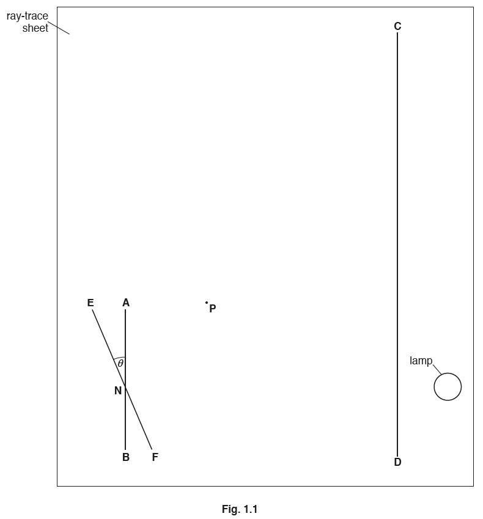

The student carries out an initial experiment. He draws lines **AB** and **CD** as shown in Fig. 1.1. He then draws a line **EF** through a point **N** as shown in Fig. 1.1 and at an angle *θ* to line **AB**.

The angle *θ* is

measured to be 23° ±1°

Draw a normal to line **AB** at point **N** and extend the normal to line** CD**. Label the point at which the normal crosses line **CD** with the letter **L**.

*Source: Feb 2019 0625/62 Q1A*

**Q4** [2 marks]

**Extract:**

A student is investigating the reflection of light by a plane mirror.

Fig. 1.1 shows his ray-trace sheet at full size.

The student carries out an initial experiment. He draws lines **AB** and **CD** as shown in Fig. 1.1. He then draws a line **EF** through a point **N** as shown in Fig. 1.1 and at an angle *θ* to line **AB**.

The angle *θ* is  measured to be 23° ±1°

Draw a normal to line **AB** at point **N** and extend the normal to line** CD**.

The student places a plane mirror on line **EF** and a screen with a 2 mm slit on line **CD**. He arranges the screen so that a ray of light shines along line **LN**. The ray reflected from the mirror passes through point **P**.

State and explain whether point **P**, shown on Fig. 1.1, is at a suitable distance from point **N **for this investigation.

*Source: Feb 2019 0625/62 Q1B*

**Q4** [2 marks]

**Extract:**

A student is investigating the reflection of light by a plane mirror.

  Fig. 1.1 shows his ray-trace sheet at full size.

The student carries out an initial experiment. He draws lines AB and CD as shown in Fig. 1.1. He then draws a line EF through a point N as shown in Fig. 1.1 and at an angle θ to line AB.

  The angle θ is

 measured to be 23° ±1°

Draw a normal to line AB at point N and extend the normal to line CD. Label the point at which the normal crosses line CD with the letter L.

(i) Draw a line joining point **N** and point **P**. Extend this line until it meets line **CD**.

Label the point at which this line meets line **CD** with the letter **G**.

[1]

(ii) Measure the length *a* of line **LG**.

*a* = ................................................... cm [1]

*Source: Feb 2019 0625/62 Q1C*

**Q4** [4 marks]

**Extract:**

A student is investigating the reflection of light by a plane mirror.

Fig. 1.1 shows his ray-trace sheet at full size.

The student carries out an initial experiment. He draws lines **AB** and **CD** as shown in Fig. 1.1. He then draws a line **EF** through a point **N** as shown in Fig. 1.1 and at an angle *θ* to line **AB**.

The angle *θ* is  measured to be 23° ±1°

Draw a normal to line **AB** at point **N** and extend the normal to line** CD**.

The student repeats the procedure for values of *θ* = 25°, 20°, 15°, 10° and 5°. His values for *a* are shown in Table 1.1.

**Table 1.1**

| *θ* / ° | *a */cm |
|---|---|
| 25 | 12.2 |
| 20 | 8.3 |
| 15 | 5.7 |
| 10 | 3.6 |
| 5 | 1.8 |

Use the values from Table 1.1 to plot a graph of *a */ cm (y-axis) against *θ */ ° (x-axis).

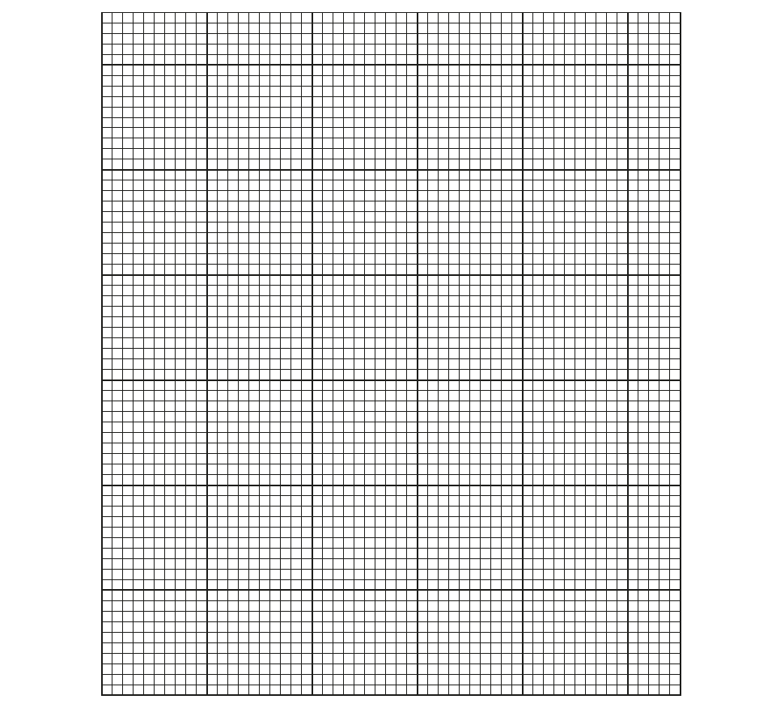

*Source: Feb 2019 0625/62 Q1D*

**Q4** [1 mark]

**Extract:**

A student is investigating the reflection of light by a plane mirror. The student draws lines AB and CD on a ray-trace sheet, draws a line EF through a point N at an angle θ to AB, and draws a normal to AB at N. The angle θ is measured (e.g., 23° ±1°). A plane mirror is placed on EF, and a screen with a 2 mm slit is placed on CD. A ray of light shines along LN, is reflected from the mirror, and passes through point P. The student joins N and P, extends the line to meet CD at G, and measures the length a of LG. The procedure is repeated for θ = 25°, 20°, 15°, 10°, and 5°, and the corresponding values of a are recorded in a table. The values are then plotted on a graph of a (y-axis) against θ (x-axis).

Suggest a possible source of inaccuracy in this experiment, even if it is carried out carefully.

*Source: Feb 2019 0625/62 Q1E*

**Q4** [1 mark]

**Extract:**

(ii) Measure the length *a* of line LG.

a = ................................................... cm

The student repeats the procedure for values of *θ* = 25°, 20°, 15°, 10° and 5°. His values for *a* are shown in Table 1.1.

Table 1.1

| *θ* / ° | *a */cm |
| 25 | 12.2 |
| 20 | 8.3 |
| 15 | 5.7 |
| 10 | 3.6 |
| 5 | 1.8 |

A student wishes to check if his values for *a* are reliable.

Suggest how he could improve the experiment, using the same apparatus, to check the reliability of his results.

*Source: Feb 2019 0625/62 Q1F*

### Q5 — medium — 6 marks

**Q5** [3 marks]

**Extract:**

Question stem:

- On the diagram, u = 5.0 cm and v = 7.5 cm
- The diagram is drawn to 1/5 scale, so U = 5.0 × 5 = 25 cm and V = 7.5 × 5 = 37.5 cm

---

When marking this answer:

- In part (i), the mark needs both U and V correct
- In part (ii), accept f1 correctly calculated from the candidate's own U and V (ecf), for example 15.1 cm from V = 38 cm
- In part (ii), f1 must be given to two or three significant figures and with the unit cm; a bare 15 with no unit does not earn the mark
- In part (iii), "move the screen slowly" or "move the screen backwards and forwards" each earns the mark on its own

Some students determine the focal length of a converging lens by two different methods. They use the apparatus shown in Fig. 2.1.

A student sets the distance *U* between the illuminated triangle and the lens.

She moves the screen until a sharp image of the triangle is seen on the screen.

**Method 1**

On Fig. 2.1, the distance *u* between the illuminated triangle and the lens is $5 . 0 \text{cm}$.

On Fig. 2.1, the distance *v* between the lens and the screen is $7 . 5 \text{cm}$.

Fig. 2.1 is drawn to 1/5 scale.

(i) Calculate the actual distance *U* between the illuminated triangle and the lens, and the actual distance *V* between the lens and the screen, in the experiment.

*U* = ...............................................................

*V* = ...............................................................

[1]

(ii) Calculate a value $f_{1}$ for the focal length of the lens, using the equation:

`f_{1} = \frac{UV}{\left(U + V\right)}`

$f_{1}$ = .........................................................

[1]

(iii) Briefly describe a technique to obtain an image on the screen that is as sharp as possible in this experiment.

[1]

*Source: 2019 (Series 3) 0625/63 Q2A*

**Q5** [2 marks]

**Extract:**

Question stem:

- From part (a): on the diagram v = 7.5 cm and the diagram is drawn to 1/5 scale, so V = 7.5 × 5 = 37.5 cm
- hO = 1.5 cm and hI = 2.4 cm

---

When marking this answer:

- In part (i), M = 1.6 must be given without a unit; an answer with a unit does not earn the mark
- In part (ii), accept 14 cm or 14.4 cm for f2 (from V = 37.5 cm) as well as 15 cm or 14.6 cm (from V = 38 cm)
- In part (ii), accept f2 correctly calculated from the candidate's own V and M (ecf)
- In part (ii), the unit is not required for the mark

**Method 2**

On Fig. 2.2, the height $h_{O}$ of the illuminated triangle is measured to be $1 . 5 \text{cm}$.

On Fig. 2.3, the height $h_{I}$ of the image on the screen is measured to be $2 . 4 \text{cm}$.

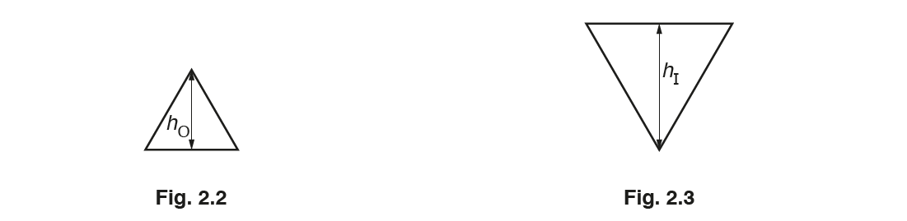

(i) Calculate a value for the magnification *M*, using the equation:

$M = \frac{h_{I}}{h_{O}}$

*M* = .........................................................

[1]

(ii) Calculate a second value $f_{2}$ for the focal length of the lens, using the value of *V* from **(a)(i)** and the equation:

`f_{2} = \frac{V}{\left(M + 1\right)}`

$f_{2}$ = .........................................................

[1]

*Source: 2019 (Series 3) 0625/63 Q2B*

**Q5** [1 mark]

**Extract:**

Question stem:

Some students determine the focal length of a converging lens by two methods, using an illuminated triangle, a converging lens and a screen on a bench. Method 1 uses the distances U (triangle to lens) and V (lens to screen); Method 2 uses the heights of the triangle and of its image on the screen.

---

When marking this answer:

- Award the mark for any one precaution from the mark scheme list
- Vague answers such as "be careful" or "measure accurately" do not earn the mark

State **one** precaution that could be taken to ensure that the measurements in the experiment are taken as reliably as possible.

*Source: 2019 (Series 3) 0625/63 Q2D*

### Q6 — medium — 9 marks

**Q6** [1 mark]

A student investigates the position of the image in a plane mirror.

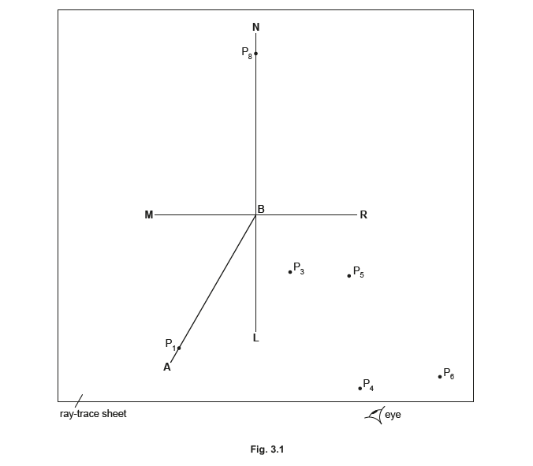

Fig. 3.1 shows the ray-trace sheet he uses.

The student draws the line **MR**.

• He draws a normal NL to this line that passes through the centre of MR.

• He labels the point at which **NL** crosses **MR** with the letter **B**.

• He draws a line from **B** at an angle of incidence *i* = 30° to the normal below **MR** and to the left of the normal. He labels the end of this line **A**.

• He places a pin P1 on line **AB**, as shown in Fig. 3.1. He places another pin P2 on the line **AB**.

• He places the reflecting face of the mirror vertically on the line **MR**.

• He views the images of pins P1 and P2 from the direction indicated by the eye in Fig. 3.1.

(i) On Fig. 3.1, mark with a cross a suitable position for pin P2 in this experiment.

[1]

(ii) He places two pins P3 and P4 some distance apart so that pin P3 and the images of P2 and P1 all appear exactly behind pin P4. The positions of P3 and P4 are shown on Fig. 3.1.

Draw the line joining the positions of P3 and P4. Continue the line until it extends at least 7.0 cm beyond **MR**.

[2]

*Source: 2020 May/June 0625/61 Q3*

**Q6** [3 marks]

**Extract:**

A student investigates the position of the image in a plane mirror.

Fig. 3.1 shows the ray-trace sheet he uses.

The student draws the line **MR**.

• He draws a normal NL to this line that passes through the centre of MR.

• He labels the point at which **NL** crosses **MR** with the letter **B**.

• He draws a line from **B** at an angle of incidence *i* = 30° to the normal below **MR** and to the left of the normal. He labels the end of this line **A**.

• He places a pin P1 on line **AB**, as shown in Fig. 3.1. He places another pin P2 on the line **AB**.

• He places the reflecting face of the mirror vertically on the line **MR**.

• He views the images of pins P1 and P2 from the direction indicated by the eye in Fig. 3.1.

(i) On Fig. 3.1, mark with a cross a suitable position for pin P2 in this experiment.

(ii) He places two pins P3 and P4 some distance apart so that pin P3 and the images of P2 and P1 all appear exactly behind pin P4. The positions of P3 and P4 are shown on Fig. 3.1.

The student keeps pin P1 in the same position but moves pin P2 so that the angle of incidence *i* = 40°.

- The pin positions P5 and P6 for the reflected ray are marked on Fig. 3.1.

(i) Draw the line joining the positions of P5 and P6. Continue the line until it extends at least 7.0 cm beyond **MR**.

Label with the letter **Y** the point where the two lines cross beyond **MR**.

[1]

(ii) Draw a line from P1 to **MR** that meets **MR** at a right angle. Measure and record the length *a* of this line.

*a* = ..................................................... [1]

(iii) Draw a line from the point labelled **Y **to **MR** that meets **MR** at a right angle. Measure and record the length *b* of this line.

*b* = ..................................................... [1]

*Source: 2020 May/June 0625/61 Q3B*

**Q6** [2 marks]

The student removes all the pins. He places pin P7 on the normal at a distance 6.0 cm from the front of the mirror.

- He views the image of P7 in the mirror.
- He places pin P8 on the normal behind the mirror.
- He adjusts the position of P8 so that the image of the bottom of the pin P7 and the top of pin P8 seen over the mirror appear as one pin when viewed from all angles in front of the mirror.

(i) On Fig. 3.1, measure the distance *x* along the normal between P8 and the mirror.

*x* = ..................................................... [1]

(ii) Complete the diagram in Fig. 3.2 to show the appearance of the image of pin P7 and pin P8 as described in (c).

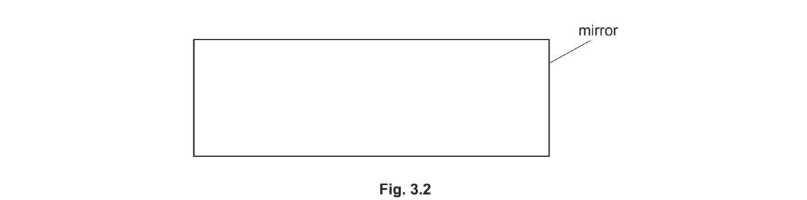

[1]

**Q6** [2 marks]

**Extract:**

(from part b) Distance a measured correctly to within ± 2 mm; [1 mark] - In our diagram a = 5.2 cm OR 52 mm
Distance b measured correctly to within ± 2 mm; [1 mark] - In our diagram a = 4.9 cm OR 49 mm
(from part c) On our diagram the distance x = 5.9 cm

The student expects the readings to show that the image formed in a plane mirror is the same distance behind the mirror as the object is in front of the mirror. Readings of *a* = *b* and *x *= 6.0 cm will show this.

State whether your readings show that the image formed in a plane mirror is the same distance behind the mirror as the object is in front of the mirror. Justify your statement by reference to the readings.

statement:

justification:

*Source: 2020 May/ June 0625/61 Q3D*

**Q6** [1 mark]

**Extract:**

A student investigates the position of the image in a plane mirror.

The student draws the line MR.

• He draws a normal NL to this line that passes through the centre of MR.

• He labels the point at which NL crosses MR with the letter B.

• He draws a line from B at an angle of incidence i = 30° to the normal below MR and to the left of the normal. He labels the end of this line A.

• He places a pin P1 on line AB, as shown in Fig. 3.1. He places another pin P2 on the line AB.

• He places the reflecting face of the mirror vertically on the line MR.

• He views the images of pins P1 and P2 from the direction indicated by the eye in Fig. 3.1.

A student carefully carries out an investigation into an image showing the position of different pins in a plane mirror.

Suggest a practical reason why the results may not be accurate.

*Source: 2020 May/ June 0625/61 Q3E*

### Q7 — medium — 11 marks

**Q7** [3 marks]

A student is determining the refractive index *n* of the material of a transparent block.

Fig. 3.1 shows the outline **ABCD** of the transparent block.

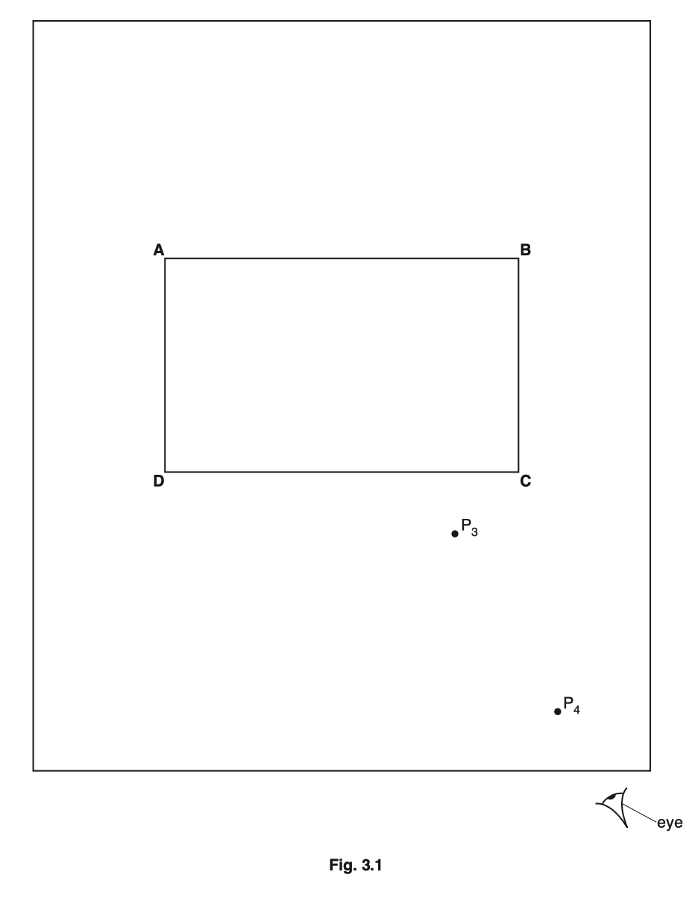

(i) On Fig. 3.1:

- draw a normal **NL** at the centre of side **AB**

  - continue the normal so that it passes through side **CD** of the block
  - label the point **F** where **NL** crosses **AB**
  - label the point **G** where **NL** crosses **CD**.

[1]

(ii) Draw a line **EF** at an angle *i* = 30° to the left of the normal and above side **AB**.

[1]

(iii) Mark the positions of two pins P1 and P2 on line **EF** placed at a suitable distance apart for this type of ray-tracing experiment.

[1]

*Source: Oct 2018 S1 0625/61 Q3A*

**Q7** [4 marks]

**Extract:**

A student is determining the refractive index n of the material of a transparent block.

Fig. 3.1 shows the outline ABCD of the transparent block.

(i) On Fig. 3.1:
- draw a normal NL at the centre of side AB
- continue the normal so that it passes through side CD of the block
- label the point F where NL crosses AB
- label the point G where NL crosses CD.

(ii) Draw a line EF at an angle i = 30° to the left of the normal and above side AB.

(iii) Mark the positions of two pins P1 and P2 on line EF placed at a suitable distance apart for this type of ray-tracing experiment.

The student observes the images of P1 and P2 through side **CD** of the block so that the images of P1 and P2 appear one behind the other.

He places two pins P3 and P4 between his eye and the block so that P3, P4 and the images of P1 and P2 seen through the block, appear one behind the other.

The positions of P3 and P4 are marked on Fig. 3.1.

(i)  Draw a line joining the positions of P3 and P4. Continue the line until it meets the normal **NL**.

Label the point **H** where the line meets side **CD**. Draw the line **FH**.

[1]

(ii) Measure and record the length*** ****a* of the line **GH**.

*a* = ........................................................ [1]

(iii) Measure and record the length *b* of the line **FH**.

*b* = ........................................................ [1]

(iv) Calculate the refractive index *n* using the following equation:

$n=\frac{0.5b}{a}$.

*n* = ........................................................ [1]

*Source: Oct 2018 S1 0625/61 Q3B*

**Q7** [1 mark]

**Extract:**

The student observes the images of P1 and P2 through side **CD** of the block so that the images of P1 and P2 appear one behind the other.

He places two pins P3 and P4 between his eye and the block so that P3, P4 and the images of P1 and P2 seen through the block, appear one behind the other.

The positions of P3 and P4 are marked on Fig. 3.1.

**Extended tier only**

The student repeats the procedure using the angle of incidence *i* = 45°.

*a* = 3.2 cm

*b* = 6.9 cm

Calculate the refractive index *n*, using the equation $n=\frac{0.71b}{a}$.

*n* = ........................................................

*Source: Oct 2018 S1 0625/61 Q3C*

**Q7** [2 marks]

**Extract:**

A student is determining the refractive index n of the material of a transparent block.

(i) On Fig. 3.1:  
- draw a normal NL at the centre of side AB
- continue the normal so that it passes through side CD of the block
- label the point F where NL crosses AB
- label the point G where NL crosses CD.

(ii) Draw a line EF at an angle i = 30° to the left of the normal and above side AB.

(iii) Mark the positions of two pins P1 and P2 on line EF placed at a suitable distance apart for this type of ray-tracing experiment.

The student observes the images of P1 and P2 through side CD of the block so that the images of P1 and P2 appear one behind the other. He places two pins P3 and P4 between his eye and the block so that P3, P4 and the images of P1 and P2 seen through the block, appear one behind the other. The positions of P3 and P4 are marked on Fig. 3.1.

(i)  Draw a line joining the positions of P3 and P4. Continue the line until it meets the normal NL. Label the point H where the line meets side CD. Draw the line FH.

(ii) Measure and record the length a of the line GH.

(iii) Measure and record the length b of the line FH.

(iv) Calculate the refractive index n using the following equation:

n = (0.5 b) / a.

The student expected the two values of refractive index *n* obtained in this experiment to be equal.

State **two** difficulties with this type of experiment that could explain any difference in the two values of *n*.

*Source: Oct 2018 S1 0625/61 Q3D*

**Q7** [1 mark]

**Extract:**

A student is determining the refractive index n of the material of a transparent block.

(i) On Fig. 3.1:  
- draw a normal NL at the centre of side AB
- continue the normal so that it passes through side CD of the block
- label the point F where NL crosses AB
- label the point G where NL crosses CD.

(ii) Draw a line EF at an angle i = 30° to the left of the normal and above side AB.

(iii) Mark the positions of two pins P1 and P2 on line EF placed at a suitable distance apart for this type of ray-tracing experiment.

The student observes the images of P1 and P2 through side CD of the block so that the images of P1 and P2 appear one behind the other.

He places two pins P3 and P4 between his eye and the block so that P3, P4 and the images of P1 and P2 seen through the block, appear one behind the other.

The positions of P3 and P4 are marked on Fig. 3.1.

A student suggests precautions to take in this experiment to obtain reliable results. Tick **one** box to indicate the most sensible suggestion.

`square`   Carry out the experiment in a darkened room.

`square`   Use pins that are taller than the height of the block.

`square`   View the bases of the pins.

`square`   View the pins with one eye closed.

*Source: Oct 2018 S1 0625/61 Q3E*

## Multiple Choice Questions (35 questions)

### Q1 — medium — 1 marks

**Q1** [1 mark]

A person stands 2.0 m in front of a plane mirror and then takes one step back so that they are 3.0 m from the mirror.

What is the distance between the person and their image after they take a step back?

### Q2 — hard — 1 marks

**Q2** [1 mark]

An object is placed 9 cm in front of a thin converging lens. The scale diagram shows how the lens forms a real, inverted image.

Which row gives the focal length of the lens and the distance of the image from the lens?

|   | focal length of lens / cm | distance of image from lens / cm |
|---|---|---|
| **A** | 6.0 | 18.0 |
| **B** | 9.0 | 12.0 |
| **C** | 12.0 | 9.0 |
| **D** | 18.0 | 6.0 |

### Q3 — hard — 1 marks

**Q3** [1 mark]

A student uses a thin converging lens with a focal length $f$ of $10 \text{cm}$ to produce a real, inverted, and magnified image of an object.

Where must the object be placed?

### Q4 — medium — 1 marks

**Q4** [1 mark]

The diagram shows a light ray incident on the boundary between a glass block and air at point O.

The angle of incidence $i$ is $25 ^{\circ}$. The critical angle for the glass is $42 ^{\circ}$.

Which path does the light ray take after point O?

### Q5 — medium — 1 marks

**Q5** [1 mark]

The diagram shows a ray of light entering a glass block.

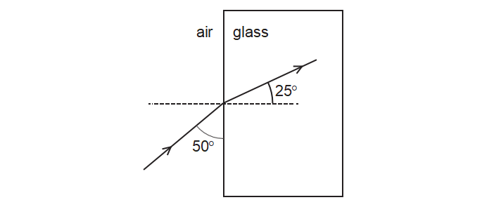

Which calculation gives the refractive index of the glass?

*Source: June 2023 0972/21 Q18*

### Q6 — medium — 1 marks

**Q6** [1 mark]

Which diagram shows the dispersion of white light by a glass prism?

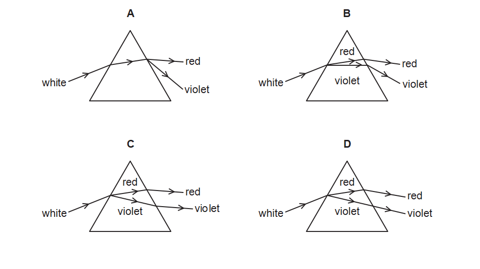

*Source: June 2023 0972/11 Q20*

### Q7 — hard — 1 marks

**Q7** [1 mark]

** **An object O is placed at point P near to a thin converging lens. The diagram shows three rays from the top of O passing through the lens. Each point F is one focal length from the centre of the lens. Each point 2F is two focal lengths from the centre of the lens.

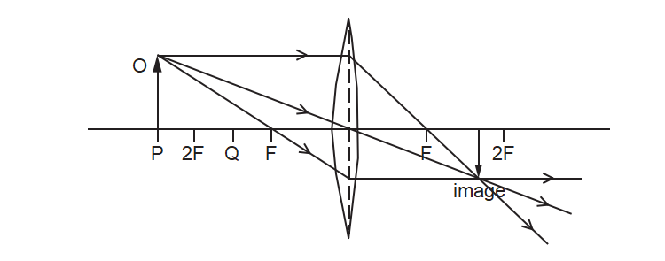

The object O is moved to point Q on the diagram.

Which type of image is produced when the object O is at point Q?

*Source: June 2023 0972/11 Q19*

### Q8 — easy — 1 marks

**Q8** [1 mark]

A student draws a diagram to show the directions of a light ray reflecting off a plane mirror.

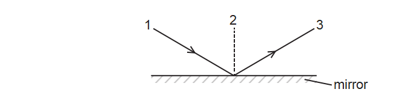

What are the correct terms for the lines drawn?

|   | **normal** | **incident ray** | **reflected ray** |
|---|---|---|---|
| **A** | 1 | 2 | 3 |
| **B** | 1 | 3 | 2 |
| **C** | 2 | 1 | 3 |
| **D** | 2 | 3 | 1 |

*Source: June 2023 0972/11 Q18*

### Q9 — hard — 1 marks

**Q9** [1 mark]

An object is placed in front of a converging lens. The lens has a focal length f.

In which labelled position should the object be placed in order to produce a real image that is smaller than the object?

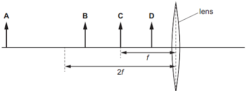

*Source: June 2022 paper 1 Q23*

### Q10 — medium — 1 marks

**Q10** [1 mark]

A boy sees a fish in a lake.

Which labelled path is taken by the light travelling from the fish to the boy’s eye?

*Source: specimen 2023 paper 1 Q22*

### Q11 — medium — 1 marks

**Q11** [1 mark]

**Extended Tier Only**

The speed of light in air is 3.0 $\times$ 108  m/s.

The critical angle for light in a transparent plastic material placed in air is 37°.

What is the speed of light in the plastic material?

*Source: June 2022 paper 2 Q25*

### Q12 — medium — 1 marks

**Q12** [1 mark]

**Extended Tier Only**

A ray of light travels through transparent plastic to air.

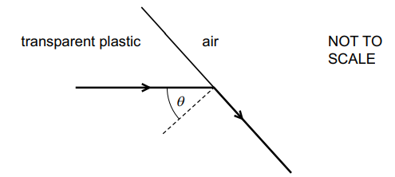

The ray of light enters the air travelling parallel to the surface of the plastic. The refractive index of the plastic is 1.25.

What is angle *θ *?

*Source: specimen 2023 paper 2 Q23*

### Q13 — medium — 1 marks

**Q13** [1 mark]

Which diagram shows the formation of a real image of an object O placed in front of a converging lens?

*Source: specimen 2023 paper 1 Q23*

### Q14 — medium — 1 marks

**Q14** [1 mark]

**Extended Tier Only**

An object is placed 8.0 cm from a thin converging lens of focal length 5.0 cm.

Which statement about the image formed by the lens is correct?

*Source: specimen 2023 paper 2 Q22*

### Q15 — medium — 1 marks

**Q15** [1 mark]

**Extended Tier Only**

Which statement describes monochromatic light?

*Source: specimen 2023 paper 2 Q21*

### Q16 — easy — 1 marks

**Q16** [1 mark]

A parallel beam of light is incident on a plane mirror.

Which diagram shows how the beam is reflected by the mirror?

*Source: 2023 specimen paper 1 Q21*

### Q17 — easy — 1 marks

**Q17** [1 mark]

**Extended Tier Only**

A thin converging lens can produce both real and virtual images.

Which row describes a real and a virtual image?

| ** ** | **real image** | **virtual image** |
|---|---|---|
| **A** | rays converge to form the image | image can be projected onto a screen |
| **B** | rays converge to form the image | image cannot be projected onto a screen |
| **C** | rays diverge to form the image | image can be projected onto a screen |
| **D** | rays diverge to form the image | image cannot be projected onto a screen |

*Source: june 2022 paper 2 Q24*

### Q18 — easy — 1 marks

**Q18** [1 mark]

A card is placed in front of a plane mirror so that its label is facing the mirror, as shown.

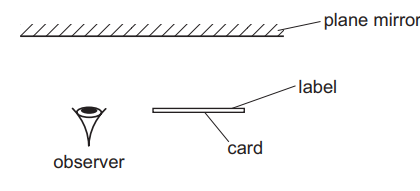

The label is shown.

How does the image of the label formed by the mirror appear to the observer?

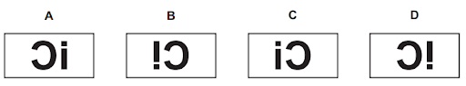

*Source: June 2022 paper 1 Q22*

### Q19 — easy — 1 marks

**Q19** [1 mark]

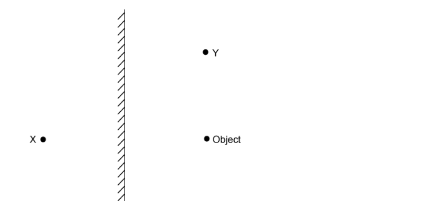

An object is placed in front of a mirror. Where is the image formed, and is the image real or virtual?

|   | **Image location** | **Image type** |
|---|---|---|
| **A** | X | real |
| **B** | X | virtual |
| **C** | Y | real |
| **D** | Y | virtual |

### Q20 — easy — 1 marks

**Q20** [1 mark]

A teacher has a clock mounted in such a way that students can only see its reflection in a plane mirror.

The diagram shows the reflection of the clock.

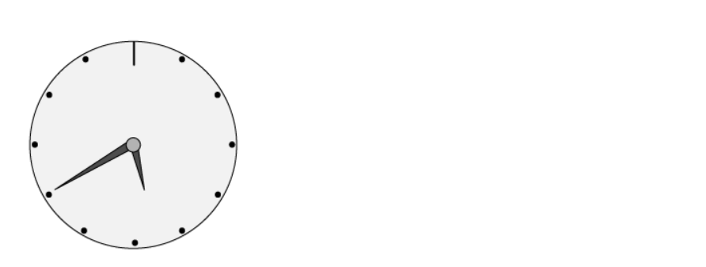

What time is shown on the clock?

### Q21 — easy — 1 marks

**Q21** [1 mark]

The diagram shows white light passing through a prism.

Which of the following gives colours in the correct order from A to B?

### Q22 — easy — 1 marks

**Q22** [1 mark]

When light passes from a denser material into a less dense material

### Q23 — easy — 1 marks

**Q23** [1 mark]

Identify the correct definition of the critical angle.

### Q24 — hard — 1 marks

**Q24** [1 mark]

**Extended tier only**

Light enters a flat water surface at an angle of 27 **o**.

The refractive index of water is 1.33.

At what angle does the light ray refract?

### Q25 — hard — 1 marks

**Q25** [1 mark]

**Extended tier only**

A ray of light is shone into a semi-circular glass block so that it makes an angle of 48° with the rear, flat edge of the block as shown.

Calculate the refractive index of the glass.

### Q26 — hard — 1 marks

**Q26** [1 mark]

**Extended tier only**

Below is a ray diagram showing the image formed by a thin, converging lens.

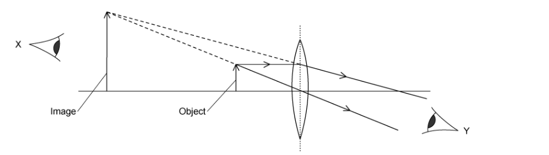

Which of the following statements about the image is correct?

### Q27 — medium — 1 marks

**Q27** [1 mark]

**Extended tier only**

Which diagram correctly shows the formation of a real image on a screen?

### Q28 — medium — 1 marks

**Q28** [1 mark]

The diagram shows a ray of light inside a perspex rod.

Perspex has a critical angle of 42o.

Which row in the table correctly states whether there is any light reflected from the surface, and whether there is any light refracted out of the perspex rod?

|   | **Light reflected?** | **Light refracted?** |
|---|---|---|
| **A** | yes | yes |
| **B** | yes | no |
| **C** | no | yes |
| **D** | no | no |

### Q29 — hard — 1 marks

**Q29** [1 mark]

The image below shows white light being split into its constituent colours by a glass prism.

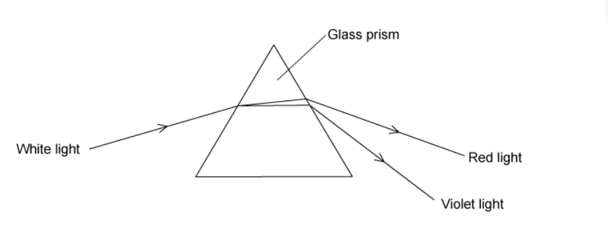

Why does a prism cause white light to be dispersed?

### Q30 — hard — 1 marks

**Q30** [1 mark]

**Extended tier only**

The diagram shows an object positioned close to a thin converging lens (inside the focal distance). Three light rays are shown leaving the object and passing through the lens.

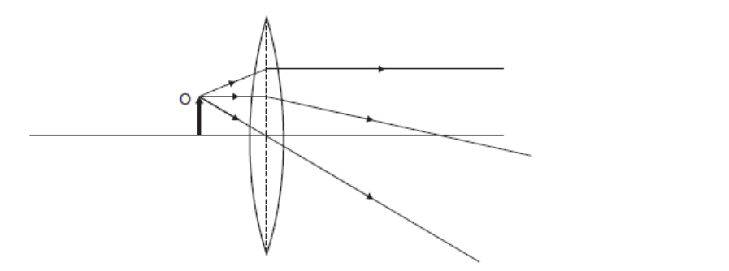

Which row in the table correctly describes the properties of the image?

|   | **location** | **size** | **real / virtual** |
|---|---|---|---|
| **A** | to the left of O | reduced | real |
| **B** | to the right of O | enlarged | virtual |
| **C** | to the left of O | enlarged | virtual |
| **D** | at O | the same as O | real |

### Q31 — medium — 1 marks

**Q31** [1 mark]

A physics teacher demonstrates dispersion for her class. She asks the students to draw a diagram of the dispersion.

The diagrams show four examples of what different students drew. One of them is correct. Which one?

### Q32 — hard — 1 marks

**Q32** [1 mark]

The diagram shows a ray of light being totally internally reflected at the boundary between substances A and B.

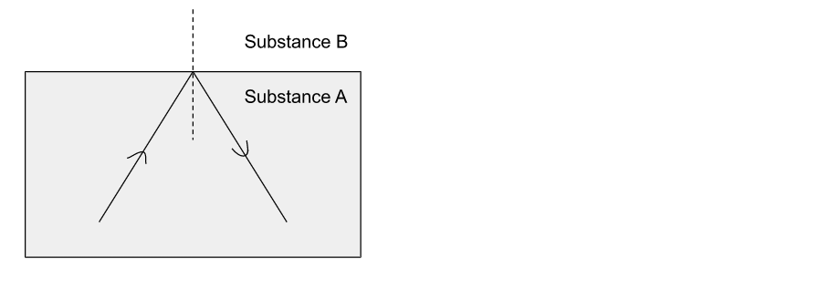

Which row in the table must be true?

|   | **Angle of incidence** | **Substance A** |
|---|---|---|
| **A** | greater than critical angle | greater refractive index than B |
| **B** | greater than critical angle | smaller refractive index than B |
| **C** | less than critical angle | greater refractive index than B |
| **D** | less than critical angle | smaller refractive index than B |

### Q33 — hard — 1 marks

**Q33** [1 mark]

**Extended tier only**

The diagram shows light passing from air into glass. A number of angles have been labelled on the diagram.

Which of the equations could be used to correctly calculate the refractive index, *n*, of the glass?

### Q34 — medium — 1 marks

**Q34** [1 mark]

Which of the images correctly shows the focal length of the thin converging lens?

### Q35 — medium — 1 marks

**Q35** [1 mark]

Which of the diagrams below shows both the correct position of the image, and the correct path the light rays must have taken to the eye?

## Theory Questions (28 questions)

### Q1 — medium — 8 marks

**Q1** [3 marks]

Light may be totally internally reflected at the boundary between two materials.

(i) State the **two **conditions necessary for total internal reflection to occur.

[2]

(ii) State **one **practical use of total internal reflection.

[1]

**Q1** [1 mark]

Fig. 5.1 shows a ray of light incident on a semicircular glass block.

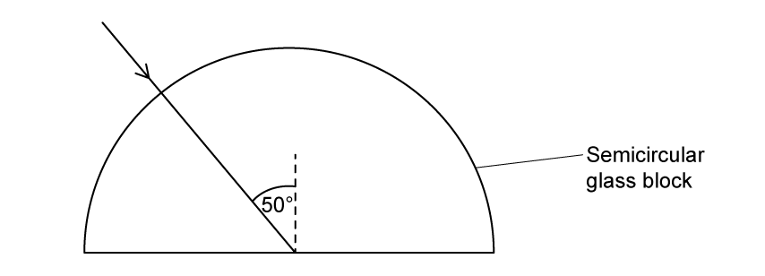

**Fig. 5.1**

Explain why the ray does not change direction when it enters the block at the curved edge.

**Q1** [2 marks]

The critical angle for the glass is 42°.

Calculate the refractive index of the glass.

Show your working.

**Q1** [2 marks]

**Extract:**

Fig. 5.1 shows a ray of light incident on a semicircular glass block.

A semicircular glass block shown from above. A ray of light enters the curved edge and hits the straight edge at an angle of incidence of 50-degrees to the normal. The normal is drawn as a dashed line perpendicular to the straight edge.

The critical angle for the glass is 42°.

On Fig. 5.1, continue the path of the light through the glass block and after it leaves the glass block.

### Q2 — medium — 11 marks

**Q2** [6 marks]

Fig. 7.1 shows a ray of light travelling from the air through a glass block.

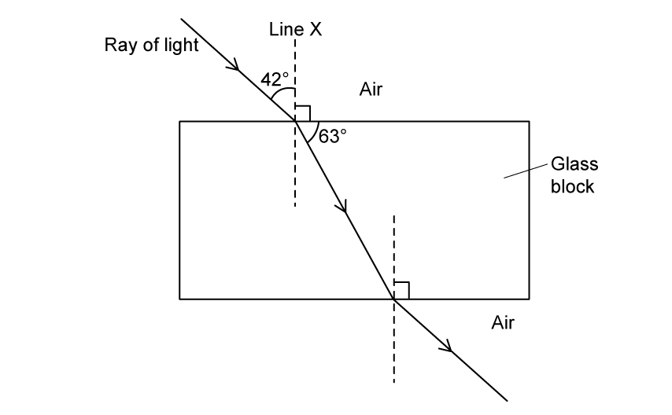

**Fig. 7.1**

(i) State the angle of incidence at the air-to-glass boundary.

[1]

(ii) Determine the angle of refraction at the air-to-glass boundary.

[1]

(iii) Suggest a value for the incident angle at the glass-to-air boundary, and justify your reasoning.

[4]

**Q2** [2 marks]

When the angle of refraction is greater than the critical angle, total internal reflection occurs.

Describe total internal reflection.

**Q2** [3 marks]

Fig 7.2 shows total internal reflection of light in an optical fibre.

**Fig. 7.2**

The angle $θ$ is 48°.

State the angle of reflection and justify your reasoning.

### Q3 — medium — 11 marks

**Q3** [1 mark]

A student investigates the refraction of light through a rectangular glass block. Fig. 3.1 shows the student's ray-trace sheet.

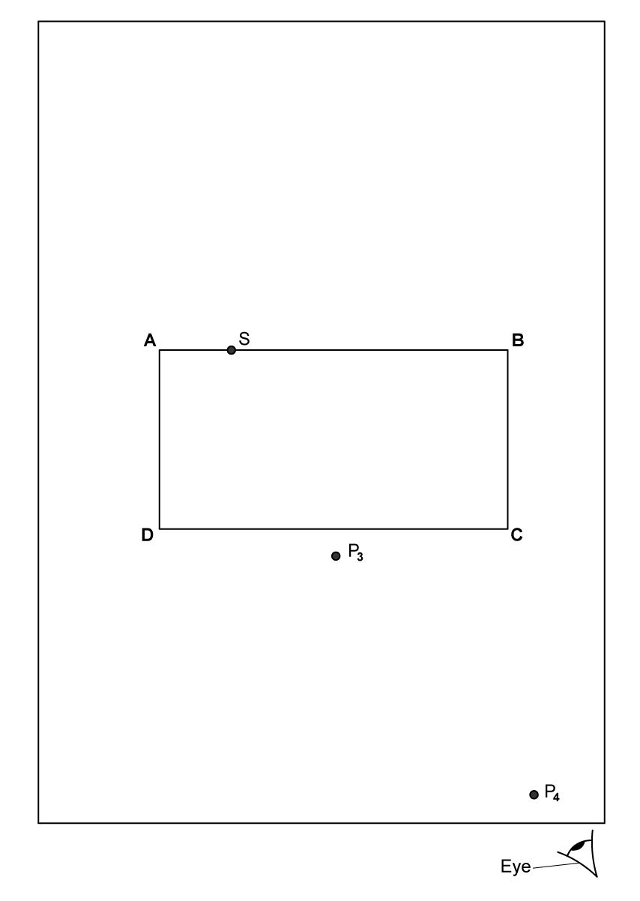

**Fig. 3.1**

On Fig. 3.1, draw a normal **NL** to the side **AB** of the block at the point **S**. Continue the normal so that it passes through side **CD** of the block.

**Q3** [1 mark]

**Extract:**

A student investigates the refraction of light through a rectangular glass block. Fig. 3.1 shows the student's ray-trace sheet.

A rectangular outline labelled ABCD. Side AB is the top surface. A point S is marked on AB. Below CD there are two points P3 and P4, and an eye symbol in the bottom right corner, indicating perspective.

On Fig. 3.1, draw a normal **NL** to the side **AB** of the block at the point **S**. Continue the normal so that it passes through side **CD** of the block.

Draw a line **RS** at an angle $i=40^{\circ}$ to the normal, above **AB **and to the left of the normal.

**Q3** [3 marks]

**Extract:**

A student investigates the refraction of light through a rectangular glass block. Fig. 3.1 shows the student's ray-trace sheet.

On Fig. 3.1, draw a normal NL to the side AB of the block at the point S. Continue the normal so that it passes through side CD of the block.

Draw a line RS at an angle i = 40° to the normal, above AB and to the left of the normal.

The student places two pins, $P_{1}$ and $P_{2}$, on the line **RS**.

(i) On Fig. 3.1, mark the positions of the two pins $P_{1}$ and $P_{2}$. Indicate a suitable distance between the pins for this type of ray-trace experiment.

[1]

(ii) Suggest **two **other techniques that the student can use to produce an accurate ray-trace.

[2]

**Q3** [3 marks]

**Extract:**

A student investigates the refraction of light through a rectangular glass block. Fig. 3.1 shows the student's ray-trace sheet.

A rectangular outline labelled ABCD. Side AB is the top surface. A point S is marked on AB. Below CD there are two points P3 and P4, and an eye symbol in the bottom right corner, indicating perspective.

On Fig. 3.1, draw a normal NL to the side AB of the block at the point S. Continue the normal so that it passes through side CD of the block.

The student observes the images of $P_{1}$ and $P_{2}$ through the side **CD **of the block. They place two more pins, $P_{3}$ and $P_{4}$, so that they appear to be in a straight line with the images. Fig. 3.1 shows the positions of $P_{3}$ and $P_{4}$.

- Draw a line joining $P_{3}$ and $P_{4}$. Continue the line until it meets the normal **NL**.
- Label the point **T** where the line meets side **CD**. Draw the line **ST**.
- Measure the angle $r$ between **ST** and the normal.

**Q3** [3 marks]

**Extract:**

A student investigates the refraction of light through a rectangular glass block.

Draw a line **RS** at an angle [i = 40°] to the normal, above **AB** and to the left of the normal.

The student plans to take more sets of readings to investigate the relationship between $i$ and $r$.

(i) Suggest other suitable values of angle $i$ that the student could use.

[2]

(ii) Suggest how the student could improve the experiment to check the reliability of their results.

[1]

### Q4 — medium — 2 marks

**Q4** [2 marks]

Fig. 7.1 represents two rays of light striking a thin converging lens. The rays are both parallel to the principal axis.

F2 and F1 are the focal points of the lens.

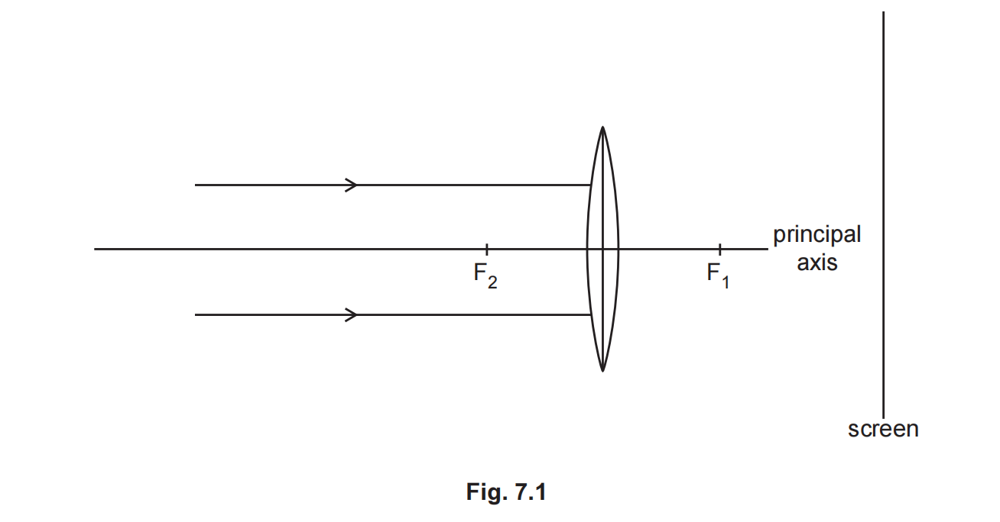

On Fig. 7.1, continue the path of each ray beyond the lens as far as the screen.

*Source: June2023 0972/31 Q7A*

### Q5 — medium — 9 marks

**Q5** [3 marks]

**Extended Tier Only**

Fig. 7.1 is a full-scale diagram of a small nail N in front of a thin converging lens. The line L represents the lens.

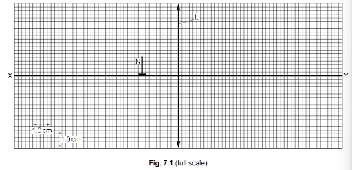

The focal length of the lens is 3.0 cm.

Rays of light, parallel to XY, are travelling towards the lens.

Describe what happens to the light after it passes through the lens.

*Source: June 2022 paper 4 Q7A*

**Q5** [1 mark]

**Extract:**

Fig. 7.1 is a full-scale diagram of a small nail N in front of a thin converging lens. The line L represents the lens.

The focal length of the lens is 3.0 cm.

**Extended Tier Only**

On Fig. 7.1, mark and label with an F each of the **two **principal focuses of the lens.

*Source: June 2022 paper 4 Q7B*

**Q5** [5 marks]

**Extract:**

Fig. 7.1 is a full-scale diagram of a small nail N in front of a thin converging lens. The line L represents the lens. The focal length of the lens is 3.0 cm. Rays of light, parallel to XY, are travelling towards the lens. On Fig. 7.1, the two principal focuses of the lens are marked on XY 3.0 cm from the centre of the lens, one point on the left and one point on the right of the lens, each labelled F. The small nail N, of height 1.2 cm, is positioned 2.0 cm to the left of the lens.

**Extended Tier Only**

The small nail N, of height 1.2 cm, is positioned 2.0 cm to the left of the lens.

(i) By drawing on Fig. 7.1, find the position of the image I of N and add image I to the diagram.

[3]

(ii) State and explain whether I is a real or a virtual image.

[1]

(iii)** **State the name given to a lens when it is used in this way.

[1]

*Source: June 2022 paper 4 Q7C*

### Q6 — medium — 3 marks

**Q6** [3 marks]

The water waves travel from deep water into shallow water. The water waves have a lower speed in the shallow water.

Fig. 7.2 shows wavefronts for the waves in deep water to the left of the boundary.

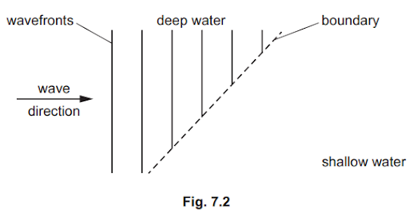

(i) On Fig. 7.2, complete **three **wavefronts for the waves in shallow water to the right of the boundary.

[2]

(ii)** **State the term for the process at the boundary in Fig. 7.2.

[1]

*Source: june 2022 paper 3 Q7B*

### Q7 — medium — 1 marks

**Q7** [1 mark]

A ray of light refracts as it travels from air into glass, as shown in Fig. 8.1.

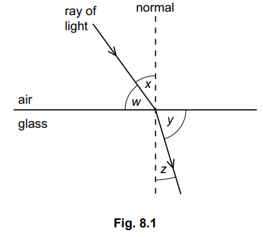

State which angle *w, x, y *or *z*, is the angle of refraction.

*Source: specimen 2023 paper 3 Q8A*

### Q8 — medium — 7 marks

**Q8** [5 marks]

**Extended Tier Only**

Fig. 6.1 shows a converging lens and its principal axis. The points F1 and F2 are each a principal focus of the lens.

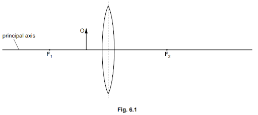

An object O is placed between F1 and the lens.

(i)** **On Fig. 6.1, draw two rays from the top of the object O to locate the image. Label the image I.

[3]

(ii) The object O is moved to the left along the principal axis so that it is further from the lens than F1.

Fig. 6.2 is a diagram of the new arrangement with the new image shown.

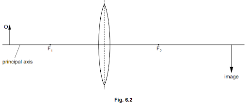

Underline three of the terms below that describe the image shown in Fig. 6.2.

| **diminished** | **enlarged** | **inverted** | **real** | **same size** | **upright** | **virtual** |
|---|---|---|---|---|---|---|

[2]

*Source: specimen 2023 paper 4 Q6A*

**Q8** [2 marks]

Fig. 6.3 shows yellow light passing through a glass prism

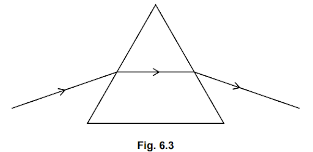

Blue light enters the prism along the same path as the yellow light.

On Fig. 6.3, draw the path of the blue light as it enters, passes through and leaves the prism.

*Source: specimen 2023 paper 4 Q6B*

### Q9 — hard — 8 marks

**Q9** [3 marks]

Fig. 5.1 shows a visible spectrum focused on a screen by passing light from a source of white light through a lens and a prism.

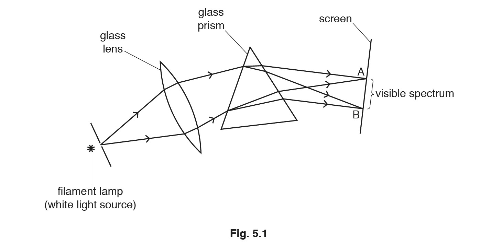

(i) State the name of the process that separates the colours in white light.

[1]

(ii) State the colour of the light on the screen at points A and B.

[1]

(iii) State the property of the glass of the prism that causes white light to be split into the different colours of the spectrum.

[1]

*Source: Oct/Nov2018  (Series 2) 0625/42 Q5A*

**Q9** [5 marks]

**Extended tier only**

Fig. 5.2 shows a section of an optical fibre in air. A ray of light is incident on the fibre wall at X.

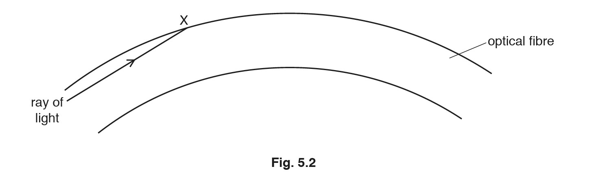

(i) On Fig. 5.2, continue the path of the ray of light up to the end of the fibre.

[1]

(ii) The refractive index of the material of the fibre is 1.46. Calculate the critical angle of the material of the fibre.

critical angle = ...........................................................[2]

(iii) State two uses of optical fibres.

[2]

*Source: Oct/Nov2018  (Series 2) 0625/42 Q5B*

### Q10 — medium — 6 marks

**Q10** [3 marks]

Fig. 6.1 shows a mirror periscope. The periscope is used to view a golfer over the heads of other people. The periscope has two plane mirrors each at an angle of 45° to the vertical.

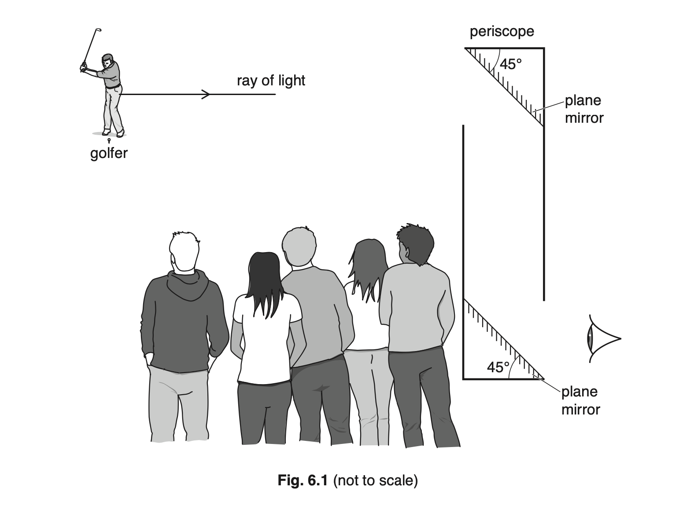

(i) On Fig. 6.1:

1. Continue the ray of light from the golfer towards the upper mirror of the periscope.

  - Draw and label the normal at the point where the ray strikes the mirror.

[1]

(ii) On Fig. 6.1, continue the ray of light after reflection at the upper mirror until it leaves the periscope.

[1]

(iii) State the law of reflection used to deduce the position of the ray of light after striking the mirrors.

[1]

*Source: Oct 2019 3 Q6A*

**Q10** [3 marks]

Fig. 6.2 shows three rays of red light each entering a semi-circular glass block.

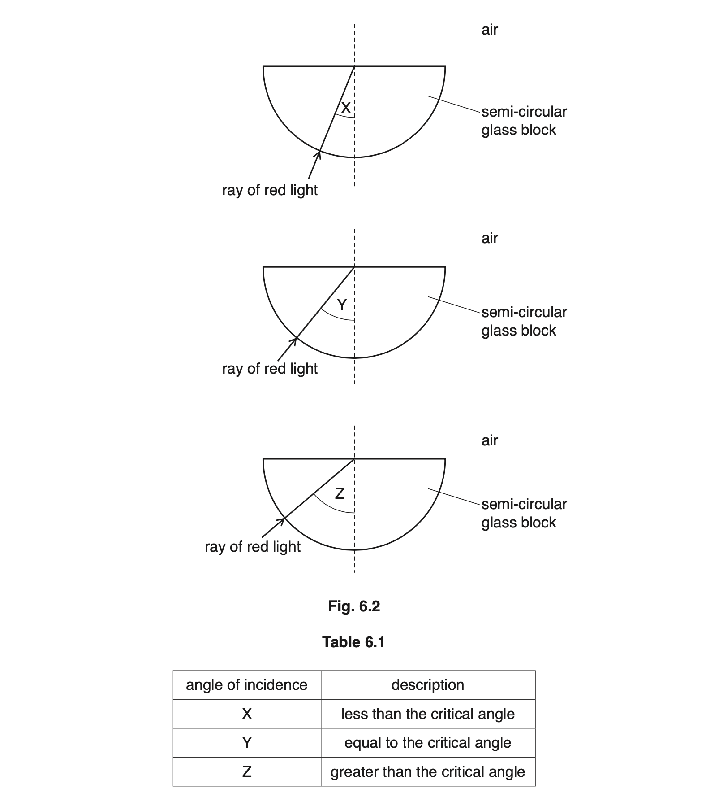

Using the information in Table 6.1, draw on Fig. 6.2 to complete the path of each ray of red light.

*Source: Oct 2019 3 Q6B*

### Q11 — hard — 9 marks

**Q11** [1 mark]

**Extended tier only**

A laser produces a beam of monochromatic light. State what is meant by the term *monochromatic*.

*Source: 2018 (Series 1) 0625/41 Q7A*

**Q11** [6 marks]

A wave, in air, is incident on a glass block. Fig. 7.1 shows the wavefronts at the air-glass boundary. The arrow shows the direction of travel of the wavefronts.

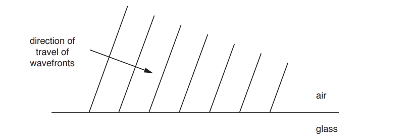

The wave undergoes reflection and refraction at the air-glass boundary.

On Fig. 7.1 draw:

(i) the wavefronts of the reflected wave

[3]

(ii) the wavefronts of the refracted wave.

[3]

*Source: 2018 (Series 1) 0625/41 Q7B*

**Q11** [2 marks]

A transverse wave is produced in a long, horizontal rope. The rope is much longer than the wavelength of the wave.

In the space below, sketch a diagram to show the appearance of the rope as the wave passes along it. Label **two** important features of the wave.

*Source: 2018 (Series 1) 0625/41 Q7C*

### Q12 — medium — 5 marks

**Q12** [3 marks]

Fig. 6.1 shows an arrangement of glass prisms inside a box. The angles of the prisms are 45°, 45° and 90°.

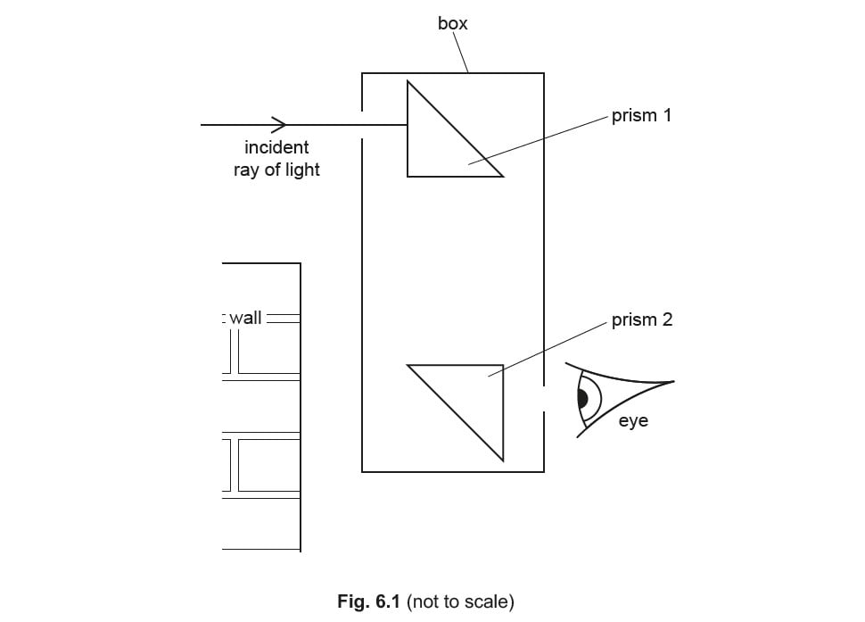

This is a device used to view objects that are behind a wall. The incident ray of light undergoes total internal reflection in the prisms.

On Fig. 6.1, complete the path of the ray through the device and show the ray as it emerges from the box.

*Source: May/June 2020 (Series 2) 0625/42 Q6A*

**Q12** [2 marks]

**Extended tier only**

Show that the refractive index of glass with a critical angle of 45° is 1.41.

*Source: May/June 2020 (Series 2) 0625/42 Q6B*

### Q13 — easy — 5 marks

**Q13** [1 mark]

Fig. 5.1 represents an object positioned on the principal axis of a thin lens.

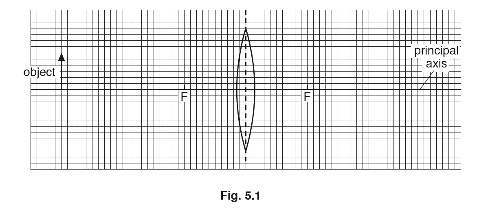

Each small square of the grid represents 0.5 cm. Each principal focus of the lens is labelled F.

Use the grid to determine the focal length of the lens.

focal length = ..................................................... cm

*Source: 2018 0625/32 Q5A*

**Q13** [4 marks]

**Extract:**

Fig. 5.1 represents an object positioned on the principal axis of a thin lens. Each small square of the grid represents 0.5 cm. Each principal focus of the lens is labelled F.

(i) On Fig. 5.1, draw a ray from the top of the object that passes through a principal focus, then through the lens and beyond it.

[1]

(ii) On Fig. 5.1, draw a second ray from the top of the object that passes through the centre of the lens. Continue the path of this ray to the edge of the grid.

[1]

(iii) On Fig. 5.1, draw an arrow to show the position and nature of the image produced by the lens.

[1]

*Source: 2018 0625/32 Q5B*

### Q14 — hard — 5 marks

**Q14** [3 marks]

Fig. 6.1 shows a ray of red light incident on part of a lens.

(i) On Fig. 6.1, continue the path of the ray as it passes through the lens and emerges from it.

[2]

(ii) State the term used to describe the process as the ray enters and leaves the lens.

[1]

*Source: 2018 (Series 2) 0625/32 Q6A*

**Q14** [2 marks]

Fig. 6.2 shows two parallel rays of light travelling towards another lens.

The two rays of light pass through the lens to form an image.

On Fig. 6.2, continue the path of the rays. Extend the rays for at least 5 cm beyond the lens.

*Source: 2018 (Series 2) 0625/32 Q6B*

### Q15 — medium — 6 marks

**Q15** [1 mark]

Fig. 8.1 shows a ray of light travelling through a glass block and then reflecting from a mirror.

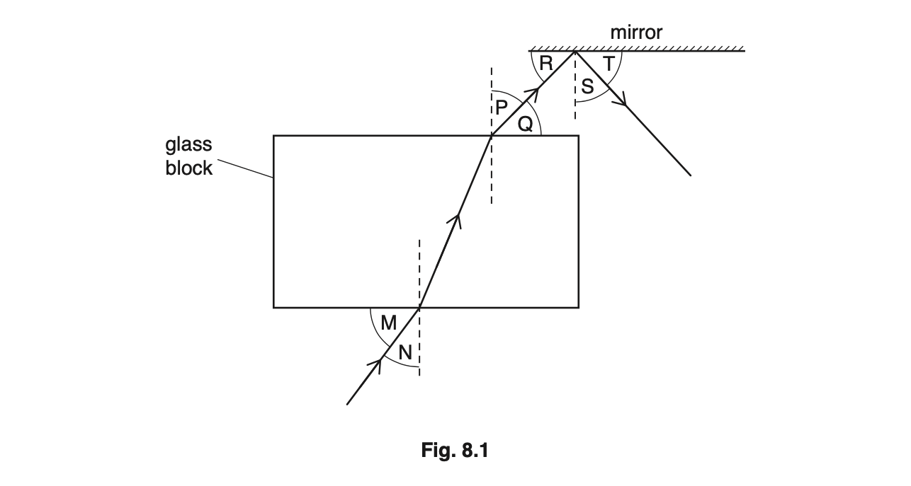

State the term used for the dashed lines drawn in Fig. 8.1.

*Source: Oct 2019 0625/33 Q8A*

**Q15** [3 marks]

**Extract:**

Use Fig. 8.1 to identify the three angles in the list. Place the correct letter in the box to indicate each angle:

Angle of incidence; Angle of reflection; Angle of refraction.

You may be questioning whether angle P is an angle of refraction. It is important to realise that refraction occurs when light enters the block and when light exits the block. In both circumstances, the density of the medium changes and the speed of the light changes. The angle of refraction is the angle between the light ray in the second medium and the normal of the boundary between the two materials, therefore angle P is an angle of refraction.

Use Fig. 8.1 to identify the three angles in the list. Place the correct letter in the box to indicate each angle.

`square`  angle of incidence

`square`  angle of reflection

`square`  angle of refraction

*Source: Oct 2019 0625/33 Q8B*

**Q15** [2 marks]

The ray of light in Fig. 8.1 changes direction as it enters the glass block. State the name of this effect and explain why it happens.

*Source: Oct 2019 0625/33 Q8C*

### Q16 — easy — 10 marks

**Q16** [3 marks]

**Extended**

** **

Fig. 1.1 shows a light ray passing though a block of ice.

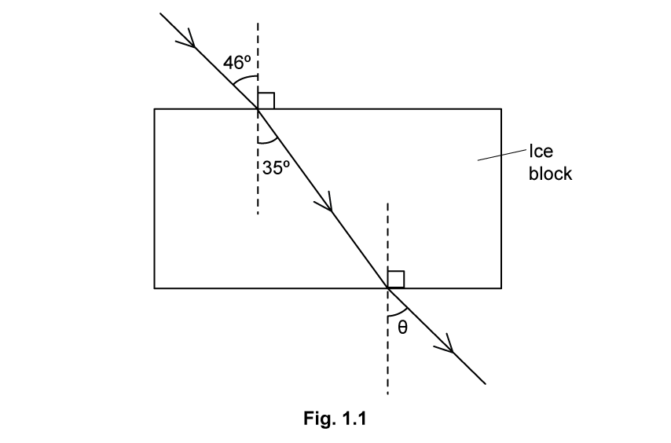

**(not to scale)**

Determine the refractive index of ice.

refractive index = ....................................

**Q16** [3 marks]

Explain why the angle of refraction is smaller than the incident angle for the boundary from air to ice.

**Q16** [1 mark]

**Extract:**

sin(i) = sin(46°)

n = sin(i)/sin(r)
n = sin(46°)/sin(35°)
n = 1.25

State the correct value of angle $θ$ on Fig. 1.1.

angle $θ$ = ....................................

**Q16** [3 marks]

Complete Table 1.2 by drawing a tick to show which properties of light change during refraction.

**Table 1.2**

| **Property** | **Does change** | **Does not change** |
|---|---|---|
| speed |   |   |
| wavelength |   |   |
| frequency |   |   |

### Q17 — medium — 7 marks

**Q17** [2 marks]

**Extended tier only**

The speed of a light wave in air is 3.00 × 108 m / s. The refractive index of water is 1.33.

Calculate the speed of the light wave in water.

speed = .........................................................

*Source: February/March 2018 0625/42 Q7A*

**Q17** [5 marks]

Fig. 7.1 shows parallel wavefronts of a light wave in air incident on a boundary with a transparent plastic.

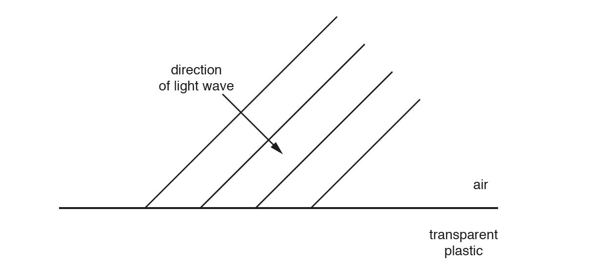

On Fig. 7.1,

(i) draw the positions of the four refracted wavefronts in the plastic,

[3]

(ii) draw an arrow to show the direction of travel of the refracted wave,

[1]

(iii) label the angle of refraction *r* of the light wave.

[1]

*Source: February/March 2018 0625/42 Q7B*

### Q18 — medium — 5 marks

**Q18** [2 marks]

Fig. 9.1 shows two rays of light X and Y leaving an object O. The rays strike a plane mirror.

Ray X is reflected as shown.

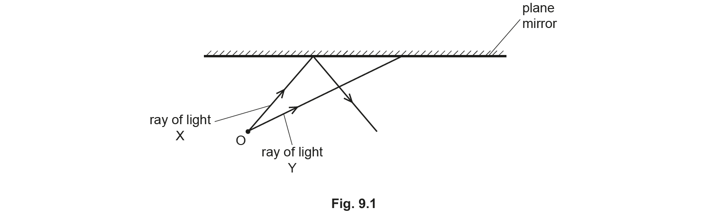

(i) On Fig. 9.1, draw the normal at the point where ray X strikes the mirror.

[1]

(ii) On Fig. 9.1, draw the path of ray Y after it strikes the mirror.

[1]

*Source: 2020 Feb/March 0625/32 Q9A*

**Q18** [3 marks]

An object O is placed on the left of a thin converging lens. F is the principal focus.

This arrangement is shown in Fig. 9.2.

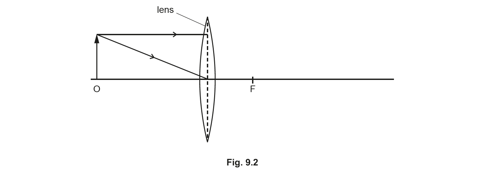

Two rays from the top of the object are incident on the lens, as shown in Fig. 9.2.

On Fig. 9.2, draw the path of each ray to locate the position of the image of O formed by the lens.

On Fig. 9.2, draw an arrow to represent the image and label it **I**.

*Source: 2020 Feb/March 0625/32 Q9B*

### Q19 — easy — 6 marks

**Q19** [4 marks]

An object, OX, is placed in front of a converging lens.

Fig. 7.1 shows a ray of light from the object passing through the lens.

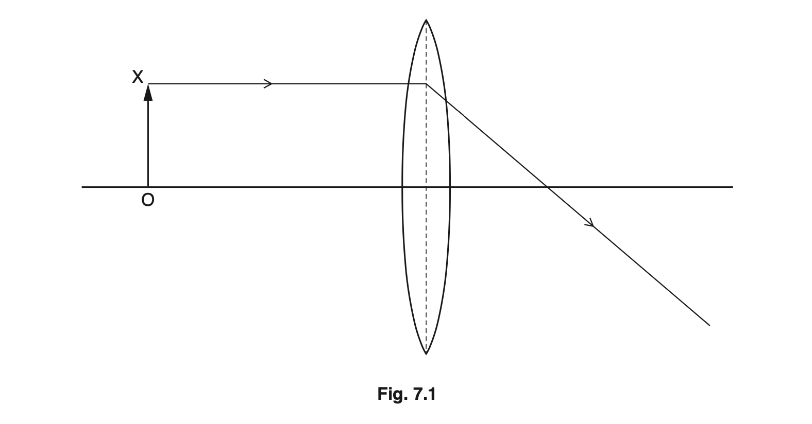

(i) The lens forms an image of object OX.

On Fig. 7.1, draw another ray from X to locate the position of the image.

[1]

(ii) On Fig. 7.1, draw an arrow to represent the image of OX and label it I.

[1]

(iii) On Fig. 7.1, mark a principal focus for the lens and label it F.

[1]

(iv) On Fig. 7.1, measure and record the focal length of the lens.

focal length = ...................................................... cm [1]

*Source: Oct 2019 3 Q7A*

**Q19** [2 marks]

**Extract:**

For a converging lens, the image is always inverted. The size of the image, however, depends on the distance between the object and the vertical axis on the lens. The distance between the principal focus and the lens' vertical axis is the focal length, which we shall denote as f. If the object is at a distance of more than 2f from the lens' vertical axis, the image will be smaller than the object. If the object is at a distance between f and 2f from the lens' vertical axis, the image will be larger than the object. If the object is at a distance of 2f from the lens' vertical axis, the image is the same size as the object. In the question above, it can be seen using a ruler (regardless of the screen you are using) that the object is more than 2f from the lens' vertical axis. This means the image will be inverted and diminished (i.e. smaller).

Describe the image I.

Choose words from the list. Tick (✓) **two** boxes.

`square` enlarged

`square` diminished

`square` same size

`square` inverted

`square` upright

*Source: Oct 2019 3 Q7B*

### Q20 — hard — 8 marks

**Q20** [2 marks]

A ray of light in air is incident on a glass block. The light changes direction.

State

(i) the name of this effect.

[1]

(ii) the cause of this effect.

[1]

*Source: 2018 0625/41 Q5A*

**Q20** [6 marks]

Fig. 5.1 shows a thin converging lens of focal length 3.5cm.

(i) On Fig. 5.1, mark each of the two principal focuses and label each with the letter F.

[1]

(ii) An object O of height 4.4cm is placed a distance of 7.5cm from the lens.

On Fig. 5.1, draw rays from the tip of the object O to locate the image. Draw and label the image.

[3]

(iii) Determine the height of the image.

height of the image = ...........................................................[1]

(iv) State and explain whether the image is real or virtual.

[1]

*Source: 2018 0625/41 Q5B*

### Q21 — easy — 9 marks

**Q21** [2 marks]

**Extended tier only**

An endoscope is a piece of medical equipment used to see inside a person's body. Endoscopes use optical fibres within a long tube which reflects light from inside the patient to an eye piece lens or camera.

**Fig. 1.1**

Fig. 1.1 shows a section of optical fibre. Light travels from X to Y.

On Fig. 1.1, complete the path of the light ray until it leaves the section of optical fibre.

**Q21** [1 mark]

State the type of reflection that occurs within an optical fibre.

**Q21** [3 marks]

**Extended tier only**

Calculate the critical angle.

Glass has a refractive index of 1.52.

critical angle = ...................................

**Q21** [3 marks]

**Extract:**

Glass has a refractive index of 1.52.

**Extended tier only**

When the light ray exits the optical fibre it passes into air.

Calculate the speed of light in glass.

speed of light in glass = ....................................

### Q22 — medium — 8 marks

**Q22** [5 marks]

Fig. 7.1 shows a converging lens and the image I formed when an object is placed to the left of the lens. The principal focuses are labelled A and B and the centre of the lens is labelled C.

(i) On Fig. 7.1, draw two rays to locate the position of the object.

Draw the object and label it O.

[3]

(ii) Ring all of the following distances that are equal to the focal length of the lens.

| **AB  ** | **AC** | **CB** | **2AB** |
|---|---|---|---|

[2]

*Source: 2020 Feb/March 0625/42 Q7A*

**Q22** [3 marks]

Fig. 7.2 shows green light passing through a triangular glass block.

Red light enters the triangular glass block shown in Fig. 7.2 along the same path as the green light.

(i) On Fig. 7.2, draw the path of the red light within the triangular glass block.

[1]

(ii) Fig. 7.3 shows green light passing through a rectangular glass block.

Red light enters the rectangular glass block shown in Fig. 7.3 along the same path as the green light.

On Fig 7.3 draw the path of the red light within the rectangular glass block.

[1]

(iii) On Fig 7.3 draw the path of the red light after leaving the rectangular glass block.

[1]

*Source: 2020 Feb/March 0625/42 Q7B*

### Q23 — hard — 8 marks

**Q23** [2 marks]

Fig. 7.1 shows a ray of light in water that is incident on a submerged, transparent plastic block.

State what happens to the speed of light as it enters the plastic block. Explain your answer.

*Source: 2018 0625/42 Q7A*

**Q23** [6 marks]

**Extended tier only**

Fig. 7.2 shows the two principal focuses F1 and F2 of a thin converging lens.

Fig. 7.2 also shows an object O of height 1.2cm placed close to the lens. Two rays from the tip of the object O are incident on the lens.

(i) On Fig. 7.2, continue the paths of these two rays for a further distance of at least 5 cm.

[2]

(ii) Using your answer to **(b)(i)**, find and mark on Fig. 7.2 the image I of object O and label this image.

[2]

(iii) Determine the height of image I.

height = ...........................................................[1]

(iv) State and explain whether I is a real image or a virtual image.

[1]

*Source: 2018 0625/42 Q7B*

### Q24 — hard — 8 marks

**Q24** [4 marks]

Fig. 7.1 shows a ray of light striking a plane mirror at point P.

(i) Determine the value of the angle of incidence for the ray of light at point P.

angle of incidence = ...................................................... ° [1]

(ii)      On Fig. 7.1,

- draw a normal at point P
- draw the ray reflected at point P
- determine the angle of reflection at point P.

angle of reflection = ...................................................... ° [3]

*Source: 2020 0625/31 Q7A*

**Q24** [4 marks]

Fig. 7.2 shows an object OB positioned 20cm from a thin converging lens. Both principal focuses of the lens are labelled F.

Two rays from the tip B of the object are incident on the lens, as shown in Fig. 7.2.

On Fig. 7.2, continue the paths of these two rays to show the position of the image of OB formed by the lens. Draw an arrow to show the size, position and orientation of the image of OB.

*Source: 2020 0625/31 Q7B*

### Q25 — easy — 6 marks

**Q25** [3 marks]

The spectrum of white light is made up of seven colours.

Fig. 7.1 shows a partially-completed spectrum. Two labels are missing.

(i) On Fig. 7.1, write the name of the missing colour in each blank space.

[2]

(ii) On Fig. 7.1, indicate the direction of increasing wavelength for the spectrum. Draw an arrow in the box below the spectrum of colours.

[1]

*Source: 2018 0625/31 Q7A*

**Q25** [3 marks]

A ray of red light strikes one face of a triangular glass prism as shown in Fig. 7.2.

(i) On Fig. 7.2, draw the path of the ray as it travels through the glass prism and enters the air.

[2]

(ii) State the term used to describe what happens to the ray of red light as it enters and leaves the prism.

[1]

*Source: 2018 0625/31 Q7B*

### Q26 — hard — 7 marks

**Q26** [2 marks]

**Extended tier only**

Fig. 7.1 shows red light travelling from air into a prism made of diamond. The path of the red light is incomplete.

The refractive index of diamond is 2.42.

Calculate angle *x*.

angle x = .........................................................

*Source: May/June 2020 (Series 3) 0625/43 Q7A*

**Q26** [3 marks]

Explain the term total internal reflection.

*Source: May/June 2020 (Series 3) 0625/43 Q7B*

**Q26** [2 marks]

**Extract:**

Fig. 7.1 shows red light travelling from air into a prism made of diamond. The path of the red light is incomplete. The refractive index of diamond is 2.42. At the first boundary of air to diamond, the light ray approaches at an angle of 40 degrees to the normal, and leaves the boundary at an angle x to the normal. At the second boundary, diamond to air, the light ray approaches at angle y to the normal.

Explain the term total internal reflection:
- When light travels from an (optically) more dense medium to an (optically) less dense medium; 
- And the angle of incidence (of the light at the boundary) is greater than the critical angle (of the material creating the boundary); 
- Then all light is reflected OR no light is refracted;

The angle y is greater than the critical angle of diamond.

On Fig. 7.1, draw the path of the red light through and out of the prism after point A.

*Source: May/June 2020 (Series 3) 0625/43 Q7C*

### Q27 — medium — 6 marks

**Q27** [1 mark]

Fig. 8.1 is a partially completed ray diagram.

The object is at O and its image is at I.

Which distance is the focal length of the lens? Tick **one** box.

`square`  C to F1 

`square`  O to C

`square`  F2 to I

`square`  O to I

*Source: Oct 2019 0625/32 Q8A*

**Q27** [3 marks]

On Fig. 8.1, extend the **two** rays from the arrowhead on the object until both reach the position of the image.

*Source: Oct 2019 0625/32 Q8B*

**Q27** [2 marks]

**Extract:**

Fig. 8.1 is a partially completed ray diagram.

The object is at O and its image is at I.

The object is moved a small distance **away** from the lens. State the effect, if any, this has on the position and size of the image.

*Source: Oct 2019 0625/32 Q8C*

### Q28 — hard — 8 marks

**Q28** [2 marks]

Fig. 6.1 represents the electromagnetic spectrum.

State the radiation in each of the regions represented by A, B, C and D in Fig. 6.1.

*Source: February/March 2018 0625/42 Q6A*

**Q28** [6 marks]

**Extended tier only**

A source emits visible light.

Fig. 6.2 shows a ray of red light from the source incident on the face XY of a glass prism at point S.

The angle of incidence i of the ray is 35 °. The refractive index of the glass for red light is 1.5.

(i) Calculate the angle of refraction in the glass at S.

angle of refraction = ......................................................... [2]

(ii) On Fig. 6.2, draw the refracted ray at face XY and the ray emerging from face XZ of the prism. Label this ray R.

[2]

(iii) A ray of blue light follows the same path as the ray of red light incident on the face XY.

On Fig. 6.2, draw the path of this ray in the prism and emerging from the prism.

Label this ray B.

[2]

*Source: February/March 2018 0625/42 Q6B*

