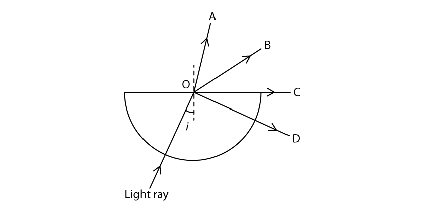
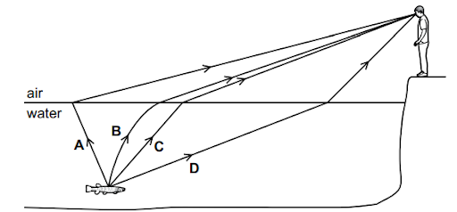
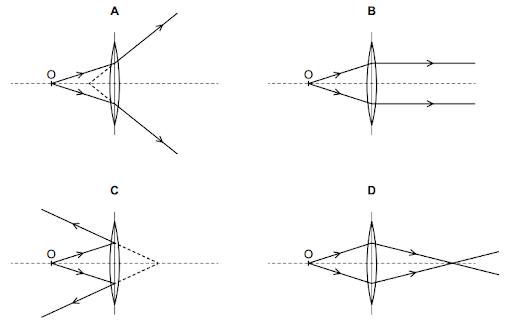
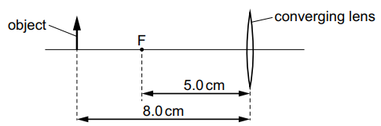
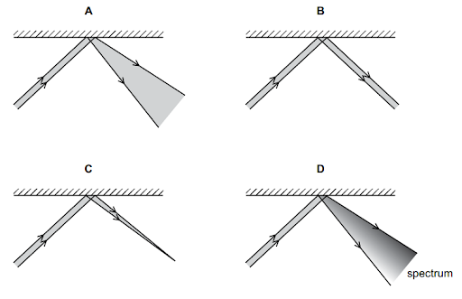
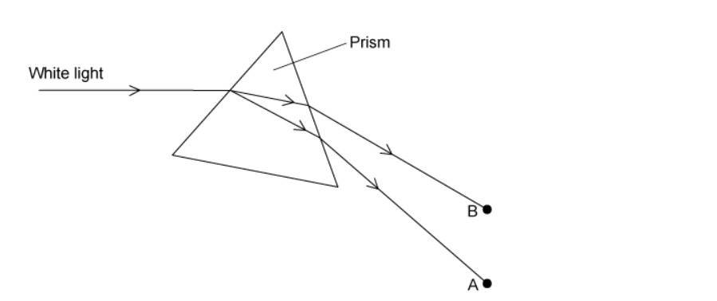
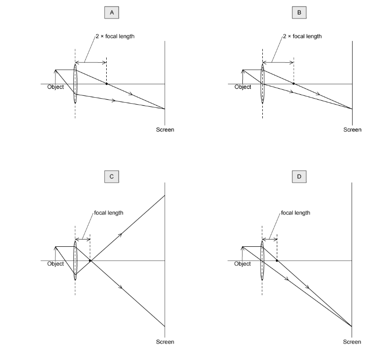
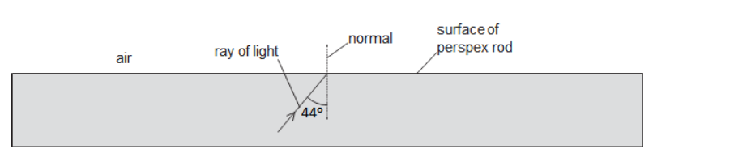
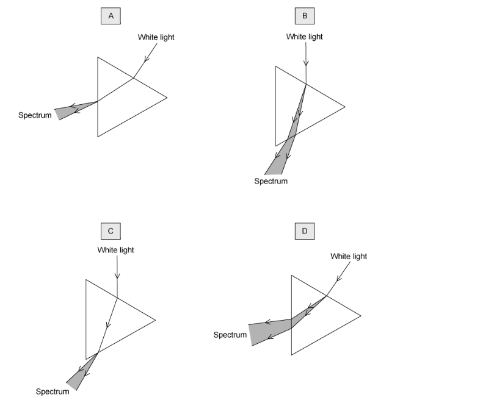
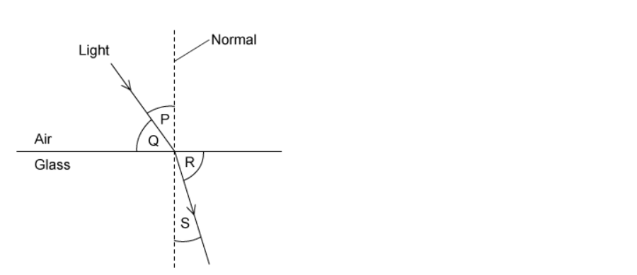

# Exam Questions — Light
**3. Waves** · Cambridge (CIE) IGCSE physics (0625 & 0972)
> Source: [https://www.savemyexams.com/igcse/physics/cie/23/topic-questions/](https://www.savemyexams.com/igcse/physics/cie/23/topic-questions/) · 35 questions across 1 sets

## Multiple Choice Questions (35 questions)

### Q1 — medium — 1 marks

**Q1** [1 mark]

A person stands 2.0 m in front of a plane mirror and then takes one step back so that they are 3.0 m from the mirror.

What is the distance between the person and their image after they take a step back?

### Q2 — hard — 1 marks

**Q2** [1 mark]

An object is placed 9 cm in front of a thin converging lens. The scale diagram shows how the lens forms a real, inverted image.

Which row gives the focal length of the lens and the distance of the image from the lens?

|   | focal length of lens / cm | distance of image from lens / cm |
|---|---|---|
| **A** | 6.0 | 18.0 |
| **B** | 9.0 | 12.0 |
| **C** | 12.0 | 9.0 |
| **D** | 18.0 | 6.0 |

### Q3 — hard — 1 marks

**Q3** [1 mark]

A student uses a thin converging lens with a focal length $f$ of $10 \text{cm}$ to produce a real, inverted, and magnified image of an object.

Where must the object be placed?

### Q4 — medium — 1 marks

**Q4** [1 mark]

The diagram shows a light ray incident on the boundary between a glass block and air at point O.

The angle of incidence $i$ is $25 ^{\circ}$. The critical angle for the glass is $42 ^{\circ}$.

Which path does the light ray take after point O?

### Q5 — medium — 1 marks

**Q5** [1 mark]

The diagram shows a ray of light entering a glass block.

Which calculation gives the refractive index of the glass?

*Source: June 2023 0972/21 Q18*

### Q6 — medium — 1 marks

**Q6** [1 mark]

Which diagram shows the dispersion of white light by a glass prism?

*Source: June 2023 0972/11 Q20*

### Q7 — hard — 1 marks

**Q7** [1 mark]

** **An object O is placed at point P near to a thin converging lens. The diagram shows three rays from the top of O passing through the lens. Each point F is one focal length from the centre of the lens. Each point 2F is two focal lengths from the centre of the lens.

The object O is moved to point Q on the diagram.

Which type of image is produced when the object O is at point Q?

*Source: June 2023 0972/11 Q19*

### Q8 — easy — 1 marks

**Q8** [1 mark]

A student draws a diagram to show the directions of a light ray reflecting off a plane mirror.

What are the correct terms for the lines drawn?

|   | **normal** | **incident ray** | **reflected ray** |
|---|---|---|---|
| **A** | 1 | 2 | 3 |
| **B** | 1 | 3 | 2 |
| **C** | 2 | 1 | 3 |
| **D** | 2 | 3 | 1 |

*Source: June 2023 0972/11 Q18*

### Q9 — hard — 1 marks

**Q9** [1 mark]

An object is placed in front of a converging lens. The lens has a focal length f.

In which labelled position should the object be placed in order to produce a real image that is smaller than the object?

*Source: June 2022 paper 1 Q23*

### Q10 — medium — 1 marks

**Q10** [1 mark]

A boy sees a fish in a lake.

Which labelled path is taken by the light travelling from the fish to the boy’s eye?

*Source: specimen 2023 paper 1 Q22*

### Q11 — medium — 1 marks

**Q11** [1 mark]

**Extended Tier Only**

The speed of light in air is 3.0 $\times$ 108  m/s.

The critical angle for light in a transparent plastic material placed in air is 37°.

What is the speed of light in the plastic material?

*Source: June 2022 paper 2 Q25*

### Q12 — medium — 1 marks

**Q12** [1 mark]

**Extended Tier Only**

A ray of light travels through transparent plastic to air.

The ray of light enters the air travelling parallel to the surface of the plastic. The refractive index of the plastic is 1.25.

What is angle *θ *?

*Source: specimen 2023 paper 2 Q23*

### Q13 — medium — 1 marks

**Q13** [1 mark]

Which diagram shows the formation of a real image of an object O placed in front of a converging lens?

*Source: specimen 2023 paper 1 Q23*

### Q14 — medium — 1 marks

**Q14** [1 mark]

**Extended Tier Only**

An object is placed 8.0 cm from a thin converging lens of focal length 5.0 cm.

Which statement about the image formed by the lens is correct?

*Source: specimen 2023 paper 2 Q22*

### Q15 — medium — 1 marks

**Q15** [1 mark]

**Extended Tier Only**

Which statement describes monochromatic light?

*Source: specimen 2023 paper 2 Q21*

### Q16 — easy — 1 marks

**Q16** [1 mark]

A parallel beam of light is incident on a plane mirror.

Which diagram shows how the beam is reflected by the mirror?

*Source: 2023 specimen paper 1 Q21*

### Q17 — easy — 1 marks

**Q17** [1 mark]

**Extended Tier Only**

A thin converging lens can produce both real and virtual images.

Which row describes a real and a virtual image?

| ** ** | **real image** | **virtual image** |
|---|---|---|
| **A** | rays converge to form the image | image can be projected onto a screen |
| **B** | rays converge to form the image | image cannot be projected onto a screen |
| **C** | rays diverge to form the image | image can be projected onto a screen |
| **D** | rays diverge to form the image | image cannot be projected onto a screen |

*Source: june 2022 paper 2 Q24*

### Q18 — easy — 1 marks

**Q18** [1 mark]

A card is placed in front of a plane mirror so that its label is facing the mirror, as shown.

The label is shown.

How does the image of the label formed by the mirror appear to the observer?

*Source: June 2022 paper 1 Q22*

### Q19 — easy — 1 marks

**Q19** [1 mark]

An object is placed in front of a mirror. Where is the image formed, and is the image real or virtual?

|   | **Image location** | **Image type** |
|---|---|---|
| **A** | X | real |
| **B** | X | virtual |
| **C** | Y | real |
| **D** | Y | virtual |

### Q20 — easy — 1 marks

**Q20** [1 mark]

A teacher has a clock mounted in such a way that students can only see its reflection in a plane mirror.

The diagram shows the reflection of the clock.

What time is shown on the clock?

### Q21 — easy — 1 marks

**Q21** [1 mark]

The diagram shows white light passing through a prism.

Which of the following gives colours in the correct order from A to B?

### Q22 — easy — 1 marks

**Q22** [1 mark]

When light passes from a denser material into a less dense material

### Q23 — easy — 1 marks

**Q23** [1 mark]

Identify the correct definition of the critical angle.

### Q24 — hard — 1 marks

**Q24** [1 mark]

**Extended tier only**

Light enters a flat water surface at an angle of 27 **o**.

The refractive index of water is 1.33.

At what angle does the light ray refract?

### Q25 — hard — 1 marks

**Q25** [1 mark]

**Extended tier only**

A ray of light is shone into a semi-circular glass block so that it makes an angle of 48° with the rear, flat edge of the block as shown.

Calculate the refractive index of the glass.

### Q26 — hard — 1 marks

**Q26** [1 mark]

**Extended tier only**

Below is a ray diagram showing the image formed by a thin, converging lens.

Which of the following statements about the image is correct?

### Q27 — medium — 1 marks

**Q27** [1 mark]

**Extended tier only**

Which diagram correctly shows the formation of a real image on a screen?

### Q28 — medium — 1 marks

**Q28** [1 mark]

The diagram shows a ray of light inside a perspex rod.

Perspex has a critical angle of 42o.

Which row in the table correctly states whether there is any light reflected from the surface, and whether there is any light refracted out of the perspex rod?

|   | **Light reflected?** | **Light refracted?** |
|---|---|---|
| **A** | yes | yes |
| **B** | yes | no |
| **C** | no | yes |
| **D** | no | no |

### Q29 — hard — 1 marks

**Q29** [1 mark]

The image below shows white light being split into its constituent colours by a glass prism.

Why does a prism cause white light to be dispersed?

### Q30 — hard — 1 marks

**Q30** [1 mark]

**Extended tier only**

The diagram shows an object positioned close to a thin converging lens (inside the focal distance). Three light rays are shown leaving the object and passing through the lens.

Which row in the table correctly describes the properties of the image?

|   | **location** | **size** | **real / virtual** |
|---|---|---|---|
| **A** | to the left of O | reduced | real |
| **B** | to the right of O | enlarged | virtual |
| **C** | to the left of O | enlarged | virtual |
| **D** | at O | the same as O | real |

### Q31 — medium — 1 marks

**Q31** [1 mark]

A physics teacher demonstrates dispersion for her class. She asks the students to draw a diagram of the dispersion.

The diagrams show four examples of what different students drew. One of them is correct. Which one?

### Q32 — hard — 1 marks

**Q32** [1 mark]

The diagram shows a ray of light being totally internally reflected at the boundary between substances A and B.

Which row in the table must be true?

|   | **Angle of incidence** | **Substance A** |
|---|---|---|
| **A** | greater than critical angle | greater refractive index than B |
| **B** | greater than critical angle | smaller refractive index than B |
| **C** | less than critical angle | greater refractive index than B |
| **D** | less than critical angle | smaller refractive index than B |

### Q33 — hard — 1 marks

**Q33** [1 mark]

**Extended tier only**

The diagram shows light passing from air into glass. A number of angles have been labelled on the diagram.

Which of the equations could be used to correctly calculate the refractive index, *n*, of the glass?

### Q34 — medium — 1 marks

**Q34** [1 mark]

Which of the images correctly shows the focal length of the thin converging lens?

### Q35 — medium — 1 marks

**Q35** [1 mark]

Which of the diagrams below shows both the correct position of the image, and the correct path the light rays must have taken to the eye?

