# Mark Schemes — Electromagnetic Spectrum
**3. Waves** · Cambridge (CIE) IGCSE physics (0625 & 0972)

## Multiple Choice Questions (25 questions)

### Q1
**Final answer:** **The correct answer is B**

- All electromagnetic waves travel at the same speed in a vacuum (the speed of light, 3 × 108 m/s)
- In the electromagnetic spectrum, ultraviolet radiation has a shorter wavelength and a higher frequency than infrared radiation
- The order from longest wavelength to shortest is: radio, microwave, infrared, visible, ultraviolet, X-rays, gamma rays

**A** is incorrect because ultraviolet has a shorter wavelength and higher frequency than infrared, not longer and lower.

**C** is incorrect because all electromagnetic waves travel at the same speed in a vacuum. Ultraviolet does not travel faster than infrared.

**D** is incorrect because ultraviolet has a shorter (not longer) wavelength than infrared, and all EM waves travel at the same speed in a vacuum.

### Q2
**Final answer:** **The correct answer is C**

- The electromagnetic spectrum consists of different regions, each with specific properties and uses
- Ultraviolet radiation has a high enough frequency to kill bacteria and is used to sterilise water supplies
- Microwaves are used for satellite communications and cooking
- Radio waves are used for radio and television transmissions
- X-rays are used for medical imaging because they can penetrate soft tissue but are absorbed by bone

**A** is incorrect as microwaves are used for communication and heating, not for imaging bones

**B** is incorrect as security marking typically uses ultraviolet radiation, which causes the ink to fluoresce

**D** is incorrect as X-rays are used for medical and security scans, while satellite television relies on microwaves

> **[exam-tip]**
> Make sure you learn the common applications for each region of the electromagnetic spectrum. A useful approach is to group them by type of use: communication (radio waves, microwaves), medical (X-rays, gamma rays), and sterilisation/detection (ultraviolet). Remember that ultraviolet is commonly used for sterilising water and detecting security markings, while X-rays are used for imaging bones—not the other way around.

### Q3
**Final answer:** **The correct answer is ****D**** because:**

- The frequency of a wave can be found using:

$\mathrm{wave} \mathrm{speed}=\mathrm{frequency}\times\mathrm{wavelength} \mathrm{or}v=\mathrm{fλ}$

- This equation can be rearranged to give:

$f=\frac{v}{λ}$

- The speed of light is 3.00 × 108 m/s so the frequencies can be found like this:

$f_{max}=\frac{3.00\times10^{8}m/s}{4.0\times10^{-7}m}=7.5\times10^{14}\mathrm{Hz}\,\,f_{\mathrm{min}}=\frac{3.00\times10^{8}m/s}{7.0\times10^{-7}m}=4.3\times10^{14}\mathrm{Hz}$

- This gives a range of  to $4.3\times10^{14}\mathrm{Hz} \mathrm{to}7.5\times10^{14}\mathrm{Hz}$

**A** and **B** incorrect as the powers (×108 etc.) have not been used correctly to reach this answer.

**C** is incorrect because the wrong value for the speed of light has been used in the calculation.

Calculations involving exponents and standard form can be tricky, especially negative powers of ten such as ×10-7. You should always check calculations like this twice and remember that dividing by something with a negative exponent will make the answer larger, not smaller.

### Q4
**Final answer:** **The correct answer is ****B****, because:**

- Remote controllers typically use infrared radiation

**A** is incorrect as microwaves are used in long range communications, such as mobile phone or satellite communications systems, whereas remote controllers are much shorter range.

**C** is incorrect as ultrasound is not a part of the electromagnetic spectrum.

**D** is incorrect as ultraviolet light is not used in communications systems.

### Q5
**Final answer:** **The correct answer is B because:**

- The speed of electromagnetic waves in a vacuum is 3.0 $\times$ 108 m/s
- Option **B** is given in km/s

1 km = 1 $\times$ 103 m

3.0 $\times$ 105 km/s = (3.0 $\times$ 105) $\times$ (1 $\times$ 103) m/s = 3.0 $\times$ 108 m/s

- This converts to the correct speed in m/s

**A **is incorrect as this is 3.0 $\times$ 102 m/s

**C **is incorrect as this is 3.0 $\times$ 104 m/s

**D **is incorrect as this is 3.0 $\times$ 1014 m/s

Learning the powers of prefixes for units is an essential part of revision for a physics exam.

### Q6
**Final answer:** **The correct answer is B because:**

- The uses of microwaves include:

  - Heating food
  - Communication with mobile phones
  - Satellite television
- ‘Telecommunication’ refers to the second use listed

**A **is incorrect as X-rays are used to scan bones, not infrared radiation

**C **is incorrect as infrared radiation is used in night photography, not ultraviolet light

**D **is incorrect as infrared radiation is used in thermal imaging, not X-rays

### Q7
**Final answer:** **The correct answer is B because:**

- All electromagnetic waves travel at the same speed in a vacuum

  - This eliminates options **A** and **C**
- Radio waves have a longer wavelength than X-rays

  - This eliminates option **D**

### Q8
**Final answer:** **The correct answer is A because:**

- A remote controller for a television uses **infrared waves**

**B** & **C** are incorrect because microwaves and radio waves are used for sending signals over longer ranges, such as WiFi, mobile, and satellite communications

**D** is incorrect because visible light is not used for sending signals

### Q9
**Final answer:** **The correct answer is ****C**** because: **

the electromagnetic spectrum contains the following types of wave:

- Radio waves

  - Microwaves
  - Infrared
  - Visible light
  - Ultra violet
  - X-Rays
  - Gamma rays

Sound waves are not electromagnetic waves.

Any answer that contains sound waves is wrong by exclusion.

### Q10
**Final answer:** **The correct answer is ****C**** because **

the electromagnetic spectrum contains the following types of waves in the order you have probably learnt them. This is in **order** of **increasing** **frequency**:

- Radio waves (lowest frequency)

  - Microwaves
  - Infrared
  - Visible light
  - Ultra violet
  - X-Rays
  - Gamma rays (highest frequency)

The order in the table above is reversed, so they are being shown in order of decreasing frequency.

**A** is incorrect as the spectrum is being shown in order of **increasing** wavelength.

**B** is incorrect as all electromagnetic waves travel at the same speed: the speed of light.

**D** is incorrect as the amplitude is related to the intensity or “brightness” of the waves, this can be different for waves in the same part of the spectrum, just like visible light can be bright or dim.

### Q11
**Final answer:** **The correct answer is ****D**** because **

the electromagnetic spectrum runs, in order of longest wavelength to shortest wavelength:

- Radio waves

  - Microwaves
  - Infrared
  - Visible light
  - Ultra violet
  - X-Rays
  - Gamma (γ) rays

The table starts with the shortest EM wavelength (gamma rays) and runs to the longest EM wavelength (radio waves). That would make **D** microwaves.

**A** is incorrect as this would be X-rays.

**B** is incorrect as this would be ultraviolet light.

**C** is incorrect as this would be visible light.

### Q12
**Final answer:** **The correct answer is ****C**** because:**

- The electromagnetic spectrum contains the following types of waves in the order you have probably learned them. This is in order of increasing frequency and decreasing wavelength

  - Radio waves
  - Microwaves
  - Infrared
  - Visible light
  - Ultra violet
  - X-Rays
  - Gamma rays
- We are asked to choose the answer which has the parts in order of decreasing wavelength, i.e. the order above.
- The only answer that achieves this is **C**.

**A** is incorrect as these are in order of increasing wavelength.

**B** is incorrect as these are in no particular order

**D** is incorrect as these are in order of increasing wavelength.

### Q13
**The correct answer is ****D**** because**

the electromagnetic spectrum runs, in order of longest wavelength to shortest wavelength:

- Radio waves

  - Microwaves
  - Infrared
  - Visible light
  - Ultra violet
  - X-Rays
  - Gamma rays

The other answers have the parts of the EM spectrum in the wrong order.

### Q14
**Final answer:** **The correct answer is ****D**** because:**

- Remote controls contain an infrared LED at the front. This is used to send coded signals to the TV that cannot be seen by the human eye.
- It is possible, with certain mobile phone cameras, to see this infrared LED flashing when a button is pressed on a remote control. Give it a go. It won’t work with Apple phones as they include an IR filter over the lens of their cameras.

**A** is incorrect as microwaves are used for mobile phone and satellite communication, and for cooking in microwave ovens.

**B** is incorrect as visible light is used to see things.

**C** is incorrect as ultraviolet radiation is used to kill bacteria, to make security features in secure documents and banknotes glow and to make people’s clothes and teeth glow at nightclubs. Oh, it also gives you a suntan and causes skin cancer.

### Q15
**Final answer:** **The correct answer is ****D**** because:**

- Bluetooth devices are operated using radio waves

  - They can transmit a lot of data over a short distance
- Radio waves can pass through walls

  - However, the signal is weakened by doing so
- Since Bluetooth only needs to operate over short ranges, it does not matter that the signal is weakened by passing through walls (if anything, it is a benefit to protect users' privacy)

**A** , **B **and **C **are incorrect as although all three statements are true, they have nothing to do with Bluetooth

### Q16
**Final answer:** **The correct answer is ****B**** because**

- The electromagnetic spectrum contains the following types of waves in the order you have probably learned them. This is in order of **increasing** **frequency** and **decreasing** **wavelength**

  - Radio waves
  - Microwaves
  - Infrared
  - Visible light
  - Ultra violet
  - X-Rays
  - Gamma rays
- We can see that **ultraviolet** waves have both a **higher** **frequency** and a **smaller** **wavelength** than **microwaves**.
- Therefore, the only correct answer is B

**A** is incorrect as **all** electromagnetic waves travel at **the same** speed in a vacuum.

**C** is incorrect as microwaves have a **lower **frequency than ultraviolet.

**D** is incorrect as both microwaves and ultraviolet are transverse waves. **All** electromagnetic waves are transverse.

### Q17
**Final answer:** **The correct answer is ****A**** because: **

the electromagnetic spectrum runs, in order of **longest** wavelength to **shortest** wavelength:

- Radio waves

  - Microwaves
  - Infrared
  - Visible (red → blue)
  - Ultra violet
  - X-Rays
  - Gamma rays

- The wavelength of **X is smaller than the visible red light,** so it must be further down the list above.
- The wavelength of **Y is much greater than visible red light**, so it must be further up the list above.
- The only row of the table that matches is A.

**B** is incorrect as ultraviolet has a shorter wavelength than visible red light.

**C** is incorrect as infrared has a longer wavelength than visible red light.

**D** is incorrect as the two options are the wrong way round.

### Q18
**Final answer:** **The correct answer is ****C**** because:**

- Infrared waves are the type of electromagnetic wave emitted by objects (the hotter the object, the more IR it emits).
- When infrared waves of sufficient intensity are incident on an object, they cause it to heat up. Infrared waves can, therefore, be used for cooking in ovens.
- Some students may believe that only microwaves can be used for cooking...clearly they have never used an oven or a toaster.
- This is more apparent in the Thermal Processes topic, **2.3**.

**A** is incorrect as x-rays and γ-rays can be used to treat tumours.

**B** is incorrect as x-rays can be used to make images of bones.

**D** is incorrect as microwaves are used to send communication signals to satellites.

### Q19
**Final answer:** **The correct answer is ****B**** because:**

- Mobile phone networks are operated using the microwave part of the electromagnetic spectrum
- Microwaves are used because:

  - They only need a short aerial to operate
  - They can penetrate walls without being significantly weakened

**A** is incorrect as radio waves can travel over large distance, but they are weakened by passing through walls which makes them unsuitable for mobile phone communication

**C** is incorrect as infrared waves are safe and do not damage tissue. They are used in remote controls because they work well over short distances, so they would not be suitable for mobile phone communication.

**D** is incorrect as ultrasound is not a type of EM wave, and they also cannot travel in space since sound is a longitudinal wave and needs a medium to travel in

### Q20
**Final answer:** **The correct answer is ****C**** because:**

- The speed of all electromagnetic waves is usually given as 3.0 × 108 **m/s**

  - But in the solutions above the units are either **cm/s** or **km/s**
- There are 1 000, or 103 metres in one kilometre, therefore the speed in km / s = (3.0 × 108 m/s) ÷ 103 = 3.0 × 105 km/s

  - Option **D** is not correct
- There are 100, or 102 centimetres in one metre therefore the speed in cm / s = (3.0 × 108 m / s) × 102 = 3.0 × 1010 cm/s

  - Option **C** is correct

Converting large and small numbers and units is a key skill for the Physics or Engineering student. This question is getting you to practice working with indices so that you can easily convert between cm, m and km.

### Q21
**Final answer:** **The correct answer is ****D**** because: **

**all **types of electromagnetic radiation travel at **the same** speed in a vacuum.

That speed is the speed of light: 3 x 108 m/s.

### Q22
**Final answer:** **The correct answer is ****D**** because:**

- **Ultraviolet** light causes a phenomenon called **luminescence**. This makes special inks glow when they are exposed to ultraviolet light. This special ink is difficult to forge.
- **TV** remote controllers send signals to the TV using an **infrared** LED built into the front of the controller (usually).
- Sealed **medical** **instruments** are sterilised using **γ-rays** at the factory before they are sent out to medical practices and hospitals. γ-rays kill all the bacteria and viruses that might be on the instrument.

### Q23
**The correct answer is ****A**** because:**

ultraviolet light causes a phenomenon called **luminescence**. This makes special inks glow when they are exposed to ultraviolet light.

**B** is incorrect as infrared is used to heat things up, for short range communications, like in remote controls, and for fibre optic communication.

**C** is incorrect as visible light is used to see things.

**D** is incorrect as x-rays are used to image bones and to treat *cancer.*

### Q24
**Final answer:** **The correct answer is ****D**** because:**

- Digital signals are created when an analogue signal (with varying frequency) is converted into a series of pulses

  - This has the effect of 'cleaning up' the sound
- Digital signals can be transmitted incredibly fast and reliably using optical fibres

### Q25
**Final answer:** **The correct answer is ****D**** because:**

- Uses of infrared include;

  - Electric grills, short range communications (for example TV remote controllers), intruder alarms, thermal imaging, and communications using optical fibres.
- Infrared can be thought of as heat therefore the main hazard associated with it is burns to the skin.

**A** is incorrect as gamma waves are used to detect cancers, but the hazards include mutation or damage to cells in the body

**B** is incorrect as x-rays are used in medical scanning. Ultraviolet is typically used to detect fake bank notes. The hazards of x-rays (mutation or damage to cells in the body) have been given correctly

**C** is incorrect as visible light is used in photography but it does not have any significant hazards. Dangers associated with sunlight (sun burn, damage to eye sight) are caused by the ultraviolet part of the spectrum, not the visible part

## Theory Questions (18 questions)

### Q1
An electromagnetic wave with a longer wavelength than visible light is:

Any **one** from:

- Infrared (rays / waves); **[1 mark]**
- Microwaves; **[1 mark]**
- Radio (waves); **[1 mark]**

**[Total: 1 mark]**

> **[exam-tip]**
> This is a simple ‘**state** a fact’ question, so give a single region of the electromagnetic spectrum. Only give one answer here. Writing one correct answer and one incorrect one would mean that you were not awarded the mark. Don’t risk giving more answers than the question asks for.
(i)** **One use of gamma rays is:

Any **one** from:

- Sterilising food / water; **[1 mark]**
- Sterilising (medical) equipment; **[1 mark]**
- Detection of cancer;** [1 mark]**
- Treatment of cancer; **[1 mark]**
- Space telescopes;** [1 mark]**

(ii)** **One harmful effect of gamma rays on people is:

Any **one** from:

- Mutation (of cells / DNA); **[1 mark]**
- Damage to cells / DNA; **[1 mark]**

**[Total: 2 marks]**

> **[exam-tip]**
> The **descriptions** for parts (i) and (ii) here should only be very brief. Do not try to give too much information in your answers. It will take extra time and you could risk missing out on the marks.

### Q2
(i) A type of electromagnetic wave with a wavelength shorter than that of visible light is:

- Ultraviolet **OR** X-rays **OR** Gamma rays; **[1 mark]**

(ii)  A correct use for the wave stated in (c)(i) is:

**EITHER**

- Ultraviolet is used for security marking **OR** detecting fake banknotes **OR** sterilising water

**OR**

- X-rays are used for medical scanning **OR** security scanners

**OR**

- Gamma rays are used for sterilising food / medical equipment **OR** detection / treatment of cancer; **[1 mark]**

**[Total: 2 marks]**

### Q3
(i) The missing range in the EM spectrum is:

- Microwaves; **[1 mark]**

(ii) The speed of infrared radiation in a vacuum:

- In a vacuum, all EM radiation travels at the same speed
- The speed of infrared in a vacuum is 3.0 × 108 m/s; **[1 mark]**

(iii) A form of EM radiation with a wavelength shorter than visible light is:

Any **one** from:

- Ultraviolet radiation;** [1 mark]**
- X-rays; **[1 mark]**
- Gamma rays **OR** γ rays; **[1 mark]**

**[Total: 3 marks]**
(i) Uses of X-rays and gamma rays are:

One medical use of X-rays:

Any **one** from:

- Detecting broken bones; **[1 mark]**
- Detecting damaged teeth; **[1 mark]**
- Treating / detecting cancer; **[1 mark]**

One medical use of gamma rays:

Any **one** from:

- Sterilising equipment; **[1 mark]**
- Sterilising food;** [1 mark]**
- Treating / detecting cancer; **[1 mark]**

(ii) Gamma rays are dangerous to living things because:

Any **two **from:

- They are high energy / high frequency / a form of ionising radiation; **[1 mark]**
- They may damage / mutate the living thing’s DNA / cells; **[1 mark]**
- They may cause radiation burns; **[1 mark]**

**[Total: 4 marks]**

> *This question is simply a test of your memory of the uses and dangers of each type of radiation. While you don’t have to remember every use or danger, you should know two for each type of EM radiation.*

### Q4
Correctly completed sentences are:

- A geostationary satellite has an orbital period of **24** hours; **[1 mark]**
- A Polar satellite has an orbital height of **200**** **km above sea level; **[1 mark]**
- whereas this is **36 000**** **km for geostationary satellites; **[1 mark]**

**[Total: 3 marks]**
(i) State two uses of a polar satellite:

**Any two from:**

- Monitoring the weather; **[1 mark]**
- Military applications; **[1 mark]**
- Taking images of the Earth’s surface; **[1 mark]**

(ii) State one use of a geostationary satellite:

- Radio / telecommunication broadcasting; **[1 mark]**

**[Total: 3 marks]**
explain why there is a time delay in calls when using a geostationary satellites compared to calls which use polar satellites:

- Geostationary satellites are further away (from the Earth's surface) **OR** geostationary satellites are 36 000 km away whereas polar satellites are 200 km away; **[1 mark]**
- It takes the signal a longer <u>time</u> to travel / reach the other user / satellite; **[1 mark]**

**[Total: 2 marks]**
(i) Rhys receives radio station signals and TV signals. State which signal has the longer wavelength:

- <u>Radio</u> waves / signals; **[1 mark]**

(ii) Explain why the TV has poor signal even though the radio is clear:

- Radio and TV signals both <u>diffract</u> around the hills; **[1 mark]**
- TV signals diffract <u>less</u> as their wavelength is smaller than the size of the hills **OR** radio waves diffract <u>more</u> as their wavelength is similar to the size of the hills; **[1 mark]**

**[Total: 3 marks]**

### Q5
(i) A completed diagram which would score two marks would look like:

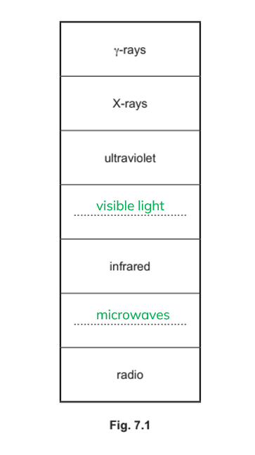

- Top space - visible light;** [1 mark]**
- Bottom space - microwaves;** [1 mark]**

(ii) Two properties that are the same for all waves in the electromagnetic spectrum:

**Any two from:**

- All EM waves are <u>transverse</u>;** [1 mark]**
- All EM waves travel at the <u>same speed</u>;** [1 mark]**
- (Transverse / EM waves) do not need a <u>medium</u>;** [1 mark]**

**[Total: 4 marks]**

> *It is essential you memorise the order of the electromagnetic spectrum as this is a very common style of question.*
State which region of the electromagnetic spectrum is used in each situation.

(i) Detecting objects without opening baggage at a security check:

- X-rays; **[1 mark]**

(ii) Television remote control

- Infrared; **[1 mark]**

(iii) Satellite television transmissions

- Microwaves; **[1 mark]**

**[Total: 3 marks]**

> *You should memorise the uses and dangers of each part of the electromagnetic spectrum.*

### Q6
(i) The missing radiations drawn on Fig. 9.1 would look like:

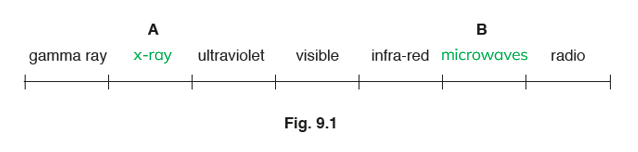

- X-rays between gamma rays and ultraviolet; **[1 mark]**
- Microwaves between infra-red and radio; **[1 mark]**

(ii) A ring drawn around the lowest frequency radiation would look like:

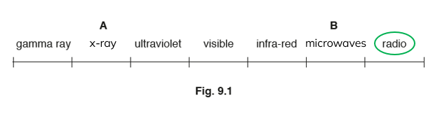

- Ring drawn around radio; **[1 mark]**

**[Total: 3 marks]**
To state two safety precautions when handling sources that emit gamma radiation:

**Any two from:**

- Lead / metal apron; **[1 mark]**
- Use long tongs; **[1 mark]**
- Limit the time of exposure; **[1 mark]**
- Point the source away from people; **[1 mark]**

**[Total: 2 marks]**

> *Safety precautions for handling radioactive radiations are the same for all types of ionising radiation.*

### Q7
Short wavelength visible light and infrared radiation are used to achieve this high rate, explain why:

- Radiation with a short wavelength has a <u>high frequency</u>; **[1 mark]**
- More information / data is transferred per second; **[1 mark]**

**[Total: 2 marks]**
Explain why visible light is used and not X-rays:

- X-rays penetrate soft-tissue / the liver; **[1 mark]**
- Visible light is reflected by soft tissue / the liver; **[1 mark]**
- X-rays may cause internal damage / cancer / harm cells **OR** X-rays are more ionising than visible light; **[1 mark]**

**[Total: 3 marks]**
Draw the path of visible light along the fibre from one end to the other:

A diagram scoring 2 marks:

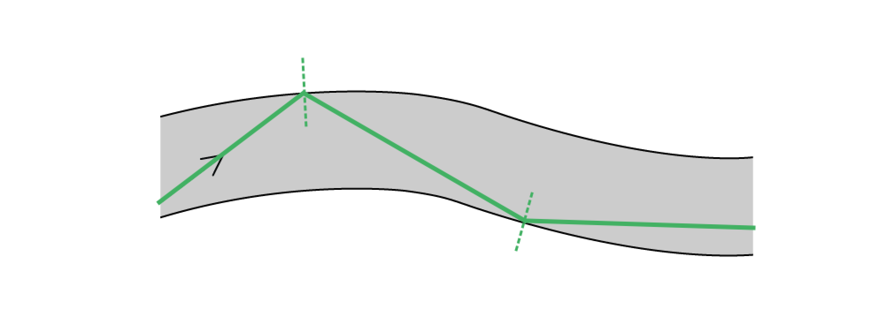

- <u>Two</u> total internal reflections shown; **[1 mark]**
- Angles of incidence and reflection are equal (by eye) in each total internal reflection; **[1 mark]**

**[Total: 2 marks]**

> *You should know that total internal reflection occurs in an optical fibre, but you must be **accurate** when drawing this. Draw the normal as close to perpendicular to the fibre's wall as you can, then use a **protractor** to ensure your angles **i** and **r** are **equal**.*

> *There are no marks for drawing the normal but it will really help with your reflections!*
(i) Calculate the critical angle of the glass:

Recall the equation for critical angle:

- $n = \frac{1}{\sin ( C )}$ **[1 mark]**

Rearrange for C and substitute the refractive index, $n$:

- $C = \sin ^{- 1} ( \frac{1}{n} )$
- $C = \sin ^{- 1} ( \frac{1}{1.3} )$ **[1 mark]**
- $C=50^{\circ}$ (2 s.f.) **[1 mark]**

(ii) The light does not reach the blockage. Suggest why:

- The angle of incidence is less than 50°; **[1 mark]**
- At the point where the fibre bends / turns the corner; **[1 mark]**
- (Therefore) the light is <u>refracted</u> / leaves the fibre / core; **[1 mark]**

**[Total: 6 marks]**

> *50° is a relatively impractical critical angle - if the angle of incidence is less than this, the light will be refracted out of the optical fibre. In reality, a material would be used with a smaller critical angle. *

### Q8
(i) Complete Table 1.1 by filling in the missing EM waves:

A table scoring 3 marks:

| gamma | **Final answer:** **x-ray** | **Final answer:** **ultraviolet** | **Final answer:** **visible** | **Final answer:** **infrared** | **Final answer:** **microwave** | radio |
|---|---|---|---|---|---|---|

- **5 correct scores 3 marks**
- **4 correct scores 2 marks**
- **3 correct sores 1 mark**
- **Less than 3 scores 0 marks**

(ii) Suggest what the arrow is indicating:

- The arrow indicates something increasing from left to right
- <u>Wavelength</u> increases from left to right; **[1 mark]**

**[Total: 4 marks]**
(i) Describe the interaction between the x-rays and soft tissue:

- Soft tissue <u>transmits</u> the x-rays; **[1 mark]**

(ii) Describe the interaction between the x-rays and bone:

- Bone <u>absorbs</u> the x-rays; **[1 mark]**

**[Total: 2 marks]**

### Q9
(i) The names of the missing parts are:

- A: radio; **[1 mark]**
- B: visible light; **[1 mark]**

(ii) The type of electromagnetic wave with a wavelength of 1.0 × 10–9 m is:

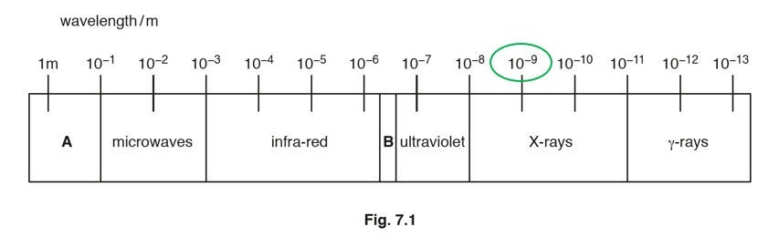

- X-rays; **[1 mark]**

**[Total: 3 marks]**

> *You should memorise the order of the electromagnetic spectrum carefully, along with uses and dangers of each section.*
One other property that is the same for all electromagnetic waves is:

- They are all transverse; **[1 mark]**

**[Total: 1 mark]**
(i) State the type of electromagnetic radiation used for remote controllers for televisions:

- Infra-red / IR; **[1 mark]**

(ii) State the type of electromagnetic radiation used for killing bacterial cells:

**Any one from:**

- gamma / γ; **[1 mark]**
- X-rays; **[1 mark]**
- Ultraviolet; **[1 mark]**

**[Total: 2 marks]**

> *Make sure you know the uses and dangers of each of the different sections of the electromagnetic spectrum.*

### Q10
(i) On Fig. 7.1, add the label for the missing type of radiation:

- Ultraviolet (waves / radiation); **[1 mark]**

(ii) State the name of the property that is increasing in the direction of the arrow:

- Wavelength; **[1 mark]**

(iii) Compare the speeds of radio waves and visible light in a vacuum:

- Radio waves and visible light have the same speed in a vacuum (because all EM waves travel at the speed of light); **[1 mark]**

**[Total: 3 marks]**

> *You do need to remember the order of the EM spectrum. You also need to remember that lower energy waves have lower frequencies and longer wavelengths, whereas higher energy waves have high frequencies and shorter wavelengths.*
(i) Describe how X-rays are used for security in airports:

Any **two **from:

- X-rays are used for checking bags / people / packages; **[1 mark]**
- For hidden / concealed objects; **[1 mark]**
- Which show up as a shadow / image on a screen / monitor; **[1 mark]**

(ii) Explain the properties of X-rays that make them useful in airport security:

**EITHER**

- Transmission (of X-rays); **[1 mark]**
- Through less dense materials; **[1 mark]**

**OR**

- Absorption (of X-rays); **[1 mark]**
- By dense materials; **[1 mark]**

**[Total: 4 marks]**

### Q11
(i) State the name of the missing part:

- Microwaves; **[1 mark]**

(ii) Suggest a value for speed of infra-red waves in a vacuum:

- All electromagnetic waves travel at the same speed
- Therefore the speed of infra-red waves in a vacuum is 3.0 × 108 m / s; **[1 mark]**

(iii) Parts of the electromagnetic spectrum which have a wavelength shorter than light:

**Any one from:**

- ultraviolet; **[1 mark]**
- X-rays; **[1 mark]**
- gamma / γ-rays; **[1 mark]**

**[Total: 3 marks]**

> *It is vital to learn the order of the electromagnetic spectrum, and remember that the speed of all electromagnetic waves in a vacuum is constant.*
(i) State a medical use for X-rays:

**Any one from:**

- Detecting broken bones; **[1 mark]**
- Detecting damaged teeth; **[1 mark]**
- Detecting cancer; **[1 mark]**
- Treating cancer; **[1 mark]**

State a medical use for gamma rays:

**Any one from:**

- Sterilising hospital equipment; **[1 mark]**
- Increasing the shelf-life of sealed food; **[1 mark] **
- Detecting cancer; **[1 mark]**
- Treating cancer; **[1 mark]**

(ii) To explain why γ-rays are dangerous to living things:

**Any two from:**

- Gamma rays are ionising radiations / high-energy electromagnetic radiation; **[1 mark]**
- Gamma rays may damage or mutate cells / DNA; **[1 mark]**
- Gamma rays may cause radiation burns; **[1 mark]**

**[Total: 4 marks]**

> *Make sure you learn the uses and dangers of each part of the electromagnetic spectrum.*

### Q12
Complete Fig. 8.1 with the names of the missing types of radiation in the correct boxes.

A diagram that would score 5 marks should look like:

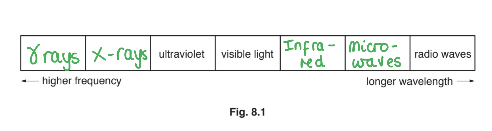

(From left to right):

- γ / gamma (rays); **[1 mark]**
- X-rays; **[1 mark]**
- Infrared (rays / waves); **[1 mark]**
- Microwaves; **[1 mark]**

**[Total: 4 marks]**

> *You will be expected to remember the order of the types of radiation in the electromagnetic spectrum. The question could be asked in **either** order, i.e. from highest to lowest frequency or lowest to highest frequency. Therefore, check that you have learnt it **both** ways around.*

> *Remember that as frequency **increases**, the wavelength of a wave **decreases**. This means although gamma rays have the **highest** frequency (and energy), they have the **shortest** wavelength.*
A use of ultraviolet radiation is:

- Sun beds **OR** security marking;** [1 mark]**

**[Total: 1 mark]**

### Q13
A correctly completed sentence would look like:

- Gamma rays have the same **speed / velocity** as visible light; **[1 mark]**
- but different **frequency**; **[1 mark]**
- and **wavelength**; **[1 mark]**

**[Total: 3 marks]**
Correctly matched objects would look like:

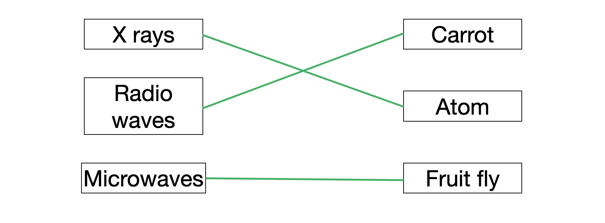

- **One mark for each correct line**

**[Total: 3 marks]**

> *A fruit fly is ~1 mm long, a carrot is ~10 cm long and an atom is ~0.1 nm. These roughly match the wavelengths of the corresponding forms of EM radiation, but it is worth noting that radio waves can have a wavelength anywhere from >1 mm to 30 m.*
(i) State the name of the process by which electromagnetic radiation can remove electrons from atoms:

- Ionisation; **[1 mark]**

(ii) Explain why radiographers stand behind lead screens when performing X-ray scans all day:

- X-rays are ionising; **[1 mark]**
- (The lead screen) reduces (prolonged) exposure to the radiation; **[1 mark]**

**[Total: 3 marks]**
(i) State the type of signal the oscilloscope shows:

- Digital; **[1 mark]**

(ii) Explain how the student can tell what type of signal is shown:

- The signal only has values of 0 and 1; **[1 mark]**

**[Total: 2 marks]**

### Q14
(i) State the wavelength of the wave in Fig 1.1:

A diagram which would score 1 mark:

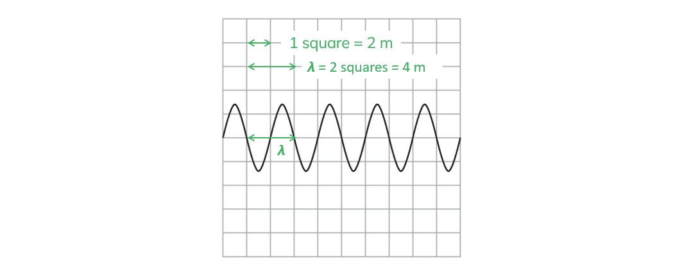

- wavelength = 4 m **[1 mark]**

** **

(ii) Sketch on Fig. 1.1 a wave that has a greater amplitude and lower frequency:

A diagram scoring 2 marks:

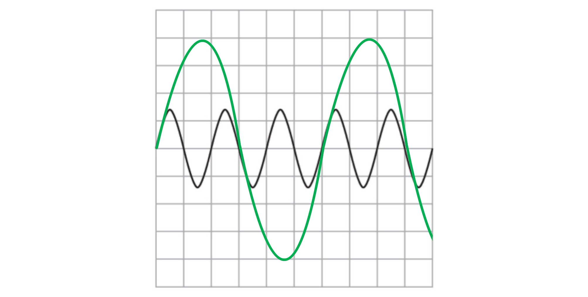

- Amplitude is drawn larger than original; **[1 mark]**
- Wavelength is longer than original; **[1 mark]**

**[Total: 3 marks]**
Calculate the wavelength of a radio wave with a frequency of 20 GHz:

Convert GHz to Hz:

- 1 GHz = 109 Hz
- Therefore, 20 GHz = 20 × 109 Hz **[1 mark]**

Using the wave equation:

- $v=fλ$
- $λ=\frac{v}{f}$
- $λ=\frac{3\times10^{8}}{20\times10^{9}}$ **[1 mark]**
- $λ=1.5\times10^{-2}m$ **OR** $0.015m$ **[1 mark]**

**[Total: 3 marks]**

> *Before starting any calculation first check that all the values are in normal units. Look for prefixes like G (giga) and change the number immediately - or you may forget later!*
State why sound waves and radio waves have different frequencies at the same wavelength:

Recall the speeds of sound and radio waves:

- Sound travels at 330 m/s while radio waves travel at 3.0 × 108 m/s

Draw a conclusion:

- Since the two waves travel at different speeds; **[1 mark]**
- They travel the same distance/one wavelength in different times; **[1 mark]**

**[Total: 2 marks]**

### Q15
State the maximum speed of gamma rays in a vacuum:

- 300 000 000 m/s **OR** 3 × 108 m/s **[1 mark]**

**[Total: 1 mark]**

> *Exam writers seem to love this question, because they can ask it in many ways that try to throw you off. Don't fall into the trap! All EM waves travel at the same speed in a vacuum which is the speed of light. Be confident in your knowledge of this, no matter how the question is asked.*
Calculate the frequency of a gamma ray with a wavelength of 6.5 × 10−13 m:

Using the wave equation:

- $v=fλ$
- $f=\frac{v}{λ}$
- $f=\frac{3\times10^{8}}{6.5\times10^{-13}}$ **[1 mark]**
- $f=4.6\times10^{20}\mathrm{Hz}$ **[1 mark]**

**[Total: 2 marks]**
Compare and contrast gamma rays and radio waves, considering their properties and their applications:

Consider the properties:

- Both are transverse; **[1 mark]**
- Gamma rays have the shortest wavelength (of all EM waves) **OR** the highest frequency / energy;** [1 mark]**
- Radio waves have the longest wavelength (of all EM waves) **OR** the lowest frequency / energy;** [1 mark]**
- Gamma rays are highly ionising / harmful to humans, whereas radio waves are not;** [1 mark]**

Consider the applications:

- Radio waves are used in communications / radio / TV; **[1 mark]**
- Gamma rays are used in sterilising food / medical equipment / treating cancer; **[1 mark]**

**[Total: 6 marks]**

> *Notice that in this question, you do not get a mark for saying that gamma and radio waves have the same speed. This is because you already gained a mark for this in part (a).*
Suggest **two** ways that workers can keep themselves safe when working with gamma rays:

Any **two **from:

- Minimise the length of time they are exposed to gamma radiation; **[1 mark]**
- Use a radiation badge to measure their exposure; **[1 mark]**
- Wear a lead apron / shielding; **[1 mark]**

**[Total: 2 marks]**

### Q16
The correctly circled answers would be:

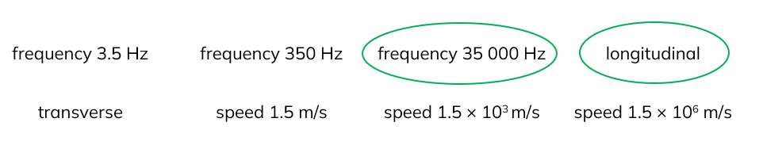

- Frequency 35 000 Hz circled;** [1 mark]**
- Longitudinal circled; **[1 mark]**

**[Total: 2 marks]**
To calculate the wavelength:

List the known quantities:

- Frequency, *f* = 1.3 × 1017 Hz
- Speed of light, *v* = 3.0 × 108 m/s

Recall the equation linking speed, wavelength and frequency:

- $speed=frequency\timeswavelength$ **OR** $v=f\timesλ$ **[1 mark]**

Substitute in known values:

- $λ=\frac{v}{f}=\frac{3.0\times10^{8}}{1.3\times10^{17}}$ **[1 mark]**

Calculate *λ*:

- *λ *= 2.31 × 10−9 m = 2.3 × 10−9 m **[1 mark]**

**[Total: 3 marks]**

> *Remember that all electromagnetic waves travel at the same speed, 3.0 × 10**8** m/s.*
To explain why it is safe for the patient but the dentist must stand away:

- X-rays ionising / harmful / dangerous (to humans); **[1 mark]**

Any one from:

- The patient is rarely exposed; **[1 mark]**
- There is a low total dose on the patient; **[1 mark]**
- The benefit outweighs the danger; **[1 mark]**
- The dentist would be frequently exposed; **[1 mark]**
- The total dose on dentist would be high if they stayed in the room; **[1 mark]**

**[Total: 2 marks]**

> *The patient only gets exposed for a brief period of time, and the benefits of the exposure outweigh the risk. For the dentist, they are exposed frequently due to to multiple patients needing x-rays. Therefore to minimise exposure they need to stand away.*
To explain why microwave ovens are designed only to work with the door closed:

- Microwaves are harmful / dangerous (to humans); **[1 mark]**
- Microwaves would pass through the open door (if it was not closed); **[1 mark]**

**[Total: 2 marks]**

### Q17
(i) The radiation in the missing region is:

- x-rays; **[1 mark]**

(ii) The region that has the waves with the longest wavelength is:

- Radio waves;** [1 mark]**

**[Total: 2 marks]**

> *It is important that you use the revision notes to familiarise yourself with the regions of the electromagnetic spectrum and their order from longest to smallest wavelength as well as their uses. *
An answer that would score 1 mark would look like this:

`square` ultraviolet

**✔** ultrasound; **[1 mark]**

`square` visible light

**[Total: 1 mark]**

> *The key to answering this question is to recognise that ultrasound is not an electromagnetic wave, so does not travel at the speed of light 3 × 10**8** m/s. It is a sound wave, so travels at the speed of sound when in air 340 m/s.*
**Any four from:**

- Produce a sharp sound; **[1 mark]**
- Use a suitable reflecting surface (from which to reflect the sound off); **[1 mark]**
- Measure the distance travelled by sound; **[1 mark]**
- Measure the time for sound to travel the measured distance; **[1 mark]**
- Use speed = distance / time equation to calculate the speed of sound; **[1 mark]**

**[Total: 4 marks]**

> *You may be asked to describe a range of experiments to measure certain quantities in your examination. To create your method consider the equation you need to use and how you would obtain the values for each quantity. *

### Q18
A correctly completed diagram looks like:

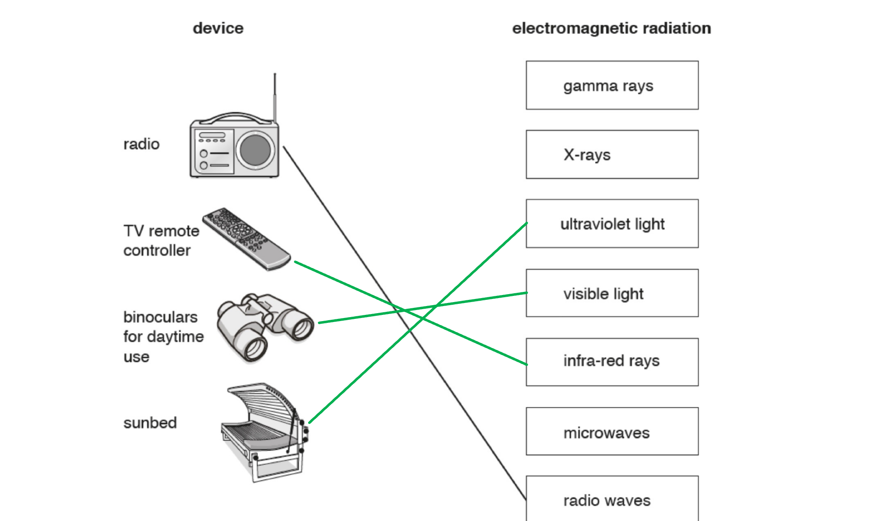

- **One mark for each correct line**

**[Total: 3 marks]**
(i) One type of radiation with longer wavelength than visible light is:

- Infrared **OR**** **microwaves **OR**** **radio waves; **[1 mark]**

(ii) All types of electromagnetic radiation travel through a vacuum with the same **speed**; **[1 mark]**

**[Total: 2 marks]**

> *To remember the order of the electromagnetic spectrum, use a mnemonic. This one about a grandmother-turned-spy with an umbrella-gadget may help!*

