# Exam Questions — Electromagnetic Spectrum
**3. Waves** · Cambridge (CIE) IGCSE physics (0625 & 0972)
> Source: [https://www.savemyexams.com/igcse/physics/cie/23/topic-questions/](https://www.savemyexams.com/igcse/physics/cie/23/topic-questions/) · 43 questions across 2 sets

## Multiple Choice Questions (25 questions)

### Q1 — medium — 1 marks

**Q1** [1 mark]

Which row correctly compares the wavelength, frequency and speed of ultraviolet radiation and infrared radiation in a vacuum?

|   | wavelength of ultraviolet compared to infrared | frequency of ultraviolet compared to infrared | speed of ultraviolet compared to infrared |
|---|---|---|---|
| **A** | longer | lower | same |
| **B** | shorter | higher | same |
| **C** | shorter | lower | higher |
| **D** | longer | higher | lower |

### Q2 — easy — 1 marks

**Q2** [1 mark]

Which row correctly matches a region of the electromagnetic spectrum to its application?

|   | region | application |
|---|---|---|
| **A** | microwaves | medical scanning of bones |
| **B** | radio waves | security marking |
| **C** | ultraviolet | sterilising water |
| **D** | X-rays | satellite television |

### Q3 — medium — 1 marks

**Q3** [1 mark]

Visible light has wavelengths in the range $4.0\times10^{-7}m\mathrm{to}7.0\times10^{-7}m$.What is the range of the frequencies of visible light?

*Source: June 2023 0972/21 Q21*

### Q4 — easy — 1 marks

**Q4** [1 mark]

Which statement is correct?

*Source: June 2023 0972/11 Q21*

### Q5 — medium — 1 marks

**Q5** [1 mark]

**Extended Tier Only**

What is the speed of electromagnetic waves in a vacuum?

*Source: specimen 2023 paper 2 Q24*

### Q6 — medium — 1 marks

**Q6** [1 mark]

Which statement is **correct**?

*Source: specimen 2023 paper 1 Q24*

### Q7 — easy — 1 marks

**Q7** [1 mark]

** **Which statement correctly compares radio waves and X-rays?

*Source: June 2022 paper 1 Q25*

### Q8 — easy — 1 marks

**Q8** [1 mark]

Which part of the electromagnetic spectrum is used by a remote controller for a television?

*Source: June 2022 paper 1 Q24*

### Q9 — easy — 1 marks

**Q9** [1 mark]

Which of the following groups contains only electromagnetic waves?

### Q10 — easy — 1 marks

**Q10** [1 mark]

The electromagnetic spectrum is shown in the table below.

| γ-rays | x-rays | ultraviolet | visible light | infrared | microwaves | radio waves |
|---|---|---|---|---|---|---|

Which word is missing from the box below the electromagnetic spectrum?

### Q11 — easy — 1 marks

**Q11** [1 mark]

The table below shows the entire electromagnetic spectrum. It runs in order of increasing wavelength.

Which region is microwaves?

| γ-rays | **A** | **B** | **C** | infrared | **D** | radio waves |
|---|---|---|---|---|---|---|

### Q12 — easy — 1 marks

**Q12** [1 mark]

Which list shows the parts of the electromagnetic spectrum in order of decreasing wavelength?

### Q13 — easy — 1 marks

**Q13** [1 mark]

The table below shows the entire electromagnetic spectrum. It runs in order of increasing frequency.

Three parts of the spectrum are missing.

| radio waves | **X** | infrared | visible light | **Y** | x-rays | **Z** |
|---|---|---|---|---|---|---|

What are parts **X**, **Y** and **Z**?

|   | **X** | **Y** | **Z** |
|---|---|---|---|
| **A** | ultraviolet | microwaves | gamma rays |
| **B** | microwaves | gamma rays | microwaves |
| **C** | gamma rays | ultraviolet | microwaves |
| **D** | microwaves | ultraviolet | gamma rays |

### Q14 — medium — 1 marks

**Q14** [1 mark]

Which type of electromagnetic wave is used in remote controls?

### Q15 — hard — 1 marks

**Q15** [1 mark]

**Extended tier only**

Bluetooth devices rely on electromagnetic radiation to transmit signals.

Which of the following statements is correct?

### Q16 — medium — 1 marks

**Q16** [1 mark]

In what way are microwaves different from ultraviolet waves?

### Q17 — medium — 1 marks

**Q17** [1 mark]

Visible, red light has a wavelength of around 700 x 10-7 m.

Two other types of electromagnetic radiation, X and Y, have different wavelengths to the visible, red light.

Wavelength of X = 400 x 10-7 m Wavelength of Y = 3.0 x 10-2 m

Which types of radiation could X and Y be?

|   | **X** | **Y** |
|---|---|---|
| **A** | visible blue light | microwaves |
| **B** | x-rays | ultraviolet |
| **C** | infrared | radio waves |
| **D** | microwaves | ultraviolet |

### Q18 — medium — 1 marks

**Q18** [1 mark]

Which of the following sentences about infrared waves is true?

### Q19 — hard — 1 marks

**Q19** [1 mark]

**Extended tier only**

Mobile phone networks rely on electromagnetic radiation to transmit signals.

Which of the following statements is correct?

### Q20 — hard — 1 marks

**Q20** [1 mark]

**Extended tier only**

Which of the following options shows the correct speed for electromagnetic waves in a vacuum?

### Q21 — medium — 1 marks

**Q21** [1 mark]

**Extended tier only**

Which of the following types of electromagnetic radiation has the highest speed in a vacuum?

### Q22 — medium — 1 marks

**Q22** [1 mark]

The table gives common uses of electromagnetic radiation.

Which row correctly matches the type of electromagnetic radiation with its use?

|   | **Detecting banknote forgery** | **TV remote controllers** | **Sterilising medical instruments** |
|---|---|---|---|
| **A** | microwaves | visible light | microwaves |
| **B** | infrared | infrared | γ-rays |
| **C** | ultraviolet | radio waves | infrared |
| **D** | ultraviolet | infrared | γ-rays |

### Q23 — medium — 1 marks

**Q23** [1 mark]

A forgery detector is used to check whether bank notes are genuine or counterfeit. A type of electromagnetic radiation is shone onto the banknote which makes special ink in the note glow.

Which type of electromagnetic radiation is shone onto the banknote?

### Q24 — hard — 1 marks

**Q24** [1 mark]

**Extended tier only**

Communications engineers need to choose whether to send signals as either digital or analogue.

What is the main benefit of using digital signals?

### Q25 — hard — 1 marks

**Q25** [1 mark]

Which line in the table correctly identifies a use and a danger of the electromagnetic wave given in the first column?

|   | **EM wave** | **Uses** | **Dangers** |
|---|---|---|---|
| **A.** | gamma | detection of cancers | internal heating of body cells |
| **B.** | x-rays | detecting false bank notes | mutation or damage to body cells |
| **C.** | visible | photography | mutation or damage to body cells |
| **D.** | infrared | thermal imaging | skin burns |

## Theory Questions (18 questions)

### Q1 — easy — 3 marks

**Q1** [1 mark]

Visible light is a region of the electromagnetic spectrum.

State **one **region of the electromagnetic spectrum which has waves of longer wavelength than waves of visible light.

*Source: June 2023 0972/31 Q7B*

**Q1** [2 marks]

Gamma rays are another region of the electromagnetic spectrum.

(i)**  **Describe **one **use of gamma rays.

[1]

(ii)** **Describe **one **harmful effect on people of excessive exposure to gamma rays.

[1]

*Source: June 2023 0972/31 Q7C*

### Q2 — medium — 2 marks

**Q2** [2 marks]

(i)** **State the name of **one** type of electromagnetic wave with a wavelength shorter than that of visible light.

[1]

(ii) State **one **use of the type of wave you have given in **(i). **

[1]

*Source: June 2022 paper 3 Q7C*

### Q3 — medium — 7 marks

**Q3** [3 marks]

Fig. 9.1 shows some parts of the electromagnetic spectrum.

| radio waves |   | infrared waves | visible light | ultraviolet waves | X-rays | $γ$-rays |
|---|---|---|---|---|---|---|

**Fig. 9.1**

(i) In Fig. 9.1, one part of the electromagnetic spectrum is **not** labelled.

State the name of this part.

[1]

(ii) The speed of visible light waves in a vacuum is 3.0 $\times$ 108 m/s.

State the value for the speed of infrared waves in a vacuum.

speed = .................................................. m/s [1]

(iii)** **Some parts of the electromagnetic spectrum have a wavelength shorter than that of visible light.

State **one **example.

[1]

*Source: 2023 specimen paper 3 Q9A*

**Q3** [4 marks]

(i)** **X-rays and γ-rays are used in hospitals.

Describe **one **medical use for X-rays and **one **medical use for γ-rays.

[2]

(ii) State** two** reasons why γ-rays are dangerous to living things.

[2]

*Source: 2023 Specimen paper 3 Q9B*

### Q4 — easy — 11 marks

**Q4** [3 marks]

Complete the sentences using the numbers from the box. Use **one** number for each blank space.

A geostationary satellite has an orbital period of _______ hours.

A Polar satellite has an orbital height of ______ km above sea level, whereas this is ________ km for geostationary satellites.

| **72                36 000                200                12                24** |
|---|

**Q4** [3 marks]

(i) State two uses of a polar satellite.

[2]

(ii) State one use of a geostationary satellite.

[1]

**Q4** [2 marks]

**Extract:**

A Polar satellite has an orbital height of 200 km above sea level; whereas this is 36 000 km for geostationary satellites.

A satellite phone allows users to communicate across the globe by sending signals to a satellite, which then sends the signal to the user receiving the signal.

Using your answer from part (a), explain why there is a time delay in calls when using a geostationary satellites compared to calls which use polar satellites.

**Q4** [3 marks]

**Extended tier only**

Rhys lives in a valley and is surrounded by hills on all sides. He likes to follow the local news with his radio and his television.

(i) Rhys receives radio station signals and TV signals. State which signal has the longer wavelength.

[1]

(ii) Explain why the TV has poor signal even though the radio is clear.

[2]

### Q5 — medium — 7 marks

**Q5** [4 marks]

Fig. 7.1 shows a diagram of the main regions of the electromagnetic spectrum. Two labels are missing.

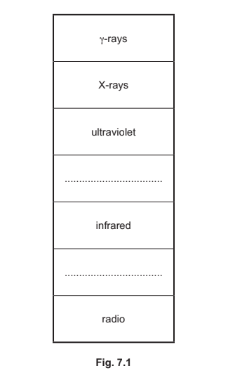

(i) Complete the labels on Fig. 7.1.

[2]

(ii) State two properties that are the same for all waves in the electromagnetic spectrum.

[2]

*Source: 2020 0625/32 Q7A*

**Q5** [3 marks]

State which region of the electromagnetic spectrum is used in each situation.

(i) Detecting objects without opening baggage at a security check

[1]

(ii) Television remote control

[1]

(iii) Satellite television transmissions

[1]

*Source: 2020 0625/32 Q7B*

### Q6 — easy — 5 marks

**Q6** [3 marks]

Fig. 9.1 shows a partially-labelled diagram of the electromagnetic spectrum.

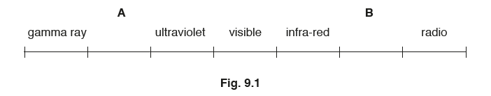

(i) On Fig. 9.1, add the names of the missing radiations at **A** and at **B**.

[2]

(ii) Indicate the radiation that has the lowest frequency. On Fig. 9.1, draw a ring around the radiation.

[1]

*Source: 2018 0625/31 Q9A*

**Q6** [2 marks]

State two safety precautions when handling sources that emit gamma radiation.

*Source: 2018 0625/31 Q9B*

### Q7 — medium — 13 marks

**Q7** [2 marks]

**Extended tier only**

Optical fibres are used for high speed broadband.

Short wavelength visible light and infrared radiation are used to achieve this fast broadband. Explain why.

**Q7** [3 marks]

An optical fibre is inserted into a patient's body to examine the liver during a keyhole surgery.

Explain why visible light is more useful and safer than X-rays during this surgery.

**Q7** [2 marks]

#### Extended

Fig. 1.1 shows the optical fibre used. The arrow shows the initial direction of the ray of visible light.

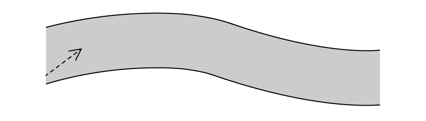

**Fig. 1.1**

Draw the path of visible light along the fibre from one end to the other.

**Q7** [6 marks]

#### Extended

A technician uses an optical fibre in a factory to view a pipe blockage. The blockage is round a bend, shown in Fig. 1.2.

The glass from which the optical fibre is made has a refractive index of 1.3.

(i) Calculate the critical angle of the glass.

[3]

(ii) The light does not reach the blockage. Suggest why.

[3]

### Q8 — hard — 6 marks

**Q8** [4 marks]

Table 1.1 shows a list of the electromagnetic spectrum.

| gamma |   |   |   |   |   | radio |
|---|---|---|---|---|---|---|

**Table 1.1**

(i) Complete Table 1.1 by filling in the missing EM waves.

[3]

(ii) Suggest what the arrow is indicating.

[1]

**Q8** [2 marks]

Fig. 1.1 shows an X-ray of a broken bone.

**Fig. 1.1**

Describe the interaction between the x-rays and

(i) soft tissue.

[1]

(ii) bone.

[1]

### Q9 — medium — 6 marks

**Q9** [3 marks]

Fig. 7.1 shows an incomplete diagram of the electromagnetic spectrum.

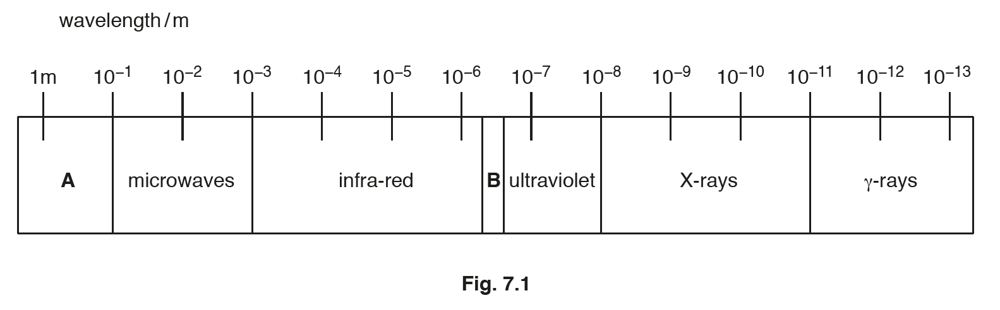

(i) In Fig. 7.1, section A and section B of the electromagnetic spectrum are not labelled.

State the names of parts A and B.

[2]

(ii) An electromagnetic wave has a wavelength of 1.0 × 10–9 m. Use Fig. 7.1 to identify the type of electromagnetic wave.

[1]

*Source: 2018 0625/33 Q7A*

**Q9** [1 mark]

All electromagnetic waves travel at the same speed in a vacuum.

State one other property that is the same for all electromagnetic waves

*Source: 2018 0625/33 Q7B*

**Q9** [2 marks]

For each purpose, state one type of electromagnetic radiation that can be used.

(i) Remote controllers for televisions

[1]

(ii) Killing bacterial cells

[1]

*Source: 2018 0625/33 Q7C*

### Q10 — medium — 7 marks

**Q10** [3 marks]

Fig. 7.1 shows the electromagnetic spectrum. One type of radiation is not labelled.

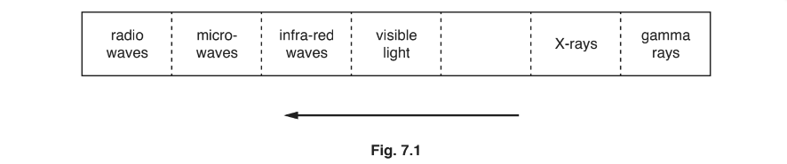

(i) On Fig. 7.1, add the label for the missing type of radiation.

[1]

(ii) The arrow in Fig. 7.1 indicates a property that is increasing.

State the name of the property that is increasing in the direction of the arrow.

[1]

(iii) Compare the speeds of radio waves and visible light in a vacuum.

[1]

*Source: Nov 2018 (S1) 0625/31 Q7A*

**Q10** [4 marks]

(i) Describe how X-rays are used for security in airports.

[2]

(ii) Explain the properties of X-rays that make them useful in airport security.

[2]

*Source: Nov 2018 (S1) 0625/31 Q7B*

### Q11 — medium — 7 marks

**Q11** [3 marks]

Fig. 7.1 shows some parts of the electromagnetic spectrum.

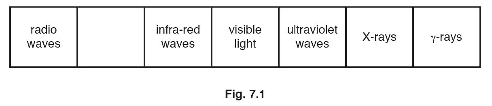

(i) In Fig. 7.1, one part of the electromagnetic spectrum is not labelled.

State the name of this part.

[1]

(ii) The speed of visible light waves in a vacuum is 3.0 × 108 m / s.

Suggest a value for the speed of infra-red waves in a vacuum.

speed = .................................................. m / s

[1]

(iii) Some parts of the electromagnetic spectrum have a wavelength shorter than that of visible light. State one example.

[1]

*Source: 2018 0625/32 Q7A*

**Q11** [4 marks]

(i) X-rays and γ-rays are used in hospitals.

Describe one medical use for X-rays and one use for γ-rays.

[1]

(ii) Explain why γ-rays are dangerous to living things.

[1]

*Source: 2018 0625/32 Q7B*

### Q12 — easy — 5 marks

**Q12** [4 marks]

Fig. 8.1 shows an incomplete diagram of the electromagnetic spectrum.

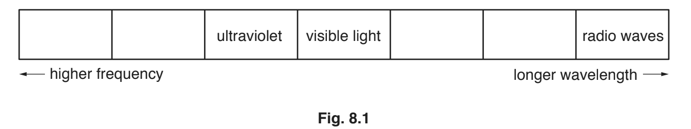

Complete Fig. 8.1 with the names of the missing types of radiation in the correct boxes.

*Source: 2019 0625/32 Q8A*

**Q12** [1 mark]

State one use for ultraviolet radiation.

*Source: 2019 0625/32 Q8B*

### Q13 — easy — 9 marks

**Q13** [1 mark]

Complete the sentence below.

Gamma rays have the same ___________ as visible light, but different __________ and ____________.

**Q13** [3 marks]

Match the type of electromagnetic radiation with the object most similar in size to its wavelength.

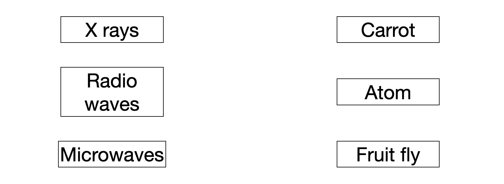

**Q13** [3 marks]

State the name of the process by which electromagnetic radiation can remove electrons from atoms.

[1]

(ii) Radiographers operate X-ray equipment as part of their profession.

Lead absorbs a lot of radiation. Explain why radiographers stand behind lead screens when performing X-ray scans all day.

[2]

**Q13** [2 marks]

**Extended tier only**

A student sees that an oscilloscope shows a signal, shown in Fig. 1.1.

(i) State the type of signal the oscilloscope shows.

[1]

(ii) Explain how the student can tell what type of signal is shown.

[1]

### Q14 — hard — 8 marks

**Q14** [3 marks]

Fig. 1.1 shows a radio wave. Each 1 cm square is equal to 2 m.

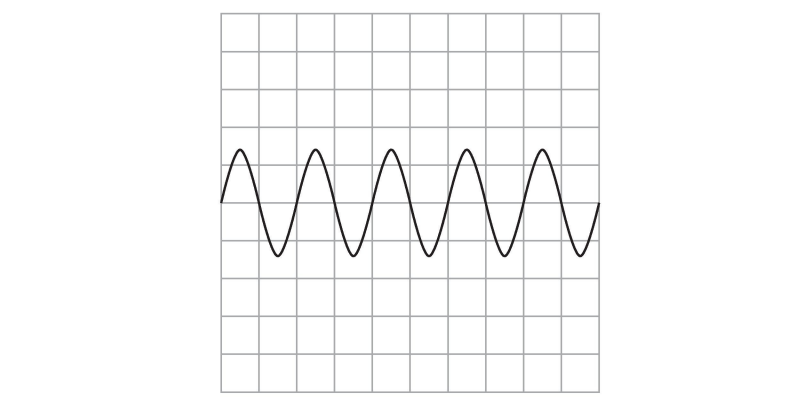

(i) State the wavelength of the radio wave in Fig 1.1.

[1]

(ii) Sketch on Fig. 1.1 a wave that has a greater amplitude and lower frequency.

[2]

**Q14** [3 marks]

**Extended tier only**

A radio wave with a frequency of 20 GHz travels through the vacuum of space.

Calculate the wavelength of this radio wave.

wavelength = ....................................

**Q14** [2 marks]

**Extended tier only**

State why sound waves and radio waves have different frequencies at the same wavelength.

### Q15 — hard — 11 marks

**Q15** [1 mark]

**Extended tier only**

Gamma rays are the highest energy waves in the electromagnetic spectrum.

State the maximum speed of gamma rays in a vacuum.

**Q15** [2 marks]

**Extract:**

Gamma rays are the highest energy waves in the electromagnetic spectrum.

State the maximum speed of gamma rays in a vacuum.

- 300 000 000 m/s OR 3 × 10^8 m/s

Calculate the frequency of a gamma ray with a wavelength of 6.5 × 10−13 m.

frequency = ....................................

**Q15** [6 marks]

Compare and contrast gamma rays and radio waves. You should consider both their properties and their applications.

**Q15** [2 marks]

Gamma rays are dangerous to work with because they transfer large amounts of energy.

People who work with gamma radiation need to take precautions to keep themselves safe.

Suggest **two** ways that workers can keep themselves safe when working with gamma rays.

### Q16 — hard — 9 marks

**Q16** [2 marks]

Circle two of the following that apply to an ultrasound wave travelling in air.

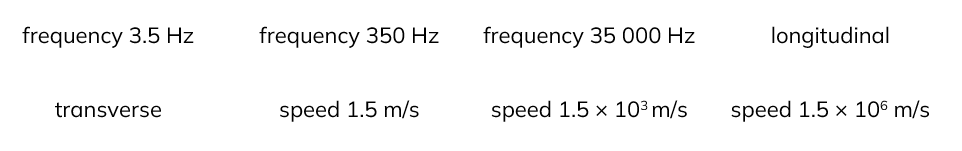

*Source: 2018 0625/42 Q6A*

**Q16** [3 marks]

Calculate the wavelength of X-rays with frequency 1.3 × 1017 Hz in a vacuum.

wavelength = ...........................................................

*Source: 2018 0625/42 Q6B*

**Q16** [2 marks]

A dentist takes an X-ray photograph of a patient’s teeth. Explain why it is safe for the patient to be close to the source of X-rays, but the dentist must stand away from the source.

*Source: 2018 0625/42 Q6C*

**Q16** [2 marks]

State, with a reason, why microwave ovens are designed only to work with the door closed.

*Source: 2018 0625/42 Q6D*

### Q17 — hard — 7 marks

**Q17** [2 marks]

Fig.9.1 represents the seven main regions of the electromagnetic spectrum.

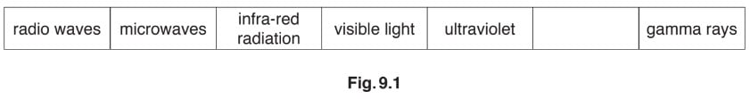

(i) In Fig.9.1, one region is not named.

State the name of the radiation in this region.

[1]

(ii) State which region has waves with the longest wavelength.

[1]

*Source: February/March 2018 0625/32 Q9A*

**Q17** [1 mark]

Tick the box for the wave with the lowest speed in air.

`square` ultraviolet

`square` ultrasound

`square` visible light

*Source: February/March 2018 0625/32 Q9B*

**Q17** [4 marks]

A group of students want to determine the speed of sound in air.

Describe a method they can use. State the measurements they need to make.

*Source: February/March 2018 0625/32 Q9C*

### Q18 — easy — 5 marks

**Q18** [3 marks]

Fig. 7.1 shows some devices that each use one type of electromagnetic radiation.

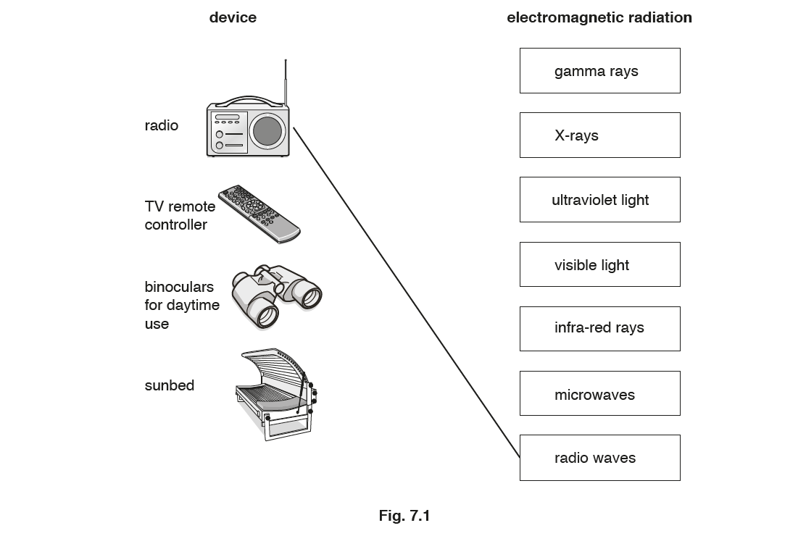

Draw one line from each device to the correct type of electromagnetic radiation. One has been done for you.

*Source: 2019 May/June 0972/31 Q7A*

**Q18** [2 marks]

(i) State the name of one type of radiation that has a longer wavelength than visible light.

[1]

(ii) Complete the sentence about electromagnetic radiation. Use a word from the list below.

| **amplitude** | **frequency** | **speed** | **wavelength** |
|---|---|---|---|

All types of electromagnetic radiation travel through a vacuum with the same __________

[1]

*Source: 2019 May/June 0972/31 Q7B*

