# Mark Schemes — Sound
**3. Waves** · Cambridge (CIE) IGCSE physics (0625 & 0972)

## Multiple Choice Questions (21 questions)

### Q1
**Final answer:** **The correct answer is A**

- The loudness of a sound is related to the amplitude of the sound wave
- Reducing the loudness produces a quieter sound, which means the amplitude decreases
- The pitch of a sound is related to the frequency of the sound wave
- Lowering the pitch means the frequency decreases
- Therefore, both the amplitude and the frequency decrease

**B** is incorrect because the frequency should decrease (lower pitch), not increase.

**C** is incorrect because the amplitude should decrease (quieter), not increase.

**D** is incorrect because both the amplitude and the frequency decrease, not increase. This option describes making the sound louder and higher-pitched.

### Q2
**Final answer:** **The correct answer is C**

- The sound travels from the student to the wall and then back again to be heard as an echo
- The speed of sound in air is about $330m/s$
- The total distance travelled by the sound is calculated using the equation:

$\text{total distance}=\text{speed}\times\text{time}$

$\text{total distance}=330\times1.2=396\text{m}$

- The distance $d$ to the wall is exactly half of the total distance travelled by the sound:

$d=\frac{396}{2}=198m$

- This is approximately equal to $200m$, which is option **C**

**A** is incorrect as this corresponds to a speed of sound of $\frac{50\times2}{1.2}\approx83m/s$, which is too low.

**B** is incorrect as this corresponds to a speed of sound of $\frac{100\times2}{1.2}\approx167m/s$, which is too low.

**D** is incorrect as this corresponds to a speed of sound of $\frac{400\times2}{1.2}\approx667m/s$, which is too high.

> **[exam-tip]**
> When dealing with echo questions, always remember that the sound travels twice the distance to the reflecting surface — once going and once returning. A common mistake is to forget to halve the total distance calculated. Make sure you identify whether the question asks for the one-way distance or the total distance travelled by the sound.

### Q3
**Final answer:** **The correct answer is D because:**

- For a sound wave, amplitude and volume are equivalent
- Since the amplitude of the sound is decreasing, the volume of the sound is decreasing

**A **is incorrect as amplitude is decreasing

**B **is incorrect as the frequency is decreasing

**C **is incorrect as frequency and pitch are equivalent for a sound wave, and pitch is decreasing

### Q4
**Final answer:** **The correct answer is ****A**** because:**

- The light travels instantly between the students
- The time it takes for the sound to travel 100 m can be calculated like this:

$\mathrm{speed}=\frac{\mathrm{distance}}{\mathrm{time}}\mathrm{or}v=\frac{s}{t}$

- Rearrange the equation:

$t=\frac{s}{v}=\frac{100m}{340m/s}=0.29s$

- This is the time delay between student Y seeing the smoke and hearing the sound

**B** is incorrect as it shows the time it would take for the sound to travel from student X to student Y and back again.

**C** and **D** are incorrect as they show incorrect uses of the speed equation.

### Q5
**Final answer:** **The correct answer is C**

- The time taken for the sound to return to the boat is 1.3 s
- Over this time, the sound wave covers the distance from boat to sea bed twice, as it is a return journey
- The speed is therefore

v=dt=20001.3=1540 m/s

- Option **C** is the closest to this answer

This is a common trick in exams to check you are reading the question properly. It is also possible to answer this question by halving the time and keeping the distance as 1000 m. The trip to the sea bed takes half the time of the return journey.

### Q6
**Final answer:** **The correct answer is B**

- Sound waves travel fastest through solids and slowest through gases
- The distance from **S **to each microphone is the same
- The path to **B** is through only solid, so this is the fastest path
- This means microphone **B **receives the signal first

**A **is incorrect as this path is through a gas, which is slower than through a solid

**C **and **D **are incorrect as these paths are through a liquid, which is slower than through a solid

### Q7
**Final answer:** **The correct answer is ****B**** because: **

- The pitch of a sound wave is determined by its frequency. **High frequency** means **high pitch** and **low frequency** means **low pitch**.

**A **is incorrect as the pitch decreases, it does not increase.

**C **and **D **are incorrect as the volume does not change because the amplitude of the sound wave does not change.

### Q8
**Final answer:** **The correct answer is ****C**** because: **

- The **loudness** of a sound wave is governed by its **amplitude**. To play a quieter sound wave, the amplitude must be decreased.

**A **is incorrect as the frequency does not change when the volume of a sound wave changes.

**B **is incorrect as the wavelength does not change when the volume of a sound wave changes.

**D **is incorrect as the speed does not change when the volume of a sound wave changes.

### Q9
**Final answer:** **The correct answer is ****D**** because:**

- Broken bones are imaged using x-rays
- The other options are all key uses of ultrasound waves

### Q10
**Final answer:** **The correct answer is ****C**** because:**

- The range of hearing of the average human with healthy hearing is around 20 Hz to 20,000 Hz, or 20 kHz.
- The only option that falls entirely into this range is C.

Remember that **k **stands for **kilo**, which means 1000 and **M** stands for **mega**, which means 1,000,000.

**A **is incorrect as 200 kHz is far above the top end of the human hearing range.

**B **is incorrect as 50 kHz is above the top end of the human hearing range.

**D **is incorrect as the entire range is too high for humans to hear.

### Q11
**Final answer:** **The correct answer is ****B**** because:**

- The **amplitude** of a sound wave determines its **volume**. We are told that X is louder, so its amplitude must be larger.
- The **frequency** of a sound wave determines its **pitch**. We are told that X has a lower pitch, so its frequency must be lower.

**A **is incorrect  as X has a lower frequency than *f.*

**C **is incorrect  as X has a higher amplitude than *A*, and a lower frequency than *f*.

**D  **is incorrect  as X has a higher amplitude than *A.*

### Q12
**Final answer:** **The correct answer is ****D**** because:**

- Distance = speed x time
- Distance = 1500 x 0.48 = 720 m
- This is the distance the sound wave travels to get to the fish **and back again**. Therefore, we need to divide it by 2.
- Therefore  $\frac{720}{2}=360m$

**A** is incorrect as speed has been incorrectly divided by time.

**B** is incorrect as speed has been incorrectly divided by time, and the factor of 2 has not been taken into account.

**C** is incorrect as the final distance was not divided by 2

### Q13
**Final answer:** **The correct answer is ****A**** because:**

- $speed=\frac{distance}{time}$
- $speed=\frac{300}{0.86}=348.84m/s$
- The sound only travels in one direction: from the pistol to the spectator, so there is no factor of two here.

**B **is incorrect as this is the speed of sound that is often given in textbooks (it’s wrong, by the way, it’s closer to 345 m/s), but this is not the answer you get if you use the information in the question.

**C **is incorrect as distance has been incorrectly multiplied by time.

**D **is incorrect as the final answer has been incorrectly multiplied by 2, which would be correct if the sound wave were bouncing off a surface and returning whence it came.

### Q14
**Final answer:** **The correct answer is ****D**** because:**

- *Distance* = *speed* x *time*
- *Distance* = 345 x 1.8 = 621 m

- This is the distance travelled by the sound wave when it travels to the cliff **and back again**.
- Therefore, we have to divide this answer by 2, so 
$\frac{621}{2}=310.5m$

**A **is incorrect as speed has incorrectly been divided by time, and the factor of 2 not considered.

**B **is incorrect as speed has incorrectly been divided by time

**C **is incorrect as the distance has not been divided by 2.

### Q15
**Final answer:** **The correct answer is ****B**** because:**

- **Sound** waves are **longitudinal**.
- This means that the **direction** of **vibration** will be **towards** and away from the speaker, in the same direction as the wave travels.

Any answer that states that sound is a transverse wave is wrong.

### Q16
**Final answer:** **The correct answer is ****B**** because:**

- Ultrasound is used to find breaks in materials such as the steel of railway lines, where an echo will reflect off a broken surface, indicating the distance to the damaged part

  - Option **1** is correct

- In situations where x-rays would be too damaging, such as scans of the fetus or soft tissues, ultrasound is extensively used

  - Option **2** is correct

- <u>Radar</u> stands for *radio detection and ranging* and uses radio waves, not sound waves, to detect distances and velocities

  - Option **3** is <u>not</u> correct

### Q17
**Final answer:** **The correct answer is ****D**** because: **

- The pitch of a sound wave is determined by its frequency. High frequency means high pitch and low frequency means low pitch.

**A **is incorrect as while this would prevent the person from hearing sound waves, it would also result in them being unable to breathe, and is extremely unlikely, unless the room is aboard a spacecraft with some serious issues. Half a mark if you gave this answer as it’s *technically* correct.

**B **is incorrect as the speed of sound waves changes in different media, but it does not affect our ability to hear them.

**C **is incorrect as a higher amplitude of sound wave would mean the sound was louder. I suppose, *technically*, if the amplitude were great enough, it would burst the person’s eardrums, meaning they’d hear a very loud sound, followed by nothing, ever again. Since they *would* hear a loud sound first, no marks for this answer.

### Q18
**Final answer:** **The correct answer is ****A**** because **

- Echoes are caused by sound waves being reflected from surfaces.

**B **is incorrect as sound does refract, but this does not cause echoes.

**C **is incorrect as sound will diffract, but this does not cause echoes, it merely allows us to hear round corners.

**D **is incorrect as sound can disperse, but you are unlikely to ever notice this effect without quite specialist equipment.

### Q19
**Final answer:** **The correct answer is ****D**** because:**

- The pitch of a sound wave is determined by its frequency. **Higher** **frequency** means a **higher** **pitch**.
- The volume of a sound wave is determined by its amplitude. A **higher** **amplitude** means a **louder** **sound**.

### Q20
**Final answer:** **The correct answer is ****A**** because **

- echoes are caused when sound waves are reflected from a surface.

**B **is incorrect as echoes are not caused by refraction.

**C **is incorrect as this is a true statement, but it would not cause Narcissus to hear the clap again.

**D **is incorrect as the sound *could* travel backwards *if* the wind were blowing faster than the speed of sound. However, it would simply carry the clap backwards, away from him. And listening for an echo would be the last thing he’d want to do in supersonic winds!

### Q21
**Final answer:** **The correct answer is ****C**** because:**

- The typical range of human hearing is from about** 20 Hz to about 20,000 Hz**.
- Remember that **k** stands for **kilo** and means 1,000. So **20,000 Hz = 20 kHz**
- The only one of the sounds produced by the teacher that lies inside that range is 440 Hz.

**A **is incorrect as 10 Hz is too low to hear.

**B **is incorrect as 30 kHz, 30,000 Hz is too high to hear.

**D **is incorrect as 120 kHz, 120,000 Hz is too high to hear.

## Theory Questions (18 questions)

### Q1
(i) To calculate the frequency of the emitted sound:

- Write down the wave equation:

$v = f λ$ **[1 mark]**

- Rearrange for frequency and calculate

$f=\frac{v}{λ}$

$f=\frac{1500}{0.030}$

$f=$ $50000\text{Hz}$ **[1 mark]**

> **[mark-scheme]**
> 1 mark for the correct equation **OR** correct substitution
> 
> - Accept $v = f λ$ **OR** $f = \frac{v}{λ}$ **OR** $\frac{1500}{0.030}$
> 
> 1 mark for a correct final answer of 50 000 Hz
> 
> - Accept $5 . 0 \times 10^{4}  \text{Hz}$ or $50  \text{kHz}$
> 
> Both marks can be scored for the correct answer alone

> **[mark-scheme]**
> (ii) The sound is
> 
> - Not audible, because the frequency ($50  000  \text{Hz}$ / $50  \text{kHz}$) is above $20  000  \text{Hz}$ / $20  \text{kHz}$ (the upper limit of human hearing) **OR **the sound is ultrasound **[1 mark]**
> 
> Accept: "it is above the range of human hearing"
> 
> Do not accept: "it is not audible" without a reason — must reference the frequency being above the hearing limit

> **[exam-tip]**
> Remember to convert the wavelength to metres before substituting: 3.0 cm = 0.030 m. A common error is to substitute 3.0 instead of 0.030, giving 500 Hz — this would be audible, which contradicts the purpose of the sonar equipment. The result (50 kHz) is well above the 20 kHz upper limit of human hearing, so the sound is ultrasound and is not audible. This is deliberate — ultrasound is used for sonar because its short wavelength allows it to detect small features on the seabed.
> **[mark-scheme]**
> - (The pulse of) sound / ultrasound (sent into water) reflects from seabed **[1 mark]**
> - The time (for the total journey) is measured
> **AND**
> depth = speed × time **[1 mark]**
To calculate the time for the pulse to return to the ship:

- Read the depth from the graph:

From the graph, when distance = 300 m, depth = 70 m

- The pulse travels down to the seabed and back, so the total distance is twice the depth:

$\text{total distance} = 2 \times 70 = 140 \text{m}$ **[1 mark]**

- Rearrange the speed equation for time and substitute:

$\text{time} = \frac{\text{total distance}}{\text{speed}} = \frac{140}{1500}$

$\text{time} = 0 . 0933 \text{s} =$$0 . 093 \text{s}$ **[1 mark]**

> **[mark-scheme]**
> 1 mark for reading the depth from the graph **AND** doubling it: total distance = $140 \text{m}$
> 
> - Accept a depth of 69–71 m (total distance 138–142 m)
> 
> 1 mark for a correct final answer of $0 . 093 \text{s}$
> 
> - Accept 0.092–0.095 s
> - Accept 0.0933 s or 0.09 s
> - ecf: if the depth is misread but is doubled and divided by 1500 correctly, award this mark
> - If the depth is not doubled (0.047 s), maximum 1 mark

> **[exam-tip]**
> The pulse goes down to the seabed and back, so double the depth before dividing by the speed: forgetting to double gives 0.047 s and loses a mark. Read the depth at exactly 300 m and to the nearest half-square; the seabed is steep there, so a careless read-off shifts your answer.

### Q2
> **[mark-scheme]**
> - Measure the distance from the drum to the wall using the trundle wheel **[1 mark]**
> - Measure the time interval between striking the drum and hearing the echo **[1 mark]**
> - Use $v=\frac{2\times\mathrm{distance}}{\mathrm{time}}$ to calculate the speed **[1 mark]**

> **[exam-tip]**
> Remember that the sound travels from the drum to the wall and back to the drum. Therefore, you have to use $2\times$ the distance in the calculation.
- List the known quantities:

  - Distance, $d=32.95m$
  - Speed of sound in air, $v=330m/s$
- Write out the equation and rearrange to make time the subject:

$v=\frac{2d}{t}$

$t=\frac{2d}{v}$ **[1 mark]**

- Substitute in the known values to calculate:

$t=\frac{2\times32.95}{330}$ **[1 mark]**

$t=1.996...$

$t=0.20s$ (2 s.f.) **[1 mark]**
> **[mark-scheme]**
> - The time interval is very short **OR** The measured time is close to human reaction time **[1 mark]**
> - The uncertainty in the measurement is greater than 10% **[1 mark]**
> **[mark-scheme]**
> Any **one **from:
> 
> - Use a louder sound at a greater distance to increase the time interval measurement
> - Use a sharper sound source (so the sound is clearer to hear)
> - Ensure the timer is started when the drum is seen to be hit rather than when it is heard
> - Use a digital recording to measure the time interval more precisely
> - Ensure the environment is quiet
> - Make sure there are no other walls or large objects that may reflect the sound
> 
> **[1 mark]**
Sketch the trace for a sound that is louder and has a higher pitch:

- A louder sound has a greater amplitude
- A higher pitch has a shorter frequency

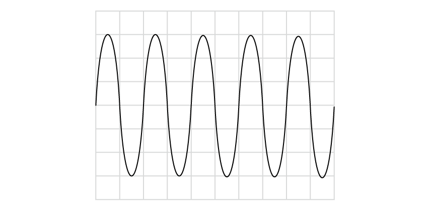

> **[mark-scheme]**
> - Amplitude is greater than 2 squares** [1 mark]**
> 
> - Frequency is less than 4 squares **[1 mark]**

### Q3
A typical speed for sound in air is:

- 330 m/s **[1 mark]**

**[Total: 1 mark]**

> *Any value from 330 m/s to 350 m/s is accepted.*
To calculate frequency:

List the known quantities:

- Wavelength, *λ* = 22 mm = 0.022 m
- Speed, *v* = 330 m/s (from part (a))

Recall the equation for wave speed and rearrange for frequency:

- v=fλ **[1 mark]**
- f=v/λ

Substitute the known quantities:

- f=330/0.022
- f=15 000 Hz **[1 mark]**

**[Total: 2 marks]**

> *A correct answer using the answer from part (a) gains the marks here. A speed of 350 m/s, for example, gives a frequency of 16 000 Hz. *
To determine the size and position of the bubble:

- Use a <u>transducer</u> to send and receive ultrasound pulses; **[1 mark]**
- Measure time taken for echo to return from front **AND **back of bubble; **[1 mark]**
- Use the speed of sound in the metal; **[1 mark]**
- Use the equation distance = speed × time to locate bubble; **[1 mark]**

**[Total: 4 marks]**

> *By measuring the distance to the front and to the back of the bubble, its size can be found by subtracting one value from the other and the location of its beginning and end is also known.*

### Q4
(i) State what is meant by the frequency of the source:

- The number of complete oscillations per second; **[1 mark]**

(ii) State the distance moved, in terms of the wavelength, *λ* by a wavefront during n oscillations of the source:

- For each oscillation the wavefront moves one wavelength, *λ *
- Therefore for n oscillations the wavefront moves <u>n × </u><u>*λ*</u> **[1 mark]**

**[Total: 2 marks]**
Use your answers from part (a) to derive the wave equation:

Start with the equation defining velocity and substitute the term stated in (a)(i):

- $v=\frac{d}{t}=\frac{nλ}{t}$ **[1 mark]**

Substitute the equation which defines frequency in terms of time:

- $f=\frac{1}{t}$ **OR  **$v=f\timesnλ$**[1 mark]**

Make n = 1 to find the velocity of one wavefront (since they all have the same speed):

- $v=fλ$ **[1 mark]**

**[Total: 3 marks]**
Determine the frequency of the sound wave:

Look at the **troughs** to find the time for one full wavelength:

- One wavelength = 3 cm
- Time per cm = 2.0 ms = 2.0 × 10−3 s
- Therefore time period, T = (3 × 2.0 × 10−3) = 6.0 × 10−3 s **[1 mark]**

Use the equation for frequency:

- $f = \frac{1}{T} = \frac{1}{( 6.0 \times 10^{- 3} )} = 166.7$

Write the answer to 2 sig figs and include the unit:

- $f=170\mathrm{Hz}$ **[1 mark]**

**[Total: 2 marks]**

> *You may instinctively look at the crests of the wave pattern to find the wavelength (since a definition you are used to is 'the distance from one crest to the next one'). *

> *However in this diagram the crests are in the middle of the divisions, making it harder to estimate the distance, while the troughs meet the division lines much more clearly.*

### Q5
(i) Suggest why the sailors watch for the flash of light rather than listen for the bang:

- Light travels faster than sound; **[1 mark]**

**OR**

- Light is seen before the bang is heard; **[1 mark]**

(ii) Calculate the speed of sound:

List the known quantities:

- Distance from the canon, *d* = 500 m
- Time difference, *t* = 1.6 s

Recall the equation for speed:

- $speed=\frac{distance}{time}$ **OR** $v=\frac{d}{t}$ **[1 mark]**

Substitute in the known quantities:

- $speed=\frac{500}{1.6}$ **[1 mark]**

Calculate the speed of sound:

- speed*  *= 312.5 m/s **[1 mark]**

**   **

(iii)  Suggest why the value obtained in **(ii) **is lower than expected:

- It is <u>windy</u> (which affects the measurements); **[1 mark]**

**OR**

- The reaction time to start / stop the watch (affects the time measured); **[1 mark]**

**[Total: 5 marks]**

In part (ii), you may have noticed that the question gives 1.6 s as the time **difference** between the sailor receiving the flash. The flash and the bang occur at the same time, so technically a short time passes between the canon making the sound and the sailor seeing the light.

You would be forgiven for thinking that this must mean that it is incorrect to say that 1.6 s pass between the canon sounding and the sailor hearing it. Isn't it 1.6 s + the time taken for the light to reach the sailor?

This is actually true! However, light travels at a speed of 300 000 000 m / s, so it takes light 0.0000017 s to reach the sailor. So actually the time it takes for the sound to reach the sailor is 1.6000017 s, but this has no effect on our answer to four significant figures!

Essentially, light travels so quickly that we can say that the sailor seeing the flash and the canon making a sound happen at **almost** the exact same time.  The further away the sailor the longer it will take the light and sound to reach them.
State the term:

- The second bang is an <u>echo;</u> **[1 mark]**

Explain how it is produced:

- The sound waves are <u>reflected</u> by the cliffs; **[1 mark]**

**[Total: 2 marks]**

> *Just like any other wave, sound waves can be reflected. Certain surfaces work better - generally if a surface is large and smooth it will be more capable of reflecting sound and creating an echo (caves and quarries typically create echoes well as they have large flat surfaces of rock).*

### Q6
Explain why Gassendi needed to assume that ‘compared with the speed of sound, the speed of light is infinite’:

**Any two from:**

- Time in calculation is <u>difference</u> between <u>light and sound</u> arriving; **[1 mark]**
- Can't include this in the calculation / don't know how long the light takes to arrive; **[1 mark]**
- So must assume it is zero; **[1 mark]**

**[Total: 2 marks]**
Calculate the time between seeing the flash of a gun and hearing the sound:

List the known values:

- Distance, *d* = 2.5 km = 2500 m **[1 mark]**
- Gassendi's value for speed of sound, *s* = 480 m/s

Use the rearranged equation for speed to find time:

- $t=\frac{d}{s}=\frac{2500}{480}$ **[1 mark]**

Calculate and write the answer to two sig figs:

- $t=5.2s$ **[1 mark]**

**[Total: 3 marks]**
Explain why modern writers would judge this result as 'much better':

- Much closer to currently accepted value / true value; **[1 mark]**

**[Total: 1 mark]**

> *"More **accurate**" would gain a mark here, as this is the definition of accuracy. *
Select data where both temperature and speed of sound are given:

- Speed of sound, *s* = 331.29 m/s **AND **temperature, *θ* = 0 °C (line 10); **[1 mark]**

Rearrange the equation to make k the subject:

- $c = k \sqrt{( \\theta + 273.15 )}$
- $k = \frac{c}{ \sqrt{( \\theta + 273.15 )} }$ **[1 mark]**

Substitute the values and calculate:

- $k = \frac{331.29}{ \sqrt{( 0 + 273.15 )} } = \frac{331.29}{ \sqrt{273.15} }$ **[1 mark]**
- $k=20.04$** [1 mark]**

**[Total: 4 marks]**

### Q7
Completed sentences are:

- Sound is produced when an object **vibrates**;** [1 mark]**
- An echo is produced when sound is **reflected** from a hard surface; **[1 mark]**
- Compared with a quiet sound, a loud sound always has a greater **amplitude**; **[1 mark]**
- Compared with a high pitched sound, a low pitched sound always has a smaller** ****frequency**; **[1 mark]**
- Waves transfer energy without transferring **matter**; **[1 mark]**

**[Total: 5 marks]**

> *It is important to know how the general terminology of waves applies to sound.*
Ultrasound is the term used for:

- Vibrations with higher frequency than (audible) sound; **[1 mark]**

**[Total: 1 mark]**

> *The range of human hearing is 20 to 20 000 Hz. Anything with a frequency less than this is infrasound. Anything with a frequency more than this is ultrasound.*

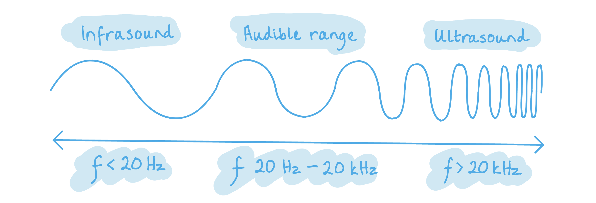

### Q8
Draw a ring around the range for a healthy human ear:

**[Total: 1 mark]**
Explain the meaning of the term *ultrasound*:

The term *ultrasound* describes:

- Frequencies (of sound); **[1 mark]**
- Above 20 000 Hz; **[1 mark]**

**[Total: 2 marks]**

Ultrasound is above the range of frequencies that humans can hear:

State and explain how sound P is different from sound Q:

- Sound P is <u>quieter</u> **AND** has a <u>lower pitch</u> (than sound Q); **[1 mark]**
- Because sound P has a <u>smaller amplitude</u>;** [1 mark]**
- And sound P has a <u>lower frequency</u>; **[1 mark]**

**[Total: 3 marks]**

If you need a reminder about pitch and volume:

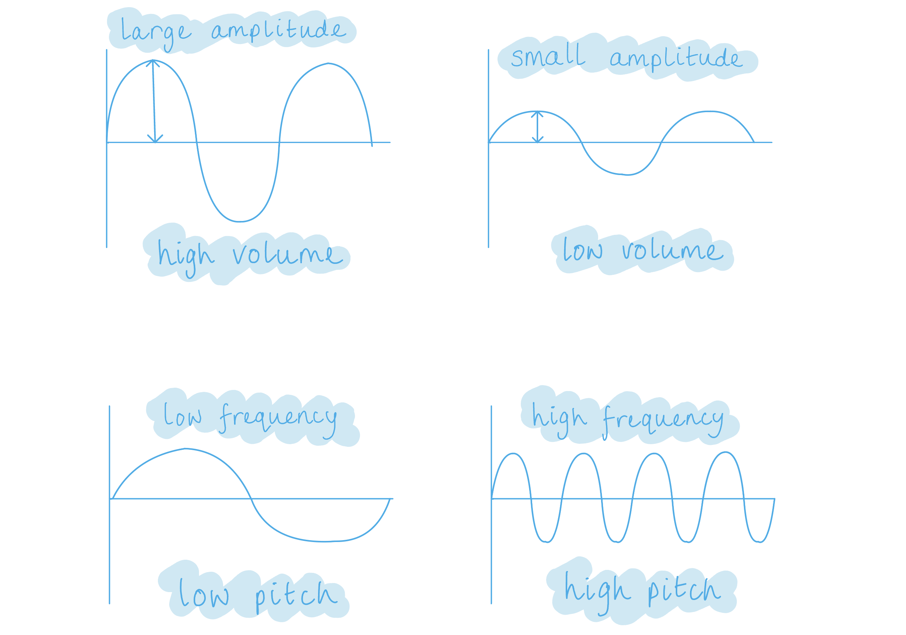

### Q9
Explain why the speed of ultrasound in soft tissue is faster than in air:

- Sound travels by oscillating particles in a medium / is a mechanical wave;** [1 mark]**
- The more dense the medium, the faster the sound wave **OR**
- Sound travels faster in solids than in gases; **[1 mark]**
- Tissue is more dense than air; **[1 mark]**

**[Total: 3 marks]**
Calculate the wavelength of the ultrasound waves:

(i) Air:

List the known quantities:

- Frequency of waves,* f *= 2.5 MHz = 2.5 × 106 Hz **[1 mark]**
- Velocity, *v* = 350 m/s

Use the wave equation:

- $v=fλ$ **[1 mark]**
- $λ=\frac{v}{f}=\frac{350}{2.5\times10^{6}}$

Calculate the answer to two sig figs and include units:

- $λ=1.4\times10^{-4}m/0.00014m/0.14\mathrm{mm}$ **[1 mark]**

(ii) Soft tissue:

Use the wave equation:

- $λ=\frac{v}{f}=\frac{1550}{2.5\times10^{6}}$

Calculate the answer to two sig figs and include units:

- $λ=6.2\times10^{-4}m/0.00062m/0.62\mathrm{mm}$ **[1 mark]**

**[Total: 4 marks]**
Use your knowledge of sound and other waves to explain why radiologists may not use the shortest wavelengths possible when scanning patients:

**Any three from:**

Consider the relevant equation:

- (The wave equation states that) frequency and wavelength are <u>inversely proportional</u>;** [1 mark]**
- Therefore short wavelength <u>increases frequency</u>; **[1 mark]**

Infer how this affects patients:

- High frequency waves

  - Are more energetic;** [1 mark]**
  - Cause more damage to cells;** [1 mark]**

**[Total: 3 marks]**

### Q10
(i) State how the tuning fork produces the sound:

- The tuning fork <u>vibrates</u>
- This vibrates air particles, producing sound waves; **[1 mark]**

(ii) State the type of wave a sound wave is.

- (A sound wave is) <u>longitudinal</u>; **[1 mark]**

(iii) Explain why a student with healthy ears cannot hear the sound:

- The frequency of the sound / 25 kHz; **[1 mark]**
- Is above the human hearing range **OR **is an ultrasound; **[1 mark]**

**[Total: 4 marks]**

> *The young, healthy hearing range of a human is roughly 20 Hz to 20 kHz. This is worth committing to memory for questions about sound. Like in this question, you may be given a frequency and be expected to know whether it is audible to humans or not. *
(i) On Fig. 8.2, draw two arrows in opposite directions to show the movement of the air particles:

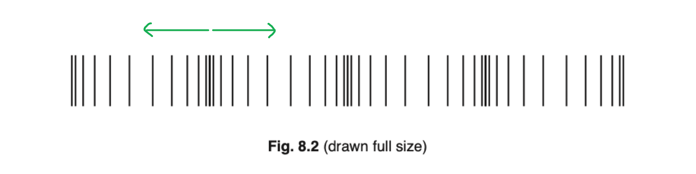

- A single horizontal line with arrowheads on either end pointing in opposite directions; **[1 mark]**

**OR **

- Two separate horizontal arrows pointing in opposite directions; **[1 mark]**

(ii) Use Fig. 8.2 to determine the wavelength of the sound wave:

- Measure the length of all four waves
- Divide this measurement by four to obtain the length of a single wave

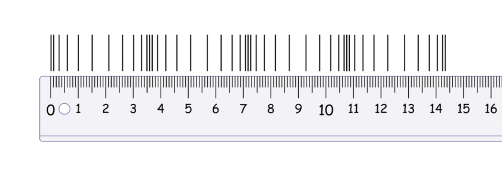

- Length of four waves = 14.4 cm
- $wavelength=\frac{14.4}{4}$
- wavelength = 3.6 cm **[1 mark]**

**[Total: 2 marks]**

> *When a measurement question comes up on your paper, the exam board will ensure that it is to scale such that every student should measure the same length. On this website, however, you may be reading these questions on a laptop, a smartphone, a tablet or a PC monitor! As a result you are likely to not gain an answer of 3.6 cm here, but what is important is the method. You will obtain a more accurate answer if you measure the length of **four** waves and divide by four to obtain the wavelength than you would by measuring the wavelength of one single wave.*

> *The error is a smaller proportion of the measurement when we measure something larger. When we divide by four, we also divide the error by four. *
Describe a method of using water waves to demonstrate refraction:

**Any four from:**

- Use of shallow water; **[1 mark]**
- Use of a flat lamina / shape below the surface (to change depth) **OR **use different depths (of water); **[1 mark]**
- Idea of waves hitting shallow water / the shape at an angle (other than 90°); **[1 mark]**
- Waves change direction; **[1 mark]**
- (Due to the) change in speed; **[1 mark]**

**An example of an answer that would gain 4 marks:**

Generate waves in a tank filled with shallow **[1 mark]** water. Place a flat object under the surface of the water to change the depth **[1 mark] **partway along the tank. Ensure that the waves are hitting the boundary of the shallower water at a non-perpendicular angle **[1 mark]**. This will cause the waves to change direction **[1 mark] **as a result of their change in speed **[1 mark]**.

### Q11
(i) To state the name of a piece of equipment for measuring the distance from the student to the wall:

- A tape measure; **[1 mark]**

(ii) To explain how sound forms an echo:

- Sound is <u>reflected</u>; **[1 mark]**

**[Total: 2 marks]**
To determine the speed of sound:

State the significance of the echo being heard at the same time as the next beat:

- When the echo is heard at the same time as the next beat, the time for sound to travel to the wall and back must be 1.0 s; **[1 mark]**

Determine the distance travelled in 1.0 s:

- The distance to the wall is 170 m and the sound travels to the wall and reflects back

  - Therefore the distance travelled in 1.0 s is 170 × 2 = 340 m **[1 mark]**

Calculate the speed of sound:

- $speed=\frac{distance}{time}=\frac{340}{1}=340$ **[1 mark]**

State the unit:

- m / s **[1 mark]**

**[Total: 4 marks]**

### Q12
The correct answers are:

(i) Sound is produced when a source **vibrates**; **[1 mark]**

(ii) Sound waves are **longitudinal** waves; **[1 mark]**

(ii) Sound waves cannot travel through a **vacuum**; **[1 mark]**

**[Total: 3 marks]**
(i) The lowest frequency of sound that can be heard by mice is:

- 1000 Hz **[1 mark]**

(ii) The highest frequency of sound that can be heard by elephants is:

- A value between 10 001 and 19 000 Hz **[1 mark]**

(iii) To explain how the chart shows that elephants can hear some sounds that humans **cannot** hear:

- The lowest frequency of sound that can be heard by humans is 20 Hz; **[1 mark]**
- Elephants can hear sounds which have a lower frequency than 20 Hz; **[1 mark]**

(iv) The term given to the high frequencies that dolphins can hear but humans **cannot** hear;

- Ultrasound; **[1 mark]**

**[Total: 5 marks]**

### Q13
The speed of sound in air is:

- Any value between 330 – 350; **[1 mark]**

With the unit:

- m/s; **[1 mark]**

**[Total: 2 marks]**

> *Some speed of sound calculations include accounting for echoes and reflections. Keeping in mind the correct answer is a useful check on whether the calculation has come out correctly.*
For this investigation, complete the sentences describing the method:

(i)

- Two people stand a distance of at least **100 m** apart; **[1 mark]**
- The distance between them is measured using a **trundle wheel / measuring tape / metre rule**; **[1 mark]**
- The second person has a **stopwatch**** **which they start when they see the first person banging the blocks together and stops when they hear the sound; **[1 mark]**
- This is then **repeated**** **several times; **[1 mark]**
- and an **average / mean** is taken for the time; **[1 mark]**

(ii)

State the equation used to calculate the speed of sound following this investigation:

- $speedofsound=\frac{distance}{averagetime}$ **OR  **$s=\frac{d}{t}$; **[1 mark]**

**[Total: 6 marks]**
For this investigation, complete the sentences describing the method:

(i)

- A person stands at least **50 m**** **away from a wall; **[1 mark]**
- The distance is measured using **a trundle wheel / measuring tape / metre rule**; **[1 mark]**
- A second person has a stopwatch and starts timing when they hear the **clap**; **[1 mark]**
- and stops timing when they hear the **echo**; **[1 mark]**
- This is then **repeated**** **several times; **[1 mark]**
- and an **average / mean** is taken for the time; **[1 mark]**

(ii)

State the equation used to calculate the speed of sound following this investigation:

- $speedofsound=\frac{2\timesdistance}{averagetime}$ **OR  **$s=\frac{2\timesd}{t}$ **[1 mark]**

**[Total: 7 marks]**
(i)

For this investigation, complete the sentences describing the method:

- Two **microphones**** **are connected to an oscilloscope and; **[1 mark]**
- placed about **5 m (range between 2-5 m) apart**; **[1 mark]**
- A **tape measure / metre rule** is used to measure the distance; **[1 mark]**
- The oscilloscope is set up so that it triggers when the **first **microphone detects a sound; **[1 mark]**
- Two wooden blocks are used to make a large clap next to the **first**** **microphone; **[1 mark]**
- The oscilloscope is then used to determine the **time difference** between the sound arriving at each microphone; **[1 mark]**
- This is **repeated**** **several times; **[1 mark]**
- and an **average** time difference calculated; **[1 mark]**

(ii)

State the equation used to calculate the speed of sound following this investigation:

**One mark for each correct:**

$speedofsound=\frac{distancebetweenmicrophones}{timedifference}$

**[Total: 10 marks]**

> *Students often either don't revise experimental methods, or don't practice explaining them in a concise way.*

> *Science is a practical subject and you definitely will be tested on your understanding of both method and analysis of the investigations you have done in school.*

### Q14
(i) Describe how the tuning fork produces the sound:

- The tuning fork vibrates / produces a vibration; **[1 mark]**

(ii) State whether a healthy human ear can hear this frequency of sound, and explain your answer:

- Yes, a human ear can hear the sound; **[1 mark]**
- Because the audible range of humans is 20 Hz to 20 000 Hz; **[1 mark]**

**[Total: 3 marks]**

> *Objects produce audible sounds when they vibrate at frequencies within the range of human hearing and inaudible ones when they vibrate at frequencies which are above or below the range of human hearing. Other species can hear sounds which we cannot.*
On Fig. 8.2, draw the wave to show the sound produced by the second tuning fork:

A diagram scoring two marks:

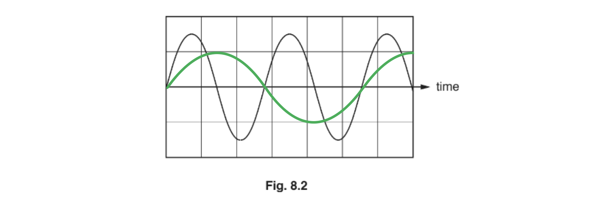

- Line drawn with a smaller amplitude; **[1 mark]**
- Line drawn with fewer waves on the screen; **[1 mark]**

**[Total: 4 marks]**

> *Remember that volume is dependent upon amplitude, the greater the amplitude the louder the sound and vice versa. *

> *Waves with a lower frequency will have a lower number of wavelengths visible on the screen. *

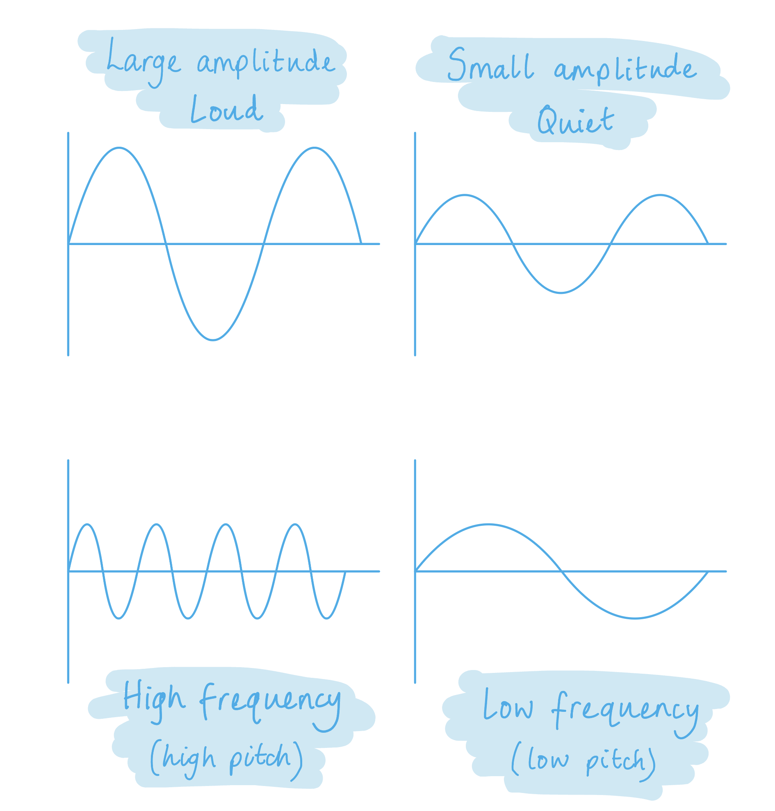

### Q15
Explain what is meant by the term longitudinal wave:

- Medium/particles vibrate; **[1 mark]**
- Vibrations/oscillations are parallel to / in the same direction as the direction of travel / energy transfer; **[1 mark]**
- The wave has areas of compression and rarefaction; **[1 mark]**

**[Total: 3 marks]**

> *If you find it difficult to remember which type of wave is which:*

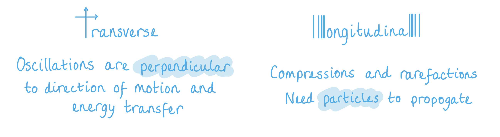
(i) State a typical value for the speed of sound in a liquid:

- A value in the range of 900 m/s to 2000 m/s; **[1 mark]**

(ii) Using your value from **(b)(i)**, calculate the wavelength of the sound wave in the ocean:

List the known quantities:

- Frequency, *f* = 800 Hz
- Speed of sound in liquid, *v* = 1000 m/s

Recall the wave equation:

- *v* = *f λ ***OR**** **wave speed = frequency × wavelength

Rearrange the equation to make wavelength the subject:

- $λ=\frac{v}{f}$

Substitute in the known values to calculate the wavelength:

- $λ=\frac{1000}{800}$ **[1 mark]**
- *λ* = 1.25 m **[1 mark]**

**[Total: 3 marks]**

> *The two rules you need to remember when rearranging equations are:*

1. *To undo an operation, do the opposite operation (to cancel a multiplication relationship, you need to divide, to cancel a minus you need to add or vice versa)*
2. *Whatever you do to an equation, you need to do it to **both sides*

> *If you need a reminder on how to rearrange the wave equation to solve for wavelength:*

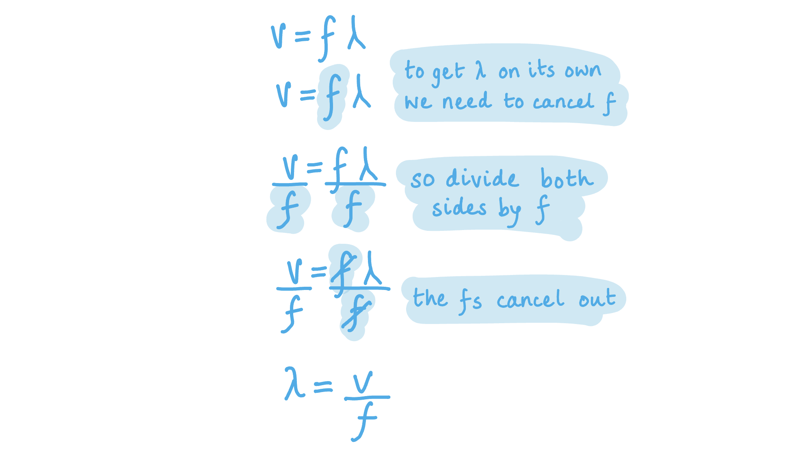

### Q16
(i) At the centre of a compression, mark a cross and label it C:

A diagram that would score 1 mark should look like this:

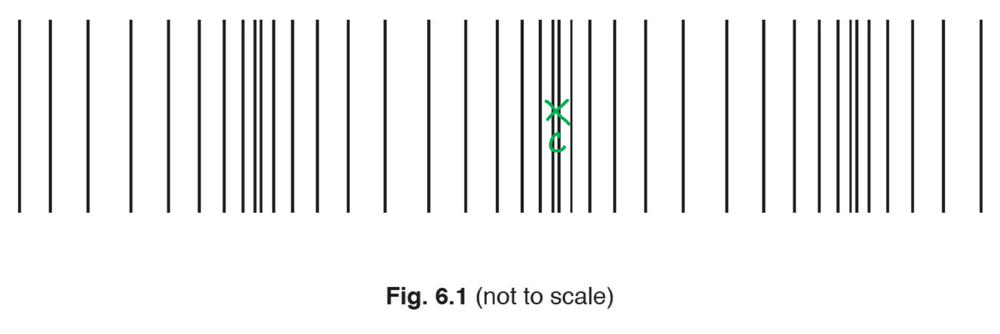

- C is indicated within the shortest gap; **[1 mark]**

(ii) At the centre of a rarefaction, mark a cross and label it R:

A diagram that would score 1 mark should look like this:

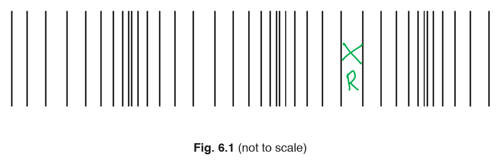

- R is indicated within the longest gap; **[1 mark]**

(iii) Draw a double-headed arrow to represent a distance of 0.90 m:

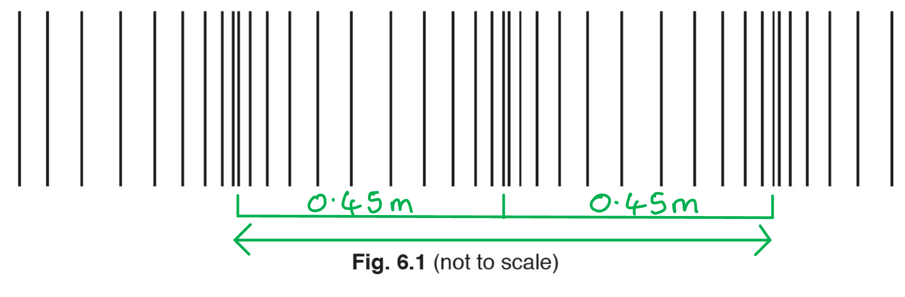

A diagram that would score 1 mark should look like this:

- A double-headed arrow is drawn across two wavelengths; **[1 mark]**

**[Total: 3 marks]**

> *In part (iii) **λ** = 0.45 m.*

> *0.45 × 2 = 0.90*

> *Hence, 0.90 m is equivalent to two wavelengths.*
Calculate the speed of the wave:

List the known quantities:

- Wavelength, *λ *= 0.45 m
- Frequency, *f *= 750 Hz

Recall the wave equation:

- $v=fλ$* ***[1 mark]**

Substitute the known quantities into the equation to calculate the wavespeed, *v*:

- $v=750\times0.45$
- *v *= 337.5 m/s = 340 m/s (2 s.f.) **[1 mark]**

**[Total: 2 marks]**
Suggest a medium through which the sound wave is travelling and state your reasoning:

Medium:

- Air / gas

**AND**

Reason:

- The speed of the wave calculated is typical of the speed of sound in a gas; **[1 mark]**

**[Total: 1 mark]**
(i) State one other similarity between sound of frequency 750 Hz and ultrasound:

**Any one from:**

- Both waves are longitudinal; **[1 mark]**
- Both waves vibrate parallel to the wave's direction of travel; **[1 mark]**
- Both waves transfer energy; **[1 mark]**

(ii) State one way in which sound of frequency 750 Hz is different from ultrasound:

**Any one from:**

- The frequency / pitch of sound is less; **[1 mark]**
- The frequency of sound is less than 20 000 Hz; **[1 mark]**
- Sound is audible to someone with normal levels of hearing; **[1 mark]**

**[Total: 2 marks]**

> *Learn key information from the revision notes to help answer questions about ultrasound.*

### Q17
Draw three crests of the incident wave:

A diagram that would score** three**** **marks should look like this:

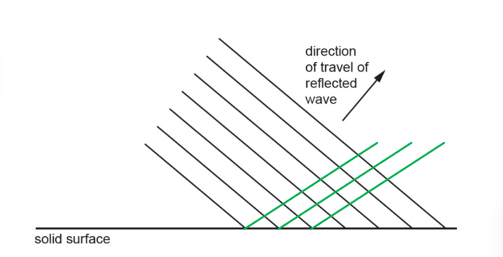

- Three wavefronts parallel to each other; **[1 mark]**
- Two wavelengths are the same as the reflected wavelengths; **[1 mark]**
- Three wavefronts are at the same angle to the barrier as the original; **[1 mark]**

**[Total: 3 marks]**

> *Use the diagram below to help clarify the wording in the mark scheme.*

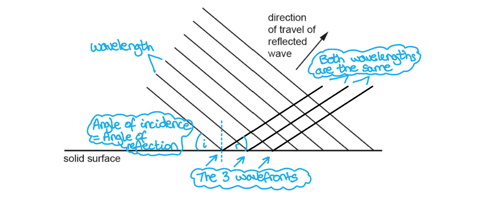
Tick four statements in the list below that are false:

An answer that would score 4 marks should look like this:

The wave is longitudinal. `square`

The wave is transverse. **✔ ****[1 mark]**

The frequency of the wave is 1 Hz. **✔ ****[1 mark]**

The frequency of the wave is 1 kHz. `square`

The frequency of the wave is 1 MHz.  **✔ ****[1 mark]**

The wave travels in a vacuum. **✔ ****[1 mark]**

The wave could travel in aluminium. `square`

**[Total: 4 marks]**

> *Knowing and understanding these properties of sound/longitudinal waves is vital for your success in the waves topic. *
State a typical value for the speed of a sound wave in water:

- A typical value is 1500 m/s; **[1 mark]**

**[Total: 1 mark]**

> *You must know the typical values of sound when travelling through different materials. Understanding that the denser the material the slower the sound will travel but the louder the sound will be is important. *

### Q18
(i) Sound travels as **a longitudinal** wave; **[1 mark]**

(ii) A loud sound has a large** ****amplitude**; **[1 mark]**

(iii) A student listens to two sounds. The sound with the higher frequency has a higher **pitch**; **[1 mark]**

**[Total: 3 marks]**

*Knowing the links between the terms amplitude and volume, and pitch and frequency is important*.
Ultrasound is where:

- Frequencies of sound; **[1 mark]**
- Are above 20 000 Hz; **[1 mark]**

**[Total: 2 marks]**
