# Exam Questions — Sound
**3. Waves** · Cambridge (CIE) IGCSE physics (0625 & 0972)
> Source: [https://www.savemyexams.com/igcse/physics/cie/23/topic-questions/](https://www.savemyexams.com/igcse/physics/cie/23/topic-questions/) · 39 questions across 2 sets

## Multiple Choice Questions (21 questions)

### Q1 — medium — 1 marks

**Q1** [1 mark]

A siren on an ambulance produces a loud, high-pitched sound.

The loudness of the siren is then decreased, and the pitch is lowered.

What happens to the amplitude and the frequency of the sound wave?

|   | amplitude | frequency |
|---|---|---|
| **A** | decreases | decreases |
| **B** | decreases | increases |
| **C** | increases | decreases |
| **D** | increases | increases |

### Q2 — hard — 1 marks

**Q2** [1 mark]

A student stands at a distance $d$ from a wall. He claps his hands and hears an echo $1.2\text{s}$ later.

What is the approximate value of $d$?

### Q3 — medium — 1 marks

**Q3** [1 mark]

The diagram represents a sound wave.

The sound wave changes from X to Y

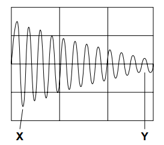

Which statement about the sound wave is correct?

*Source: specimen 2023 paper 1 Q25*

### Q4 — medium — 1 marks

**Q4** [1 mark]

** **Student X fires a starting pistol which produces smoke and sound. Student Y is standing 100 m away and sees the smoke the instant it is produced. The speed of sound in air is 340 m / s.

What is the time delay between student Y seeing the smoke and hearing the sound?

*Source: June 2023 0972/11 Q22*

### Q5 — medium — 1 marks

**Q5** [1 mark]

**Extended Tier Only**

A pulse of sound is produced at the bottom of a boat. The sound travels through the water and is reflected from the sea bed. The sound reaches the boat again after 1.3s. The sea bed is 1000m below the boat.**  **

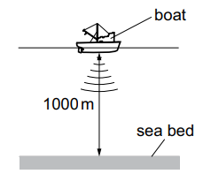

Using this information, what is the speed of sound in the water?

*Source: specimen 2023 paper 2 Q25*

### Q6 — medium — 1 marks

**Q6** [1 mark]

**Extended Tier Only**

A sheet of ice floats on water. A source of sound S is positioned at the edge of the ice sheet.

Four microphones are placed equal distances from S.

Which microphone detects the sound from S first?

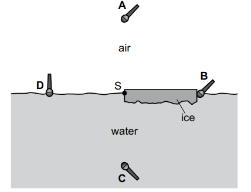

*Source: specimen 2023 paper 2 Q26*

### Q7 — easy — 1 marks

**Q7** [1 mark]

A high frequency note is played on a violin.

The violinist then reduces the frequency of the note.

What change in the note do the audience hear?

### Q8 — easy — 1 marks

**Q8** [1 mark]

A tuba player plays a loud note on her tuba.

She then plays a quiet note of the same pitch.

Which property of the sound wave she produced has changed?

### Q9 — easy — 1 marks

**Q9** [1 mark]

**Extended tier only**

Which of the following is **not **a use of ultrasound?

### Q10 — easy — 1 marks

**Q10** [1 mark]

Which of the frequency ranges below is completely audible by a human who has average hearing?

### Q11 — easy — 1 marks

**Q11** [1 mark]

Sound wave W has amplitude, *A, *and frequency, *f*.

Sound wave X is louder and lower in pitch than sound wave W.

What can be said about the amplitude and frequency of sound wave X?

|   | **Amplitude** | **Frequency** |
|---|---|---|
| **A** | higher than *A* | higher than *f* |
| **B** | higher than *A* | lower than *f* |
| **C** | lower than *A* | higher than *f* |
| **D** | lower than *A* | lower than *f* |

### Q12 — hard — 1 marks

**Q12** [1 mark]

**Extended tier only**

A fishing boat uses sonar to locate a shoal of fish. The sonar system sends a pulse of sound towards the shoal. When it hits the shoal, the sound wave is reflected and picked up by a detector underneath the ship.

The speed of sound in water is 1500 m/s.

The pulse of sound waves is received 0.48 s after it is emitted.

How far from the boat is the shoal of fish?

### Q13 — hard — 1 marks

**Q13** [1 mark]

In the olympic 100 m sprint final, a starting pistol is used to tell the sprinters when to start.

A spectator, sitting in the viewing area 300 m away sees the smoke from the pistol 0.86 s before hearing the bang. The spectator has exceptionally keen reactions and a very accurate internal clock.

Using only this information, what is the speed of sound in air?

### Q14 — hard — 1 marks

**Q14** [1 mark]

A walker can see a cliff face some distance away, and wants to estimate how far away it is.

He makes a loud noise, and times how long it takes the echo to come back. It takes 1.8 s.

If the speed of sound is 345 m/s, how far away is the cliff?

### Q15 — hard — 1 marks

**Q15** [1 mark]

In a common secondary school demonstration, a speaker is placed next to a lighted match.

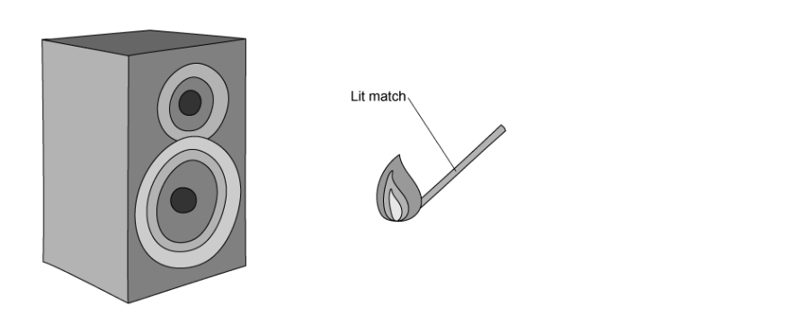

A loud sound wave is played through the speaker, causing the flame to vibrate.

What type of wave is emitted from the speaker, and in which direction does the flame vibrate?

|   | **wave type** | **direction of vibration** |
|---|---|---|
| **A** | transverse | ↔️ |
| **B** | longitudinal | ↔️ |
| **C** | transverse | ↕️ |
| **D** | longitudinal | ↕️ |

### Q16 — hard — 1 marks

**Q16** [1 mark]

**Extended tier only**

Ultrasound is high-pitched and cannot usually be heard by human ears. However, ultrasound does have many uses.

Which statement, or statements, in the list below are correct uses of ultrasound?

1. Testing materials to find breaks or other damage
2. Medical scanning of organs and soft tissues
3. Radar systems to find distance and velocity

### Q17 — medium — 1 marks

**Q17** [1 mark]

When objects vibrate, they produce sound waves.

An object in a room vibrates. However, a person in that same room does not hear anything. Why not?

### Q18 — medium — 1 marks

**Q18** [1 mark]

Echoes can sometimes be heard where a person is surrounded by distant, hard, flat surfaces.

In Greek mythology, Echo is a mountain nymph who was cursed by Hera to be only able to repeat the last words she heard. This ends tragically when she falls in love with Narcissus who, alas, loves only his own reflection.

In Physics, which wave property causes an echo?

### Q19 — medium — 1 marks

**Q19** [1 mark]

After a lockdown drill at a school, the management team notes that the lockdown siren is too quiet, and its pitch is too low to be heard at a distance.

They call the company that supplied the siren and ask them to make the alarm louder, and to give it a higher pitch.

What effect does the change have on the resulting sound wave produced by the siren?

### Q20 — medium — 1 marks

**Q20** [1 mark]

A boy named Narcissus participates in a class experiment to measure the speed of sound. He finds the large, flat wall of a building and stands a known distance away from it. He then claps his hands.

A very short time later, he hears the sound of the clap returning to him as an echo.

Why?

### Q21 — medium — 1 marks

**Q21** [1 mark]

A teacher uses a piece of lab equipment called a signal generator, which he connects to a speaker.

This apparatus can be used to make a particularly irritating noise.

The teacher makes four sounds of different frequencies with the signal generator. Which one can be heard by the student?

## Theory Questions (18 questions)

### Q1 — hard — 7 marks

**Q1** [3 marks]

A ship uses pulses of sound to determine the depth of the seabed. Each pulse of sound has a wavelength of $3.0\mathrm{cm}$.

The speed of sound in water is $1500m/s$.

(i) Calculate the frequency of the emitted sound.

[2]

(ii) Explain whether the sound from the ship is audible to a human with normal hearing.

[1]

**Q1** [2 marks]

**Extract:**

A ship uses pulses of sound to determine the depth of the seabed. Each pulse of sound has a wavelength of 3.0 cm.

The speed of sound in water is 1500 m/s.

Describe how the ship uses pulses of sound to determine the depth of the seabed.

**Q1** [2 marks]

**Extract:**

Speed of sound in water 1500 m/s. Depth at 300 m read from the graph is 70 m; accept 69 m to 71 m. Total distance is twice the depth: 140 m (accept 138 m to 142 m). Expected answer 0.0933 s; accept 0.092 s to 0.095 s, 0.093 s or 0.09 s. A misread depth that is correctly doubled and divided by 1500 earns the second mark by error carried forward. Not doubling the depth (answer 0.047 s) scores a maximum of 1 mark.

Fig. 6.1 shows the graph for the depth of the sea at different distances from the shore.

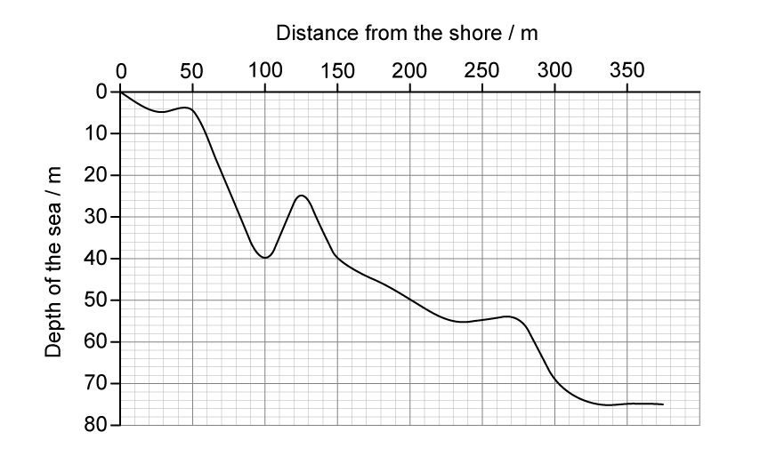

**Fig. 6.1**

When the ship is 300 m from the shore, a pulse of sound is emitted.

Calculate the time it takes for the sound wave to return to the ship.

### Q2 — medium — 11 marks

**Q2** [3 marks]

Two students standing near a wall attempt to measure the speed of sound using the following equipment:

- a drum
- a stopwatch
- a trundle wheel

Describe a method the students could use to measure the speed of sound.

**Q2** [3 marks]

**Extract:**

Two students standing near a wall attempt to measure the speed of sound using the following equipment:

- a drum
- a stopwatch
- a trundle wheel

Use v = 2 × distance/time to calculate the speed

Remember that the sound travels from the drum to the wall and back to the drum. Therefore, you have to use 2 × the distance in the calculation.

The students measured the distance to the wall to be 32.95 m.

Determine the time taken for the students to hear the echo.

**Q2** [2 marks]

**Extract:**

Two students standing near a wall attempt to measure the speed of sound using the following equipment:

- a drum
- a stopwatch
- a trundle wheel

The students measured the distance to the wall to be 32.95 m.

Time calculated: t = 0.20 s (2 s.f.)

Explain why the student's time measurement is not very accurate.

**Q2** [1 mark]

**Extract:**

Two students standing near a wall attempt to measure the speed of sound using the following equipment:

- a drum
- a stopwatch
- a trundle wheel

Describe a method the students could use to measure the speed of sound.

Method:
- Measure the distance from the drum to the wall using the trundle wheel
- Measure the time interval between striking the drum and hearing the echo
- Use v = 2 × distance / time to calculate the speed

The time interval is very short OR The measured time is close to human reaction time.

Suggest **one **way the students could improve the validity of the investigation.

**Q2** [2 marks]

An oscilloscope is a device that allows waveforms such as sound waves to be visualised.

Fig. 8.1 shows an oscilloscope trace of a sound wave.

**Fig. 8.1**

Sketch a sound wave with a higher pitch and greater volume.

### Q3 — medium — 7 marks

**Q3** [1 mark]

State a typical value for the speed of sound in air.

speed = ..........................................................  [1]

*Source: specimen 2023 paper 4 Q7A*

**Q3** [2 marks]

**Extract:**

A typical speed for sound in air is: 330 m/s

A sound wave in air has a wavelength of 22 mm.

Using your value for the speed of sound in **(a)**, calculate the frequency of the sound wave.

*Source: specimen 2023 paper 4 Q7B*

**Q3** [4 marks]

**Extended Tier Only**

Fig. 7.1 shows a solid block made from hot liquid metal. As the liquid cooled, a bubble formed **inside **the block. The bubble is **not **visible from outside the block.

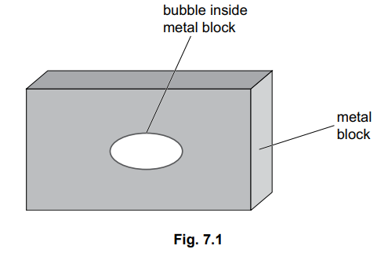

Describe and explain how to use ultrasound to determine the size and position of the bubble inside the metal block. You may draw on the diagram.

*Source: specimen 2023 paper 4 Q7C*

### Q4 — hard — 7 marks

**Q4** [2 marks]

A source of sound has frequency *f*. Sound of wavelength *λ* is produced by the source.

(i) State what is meant by the frequency of the source.

[1]

(ii) State the distance moved, in terms of the wavelength, *λ* by a wavefront during n oscillations of the source.

[1]

**Q4** [3 marks]

**Extract:**

(i) The number of complete oscillations per second.

(ii) For each oscillation the wavefront moves one wavelength, λ. Therefore for n oscillations the wavefront moves n × λ.

Use your answers from part (a) to derive the wave equation.

**Q4** [2 marks]

The waveform of a sound wave produced on the screen of a cathode-ray oscilloscope (c.r.o.) is shown in Fig. 1.

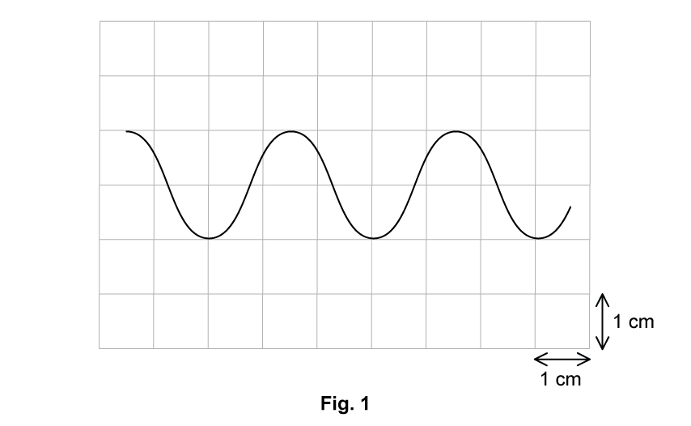

Each 1 cm division on the horizontal axis of the c.r.o. screen represents 2.0 ms.

Determine the frequency of the sound wave.

### Q5 — medium — 7 marks

**Q5** [5 marks]

A boat race starts on the sea, but close to land. Fig. 9.1 shows the boats at the start of the race.

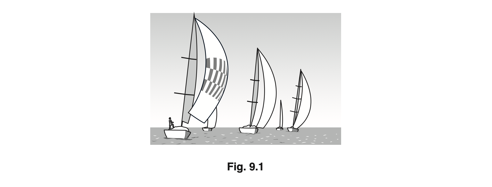

On the land, a cannon produces a loud bang to start the race. There is a flash of light at the same time as the bang.

(i) At the start of the race, the sailors watch for the flash of light from the cannon.

Suggest why the sailors watch for the flash of light rather than listen for the bang.

[1]

(ii) One of the sailors is 500 m from the cannon. She measures a time difference of 1.6 seconds between seeing the flash of light and hearing the bang.

Calculate the speed of sound.

speed of sound = ................................................ m/s [3]

(iii) The value of the speed of sound obtained in **(a)(ii)** is lower than expected.

Suggest a reason for this difference.

[1]

*Source: Oct 2019 0625/32 Q9A*

**Q5** [2 marks]

The race is held close to a part of the coast with high cliffs. A sailor hears a second bang shortly after the first bang.

State the term for the second bang and explain how it is produced.

*Source: Oct 2019 0625/32 Q9B*

### Q6 — hard — 10 marks

**Q6** [2 marks]

The text describes the process by which scientists worked towards the current accepted value for the speed of sound.

Read the text then answer the questions relating to it.

**Measuring the speed of sound in air**

| 1 | After the wave nature of sound had been identified, many attempts were made to measure its speed in air. |
|---|---|
|   | The earliest known attempt was made by the French scientist Gassendi in the 17th century. |
|   | Gassendi timed the interval between seeing the flash of a gun and hearing the bang from some distance away. |
|   | He assumed that, compared with the speed of sound, the speed of light is infinite. |
| 5 | Gassendi concluded that the speed of sound was 480 m/s. |
|   | A much better value of 350 m/s was obtained by the Italian physicists Borelli and Viviani using the same procedure. |
|   | In 1738 a value of 332 m/s was obtained by scientists in Paris. |
|   | This is remarkably close to the currently accepted value considering the measuring equipment available to the scientists at that time. |
|   | In 1740 another Italian, Bianconi, showed that sound travels faster when the temperature of the air is greater. |
| 10 | Since 1986 the accepted value for the speed of sound has been 331.29 m/s at 0 °C. |

Explain why Gassendi needed to assume that ‘compared with the speed of sound, the speed of light is infinite’ (line 4).

**Q6** [3 marks]

**Extract:**

Gassendi concluded that the speed of sound was 480 m/s.

Use Gassendi’s value for the speed of sound (line 5) to calculate the time between seeing the flash of a gun and hearing the sound if the observer was standing 2.5 km from the gun.

time = ____________________ s

**Q6** [1 mark]

**Extract:**

Gassendi concluded that the speed of sound was 480 m/s. A much better value of 350 m/s was obtained by the Italian physicists Borelli and Viviani using the same procedure. In 1738 a value of 332 m/s was obtained by scientists in Paris. This is remarkably close to the currently accepted value considering the measuring equipment available to the scientists at that time. In 1740 another Italian, Bianconi, showed that sound travels faster when the temperature of the air is greater. Since 1986 the accepted value for the speed of sound has been 331.29 m/s at 0 °C.

The value obtained by Borelli and Viviani is described as being ‘much better’ than that obtained by Gassendi (line 6).

Explain why modern writers would judge this result as 'much better'.

**Q6** [4 marks]

**Extract:**

Since 1986 the accepted value for the speed of sound has been 331.29 m/s at 0 °C.

The passage refers to Bianconi's discovery that the speed of sound in air depends on temperature (line 9).

The equation to find the speed of sound in dry air can be written

$c = k \sqrt{( \\theta + 273.15 )}$

Where *θ* is the temperature in °C, and *k* is a constant.

Calculate a value for *k* using data from the passage. You do not need to give units for *k*.

### Q7 — easy — 6 marks

**Q7** [5 marks]

Sound travels as a wave.

Complete each sentence.

Sound is produced when an object .............................. .

An echo is produced when sound is .............................. from a hard surface.

Compared with a quiet sound, a loud sound always has a greater ........................... .

Compared with a high pitched sound, a low pitched sound always has a smaller ....................... .

Waves transfer energy without transferring ................................ .

*Source: 2020 0625/32 Q8A*

**Q7** [1 mark]

State the meaning of the term ultrasound.

*Source: 2020 0625/32 Q8B*

### Q8 — easy — 6 marks

**Q8** [1 mark]

A healthy human ear can hear a range of frequencies.

Three frequency ranges are shown.

Draw a ring around the range for a healthy human ear.

0 Hz − 20 Hz  10 Hz − 10 000 Hz  20 Hz − 20 000 Hz

*Source: 2018 (Series 2) 0625/32 Q8A*

**Q8** [2 marks]

Explain the meaning of the term *ultrasound*.

*Source: 2018 (Series 2) 0625/32 Q8B*

**Q8** [3 marks]

**Extract:**

State and explain how sound P is different from sound Q:

- Sound P is quieter AND has a lower pitch (than sound Q); 
- Because sound P has a smaller amplitude; 
- And sound P has a lower frequency;

If you need a reminder about pitch and volume:

large amplitude → high volume
small amplitude → low volume
low frequency → low pitch
high frequency → high pitch

A student listens to two different sounds, P and Q.

The two different sounds are represented on a computer screen on the same scale.

Fig. 8.1 shows the screens.

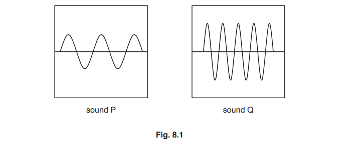

State and explain how sound P is different from sound Q.

*Source: 2018 (Series 2) 0625/32 Q8C*

### Q9 — hard — 10 marks

**Q9** [3 marks]

**Extended tier only**

An ultrasound medical scanning device generates ultrasound waves at a frequency of 2.5 MHz.

The speed of ultrasound in air = 350 m/s

The speed of ultrasound in the soft tissues of the body = 1550 m/s.

Explain why the speed of ultrasound in soft tissue is faster than in air.

**Q9** [4 marks]

**Extract:**

An ultrasound medical scanning device generates ultrasound waves at a frequency of 2.5 MHz.

The speed of ultrasound in air = 350 m/s

The speed of ultrasound in the soft tissues of the body = 1550 m/s.

Calculate the wavelength of the ultrasound waves emitted as they pass through

(i) Air

[3]

(ii) Soft tissue

[1]

**Q9** [3 marks]

**Extended tier only**

Shorter wavelengths allow for higher resolution, meaning that more and smaller details can been imaged using ultrasound.

Use your knowledge of sound and other waves to explain why radiologists may not use the shortest wavelengths possible when scanning patients.

### Q10 — hard — 10 marks

**Q10** [4 marks]

A student is listening to the sound produced by a tuning fork.

(i) State how the tuning fork produces the sound.

[1]

(ii) State the type of wave a sound wave is.

[1]

(iii) A loudspeaker produces a sound with a frequency of 25 kHz.

A student with healthy ears cannot hear this sound. Explain why.

[2]

*Source: Oct 2019 3 Q8A*

**Q10** [2 marks]

Fig. 8.2 represents a sound wave travelling in air.

(i) The air particles are moving. On Fig. 8.2, draw two arrows in opposite directions to show the movement of the air particles.

[1]

(ii) Use Fig. 8.2 to determine the wavelength of the sound wave.

wavelength = ...................................................... cm [1]

*Source: Oct 2019 3 Q8B*

**Q10** [4 marks]

Describe a method of using water waves to demonstrate refraction.

*Source: Oct 2019 3 Q8C*

### Q11 — hard — 6 marks

**Q11** [2 marks]

This question is about measuring the speed of sound in air.

A student stands in front of a large wall. She hits a drum and hears an echo. Fig. 8.1 shows the position of the student and the wall.

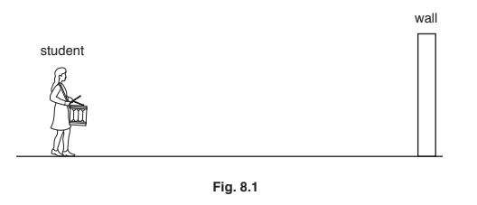

(i) State the name of a piece of equipment for measuring the distance from the student to the wall.

[1]

(ii) Explain how sound forms an echo.

[1]

*Source: 2018 0625/31 Q8A*

**Q11** [4 marks]

**Extract:**

This question is about measuring the speed of sound in air.

A student stands in front of a large wall. She hits a drum and hears an echo. Fig. 8.1 shows the position of the student and the wall.

The student hits her drum repeatedly once per second. She walks away from the wall and listens for the echo. When the student is 170m from the wall she hears the echo from one beat of the drum at the same time as the next beat of the drum.

Use this information to determine the speed of sound. State the unit.

speed = ..........................................................

*Source: 2018 0625/31 Q8B*

### Q12 — medium — 8 marks

**Q12** [3 marks]

Complete the sentences about sound. Use words from the box above each sentence.

(i)

| glows | reflects | refracts | vibrates |
|---|---|---|---|

Sound is produced when a source ..............................................

[1]

(ii)

| electromagnetic | longitudinal | transverse |
|---|---|---|

Sound waves are .............................................. waves.

[1]

(iii)

| metal | vacuum | liquid |
|---|---|---|

Sound waves cannot travel through a ..............................................

[1]

*Source: 2018 0625/32 Q8A*

**Q12** [5 marks]

Humans, elephants, mice and dolphins have different hearing ranges. Fig. 8.1 shows the hearing range for each type of animal.

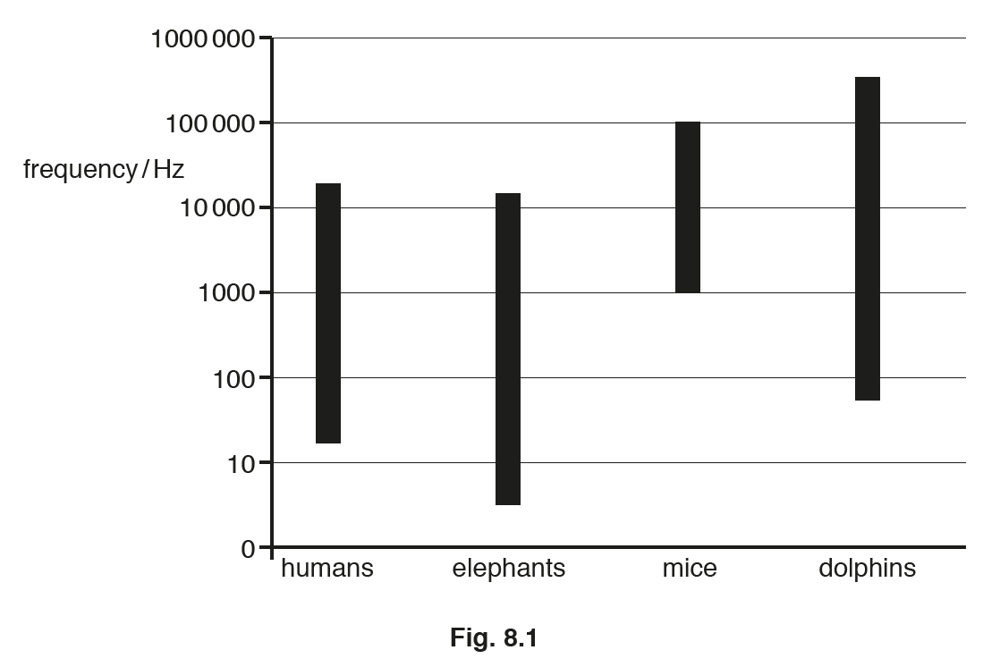

(i) State the lowest frequency of sound that can be heard by mice.

.......................Hz [1]

(ii) State the highest frequency of sound that can be heard by elephants.

.......................Hz [1]

(iii) Explain how the chart shows that elephants can hear some sounds that humans **cannot** hear.

[2]

(iv) State the term given to the high frequencies that dolphins can hear but humans **cannot** hear.

[1]

*Source: 2018 0625/32 Q8B*

### Q13 — easy — 25 marks

**Q13** [2 marks]

The speed of sound waves can be measured in different ways.

State a reasonable value for the speed of sound in air which the calculations resulting from any experimental method should find.

**Q13** [6 marks]

One method to find the speed of sound in air involves two people who stand a distance apart and then measure the time a sound takes to travel between them, as shown in Fig. 1.

(i) For this investigation, complete the sentences describing the method.

1. Two people stand a distance of at least _____ apart.
2. The distance between them is measured using a _______
3. One person has two wooden blocks, which they bang together above their head.
4. The second person has a _______ which they start when they see the first person banging the blocks together and stops when they hear the sound.
5. This is then ________ several times and an ______ is taken for the time.

[5]

(ii) State the equation used to calculate the speed of sound following this investigation.

[1]

**Q13** [7 marks]

Another method to find the speed of sound in air uses echoes as shown in Fig. 2.

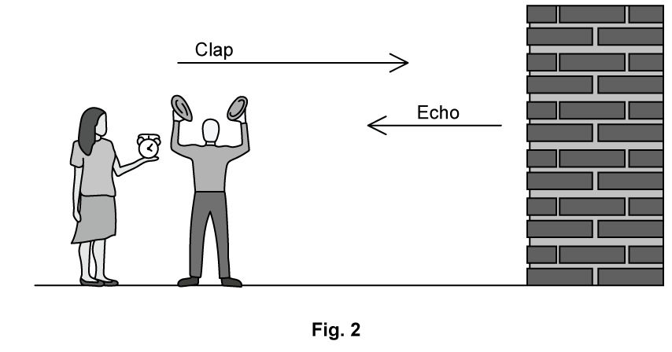

(i) For this investigation, complete the sentences describing the method.

1. A person stands at least _____ away from a wall
2. The distance is measured using a ______
3. The person claps two wooden blocks together and listens for the echo.
4. A second person has a stopwatch and starts timing when they hear the _____ and stops timing when they hear the ______
5. This is then ________ several times and an ______ is taken for the time.

[6]

(ii) State the equation used to calculate the speed of sound following this investigation.

[1]

**Q13** [10 marks]

A third method to find the speed of sound in air uses as oscilloscope, as shown in Fig. 3.

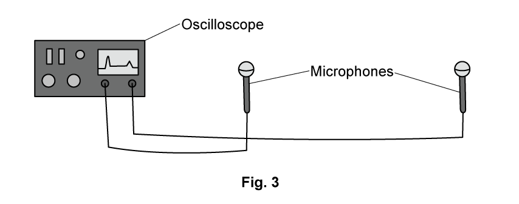

**                                             **

(i) For this investigation, complete the sentences describing the method.

1. Two ______ are connected to an oscilloscope and placed about _______ apart
2. A ______ is used to measure the distance
3. The oscilloscope is set up so that it triggers when the _______ microphone detects a sound
4. The time base is adjusted so that the sound arriving at both microphones can be seen on the screen
5. Two wooden blocks are used to make a large clap next to the ______ microphone
6. The oscilloscope is then used to determine the ________ between the sound arriving at each microphone
7. This is ________ several times and an _______ time difference calculated

[8]

(ii) Complete the equation used to calculate the speed of sound following this investigation.

$speedofsound=\frac{...................}{...................}$

[2]

### Q14 — medium — 5 marks

**Q14** [3 marks]

Fig. 8.1 shows a tuning fork and a wooden block.

(i) The tuning fork is hit against the wooden block and then makes a sound.

Describe how the tuning fork produces the sound.

[1]

(ii) The tuning fork produces a sound with a frequency of 659Hz.

State whether a healthy human ear can hear this frequency of sound.

Explain your answer.

[2]

*Source: Nov 2018 (S1) 0625/31 Q8A*

**Q14** [2 marks]

Fig. 8.2 represents the sound wave produced by a tuning fork.

A second tuning fork produces a different sound.

Compared with the sound represented in Fig. 8.2, this sound is quieter and has half the frequency.

On Fig. 8.2, draw the wave to show the sound produced by the second tuning fork.

*Source: Nov 2018 (S1) 0625/31 Q8A*

### Q15 — medium — 6 marks

**Q15** [3 marks]

A vibrating source on a ship produces a sound wave that travels through the ocean. The wave produced is a longitudinal wave.

Explain what is meant by the term longitudinal wave.

*Source: 2018 (Series 1) 0625/41 Q8A*

**Q15** [3 marks]

**Extract:**

A vibrating source on a ship produces a sound wave that travels through the ocean. The wave produced is a longitudinal wave.

**Extended tier only**

The frequency of the sound wave is 800Hz.

(i) The speed of sound in air is 330m/s.

State a typical value for the speed of sound in a liquid.

[1]

(ii) Using your value from **(b)(i)**, calculate the wavelength of the sound wave in the ocean.

wavelength = ...........................................................[2]

*Source: 2018 (Series 1) 0625/41 Q8B*

### Q16 — medium — 8 marks

**Q16** [3 marks]

**Extended tier only**

Fig. 6.1 represents a sound wave of wavelength 0.45m travelling from left to right.

On Fig. 6.1:

(i) at the centre of a compression, mark a cross and label it C.

[1]

(ii) at the centre of a rarefaction, mark a cross and label it R.

[1]

(iii) draw a double-headed arrow to represent a distance of 0.90 m.

[1]

*Source: Oct/Nov2018  (Series 2) 0625/42 Q6A*

**Q16** [2 marks]

**Extract:**

Wavelength, λ = 0.45 m
Frequency, f = 750 Hz

The frequency of the wave is 750 Hz.

Calculate the speed of the wave.

speed = ...........................................................

*Source: Oct/Nov2018  (Series 2) 0625/42 Q6B*

**Q16** [1 mark]

**Extract:**

Wavelength, λ = 0.45 m
Frequency, f = 750 Hz
v = f λ
v = 750 × 0.45
v = 337.5 m/s = 340 m/s (2 s.f.)

**Extended tier only**

Suggest a medium through which the sound wave is travelling and state your reasoning.

*Source: Oct/Nov2018  (Series 2) 0625/42 Q6C*

**Q16** [2 marks]

Another type of wave that consists of compressions and rarefactions is ultrasound.

(i) State one other similarity between sound of frequency 750 Hz and ultrasound.

[1]

(ii) State one way in which sound of frequency 750 Hz is different from ultrasound.

[1]

*Source: Oct/Nov2018  (Series 2) 0625/42 Q6D*

### Q17 — easy — 7 marks

**Q17** [3 marks]

Fig. 6.1 shows crests of a sound wave after reflection from a solid surface.

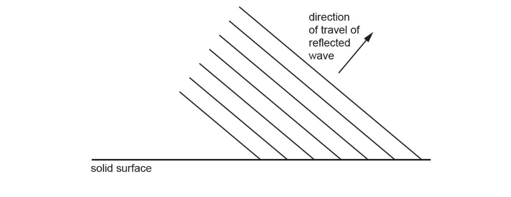

**Fig 6.1**

In Fig. 6.1, draw three crests of the incident wave.

*Source: May/June 2020 (Series 3) 0625/43 Q6A*

**Q17** [3 marks]

Tick four statements in the list below that are false for a sound wave that is audible to a healthy human ear.

The wave is longitudinal. `square`

The wave is transverse. `square`

The frequency of the wave is 1 Hz. `square`

The frequency of the wave is 1 kHz. `square`

The frequency of the wave is 1 MHz. `square`

The wave travels in a vacuum. `square`

The wave could travel in aluminium. `square`

*Source: May/June 2020 (Series 3) 0625/43 Q6B*

**Q17** [1 mark]

State a typical value for the speed of a sound wave in water.

*Source: May/June 2020 (Series 3) 0625/43 Q6C*

### Q18 — easy — 5 marks

**Q18** [3 marks]

The boxes contain words about waves.

Complete each sentence. Choose a term from each box.

(i)

| an electromagnetic      a longitudinal       a transverse |
|---|

Sound travels as .............................................. wave.

[1]

(ii)

| amplitude        pitch       speed          wavelength |
|---|

A loud sound has a large .............................................. .

[1]

(iii)

| amplitude      pitch      speed       wavelength |
|---|

A student listens to two sounds. The sound with the higher frequency has a higher .............................................. .

[1]

*Source: 2018 0625/33 Q8A*

**Q18** [2 marks]

Explain what is meant by the term ultrasound.

*Source: 2018 0625/33 Q8B*

