# Mark Schemes — Simple Phenomena of Magnetism
**4. Electricity & Magnetism** · Cambridge (CIE) IGCSE physics (0625 & 0972)

## Multiple Choice Questions (23 questions)

### Q1
**Final answer:** **The correct answer is A**

- The strength of a magnetic field is shown by the spacing of the field lines
- Where the field lines are closest together, the field is strongest
- Position A is closest to a pole of the magnet, where the field lines are most concentrated
- The field is strongest near the poles of the magnet and weakest far from the magnet

**B** is incorrect because it is furthest from the magnet, where the field lines are widely spaced, and the field is at its weakest.

**C** is incorrect because it is midway between the poles, where the field lines are more spread out, and the field is weaker.

**D** is incorrect because although it is close to a pole (north), the lines are more concentrated at point A, so the magnetic field is slightly stronger at A.

### Q2
**Final answer:** **The correct answer is D**

- Material 1 is a temporary magnet (soft iron)

  - It is ideal for the **core of an electromagnet **because it becomes strongly magnetised when a current is present, but loses that magnetism when the current is switched off
- Material 2 is a permanent magnet (made of steel)

  - It is ideal for a **bar magnet **because once it is magnetised, it retains its magnetic properties for a long time

**A** is incorrect because an electromagnet made with material 2 would stay magnetised even after the power is disconnected.

**B** is incorrect as material 1 loses its magnetism too easily to be used as a bar magnet.

**C** is incorrect because material 1 would not function as a bar magnet and material 2 would prevent an electromagnet from being switched off.

### Q3
**Final answer:** **The correct answer is B **

- The strongest magnetic field is indicated by the electromagnet that picks up the most nails when the current is kept the same
- Electromagnet **B** picks up the most nails

**A** is incorrect because **A** picks up fewer nails than B

**C** is incorrect because **C** picks up the least nails

**D **is incorrect because **D** picks up fewer nails than B

### Q4
**Final answer:** **The correct answer is ****C****, because:**

- End X of the iron will become a magnetic south pole (S) as it is placed near to a magnetic north (N) pole

  - Therefore, options **A** and **B** can be eliminated
- The nearby ends of the magnet and soft iron have opposite magnetic poles, so they attract each other
- The force acting on the soft iron will be to the left, towards the permanent magnet

  - Therefore, the correct answer is option **C**

There will also be a force pulling the magnet to the right. However, the question asks specifically for the **force** **on the soft iron**, so don’t get confused and try to describe the force on the permanent magnet.

### Q5
**Final answer:** **The correct answer is D**

- Soft iron is a temporary magnet, so it is only magnetic when the current flows in the coil i.e. when the power supply is on
- Therefore, when a core of soft iron is used, the expected results are that the electromagnet will pick up

  - a large number of pins when the power supply is **on**
  - no pins when the power supply is **off**
- This is shown by option **D**

**A **is incorrect because no pins are picked up when the power supply is on or off, so the core is likely a non-magnetic material

**B** & **C** are incorrect because pins are picked up when the power supply is both on and off, so the core is likely a permanent magnet

### Q6
**Final answer:** **The correct answer is B**

- A material must contain either iron, nickel or cobalt to be able to be magnetised

  - Only soft iron and steel of the listed materials contain iron
  - Eliminate options **A** and **D**
- Steel is a permanent magnet

  - Eliminate option **C**
- Soft iron is a temporary magnet

### Q7
**Final answer:** **The correct answer is D**

- Magnetic fields always point from the **north **pole to the **south **pole
- If a compass were placed at point X, it would point towards the south pole, as shown by option **D**

### Q8
**Final answer:** **The correct answer is D**

- Magnetic field lines always point from the north pole to the south pole

  - The arrow of a compass points along the same direction as the field line
  - Only compass **D** does this

**A**,** B **and **C **are incorrect as these arrows point in the opposite direction to the field lines

### Q9
**Final answer:** **The incorrect statement is ****D**** because:**

- A permanent magnet produces its own magnetic field

  - This means it never loses its magnetism
  - Most permanent magnets are made from 'hard' iron, nickel, or cobalt

- A soft magnetic material, such as soft iron, will only be magnetic whilst there is a current around it (such as in an electromagnet)

  - Once the current is switched off, it is demagnetised (loses its magnetism)
  - This means it wouldn't work as a permanent magnet

**A** is correct as opposite poles attract, so an S-pole will attract the N-pole of another magnet

**B** is correct as like poles repel, so an S-pole will repel the S-pole of another magnet

**C** is correct as permanent magnets can only attract or repel other magnetic materials, so it is true that they cannot repel non-magnetic materials

### Q10
**Final answer:** **The correct answer is ****D**** because:**

- Magnetic field lines always go from the **north** pole to the **south** pole

  - This eliminates options **B** and **C **which have the wrong direction for the magnetic field arrows
- The **strength** of the magnetic field is shown by the **spacing** of the magnetic field lines

  - If the magnetic field lines are **close together** then the magnetic field will be **stronger**
  - The field lines in option **D** are closer than **A**, so **D** has the stronger magnetic field

### Q11
**Final answer:** **The correct answer is ****B**** because:**

- Ferrous metals contain **iron**
- These are either iron itself or an alloy of iron, such as **steel**

  - Therefore, steel and iron are both ferrous

An alloy is a substance that contains more than one metal. Iron alloys all contain small amounts of iron. In the case of steel, this is iron and carbon.

### Q12
**Final answer:** **The correct answer is ****A**** because:**

- A hard magnetic material is required for a permanent magnet. Steel is a hard magnetic material that will retain its magnetism for a long time.
- A soft magnetic material is required for the core of an electromagnet. A material that loses its magnetism quickly is needed, so that the electromagnet can ‘let go’ of whatever it is holding.

The other answers do not pair iron with the core of an electromagnet, and/or steel with the permanent magnet.

### Q13
**Final answer:** **The correct answer is ****C**** because:**

- A ferrous metal contains **iron**, a non-ferrous metal does not.
- Aluminium and copper are elements, so they cannot contain iron.
- Brass is an alloy of copper and tin, which does not contain iron.

**A** is incorrect as iron is ferrous, and steel is an alloy of iron.

**B** is incorrect as steel is an alloy of iron, which is ferrous.

**D** is incorrect as iron is ferrous.

### Q14
**Final answer:** **The correct answer is ****C**** because:**

- Magnets attract magnetic materials.
- Materials containing iron are ferrous, and iron is a magnetic material. Therefore, a permanent magnet would attract ferrous materials (among other things).

**A **is incorrect as a permanent magnet will not repel materials that are not magnetic, it will have no effect on them.

**B **is incorrect as a permanent magnet will not repel non-ferrous materials. It will have no effect on most non-ferrous materials, and will attract cobalt and nickel.

**D **is incorrect as all permanent magnets have **two** poles, a north and a south. It is impossible for a permanent magnet to have only one pole.

### Q15
**Final answer:** **The correct answer is ****D**** because**

- Permanent magnets always attract magnetic materials. The iron bar is a magnetic material.
- Magnetic poles will be induced in the magnetic material which are opposite to the poles of the permanent magnet, which causes the attraction.

**A **is incorrect as the magnet will not repel the iron bar.

**B **is incorrect as the magnet will not repel the iron bar.

**C **is incorrect as the poles are the same as the permanent magnet’s poles. This would cause them to repel.

### Q16
**Final answer:** **The correct answer is ****C**** because:**

- Compass needles always point to the Earth’s North pole (which is actually a south magnetic pole, who knew?!).
- A compass needle will point along the direction of the permanent magnet’s field line, from north pole to south pole.

**A **is incorrect as this will cause the field lines to be visible, but it will not tell you which direction those field lines point.

**B **is incorrect as this will only tell you that the magnet is, indeed, a magnet, since it will attract the paperclip. Both poles will attract the paperclip, so you cannot tell which pole is which from this method.

**D **is incorrect as this will only tell you that the magnet is, indeed, a magnet, since it will attract the ferrous material. Both poles will attract the ferrous material, so you cannot tell which pole is which from this method.

### Q17
**Final answer:** **The correct answer is ****D**** because:**

- Remember that Iron is very easy to magnetise but loses its magnetic properties very quickly, and as such cannot be used as a **permanent magnet**, so you can disregard answers A and C.
- Also remember that an Alternating Current cannot be used to create a **permanent magnet**, as the direction of the magnetic field constantly changes with the change in current.

**A **is incorrect as soft iron will lose its magnetism too quickly.

**B **is incorrect as AC cannot be used to create a permanent magnet, as the magnetic poles flip very regularly.

**C **is incorrect as soft iron will lose its magnetism too quickly.

### Q18
**Final answer:** **The correct answer is ****B**** because:**

- Steel is slow to be magnetised (as it is an alloy of iron), and can retain its magnetism for a while

  - This makes it a good material for a magnet
- Iron can be magnetised and demagnetised very quickly

  - This means it becomes strongly magnetised when placed in contact with the magnets, but does not remain magnetised when taken away from the magnets
  - This makes it a good material for the keeper

Steel is often known as a 'hard' magnetic material and iron as a 'soft' magnetic material due to the relative amount of time they remain magnetised.

### Q19
**Final answer:** **The correct answer is ****B**** because**

- The strongest permanent magnet is able to hold the most paper clips when the bar magnet is taken away, regardless of how many it held when the bar magnet was present.
- Rod **B** can hold the most paper clips.

Each of the other rods holds fewer paperclips when the permanent magnet is taken away.

### Q20
**The correct answer is ****B**** because:**** **

- the diagram shows how the magnetic poles would be formed.

### Q21
**Final answer:** **The correct answer is ****B**** because:**

- When a compass needle is close to a magnet, it will point in the direction of the magnetic field lines

  - This goes from the north to the south pole
- Therefore, if the compass needle points **towards** the pole, it must be a south pole

The diagram below shows what the compass needles might look like around a magnet:

### Q22
**Final answer:** **The correct answer is ****A**** because:**

- In order for there to be repulsion between two metal bars, they must **both** be magnets. Otherwise it is impossible to have two like poles next to each other.
- Like magnetic poles repel.

**B **is incorrect as both ends of rod 3 attract. This means that it has two identical poles. This cannot happen in a magnet, and is only possible if the poles are changing in response to another magnetic field. This means that rod 3 is a magnetic material.

**C **is incorrect as in order to get repulsion at all, **both** of the bars must be magnets, not just one.

**D **is incorrect as in order to get repulsion at all, **both** of the bars must be magnets, not just one.

### Q23
**Final answer:** **The correct answer is ****A**** because North poles will repel North poles of other permanent magnets.**

**B **is incorrect as soft magnetic materials lose their magnetism quickly. A permanent magnet would not be permanent if it were made from a soft magnetic material.

**C **is incorrect as magnetic materials become magnets when placed in a magnetic field. They always become magnetic in such a way as to **attract** the magnet that causes them to become magnetic. They would never repel.

**D **is incorrect as magnetic field lines **never** cross.

## Theory Questions (18 questions)

### Q1
State the apparatus and how it will be used:

- Use a (plotting) compass or iron filings; **[1 mark]**
- Use a (plotting) compass to show the direction (of magnetic field lines);** [1 mark]**

Describe the method:
Any **two** from:

- Sprinkle / scatter the iron filings (around magnets); **[1 mark]**
- Tap the card; **[1 mark]**
- To arrange the filings along field lines / to show the (magnetic field)        pattern;** [1 mark]**
- Place the compass near the magnet;** [1 mark]**
- Mark a point at the end of the (compass) arrow;** [1 mark]**
- Move the compass **OR** place multiple compasses in different   positions (around the magnets);** [1 mark]**
- Repeat the procedure / plot more than one line;** [1 mark]**

**[Total: 4 marks]**

An example answer could be:

*Place a plotting compass next one of the ends of a magnet so the needle points away from the magnet. Draw a dot at the end of the needle to show where it points. Slide the compass along so that the needle starts at the point you have just drawn. Continue moving the compass and drawing points until it reaches the other end of the magnet. Join the dots to show the shape and direction of the field. Repeat for more starting points on the magnet until the full magnetic field pattern is shown.*

> **[exam-tip]**
> This is one of the longer questions and you need to provide a clear **description**. There are two different approaches to showing a magnetic field and you can describe either or both. Using a compass is the only way of showing the direction of the field and mentioning this is the only way to score full marks on this question.

### Q2
The correct magnetic poles are as follows:

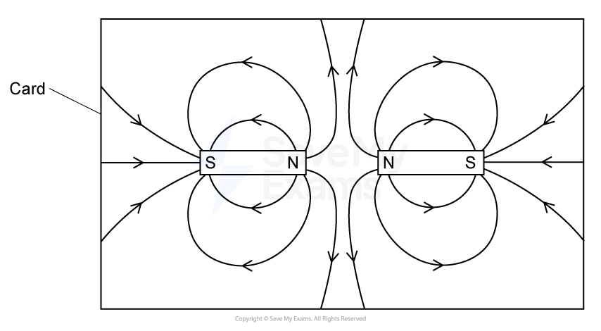

- Two N / north poles on either side of the gap; **[1 mark]**

**[Total: 1 mark]**

> **[exam-tip]**
> For this question, you need to **label** the poles. The evidence you need to use is the directions of the magnetic field lines. Magnetic field lines always point away from magnetic north poles and towards magnetic south poles. Look carefully at the field lines to help you decide where the north poles and the south poles are.
> Make sure that you label all four poles. In the mark scheme you are only awarded marks for labelling the north poles. However, you have no way of knowing that when answering the question, so don’t risk losing out on the mark.

### Q3
An experiment to determine the pattern of the magnetic field lines around the bar magnet is:

**EITHER**

Method 1:

- Using a plotting compass;**[1 mark]**
- (On the piece of card) mark the arrow positions at different points (around the magnet) **OR** move the compass in the direction of arrow; **[1 mark]**
- Join up the marks / draw lines to show the pattern; **[1 mark]**

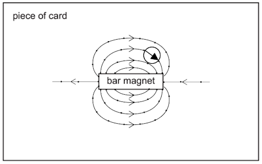

**OR **

Method 2:

- Using several plotting compasses; **[1 mark]**
- Place the compasses around the magnet; **[1 mark]**
- The compass arrows line up to show the pattern; **[1 mark]**

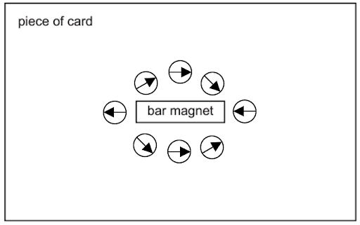

**Total: [3 marks]**

> *It’s a good idea to give a written answer as well as drawing a clear sketch on the diagram provided, as you could gain marks for any points you might have missed in your explanation.*
The results reveal that the metal bar XY is:

- (Soft) iron **OR** a magnetic material **OR** a temporary magnet; **[1 mark]**

This is because:

- (The diagram shows that) end X (of the metal bar) is attracted to both poles of the magnet; **[1 mark]**
- Therefore, bar XY must be unmagnetised;**[1 mark]**

**Total: [3 marks]**

### Q4
The effect that produces a temporary magnet is:

- Induced magnetism; **[1 mark]**

**[Total: 1 mark]**
The magnetic materials from the list are:

- Iron **AND** steel; **[1 mark]**

**[Total: 1 mark]**
Draw, on Fig. 1.1, the temporary poles that will be induced in the magnetic material:

A diagram scoring 1 mark:

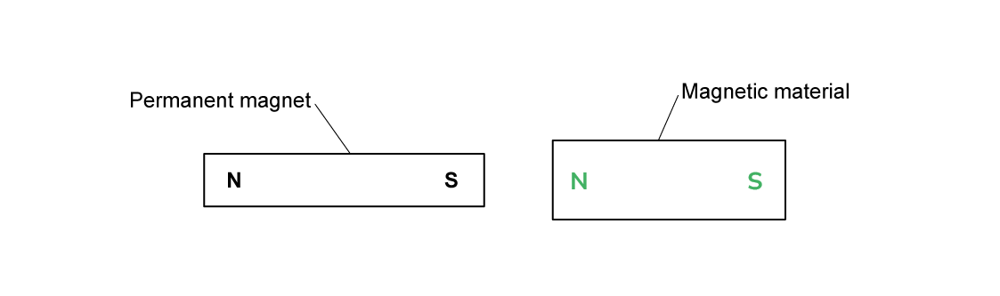

- Induced north pole shown closest to the south pole of the permanent magnet **AND** induced south pole drawn on opposite end of magnetic material; **[1 mark]**

**[Total: 1 mark]**
Complete the paragraph using words from the list:

- The paperclips are made of steel which is a **magnetic** material; **[1 mark]**
- The paperclips are **attracted **to the permanent magnet; **[1 mark]**
- The magnetic field induces temporary **poles** in the paperclips; **[1 mark]**
- And they become **temporary** magnets; **[1 mark]**

**[Total: 4 marks]**

### Q5
Describe a method for drawing the magnetic field around a bar magnet using iron filings:

- Place a piece of paper on top of the bar magnet; **[1 mark]**
- Sprinkle iron fillings onto the piece of paper; **[1 mark]**
- Tap the paper to shift the iron fillings along the field lines; **[1 mark]**
- Sketch the pattern (on a separate piece of paper); **[1 mark]**

**[Total: 4 marks]**
The definition of a magnetic field is:

- A region in which a magnetic pole / magnet <u>experiences a force</u>; **[1 mark]**

**[Total: 1 mark]**
The direction of magnetic field lines are:

- From north (pole) to south (pole); **[1 mark]**

**[Total: 1 mark]**
Sketch the magnetic field lines for the two bar magnets shown in Fig. 1.1:

A diagram scoring 2 marks:

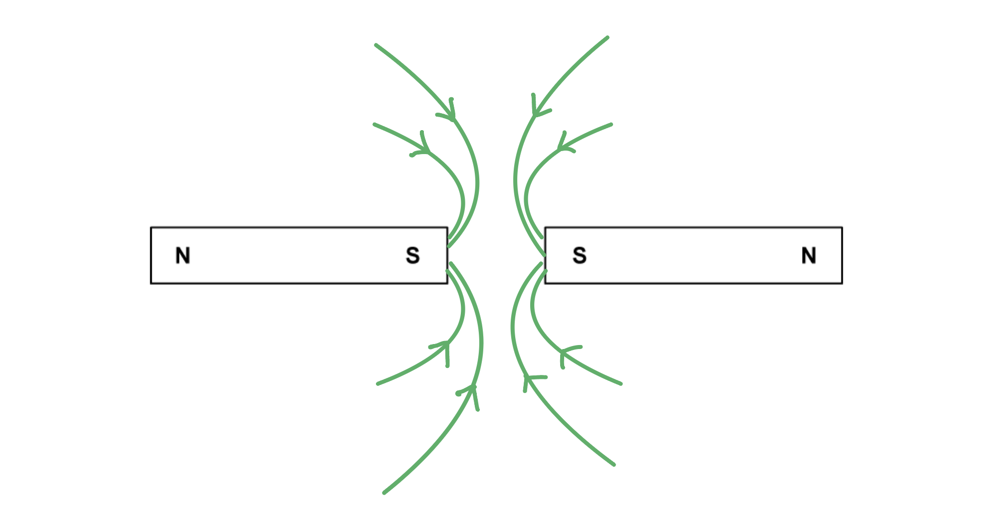

- Magnetic field lines show south poles repelling; **[1 mark]**
- At least 4 field lines drawn with arrows pointing from north to south; **[1 mark]**
- No field lines in the region directly between the south poles; **[1 mark]**

**[Total: 3 marks]**

> *Make sure not to miss out on the arrows indicating the direction of the magnetic field lines! These are always from **north** to **south**.*

### Q6
(i) Use domain theory to explain why most metals are not magnetic:

- The individual electrons have different alignments; **[1 mark]**
- So the magnetic fields (mostly) cancel out; **[1 mark]**
- Resulting in no net / overall magnetic field; **[1 mark]**

(ii) Use domain theory to explain why some metals can be magnetised:

- The electrons within the domain have the same alignment; **[1 mark]**
- When the metal is exposed to an external magnetic field (such as stroking with a bar magnet) the domains all align with the external magnetic field; **[1 mark]**
- Giving the metal a north and south pole **OR** the metal becomes / acts as a magnet; **[1 mark]**

**[Total: 6 marks]**
Draw a sketch of a magnetised material:

A diagram scoring 1 mark:

- All arrows pointing in the same direction; **[1 mark]**

**[Total: 1 mark]**

> *The question states a **magnetised** material, not a **magnet** material - these are two very different things! Therefore, your sketch must be inspired from Fig 1.2 and not 1.3.*

### Q7
Show the pattern of magnetic field lines around the bar magnet:

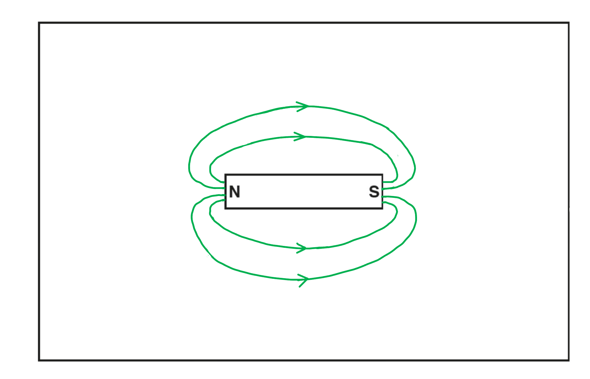

- Correct field pattern for a bar magnet (loops from one end of the bar to the other, symmetrical above and below the bar); **[1 mark]**
- No field lines cross **AND** a clearly continuously curved line (no sharp changes in angle); **[1 mark]**
- Arrows on <u>all the field lines</u> from the North pole to the South pole; **[1 mark]**

**[Total: 3 marks]**

> *When revising, make sure you practice drawing this - it can be difficult to draw smooth lines with the correct shape. Use a pencil because correcting a mistake in ink could look unclear on your exam paper. *
Explain why the friction between the plastic and the cloth causes the plastic to become positively charged:

State the type of particle being transferred:

- <u>Electrons</u> are moving; **[1 mark]**

Describe the direction of movement of the electrons:

- The plastic becomes positively charged, so it has lost negative charge
- (The electrons move) from the rod / to the cloth; **[1 mark]**

**[Total: 2 marks]**
Describe the force between two positively charged spheres:

- Force of repulsion; **[1 mark]**

Describe the force between a bar magnet and a bar of copper metal:

- No force; **[1 mark]**

**  ****[Total: 2 marks]**

> *The force in the first scenario arises from the fact that like charges repel. The two suspended spheres are positively charged. As they are suspended, they are able to move as a result of the force of repulsion, but it is worth noting that even if they were fixed in position, the force would still exist. *

> *In the second scenario, there is no force as copper is not a magnetic metal. This means it is not magnetised by the permanent magnet's field and so experiences no force.*

> *If the metal bar was made from iron, cobalt, nickel or steel, then it would become magnetised and experience an attractive force as a result of the interaction between the two magnetic fields.*

### Q8
To describe how to use the apparatus to show the pattern of magnetic field lines:

**Any three from:**

- Use a plotting compass next to magnet; **[1 mark]**
- Mark the point of the compass needle; **[1 mark]**
- Move the compass to the other side of the dot; **[1 mark]**
- Align the needle with the dot, then put a dot the other side of needle and repeat; **[1 mark]**
- Start again from another position next to magnet; **[1 mark]**

A diagram that would show this might look like:

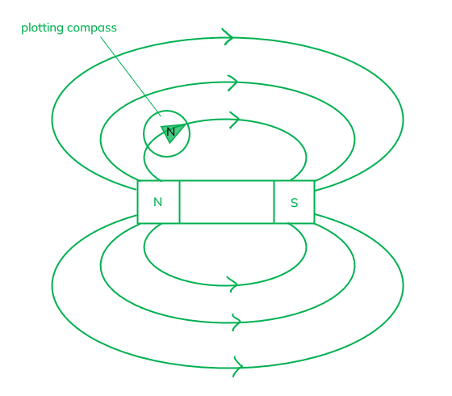

**[Total: 3 marks]**

> *It is important that you learn the key methods involved in the core practicals.*
A diagram which would score three marks would look like:

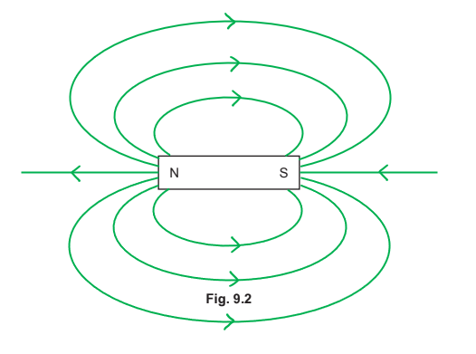

**Any two from:**

- No field lines should cross; **[1 mark]**
- Field lines loop from the north pole to the south pole away from the ends; **[1 mark]**
- Field lines shown as straight lines out of the north pole and into the south pole at the ends of the magnet; **[1 mark]**

And for the final mark:

- Arrow(s) shown on the field lines pointing from the north pole to the south pole; **[1 mark]**

**[Total: 3 marks]**

> *Knowing the field lines around a bar magnet is a key point. Don't forget to add arrows, and that these should point from north to south.*

### Q9
Draw the magnetic field lines that the student will discover between the magnets:

A diagram scoring 3 marks:

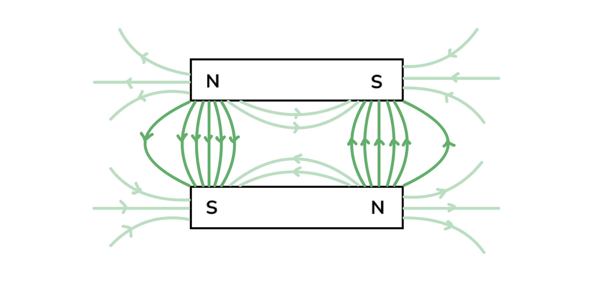

- At least one straight line drawn from north to south pole at each end; **[1 mark]**
- At least two curved lines drawn from north to south pole at each end;** [1 mark]**
- Arrows on all lines showing direction from north to south poles; **[1 mark]**

*Ignore field lines that are not directly between the magnets*

**[Total: 3 marks]**
State two errors in the diagram:

- The field lines are pointing from south poles to north poles **OR** the field lines will be / should be pointing from north poles to south poles;** [1 mark]**
- There are field lines between the repelling poles **OR** there will not / should not be field lines between the repelling poles;** [1 mark]**

**[Total: 2 marks]**

> *The field lines that the student would see after they added the compasses would be as follows:*

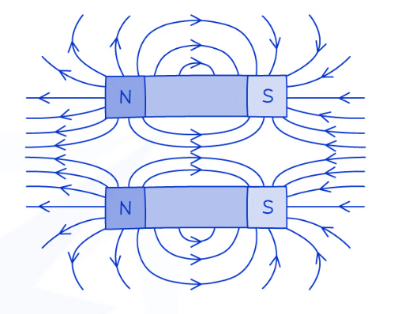
Explain why the filings are in this position:

- Magnetic fields are 3D / three dimensional; **[1 mark]**
- The iron fillings arrange themselves along field lines; **[1 mark]**
- Therefore, some of the filings are standing / pointing up / out of the page; **[1 mark]**

**[Total: 3 marks]**

> *It doesn't matter whether the filings land on the north or south pole of the magnet, they will still look like the image in Fig 1.2. *

### Q10
Draw the following onto Fig. 8.1:

A diagram that would score 4 marks would look like this:

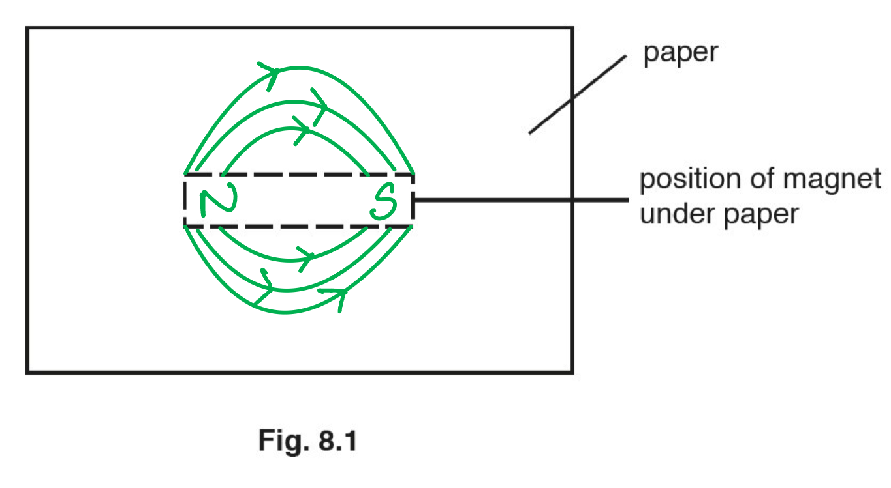

- N and S are labelled at either end of the magnet; **[1 mark]**
- At least 3 field lines drawn as arches between the poles above the magnet; **[1 mark]**
- At least 3 field lines drawn as arches between the poles below the magnet; **[1 mark]**
- Arrows on the field lines point from N to S; **[1 mark]**

**[Total: 4 marks]**
(i) State the name given to the device:

- This is an electromagnet; **[1 mark]**

(ii) Describe the effect on the iron filings:

- When the switch is closed the soft iron filings are attracted to the electromagnet;

**   ****AND**

- Most iron filings fall off when the switch is opened; **[1 mark]**

** **

(iii) Describe the effect on the iron filings:

- Most / more of the iron filings remain attached to the steel rod when the switch is opened; **[1 mark]**

**[Total: 3 marks]**

> *An iron core creates a temporary electromagnet. It loses its magnetism as soon as the current in the coil around the outside is switched off. A steel core creates a permanent electromagnet. It takes time for the steel to lose its magnetism once the current in the coil has been switched off. *

### Q11
State where, in relation to the bar magnet, the magnetic field is strongest and explain how scientists know this:

A diagram scoring 2 marks:

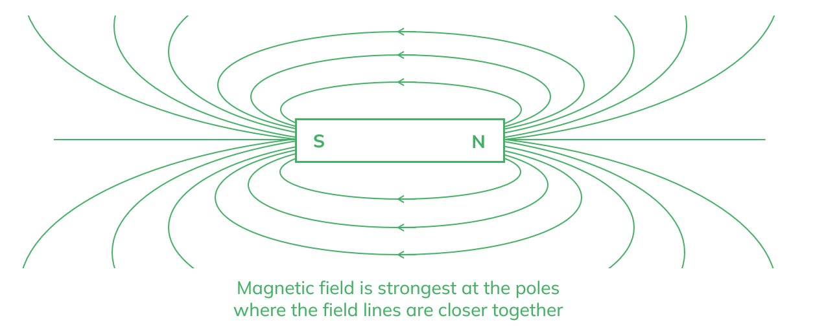

- The magnetic field around a bar magnet is strongest at the poles; **[1 mark]**
- As this is where the field lines are closest together; **[1 mark]**

**[Total: 2 marks]**
Suggest how the student might make a compass from this equipment:

- Steel is a magnetic material and can be magnetised; **[1 mark]**
- By repeatedly stroking the needle with the magnet in the same direction;** [1 mark]**
- The needle can be placed on / in (a piece of) the cork so that it can rotate freely floating on the water; **[1 mark]**

**[Total: 3 marks] **

> *You may have made a compass like this before in class or seen it done. However, exam questions will often take science you have learned about in class and ask about it in an unfamiliar context. In questions like this, think it through logically and stick to the physics.*
The needle always returns to the same position because:

- It is pointing to Earth's <u>magnetic</u> north pole; **[1 mark]**

**[Total: 1 mark]**

### Q12
A method that the student could use is:

**Any two from:**

- Pole of magnet is placed on or near the steel rod;** [1 mark]**
- Magnet is stroked along the rod;** [1 mark]**
- The magnet is stroked repeatedly;** [1 mark]**
- The strokes are all in the same direction;** [1 mark]**

**[Total: 2 marks]**

> *The key physics here is that the stroking of the magnet is in the **same direction**. If the direction is changed then the steel cannot be magnetised. *
To test that the steel rod has been magnetised:

**Method 1**

- Place pole of the rod next to a known magnet; **[1 mark]**
- If one end of the rod repels the magnet then it must also be a magnet as <u>like poles repel</u>; **[1 mark]**

**OR**

**Method 2**

- Place a **plotting compass** next to the suspected magnetised rod; **[1 mark]**
- If the steel rod has been successfully magnetized, it will produce its own magnetic field; **[1 mark]**

**[Total: 2 marks]**

> *A piece of steel which is unmagnetised will still be attracted to the magnet. It is whether one end can repel that shows that it's been magnetised.*

> *There are two types of magnets:*

- *Induced magnets*
- *Permanent magnets*

> *Induced magnets are **always** attracted to the magnet that magnetised them. We only see a repulsive force between two permanent magnets when like poles are facing each other. This is caused by the interaction between the magnetic fields.*

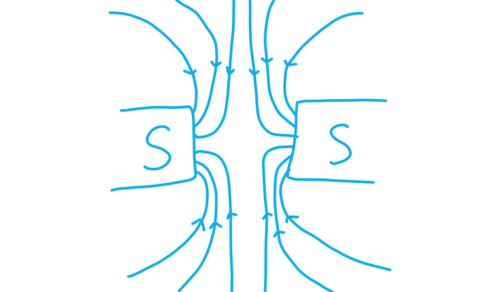

> *This only occurs between two permanent magnets, so if we observe this phenomenon, we must have two permanent magnets. *

> *Induced magnets can also magnetise other materials. If a paperclips is magnetised, it can also magnetise other materials, hence why it is possible to pick up a **chain** of paperclips with a single permanent magnet. *

*The ability to attract materials such as iron is not unique to permanent magnets, so this cannot be used to prove that a magnet is permanent. *
The difference between the magnetic properties of soft iron and steel is:

- Soft iron is a type of temporary magnet, so it becomes magnetised / unmagnetised easily** ****OR**
- Steel is a type of permanent magnet, so it is always magnetic; **[1 mark]**

**[Total: 1 mark]**

### Q13
(i) Write the letters N and S to indicate the north and south poles of the magnet

A diagram that would score 1 mark should look like:

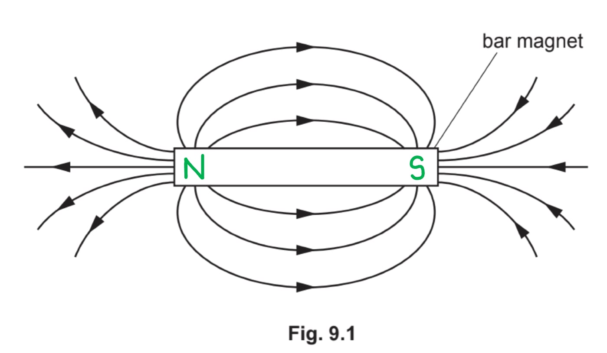

- N labelled on the left pole **AND** S labelled on the right pole; **[1 mark]**

** **

(ii) When a soft-iron bar is close to a permanent magnet:

- (The iron bar and magnet) attract (each other); **[1 mark]**
- The iron bar becomes an induced magnet; **[1 mark]**
- With the opposite pole next to the pole of the magnet; **[1 mark]**

**[Total: 4 marks]**

> *Magnetic field lines are always directly **out** of a **north** pole and **towards** a **south **pole.*

> *In part (ii), you must be specific as to whether you are referring to the soft-iron bar or the permanent magnet. It is only the soft-iron bar that becomes **induced**. This is because magnetic materials (such as soft-iron) will always be attracted to a permanent magnet. Since we are not told the direction of the poles in the permanent magnet, we know they are just in a direction which attracted the soft-iron bar. Remember that **opposite** poles **attract**.*

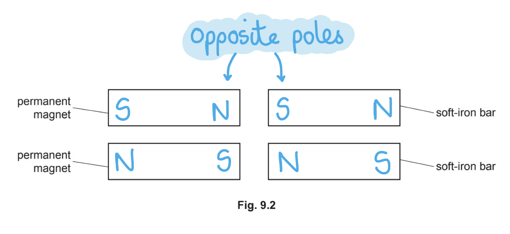
(i) The charge on ball Q and the charge on ball R are:

- The charge on Q is negative; **[1 mark]**
- The charge on R is positive; **[1 mark]**

(ii) The explanation for the charge on ball Q is:

- Since ball Q is repelled by the negative charge on P; **[1 mark]**
- It must have the same charge as on P / it must (also) be negative; **[1 mark]**

**[Total: 4 marks]**

> *Remember that:*

- *Opposite charges (positive and negative) **attract*
- *Like charges (positive and positive or negative and negative) **repel*

### Q14
Describe the effect of rotating carriage B by 180°:

- The north pole of B will be facing the north pole of C, so this will repel; **[1 mark]**
- The south pole of B will be facing the south pole of A, so this will also repel; **[1 mark]**
- (Therefore) the carriages will not stick together / repel each other; **[1 mark]**

**[Total: 3 marks]**
Sketch the magnetic field lines inside the carriage:

A diagram scoring 3 marks should look like:

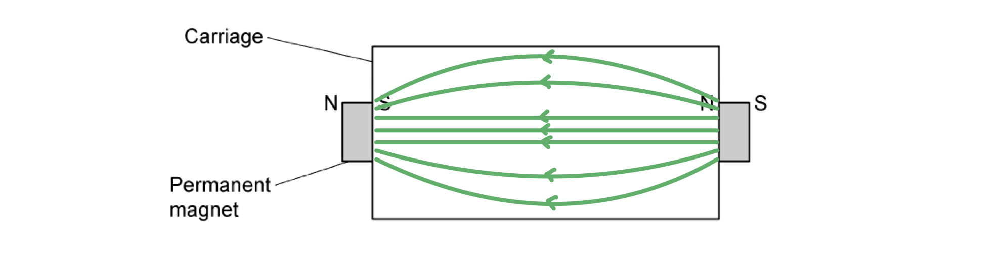

- Uniform evenly spaced magnetic field lines between poles; **[1 mark]**
- Curving magnetic field lines outside the uniform region; **[1 mark]**
- Arrows showing direction from north to south pole; **[1 mark]**

**[Total: 3 marks]**

### Q15
(i) Label N and S on each of the magnets:

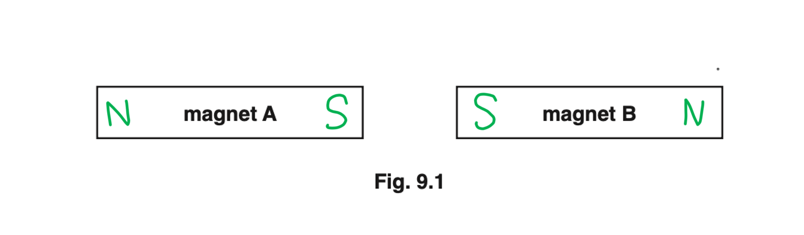

**OR**

- Sides on each magnet facing each other both labelled N and other sides labelled S; **[1 mark] ****OR**
- Sides on each magnet facing each other both labelled S and other sides labelled N; **[1 mark]**

(ii) State the term used to describe the nature of the forces acting between magnet A and magnet B:

- This action is known as <u>repulsion</u> **OR** the magnets <u>repel</u>; **[1 mark]**

(iii) Describe what happens when magnet A is slowly moved towards the steel bar:

- The steel bar is magnetised by the permanent magnet
- The steel bar <u>moves towards</u> / is <u>attracted</u> to magnet A; **[1 mark]**

**[Total: 3 marks]**

> *Repulsion only occurs between two permanent magnets. When a magnetic material such as steel enters the magnetic field of a permanent magnet, it will be attracted to the permanent magnet regardless of the pole it is close to. *

> *A lot of students are curious about how this works. **The following is not going to come up in your exam, but you may just be interested!*

> *In magnetic materials like iron and steel, the atoms act as tiny magnets which are usually randomly aligned.*

> *It is worth pointing out that they are **not **little bar magnets like this, but this is just to help visualise how the poles are randomly aligned when a magnetic material is not near a magnet. *

> *A magnetic field from a permanent magnet aligns these so these "microscopic south poles" point closest to the permanent magnet's north pole. However, if the magnetic material is placed near a south pole, the microscopic magnets align the other way, so now all of their south poles point **away** from the permanent south pole. *

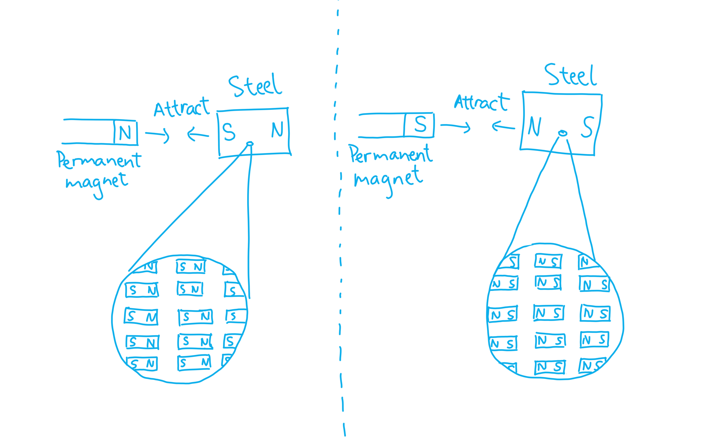

### Q16
Show the direction of the magnetic field by drawing an arrow on each field line:

A diagram scoring two marks:

- Two circular lines drawn;** [1 mark]**
- Arrows drawn indicating clockwise motion on both circles; **[1 mark]**

**[Total: 2 marks]**

> *Remember that you need to use the right-hand thumb rule to determine the direction of the magnetic field lines:*

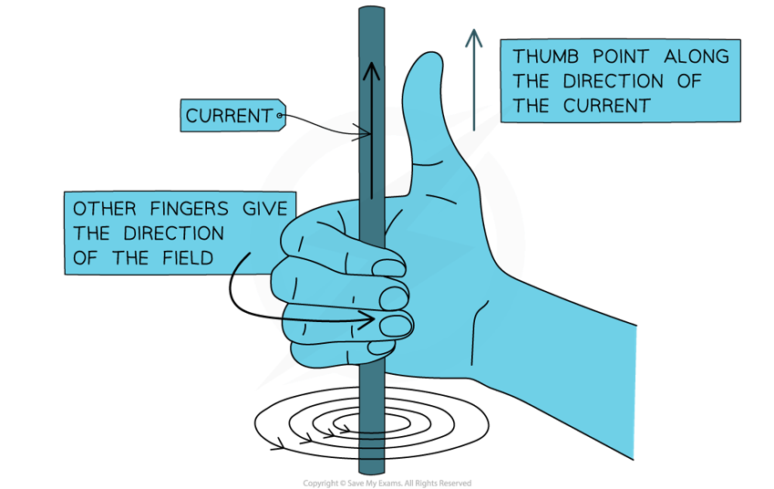

> *The direction of the current (and so the thumb) is into the page, so the direction of the field is clockwise.*

> *You may not always be told that a circle with a cross represents an arrow pointing **into** the page. A helpful way to remember this is to imagine the arrow is a dart and the cross represents the flights on the dart (the fins on the back). A circle with a dot represents an arrow pointing **out of **the page - this would be the tip of the dart.*

Explain how the circuit causes the hammer to hit the bell repeatedly when the switch is closed:

**Any five from:**

- When the switch is closed, the current flows in the circuit; **[1 mark]**
- The coil becomes an electromagnet; **[1 mark]**
- The electromagnet (coil) attracts the soft iron armature; **[1 mark]**
- (As the armature moves toward the electromagnet) the hammer strikes the bell; **[1 mark]**
- This motion breaks the circuit (at the contact screw); **[1 mark]**
- So the electromagnet is switched off / loses its magnetic field; **[1 mark]**
- The armature springs back (to its original position); **[1 mark]**
- And the cycle repeats; **[1 mark]**

**[Total: 5 marks]**
Apart from an electric door bell, another use for an electromagnet is:

**Any one from:**

- MRI scanner; **[1 mark]**
- Speakers / earphones / headphones; **[1 mark]**
- (Sorting of steel in) recycling; **[1 mark]**
- Mag-Lev trains; **[1 mark]**
- Induction hobs; **[1 mark]**
- Motor; **[1 mark]**
- Generator; **[1 mark]**

**[Total: 1 mark]**

> *There are actually hundreds of applications for electromagnets. Any reasonable suggestion would get you the mark. *

### Q17
Complete the table by writing attract or repel in the effect column:

**One mark for each correct answer:**

| **Orientation of bar magnets** | **Effect** |
|---|---|
|  | **Final answer:** **repel** |
|  | **Final answer:** **attract** |
|  | **Final answer:** **attract** |
|  | **Final answer:** **repel** |

** **

**[Total: 4 marks]**
(i) When a magnetic material is brought close to the north pole of a magnet:

- The <u>magnetic material</u> will be <u>attracted to the magnet</u>; **[1 mark]**

(ii) When a magnetic material is brought close to the south pole of a magnet:

- The <u>magnetic material</u> will be <u>attracted to the magnet</u>; **[1 mark]**

**[Total: 2 marks]**

> *Remember that a magnetic material (this is **not** the same as a magnet, that produces its own magnetic field) will never be **repelled** from a magnet, only attracted.*
One use of a permanent magnet is:

Any **one** from:

- Compass; **[1 mark]**
- Fridge magnets; **[1 mark]**
- Fridge door seal; **[1 mark]**
- Motor; **[1 mark]**
- Generator; **[1 mark]**
- Clasps on jewellery / toys / purses / bags; **[1 mark]**

**[Total: 1 mark]**

> *Any reasonable suggestion would gain the mark.*
Four magnetic materials that would be attracted to a magnet are:

- Iron; **[1 mark]**
- Nickel; **[1 mark]**
- Cobalt; **[1 mark]**
- Steel; **[1 mark]**

**[Total: 4 marks]**

### Q18
> **[mark-scheme]**
> A method the student could use to identify each strip is:
> 
> **Method**
> 
> - Bring one pole of the bar magnet up to each strip and note the effect, then repeat with the other pole **[1 mark]**
> 
> **Identification**
> 
> - The magnetised strip is attracted by one pole of the magnet **AND** repelled by the other pole **[1 mark]**
> - The magnetic but unmagnetised strip is attracted by both poles of the magnet **[1 mark]**
> - The non-magnetic strip is neither attracted nor repelled by either pole **[1 mark]**

> **[exam-tip]**
> Attraction on its own can never prove that a strip is a magnet, because a magnet attracts any unmagnetised magnetic material as well. Repulsion only happens between two magnets, so it is the one observation that picks out the magnetised strip. That is why your method needs to test each strip with both poles of the bar magnet.
> **[mark-scheme]**
> Unlike an unmagnetised magnetic material, a magnetised magnetic material:
> 
> - Is itself a magnet **[1 mark]**
> - Has poles **[1 mark]**
> - So it can attract unmagnetised magnetic materials **OR** it can repel / be repelled by another magnet **[1 mark]**

> **[exam-tip]**
> Keep your answer about what the magnetised material is and what it can do. Describing how the material was magnetised, or what is happening to its domains, may be correct physics, but it does not describe the difference the question asks about, so it will not add to your marks.
