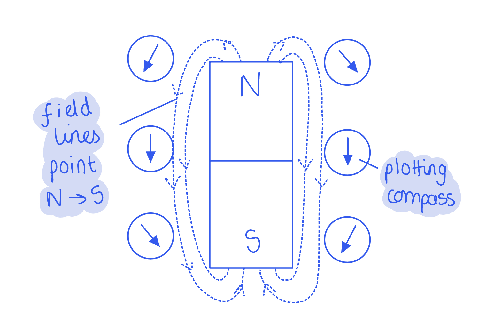

# Mark Schemes — Simple Phenomena of Magnetism
**4. Electricity & Magnetism** · Cambridge (CIE) IGCSE physics (0625 & 0972)

## Multiple Choice Questions (23 questions)

### Q1
**Final answer:** **The correct answer is A**

- The strength of a magnetic field is shown by the spacing of the field lines
- Where the field lines are closest together, the field is strongest
- Position A is closest to a pole of the magnet, where the field lines are most concentrated
- The field is strongest near the poles of the magnet and weakest far from the magnet

**B** is incorrect because it is furthest from the magnet, where the field lines are widely spaced, and the field is at its weakest.

**C** is incorrect because it is midway between the poles, where the field lines are more spread out, and the field is weaker.

**D** is incorrect because although it is close to a pole (north), the lines are more concentrated at point A, so the magnetic field is slightly stronger at A.

### Q2
**Final answer:** **The correct answer is D**

- Material 1 is a temporary magnet (soft iron)

  - It is ideal for the **core of an electromagnet **because it becomes strongly magnetised when a current is present, but loses that magnetism when the current is switched off
- Material 2 is a permanent magnet (made of steel)

  - It is ideal for a **bar magnet **because once it is magnetised, it retains its magnetic properties for a long time

**A** is incorrect because an electromagnet made with material 2 would stay magnetised even after the power is disconnected.

**B** is incorrect as material 1 loses its magnetism too easily to be used as a bar magnet.

**C** is incorrect because material 1 would not function as a bar magnet and material 2 would prevent an electromagnet from being switched off.

### Q3
**Final answer:** **The correct answer is B **

- The strongest magnetic field is indicated by the electromagnet that picks up the most nails when the current is kept the same
- Electromagnet **B** picks up the most nails

**A** is incorrect because **A** picks up fewer nails than B

**C** is incorrect because **C** picks up the least nails

**D **is incorrect because **D** picks up fewer nails than B

### Q4
**Final answer:** **The correct answer is ****C****, because:**

- End X of the iron will become a magnetic south pole (S) as it is placed near to a magnetic north (N) pole

  - Therefore, options **A** and **B** can be eliminated
- The nearby ends of the magnet and soft iron have opposite magnetic poles, so they attract each other
- The force acting on the soft iron will be to the left, towards the permanent magnet

  - Therefore, the correct answer is option **C**

There will also be a force pulling the magnet to the right. However, the question asks specifically for the **force** **on the soft iron**, so don’t get confused and try to describe the force on the permanent magnet.

### Q5
**Final answer:** **The correct answer is D**

- Soft iron is a temporary magnet, so it is only magnetic when the current flows in the coil i.e. when the power supply is on
- Therefore, when a core of soft iron is used, the expected results are that the electromagnet will pick up

  - a large number of pins when the power supply is **on**
  - no pins when the power supply is **off**
- This is shown by option **D**

**A **is incorrect because no pins are picked up when the power supply is on or off, so the core is likely a non-magnetic material

**B** & **C** are incorrect because pins are picked up when the power supply is both on and off, so the core is likely a permanent magnet

### Q6
**Final answer:** **The correct answer is B**

- A material must contain either iron, nickel or cobalt to be able to be magnetised

  - Only soft iron and steel of the listed materials contain iron
  - Eliminate options **A** and **D**
- Steel is a permanent magnet

  - Eliminate option **C**
- Soft iron is a temporary magnet

### Q7
**Final answer:** **The correct answer is D**

- Magnetic fields always point from the **north **pole to the **south **pole
- If a compass were placed at point X, it would point towards the south pole, as shown by option **D**

### Q8
**Final answer:** **The correct answer is D**

- Magnetic field lines always point from the north pole to the south pole

  - The arrow of a compass points along the same direction as the field line
  - Only compass **D** does this

**A**,** B **and **C **are incorrect as these arrows point in the opposite direction to the field lines

### Q9
**Final answer:** **The incorrect statement is ****D**** because:**

- A permanent magnet produces its own magnetic field

  - This means it never loses its magnetism
  - Most permanent magnets are made from 'hard' iron, nickel, or cobalt

- A soft magnetic material, such as soft iron, will only be magnetic whilst there is a current around it (such as in an electromagnet)

  - Once the current is switched off, it is demagnetised (loses its magnetism)
  - This means it wouldn't work as a permanent magnet

**A** is correct as opposite poles attract, so an S-pole will attract the N-pole of another magnet

**B** is correct as like poles repel, so an S-pole will repel the S-pole of another magnet

**C** is correct as permanent magnets can only attract or repel other magnetic materials, so it is true that they cannot repel non-magnetic materials

### Q10
**Final answer:** **The correct answer is ****D**** because:**

- Magnetic field lines always go from the **north** pole to the **south** pole

  - This eliminates options **B** and **C **which have the wrong direction for the magnetic field arrows
- The **strength** of the magnetic field is shown by the **spacing** of the magnetic field lines

  - If the magnetic field lines are **close together** then the magnetic field will be **stronger**
  - The field lines in option **D** are closer than **A**, so **D** has the stronger magnetic field

### Q11
**Final answer:** **The correct answer is ****B**** because:**

- Ferrous metals contain **iron**
- These are either iron itself or an alloy of iron, such as **steel**

  - Therefore, steel and iron are both ferrous

An alloy is a substance that contains more than one metal. Iron alloys all contain small amounts of iron. In the case of steel, this is iron and carbon.

### Q12
**Final answer:** **The correct answer is ****A**** because:**

- A hard magnetic material is required for a permanent magnet. Steel is a hard magnetic material that will retain its magnetism for a long time.
- A soft magnetic material is required for the core of an electromagnet. A material that loses its magnetism quickly is needed, so that the electromagnet can ‘let go’ of whatever it is holding.

The other answers do not pair iron with the core of an electromagnet, and/or steel with the permanent magnet.

### Q13
**Final answer:** **The correct answer is ****C**** because:**

- A ferrous metal contains **iron**, a non-ferrous metal does not.
- Aluminium and copper are elements, so they cannot contain iron.
- Brass is an alloy of copper and tin, which does not contain iron.

**A** is incorrect as iron is ferrous, and steel is an alloy of iron.

**B** is incorrect as steel is an alloy of iron, which is ferrous.

**D** is incorrect as iron is ferrous.

### Q14
**Final answer:** **The correct answer is ****C**** because:**

- Magnets attract magnetic materials.
- Materials containing iron are ferrous, and iron is a magnetic material. Therefore, a permanent magnet would attract ferrous materials (among other things).

**A **is incorrect as a permanent magnet will not repel materials that are not magnetic, it will have no effect on them.

**B **is incorrect as a permanent magnet will not repel non-ferrous materials. It will have no effect on most non-ferrous materials, and will attract cobalt and nickel.

**D **is incorrect as all permanent magnets have **two** poles, a north and a south. It is impossible for a permanent magnet to have only one pole.

### Q15
**Final answer:** **The correct answer is ****D**** because**

- Permanent magnets always attract magnetic materials. The iron bar is a magnetic material.
- Magnetic poles will be induced in the magnetic material which are opposite to the poles of the permanent magnet, which causes the attraction.

**A **is incorrect as the magnet will not repel the iron bar.

**B **is incorrect as the magnet will not repel the iron bar.

**C **is incorrect as the poles are the same as the permanent magnet’s poles. This would cause them to repel.

### Q16
**Final answer:** **The correct answer is ****C**** because:**

- Compass needles always point to the Earth’s North pole (which is actually a south magnetic pole, who knew?!).
- A compass needle will point along the direction of the permanent magnet’s field line, from north pole to south pole.

**A **is incorrect as this will cause the field lines to be visible, but it will not tell you which direction those field lines point.

**B **is incorrect as this will only tell you that the magnet is, indeed, a magnet, since it will attract the paperclip. Both poles will attract the paperclip, so you cannot tell which pole is which from this method.

**D **is incorrect as this will only tell you that the magnet is, indeed, a magnet, since it will attract the ferrous material. Both poles will attract the ferrous material, so you cannot tell which pole is which from this method.

### Q17
**Final answer:** **The correct answer is ****D**** because:**

- Remember that Iron is very easy to magnetise but loses its magnetic properties very quickly, and as such cannot be used as a **permanent magnet**, so you can disregard answers A and C.
- Also remember that an Alternating Current cannot be used to create a **permanent magnet**, as the direction of the magnetic field constantly changes with the change in current.

**A **is incorrect as soft iron will lose its magnetism too quickly.

**B **is incorrect as AC cannot be used to create a permanent magnet, as the magnetic poles flip very regularly.

**C **is incorrect as soft iron will lose its magnetism too quickly.

### Q18
**Final answer:** **The correct answer is ****B**** because:**

- Steel is slow to be magnetised (as it is an alloy of iron), and can retain its magnetism for a while

  - This makes it a good material for a magnet
- Iron can be magnetised and demagnetised very quickly

  - This means it becomes strongly magnetised when placed in contact with the magnets, but does not remain magnetised when taken away from the magnets
  - This makes it a good material for the keeper

Steel is often known as a 'hard' magnetic material and iron as a 'soft' magnetic material due to the relative amount of time they remain magnetised.

### Q19
**Final answer:** **The correct answer is ****B**** because**

- The strongest permanent magnet is able to hold the most paper clips when the bar magnet is taken away, regardless of how many it held when the bar magnet was present.
- Rod **B** can hold the most paper clips.

Each of the other rods holds fewer paperclips when the permanent magnet is taken away.

### Q20
**The correct answer is ****B**** because:**** **

- the diagram shows how the magnetic poles would be formed.

### Q21
**Final answer:** **The correct answer is ****B**** because:**

- When a compass needle is close to a magnet, it will point in the direction of the magnetic field lines

  - This goes from the north to the south pole
- Therefore, if the compass needle points **towards** the pole, it must be a south pole

The diagram below shows what the compass needles might look like around a magnet:

### Q22
**Final answer:** **The correct answer is ****A**** because:**

- In order for there to be repulsion between two metal bars, they must **both** be magnets. Otherwise it is impossible to have two like poles next to each other.
- Like magnetic poles repel.

**B **is incorrect as both ends of rod 3 attract. This means that it has two identical poles. This cannot happen in a magnet, and is only possible if the poles are changing in response to another magnetic field. This means that rod 3 is a magnetic material.

**C **is incorrect as in order to get repulsion at all, **both** of the bars must be magnets, not just one.

**D **is incorrect as in order to get repulsion at all, **both** of the bars must be magnets, not just one.

### Q23
**Final answer:** **The correct answer is ****A**** because North poles will repel North poles of other permanent magnets.**

**B **is incorrect as soft magnetic materials lose their magnetism quickly. A permanent magnet would not be permanent if it were made from a soft magnetic material.

**C **is incorrect as magnetic materials become magnets when placed in a magnetic field. They always become magnetic in such a way as to **attract** the magnet that causes them to become magnetic. They would never repel.

**D **is incorrect as magnetic field lines **never** cross.
