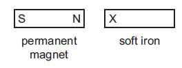
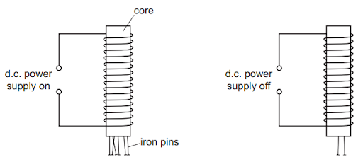
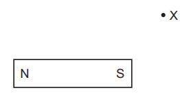
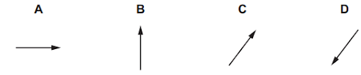
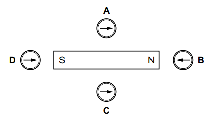
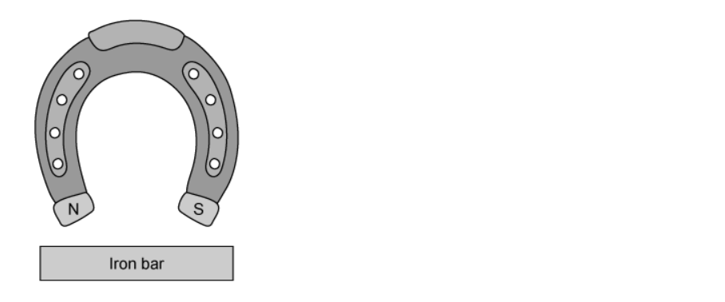
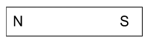
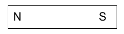
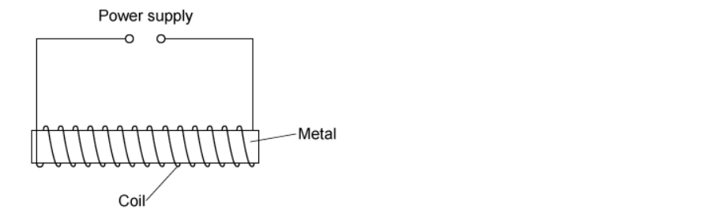
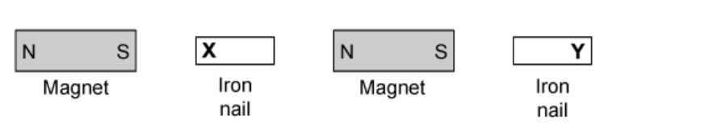

# Exam Questions — Simple Phenomena of Magnetism
**4. Electricity & Magnetism** · Cambridge (CIE) IGCSE physics (0625 & 0972)
> Source: [https://www.savemyexams.com/igcse/physics/cie/23/topic-questions/](https://www.savemyexams.com/igcse/physics/cie/23/topic-questions/) · 23 questions across 1 sets

## Multiple Choice Questions (23 questions)

### Q1 — easy — 1 marks

**Q1** [1 mark]

The diagram shows the magnetic field pattern around a bar magnet.

At which position is the magnetic field strongest?

![A bar magnet with its south pole on the left and north pole on the right. Magnetic field lines curve from the north pole around to the south pole. Four positions A, B, C and D are marked at different distances from the magnet. 
Point A is very close to the centre of the south pole.
Point B is midway between the poles and the fifth and sixth curved field lines.
Point C is midway between the poles and between the magnet and the first curved field line.
Point D is close to the corner of the north pole.](assets/001-a-bar-magnet-with-its-south-pole-on-the-left-and.png)

### Q2 — medium — 1 marks

**Q2** [1 mark]

A student has two different materials.

Material 1 magnetises easily and loses its magnetism as soon as it is removed from a magnetic field.

Material 2 is difficult to magnetise but retains its magnetism for a long time.

Which row shows the most suitable use for these materials?

|   | material 1 | material 2 |
|---|---|---|
| **A** | core of an electromagnet | core of an electromagnet |
| **B** | bar magnet | bar magnet |
| **C** | bar magnet | core of an electromagnet |
| **D** | core of an electromagnet | bar magnet |

### Q3 — easy — 1 marks

**Q3** [1 mark]

A student investigates which of four electromagnets produces the strongest magnetic field. Each electromagnet is made by wrapping a different number of turns of wire around an iron core. The current in each electromagnet is kept the same. The student tests each electromagnet by seeing how many iron nails it can pick up.

The results are summarised in the table below.

| **electromagnet** | **number of turns of wire** | **number of nails picked up** |
|---|---|---|
| **A** | 20 | 5 |
| **B** | 30 | 7 |
| **C** | 10 | 2 |
| **D** | 25 | 6 |

Which of the electromagnets produces the strongest magnetic field?

### Q4 — medium — 1 marks

**Q4** [1 mark]

An unmagnetised piece of soft iron is placed close to a strong permanent magnet, as shown.

What is the induced polarity of end X of the soft iron and in which direction does the magnetic force act on the soft iron?

|   | polarity of end X | direction of force on the soft iron |
|---|---|---|
| **A** | N | to the left |
| **B** | N | to the right |
| **C** | S | to the left |
| **D** | S | to the right |

*Source: June 2023 0972/11 Q23*

### Q5 — medium — 1 marks

**Q5** [1 mark]

A student counts how many iron pins an electromagnet picks up when its power supply is switched on. Then, she counts how many pins are picked up when the power supply is switched off.

She repeats the experiment using cores made of different materials. The results are shown.

Which core is made out of soft iron?

|   | pins picked up with the power supply on | pins picked up with the power supply off |
|---|---|---|
| **A** | 0 | 0 |
| **B** | 2 | 7 |
| **C** | 8 | 5 |
| **D** | 12 | 0 |

*Source: June 2022 paper 1 Q27*

### Q6 — easy — 1 marks

**Q6** [1 mark]

What material can a temporary magnet be made from?

*Source: 2023 Specimen paper 1 Q26*

### Q7 — easy — 1 marks

**Q7** [1 mark]

Point X is near to a bar magnet, as shown

Which arrow indicates the direction of the magnetic field of the bar magnet at point X?

*Source: June 2022 paper 1 Q26*

### Q8 — easy — 1 marks

**Q8** [1 mark]

The diagram shows a bar magnet and four plotting compasses.

Which compass correctly shows the direction of the magnetic field due to the magnet?

*Source: specimen 2023 paper 1 Q27*

### Q9 — easy — 1 marks

**Q9** [1 mark]

Which statement about a permanent bar magnet is **incorrect**?

### Q10 — easy — 1 marks

**Q10** [1 mark]

**Extended tier only**

Which magnet has the strongest magnetic field?

### Q11 — easy — 1 marks

**Q11** [1 mark]

Which of the lists below are metals that are ferrous?

### Q12 — easy — 1 marks

**Q12** [1 mark]

Which of the following choices of metal would be suitable for:

- Use as a permanent magnet?
- Use as the core in an electromagnet?

|   | **Use as a permanent magnet** | **Use as the core of an electromagnet** |
|---|---|---|
| **A** | steel | iron |
| **B** | steel | steel |
| **C** | iron | iron |
| **D** | iron | steel |

### Q13 — easy — 1 marks

**Q13** [1 mark]

Which of the lists of metals below contains only metals which are non-ferrous?

### Q14 — medium — 1 marks

**Q14** [1 mark]

Which of the following statements could be used to describe something a permanent magnet could do?

### Q15 — hard — 1 marks

**Q15** [1 mark]

A teacher, Mr. Garrison, brings a horseshoe magnet near to an iron bar as shown in the diagram.

Is the iron bar attracted to or repelled from the horseshoe magnet?

Which diagram shows the polarity of the poles that are produced in the iron bar?

| **Rod** | **Attracted / Repelled** | **Pole Distribution** |
|---|---|---|
| **A** | repelled |  |
| **B** | repelled |  |
| **C** | attracted |  |
| **D** | attracted |  |

### Q16 — hard — 1 marks

**Q16** [1 mark]

A student has what he believes to be a permanent magnet. He wants to find out which end is the magnet’s North pole.

What could he do to find out?

### Q17 — hard — 1 marks

**Q17** [1 mark]

A student wants to make an electromagnet that acts like a permanent magnet that will retain its magnetism after it is switched off. The student is using some easy-to-find materials that are in the school lab.

Which metal should the student use, and which setting on the power supply?

|   | **Metal** | **Power supply setting** |
|---|---|---|
| **A** | Soft iron | 6V a.c. |
| **B** | steel | 6V a.c. |
| **C** | Soft iron | 6V d.c. |
| **D** | steel | 6V d.c. |

### Q18 — medium — 1 marks

**Q18** [1 mark]

The diagram shows two bar magnets, stored with metal keepers across the ends. The keepers help to keep the magnets magnetised.

The material used for the keepers becomes strongly magnetised when placed in contact with the magnets, but does not remain magnetised when taken away from the magnets.

What is a suitable metal to use for the magnets and what is a suitable metal to use for the keepers?

|   | **Metal for keeper** | **Metal for magnet** |
|---|---|---|
| **A** | steel | steel |
| **B** | iron | steel |
| **C** | steel | iron |
| **D** | iron | iron |

### Q19 — hard — 1 marks

**Q19** [1 mark]

A student carries out an experiment to find out which of four metal rods makes the best permanent magnet.

The rod is attached to the south pole of a permanent magnet, and then paper clips are attached to the rod. The number of paper clips that can be held by the rod is counted.

The permanent magnet is then removed from the rod, and the number of paper clips that remain attached are counted.

The results are summarised in the table below.

Which of the rods becomes the strongest permanent magnet?

| **rod** | **number of paper clips held by the rod** |   |
|---|---|---|
| **when the magnet is present** | **when the magnet is removed** |   |
| **A** | 5 | 2 |
| **B** | 4 | 3 |
| **C** | 2 | 0 |
| **D** | 3 | 2 |

### Q20 — medium — 1 marks

**Q20** [1 mark]

A student lines up some permanent magnets with soft iron nails in between as shown in the diagram below.

What would the magnetic poles of locations **X **and **Y** be?

|   | **X** | **Y** |
|---|---|---|
| **A** | north | north |
| **B** | north | south |
| **C** | south | north |
| **D** | south | south |

### Q21 — medium — 1 marks

**Q21** [1 mark]

Which test could be used to find which end of a magnet is the south pole?

### Q22 — hard — 1 marks

**Q22** [1 mark]

A student has a collection of metal bars that keep sticking to each other. She suspects that they might be magnets, so she runs a test.

She holds end V of rod 1, near to each end of the two other rods. The ends are shown in the diagram below.

Her results are as follows:

End V:

- Repels end W
- Attracts end X
- Attracts end Y
- Attracts end Z

Which of the metal rods is a magnet?

### Q23 — medium — 1 marks

**Q23** [1 mark]

A student makes a series of statements about a permanent bar magnet.

Which of them is true?
