# Exam Questions — Simple Phenomena of Magnetism
**4. Electricity & Magnetism** · Cambridge (CIE) IGCSE physics (0625 & 0972)
> Source: [https://www.savemyexams.com/igcse/physics/cie/23/topic-questions/](https://www.savemyexams.com/igcse/physics/cie/23/topic-questions/) · 41 questions across 2 sets

## Multiple Choice Questions (23 questions)

### Q1 — easy — 1 marks

**Q1** [1 mark]

The diagram shows the magnetic field pattern around a bar magnet.

At which position is the magnetic field strongest?

![A bar magnet with its south pole on the left and north pole on the right. Magnetic field lines curve from the north pole around to the south pole. Four positions A, B, C and D are marked at different distances from the magnet. 
Point A is very close to the centre of the south pole.
Point B is midway between the poles and the fifth and sixth curved field lines.
Point C is midway between the poles and between the magnet and the first curved field line.
Point D is close to the corner of the north pole.](assets/001-a-bar-magnet-with-its-south-pole-on-the-left-and.png)

### Q2 — medium — 1 marks

**Q2** [1 mark]

A student has two different materials.

Material 1 magnetises easily and loses its magnetism as soon as it is removed from a magnetic field.

Material 2 is difficult to magnetise but retains its magnetism for a long time.

Which row shows the most suitable use for these materials?

|   | material 1 | material 2 |
|---|---|---|
| **A** | core of an electromagnet | core of an electromagnet |
| **B** | bar magnet | bar magnet |
| **C** | bar magnet | core of an electromagnet |
| **D** | core of an electromagnet | bar magnet |

### Q3 — easy — 1 marks

**Q3** [1 mark]

A student investigates which of four electromagnets produces the strongest magnetic field. Each electromagnet is made by wrapping a different number of turns of wire around an iron core. The current in each electromagnet is kept the same. The student tests each electromagnet by seeing how many iron nails it can pick up.

The results are summarised in the table below.

| **electromagnet** | **number of turns of wire** | **number of nails picked up** |
|---|---|---|
| **A** | 20 | 5 |
| **B** | 30 | 7 |
| **C** | 10 | 2 |
| **D** | 25 | 6 |

Which of the electromagnets produces the strongest magnetic field?

### Q4 — medium — 1 marks

**Q4** [1 mark]

An unmagnetised piece of soft iron is placed close to a strong permanent magnet, as shown.

What is the induced polarity of end X of the soft iron and in which direction does the magnetic force act on the soft iron?

|   | polarity of end X | direction of force on the soft iron |
|---|---|---|
| **A** | N | to the left |
| **B** | N | to the right |
| **C** | S | to the left |
| **D** | S | to the right |

*Source: June 2023 0972/11 Q23*

### Q5 — medium — 1 marks

**Q5** [1 mark]

A student counts how many iron pins an electromagnet picks up when its power supply is switched on. Then, she counts how many pins are picked up when the power supply is switched off.

She repeats the experiment using cores made of different materials. The results are shown.

Which core is made out of soft iron?

|   | pins picked up with the power supply on | pins picked up with the power supply off |
|---|---|---|
| **A** | 0 | 0 |
| **B** | 2 | 7 |
| **C** | 8 | 5 |
| **D** | 12 | 0 |

*Source: June 2022 paper 1 Q27*

### Q6 — easy — 1 marks

**Q6** [1 mark]

What material can a temporary magnet be made from?

*Source: 2023 Specimen paper 1 Q26*

### Q7 — easy — 1 marks

**Q7** [1 mark]

Point X is near to a bar magnet, as shown

Which arrow indicates the direction of the magnetic field of the bar magnet at point X?

*Source: June 2022 paper 1 Q26*

### Q8 — easy — 1 marks

**Q8** [1 mark]

The diagram shows a bar magnet and four plotting compasses.

Which compass correctly shows the direction of the magnetic field due to the magnet?

*Source: specimen 2023 paper 1 Q27*

### Q9 — easy — 1 marks

**Q9** [1 mark]

Which statement about a permanent bar magnet is **incorrect**?

### Q10 — easy — 1 marks

**Q10** [1 mark]

**Extended tier only**

Which magnet has the strongest magnetic field?

### Q11 — easy — 1 marks

**Q11** [1 mark]

Which of the lists below are metals that are ferrous?

### Q12 — easy — 1 marks

**Q12** [1 mark]

Which of the following choices of metal would be suitable for:

- Use as a permanent magnet?
- Use as the core in an electromagnet?

|   | **Use as a permanent magnet** | **Use as the core of an electromagnet** |
|---|---|---|
| **A** | steel | iron |
| **B** | steel | steel |
| **C** | iron | iron |
| **D** | iron | steel |

### Q13 — easy — 1 marks

**Q13** [1 mark]

Which of the lists of metals below contains only metals which are non-ferrous?

### Q14 — medium — 1 marks

**Q14** [1 mark]

Which of the following statements could be used to describe something a permanent magnet could do?

### Q15 — hard — 1 marks

**Q15** [1 mark]

A teacher, Mr. Garrison, brings a horseshoe magnet near to an iron bar as shown in the diagram.

Is the iron bar attracted to or repelled from the horseshoe magnet?

Which diagram shows the polarity of the poles that are produced in the iron bar?

| **Rod** | **Attracted / Repelled** | **Pole Distribution** |
|---|---|---|
| **A** | repelled |  |
| **B** | repelled |  |
| **C** | attracted |  |
| **D** | attracted |  |

### Q16 — hard — 1 marks

**Q16** [1 mark]

A student has what he believes to be a permanent magnet. He wants to find out which end is the magnet’s North pole.

What could he do to find out?

### Q17 — hard — 1 marks

**Q17** [1 mark]

A student wants to make an electromagnet that acts like a permanent magnet that will retain its magnetism after it is switched off. The student is using some easy-to-find materials that are in the school lab.

Which metal should the student use, and which setting on the power supply?

|   | **Metal** | **Power supply setting** |
|---|---|---|
| **A** | Soft iron | 6V a.c. |
| **B** | steel | 6V a.c. |
| **C** | Soft iron | 6V d.c. |
| **D** | steel | 6V d.c. |

### Q18 — medium — 1 marks

**Q18** [1 mark]

The diagram shows two bar magnets, stored with metal keepers across the ends. The keepers help to keep the magnets magnetised.

The material used for the keepers becomes strongly magnetised when placed in contact with the magnets, but does not remain magnetised when taken away from the magnets.

What is a suitable metal to use for the magnets and what is a suitable metal to use for the keepers?

|   | **Metal for keeper** | **Metal for magnet** |
|---|---|---|
| **A** | steel | steel |
| **B** | iron | steel |
| **C** | steel | iron |
| **D** | iron | iron |

### Q19 — hard — 1 marks

**Q19** [1 mark]

A student carries out an experiment to find out which of four metal rods makes the best permanent magnet.

The rod is attached to the south pole of a permanent magnet, and then paper clips are attached to the rod. The number of paper clips that can be held by the rod is counted.

The permanent magnet is then removed from the rod, and the number of paper clips that remain attached are counted.

The results are summarised in the table below.

Which of the rods becomes the strongest permanent magnet?

| **rod** | **number of paper clips held by the rod** |   |
|---|---|---|
| **when the magnet is present** | **when the magnet is removed** |   |
| **A** | 5 | 2 |
| **B** | 4 | 3 |
| **C** | 2 | 0 |
| **D** | 3 | 2 |

### Q20 — medium — 1 marks

**Q20** [1 mark]

A student lines up some permanent magnets with soft iron nails in between as shown in the diagram below.

What would the magnetic poles of locations **X **and **Y** be?

|   | **X** | **Y** |
|---|---|---|
| **A** | north | north |
| **B** | north | south |
| **C** | south | north |
| **D** | south | south |

### Q21 — medium — 1 marks

**Q21** [1 mark]

Which test could be used to find which end of a magnet is the south pole?

### Q22 — hard — 1 marks

**Q22** [1 mark]

A student has a collection of metal bars that keep sticking to each other. She suspects that they might be magnets, so she runs a test.

She holds end V of rod 1, near to each end of the two other rods. The ends are shown in the diagram below.

Her results are as follows:

End V:

- Repels end W
- Attracts end X
- Attracts end Y
- Attracts end Z

Which of the metal rods is a magnet?

### Q23 — medium — 1 marks

**Q23** [1 mark]

A student makes a series of statements about a permanent bar magnet.

Which of them is true?

## Theory Questions (18 questions)

### Q1 — hard — 4 marks

**Q1** [4 marks]

Describe how to plot the shape and direction of the magnetic field pattern shown in Fig. 8.1.

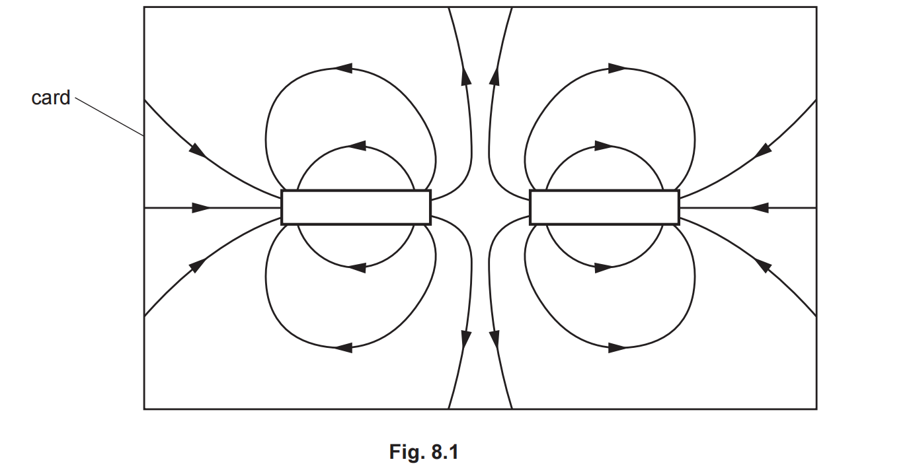

*Source: June 2023 0972/31 Q8B*

### Q2 — medium — 1 marks

**Q2** [1 mark]

Fig. 8.1 shows the magnetic field pattern around two permanent magnets. The magnets are repelling each other.

On Fig. 8.1, label both the poles on **each **magnet.

*Source: 0972/June 2023 31 Q8A*

### Q3 — medium — 6 marks

**Q3** [3 marks]

Fig. 8.1 shows a bar magnet on a piece of card.

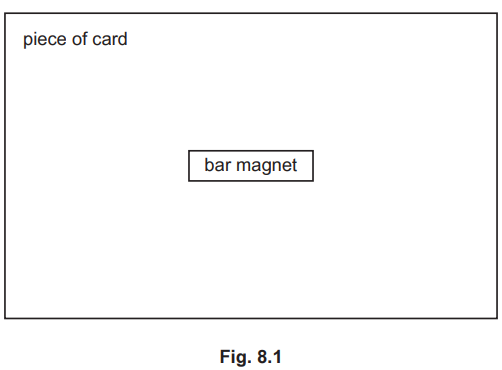

Describe an experiment to determine the pattern of the magnetic field lines around the bar magnet.

You may draw on Fig. 8.1 if it helps to explain your answer.

*Source: June 2022 paper 3 Q8A*

**Q3** [3 marks]

A student has a bar magnet and a metal bar with ends labelled X and Y. The student moves the metal bar close to either pole of the bar magnet. Fig. 8.2 and Fig. 8.3 show the force on the metal bar in each case.

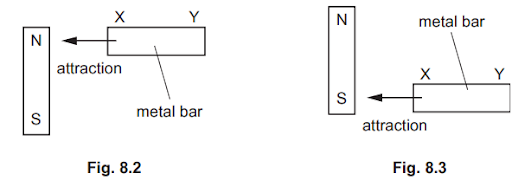

State and explain what these results reveal about the metal bar XY.

*Source: June 2022 paper 3 Q8B*

### Q4 — easy — 7 marks

**Q4** [1 mark]

When a magnetic material is placed in a magnetic field, that material can become a temporary magnet.

Tick **one** box that correctly names this effect.

`square` magnetic attraction

`square` electromagnetism

`square` induced magnetism

**Q4** [1 mark]

Identify the magnetic materials from the list below.

Tick **all **that apply.

`square` iron

`square` copper

`square` aluminium

`square` steel

**Q4** [1 mark]

Fig. 1.1 shows a magnetic material being brought into the magnetic field of a permanent magnet.

**Fig. 1.1**

Draw, on Fig. 1.1, the temporary poles that will be induced in the magnetic material.

**Q4** [4 marks]

Fig. 1.2 shows a chain of paperclips being suspended from a magnet.

Complete the paragraph explaining how this is possible.

Choose words from the list below.

**   temporary       magnetic        permanent     poles          attracted    **

** magnetised      repelled      non-magnetic  **

** **

The paperclips are made of steel which is a ...................................... material. The paperclips are ............................... to the permanent magnet. The magnetic field induces temporary ................................ in the paperclips and they become ..................................... magnets.

### Q5 — easy — 9 marks

**Q5** [4 marks]

Describe a method for drawing the magnetic field around a bar magnet using iron filings.

**Q5** [1 mark]

Define the term *magnetic field*.

**Q5** [1 mark]

State the direction of magnetic field lines.

**Q5** [3 marks]

**Extract:**

The direction of magnetic field lines are:

- From north (pole) to south (pole); [1 mark]

**Extended tier only**

Sketch the magnetic field lines for the two bar magnets shown in Fig. 1.1.

**Fig. 1.1**

### Q6 — hard — 7 marks

**Q6** [6 marks]

Scientists can explain magnetic materials and non-magnetic materials using domain theory.

All atoms contain electrons, and electrons act as tiny magnets with a north and a south pole, as shown in Fig. 1.1.

Metals are collections of many millions of atoms. For non-magnetic materials the electrons are randomly aligned as shown in Fig. 1.2.

For magnetic materials, the electrons are arranged in groups called domains. Within each domain, the electrons are aligned so that they all point in the same direction, and each domain acts as a magnet itself. Fig. 1.3 shows this arrangement.

Use domain theory to explain

(i) Why most metals are not magnetic.

[3]

(ii) Why some metals can be magnetised.

[3]

**Q6** [1 mark]

**Extract:**

Metals are collections of many millions of atoms. For non-magnetic materials the electrons are randomly aligned as shown in Fig. 1.2. For magnetic materials, the electrons are arranged in groups called domains. Within each domain, the electrons are aligned so that they all point in the same direction, and each domain acts as a magnet itself. Fig. 1.3 shows this arrangement.

Using arrows in a rectangle to represent electrons in a metal as in part **(a)**, draw a sketch of a magnetised material.

### Q7 — hard — 7 marks

**Q7** [3 marks]

A student is experimenting with magnets and electric charges.

The student places a bar magnet on a piece of paper, as shown in Fig. 9.1.

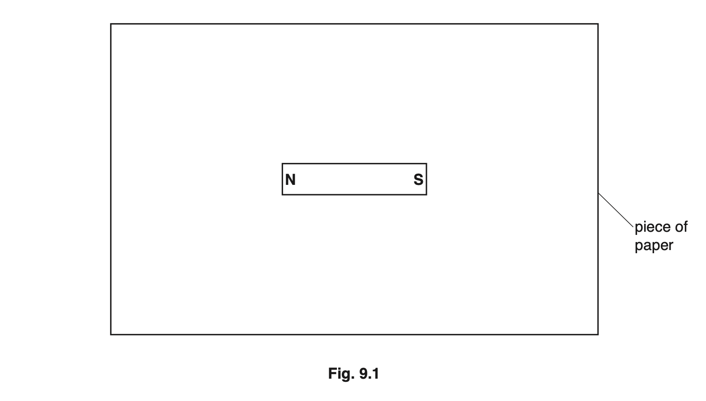

Show the pattern of magnetic field lines around the bar magnet.

Draw **two** lines above the magnet and **two** lines below the magnet. Start and finish each line at a pole. Include **one** arrow to show the direction of the magnetic field.

*Source: Oct 2019 3 Q9A*

**Q7** [2 marks]

The student rubs a plastic rod with a dry cloth. The plastic rod becomes positively charged.

Explain why the friction between the plastic and the cloth causes the plastic to become positively charged.

*Source: Oct 2019 3 Q9B*

**Q7** [2 marks]

The student investigates the forces between two pairs of objects.

Fig. 9.2 and Fig. 9.3 show the pairs of objects.

State whether there is a force of attraction, a force of repulsion, or no force between the pairs of objects. Draw a **ring** around **one** phrase for each pair of objects.

1. two positively charged spheres

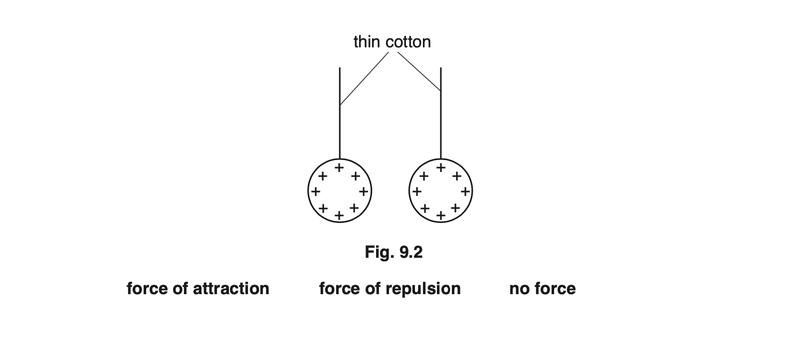

2. a bar magnet and a bar of copper metal

*Source: Oct 2019 3 Q9C*

### Q8 — easy — 6 marks

**Q8** [3 marks]

Some students plot the magnetic field lines around a bar magnet. They have the apparatus shown in Fig. 9.1 and a large sheet of paper.

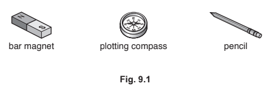

Describe how the students use the apparatus in Fig. 9.1 to show the pattern of the magnetic field lines around the bar magnet.

You may draw a diagram to assist with your description.

*Source: 2020 0625/32 Q9A*

**Q8** [3 marks]

Draw at least four lines above and below the bar magnet in Fig. 9.2 to show the magnetic field around the bar magnet. Draw an arrow on the field lines to show the direction of the magnetic field.

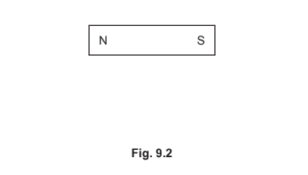

*Source: 2020 0625/32 Q9B*

### Q9 — hard — 8 marks

**Q9** [3 marks]

A student is using plotting compasses to investigate the magnetic field lines of bar magnets.

The student places two bar magnets in the arrangement shown in Fig. 1.1.

**Fig. 1.1**

Draw the magnetic field lines that the student will discover between the magnets.

**Q9** [2 marks]

**Extract:**

A student is using plotting compasses to investigate the magnetic field lines of bar magnets. The student places two bar magnets in the arrangement shown in Fig. 1.1. Draw the magnetic field lines that the student will discover between the magnets.

Draw the magnetic field lines that the student will discover between the magnets:
- At least one straight line drawn from north to south pole at each end;
- At least two curved lines drawn from north to south pole at each end;
- Arrows on all lines showing direction from north to south poles;
*Ignore field lines that are not directly between the magnets*

The student changed the orientation of the bottom magnet by rotating it 180°. Fig. 1.2 shows the predictive sketch drawn by the student before they added the plotting compasses.

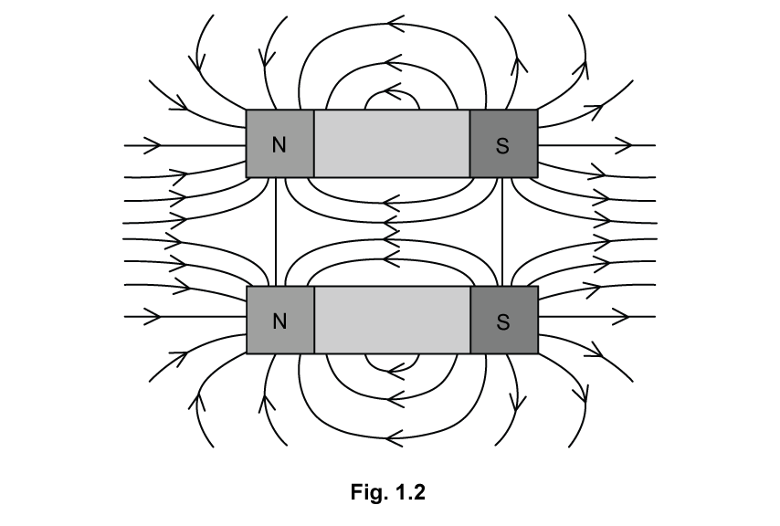

State two differences between the sketch in Fig 1.2 and the pattern the student will actually see when they add the plotting compasses.

**Q9** [3 marks]

The student attempts to look at the field lines by adding iron filings around the magnet.

Whilst collecting the iron filings, they spill some on the magnet.

Fig. 1.3 shows a side view of the magnet and the filings.

Explain why the iron filings are in this position.

### Q10 — medium — 7 marks

**Q10** [4 marks]

Fig. 8.1 shows a sheet of paper. A bar magnet is underneath the paper. A student sprinkles iron filings onto the paper.

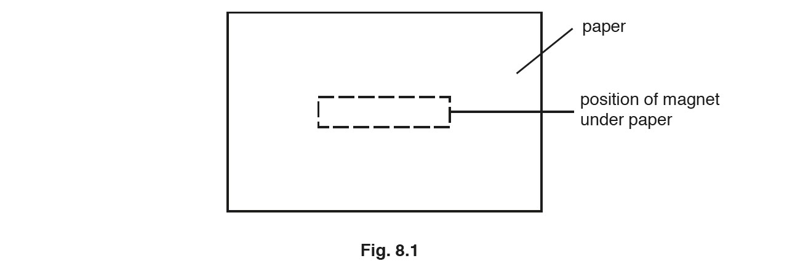

On Fig. 8.1

- Label the position of each pole of the magnet. Use the label N for the north pole and S for the south pole.
- Draw magnetic field lines above the magnet and draw magnetic field lines below the magnet.
- Add arrows to show the direction of the magnetic field.

*Source: Oct/Nov2018  (Series 3) 0625/33 Q8A*

**Q10** [3 marks]

A student places a soft iron rod inside a coil of insulated wire. The coil is connected to a battery, as shown in Fig. 8.2.

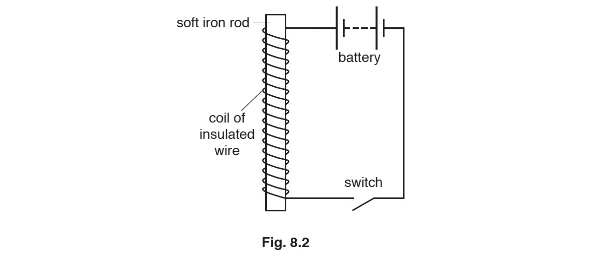

(i) State the name given to the device shown in Fig. 8.2.

[1]

(ii) The student puts one end of the device in Fig. 8.2 just above a pile of iron filings.

He closes the switch for a short time and then opens it again.

Describe the effect this has on the iron filings.

[1]

(iii) The student removes the soft iron rod and replaces it with a steel rod.

He puts one end of the steel rod just above the pile of iron filings. He closes the switch for a short time and then opens it again.

Describe the effect this has on the iron fillings.

[1]

*Source: Oct/Nov2018  (Series 3) 0625/33 Q8B*

### Q11 — medium — 6 marks

**Q11** [2 marks]

**Extended tier only**

Bar magnets produce a magnetic field.

State where, in relation to the bar magnet, the magnetic field is strongest and explain how scientists know this.

You may wish to use a diagram in your answer.

**Q11** [3 marks]

A student is making a compass from a steel sewing needle, a cork and a bowl of water. Fig. 1.1 shows this apparatus.

A compass consists of a freely rotating magnet.

Suggest how the student might make a compass from this equipment.

**Q11** [1 mark]

**Extract:**

A student is making a compass from a steel sewing needle, a cork and a bowl of water. Fig. 1.1 shows this apparatus.

A compass consists of a freely rotating magnet.

When the student brings a magnet close to the needle-cork compass, the needle spins to face the north pole of the magnet. When the student moves the magnet away, the needle always returns to the same position.

Suggest why this is the case.

### Q12 — medium — 5 marks

**Q12** [2 marks]

A student magnetises a steel rod by using a permanent magnet.

Describe a method that the student could use.

*Source: 2018 0625/33 Q9A*

**Q12** [2 marks]

**Extract:**

To test that the steel rod has been magnetised:

- Place pole of the rod next to a known magnet;
- If one end of the rod repels the magnet then it must also be a magnet as like poles repel;

A piece of steel which is unmagnetised will still be attracted to the magnet. It is whether one end can repel that shows that it's been magnetised.

There are two types of magnets:

- Induced magnets
- Permanent magnets

Induced magnets are always attracted to the magnet that magnetised them. We only see a repulsive force between two permanent magnets when like poles are facing each other. This is caused by the interaction between the magnetic fields.

This only occurs between two permanent magnets, so if we observe this phenomenon, we must have two permanent magnets. 

The ability to attract materials such as iron is not unique to permanent magnets, so this cannot be used to prove that a magnet is permanent.

Explain how the student could test that the steel rod has been magnetised.

*Source: 2018 0625/33 Q9B*

**Q12** [1 mark]

Magnets can be made from soft iron or from steel.

State one difference between the magnetic properties of soft iron and steel.

*Source: 2018 0625/33 Q9C*

### Q13 — hard — 8 marks

**Q13** [4 marks]

Fig. 9.1 shows the magnetic field pattern around a bar magnet.

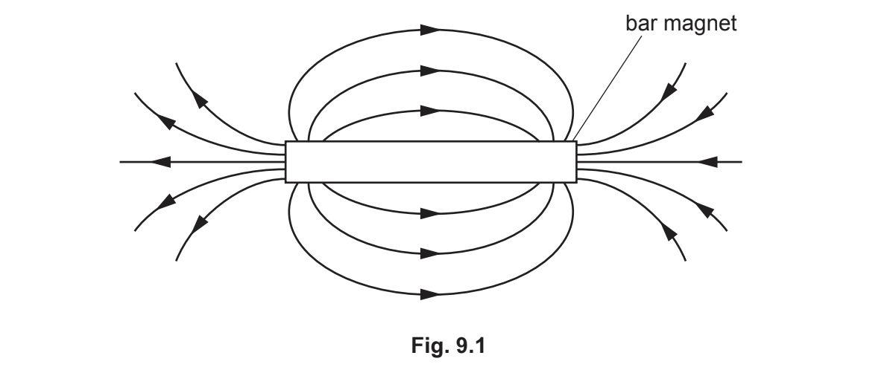

(i) On Fig. 9.1, write the letters N and S to indicate the north and south poles of the magnet.

[1]

(ii) Fig. 9.2 shows a soft-iron bar placed close to a permanent magnet.

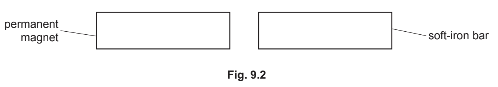

State and explain what happens to the soft-iron bar. You may draw on Fig. 9.2.

[3]

*Source: 2020 0625/31 Q9A*

**Q13** [4 marks]

Three balls P, Q and R are electrically charged. The balls are suspended by threads of insulating material. Fig. 9.3 shows the arrangement.

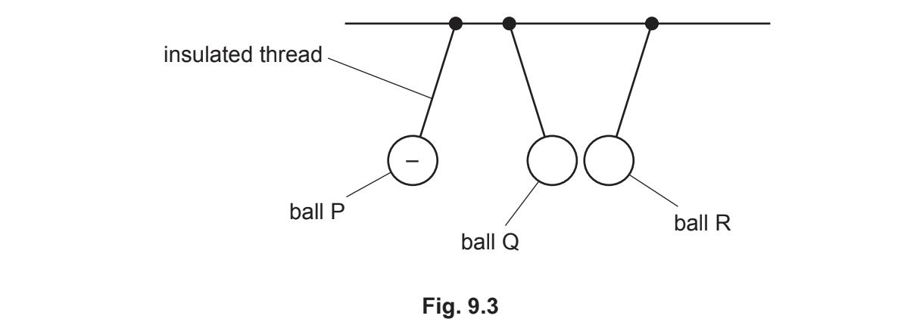

Ball P is negatively charged.

(i) State the charge on ball Q and the charge on ball R.

[2]

(ii) Explain your answer for part (i) for the charge on ball Q.

[2]

*Source: 2020 0625/31 Q9B*

### Q14 — medium — 6 marks

**Q14** [3 marks]

A wooden toy train has permanent magnets that hold the carriages together. Fig. 1.1 shows the arrangement.

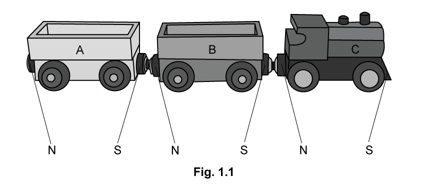

The centre carriage (B) is removed and turned 180°.

Describe the effect this will have on the train.

**Q14** [3 marks]

**Extract:**

A wooden toy train has permanent magnets that hold the carriages together. Fig. 1.1 shows the arrangement.

The centre carriage (B) is removed and turned 180°.

Figure 1.2 shows one of the carriages with a magnet attached to each end.

**Fig. 1.2**

Sketch the magnetic field lines inside the carriage.

### Q15 — medium — 3 marks

**Q15** [3 marks]

Two bar magnets are placed next to each other as shown in Fig. 9.1.

Magnet A is slowly moved towards magnet B. This causes magnet B to move away from magnet A.

(i) On Fig. 9.1, suggest the poles of each bar magnet.

Label N and S on each of the magnets.

[1]

(ii) State the term used to describe the nature of the forces acting between magnet A and magnet B.

[1]

(iii) Magnet B is removed and replaced with a steel bar of the same size.

Describe what happens when magnet A is slowly moved towards the steel bar.

[1]

*Source: Oct 2019 0625/33 Q9A*

### Q16 — hard — 8 marks

**Q16** [2 marks]

A long straight wire passes through a piece of card. There is a current in the wire, as shown in Fig. 11.1.

Fig. 11.2 shows the view of the card from above. The current is into the page.

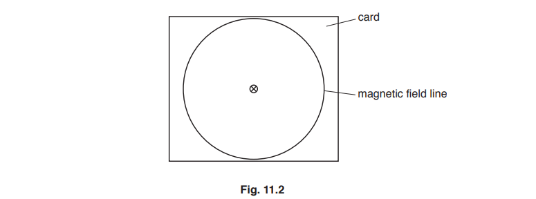

The current in the wire produces a magnetic field around the wire. One magnetic field line is drawn.

On Fig. 11.2, draw two more magnetic field lines around the wire. Show the direction of the magnetic field by drawing an arrow on each field line.

*Source: 2018 (Series 2) 0625/32 Q11A*

**Q16** [5 marks]

Fig. 11.3 shows the circuit for an electric bell.

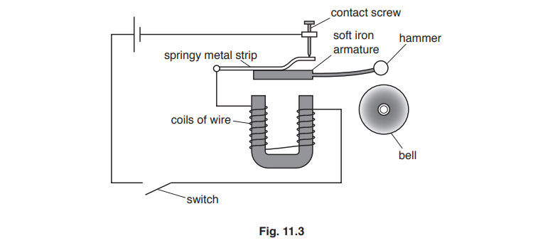

Explain how the circuit causes the hammer to hit the bell repeatedly when the switch is closed.

Use your ideas about circuits and electromagnets.

*Source: 2018 (Series 2) 0625/32 Q11B*

**Q16** [1 mark]

Apart from an electric door bell, suggest another use for electromagnets.

### Q17 — easy — 11 marks

**Q17** [4 marks]

When the poles of two bar magnets are brought close together, the magnets will experience either an attraction or a repulsion.

Complete Table 1.1 by writing either attract or repel in the effect column.

**Q17** [2 marks]

State which item will experience an attraction or repulsion when

(i) a magnetic material is brought close to the north pole of a magnet.

[1]

(ii) a magnetic material is brought close to the south pole of a magnet.

[1]

**Q17** [1 mark]

State one use of a permanent magnet.

**Q17** [4 marks]

State four magnetic materials that would be attracted to a magnet.

### Q18 — medium — 7 marks

**Q18** [4 marks]

**Extract:**

When marking this answer:

- The magnetised-strip mark needs repulsion: a strip described only as being attracted to the magnet is not identified as magnetised
- Accept "pushed away" or "moves away" for repelled, and "no effect" or "no force" for the non-magnetic strip
- Each identification mark can be awarded on its own, even when the method is not described

A student is given three unknown metal strips and a bar magnet.

The student is also given the following information:

- One strip is magnetic and magnetised
- One strip is magnetic but not magnetised
- One strip is not magnetic

Describe a method the student could use to identify each strip.

**Q18** [3 marks]

**Extract:**

When marking this answer:

- Accept "acts as a magnet" or "unmagnetised material cannot act as a magnet until it is magnetised" for "is itself a magnet"
- Accept "has (fixed) poles" or "has a north and south pole" for the poles mark, including when stated as "unmagnetised material has no poles"
- A description of one end being attracted by one pole and repelled by the other earns the repel mark only; do not also award the "is itself a magnet" or "has poles" marks unless these are stated

Describe the difference between a magnetised and an unmagnetised magnetic material.
