# Mark Schemes — Electrical Quantities
**4. Electricity & Magnetism** · Cambridge (CIE) IGCSE physics (0625 & 0972)

## Alternative To Practical Questions (8 questions)

### Q1
A suitable position for the variable resistor on Fig. 3.1 is:

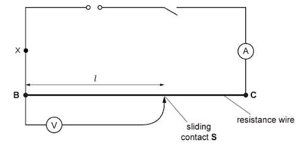

- Any position in series with the power supply, ammeter and wire BC; **[1 mark]**

**[Total: 1 mark]**
The current shown on the ammeter in Fig. 3.2 is:

- *I* = 0.38 A **[1 mark]**

**[Total: 1 mark]**

> *On this ammeter, the large divisions correspond to a current of 0.1 A and the small divisions correspond to a current of 0.02 A.*
The potential difference shown on the voltmeter in Fig. 3.3 is:

- *V* = 2.6 V** [1 mark]**

**[Total: 1 mark]**

> *On this voltmeter, the large divisions correspond to a potential difference of 1.0 V and the small divisions correspond to a potential difference of 0.2 V.*

> *Table 3.1 can be found in part (d). It is unusual for an exam question to ask you to record your answer in another question part, but in practical investigation questions it can happen. *
(i) The resistance of the wire when its length is 85.0 cm is:

- $R=\frac{V}{I}$

  - Where *V* = 2.6 V and *I *= 0.38 A
- $R=\frac{2.6}{0.38}=6.84Ω$**[1 mark]**

(ii) The missing units from the column headings in Table 3.1 are:

| $l/\mathrm{cm}$ | $V/V$ | $R/Ω$ |
|---|---|---|
| 5.0 | 0.2 | 0.53 |
| 25.0 | 0.8 | 2.11 |
| 45.0 | 1.4 | 3.68 |
| 65.0 | 2.0 | 5.26 |
| 85.0 | **Final answer:** **2.6** | **Final answer:** **6.84** |

- Potential difference column: V **AND** resistance column: Ω; **[1 mark]**

**[Total: 2 marks]**
A correctly plotted graph of resistance *R *(y‑axis) against length* l* (x‑axis) is as follows:

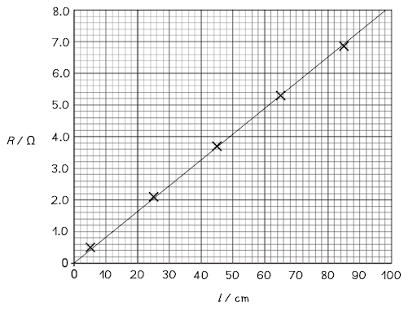

- Axes correctly labelled: resistance / Ω or *R* / Ω on the y-axis **AND **length / cm or *l* / cm on the x-axis; **[1 mark]**
- Suitable scales e.g. 0.2 Ω divisions for R **AND **2 cm divisions for *l*; **[1 mark]**
- All points plotted correctly within half a small square; **[1 mark]**
- Best fit line drawn correctly; **[1 mark]**

**[Total: 4 marks]**
Use your graph from (e) to find the resistance when $l$ = 50 cm:

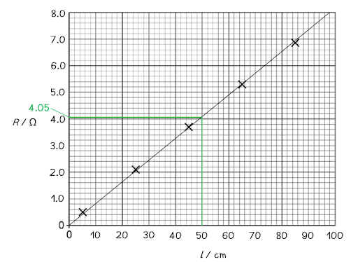

- Lines drawn on graph from $l$ = 50 cm to resistance axis; **[1 mark]**
- *R*50 correct within half a small square e.g. *R*50 = 4.05 cm; **[1 mark]**

**[Total: 2 marks]**

### Q2
(i) An example of a voltmeter gaining two marks:

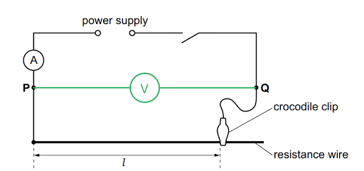

- Correct symbol for a voltmeter in parallel with **P** and **Q**;** [1 mark]**

(ii) An example of a table gaining two marks:

| $l/\mathrm{cm}$ | $V/$ | $I/$ | $R/Ω$ | $\frac{R}{l}/\frac{Ω}{\mathrm{cm}}$ |
|---|---|---|---|---|
| 90.0 | **Final answer:** **2.6** | **Final answer:** **0.36** |   |   |
| 60.0 | 2.5 | 0.49 |   |   |
| 40.0 | 2.3 | 0.74 |   |   |

The value of *V* at 90.0 cm is:

- 2.6 V **[1 mark]**

The value of *I* at 90.0 cm is:

- 0.36 A **[1 mark]**

**[Total: 3 marks]**

> *The divisions on each scale in (ii) have different values. Count the number of divisions between marked values to determine the size of one individual division.*

> *Table 2.1 can be found in part (b). It is unusual for an exam paper to ask you to write your answer in a different question part, but for practical investigation questions it can happen.*
An example of a table gaining two marks:

| $l/\mathrm{cm}$ | $V/V$ | $I/A$ | $R/Ω$ | $\frac{R}{l}/\frac{Ω}{\mathrm{cm}}$ |
|---|---|---|---|---|
| 90.0 | 2.6 | 0.36 |   |   |
| 60.0 | 2.5 | 0.49 |   |   |
| 40.0 | 2.3 | 0.74 |   |   |

- Correct units of V (or volts) in the correct column;** [1 mark]**
- Correct units of A (or amps) in the correct column; **[1 mark]**

**[Total: 2 marks]**
(i) An example of a table gaining two marks:

| $l/\mathrm{cm}$ | $V/V$ | $I/A$ | $R/Ω$ | $\frac{R}{l}/\frac{Ω}{\mathrm{cm}}$ |
|---|---|---|---|---|
| 90.0 | 2.6 | 0.36 | **Final answer:** **7.2** |   |
| 60.0 | 2.5 | 0.49 | **Final answer:** **5.1** |   |
| 40.0 | 2.3 | 0.74 | **Final answer:** **3.1** |   |

- Correctly placed resistance values of 7.2, 5.1 and 3.1; **[1 mark]**
- All given consistently to two significant figures **OR**
- All given consistently to three significant figures;** [1 mark]**

(ii) An example of a table gaining two marks:

| $l/\mathrm{cm}$ | $V/V$ | $I/A$ | $R/Ω$ | $\frac{R}{l}/\frac{Ω}{\mathrm{cm}}$ |
|---|---|---|---|---|
| 90.0 | 2.6 | 0.36 | 7.2 | **Final answer:** **0.080** |
| 60.0 | 2.5 | 0.49 | 5.1 | **Final answer:** **0.085** |
| 40.0 | 2.3 | 0.74 | 3.1 | **Final answer:** **0.078** |

- Correctly placed values of 0.080, 0.085, 0.078; **[1 mark]**

**[Total: 3 marks]**

> *If you wrote incorrect answers in (a)(i), you may still gain marks in subsequent calculations using these incorrect values, provided the calculations are correct. This is known as e.c.f. (error carried forward). If you are unsure, ask a friend or teacher to check your calculations.*
Write whether the results agree with this suggestion and justify it:

**EITHER**

- The results do not support the suggestion **AND**
- The values of 0.080, 0.085 and 0.078 have a range of 0.007, which is within the limits of experimental accuracy; **[1 mark]**

**OR**

- The results support the suggestion **AND**
- The values of 0.080, 0.085 and 0.078 are too far apart to be called identical; **[1 mark]**

**[Total: 1 mark]**

> *Your statement can be made either way around, but to gain the mark it must be supported with numerical values.*
One difficulty which may lead to results which do not match:

**Final answer:** **Any ****one**** from:**

- Difficult to judge position of crocodile clip;
- Difficult to measure wire to the nearest mm;
- Contact between the wire and the crocodile clip is not precise;
- Difficult to interpolate readings on metres between graduations;

**[Total: 1  mark]**

> *This question is asking about parts of an experiment performed correctly that are difficult.  Mistakes, such as leaving the wire to heat up, will not gain marks here because the question states that the students perform the experiment ‘carefully’.*
(i) An example of a correct circuit gaining one mark:

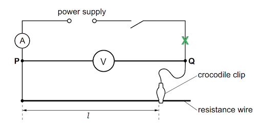

- ‘X’ placed anywhere between the power supply and either **P** or **Q**; **[1 mark]**

(ii) An example of a variable resistor diagram gaining one mark:

- Rectangle with only a strike-through arrow (the wires either side are optional); **[1 mark]**

**[Total: 2 marks]**

> *The variable resistor must be in series with the wire. Adding to the total resistance decreases the current in the series circuit.*

### Q3
Record the current $I$ in the circuit, as shown on the ammeter in Fig. 2.2:

- $I=0.48A$ **[1 mark]**

**[Total: 1 mark]**

> *Reading scales can be tricky to begin with, but like everything in physics it is simple once you follow a few easy steps. *

> *Determine the value represented by the graduations on the scale:*

- *The difference between two large lines in Fig. 2.2 is 0.1 A*

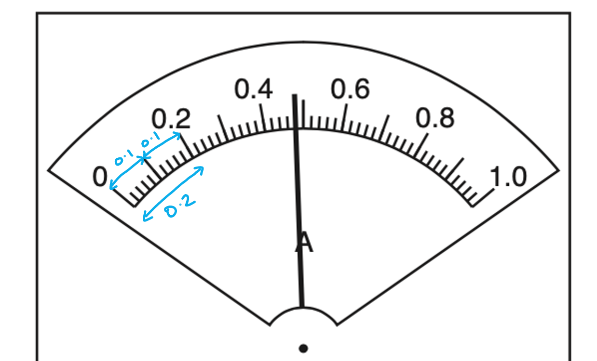

- *The difference between the smaller lines is 0.02 A*

  - *The smaller lines split up a gap of 0.1 A in to 5 segments*
  - $\frac{0.1}{5}=0.02$

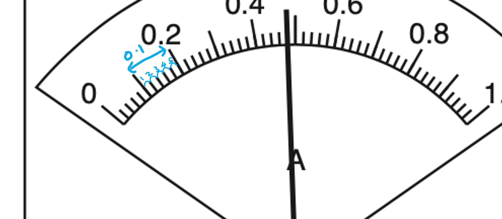

> *To read the value of the current shown on the ammeter:*

- *The needle is nearly at the large line between 0.4 A and 0.6 A*

  - *This represents a current of 0.5 A*

- *The needle points to one small line below 0.5 A*
- *The current is 0.02 A less than 0.5 A*

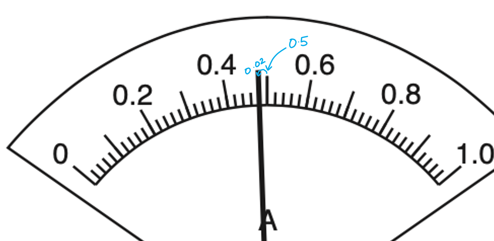

- *0.5 A − 0.02 A = 0.48 A, which is our reading. *

> *This might seem like quite a long process, but with practice it becomes second-nature and you will be picking these marks up very easily. It uses a similar kind of logic to reading an analogue clock, eventually the increments of the graduation marks will become obvious.*
Record the voltmeter reading in Table 2.1 for $l$ = 20.0 cm using Fig. 2.3:

Read the voltage from Fig. 2.3:

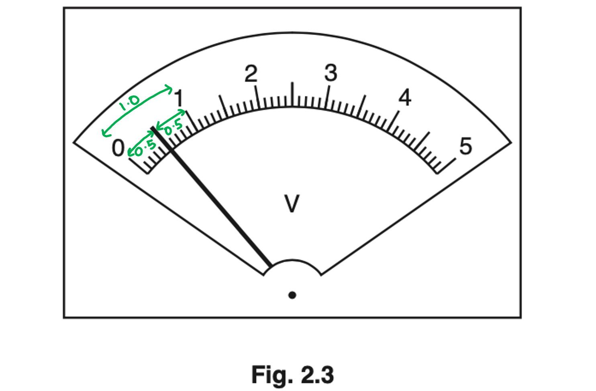

- The needle points to a potential difference of 0.5 V

Record the reading in table 2.1 for $l$ = 20.0 cm:

**Table 2.1**

| $l$/ | V/ |
|---|---|
| 20.0 | **Final answer:** **0.5** |
| 40.0 | 0.9 |
| 60.0 | 1.6 |
| 80.0 | 2.0 |
| 100.0 | 2.4 |

- A value of 0.5 in the space above with <u>no units;</u> **[1 mark]**

**[Total: 1 mark]**

> *When entering data into a table, the units belong at the heading of the column, not next to every number in the table. You could lose marks for writing "0.5 V" instead of just "0.5". *
Complete the column headings in the table:

- The headings represent length $l$ and potential difference *V*
- So, only the units need to be added

**Table 2.1**

| $l$/ **cm** | V/ **V** |
|---|---|
| 20.0 | 0.5 |
| 40.0 | 0.9 |
| 60.0 | 1.6 |
| 80.0 | 2.0 |
| 100.0 | 2.4 |

- Units for $l$ given as cm / centimetres **AND** units for *V* given as V / volts; **[1 mark]**

**[Total: 1 mark]**
Plot a graph of V / V (y-axis) against $l$ / cm (x-axis). Start both axes at the origin (0, 0):

A graph that would gain 4 marks would look like:

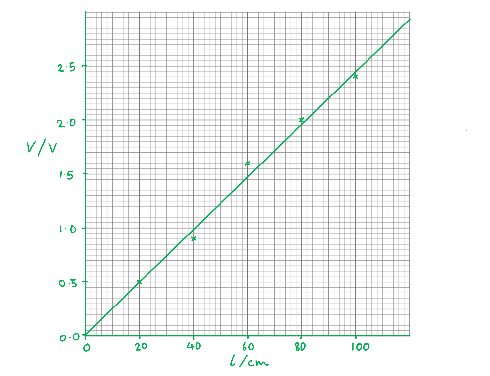

- Axes labelled correctly with length on the x-axis and potential difference on the y-axis; **[1 mark]**
- The scale is suitable (the graph takes up more than half of the grid); **[1 mark]**
- All data points plotted correctly to half a square; **[1 mark]**
- A single, thin, continuous straight line clearly following the trend of data; **[1 mark]**

**[Total: 4 marks]**

> *A few common mistakes include:*

- *drawing axes that are too small*

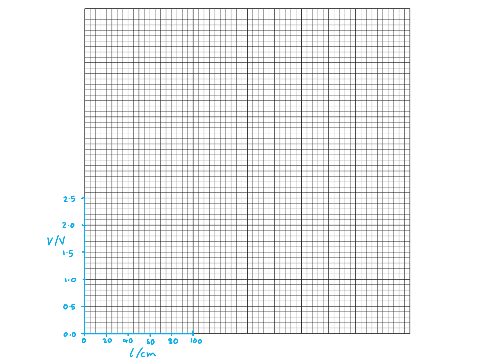

- *Not being accurate when plotting data points - only half a square is allowed either side of the data point before it is marked as incorrect*

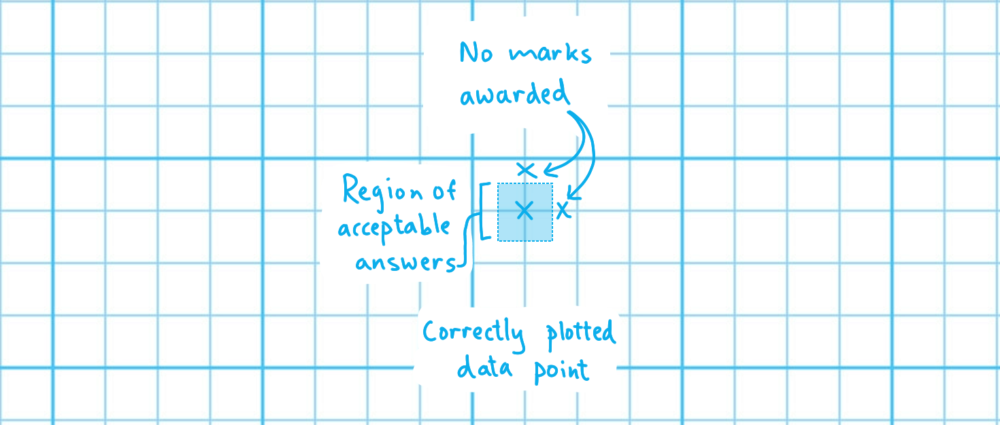

> *It is also important to remember that the line of best fit is an average. Therefore, it should have roughly **equal numbers of data points above and below it**. The line does not have to pass through every data point, but this is a good rule of thumb to follow. *
(i) Determine the gradient G of the graph, showing clearly on the graph how you obtained the necessary information:

Use the triangle method on the line of best fit to determine the x and y values:

- Locate two points on the graph
- Determine the differences in their x values and their y values

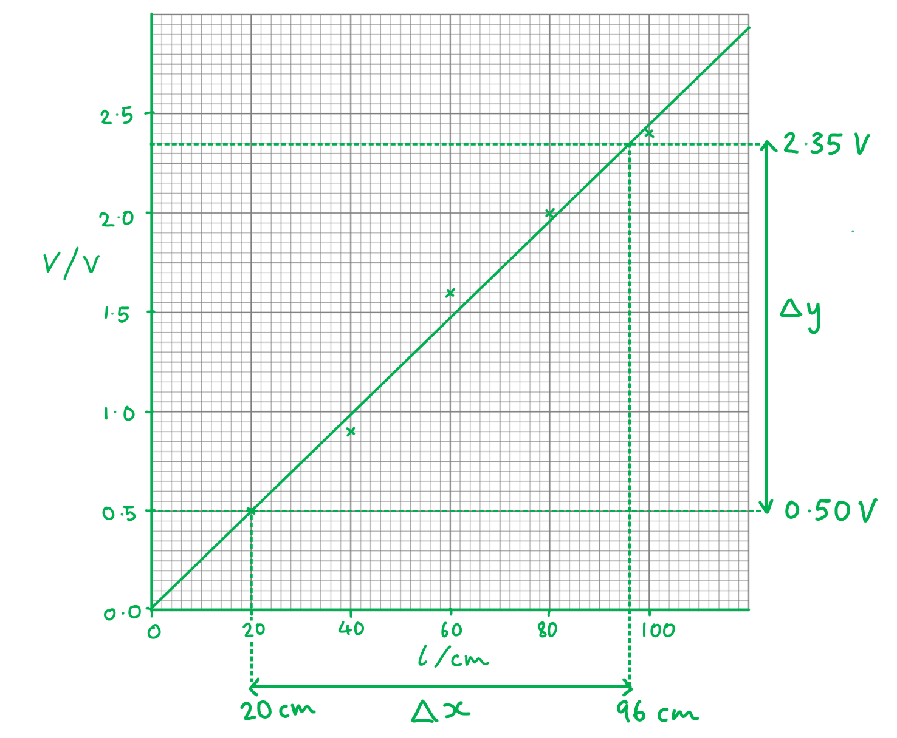

- Triangle method <u>shown</u> on the graph; **[1 mark]**
- <u>At least half</u> of the line of best fit used; **[1 mark]**

Determine the change in x values:

- $Δx=96-20=76$

Determine the change in y values:

- $Δy=2.35-0.50=1.85$

Recall the equation to calculate gradient and substitute in the values:

- $G=\frac{Δy}{Δx}=\frac{1.85}{76}=0.02434$
- *G* = 0.024

(ii) Calculate the resistance *R* of each centimetre of the wire:

List the known quantities:

- Current, $I$ = 0.48 A (from part (a))
- *k* = 1.0 V/cm
- *G* = 0.024 (from part (e)(i))

Substitute the known quantities into the equation:

- $R=\frac{Gk}{I}$
- $R=\frac{0.024\times1.0}{0.48}$
- *R* = 0.050
- The value of *R* is between 0.040 and 0.055  **[1 mark]**
- The units of *R* are Ω/cm **OR** Ω; **[1 mark]**

**[Total: 4 marks]**

> *In part (i), no marks are awarded for the value you get for the gradient.  The examiners really want to see if you know **how** to determine the gradient if a graph, so make it obvious. Even if all the numbers are wrong, correctly drawing a triangle between two appropriate points on your graph and determining the difference in y and x values will get you two marks. *

> *The second part, however, specifically allows no error carried forward. This means if you don't get an answer in the range specified, you don't get the answer mark. You can still get a unit mark, however, so only one mark in part (e) is for the value you obtain. Paper 6 is all about your method and your approach. *

### Q4
Plan an experiment to investigate the relationship between the power produced by an electrical heater and the time taken to heat a beaker of water:

Complete the heater diagram:

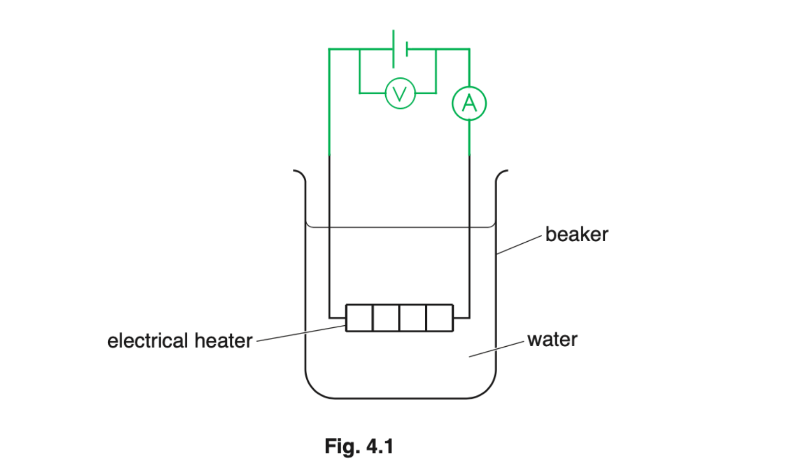

- Complete correct circuit (as above) with a power source **AND** correct symbols for ammeter and voltmeter **AND** voltmeter in parallel with cell **AND** ammeter in series; **[1 mark]**

Describe measurements in the circuit:

- (In each experiment) measure potential difference / $V$ **AND** current / $I$ (to determine the power supplied to the heater); **[1 mark]**
- <u>Repeat</u> (the experiment) with at least <u>two other</u> values of $V$ **OR** $I$*** *****OR** power; **[1 mark]**

Describe measurements in the water:

- Measure the time taken to raise the water temperature by / to a specific amount (in each experiment); **[1 mark]**

State variables to be controlled:

**Any one from:**

Each experiment should have the same:

- Starting temperature (of water); **[1 mark]**
- Finishing temperature (of water); **[1 mark]**
- Temperature difference; **[1 mark]**
- Room temperature; **[1 mark]**
- Volume of water; **[1 mark]**
- Position of the heater (in the water); **[1 mark]**
- Area from which temperature is measured; **[1 mark]**

Draw a table to display readings in:

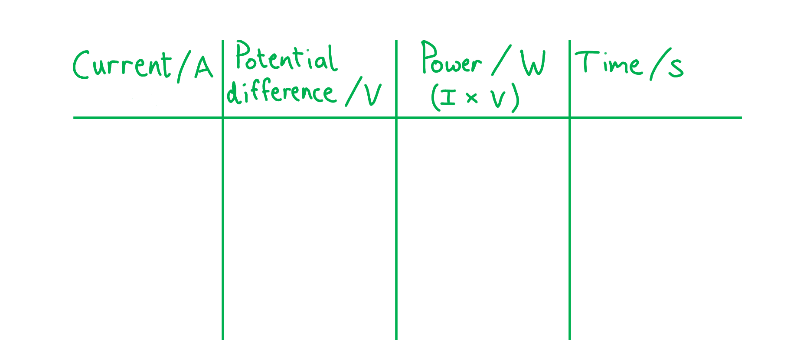

- Clear columns for time **AND** current **AND** potential difference **AND** power; **[1 mark]**

Explain how these results would lead to a conclusion:

- Plot a graph of <u>power</u> against <u>time</u>; **[1 mark]**

**   **

**An example of an answer which would score 7 marks is:**

**[diagram with completed circuit: 1 mark]**

Connect the circuit in Fig. 4.1 to a power source with a voltmeter and ammeter attached.

Measure the current and the potential difference using the ammeter and voltmeter **[1 mark]**. These will be used later to determine power.

Measure the start temperature of the water using a thermometer. Time how long it takes for the water's temperature to increase by a certain amount (e.g. 10 °C) **[1 mark]**.

Repeat the experiment two more times, with different cells to obtain different values of current and potential difference **[1 mark]**.

Ensure that the water's start temperature and volume are identical to that of the first experiment and the heater is submerged in the same position **[1 mark]**.

Record these data in a table such as the one below:

**[table with correct headings and units: 1 mark]**

To draw a conclusion from this experiment, plot a graph of power against time **[1 mark] **to demonstrate the relationship between the two quantities.

Questions like this come up in every paper 6 exam and they have a lot of marks in common. It is always a good idea to write about:

- Control variables
- Repeats of experiments
- Methods of recording data and showing a relationship (e.g. tables, graphs, gradients)

Don't waste valuable time in the exam coming up with pretend numbers for the table, the examiners are not interested in this and no marks can be gained from it.

For this question specifically, you also need to know that you can determine power supplied to a component by measuring current and potential difference across the component.

### Q5
Record, in amperes A, the current $I$ in the circuit, as shown on the ammeter in Fig. 2.2:

- $I$ = 0.47 A **[1 mark]**

**[Total: 1 mark]**

> *To work out the scale of the ammeter:*

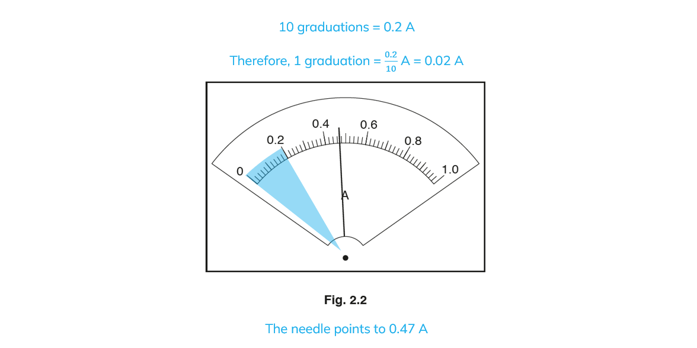
Calculate, and record in Table 2.1, $\frac{V}{l}$ for each value of $l$ and complete the $\frac{V}{l}$ column heading:

A table scoring two marks:

| $l$/cm | $V/V$ | $\frac{V}{l}$/ $\frac{V}{\mathrm{cm}}$ |
|---|---|---|
| 20.0 | 0.50 | **Final answer:** **0.025** |
| 40.0 | 0.92 | **Final answer:** **0.023** |
| 60.0 | 1.62 | **Final answer:** **0.027** |
| 80.0 | 2.08 | **Final answer:** **0.026** |
| 100.0 | 2.40 | **Final answer:** **0.024** |

- All data points completed correctly; **[1 mark]**
- All data points given to the same number of significant figures; **[1 mark]**
- Units given as V/cm; **[1 mark]**

**[Total: 3 marks]**
(i) Tick the box to show your conclusion from the results:

**✓** $\frac{V}{l}$ is approximately constant. **[1 mark]**

`square` $\frac{V}{l}$ is decreasing as V increases.

`square` $\frac{V}{l}$ is increasing as V increases.

`square` There is no simple pattern for $\frac{V}{l}$in the results.

(ii) Justify your conclusion by reference to your results:

**Any one from:**

- The values are all close together; **[1 mark]**
- The range of the data values is small; **[1 mark]**
- The values are within the limits of experimental accuracy; **[1 mark]**

**[Total: 2 marks]**
Calculate the resistance of 100 cm of the resistance wire:

List the known quantities:

- Length of resistance wire, $l$ = 100 cm
- Potential difference, V = 2.40 V (from Table 2.1 in part (b))
- Current, $I$ = 0.47 (from part (a))

Substitute the known values into the equation to calculate:

- $R=\frac{V}{I}$
- $R=\frac{2.40}{0.47}$
- *R* = 5.1 **[1 mark]**
- Answer given to two significant figures; **[1 mark]**
- Unit Ω **[1 mark]**

**[Total: 3 marks]**

> *Significant figures can be tricky! You have to lean the rules. If you need a reminder:*

> *Zeros between significant non-zero digits are always significant*

> *Zeros that come before non-zero digits are never significant*

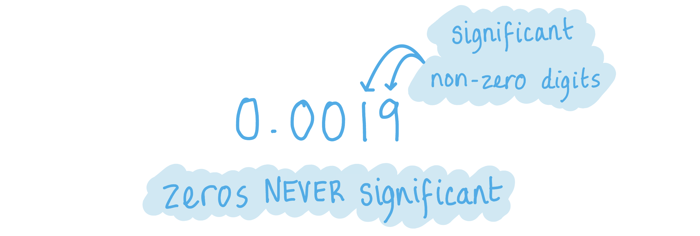

> *Zeros that come after non-zero digits are a little more complicated:*

- *If there is no decimal place, the zeros are not significant*

- *If the zeros are between the non-zero digits and the decimal place, the zeros are significant*

- *If the zeros come after the decimal place, the zeros are significant*

Suggest one way to minimise the rise in temperature of the resistance wire:

**Any one from:**

- Keep the current low; **[1 mark]**
- Switch the current off between readings; **[1 mark]**

**[Total: 1 mark]**
Draw the circuit symbol for a variable resistor:

- Correct symbol drawn; **[1 mark]**

**[Total: 1 mark]**

### Q6
On Fig. 1.1, draw the symbol for a voltmeter connected to measure the potential difference across the lamp:

A diagram scoring one mark:

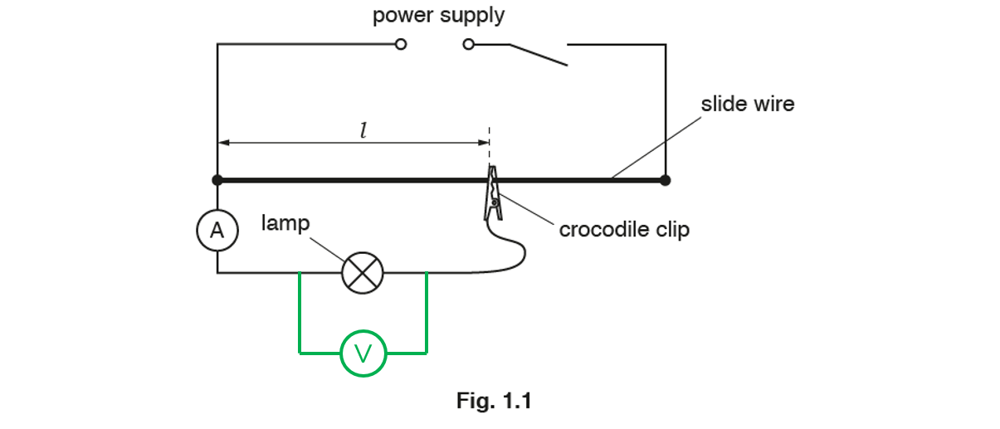

- Correct symbol for voltmeter drawn in parallel to the lamp; **[1 mark]**

**[Total: 1 mark]**
(i) Record the voltmeter and ammeter readings shown in Fig. 1.2 for a value of $l$* *= 20.0 cm:

- *V* = 0.6 V

**AND**

- $I$ = 0.14 A **[1 mark]**

(ii) Calculate, and record in Table 1.1, the resistance *R* of the lamp at $l$* *= 20.0 cm:

A table scoring one mark:

**Table 1.1**

| $l$/cm | *R*/Ω |
|---|---|
| 20.0 | **Final answer:** **4.3** |
| 40.0 | 7.5 |
| 60.0 | 10 |
| 80.0 | 12 |
| 100.0 | 13 |

* *Use the equation given to calculate the resistance:

- $R=\frac{V}{I}$
- $R=\frac{0.6}{0.14}$
- *R* = 4.3 Ω **[1 mark]**

**[Total: 2 marks]**

> *To work out the scale of the ammeter and voltmeter:*

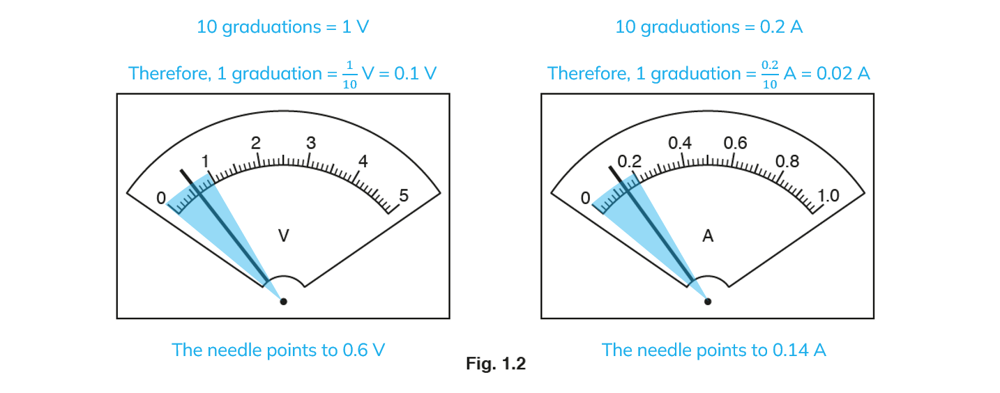
Plot a graph of *R* / Ω (y-axis) against $l$ / cm (x-axis):

A graph scoring 4 marks should look like this:

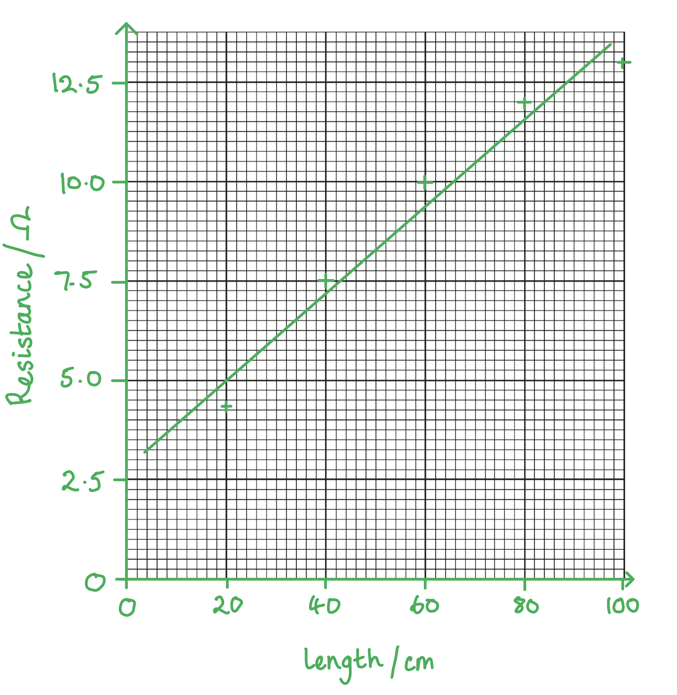

- Length on the x-axis and resistance on the y-axis **AND**** **both axes are correctly labelled with units given;** [1 mark]**
- Axes are drawn with appropriate scales that use at least half the grid;** [1 mark]**
- All data points are plotted correctly to within half a (small) square; **[1 mark]**
- A thin line of best fit is drawn with roughly equal numbers of data points above and below; **[1 mark]**

**[Total: 4 marks]**

> *Lots of students find choosing an appropriate scale the most intimidating part of drawing a graph. *

> *Once you have decided which quantity goes on which axis, you just need look at the range of the data. Make sure that you can fit the highest value on your axis! *

> *The scale needs to be chosen so that each increment increases by the **same amount**. In this example the x-axis, length, goes up in 20 cm increments, and the y-axis, resistance, goes up in increments of 2.5 Ω. You may have chosen a different scale to use and that is fine. As long as each axis takes up at least **half** of the width or height of the graph paper.*

> *Also remember that** the line of best fit is an average**. Therefore, there should be roughly equal numbers of data points above as below the line. As long as you follow this rule, your line of best fit will get the mark. Never try to force the shape of the line of best fit. Your pattern of data points will show you if it needs to be a curve or a straight line. They will also show you whether your line of best fit should go through the origin or not. Never force it to do so.*

> *Remember to always use one of the following notations to plot your data points to ensure you get the marks:  +  ×  *`circled dot`

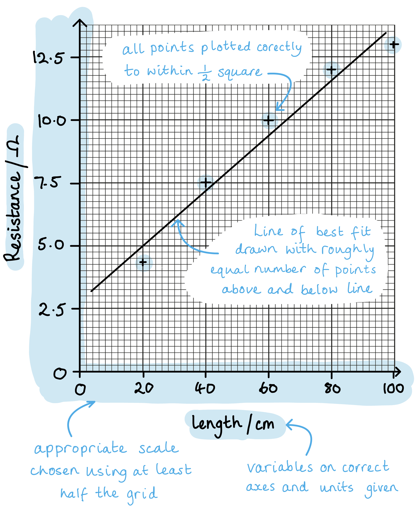
State what the shape of the graph tells you about how the resistance of the lamp changes with the temperature of the filament:

- <u>Resistance</u> increases as the <u>temperature</u> of the filament increases; **[1 mark]**

Justify your statement using your results from the graph:

- The temperature / resistance increases with length; **[1 mark]**

**[Total: 2 marks]**
On Fig. 1.3, complete the circuit diagram to show a variable resistor used to change the current in the lamp:

A diagram scoring two marks:

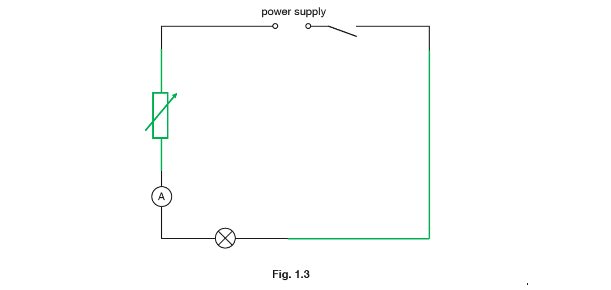

- The correct symbol used for the variable resistor; **[1 mark]**
- The variable resistor is placed in series and the rest of the circuit is drawn in; **[1 mark]**

**[Total: 2 marks]**

> *The variable resistor can be placed at any point in the circuit because the current is the same everywhere in a series circuit.*

### Q7
(i) A correctly completed circuit would look like:

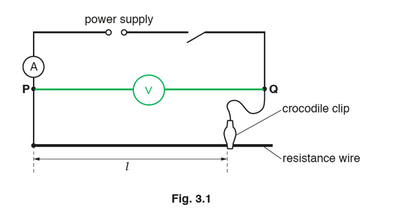

- Voltmeter connected in parallel with the wire, from P to Q; **[1 mark]**

(ii) A correctly completed table would look like:

**Table 3.1**

| $l$ / cm | *V*/ | $I$/ | *R*/Ω | $\frac{R}{l}/\frac{Ω}{cm}$ |
|---|---|---|---|---|
| 90.0 | **Final answer:** **2.6** | **Final answer:** **0.36** |   |   |
| 60.0 | 2.5 | 0.52 |   |   |
| 40.0 | 2.3 | 0.71 |   |   |

- Reading on the voltmeter = 2.6 V; **[1 mark]**
- Reading on the ammeter = 0.36 A; **[1 mark]**

**[Total: 3 marks]**
Completed column headings would look like:

**Table 3.1**

| $l$ / cm | *V*/ | $I$/ | *R*/Ω | $\frac{R}{l}/\frac{Ω}{cm}$ |
|---|---|---|---|---|
| 90.0 | **Final answer:** **2.6** | **Final answer:** **0.36** |   |   |
| 60.0 | 2.5 | 0.52 |   |   |
| 40.0 | 2.3 | 0.71 |   |   |

- Correct units: V **AND** A; **[1 mark]**

**[Total: 1 mark]**
(i) A correctly completed set of readings in Table 3.1 would look like:

**Table 3.1**

| $l$ / cm | *V*/ | $I$/ | *R*/Ω | $\frac{R}{l}/\frac{Ω}{cm}$ |
|---|---|---|---|---|
| 90.0 | 2.6 | 0.36 | **Final answer:** **7.2** |   |
| 60.0 | 2.5 | 0.52 | **Final answer:** **4.8** |   |
| 40.0 | 2.3 | 0.71 | **Final answer:** **3.2** |   |

Calculate *R* correctly for each value of $l$:

- At 90 cm, $\frac{V}{I}=\frac{2.6}{0.36}=7.2Ω$

**AND**

- At 60 cm, $\frac{V}{I}=\frac{2.5}{0.52}=4.8Ω$

**AND**

- At 40 cm, $\frac{V}{I}=\frac{2.3}{0.71}=3.2Ω$ **[1 mark]**

State an appropriate number of significant figures:

- All readings to 2 s.f. (as this is the smallest number of s.f. in the question); **[1 mark]**

(ii) A correctly completed set of readings in the final column on Table 3.1 would look like:

**Table 3.1**

| $l$ / cm | *V*/ | $I$/ | *R*/Ω | $\frac{R}{l}/\frac{Ω}{cm}$ |
|---|---|---|---|---|
| 90.0 | 2.6 | 0.36 | 7.2 | **Final answer:** **0.08** |
| 60.0 | 2.5 | 0.52 | 4.8 | **Final answer:** **0.08** |
| 40.0 | 2.3 | 0.71 | 3.2 | **Final answer:** **0.08** |

- All values of $\frac{R}{l}$ calculated as 0.08 (Ω/cm) **[1 mark]**

**[Total: 3 marks]**

> *You don't need to state the number of significant figures to get the mark for correct s.f. Giving your answers to the correct number in the table will obtain this mark.*
To calculate the resistance *R*25 of a 25.0 cm length of the resistance wire:

List the known quantities:

- $\frac{R}{l}$ = 0.08 Ω/cm
- $l$ = 25.0 cm

Rearrange $\frac{R}{l}$to make *R*25 the subject:

- $R_{25}=0.08\times25$ **[1 mark]**

Calculate R:

- *R*25 = 2 Ω **[1 mark]**

**[Total: 2 marks]**
Suggest one reason why different students, carrying out the experiment carefully with the same equipment, may not obtain identical results:

**Any one from:**

- Difficult to judge position of crocodile clip;** [1 mark]**
- Difficult to measure wire to nearest mm;** [1 mark]**
- Contact between wire and crocodile clip not precise;** [1 mark]**
- Difficult to interpolate readings on meters between the marks;** [1 mark]**

**[Total: 1 mark]**

> *Questions will often ask for factors which might affect the results. It is important to consider these carefully.*
A correct circuit diagram which would score 2 marks would look like:

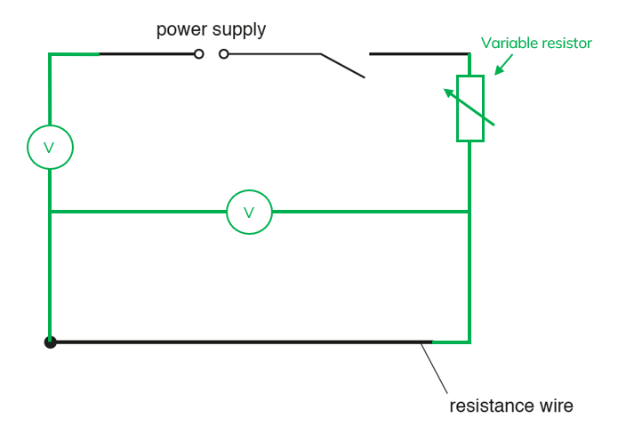

- Correct symbol for variable resistor; **[1 mark]**
- Variable resistor in series and with all circuit elements in correct arrangement; **[1 mark]**

**[Total: 2 marks]**

> *When drawing a circuit diagram, always use a ruler and consider all the possible circuit components needed.*

### Q8
(i) Record the values of *V*0 and* I*0:

- *V* = 2.1 (V)

**AND**

- *I* = 0.26 (A) **[1 mark]**

** **

(ii) To calculate the resistance *R*0 of 100.0 cm of the wire:

List the known quantities (from part (i)):

- *V *= 2.1 (V)
- *I *= 0.26 (A)

From the question:

- $R_{0}=\frac{V_{0}}{I_{0}}$

Substitute in values and calculate *R*0:

- $R_{0}=\frac{2.1}{0.26}$
- *R*0 = 8.1 (Ω) **[1 mark]**

**[Total: 2 marks]**

> *You would get a mark for error carried forward if you misread the values but used the correct method to calculate resistance.*
To calculate $\frac{1}{I}$:

Read the value of $I$* *at $l$* *= 70.0 cm from the table:

| $l$***/ *****cm** | $l$**/ A** | $\frac{1}{I}$** / **$\frac{1}{A}$** ** |
|---|---|---|
| 70.0 | **Final answer:** **0.35** |   |
| 60.0 | 0.40 | 2.50 |
| 50.0 | 0.44 | 2.27 |
| 40.0 | 0.53 | 1.89 |
| 30.0 | 0.65 | 1.54 |

- $I$* *= 0.35 A

Substitute values into the equation and calculate $\frac{1}{I}$:

- $\frac{1}{I}=\frac{1}{0.35}$
- $\frac{1}{I}=2.86$ `( 1 / A )` **[1 mark]**

**[Total: 1 mark]**

> *Being able to correctly identify values from a table and/or calculate missing values is an essential skill.*
A graph which would score four marks would look like:

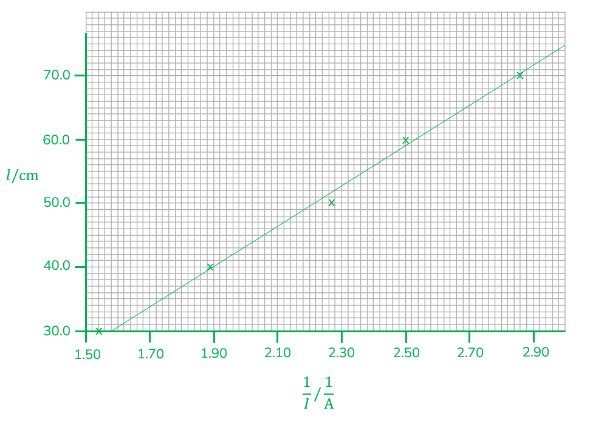

- Axes labelled with quantity and unit; **[1 mark]**
- Appropriate scales (plots occupying at least 1⁄2 grid); **[1 mark]**
- Plots all correct to 1⁄2 small square and precise marks; **[1 mark]**
- A <u>well judged</u> <u>thin</u> line; **[1 mark]**

**[Total: 4 marks]**

> *Avoid these **main mistakes** with graphs in Paper 6:*

- *Using a scale that doesn’t fit, particularly using multiples of three (this is always marked incorrect). Stick with multiples of 1,2 or 5.*
- *Using a pen then have trouble correcting errors. Use a pencil*
- *Marking the plotting points with either thick lines or large blobs (even one of these will lose the mark). Draw an ‘x’ with a pencil.*
- *Making the line of best fit too thick. This will make it harder to read values from.*
- *Joining the plots up instead of making a thin line down the middle of them for the line of best fit.*

> *The key to this is **practice**. Try plotting graphs at home and compare your graph to our example. You can also ask your teacher to check your work. With practice, these are four very easy marks!*
(i) To determine the gradient of the graph:

Triangle drawn on the graph:

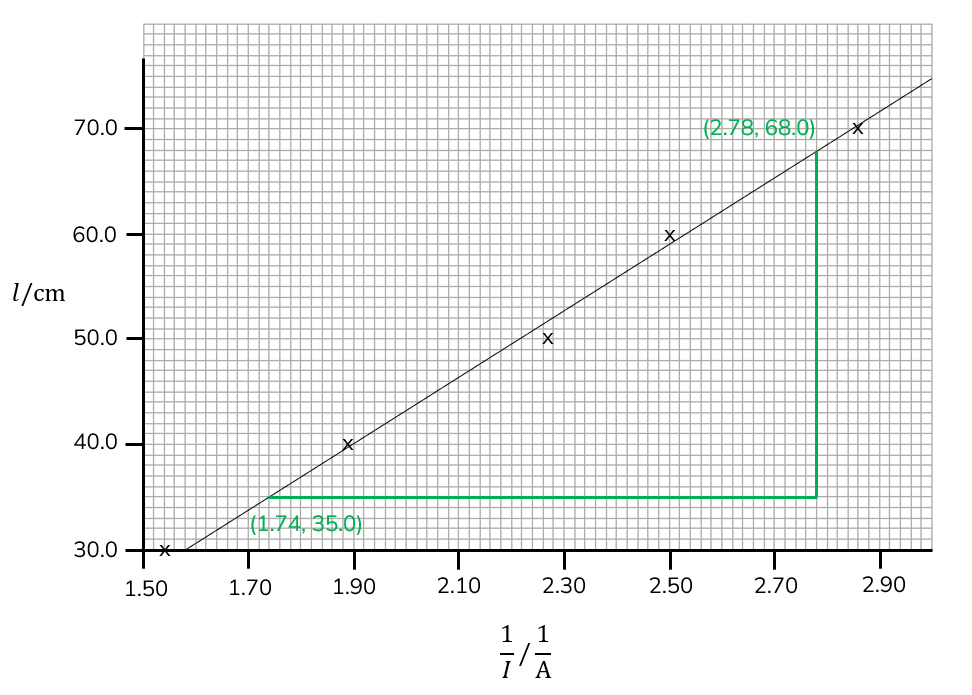

**AND**

Calculation of *G*:

- $G=\frac{changeiny}{changeinx}=\frac{68-35}{2.78-1.74}=\frac{33}{1.04}$
- *G* = 31.7 **[1 mark]**

(ii) To calculate *E*:

List the known quantities:

- *R*0 = 8.1 Ω
- *G* = 31.7
- *k* = 100 cm

From the question:

- $E=\frac{G\timesR_{0}}{k}$

Substitute in values and calculate *E*:

- $E=\frac{31.7\times8.1}{100}$
- *E* = 2.6 V (Range 2.0 to 2.9 V) **[1 mark]**

**[Total: 2 marks]**

> *The triangle should cover at least half the length of the line. Choose points where the line intersects a line on the graph paper. to make it easier to calculate.*
State which length will be most affected by the resistance of the ammeter:

- $l$ = 30.0 cm **[1 mark]**

Explain why:

- The ammeter will form a greater proportion of the resistance for 30.0 cm than for the other lengths; **[1 mark]**

**[Total: 2 marks]**

## Multiple Choice Questions (40 questions)

### Q1
**Final answer:** **The correct answer is B**

- The electromotive force (e.m.f.) of a source is defined as the energy transferred per unit charge in driving charge around a complete circuit
- It is measured in volts (V), where 1 V = 1 J/C
- The e.m.f. represents the total energy the battery gives to each coulomb of charge

**A** is incorrect because this is the definition of current ($I=Q/t$), not e.m.f.

**C** is incorrect because, despite the word "force" in its name, e.m.f. is not a force. It is an energy transfer per unit charge. This is a common misconception.

**D** is incorrect because this describes the terminal potential difference when no current flows, which happens to equal the e.m.f. numerically. However, this is not the definition of e.m.f. — it is a consequence of there being no internal energy losses.

### Q2
**Final answer:** **The correct answer is D**

- Use the equation relating charge, current and time:

$Q = I t$

- The time must be converted from minutes to seconds:

$t = 4 . 0 \times 60 = 240 \text{s}$

- Substitute the values:

$Q = 0 . 50 \times 240$

$Q = 120 \text{C}$

### Q3
**Final answer:** **The correct answer is D**

- When two materials are rubbed together, electrons are transferred from one material to the other
- Only electrons can be transferred because they are on the outer shells of atoms and can be removed by friction
- Protons cannot be transferred because they are fixed in the nucleus of the atom
- The rod becomes negatively charged, which means it has gained electrons
- Therefore, electrons have been transferred from the cloth to the rod

**A** is incorrect because protons cannot be removed from the nucleus by friction. Charging by friction always involves the transfer of electrons.

**B** is incorrect because if electrons moved from the rod to the cloth, the rod would lose negative charge and become positively charged, not negatively charged.

**C** is incorrect because protons are located in the nucleus of the atom and cannot be transferred by rubbing.

### Q4
**Final answer:** **The correct answer is C**

- To calculate the cost, the electrical energy used must first be found in kilowatt-hours $( kWh )$
- The power $P$ of the heater must be converted from watts $( \mathrm{W} )$ to kilowatts $( kW )$ by dividing by $1000$

$P=\frac{2000}{1000}=2.0\text{kW}$

- The electrical energy $E$ used is calculated by multiplying power $P$ in $\text{kW}$ by the time $t$ the heater is switched on, which is $3.0h$

$E=Pt$

$E=2.0\times3.0=6.0\text{kWh}$

- The total cost of using the heater is the electrical energy $E$ used multiplied by the cost per unit, which is $20\mathrm{cents}/\mathrm{kWh}$

$\text{total cost}=6.0\times20=120\text{cents}$

> **[exam-tip]**
> Remember to always convert power from watts to kilowatts before calculating energy in kWh. A common mistake is forgetting this conversion, which leads to an answer that is 1000 times too large.
> 
> The formula to remember is:
> 
> Cost = Power (kW) × Time (h) × Cost per kWh
> 
> Make sure you keep track of your units throughout the calculation to avoid errors.

### Q5
**Final answer:** **The correct answer is D**

- Direct current (d.c.) is a flow of charge that travels in one direction only, meaning the voltage remains on one side of the zero line (usually constant)
- Alternating current (a.c.) is a flow of charge that continuously reverses its direction, which is shown on a graph by the voltage moving between positive and negative values
- Supply X shows a constant positive value, identifying it as d.c.
- Supply Y shows a wave that crosses the zero line, identifying it as a.c.

**A** is incorrect as it reverses the identification of both graphs.

**B** is incorrect as graph X does not reverse its direction.

**C** is incorrect as graph Y clearly shows the voltage changing polarity (alternating).

> **[exam-tip]**
> When interpreting voltage–time graphs, remember that d.c. stays on one side of the zero line (constant polarity), while a.c. crosses the zero line repeatedly (changing polarity). A quick way to identify a.c. is to look for a waveform that oscillates above and below zero.

### Q6
**Final answer:** **The correct answer is A**

- Charging by friction involves the transfer of electrons, which are negatively charged particles
- When a rod becomes negatively charged, it has **gained **an excess of electrons from the cloth
- Electrostatic forces follow the rule that opposite charges attract and like charges repel
- A negatively charged rod will be **attracted **to an object with a positive charge

**B** is incorrect as unlike charges attract each other, they do not repel

**C** is incorrect because losing electrons would leave the rod with an overall positive charge

**D** is incorrect as losing electrons results in a positive charge, which would be repelled by another positive object but attracted to a negative one

> **[exam-tip]**
> Remember the key principles of electrostatics: electrons are the particles that move during charging by friction, and opposite charges attract whilst like charges repel. If an object gains electrons, it becomes negatively charged; if it loses electrons, it becomes positively charged.
> 
> Many students confuse which way electrons transfer — always think about which material ends up with the excess electrons.

### Q7
**Final answer:** **The correct answer is ****C**** because:**

- The amount of charge transferred is given by:

$\mathrm{current}=\frac{\mathrm{charge} \mathrm{transferred}}{\mathrm{time}}=\mathrm{or}I=\frac{Q}{T}\,Q=It=0.40A\times60s=24C$

- The e.m.f. of the battery is given by:

$e.m.f.=\frac{\mathrm{energy} \mathrm{transferred}}{\mathrm{charged} \mathrm{transferred}}=\mathrm{or}E=\frac{W}{Q}\,E=\frac{W}{Q}=\frac{48J}{24C}=2.0V$

- Only row **C** of the tables gives these two correct values.

### Q8
**Final answer:** **The correct answer is ****D**** because:**

- The resistance of a component is defined by the equation: $\mathrm{resistance}=\frac{\mathrm{voltage}}{\mathrm{current}}=R=\frac{V}{I}$
- The gradient of any part of the line on the graph is the change in *y* (the current) divided by the change in *x* (the voltage)
- That means the gradient shows the resistance
- The graph shows a straight line, the gradient is constant
- Therefore, the resistance is constant

**A** and **B** are incorrect because there is no information about temperature that can be determined from this graph.

**C** is incorrect because the gradient is constant, if the resistance increases the line would start to curve to the right as voltage increased, instead of remaining straight.

### Q9
**Final answer:** **The correct answer is ****C**** because:**

- Longer wires have greater resistance
- The resistance of a wire is directly proportional to its length. For example, tripling the length of the wire will triple its resistance

  - Therefore, eliminate option **B**
- Thicker wires (ones with larger diameters) have lower resistance
- The resistance of a wire is inversely proportional to its cross-sectional area. For example, halving the cross-sectional area will double the resistance

  - Therefore, eliminate options **A** and **D**

Be careful not to confuse cross-sectional area and diameter here. Resistance decreases as diameter increases, but these quantities are not inversely proportional.

### Q10
**Final answer:** **The correct answer is ****D****, because:**

- Resistance can be calculated using current and voltage measurements of a component
- The ammeter must be placed in series with the component being tested

  - Therefore, circuits **A** and **C** can be eliminated
- The voltmeter must be placed in parallel with the component being tested, and only with that component

  - Therefore, circuit B can be eliminated
- This leaves the correct circuit **D**

The ammeter must be placed in series to measure the current *through* the component being tested and the voltmeter must be in parallel to measure the voltage *across* the component. Look at the circuits carefully to make sure that the voltmeter is only measuring the voltage across the component being tested, not other components as well.

**A** is incorrect, as the ammeter is placed in parallel with resistor R and the voltmeter is placed in series with resistor R.

**B** is incorrect, as the voltmeter is in parallel with resistor R and the variable resistor. The ammeter is correctly placed.

**C** is incorrect, as the ammeter is in parallel with resistor R (and the variable resistor) and the voltmeter is in series with resistor R.

### Q11
**Final answer:** **The correct answer is ****B****, because:**

- Metals like copper contain free electrons, which can move
- Electrons have an electric charge. When charges move, an electric current is formed

Metallic bonding releases some of the electrons from the metal atoms, these are free to move through the metal.

**A** is incorrect as copper atoms are neutral and their movement could not cause an electric current. Copper atoms also cannot flow with a solid metal.

**D** is incorrect as neutrons are neutral, and their movement could not cause an electric current.

**C** is incorrect as protons cannot leave copper nuclei to form a current.

### Q12
**Final answer:** **The correct answer is ****B****, because:**

- The cloth gains an opposite charge to the rod, so it must become positively charged

  - Therefore, options **C** and **D** can be eliminated
- Electrons are negatively charged, so the cloth must be losing electrons for   it to end up with an overall positive charge
- Option B shows electrons traveling from the cloth to the rod

  - Therefore, option **B** is correct

Only the negatively charged electrons can be transferred in these simple static electricity experiments. The positively charged particles are ions, and these cannot move through solids.

### Q13
**Final answer:** **The correct answer is B because:**

- The electrical energy converted by the resistor is

$E=VIt$

- Rearrange for the time

$t=\frac{E}{VI}$

$t=\frac{360}{6.0\times3.0}=20s$

- This is option** B**

### Q14
**Final answer:** **The correct answer is A because:**

- When two charged objects **repel **each other, it means they have like charges
- This means they are either both positively charged, or both negatively charged

**B**, **C **and** D **are incorrect because the sphere would be attracted by the rod in all of these scenarios

### Q15
**Final answer:** **The correct answer is C because:**

- The resistance of resistor Z can be determined from measurements of

  - potential difference, using a voltmeter
  - current, using an ammeter
- To measure the potential difference, the voltmeter must be placed in parallel with resistor Z

  - Therefore, meter X = voltmeter
- To measure current, the ammeter must be placed in series with resistor Z

  - Therefore meter Y = ammeter

### Q16
**Final answer:** **The correct answer is B because:**

- The rod's positive charges attract the sphere’s negatively charged electrons toward its surface
- As a result, the rod **attracts **the sphere

  - This eliminates options **C** and **D**
- The rod is moved close to the sphere, but it does not come into contact with it
- Therefore, the sphere does** not** become charged

  - This eliminates option **A**

### Q17
**Final answer:** **The correct answer is D because:**

- Electrical power is the product of current and potential difference

$P=IV$

- Energy supplied over a period of time is the product of power and time

$E=Pt$

$E=IVt$

- Convert 20 minutes to seconds

$t=20mins=20\times60=1200s$

- Substitute the known quantities into the equation for energy

$E=26\times230\times1200=7176000J$

- Convert this value to standard form

$E=7.18\times10^{6}J$

- This rounds to option **D**

### Q18
**Final answer:** **The correct answer is C because:**

- The e.m.f. is defined as the electrical work done by a source in moving a unit charge around a complete circuit
- If the battery has an e.m.f. of 3.7 V, that means it takes 3.7 J to move 1.0 C of charge around a circuit

**A **is incorrect as this describes the power (energy transferred per second)

**B **is incorrect as this describes the total energy in the battery’s chemical energy store

**D **is incorrect as e.m.f. is defined as the energy required to move units of charge, not current

### Q19
**Final answer:** **The correct answer is C because:**

- When two insulators are rubbed together, electrons are transferred from one to the other

  - The rod becomes positively charged, so it must lose electrons
  - The cloth must have gained those electrons
- Therefore, the cloth becomes negatively charged

**A **and **B **are incorrect as the rod loses electrons to become positive

**D **is incorrect as when one insulator becomes positive, the other becomes negative

### Q20
**Final answer:** **The correct answer is B because:**

- A volt (V) is equivalent to the energy transferred per unit of charge, which is a joule per coulomb, or J/C

**A **is incorrect because a volt is equivalent to current multiplied by resistance (AΩ), not current divided by resistance (A/Ω)

**C **is incorrect because joules per second (J/s) is equivalent to the watt (W), which is the unit of power

**D **is incorrect because a volt is equivalent to the energy transferred per unit of charge (J/C), not the power per unit of charge (W/C)

### Q21
**Final answer:** **The correct answer is A because:**

- The electromotive force (e.m.f.) of a battery is the voltage it supplies
- From the list, this can only be 12 V

**B** is incorrect because 30 kg is the mass of the battery

**C** is incorrect because 216 kJ is the energy supplied by the battery

**D** is incorrect because 680 A is the current supplied by the battery

### Q22
**Final answer:** **The correct answer is ****C**** because:**

- The units of electromotive force and potential difference both have the units of **volts**

Current is measured in **amps (A)**, and resistance is measured in **ohms (Ω)**.

### Q23
**Final answer:** **The correct answer is ****B**** because:**

- When objects are charged, **like** charges **repel** and **opposite** charges **attract**

  - Neutrally charged objects do not exert a force on each other
- The two balls are suspended far apart

  - Therefore there must be a force between them, which is repelling them (pushing them apart)
- The only option with two like charges is **B**

### Q24
**Final answer:** **The correct answer is**** B**** because:**

- The unit of charge is the **coulomb **(C)

**A** is incorrect as the ampere (A) is the unit of current

**C** is incorrect as the newton (N) is the unit of force

**D** is incorrect as the volt (V) is the unit of potential difference

### Q25
**Final answer:** **The correct answer is ****B**** because: **

- The unit of electromotive force (EMF) is the volt.

**A **is incorrect as the joule is the unit of energy.

**C **is incorrect as the ampere is the unit of current.

**D **is incorrect as the watt is the unit of power (there’s a great physics joke here, “Watt (what) is the unit of power?” to which the correct answer is “yes, it is”...!

### Q26
**Final answer:** **The correct answer is ****D**** because:**

- Electrical energy = power × time
- Power = current × voltage
- Therefore, the correct energy equation is:

  - electrical energy = current × voltage × time

### Q27
**Final answer:** **The correct answer is ****B**** because:**

- The resistance of a wire is **proportional **to its **length**

  - Therefore, the **longest** wire will have the highest resistance

- The resistance of a wire is **inversely** **proportional** to its **diameter**

  - Therefore, the **narrowest** wire will have the highest resistance

- Wire **B** has both the longest length and the smallest diameter, hence it has the greatest resistance

None of the other wires have that winning combination of being the longest wire or having the smallest diameter.

### Q28
**Final answer:** **The correct answer is ****D**** because: **

- An electric field is defined as **a region of space in which an electric charge experiences a force**.

**A **is incorrect as this is a definition of a gravitational field (on the Earth)

**B **is incorrect as this is not the definition of anything!

**C **is incorrect as this is a definition of a magnetic field.

### Q29
**Final answer:** **The correct answer is ****A**** because:**

- This one is tricky, because you are not given very much information; you have to work out a lot.
- Meter** X is connected in series with the resistor**, this means it has to be an ammeter, and is measuring current.
- Meter** Y is connected in parallel with the resistor**, this means it has to be a voltmeter and is measuring voltage.
- We know that $R=\frac{V}{I}$ and the only combination of *V* and *I* that gives us a resistance of 2.0 ᘯ is 8.0 V and 4.0 A.

The tricksy answer is **C**, because the values would give the correct answer *if* they were reversed.

### Q30
**Final answer:** **The correct answer is ****C**** because:**

- The resistance of a wire is **directly** **proportional** to its **length**

  - Therefore, a **shorter **wire would give a lower resistance

- The resistance of a wire is **inversely** **proportional** to its **diameter**

  - Therefore, a **larger **diameter wire would give a lower resistance

**A **is incorrect as increasing the length would increase the resistance of the wire.

**B **is incorrect as both of these factors would increase the resistance of the wire.

**D **is incorrect as decreasing the diameter would increase the resistance of the wire.

### Q31
**Final answer:** **The correct answer is ****B**** because:**

- The equations needed for this question are: *V* = *IR *and* P* = *IV*
- Rearranging *V = IR *gives $I=\frac{V}{R}$.
- Substituting into the other equation gives: $P=\frac{V}{R}\timesV,\mathrm{so}P=\frac{V^{2}}{R}$
- The answer, is, therefore: $P=\frac{6^{2}}{3}=12W$

**A** is incorrect as the voltage has been divided by the resistance. This gives the current, but the wrong unit has been given.

**C** is incorrect as the total energy dissipated by the resistor in a minute has been given. The question asks for power, not energy.

**D** is incorrect as the voltage has incorrectly been multiplied by the resistance. This does not give anything useful.

### Q32
**Final answer:** **The correct answer is ****A**** because:**

- Conventional current flows from positive to negative (because initially scientists thought positive charges flowed in a complete circuit).
- Electrons actually flow from negative to positive, because they are negatively charged.
- $current=\frac{charge}{time},\mathrm{so}current=\frac{4.9}{0.7}=7.00A$

**B **is incorrect as the charge has been incorrectly multiplied by the time.

**C **and** D **are incorrect as the direction of electron flow is incorrect.

### Q33
**Final answer:** **The correct answer is ****B**** because:**

- The unit of charge is the **coulomb, C**
- The unit of e.m.f. is the **volt, V**

**A **is incorrect as Q and E are the symbols used to represent the quantities in mathematical equations. They are not the units.

**C **is incorrect as A, amp, is the unit of current, J, joule, is the unit of energy

**D **is incorrect as J, joule is the unit of energy, ᘯ, ohm is the unit of resistance.

### Q34
**Final answer:** **The correct answer is ****D**** because:**

- The rod is negatively charged, and the sphere is earthed (grounded)
- The negative charges in the rod **repel **the negatively charged electrons in the sphere
- The electrons move away from the surface, **along **the earth wire and **away **from the conducting sphere
- This leaves the conducting sphere with a net **positive **charge concentrated on the side nearest the negative rod

**A & C** are incorrect as they show negative charges on the sphere. This would only happen if the sphere were not earthed. Since there is an earth connection, the excess negative charge leaves the sphere.

**B** is incorrect as it shows a uniform distribution of positive charge and misses the fact that the negative rod would cause the positive charge to be concentrated on the side nearest the rod only.

Remember, the positive protons never move, only electrons do. When the negative electrons are repelled by the negatively charged rod, they move away from the protons, leaving an overall positive charge.

### Q35
**Final answer:** **The correct answer is ****B**** because:**

- Electric field lines always go from positive (+) to negative (-)
- Between parallel plates, the field lines are **parallel **and **equally spaced**
- This pattern is shown by **B**

**A **and **C** are incorrect as electric field lines do not run parallel to the plates.

**D **is incorrect as the field lines are running in the wrong direction, - to +

### Q36
**Final answer:** **The correct answer is ****D**** because:**

- Electrical conductors cannot hold a charge when rubbed by a cloth, as electrons very quickly flow into (or out of) them from whatever is touching them.
- Therefore, only **electrical** **insulators** can be **charged** by **rubbing**. Glass and PVC are electrical insulators. Aluminium and copper are not.

**A **is incorrect as aluminium is an electrical conductor.

**B **is incorrect as copper is an electrical conductor.

**C **is incorrect as both aluminium and copper are electrical conductors.

### Q37
**Final answer:** **The correct answer is ****C**** because:**

- *V* = *IR* and *P* = *IV* can be combined to give $P=\frac{V^{2}}{R}$
- Since the resistance, *R* is already known, all we need is a voltmeter to complete the measurements and to calculate power.

**A **is incorrect as both of these could be used to calculate power, using *P* = *IV*, but it is not the minimum equipment requirement.

**B **is incorrect as as above, the stopwatch would only be required if we were asked to calculate energy, rather than power.

**D **is incorrect as the measurement could be done with an ammeter, using *P* = *I**2**R*. The stopwatch would be redundant, as we are not asked to calculate energy. This is, therefore, not the minimum amount of equipment needed.

### Q38
**Final answer:** **The correct answer is ****D**** because:**

- When the rod is rubbed with the cloth, electrons are transferred between them

  - If electrons move from the cloth, the cloth becomes positive
  - If electrons move to the rod, the rod becomes negative

- This means the two objects have **opposite **charges
- Opposite charges **attract**

**A **and **B** are incorrect as the charges will be opposite.

**C **is incorrect as opposite charges will attract, not repel.

### Q39
**Final answer:** **The correct answer is ****A**** because:**

- There are a few ways to do this question, but it comes down to three equations:

  - *V = IR*
  - *P = IV*
  - *E = Pt*
- We can combine *P = IV *and *E = Pt *to form ***E***** = *****IVt***
- Where: *I* = 5 A, *V* = 15 V and *t* = 2 *×* 60 = 120 s
- Therefore, *E* = 5 *×* 15 *×* 120** **= **9000***** *****J** =** 9.0 kJ**

All of the other answers are calculated incorrectly, with various mistakes.

Be careful:

- Remember to convert time into seconds!
- Make sure any division you do is the correct way round.

### Q40
**Final answer:** **The correct answer is ****C**** because:**

- In a filament lamp, increasing the **voltage** increases the amount of heat produced.
- The **resistance** of the filament **increases** as the **temperature** of the filament **increases**
- The current flowing through the filament reduces as the resistance increases.

  - This relationship is shown in **Graph** **P**

- An **ohmic** resistor will follow **Ohm's law**
- Ohm's law states that the electrical current flowing in a circuit is proportional to the voltage

  - The only proportional relationship is shown in **Graph Q**

The other combinations do not match the correct graph to the correct component.

## Theory Questions (20 questions)

### Q1
> **[mark-scheme]**
> - Work done / energy transferred **[1 mark]**
> - per unit charge passing through a component **[1 mark]**
> 
> Accept: $V = W / Q$ stated in words
To determine the combined resistance of R2 and R3:

- List the known quantities:

  - Resistance of $R_{2}=20Ω$
  - Resistance of $R_{3}=30Ω$
- Recall the rule for adding resistance in parallel combinations:

$\frac{1}{R}=\frac{1}{R_{2}}+\frac{1}{R_{3}}$ **[1 mark]**

- Substitute in the values and rearrange for $R$:

$\frac{1}{R}=\frac{1}{20}+\frac{1}{30}=\frac{5}{60}$

$R=\frac{60}{5}=12Ω$ **[1 mark]**

> **[mark-scheme]**
> 1 mark for stating the correct formula for parallel resistors, e.g. $\frac{1}{R} = \frac{1}{R_{2}} + \frac{1}{R_{3}}$ **OR** $R = \frac{R_{2}\timesR_{3}}{R_{2}+R_{3}}$
> 
> 1 mark for correct substitution, e.g. $\frac{1}{20} + \frac{1}{30} = \frac{5}{60}$ leading to a final answer of $12Ω$
> 
> "Show that" requires the formula to be written before substitution — answer alone scores zero

> **[exam-tip]**
> For two resistors in parallel, a useful check is that the combined resistance of two parallel resistors is always less than the resistance of the smaller individual resistor, so your answer must be less than $20Ω$.
To calculate the current in resistor R1:

- List the known quantities

  - Resistance of parallel resistors, $R_{\mathrm{parallel}}=12Ω$
  - Resistance of $R_{1}=8.0Ω$
  - e.m.f. of battery, $E=12V$
- Calculate the total resistance of the circuit:

$R_{\text{total}}=R_{1}+R_{\text{parallel}}$

$R_{\text{total}}=8.0+12=20Ω$ **[1 mark]**

- Calculate the current in the circuit using $V=E$ (emf of the battery) and $R=R_{\mathrm{total}}$ (total resistance):

$V=IR$ **[1 mark]**

$I=\frac{E}{R_{\text{total}}}=\frac{12}{20}$

$I=$ $0.60\text{A}$ **[1 mark]**

> **[mark-scheme]**
> 1 mark for the correct formula for series resistors **OR** correct substitution
> 
> - Accept $R_{\text{total}}=R_{1}+R_{\text{parallel}}$ **OR** $8.0+12$
> 
> 1 mark for the correct equation **OR** correct rearrangement **OR** correct substitution
> 
> - Accept $V=IR$ **OR** $I=\frac{V}{R}$ **OR** $\frac{12}{20}$
> 
> 1 mark for a final answer of $0.60A$
> 
> Full marks can be scored for the correct answer alone

> **[exam-tip]**
> Make sure you know the rules for current in series and parallel. The current from the battery is the same as the current through R1, because R1 is in the main (series) part of the circuit. This current then splits between R2 and R3 at the parallel junction.
> **[mark-scheme]**
> - Subtract the voltmeter reading from the e.m.f./battery voltage **OR** p.d. across $R_{1}=12-(\text{voltmeter reading})$ **[1 mark]**
> - The sum of the p.d.s across the components in a series circuit equals the e.m.f. of the battery/supply voltage **[1 mark]**
> 
> Accept: "$V_{R_{1}}=12-V_{\text{parallel}}$" stated in words or symbols
> 
> Accept: "the voltages in a series circuit add up to the battery voltage" for the second mark
> 
> Do not accept: just "use $V = I R$" — the question specifically asks how the voltmeter reading is used, not how to calculate from scratch

> **[exam-tip]**
> This question tests whether you understand how potential differences are distributed in a series circuit. The key rule is: the sum of the p.d.s across all components in a series circuit equals the e.m.f. of the battery. Since the voltmeter reads the p.d. across the parallel combination, you can find the p.d. across $R_{1}$ by subtraction. Make sure you state both the method (subtraction) and the reasoning (p.d.s in series add up to the e.m.f.) to secure both marks. Many students lose the second mark by simply writing the equation without explaining why it works.

### Q2
The ball moves to the positive plate because:

- The ball gains negative charge (from the negative plate); **[1 mark]**
- The negative ball is attracted to the positive plate **OR** repelled by the negative plate;** [1 mark]**

**[Total: 2 marks]**
The particles which move when a current flows are:

- Electrons; **[1 mark]**

They flow through the ammeter:

- From left to right; **[1 mark]**

**[Total: 2 marks]**

> *The electrons are repelled by the negative terminal in the voltage supply, so move anticlockwise around the circuit.*
To calculate current:

List the known quantities:

- Charge transferred per oscillation, *Q* = 8.510–10 C
- Frequency of oscillations, *f* = 4.0 Hz

Recall the equation for the period of oscillation:

- $T=\frac{1}{f}$
- $T=\frac{1}{4}=0.25s$

Recall the equation for current:

- $I=\frac{Q}{t}$ **[1 mark]**
- Every 0.25 s cycle, 8.5$\times$10–10 C of charge is transferred between plates

Calculate the current:

- $I=\frac{8.5\times10^{-10}}{0.25}$**[1 mark]**
- $I=3.4\times10^{-9}$A  **[1 mark]**

**[Total: 3 marks]**

> *Here, you needed to recognise that, in order to calculate current, you needed to determine the time over which the charge was transferred. Harder exam questions will often require you to combine knowledge from different parts of the course.*

### Q3
When contact C is moved from Y to X:

- (The ammeter reading / current) increases; **[1 mark]**
- (Because) the resistance (in the circuit) decreases; **[1 mark]**

**[Total: 2 marks]**

> *For a constant voltage, current and resistance are inversely proportional. This means that when one increases, the other decreases.*
Calculate the reading on the ammeter when contact C is at X:

From Fig. 9.1:

- Voltage, *V* = 6.0 V
- Resistance, *R* = 8.0 Ω

The ammeter reading, or current in the circuit, is:

- $V=IR$ **OR ** $I=\frac{V}{R}$ **[1 mark]**
- $I=\frac{6.0}{8.0}$ **[1 mark]**
- $I=0.75$ A** [1 mark]**

**[****Total: 3 marks]**
When contact C is moved to point P, the total resistance is:

- Total resistance = R1 + R2

  - Where R1 = resistance of the wire between X and P and R2 = resistance of the fixed resistor
- Total resistance = 20 + 8.0 **[1 mark]**
- Total resistance = 28 Ω **[1 mark]**

**[****Total: 2 marks]**

### Q4
The rod becomes negatively charged because:

- Friction between the cloth and the rod; **[1 mark]**
- Causes <u>electrons</u> to move; **[1 mark]**
- From the cloth to the rod; **[1 mark]**

**[Total: 3 marks]**

> *This concept is another tricky one for core-level Physics. Make sure you realise it is the negative electrons that move because they are in the outer shell of an atom and not stuck inside the nucleus. *
When the negatively charged rods are close to each other:

- The rod moves / rotates away; **[1 mark]**
- This is because both rods are negatively charged, and <u>like charges repel</u>; **[1 mark]**

**[Total: 2 marks]**

> *Remembering that like (same) charges repel and opposite (different) charges attract is essential in understanding how electrostatics work. Look out for these labels on diagrams in your exam questions to help you. *

### Q5
(i) When the plastic sheet is placed onto the metal plate:

- <u>Electrons</u> / negative charges in the metal <u>move</u>; **[1 mark]**

(ii) A diagram which would score one mark is:

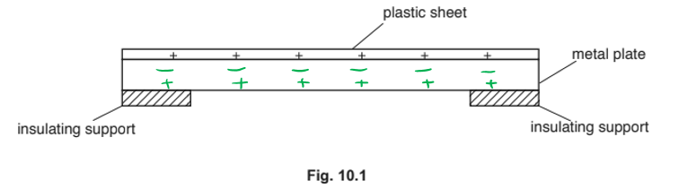

- More negative charges in the top half and more positive charges in the bottom half; **[1 mark]**

(iii) State if this arrangement helps to keep the plastic sheet in place:

- Yes, this arrangement would keep the plastic sheet in place; **[1 mark]**

Explain why:

- Unlike charges attract **OR** there is an attractive force between the metal plate and the plastic sheet; **[1 mark]**

**[Total: 4 marks]**

> *It is only ever electrons that move - the positive nuclei are in fixed position.*
A diagram which would score **one** mark would look like:

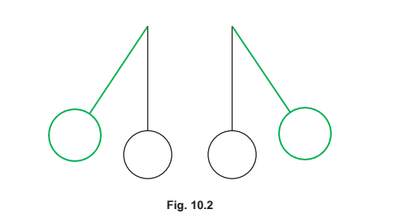

- Both threads angled away from the other ball; **[1 mark]**

To explain the positions:

- Like / same / positive charges <u>repel</u>; **[1 mark]**

**[Total: 2 marks]**

> *Remember:*

- *Like charges repel*
- *Opposite charges attract*

### Q6
Metals are good conductors of electricity because:

- (Metals) contain free / mobile electrons / delocalised electrons; **[1 mark]**

**[Total: 1 mark]**

> *Delocalised electrons are from the outer shell of electrons in the metal atoms and are free to move. This means they are able to conduct electricity easily. Insulators are poor conductors because they have no delocalised electrons.*

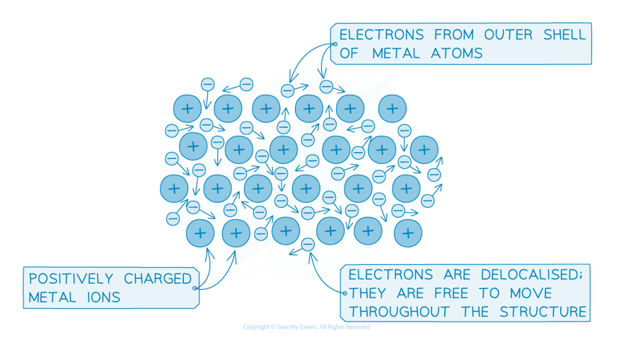
(i) To determine the resistance of W2:

List the known quantities:

- Resistance of W1 = 16 Ω

State the relationships between resistance *R* and area, *A *and length, *L*:

- $R\proptoL$ **AND** $R\propto\frac{1}{A}$**[1 mark]**

Calculate resistance of W2:

- Area of W2 is 2*A*, therefore *R* decreases by a factor of 2
- Length of W2 is $\frac{1}{2}L$, therefore *R* decreases by a factor of 2
- Therefore, overall $R=\frac{16}{4}$
- *R*2 = 4 Ω **[1 mark]**

(ii) To determine the effective resistance when W1 and W2 are connected in parallel:

**METHOD 1**

Recall the equation for resistors in parallel:

- $\frac{1}{R}=\frac{1}{R_{1}}+\frac{1}{R_{2}}$ [1 mark]

Substitute in values and calculate *R*:

- $\frac{1}{R}=\frac{1}{16}+\frac{1}{4}=\frac{5}{16}$
- $R=\frac{16}{5}$
- *R* = 3.2 Ω **[1 mark]**

**METHOD 2**

Recall the equation for two resistors in parallel:

- $R=\frac{R_{1}\timesR_{2}}{R_{1}+R_{2}}$ **[1 mark]**

Substitute in values and calculate R:

- $R=\frac{16\times4}{16+4}$
- *R* = 3.2 Ω **[1 mark]**

**[Total: 4 marks]**

> *If you have two resistors in parallel you can use the equation*$R=\frac{R_{1}\timesR_{2}}{R_{1}+R_{2}}$*.If there is more than one resistor in parallel then you need t**o use *$\frac{1}{R}=\frac{1}{R_{1}}+\frac{1}{R_{2}}+...$
(i) To find the e.m.f. of the battery:

- There are three cells of e.m.f. *E*
- Therefore overall the e.m.f. of the battery is 3*E*; **[1 mark]**

(ii) The correct box is:

- Current splits in parallel according to the resistance
- The battery will therefore have the highest resistance
- The highest resistance, in W1, will have the lowest current
- Therefore the correct box is: IB > I2 > I1; **[1 mark]**

**[Total: 2 marks]**

### Q7
Draw the electric field lines around the positively charged ball:

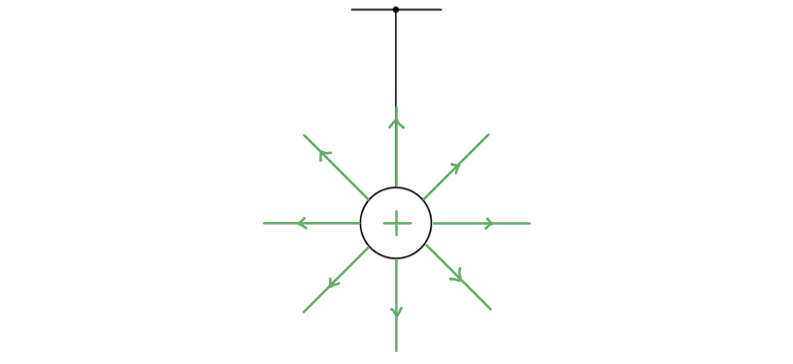

- Lines evenly distributed around the ball **AND **straight lines through the centre (by eye); **[1 mark]**
- Arrows pointing away from the ball; **[1 mark]**

**[Total: 2 marks]**
The student's prediction is:

*Both balls will hang straight downward, due to the effect of gravity.*

This prediction is:

- Wrong / incorrect;** [1 mark]**

This is because:

- Both balls are positively charged;** [1 mark]**
- Like charges repel; **[1 mark]**
- Therefore the balls will be pushed apart;** [1 mark]**

**[Total: 4 marks]**
A sketch of the arrangement of the two balls hanging next to each other, with field lines, looks like:

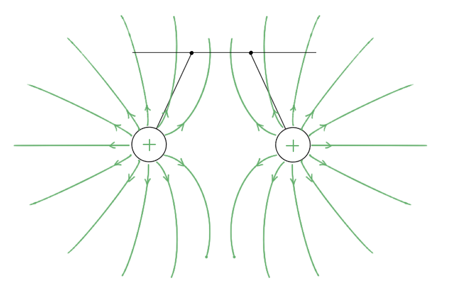

- (Balls are hanging so that) the threads point away from each other; **[1 mark]**
- Both balls have a radial field with arrows pointing away from their centre;** [1 mark]**
- Field lines extend into the area between the two balls; **[1 mark]**
- Field lines do not meet / there is an empty space; **[1 mark]**

**[Total: 4 marks]**

> *Don't worry if you don't remember this from class. The diagram you have been asked to infer goes slightly beyond your syllabus for this year, but is based on ideas which you need to be familiar with.*

> *In your exam you won't be asked to make this kind of leap, but it's interesting to try while revising!*

### Q8
(i) To tick the box that indicates the effect on the resistance of the resistor:

An answer that would score 1 mark would look like this:

`square` resistance increases

**✔** resistance is constant; **[1 mark]**

`square` resistance decreases

(ii) To tick the box that indicates the effect on the resistance of the lamp:

An answer that would score 1 mark should look like this:

**✔ **resistance increases; **[1 mark]**

`square` resistance is constant

`square` resistance decreases

**[Total: 2 marks]**

> *According to Ohm's Law **V **= **IR **so *$R=\frac{V}{I}$*.** **The gradient of the graph = *$\frac{Changeiny}{Changeinx}=\frac{I}{V}$*. So *$R=\frac{1}{Gradient}$*.*

> *When the gradient is smaller (B) then the resistance is higher.*

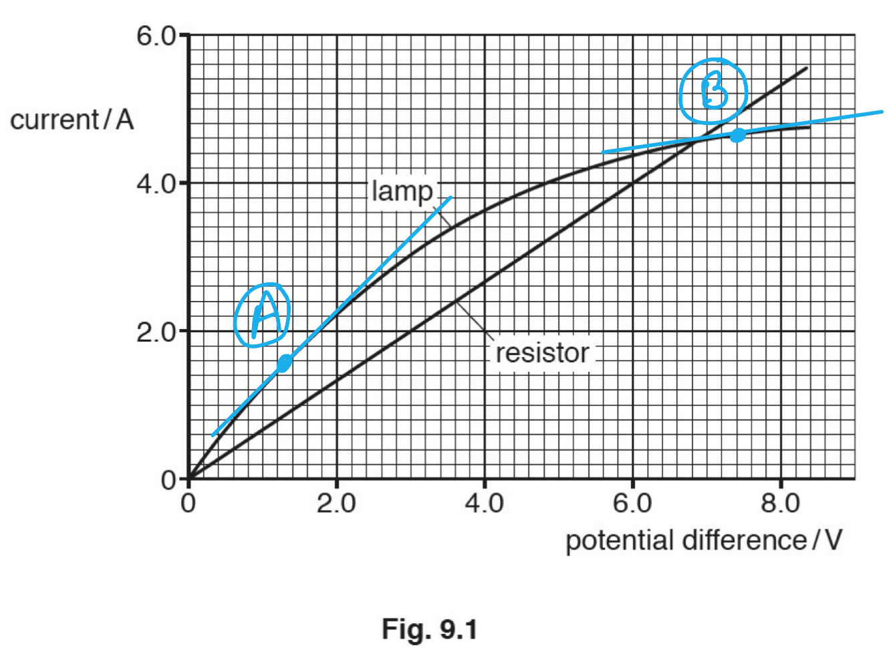
To calculate the resistance of the lamp:

List the known quantities:

- Potential Difference, *V *= 6.0 V

Use the graph to obtain the current of the lamp when the potential difference is 6.0 V:

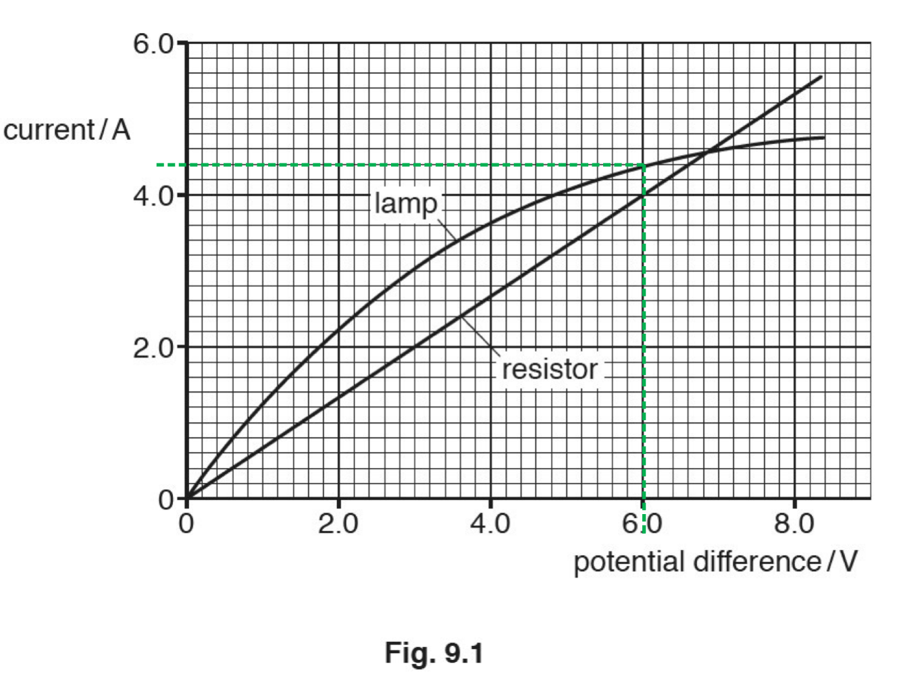

- The current is 4.4 A

Recall the equation for Ohm's Law:

- *V *= *IR *

Rearrange the equation to make resistance, *R *the subject:

- $R=\frac{V}{I}$ **[1 mark]**

**OR**

Substitute the known quantities into the equation:

- $R=\frac{6}{4.4}$ **[1 mark]**

Calculate the resistance across the lamp:

- *R *= 1.4 Ω **[1 mark]**

**[Total: 2 marks]**

> *When you are given a graph and then asked to make a calculation all the information you need will be available from the graph. Draw straight lines on the graph to obtain an accurate value for current. *
To calculate the current from the supply:

List the known quantities:

- Supply of p.d., *V *= 6.0 V

Recall the current in the lamp from part (b):

- Current in the lamp = 4.4 A

Use the graph to obtain the current in the resistor when the p.d. is 6.0 V:

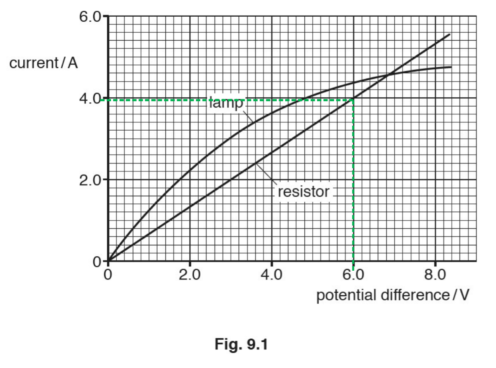

- Current in the resistor is 4.0 A **[1 mark]**

Calculate the total current in the series circuit:

- Total current = current in lamp + current in resistor
- Total current = 4.4 + 4.0
- Total current = 8.4 A **[1 mark]**

**[Total: 2 marks]**

> *The resistor and lamp are on different paths of a parallel circuit. The total current in a parallel circuit = sum of the currents along each path. So, find the current for each device and add them together.*

> *You can also find the combined resistance of the lamp and the resistor and use Ohm's law to obtain the total current. This involves more steps, so the above method is much easier. *
List the known quantities:

- Current in the circuit, *I *= 4.0 A

Recall from part (c) the p.d. across the resistor when the current is 4.0 A:

- p.d. across the resistor when the current is 4.0 A = 6.0 V

Use the graph to obtain the p.d. across the lamp when the current is 4.0 A:

- p.d. across the lamp = 4.9 V **[1 mark]**

Calculate the total p.d. in the series circuit:

- Total p.d. = p.d. across lamp + p.d. across resistor
- Total p.d. = 4.9 + 6.0
- Total p.d. = 10.9 V **[1 mark]**

**[Total: 2 marks]**

> *In part (c) you have already used the graph to see that when the p.d. is 6.0 V then the current is 4.0 A in the resistor. Therefore, you do not need to use the graph to find this information again. This can save you a bit of time! *

### Q9
Draw a circuit diagram:

A diagram that should score 4 marks would look like this:

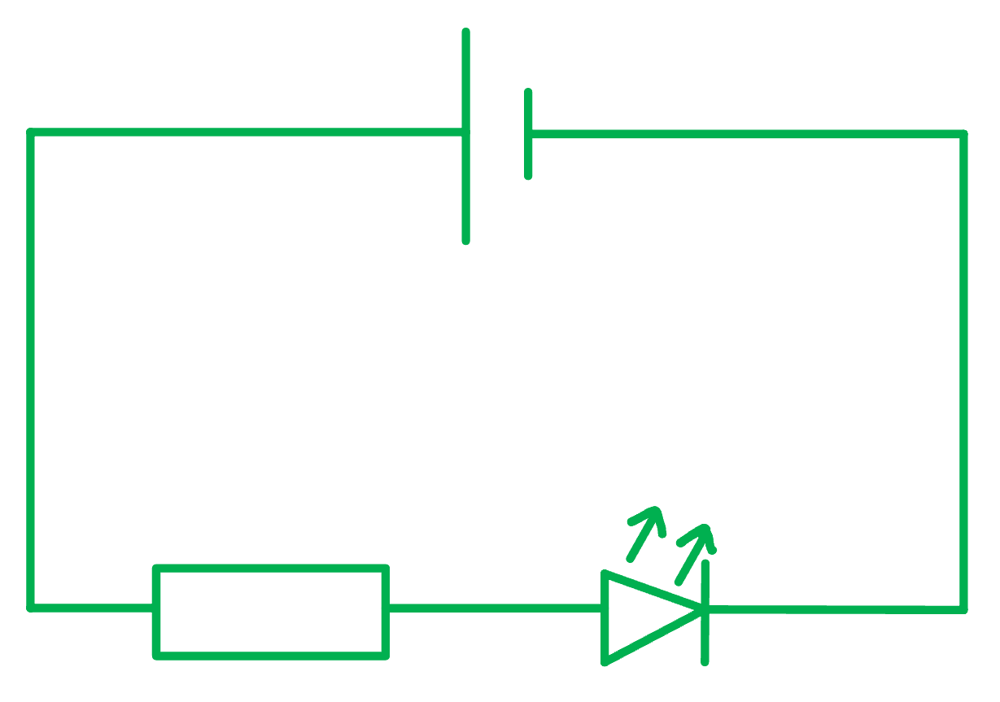

- Two of the required circuit symbols are correct; **[1 mark]**
- Three of the required circuit symbols are correct; **[1 mark]**
- The cell, battery or power supply and two other circuits symbols are drawn in series; **[1 mark]**
- LED is drawn the correct way around (towards the negative terminal); **[1 mark]**

**[Total: 4 marks]**

> *Use a ruler and a sharp pencil to draw accurate circuit diagrams. Sloppy diagrams are unlikely to get full marks!*

> *The LED must be drawn the correct way around:*

- *Current from the power supply will travel from the **positive** side of the battery*
- *Then through the **fixed resistor** *
- *Before the diode, pointing towards the **negative** terminal of the battery*

> *Current travels from positive to negative whilst electrons move the opposite way.*
Calculate the value of the resistance of the LED when lit:

List the known quantities:

- Potential difference, *V *= 3.1 V
- Current, *I *= 0.030 A

Recall the equation for Ohm's Law:

- $V=IR$ **OR **$R=\frac{V}{I}$ **[1 mark]**

Substitute the known quantities into the equation to calculate the resistance, *R *of the LED:

- $R=\frac{3.1}{0.03}$
- *R *= 103.33 = 100 Ω **[1 mark]**

**[Total: 2 marks]**
(i) Calculate the resistance of the heater:

List the known quantities:

- e.m.f. of the power supply = 10.5 V
- p.d. across the lamp = 2.1 V
- Current through the circuit, *I *= 1.5 A

Obtain an expression for the potential difference within the series circuit:

- e.m.f. = sum of potential differences across each component in the circuit
- $10.5=2.1+V$* ***[1 mark]**

Calculate the potential difference across the heater, *V*:

- $V=10.5--2.1=8.4V$

Recall the equation for Ohm's Law:

- $R=\frac{V}{I}$

Substitute the potential difference and current into the equation for Ohm's Law to calculate resistance:

- $R=\frac{8.4}{1.5}$
- *R *= 5.6 Ω **[1 mark]**

(ii) Calculate the power of the heater:

List the known quantities:

- Current in the circuit, *I *= 1.5 A
- p.d. in the heater, *V *= 8.4 V

Recall the electrical power equation:

- $P=IV$ **[1 mark]**

Substitute the known quantities into the equation and calculate the power, *P*:

- $P=8.4\times1.5$
- *P =* 12.6 W **[1 mark]**

**[Total: 4 marks]**

> *Read the question carefully, if it is asking about the heater make sure you use the information related to the heater. *

### Q10
On Fig. 9.1, using the correct symbols, complete the circuit diagram:

A diagram that would score 1 mark should look like:

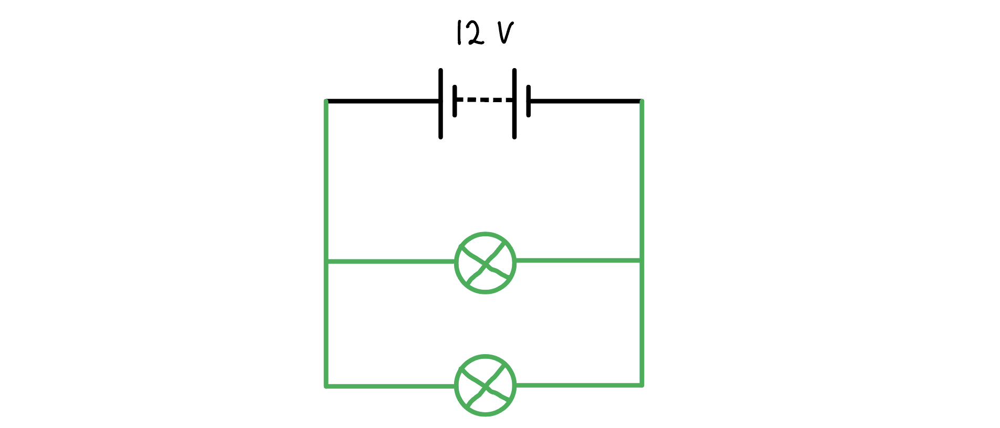

- 2 lamps drawn with correct symbols, in parallel **AND** connected correctly to the battery: **[1 mark]**

**[Total: 1 mark]**
(i) Calculate the current for this lamp:

List the known quantities:

- Voltage, *V* = 12 V
- Resistance, *R* = 6.0 Ω

Recall the equation for Ohm's law:

- $V=IR$

Rearrange the equation to make current the subject:

- $I=\frac{V}{R}$

Substitute in the known values to calculate:

- $I=\frac{12}{6.0}$
- *I *= 2 A **[1 mark]**

(ii) Calculate the power for this lamp:

Recall the equation for electrical power:

- $P=IV$

Substitute in the known values to calculate:

- $P=2\times12$ **[1 mark]**
- *P* = 24 W **[1 mark]**

**[Total: 3 marks]**

> *For part (ii) you may also have used *$P=I^{2}R$* or *$P=\frac{V^{2}}{R}$* to calculate the power. You would still gain the marks if your calculations were correct.*

> *The two rules you need to remember when rearranging equations are:*

1. * To undo an operation, do the opposite operation (to cancel a multiplication relationship, you need to divide, to cancel a minus you need to add or vice versa)*
2. *Whatever you do to an equation, you need to do it to **both sides*

> *If you need a reminder on how to rearrange Ohm's law to solve for current:*

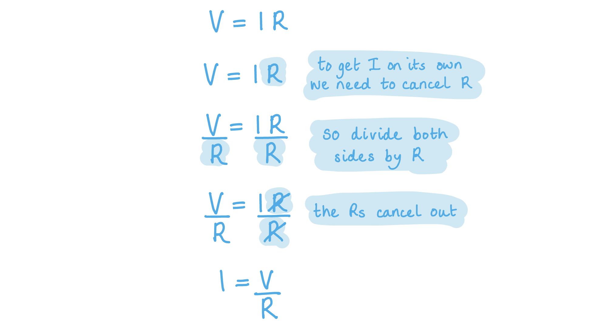
Calculate the total energy delivered to this lamp in 20 hours:

List the known quantities:

- Power,* P* = 36 W
- Time, *t* = 20 hours

Recall the equation for energy and power:

- *E = Pt*

Convert time into seconds:

- *t* = 20 hours

  - $20 \cancel{hours \times \frac{60 \cancel{\min } }{1 \cancel{ } hour} } \times \frac{60 \mathrm{s} }{1 \cancel{\min } }$
  - *t* = 72 000 s **[1 mark]**

Substitute in the known values to calculate:

- *E* = 36 × 72 000 **[1 mark]**
- *E* = 2.6 × 106 J **[1 mark]**

**[Total: 3 marks]**

> *You may also have used **E** =** IVt **to calculate the energy. You would also score the mark for this as long as your calculation is correct. *

> *You may have included the time conversion in your equation, if you did, you will also score full marks. *

### Q11
List the known quantities:

- Voltage, *V* = 12 V
- Power, *P *= 50.0 W

Recall the equation to calculate the power using current and voltage:

- *P *= *IV  ***[1 mark]**

**OR **

Rearrange and substitute the known quantities into the equation for power:

- $I=\frac{P}{V}$
- $I=\frac{50.0}{12}$

Calculate the current in the lamp:

- *I *= 4.166...
- *I *= 4.2 A (2 s.f.) **[1 mark]**

**[Total: 2 marks]**

> *Use the revision notes to make a list of all the equations you need to remember for power in electrical circuits. *
(i) To calculate the electrical energy transferred:

List the known quantities:

- e.m.f., *V* = 12 V
- Charge, *Q *= 270 kC

Convert the charge from kC to C:

- There are 1000 C in 1 kC
- So, 270 kC = 270 000 C = 270 × 103 C

Recall the equation to calculate electrical energy using charge and e.m.f.:

- *E *= *QV ***[1 mark]**

Substitute the known quantities into the equation:

- *E *= (270 × 103) × 12 **[1 mark]**

Calculate the energy transferred:

- E = 3.240...× 106

- *E *= 3.2 × 106 J (2 s.f.) **[1 mark]**

**   ****OR**** **

- 3200 kJ (2 s.f.) **[1 mark]**

(ii) To calculate the volume of fuel used to provide the energy from part (b)(i):

List the known quantities:

- Energy per cm3 = 3.6 × 104 J / cm3
- Total energy transferred = 3.240 × 106 J

State the calculation required to obtain the volume of fuel used:

- $volumeoffuelused=\frac{3.240\times10^{6}}{3.6\times10^{4}}$ **[1 mark]**

State the volume of fuel used:

- 90 cm3 **[1 mark]**

**[Total: 5 marks]**

> *Part (ii) states that 3.6 × 10**4** J of energy are transferred per cm**3**.*

> *amount of fuel needed to transfer all the energy = total energy ÷ energy per cm**3*

> *Looking at the units can also help figure out what you need to do.  Units for volume are cm**3** and units for energy per volume are J / cm**3** . The quantities must be rearranged so J's cancel and cm**3** is not in a fraction. *

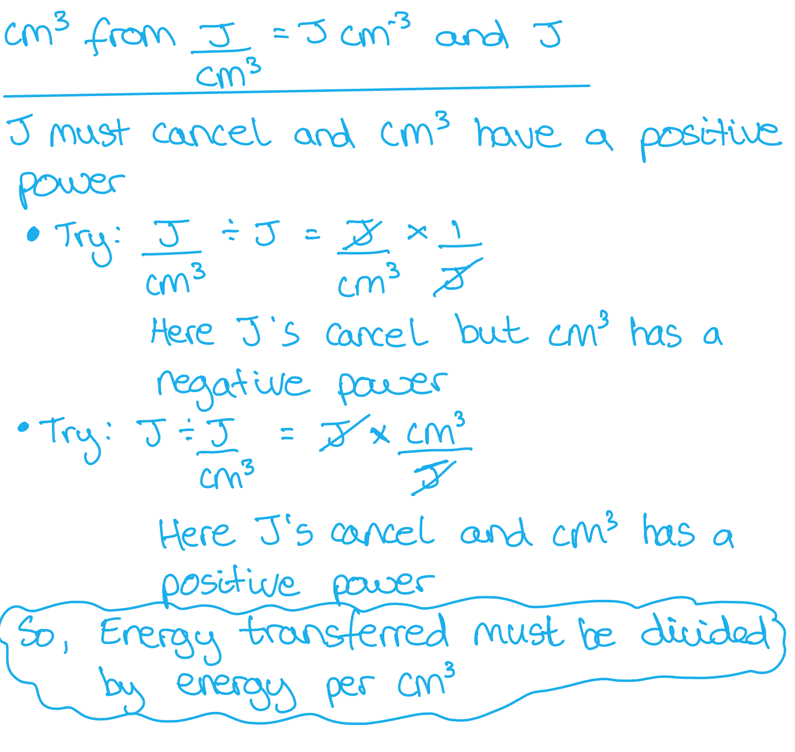

### Q12
Explain how the friction between the rod and the cloth causes the rod to become positively charged, using ideas about the movement of charge:

- Electrons; **[1 mark]**
- Move / are transferred from the rod / to the cloth; **[1 mark]**

**[Total: 2 marks]**
Explain how the student can use a positively charged rod to determine the charge on the balloon:

**Any three from:**

- Bring the (positively charged) rod close to the balloon; **[1 mark]**
- If the balloon is repelled; **[1 mark]**
- Then the balloon is positively charged; **[1 mark]**
- Because like charges repel; **[1 mark]**

**[Total: 3 marks]**

> *If both the balloon and the rod are positively charged, then they will repel, and the balloon will move away from the rod. *

> *I the balloon is negatively charged and the rod is positively charges, then they will attract and the balloon will move toward the rod.*

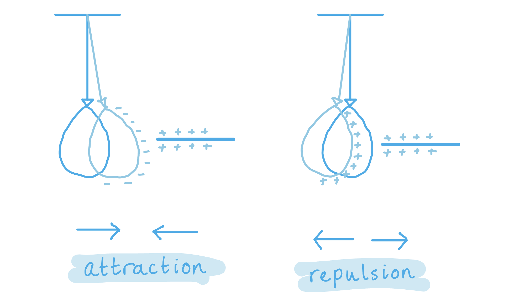

### Q13
(i) An electric field is:

- A region in which an electric charge experiences a force; **[1 mark]**

(ii) The direction of an electric field is:

- In the direction of the force on a positive electric charge / positive test charge; **[1 mark]**

**[Total: 2 marks]**
Explain why the ball oscillates:

**Any four from:**

- The ball moves towards the positive plate; **[1 mark]**
- The ball touches the positive plate; **[1 mark]**
- The ball is made of conducting material, so becomes positively charged; **[1 mark]**
- The ball is repelled from the positive plate; **[1 mark]**
- The ball touches the negative plate and loses charge; **[1 mark]**
- The negatively charged ball is attracted back to the positive plate and the process is repeated; **[1 mark]**

**[Total: 4 marks]**

> *The ball is covered in aluminium, so it is charged and hence, affected by the charged metal plates.*
Calculate the time taken:

List the known quantities:

- Current, *I *= 0.29 A
- Charge, *C *= 15 C

Recall the equation for current, charge and time:

- $I=\frac{Q}{t}$ **[1 mark]**

Rearrange the equation to make time, *t *the subject:

- $t=\frac{Q}{I}$

Substitute the known quantities into the equation to calculate the time, *t*:

- $t=\frac{15}{0.29}$ **[1 mark]**
- *t *= 51.72 s = 51.72 s (2 s.f.) **[1 mark]**

**[Total: 3 marks]**

> *The first mark is given for the equation in any form.*

### Q14
(i) State and explain any movement of the piece of wood:

- The wood moves towards the negative rod / to the right; **[1 mark]**
- This is because opposite / unlike charges attract; **[1 mark]**

(ii) State and explain any movement of the piece of wood:

- The wood / cubes float / rotate / turn / spin; **[1 mark]**
- This is because 2 forces causes movement / a couple / torque / a turning effect; **[1 mark]**

**[Total: 4 marks]**

> *Consider the attraction and repulsion of the charges to determine how the objects will move. *
Describe the differences between conductors and insulators:

Conductors...

- contain free / delocalised electrons / electrons that move; **[1 mark]**

Insulators...

- do not contain free / delocalised electrons **OR **contain electrons / charges that cannot move / are fixed in place; **[1 mark]**

**[Total: 2 marks]**
Draw the electric field pattern around a single-point positive charge:

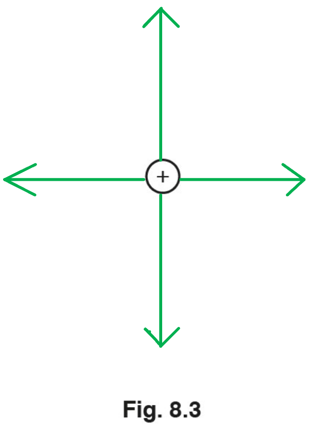

- At least 4 evenly spaced straight lines with arrows pointing radially outwards; **[1 mark]**

**[Total: 1 mark]**

> *Remember electric field lines are directed **away **from a positive charge.*

### Q15
(i) State the name of the component labelled X:

- Variable resistor; **[1 mark]**

The function of component X is:

- To change the current; **[1 mark]**

(ii) To describe how the circuit could be used to find the resistance of the fixed resistor R:

**Any three from:**

- Measure the current in the circuit; **[1 mark]**
- Make sure to use a low value of current; **[1 mark]**
- Measure the voltage; **[1 mark]**
- Repeat for other values current and voltage;** [1 mark]**
- Plot a graph of voltage against current, where the gradient will be the resistance **OR **use *V* = *I* × *R*; **[1 mark]**

**[Total: 5 marks]**

> *The resistance of a component practical is a really common question. Missing from this particular question is how to prevent errors. A key one is to avoid calculating an incorrect resistance you need to avoid temperature rises. To do this you only turn on the power for the minimum time required, or you might allow the component to cool between readings.*
(i) To calculate the current in the heater:

List the known quantities:

- Resistance, *R* = 21.8 Ω
- Voltage, *V* = 240 V

Recall the equation linking voltage, current *I*,  and resistance:

- *V *=* I *× *R* **[1 mark]**

Substitute in known values and calculate I:

- $I=\frac{V}{R}=\frac{240}{21.8}$ **[1 mark]**
- *I *= 11.0 A **[1 mark]**

(ii) A suggestion for a fuse to be fitted is:

- The fuse should be greater than the operating current, but not too high above it
- Therefore, any value in the range 12 to 15 A is acceptable; **[1 mark]**

**[Total: 4 marks]**

> *Fuses should always be rated above the operating current, but not too far above! If the gap is too large then a dangerous current could flow without the fuse breaking. If the fuse rating is under the operating current then the appliance will not work as the fuse will always break.*

### Q16
State the name of component Z:

- Variable resitor / rheostat;** [1 mark]**

**[Total: 1 mark]**
State the reading on ammeter Y:

- The circuit shown is a series circuit
- Current is the same everywhere in a series circuit
- Therefore, ammeter Y will read the same current as ammeter X
- The ammeter reads 0.8 A; **[1 mark]**

**[Total: 1 mark]**
Calculate the resistance of the nichrome wire:

List the known quantities:

- Current, *I* = 0.8 A
- Potential difference, *V *= 4.5 V

Recall the equation for Ohm's Law:

- $V=IR$** [1 mark]**

Rearrange the equation to make *R* the subject:

- $R=\frac{V}{I}$

Substitute the known values into the equation to calculate resistance:

- $R=\frac{4.5}{0.8}$ **[1 mark]**
- R = 5.6 / 5.625 Ω **[1 mark]**

**[Total: 3 marks]**

> *Remember that when stating an equation, you will still get the marks if the equation is given in its rearranged form as long as the rearrangement is correct. *

> *The two rules you need to remember when rearranging equations are:*

1. * To undo an operation, do the opposite operation (to cancel a multiplication relationship, you need to divide, to cancel a minus you need to add etc)*
2. *Whatever you do to an equation, you need to do it to both sides*

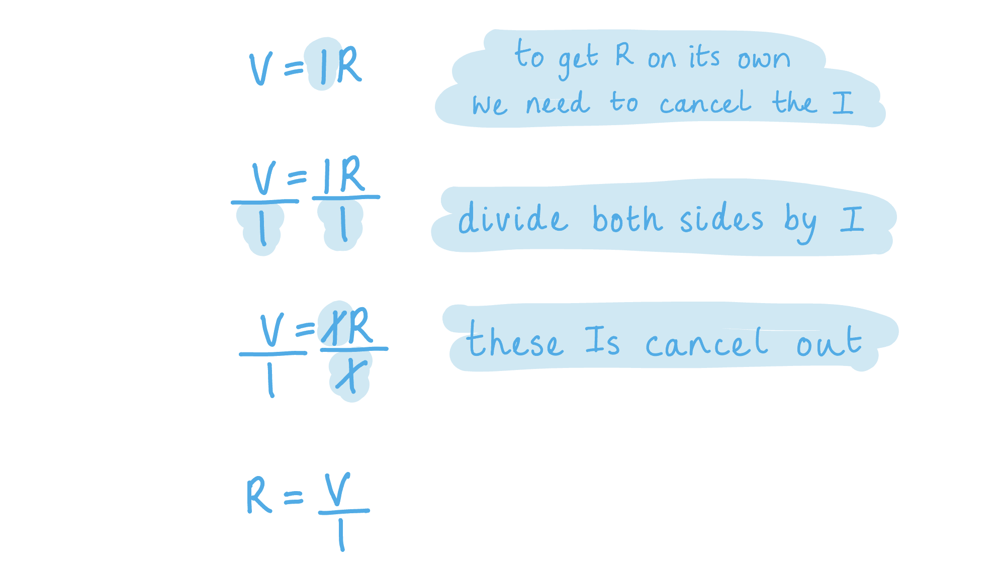
State and explain the difference in current in the thicker wire of the same length:

- The current in the thicker wire is larger; **[1 mark]**
- Because the thicker wire has less resistance; **[1 mark]**

**[Total: 2 marks]**

> *It is a common misconception that a thicker wire has a greater resistance, but this is not the case. Think about power cables - these carry current for miles (so they need low resistance) and are very thick. A thick wire provides **more paths** for the electrons to move through, so the resistance to the flow of charge is lower. *

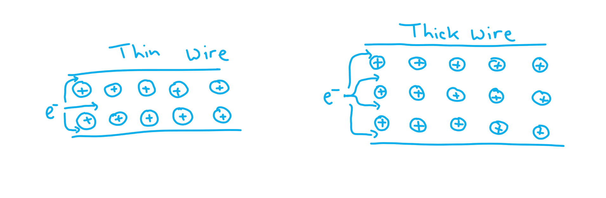

### Q17
Identify the pieces of equipment that are electrical conductors and those that are electrical insulators.

The correct lines drawn that would score 1 mark should look like:

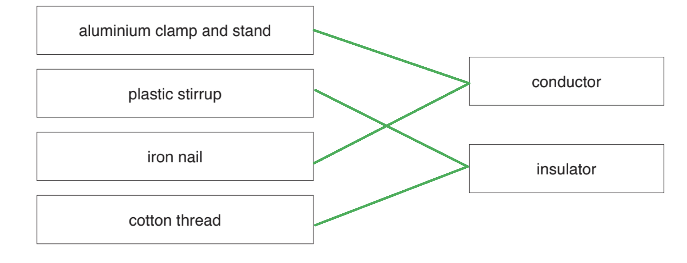

- Aluminium clamp and stand **AND** iron nail = conductor

**AND**

- Plastic stirrup **AND** cotton thread = insulator; **[1 mark]**

**[Total: 1 mark]**

Conductors are materials that allow charge to flow through easily. These tend to be metals, as they have more 'free charges' to flow. Insulators have no free charges, so charge cannot flow easily through it. Think about the materials you see in your everyday life and consider whether they are conductors or insulators.

Conductors heat up easily and allow electricity to flow through them, whilst insulators do not. This is why a frying pan will be made of a conducting material, but the handle will be an insulator, so you do not feel the heat of the pan that needs to be hot to fry food.
The polythene strip can be given a negative charge by:

- Being rubbed with a cloth; **[1 mark]**
- Because electrons will transfer to the polythene / from the cloth; **[1 mark]**

**[Total: 2 marks]**

A polythene (plastic) rod, rubbed with a dry cloth or duster, is a common example used in exams. You are expected to know that the polythene rod typically acquires a negative charge because the electrons transfer from the cloth to the rod.

If an acrylic or glass rod is rubbed, it typically acquires a positive charge. This is because the electrons must move from the rod to the cloth.
The apparatus in Fig.10.1 could be used to demonstrate that the polythene strip has a negative charge by:

- Bringing a negatively charged rod/strip/object near (the polythene strip); **[1 mark]**
- If there is repulsion, then it has a negative charge; **[1 mark]**

**[Total: 2 marks]**

### Q18
(i) The statement which explains why the balloon becomes positively charged:

- The balloon loses electrons; **[1 mark]**

(ii) State the type of charge on the rod:

- The rod has a positive charge; **[1 mark]**

Explain why the rod is positively charged:

- The balloon moves away from the rod, therefore they must have the same charge
- Because like charges repel; **[1 mark]**

**[Total: 3 marks]**
The correct answers circled would look like:

- Copper and silver circled; **[1 mark]**

**[Total: 1 mark]**

### Q19
(i)

To draw a symbol to measure the total current in the circuit:

A symbol that would score 1 mark should look like this:

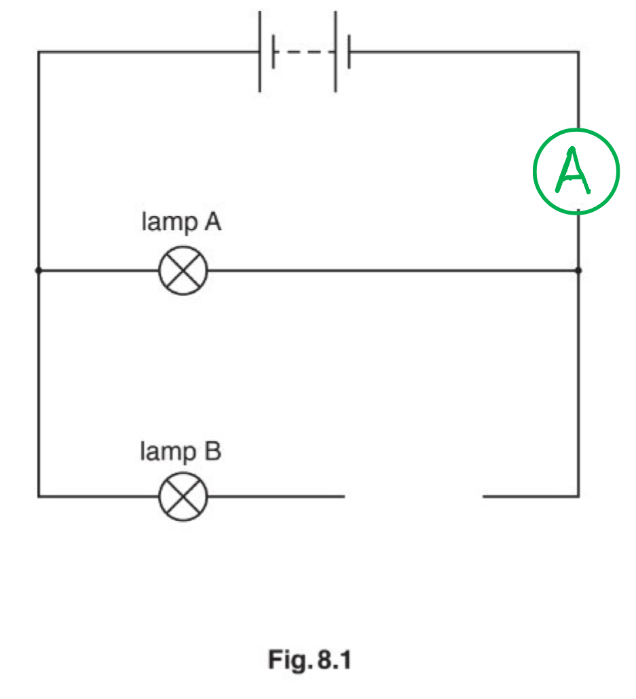

- Ammeter in series with the power supply; **[1 mark]**

(ii)

To draw a symbol to vary the current in the lamp B only:

A symbol that would score 1 mark should look like this:

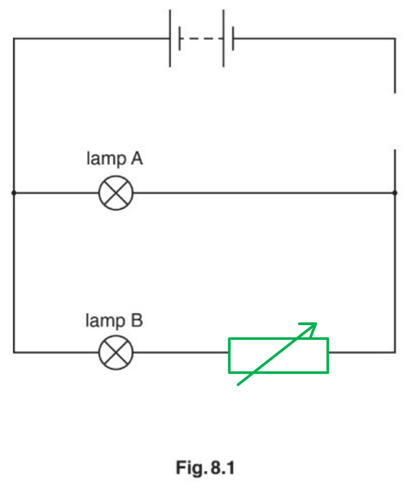

- Variable resistor in series with lamp B; **[1 mark]**

(iii)

To draw a symbol to measure the potential difference (p.d.) across lamp B:

A symbol that would score 2 marks should look like this:

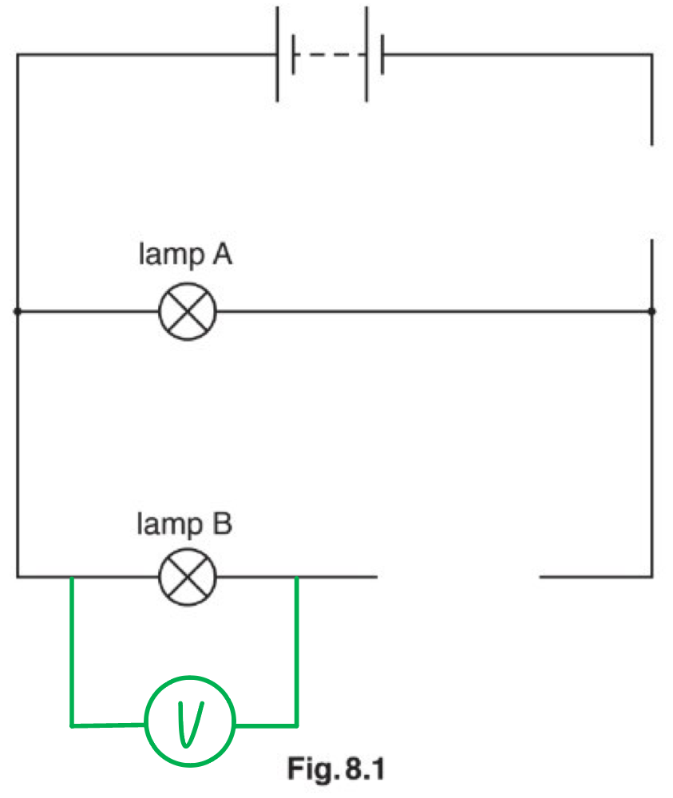

- Voltmeter symbol; **[1 mark]**
- In parallel with lamp B; **[1 mark]**

**[Total: 4 marks]**

> *It is important you are able to draw and recognise a whole range of electric circuit symbols as part of your Physics course. Use the revision notes to help with this. Make sure you know that an ammeter should always be placed in series (next to components) and a voltmeter should be placed in parallel (over the top of components). *
List the known quantities:

- Current, *I *= 0.20 A
- Potential Difference, *V *= 6.0 V

Recall the equation for Ohm's Law:

- Voltage = Current × Resistance

**   OR **

- *V *= *IR ***[1 mark]**

Rearrange the equation to make resistance, *R *the subject:

- $R=\frac{V}{I}$

Substitute the known quantities into the equation:

- $R=\frac{6}{0.2}$ **[1 mark]**

Calculate the resistance of lamp A:

- Resistance, *R *= 30 Ω **[1 mark]**

**[Total: 3 marks]**

Being able to rearrange equations in Physics is a really important skill. Have a look at how to rearrange Ohm's Law to make resistance the subject.

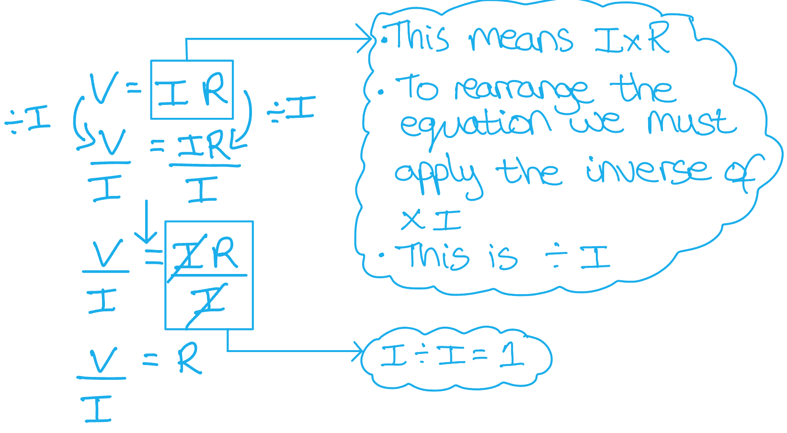

### Q20
(i) The completed sentence is:

- The rod becomes negatively charged because **electrons**; **[1 mark]**
- Move from the **cloth** to the rod; **[1 mark]**

(ii) The type of charge on the suspended rod:

Recall that like charges repel:

- The rod is <u>negatively</u> charged; **[1 mark]**

(iii) The rods repel because:

- Like charges repel (and unlike charges attract); **[1 mark]**

**[Total: 4 marks]**
(i) The material that is suitable for the connection to earth:

Consider that for current to flow to earth the material must be an electrical conductor:

- Therefore copper is the correct answer;** [1 mark]**

(ii) To explain the answer to (ii):

- Copper is a <u>conductor</u>; **[1 mark]**

**[Total: 2 marks]**

> *Although the earth connection is part of the safety precautions used with electrical devices, it is still a conductor. If current is overloading due to a short circuit or loose wire (for example) it can cause overheating and fires. By allowing the current to flow away safely to earth, we can prevent this happening. *

> *If you have ever been at home when all the lights suddenly went off and the fuse box had to be reset, then you have been kept safe by this mechanism!*
