# Exam Questions — Electrical Quantities
**4. Electricity & Magnetism** · Cambridge (CIE) IGCSE physics (0625 & 0972)
> Source: [https://www.savemyexams.com/igcse/physics/cie/23/topic-questions/](https://www.savemyexams.com/igcse/physics/cie/23/topic-questions/) · 68 questions across 3 sets

## Alternative To Practical Questions (8 questions)

### Q1 — medium — 11 marks

**Q1** [1 mark]

A student investigates the resistance of a wire.

Fig. 3.1 shows the circuit he uses.

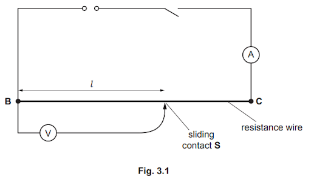

The student measures the current and decides that he wants to use a lower current.

He adds a variable resistor to the circuit to reduce the current.

On Fig. 3.1, mark with an **X** a suitable position in the circuit for the variable resistor.

*Source: June 2022 paper 6 Q3A*

**Q1** [1 mark]

**Extract:**

On this ammeter, the large divisions correspond to a current of 0.1 A and the small divisions correspond to a current of 0.02 A.

The student measures the current I in the circuit. Record the current shown in Fig. 3.2.

I = ........................................................

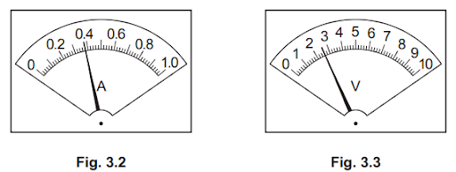

*Source: june 2022 paper 6 Q3B*

**Q1** [1 mark]

The student places the sliding contact at a distance $l$ = 85.0cm from **B**.

He measures, and records in Table 3.1, the potential difference (p.d.) *V* across the length $l$* *of resistance wire **BC.**

Record, in Table 3.1, the potential difference shown in Fig. 3.3.

*Source: june 2022 paper 6 Q3C*

**Q1** [2 marks]

**Extract:**

The student places the sliding contact at a distance l = 85.0 cm from B. He measures, and records in Table 3.1, the potential difference (p.d.) V across the length l of resistance wire BC. The potential difference shown on the voltmeter in Fig. 3.3 is: V = 2.6 V. The student measures the current I in the circuit. The current shown on the ammeter in Fig. 3.2 is: I = 0.38 A.

The student repeats the procedure using $l$ values of 65.0 cm, 45.0 cm, 25.0 cm and 5.0cm. His readings are shown in Table 3.1.

(i) Calculate, and record in Table 3.1, the resistance *R* of 85.0 cm of the resistance wire using the equation

$R=\frac{V}{I}$

[1]

(ii) Complete the column headings in Table 3.1.

**Table 3.1**

| $l/\mathrm{cm}$ | $V/$ | $R/$ |
|---|---|---|
| 5.0 | 0.2 | 0.53 |
| 25.0 | 0.8 | 2.11 |
| 45.0 | 1.4 | 3.68 |
| 65.0 | 2.0 | 5.26 |
| 85.0 |   |   |

[1]

*Source: june 2022 paper 6 Q3D*

**Q1** [4 marks]

**Extract:**

Table 3.1

| l / cm | V / V | R / Ω |
|--------|-------|-------|
| 5.0    | 0.2   | 0.53  |
| 25.0   | 0.8   | 2.11  |
| 45.0   | 1.4   | 3.68  |
| 65.0   | 2.0   | 5.26  |
| 85.0   | 2.6   | 6.84  |

Plot a graph of resistance *R* (*y*‑axis) against length* l* (*x*‑axis). Start both axes at the origin (0,0).

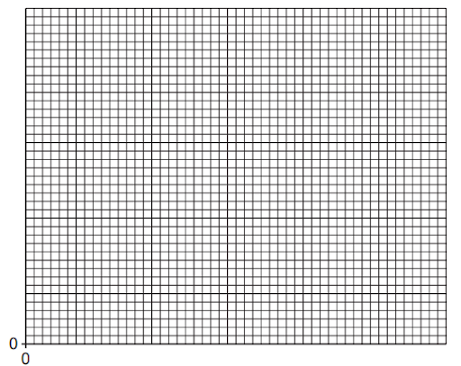

*Source: june 2022 paper 6 Q3E*

**Q1** [2 marks]

**Extract:**

Plot a graph of resistance R (y‑axis) against length l (x‑axis). Start both axes at the origin (0,0).

Use your graph to determine the resistance *R*50 of 50.0cm of the resistance wire.

Show clearly on the graph how you obtained the necessary information.

*R*50 = ...........................................................

*Source: june 2022 paper 6 Q3F*

### Q2 — medium — 11 marks

**Q2** [3 marks]

** **A student is investigating a resistance wire. She uses the circuit shown in Fig. 2.1.

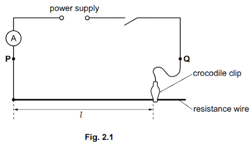

(i)** **On Fig. 2.1, draw a voltmeter connected to measure the potential difference (p.d.) *V *across terminals **P** and** Q.**

[1]

(ii) The student connects the crocodile clip to a length *l* = 90.0 cm of the resistance wire and measures the potential difference V across terminals **P **and **Q **and the current *I* in the circuit.

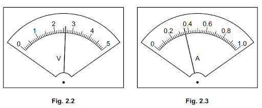

Read, and record in Table 2.1, the values of *V* and* I* shown on the meters in Fig. 2.2 and Fig. 2.3.

[2]

*Source: specimen 2023 paper 6 Q2A*

**Q2** [1 mark]

**Extract:**

| l / cm | V / V | I / A | R / Ω | R/l / Ω cm⁻¹ |
| 90.0 | 2.6 | 0.36 |   |   |
| 60.0 | 2.5 | 0.49 |   |   |
| 40.0 | 2.3 | 0.74 |   |   |

The student then connects the crocodile clip to lengths *l* = 60.0 cm and *l* = 40.0 cm of the resistance wire. She measures the potential difference* V* across terminals **P **and **Q **and the current I in the circuit. Her readings are shown in Table 2.1.

Complete the column headings in Table 2.1.

**Table 2.1**

| $l/\mathrm{cm}$ | $V/$ | $I/$ | $R/Ω$ | $\frac{R}{l}/\frac{Ω}{\mathrm{cm}}$ |
|---|---|---|---|---|
| 90.0 |   |   |   |   |
| 60.0 | 2.5 | 0.49 |   |   |
| 40.0 | 2.3 | 0.74 |   |   |

*Source: specimen 2023 paper 6 Q2B*

**Q2** [3 marks]

**Extract:**

| l / cm | V / V | I / A |
| 90.0 | 2.6 | 0.36 |
| 60.0 | 2.5 | 0.49 |
| 40.0 | 2.3 | 0.74 |

(i) Calculate, and record in Table 2.1, the resistance *R* of each length *l* of the wire.

Use the readings from the table and the equation  $R=\frac{V}{I}$

[2]

(ii)** **Calculate, and record in Table 2.1, the value of $\frac{R}{l}$ for each length *l* of the wire.

[1]

*Source: Specimen 2023 paper 6 Q2C*

**Q2** [1 mark]

**Extract:**

| l / cm | V / V | I / A | R / Ω | R/l / Ω/cm |
| 90.0 | 2.6 | 0.36 | 7.2 | 0.080 |
| 60.0 | 2.5 | 0.49 | 5.1 | 0.085 |
| 40.0 | 2.3 | 0.74 | 3.1 | 0.078 |

The values of R/l are 0.080, 0.085, and 0.078.

Another student suggests that the values of $\frac{R}{l}$ for each length of wire should be the same.

State whether the results support this suggestion.

Justify your statement with reference to values from the results.

**Q2** [1 mark]

Suggest **one** difficulty which explains why different students, doing the experiment carefully with the same equipment, may **not** obtain identical results.

*Source: specimen 2023 paper 6 Q2E*

**Q2** [2 marks]

**Extract:**

A student is investigating a resistance wire. She uses the circuit shown in Fig. 2.1.

Circuit diagram showing an ammeter, power supply, resistance wire, and crocodile clip connecting points P and Q, with variable length l.

(i) On Fig. 2.1, draw a voltmeter connected to measure the potential difference (p.d.) V across terminals P and Q.

A student finds that during the experiment, the wire becomes hot because there is a high current.

He decides to use a variable resistor to prevent this.

(i) Draw an **X **on the circuit in Fig. 2.1 to show where a variable resistor is connected for this purpose in the experiment.

[1]

(ii)** **In the space below, sketch the circuit symbol for a variable resistor.

[1]

*Source: specimen 2023 paper 6 Q2F*

### Q3 — medium — 11 marks

**Q3** [1 mark]

A student is determining the resistance of a piece of wire.

Fig. 2.1 shows the circuit she uses.

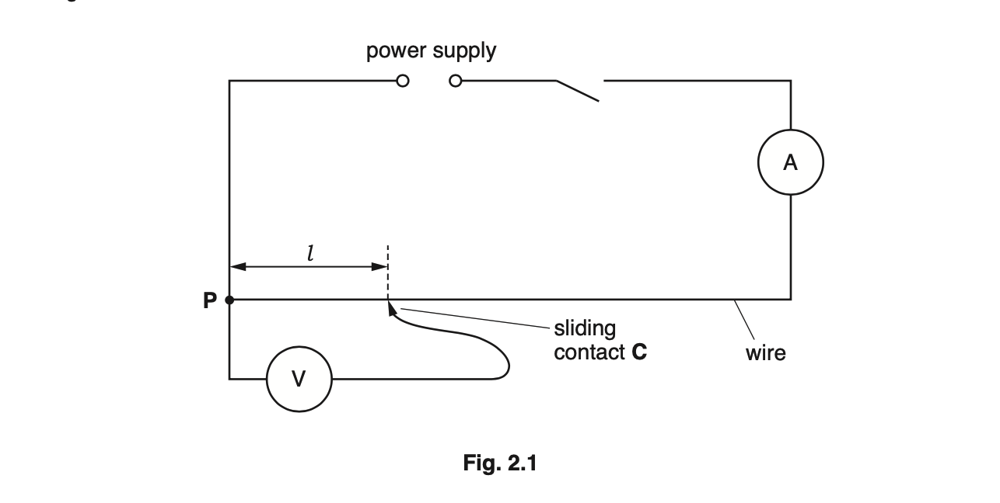

Record the current $I$ in the circuit, as shown on the ammeter in Fig. 2.2.

$I$ = ........................................................

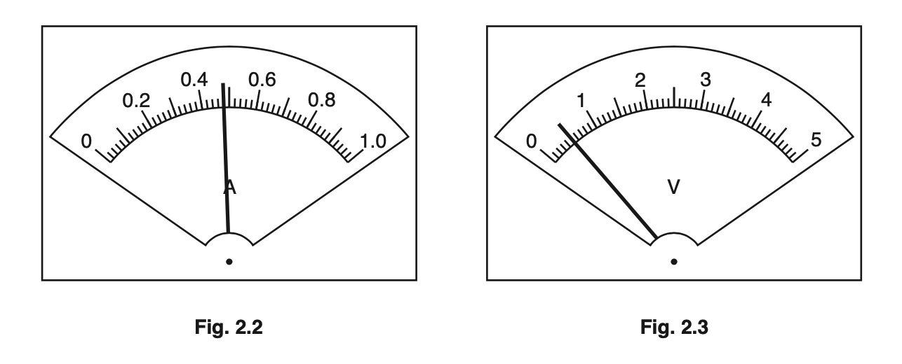

*Source: Oct 2018 S1 0625/61 Q2A*

**Q3** [1 mark]

The student places the sliding contact **C** at a distance $l$ = 20.0 cm from **P**. The voltmeter reading is shown in Fig. 2.3. Record the voltmeter reading in Table 2.1 for $l$ = 20.0 cm.

**Table 2.1**

| $l$/ | V/ |
|---|---|
| 20.0 |   |
| 40.0 | 0.9 |
| 60.0 | 1.6 |
| 80.0 | 2.0 |
| 100.0 | 2.4 |

*Source: Oct 2018 S1 0625/61 Q2B*

**Q3** [1 mark]

The student repeats the procedure using values of $l$ = 40.0 cm, 60.0 cm, 80.0 cm and 100.0 cm. The readings are shown in Table 2.1.

Complete the column headings in the table.

**Table 2.1**

| $l$/ | V/ |
|---|---|
| 20.0 |   |
| 40.0 | 0.9 |
| 60.0 | 1.6 |
| 80.0 | 2.0 |
| 100.0 | 2.4 |

*Source: Oct 2018 S1 0625/61 Q2C*

**Q3** [4 marks]

**Extract:**

Table 2.1

| l / cm | V / V |
| 20.0   | 0.5   |
| 40.0   | 0.9   |
| 60.0   | 1.6   |
| 80.0   | 2.0   |
| 100.0  | 2.4   |

Plot a graph of *V* / V (y-axis) against $l$ / cm (x-axis). Start both axes at the origin (0, 0).

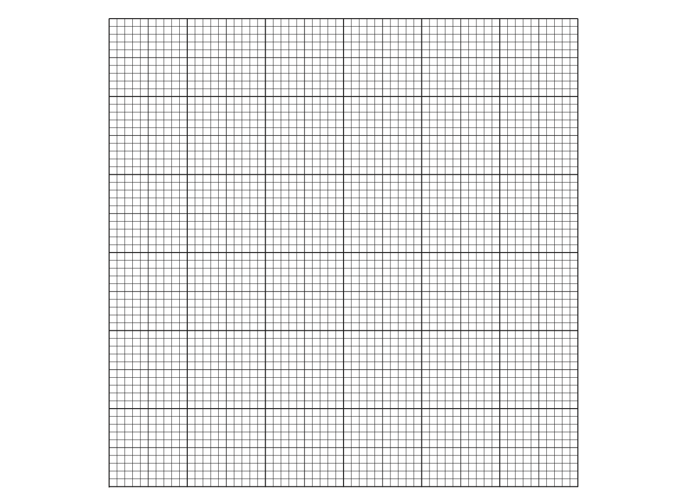

*Source: Oct 2018 S1 0625/61 Q2D*

**Q3** [4 marks]

**Extract:**

From part (a):
Current, I = 0.48 A

From part (d):
Graph of V / V (y-axis) against l / cm (x-axis), with data points:
| l / cm | V / V |
| 20.0   | 0.5   |
| 40.0   | 0.9   |
| 60.0   | 1.6   |
| 80.0   | 2.0   |
| 100.0  | 2.4   |

From part (e):
Equation: R = (G × k) / I, where k = 1.0 V/cm and I is the current recorded in (a).

**Extended tier only**

(i) Determine the gradient *G* of the graph. Show clearly on the graph how you obtained the necessary information.

*G* = ........................................................ [2]

(ii) Calculate the resistance *R* of each centimetre of the wire. Use the following equation:

$R=\frac{Gk}{I}$,

where *k* = 1.0 V/cm and where $I$ is the current recorded in **(a)**.

Include the unit.

*R* = ........................................................ [2]

*Source: Oct 2018 S1 0625/61 Q2E*

### Q4 — medium — 7 marks

**Q4** [7 marks]

A student is investigating the relationship between the power produced by an electrical heater and the time taken to heat a beaker of water. The power of the heater is given by the equation *P* = *VI*, where *V* is the potential difference (p.d.) across the heater and *I* is the current in the heater.

Plan an experiment to investigate the relationship between the power produced by an electrical heater and the time taken to heat a beaker of water.

The following apparatus is available:

- ammeter
- voltmeter
- 0–12 V variable power supply
- 250 cm3 beaker
- heater
- thermometer
- stopwatch

The student can also use other apparatus and materials that are usually available in a school laboratory.

You should:

- complete the diagram in Fig. 4.1 to show the circuit that you would use
- explain briefly how you would carry out the investigation
- state the key variables that you would control
- draw a table with column headings, to show how you would display your readings (you are **not** required to enter any readings in the table)
- explain how you would use your results to reach a conclusion.

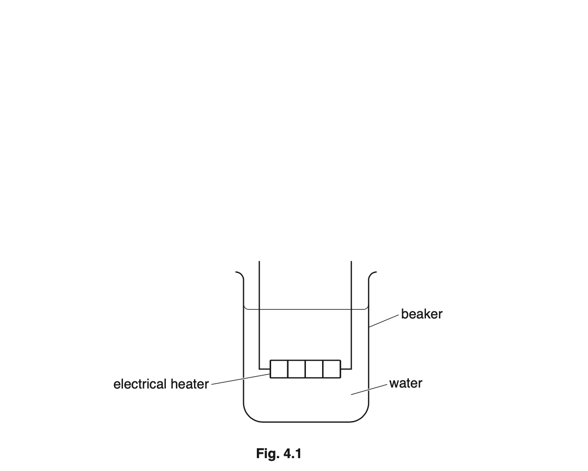

*Source: Oct 2018 S1 0625/61 Q4*

### Q5 — medium — 10 marks

**Q5** [1 mark]

A student is determining the resistance of a resistance wire.

The circuit is shown in Fig. 2.1.

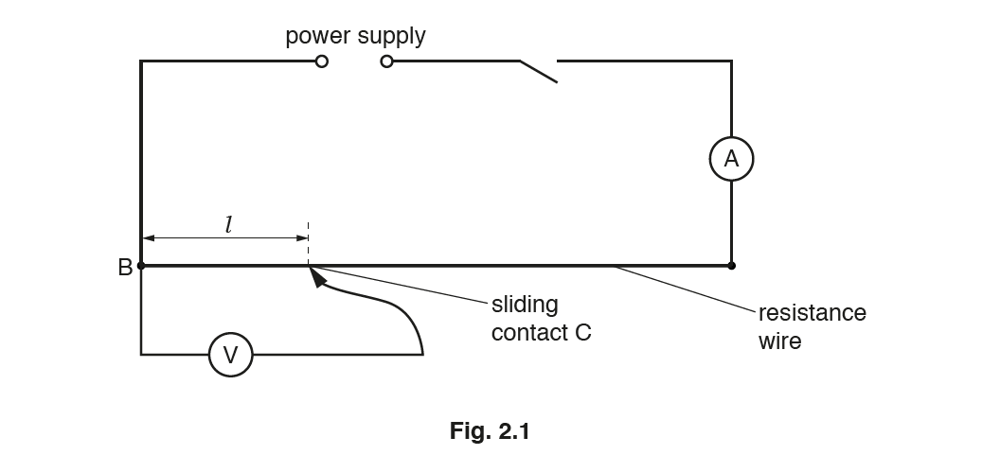

Record, in amperes A, the current $I$ in the circuit, as shown on the ammeter in Fig. 2.2.

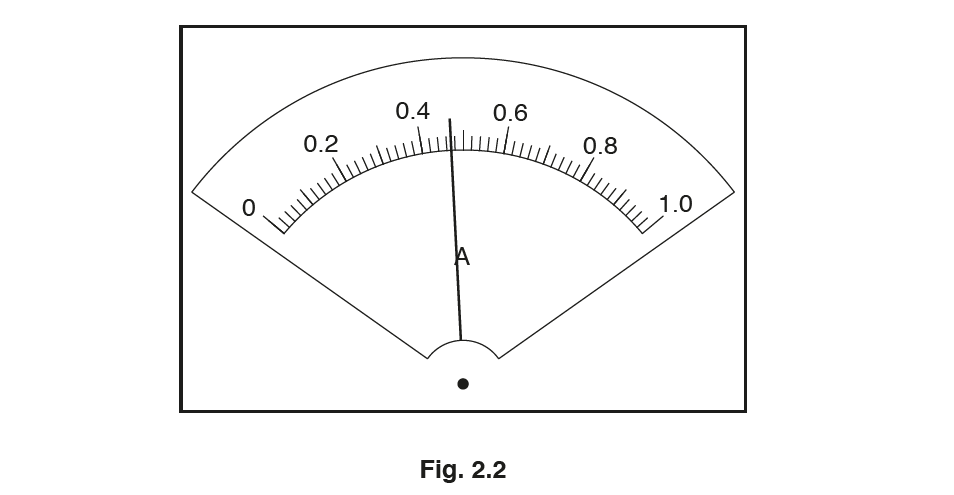

$I$ = ........................................................

*Source: May 2019 0625/61 Q2A*

**Q5** [3 marks]

The student places the sliding contact C at a distance $l$ = 20.0 cm from B.

She records the potential difference *V* across the length $l$ of the resistance wire.

She repeats the procedure using $l$ values of 40.0 cm, 60.0 cm, 80.0 cm and 100.0 cm. All the readings are shown in Table 2.1.

Calculate, and record in Table 2.1, $\frac{V}{l}$ for each value of $l$.

Complete the $\frac{V}{l}$ column heading.

**Table 2.1**

| $l$/cm | $V/V$ | $\frac{V}{l}$/ |
|---|---|---|
| 20.0 | 0.50 |   |
| 40.0 | 0.92 |   |
| 60.0 | 1.62 |   |
| 80.0 | 2.08 |   |
| 100.0 | 2.40 |   |

*Source: May 2019 0625/61 Q2B*

**Q5** [1 mark]

**Extract:**

| l/cm | V/V | V/l / V/cm |
| 20.0 | 0.50 | 0.025 |
| 40.0 | 0.92 | 0.023 |
| 60.0 | 1.62 | 0.027 |
| 80.0 | 2.08 | 0.026 |
| 100.0 | 2.40 | 0.024 |

Look carefully at the values in Table 2.1.

(i) Tick the box to show your conclusion from the results.

`square` $\frac{V}{l}$ is approximately constant.

`square` $\frac{V}{l}$ is decreasing as V increases.

`square` $\frac{V}{l}$ is increasing as V increases.

`square` There is no simple pattern for $\frac{V}{l}$in the results.

[1]

(ii) Justify your conclusion by reference to your results.

[1]

*Source: May 2019 0625/61 Q2C*

**Q5** [3 marks]

**Extract:**

Current, I = 0.47 A (from part (a))
Potential difference, V = 2.40 V (from Table 2.1 in part (b))

Calculate the resistance of 100 cm of the resistance wire.

Use the equation $R=\frac{V}{I}$where *V* is the potential difference across 100 cm of the resistance wire. Use the value of current $I$ from part **(a)**. Give your answer to a suitable number of significant figures for this experiment and include the unit.

*R* = ........................................................

*Source: May 2019 0625/61 Q2D*

**Q5** [1 mark]

**Extract:**

The student places the sliding contact C at a distance   = 20.0 cm from B.

She records the potential difference *V* across the length  of the resistance wire.

She repeats the procedure using

values of 40.0 cm, 60.0 cm, 80.0 cm and 100.0 cm. All the readings are shown in Table 2.1.

Calculate, and record in Table 2.1,   for each value of .

**Table 2.1**

| /cm |   | / |
|---|---|---|
| 20.0 | 0.50 |   |
| 40.0 | 0.92 |   |
| 60.0 | 1.62 |   |
| 80.0 | 2.08 |   |
| 100.0 | 2.40 |   |

In this type of experiment, it is sensible to keep the temperature of the resistance wire as close to room temperature as possible. Suggest one way to minimise the rise in temperature of the resistance wire.

*Source: May 2019 0625/61 Q2E*

**Q5** [1 mark]

Draw the circuit symbol for a variable resistor.

*Source: May 2019 0625/61 Q2F*

### Q6 — medium — 11 marks

**Q6** [1 mark]

A student investigates how the resistance of a filament lamp changes with the potential difference (p.d.) across it.

He uses the circuit shown in Fig. 1.1.

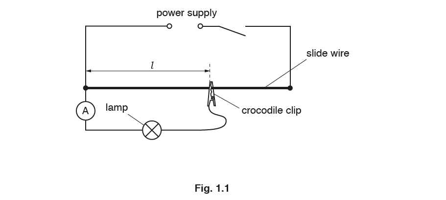

On Fig. 1.1, draw the symbol for a voltmeter connected to measure the potential difference across the lamp.

*Source: 2019 (Series 3) 0625/63 Q1A*

**Q6** [2 marks]

The student connects the crocodile clip to a length $l$ = 20.0 cm of the slide wire.  He measures the potential difference, *V*, and the current, $I$*,* for the lamp.

(i) Record the voltmeter and ammeter readings shown in Fig. 1.2 for a value of $l$* *= 20.0 cm.

*V* = ...............................................................

$I$ = ...............................................................

[1]

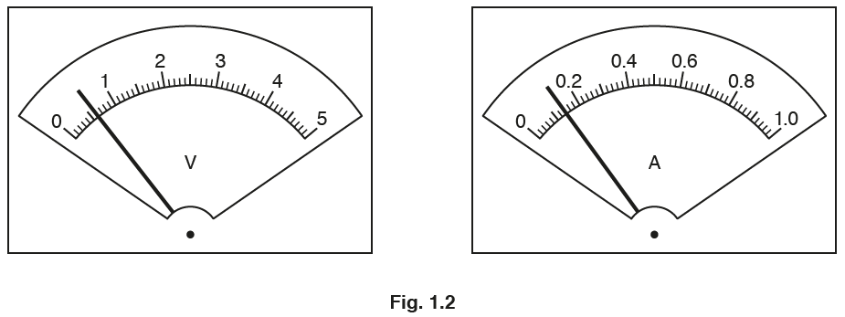

(ii) Calculate, and record in Table 1.1, the resistance *R* of the lamp at $l$* *= 20.0 cm. Use your readings from **(b)(i)** and the equation $R=\frac{V}{I}$

[1]

**Table 1.1**

| $l$/cm | *R*/Ω |
|---|---|
| 20.0 |   |
| 40.0 | 7.5 |
| 60.0 | 10 |
| 80.0 | 12 |
| 100.0 | 13 |

*Source: 2019 (Series 3) 0625/63 Q1B*

**Q6** [4 marks]

**Extract:**

Table 1.1

| l/cm | R/Ω |
| 20.0 | 4.3 |
| 40.0 | 7.5 |
| 60.0 | 10 |
| 80.0 | 12 |
| 100.0 | 13 |

Plot a graph of R / Ω (y-axis) against l / cm (x-axis).

The student connects the crocodile clip to other lengths $l$ of the slide wire.

He measures the potential difference *V* and the current $I$ for the lamp and calculates the resistance each time. His results are shown in Table 1.1.

Plot a graph of *R* / Ω (y-axis) against $l$ / cm (x-axis).

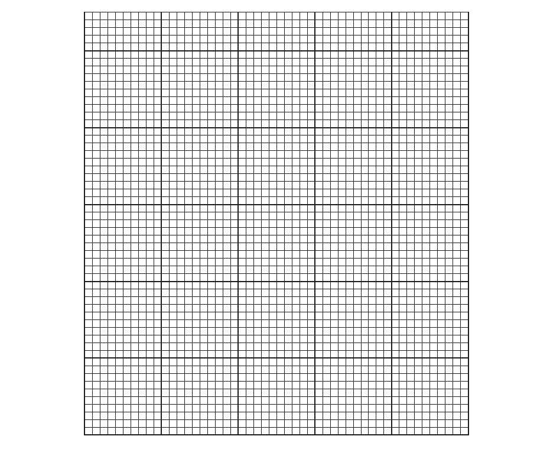

*Source: 2019 (Series 3) 0625/63 Q1C*

**Q6** [2 marks]

**Extract:**

**Table 1.1**

| l/cm | R/Ω |
| 20.0 | 4.3 |
| 40.0 | 7.5 |
| 60.0 | 10 |
| 80.0 | 12 |
| 100.0 | 13 |

Plot a graph of R / Ω (y-axis) against l / cm (x-axis).

**Extended tier only**

The student notices that the lamp is very dim when $l$ = 20.0 cm but becomes very bright when $l$ = 100.0 cm.

State what the shape of the graph tells you about how the resistance of the lamp changes with the temperature of the filament.

Justify your statement using your results from the graph.

*Source: 2019 (Series 3) 0625/63 Q1D*

**Q6** [2 marks]

**Extract:**

A student investigates how the resistance of a filament lamp changes with the potential difference (p.d.) across it.

He uses the circuit shown in Fig. 1.1.

In this type of experiment, it is possible to change the current in the lamp by using a variable resistor instead of a slide wire.

On Fig. 1.3, complete the circuit diagram to show a variable resistor used for this purpose.

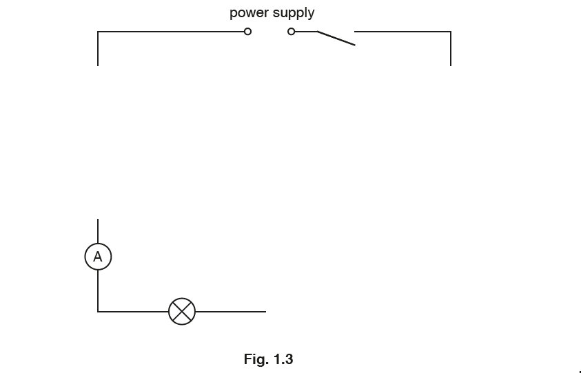

*Source: 2019 (Series 3) 0625/63 Q1E*

### Q7 — medium — 11 marks

**Q7** [3 marks]

A student is investigating a resistance wire. She uses the circuit shown in Fig. 3.1.

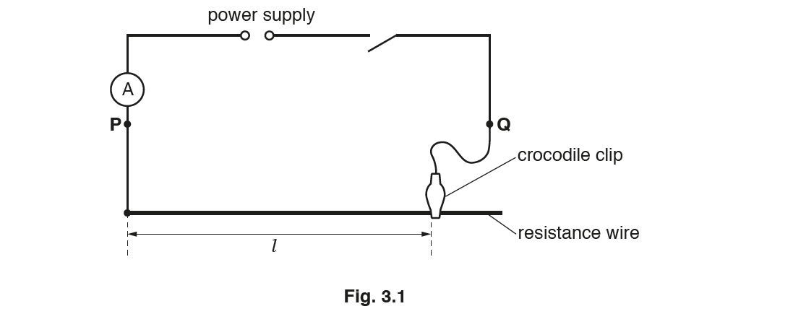

(i) On Fig. 3.1, draw a voltmeter connected to measure the potential difference *V* across terminals **P** and **Q**.

[1]

(ii) The student connects the crocodile clip to a length $l$ = 90.0 cm of the resistance wire and measures the potential difference *V* across terminals **P** and** Q** and the current $I$ in the circuit.

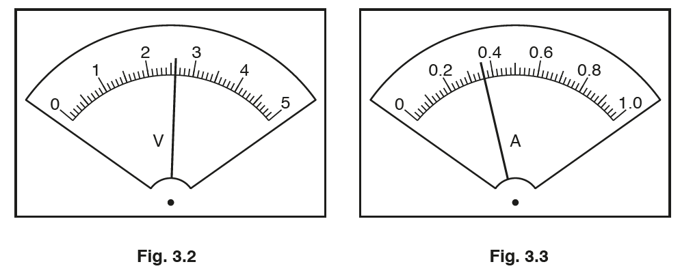

Read, and record in Table 3.1, the values of *V* and $I$ shown on the meters in Fig. 3.2 and Fig. 3.3.

[2]

**Table 3.1**

| $l$ / cm | *V*/ | $I$/ | *R*/Ω | $\frac{R}{l}/\frac{Ω}{cm}$ |
|---|---|---|---|---|
| 90.0 |   |   |   |   |
| 60.0 | 2.5 | 0.52 |   |   |
| 40.0 | 2.3 | 0.71 |   |   |

*Source: Feb 2019 0625/62 Q3A*

**Q7** [1 mark]

**Extract:**

Table 3.1

| ![l] / cm | *V*/ | ![I]/ | *R*/Ω | ![R over l divided by fraction numerator capital omega over denominator c m end fraction] |
| 90.0 |   |   |   |   |
| 60.0 | 2.5 | 0.52 |   |   |
| 40.0 | 2.3 | 0.71 |   |   |

The student then connects the crocodile clip to lengths $l$ = 60.0 cm and $I$ = 40.0 cm of the resistance wire. She measures the potential difference *V* across terminals **P** and **Q** and the current $I$ in the circuit. Her readings are shown in Table 3.1.

Complete the column headings in Table 3.1.

*Source: Feb 2019 0625/62 Q3B*

**Q7** [3 marks]

**Extract:**

Table 3.1
| l / cm | V   | I    | R / Ω | R/l (Ω/cm) |
| 90.0   | 2.6 | 0.36 |       |            |
| 60.0   | 2.5 | 0.52 |       |            |
| 40.0   | 2.3 | 0.71 |       |            |

(i) Calculate, and record in Table 3.1, the resistance *R* of each length $l$ of the wire.

Use the readings from Table 3.1 and the equation $R=\frac{V}{I}$

[2]

(ii) Calculate, and record in Table 3.1, the value of R/$l$ for each length of wire.

[1]

*Source: Feb 2019 0625/62 Q3C*

**Q7** [1 mark]

**Extract:**

A correctly completed set of readings in Table 3.1 would look like:

| l / cm | V / | I / | R / Ω | R/l (Ω/cm) |
| 90.0 | 2.6 | 0.36 | 7.2 | 0.08 |
| 60.0 | 2.5 | 0.52 | 4.8 | 0.08 |
| 40.0 | 2.3 | 0.71 | 3.2 | 0.08 |

All values of R/l calculated as 0.08 (Ω/cm)

Use your results in Table 3.1 to calculate the resistance *R*25 of a 25.0 cm length of the resistance wire. Show your working.

*R*25 = ..................................................... Ω

*Source: Feb 2019 0625/62 Q3D*

**Q7** [1 mark]

**Extract:**

A student is investigating a resistance wire. She uses the circuit shown in Fig. 3.1.

(ii) The student connects the crocodile clip to a length l = 90.0 cm of the resistance wire and measures the potential difference V across terminals P and Q and the current I in the circuit.

The student then connects the crocodile clip to lengths l = 60.0 cm and l = 40.0 cm of the resistance wire. She measures the potential difference V across terminals P and Q and the current I in the circuit. Her readings are shown in Table 3.1.

Suggest **one** reason why different students, carrying out the experiment carefully with the same equipment, may **not** obtain identical results.

*Source: Feb 2019 0625/62 Q3E*

**Q7** [2 marks]

The student finds that, during the experiment, the wire becomes hot because of a high current.

She decides to use a variable resistor to prevent this.

Complete the circuit in Fig. 3.4 to show a variable resistor used for this purpose in the experiment.

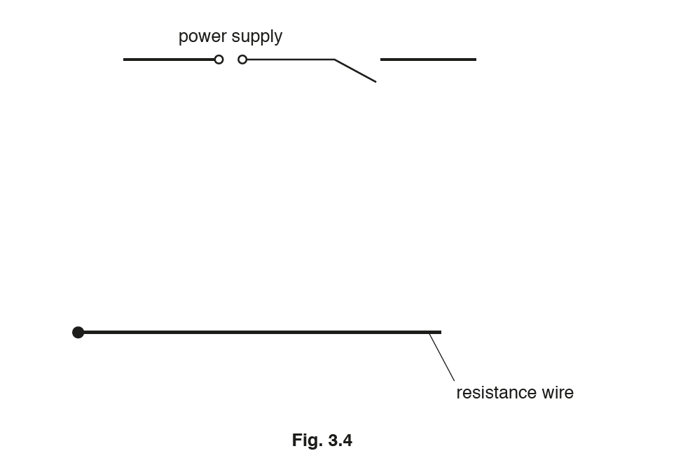

*Source: Feb 2019 0625/62 Q3F*

### Q8 — medium — 11 marks

**Q8** [2 marks]

A student is investigating a power supply. She is using the circuit shown in Fig. 3.1.

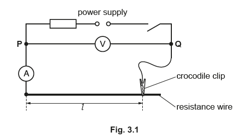

The student connects the crocodile clip to a length *l* = 100.0 cm of the resistance wire and measures the potential difference *V*0 across terminals **P** and **Q** and the current* I*0 in the circuit.

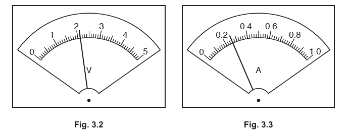

(i) Record the values of *V*0 in V, and *I*0 in A, shown on the meters in Fig. 3.2 and Fig. 3.3.

*V*0 = ........................................................... V

*I*0 = ........................................................... A [1]

(ii) Calculate the resistance *R*0 of 100.0 cm of the wire. Use your values of *V*0 and *I*0 and the equation

$R_{0}=\frac{V_{0}}{I_{0}}$

*R*0 = ...........................................................Ω [1]

*Source: 2020 0625/62 Q3A*

**Q8** [1 mark]

The student then connects the crocodile clip to lengths* l *= 70.0 cm, 60.0 cm, 50.0 cm, 40.0 cm and 30.0 cm of the resistance wire. She measures the current *I* in the circuit for each length.

Her readings are shown in Table 3.1.

**Table 3.1**

| $l$*** / *****cm** | $l$**/ A** | $\frac{1}{I}$** / **$\frac{1}{A}$** ** |
|---|---|---|
| 70.0 | 0.35 |   |
| 60.0 | 0.40 | 2.50 |
| 50.0 | 0.44 | 2.27 |
| 40.0 | 0.53 | 1.89 |
| 30.0 | 0.65 | 1.54 |

Calculate, and write in Table 3.1, the value of $\frac{1}{I}$ for length *l* = 70.0 cm of the wire.

*Source: 2020 0625/62 Q3B*

**Q8** [4 marks]

**Extract:**

Table 3.1

| l / cm | I / A | 1/I / 1/A |
| 70.0   | 0.35  | 2.86      |
| 60.0   | 0.40  | 2.50      |
| 50.0   | 0.44  | 2.27      |
| 40.0   | 0.53  | 1.89      |
| 30.0   | 0.65  | 1.54      |

Plot a graph of $l$ / cm (y-axis) against$\frac{1}{I}/\frac{1}{A}$ (x-axis). You do **not** need to start your axes at the origin (0,0).

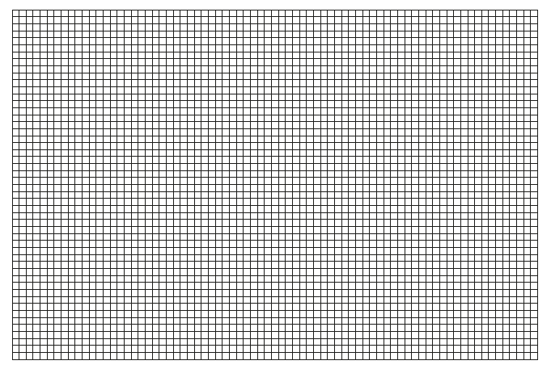

*Source: 2020 0625/62 Q3C*

**Q8** [2 marks]

**Extract:**

(From part a(ii))
- V = 2.1 (V)
- I = 0.26 (A)
- R_0 = V_0 / I_0
- R_0 = 2.1 / 0.26
- R_0 = 8.1 Ω

(From part d(ii))
- E = (G × R_0) / k
- k = 100 cm

(i) Determine the gradient *G* of the graph. Show clearly on the graph how you obtained the necessary information.

*G* = ........................................................ [1]

(ii) Calculate the electromotive force (e.m.f.) *E* of the power supply. Use your value of *R*0 from **(a)(ii)** and the equation

$E=\frac{G\timesR_{0}}{k}$

, where *k *= 100 cm.

*E* = ........................................................ [1]

*Source: 2020 0625/62 Q3D*

**Q8** [2 marks]

**Extract:**

The student then connects the crocodile clip to lengths l = 70.0 cm, 60.0 cm, 50.0 cm, 40.0 cm and 30.0 cm of the resistance wire. She measures the current I in the circuit for each length.

The ammeter in this circuit has a small resistance which affects the current. The effect of this resistance on the measured current I will be different for each measured length l of the resistance wire.

State and explain which length l will be most affected by the resistance of the ammeter.

*Source: 2020 0625/62 Q3E*

## Multiple Choice Questions (40 questions)

### Q1 — easy — 1 marks

**Q1** [1 mark]

The electromotive force (e.m.f.) of a battery is

### Q2 — medium — 1 marks

**Q2** [1 mark]

A current of 0.50 A flows through a lamp for 4.0 minutes.

What is the charge that flows through the lamp?

### Q3 — medium — 1 marks

**Q3** [1 mark]

A plastic rod is rubbed with a cloth. The rod becomes negatively charged.

What has happened during the charging process?

### Q4 — hard — 1 marks

**Q4** [1 mark]

An electric heater with a power rating of $2000\text{W}$ is switched on for $3.0\text{hours}$. The cost of $1\text{kWh}$ of electricity is $20\text{cents}$.

What is the total cost of using the heater?

### Q5 — easy — 1 marks

**Q5** [1 mark]

The diagrams show the voltage–time graphs for two electrical power supplies, X and Y.

Which row correctly identifies the type of current provided by each supply?

|   | **supply X** | **supply Y** |
|---|---|---|
| **A** | alternating current (a.c.) | direct current (d.c.) |
| **B** | alternating current (a.c.) | alternating current (a.c.) |
| **C** | direct current (d.c.) | direct current (d.c.) |
| **D** | direct current (d.c.) | alternating current (a.c.) |

### Q6 — medium — 1 marks

**Q6** [1 mark]

A student rubs a plastic rod with a cloth. The rod becomes negatively charged.

Which statement about the rod is correct?

### Q7 — medium — 1 marks

**Q7** [1 mark]

** **A battery is connected to a circuit. It is switched on for 1.0 minute. During that time, there is a current of 0.40 A in the circuit and the battery supplies a total of 48 J of energy.

Which row gives the charge that passes and the electromotive force (e.m.f.) of the battery?

|   | charge that passes in 1.0 minute / C | e.m.f. of the battery / V |
|---|---|---|
| **A** | 0.40 | 2.0 |
| **B** | 0.40 | 120 |
| **C** | 24 | 2.0 |
| **D** | 24 | 120 |

*Source: june 2023 0972/21 Q27*

### Q8 — medium — 1 marks

**Q8** [1 mark]

The diagram shows the current–voltage graph for a metal wire.

What can be deduced from the graph?

*Source: June2023 0972/21 Q26*

### Q9 — easy — 1 marks

**Q9** [1 mark]

A wire has a uniform circular cross-sectional area.

Which statement is correct?

*Source: June 2023 0972/21 Q25*

### Q10 — medium — 1 marks

**Q10** [1 mark]

Four students draw a circuit diagram of the apparatus used to measure the resistance of resistor R.

Which circuit is correct?

*Source: June 2023 0972/ 11 Q26*

### Q11 — easy — 1 marks

**Q11** [1 mark]

Which particles move to cause a current in a copper wire?

*Source:  June 2023 0972/11 Q25*

### Q12 — medium — 1 marks

**Q12** [1 mark]

** **A plastic rod is rubbed with a cloth.

The rod and the cloth both become charged as electrons move between them.

The rod becomes negatively charged.

Which diagram shows how the rod becomes negatively charged and shows the final charge on the cloth?

*Source:  June 2023 0972/11 Q24*

### Q13 — medium — 1 marks

**Q13** [1 mark]

A resistor converts 360 J of energy when there is a current of 3.0 A in it. The potential difference across the resistor is 6.0 V.

For how long is there this current in the resistor?

*Source: June 2022 paper 2 Q31*

### Q14 — medium — 1 marks

**Q14** [1 mark]

A plastic rod is brought near to a small plastic sphere suspended from a stand. The sphere is repelled by the rod.

Why is this?

*Source: June 2022 paper 2 Q29*

### Q15 — medium — 1 marks

**Q15** [1 mark]

The circuit shown is being used to measure the resistance of resistor Z.**  **

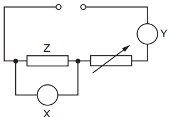

What is the correct combination of meters to determine the resistance of resistor Z?

| ** ** | **meter X** | **meter Y** |
|---|---|---|
| **A** | ammeter | ammeter |
| **B** | ammeter | voltmeter |
| **C** | voltmeter | ammeter |
| **D** | voltmeter | voltmeter |

*Source: June 2022 paper 1 Q30*

### Q16 — medium — 1 marks

**Q16** [1 mark]

The diagram shows a charged plastic rod and an uncharged metal sphere. The metal sphere is suspended by an insulating thread.

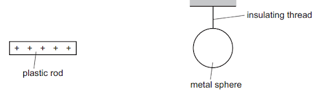

The plastic rod is then moved close to the metal sphere.

Which row is correct?

| ** ** | **observation** | **the overall state of the metal sphere** |
|---|---|---|
| **A** | The rod attracts the sphere. | charged |
| **B** | The rod attracts the sphere. | uncharged |
| **C** | The rod repels the sphere. | charged |
| **D** | The rod repels the sphere. | uncharged |

*Source: june 2022 paper 1 Q28*

### Q17 — medium — 1 marks

**Q17** [1 mark]

A water heater is connected to a 230 V supply and there is a current of 26 A in the heater.

It takes 20 minutes to heat the water to the required temperature.

How much energy is supplied by the heater?

*Source: specimen 2023 paper 2 Q31*

### Q18 — medium — 1 marks

**Q18** [1 mark]

The electromotive force (e.m.f.) of a mobile phone battery is 3.7 V.

What does this mean?

*Source: specimen 2023 paper 2 Q29*

### Q19 — medium — 1 marks

**Q19** [1 mark]

A plastic rod is rubbed with a cloth. The rod becomes positively charged.

What happens to the plastic rod and what is the charge on the cloth?

|   | plastic rod | charge on cloth |
|---|---|---|
| **A** | gains electrons | negative |
| **B** | gains electrons | positive |
| **C** | loses electrons | negative |
| **D** | loses electrons | positive |

*Source: specimen 2023 paper 1 Q28*

### Q20 — easy — 1 marks

**Q20** [1 mark]

**Extended Tier Only**

Which unit is equivalent to a volt (V)?

*Source: june 2022 paper 2 Q30*

### Q21 — easy — 1 marks

**Q21** [1 mark]

A large battery is labelled with various items of information about the battery.

| 12 V | 30 kg | 216 kJ | 680 A |
|---|---|---|---|

One of these items of information is the electromotive force (e.m.f.) of the battery.

What is the e.m.f. of the battery?

*Source: June 2022 paper 1 Q29*

### Q22 — easy — 1 marks

**Q22** [1 mark]

Which pair of quantities have the same units?

### Q23 — easy — 1 marks

**Q23** [1 mark]

The diagram shows two light, silver-coated balls labelled **X** and **Y** hanging from threads near to each other.

Which line identifies the possible charges on **X** and **Y**?

|   | **X** | **Y** |
|---|---|---|
| **A** | neutral | neutral |
| **B** | negative | negative |
| **C** | negative | positive |
| **D** | positive | negative |

### Q24 — easy — 1 marks

**Q24** [1 mark]

**Extended tier only**

What is the correct unit of charge?

### Q25 — easy — 1 marks

**Q25** [1 mark]

What is the unit of electromotive force?

### Q26 — easy — 1 marks

**Q26** [1 mark]

Which line correctly states the equation for **electrical energy**?

### Q27 — medium — 1 marks

**Q27** [1 mark]

**Extended tier only**

A student has four copper wires, of different dimensions.

Which of the following wires has the largest resistance?

|   | **Length of wire / cm** | **Diameter of wire / mm** |
|---|---|---|
| **A** | 100 | 0.2 |
| **B** | 300 | 0.1 |
| **C** | 50 | 0.4 |
| **D** | 30 | 0.5 |

### Q28 — hard — 1 marks

**Q28** [1 mark]

**Extended tier only**

What is the definition of an electric field?

### Q29 — hard — 1 marks

**Q29** [1 mark]

A 2.0 Ω resistor is connected to meter X and meter Y as shown in the diagram.

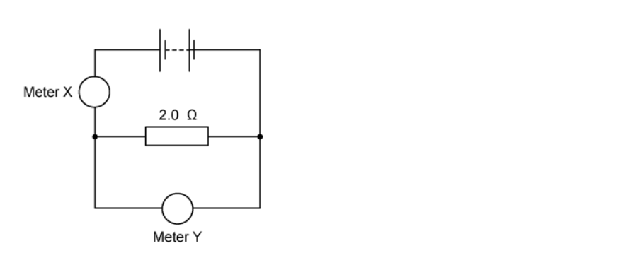

Which row in the table shows possible values for the two meters?

|   | **X** | **Y** |
|---|---|---|
| **A** | 4.0 | 8.0 |
| **B** | 2.0 | 2.0 |
| **C** | 4.0 | 2.0 |
| **D** | 1.0 | 1.0 |

### Q30 — medium — 1 marks

**Q30** [1 mark]

**Extended tier only**

A student considers how changing the diameter and length of a wire affects its resistance.

Which row shows the changes that could be made to the length and diameter of the wire to **decrease** its resistance?

|   | **Change to length** | **Change to diameter** |
|---|---|---|
| **A** | increase | increase |
| **B** | increase | decrease |
| **C** | decrease | increase |
| **D** | decrease | decrease |

### Q31 — hard — 1 marks

**Q31** [1 mark]

A student connects a 6 V power supply to a 3 Ω resistor. The resistor is left connected to the power supply for 1 minute.

How much power is dissipated by the resistor?

### Q32 — hard — 1 marks

**Q32** [1 mark]

**Extended tier only**

A student sets up a circuit as shown in the diagram.

A charge of 4.9 C flows through the resistor in 0.7 s.

Which row shows the correct current, direction of electron flow and direction of conventional current through the resistor?

|   | **current / A** | **direction of electron flow** | **direction of conventional current** |
|---|---|---|---|
| **A** | 7.00 | Left to right | Right to left |
| **B** | 3.43 | Left to right | Right to left |
| **C** | 7.00 | Right to left | Right to left |
| **D** | 3.43 | Right to left | Right to left |

### Q33 — hard — 1 marks

**Q33** [1 mark]

**Extended tier only**

Which row in the table gives the correct units for charge and e.m.f.?

|   | **Charge** | **EMF** |
|---|---|---|
| **A** | Q | E |
| **B** | C | V |
| **C** | A | J |
| **D** | J | ᘯ |

### Q34 — medium — 1 marks

**Q34** [1 mark]

A student rubs an acetate rod with a cloth, giving it a negative charge. She then holds it near an earthed, conducting sphere as shown in the diagrams below.

Which diagram shows the correct distribution of charges on the conducting sphere?

### Q35 — hard — 1 marks

**Q35** [1 mark]

**Extended tier only**

Which diagram shows the correct electric field pattern between two oppositely charged parallel plates?

### Q36 — medium — 1 marks

**Q36** [1 mark]

A student wants to charge up some rods by rubbing them with a cloth made from a suitable material.

He has a number of rods to choose from: a copper rod, a PVC rod, an aluminium rod and a glass rod.

Which two of the rods would hold a charge when rubbed with an appropriate cloth?

### Q37 — hard — 1 marks

**Q37** [1 mark]

A student wants to measure the power dissipated by a 10 kΩ resistor.

What equipment should the student use to determine the power dissipated?

### Q38 — medium — 1 marks

**Q38** [1 mark]

A PVC (plastic) rod is rubbed with a nylon cloth. This process causes electrons to be transferred between the rod and the cloth, causing both objects to become charged.

Which row gives the correct nature of the charges on both the cloth and the rod, and the effect the objects have on each other after becoming charged?

|   | **Charges on rod and cloth** | **Effect** |
|---|---|---|
| **A** | the same | repel |
| **B** | the same | attract |
| **C** | opposite | repel |
| **D** | opposite | attract |

### Q39 — hard — 1 marks

**Q39** [1 mark]

A 3.0 Ω resistor is connected to a 15 V power supply as shown in the diagram. The ammeter reads 5 A throughout the experiment.

How much energy is dissipated as heat by the resistor in 2 minutes?

### Q40 — hard — 1 marks

**Q40** [1 mark]

**Extended tier only**

Four current-voltage graphs are given below.

Which graph shows an ohmic resistor and which shows a filament lamp?

|   | **Filament lamp** | **Ohmic resistor** |
|---|---|---|
| **A** | Q | S |
| **B** | R | Q |
| **C** | P | Q |
| **D** | Q | R |

## Theory Questions (20 questions)

### Q1 — medium — 9 marks

**Q1** [2 marks]

Fig. 7.1 shows a circuit containing a battery of e.m.f. 12 V and three resistors.

**Fig. 7.1**

The voltmeter measures the potential difference (p.d.) across the parallel combination of resistors.

Define potential difference (p.d.).

**Q1** [2 marks]

**Extract:**

Fig. 7.1 shows a circuit containing a battery of e.m.f. 12 V and three resistors.

A circuit diagram showing a 12-volt battery connected in series with resistor R1 and a parallel combination of resistors R2 and R3. A voltmeter is connected across the parallel combination. R1 has a resistance of 8 ohms, R2 has a resistance of 20 ohms, and R3 has a resistance of 30 ohms.

Show that the combined resistance of R2 and R3 is $12Ω$.

**Q1** [3 marks]

**Extract:**

Fig. 7.1 shows a circuit containing a battery of e.m.f. 12 V and three resistors.

The voltmeter measures the potential difference (p.d.) across the parallel combination of resistors.

R1 has a resistance of 8 ohms, R2 has a resistance of 20 ohms, and R3 has a resistance of 30 ohms.

Calculate the current in resistor R1.

**Q1** [2 marks]

**Extract:**

Fig. 7.1 shows a circuit containing a battery of e.m.f. 12 V and three resistors.

The voltmeter measures the potential difference (p.d.) across the parallel combination of resistors.

R1 has a resistance of 8 ohms, R2 has a resistance of 20 ohms, and R3 has a resistance of 30 ohms.

Explain how the reading on the voltmeter can be used to determine the p.d. across resistor R1.

### Q2 — hard — 7 marks

**Q2** [2 marks]

Fig. 9.1 shows a conducting ball that oscillates between two charged plates.

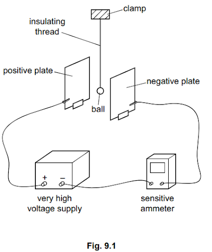

As the ball oscillates, it touches each plate in turn.

Referring to the charge on the ball, explain why the ball moves to the positive plate after touching the negative plate.

*Source: specimen 2023 paper 4 Q9A*

**Q2** [2 marks]

State which particles move when there is a current and state the direction in which they move through the sensitive ammeter.

*Source: specimen 2023 paper 4 Q9B*

**Q2** [3 marks]

**Extended Tier Only**

For each complete oscillation of the ball moving between the plates, a charge of 8.5 × 10–10 C is transferred from one plate to the other. The frequency of oscillation is 4.0 Hz.

Calculate the current shown on the sensitive ammeter.

current = ..........................................................

*Source: specimen 2023 paper 4 Q9C*

### Q3 — medium — 7 marks

**Q3** [2 marks]

Fig. 9.1 shows an electric circuit which includes uninsulated resistance wire XY. A teacher shows some students how to complete the circuit by placing the contact C at various positions on the wire XY.

The students place contact C at Y. They measure the current on the ammeter. Then they move the contact C along the wire from Y to X.

State and explain the effect on the ammeter reading when they move the contact C from Y to X.

*Source: June 2022 paper 3 Q9A*

**Q3** [3 marks]

**Extract:**

Voltage, V = 6.0 V
Resistance, R = 8.0 Ω

Calculate the reading on the ammeter when contact C is at X.

ammeter reading = ...................................................... A

*Source: june 2022 paper 3 Q9B*

**Q3** [2 marks]

**Extract:**

The resistance of the wire between X and P is 20Ω.
The fixed resistor is 8.0Ω.

The students move contact C to point P. The resistance of the wire between X and P is 20Ω.

Calculate the total resistance of the resistance wire between X and P and the fixed resistor.

total resistance = ..................................................... Ω

*Source: june 2022 paper 3 Q9C*

### Q4 — medium — 5 marks

**Q4** [3 marks]

A student rubs a polythene rod with a dry cloth. The polythene rod becomes negatively charged.

Describe and explain how the rod becomes negatively charged.

*Source: February/March 2018 0625/32 Q11A*

**Q4** [2 marks]

**Extract:**

A student rubs a polythene rod with a dry cloth. The polythene rod becomes negatively charged.

The negatively charged polythene rod hangs from a nylon thread so that it is free to turn.

The student charges a second polythene rod and brings it close to the first rod, as shown in Fig.11.1.

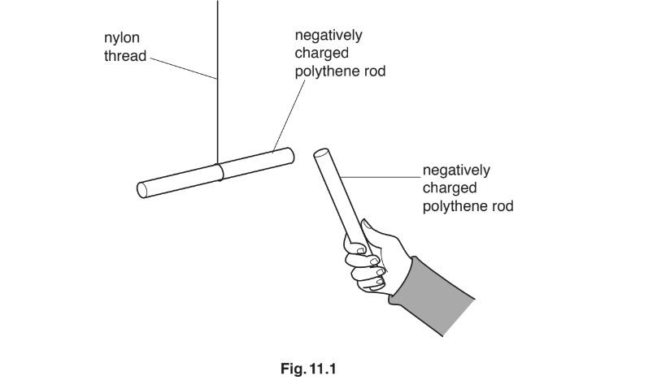

Describe and explain what happens when the negatively charged rods are close to each other.

*Source: February/March 2018 0625/32 Q11B*

### Q5 — medium — 6 marks

**Q5** [4 marks]

An uncharged conducting metal plate rests on insulating supports. Fig. 10.1 shows the plate and a positively charged insulating plastic sheet placed on top of the metal plate.

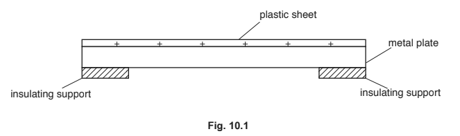

(i) Describe any flow of charge that takes place when the plastic sheet is placed onto the metal plate.

[1]

(ii) On Fig. 10.1, draw how charges are now arranged within the metal plate.

[1]

(iii) State and explain if this arrangement of charge helps to keep the plastic sheet in place.

[2]

*Source: 2018 0625/42 Q10A*

**Q5** [2 marks]

Fig. 10.2 shows two uncharged conducting spheres suspended on insulating threads.

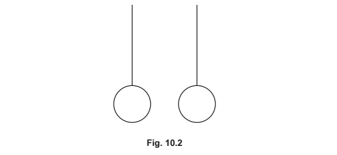

1. The spheres are now both given positive charges. On Fig. 10.2, draw a possible position of each sphere and thread.

2. Explain the positions you have drawn.

*Source: 2018 0625/42 Q10B*

### Q6 — hard — 7 marks

**Q6** [1 mark]

State, in terms of their structure, why metals are good conductors of electricity.

*Source: 2018 0625/41 Q7A*

**Q6** [4 marks]

**Extended tier only**

A cylindrical metal wire W1, of length $L$ and cross-sectional area *A*, has a resistance of 16 Ω.

A second cylindrical wire W2, of length $\frac{L}{2}$ and cross-sectional area 2*A*, is made from the same metal.

Determine

(i) the resistance of *W**2*,

resistance of *W**2* = ...........................................................[2]

(ii) the effective resistance of *W**1* and *W**2* when connected in parallel

resistance of parallel pair = ...........................................................[2]

*Source: 2018 0625/41 Q7B*

**Q6** [2 marks]

**Extract:**

A cylindrical metal wire W~1~, of length L and cross-sectional area A, has a resistance of 16 Ω. A second cylindrical wire W~2~, of length L/2 and cross-sectional area 2A, is made from the same metal.

(i) the resistance of W~2~: R_2 = 4 Ω

(ii) the effective resistance of W~1~ and W~2~ when connected in parallel: resistance of parallel pair = 3.2 Ω

Recall the equation for resistors in parallel:
1/R = 1/R_1 + 1/R_2

W~1~ and W~2~ are connected in parallel.

**Extended tier only**

The parallel pair of resistors in **(b)(ii)** is connected to a battery that is made from three cells in series, each of electromotive force (e.m.f.) *E*. There is a current in each resistor.

(i) State the e.m.f. of the battery.

[1]

(ii) The current in the battery is IB, the current in W1 is I1 and the current in W2 is I2.

Place a tick in **one** box to indicate how these three currents are related.

`square`  I1 > I2 > IB

`square`  I1 > IB > I2

`square`  I2 > I1 > IB

`square`  I2 > IB > I1

`square`  IB > I1 > I2

`square`  IB > I2 > I1

`square`  I1 = I2 = IB

[1]

*Source: 2018 0625/41 Q7C*

### Q7 — hard — 10 marks

**Q7** [2 marks]

**Extended tier only**

A light polystyrene ball is coated in conducting paint and suspended from a thread as shown in Fig. 1

The ball is given a positive charge

**Fig. 1**

Draw the electric field lines around the positively charged ball.

**Q7** [4 marks]

**Extract:**

A light polystyrene ball is coated in conducting paint and suspended from a thread as shown in Fig. 1

The ball is given a positive charge

A second, identical ball is suspended close to the first one. The second ball is also given a positive charge.

A student predicts that both balls will hang straight downward, due to the effect of gravity.

State whether the student is correct, and explain your answer.

**Q7** [4 marks]

**Extract:**

A light polystyrene ball is coated in conducting paint and suspended from a thread as shown in Fig. 1. The ball is given a positive charge. Draw the electric field lines around the positively charged ball.

A second, identical ball is suspended close to the first one. The second ball is also given a positive charge.

The student's prediction is: Both balls will hang straight downward, due to the effect of gravity. This prediction is: Wrong / incorrect; This is because: Both balls are positively charged; Like charges repel; Therefore the balls will be pushed apart.

(Sketch) Balls are hanging so that the threads point away from each other; Both balls have a radial field with arrows pointing away from their centre; Field lines extend into the area between the two balls; Field lines do not meet / there is an empty space.

**Extended tier only**

Sketch the arrangement of the two balls hanging next to each other.

Add field lines to your diagram, in support of your answer to part (b).

### Q8 — medium — 8 marks

**Q8** [2 marks]

**Extended tier only**

Fig. 9.1 shows current-potential difference graphs for a resistor and for a lamp.

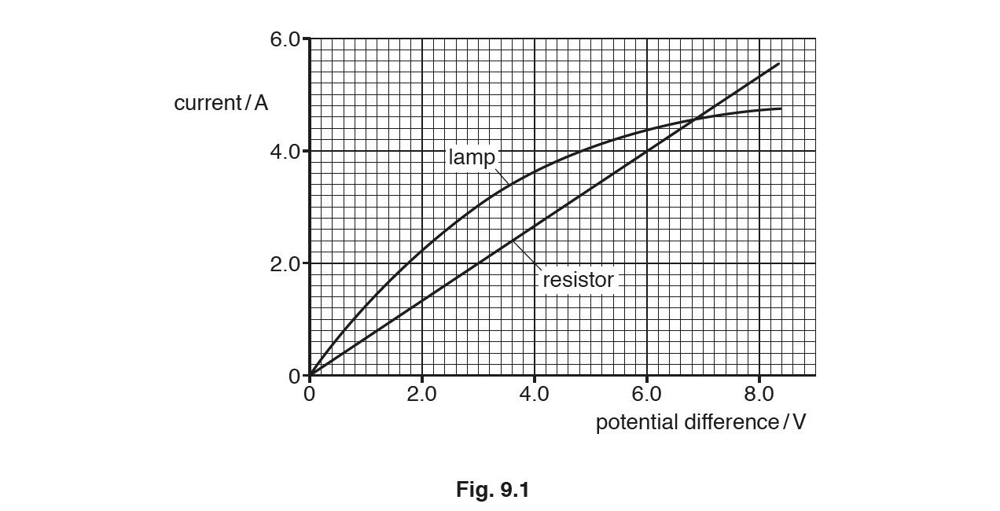

(i) The potential difference (p.d.) applied to the resistor is increased. Tick the box that indicates the effect on the resistance of the resistor.

`square` resistance increases

`square` resistance is constant

`square` resistance decreases

[1]

(ii) The potential difference (p.d.) applied to the lamp is increased. Tick the box that indicates the effect on the resistance of the lamp.

`square` resistance increases

`square` resistance is constant

`square` resistance decreases

[1]

*Source: February/March 2018 0625/42 Q9A*

**Q8** [2 marks]

**Extract:**

Fig. 9.1 shows current-potential difference graphs for a resistor and for a lamp.

The p.d. across the lamp is 6.0V. Use the graph to obtain the current of the lamp when the potential difference is 6.0 V: The current is 4.4 A.

The p.d. across the lamp is 6.0V. Calculate the resistance of the lamp.

resistance = .........................................................

*Source: February/March 2018 0625/42 Q9B*

**Q8** [2 marks]

**Extract:**

The lamp and the resistor are connected in parallel to a 6.0 V supply.
Current in the lamp = 4.4 A (at 6.0 V)
Current in the resistor = 4.0 A (at 6.0 V)
Total current in a parallel circuit = sum of the currents along each path.

The lamp and the resistor are connected in parallel to a 6.0 V supply.

Calculate the current from the supply.

current = .........................................................

*Source: February/March 2018 0625/42 Q9C*

**Q8** [2 marks]

**Extract:**

Use the graph to obtain the p.d. across the lamp when the current is 4.0 A:
- p.d. across the lamp = 4.9 V

Recall from part (c) the p.d. across the resistor when the current is 4.0 A:
- p.d. across the resistor when the current is 4.0 A = 6.0 V

**Extended tier only**

The lamp and the resistor are connected in series to another power supply. The current in the circuit is 4.0 A.

Calculate the total p.d. across the lamp and the resistor.

p.d. = .........................................................

*Source: February/March 2018 0625/42 Q9D*

### Q9 — hard — 10 marks

**Q9** [4 marks]

**Extended tier only**

A light-emitting diode (LED) is a diode that emits light when there is a current in it.

Draw a circuit diagram showing an LED, connected so that it is lit, in series with a battery and a fixed resistor. Use standard electrical symbols.

*Source: May/June 2020 (Series 2) 0625/42 Q8A*

**Q9** [2 marks]

**Extract:**

A light-emitting diode (LED) is a diode that emits light when there is a current in it.

The p.d. across the LED when lit is 3.1 V and the current in the LED is 0.030 A.

Calculate the value of the resistance of the LED when lit.

resistance = .........................................................

*Source: May/June 2020 (Series 2) 0625/42 Q8B*

**Q9** [4 marks]

Fig. 8.1 shows a power supply of e.m.f. 10.5 V connected in series with a lamp and a heater.

The p.d. across the lamp is 2.1 V and the current in the lamp is 1.5 A.

Calculate:

(i) the resistance of the heater

resistance = ......................................................... [2]

(ii) the power of the heater.

power = ......................................................... [2]

*Source: May/June 2020 (Series 2) 0625/42 Q8C*

### Q10 — medium — 7 marks

**Q10** [1 mark]

Fig. 9.1 shows the symbol for a 12V battery.

Two lamps are connected in parallel with the battery.

On Fig. 9.1, using the correct symbols, complete the circuit diagram.

*Source: 2018 (Series 1) 0625/41 Q9A*

**Q10** [3 marks]

**Extract:**

Fig. 9.1 shows the symbol for a 12V battery.

Two lamps are connected in parallel with the battery.

One of these lamps has a resistance of 6.0 Ω.

One of these lamps has a resistance of 6.0 Ω.

Calculate, for this lamp:

(i) the current

current = ...........................................................[1]

(ii) the power.

power = ...........................................................[2]

*Source: 2018 (Series 1) 0625/41 Q9B*

**Q10** [3 marks]

**Extract:**

Fig. 9.1 shows the symbol for a 12V battery.

Two lamps are connected in parallel with the battery.

The power of the other lamp is 36 W.

Calculate the total energy delivered to this lamp in 20 hours.

energy = ...........................................................

*Source: 2018 (Series 1) 0625/41 Q9C*

### Q11 — medium — 7 marks

**Q11** [2 marks]

The lamp of a car headlight is rated at 12 V, 50.0 W.

Calculate the current in the lamp when operating normally.

current = .........................................................

*Source: February/March 2018 0625/42 Q8A*

**Q11** [5 marks]

**Extended tier only**

A car is driven at night.

In a journey, the total charge that passes through the 12 V battery is 270 kC.

(i) Calculate the electrical energy transferred.

energy = ......................................................... [3]

(ii) The fuel used by the car provides 3.6 × 104 J / cm3.

Calculate the volume of fuel used to provide the energy calculated in **(b)(i)**.

volume = ......................................................... [2]

*Source: February/March 2018 0625/42 Q8B*

### Q12 — medium — 5 marks

**Q12** [2 marks]

A student experiments with electric charge.

The student uses a dry cloth to rub a plastic rod. The rod becomes positively charged.

Explain how the friction between the rod and the cloth causes the rod to become positively charged.

Use your ideas about the movement of charge.

*Source: Nov 2018 (S1) 0625/31 Q9A*

**Q12** [3 marks]

**Extract:**

A student experiments with electric charge.

The student uses a dry cloth to rub a plastic rod. The rod becomes positively charged.

The student suspends a balloon from an insulating thread, as shown in Fig. 9.1.

The balloon has an electric charge.

Explain how the student can use a positively charged rod to determine the charge on the balloon.

*Source: Nov 2018 (S1) 0625/31 Q9B*

### Q13 — hard — 9 marks

**Q13** [2 marks]

**Extended tier only**

(i) Describe what is meant by an electric field.

[1]

(ii) State what is meant by the direction of an electric field.

[1]

*Source: May/June 2020 (Series 3) 0625/43 Q8A*

**Q13** [4 marks]

Fig. 8.1 shows a polystyrene ball covered with aluminium paint. The polystyrene ball is suspended between two charged metal plates by an insulated thread.

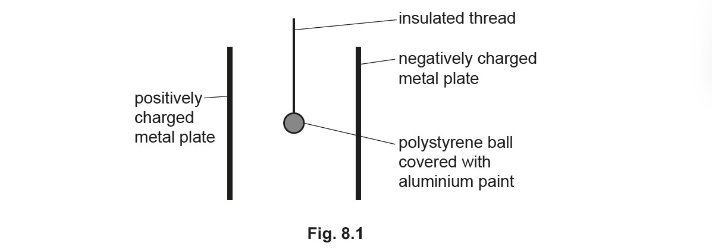

The ball oscillates between the two charged plates.

Explain why the ball oscillates.

*Source: May/June 2020 (Series 3) 0625/43 Q8B*

**Q13** [3 marks]

**Extended tier only**

There is a current of 0.29 A in an electrical circuit.

Calculate the time taken for a charge of 15 C to flow through the electrical circuit.

time = .........................................................

*Source: May/June 2020 (Series 3) 0625/43 Q8C*

### Q14 — hard — 7 marks

**Q14** [4 marks]

(i) Fig. 8.1 shows a positively charged cube of insulating material. The cube is fixed to a piece of wood that is floating on water. A negatively charged rod is held above the piece of wood and brought close to the cube, as shown.

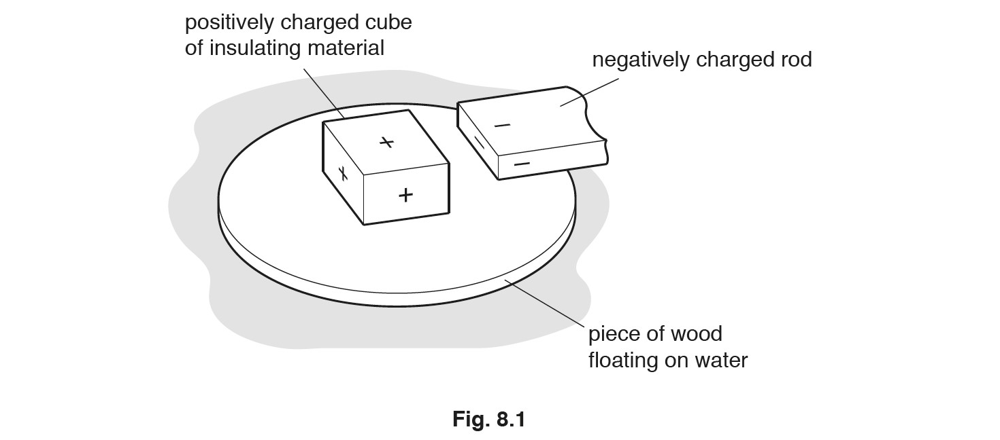

State and explain any movement of the piece of wood.

[2]

(ii) Fig. 8.2 shows two cubes of insulating material. One is positively charged and the other is negatively charged. The cubes are fixed to a piece of wood that is floating on water. Charged rods are held above the piece of wood and brought close to the cubes, as shown.

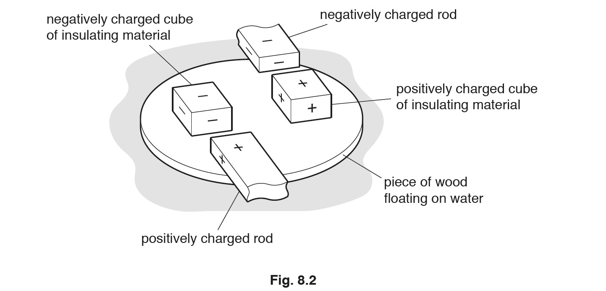

State and explain any movement of the piece of wood.

[2]

*Source: Oct/Nov2018  (Series 2) 0625/42 Q8*

**Q14** [2 marks]

In terms of a simple electron model, describe the differences between conductors and insulators.

*Source: Oct/Nov2018  (Series 2) 0625/42 Q8B*

**Q14** [1 mark]

**Extended tier only**

On Fig. 8.3, draw the electric field pattern around a single-point positive charge.

*Source: Oct/Nov2018  (Series 2) 0625/42 Q8C*

### Q15 — medium — 9 marks

**Q15** [5 marks]

Fig. 10.1 shows an electrical circuit.

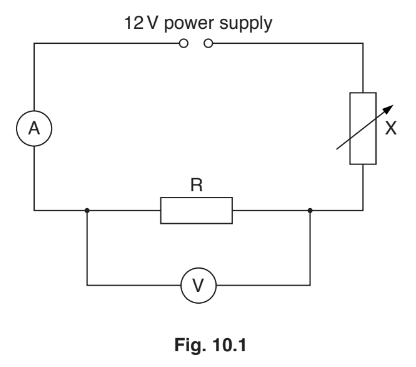

(i) State the name for the component labelled X and state its function in this circuit.

[2]

(ii) Describe how the circuit shown in Fig. 10.1 could be used to find the resistance of the fixed resistor R.

[3]

*Source: 2018 0625/33 Q10A*

**Q15** [4 marks]

An electrical heater has a resistance of 21.8 Ω when connected to a 240 V mains supply.

(i) Calculate the current in the heater.

current = ....................................................... A [3]

(ii) Suggest a rating for the fuse to be fitted to the mains plug for the heater.

fuse rating = ....................................................... A [1]

*Source: 2018 0625/33 Q10B*

### Q16 — medium — 7 marks

**Q16** [1 mark]

Fig. 10.1 shows a circuit used by a student to test a metal wire made of nichrome.

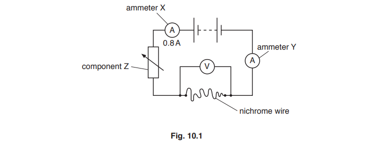

State the name of component Z.

*Source: 2018 (Series 2) 0625/32 Q10A*

**Q16** [1 mark]

**Extract:**

Fig. 10.1 shows a circuit used by a student to test a metal wire made of nichrome.

The current reading on ammeter X is 0.8 A. State the reading on ammeter Y.

*Source: 2018 (Series 2) 0625/32 Q10B*

**Q16** [3 marks]

**Extract:**

Fig. 10.1 shows a circuit used by a student to test a metal wire made of nichrome.

The current in the nichrome wire is 0.8 A. The potential difference (p.d.) across the nichrome wire is 4.5 V.

Calculate the resistance of the nichrome wire.

resistance = ..................................................... Ω

*Source: 2018 (Series 2) 0625/32 Q10C*

**Q16** [2 marks]

**Extract:**

The current in the nichrome wire is 0.8 A. The potential difference (p.d.) across the nichrome wire is 4.5 V. Calculate the resistance of the nichrome wire. resistance = ..................................................... Ω

The student tests a different nichrome wire, which is thicker than the wire in **(c)**, but of the same length. When testing this wire, the current in the wire is different from the value given in **(c)**.

State and explain the difference in current.

*Source: 2018 (Series 2) 0625/32 Q10D*

### Q17 — easy — 5 marks

**Q17** [1 mark]

Fig. 10.1 shows the apparatus for an experiment on electrostatics.

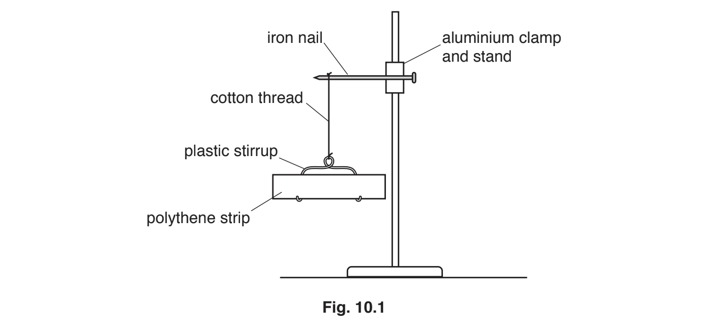

Identify the pieces of equipment that are electrical conductors and those that are electrical insulators. Draw a line from each piece of equipment to the correct box.

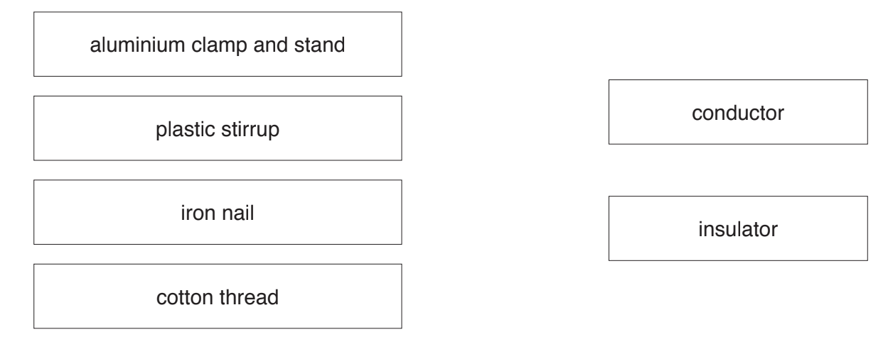

*Source: 2019 0625/32 Q10A*

**Q17** [2 marks]

State and explain how the polythene strip can be given a negative charge.

*Source: 2019 0625/32 Q10B*

**Q17** [2 marks]

Describe how the apparatus in Fig.10.1 could be used to demonstrate that the polythene strip has a negative charge.

*Source: 2019 0625/32 Q10C*

### Q18 — easy — 4 marks

**Q18** [3 marks]

Fig. 10.1 shows a balloon hanging from an insulating thread.

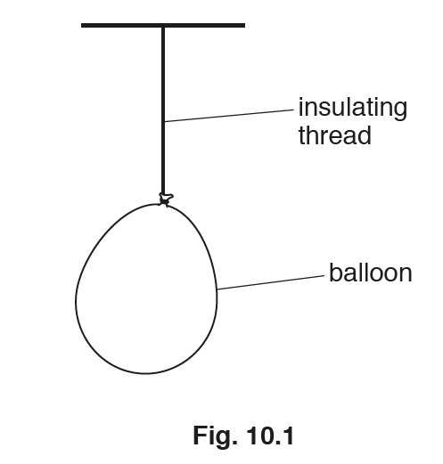

(i) A student gives the balloon a positive charge.

Which statement explains why the balloon becomes positively charged? Tick one box.

`square` The balloon gains electrons

`square` The balloon loses electrons

`square` The balloon gains protons

`square` The balloon loses protons

[1]

(ii) The student brings a charged rod close to the balloon as shown in Fig. 10.2.

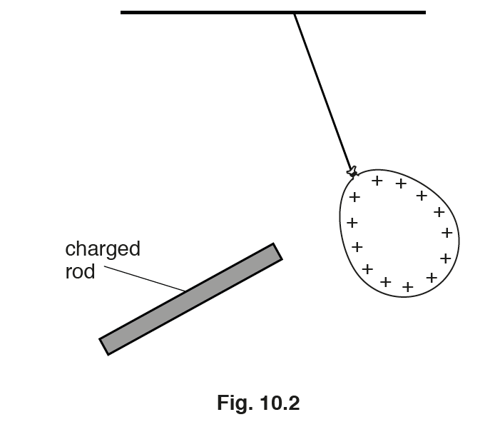

State the type of charge on the rod.   Explain your answer.

[2]

*Source: 2018 0625/32 Q10A*

**Q18** [1 mark]

Electrical charges can move easily through some materials.

Draw a circle around each material that charges can move through easily.

| copper | plastic | rubber | silver | wood |
|---|---|---|---|---|

*Source: 2018 0625/32 Q10B*

### Q19 — easy — 7 marks

**Q19** [4 marks]

A student sets up an electrical circuit. She draws part of the circuit diagram, as shown in Fig.8.1.

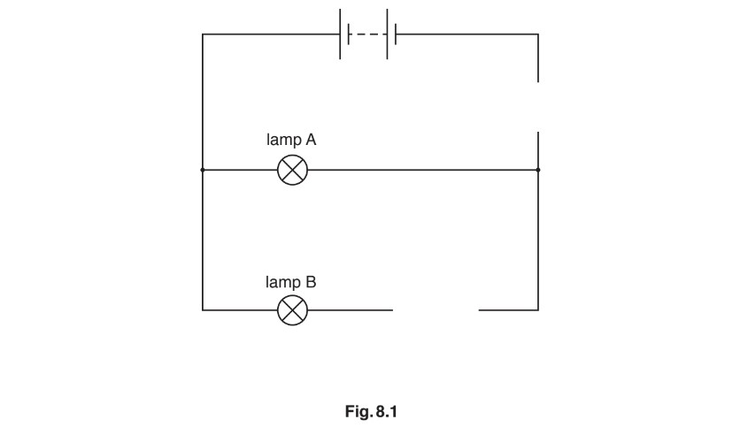

On Fig.8.1, draw the circuit symbols for three devices so that the student can:

(i) measure the total current in the circuit

[1]

(ii) vary the current in the lamp B only

[1]

(iii) measure the potential difference (p.d.) across lamp B.

[2]

*Source: February/March 2018 0625/32 Q8A*

**Q19** [3 marks]

**Extract:**

A student sets up an electrical circuit. She draws part of the circuit diagram, as shown in Fig.8.1.

The current in lamp A is 0.20 A. The potential difference (p.d.) across lamp A is 6.0 V.

Calculate the resistance of lamp A.

resistance = ......................................................Ω

*Source: February/March 2018 0625/32 Q8B*

### Q20 — easy — 6 marks

**Q20** [4 marks]

A student rubs a plastic rod with a dry cloth, as shown in Fig. 8.1. The rod becomes negatively charged.

(i) Use words from the box to complete the sentence.

| **air** | **cloth** | **electrons** | **hand** | **neutrons** | **protons** |
|---|---|---|---|---|---|

The rod becomes negatively charged because ......................................... move from the ......................................... to the rod.

[2]

(ii) The student moves the rod close to a suspended, charged rod. The two rods repel each other.

State the type of charge on the suspended rod.

[1]

(iii) Explain your answer to (a)(ii).

[1]

*Source: 2019 May/June 0972/31 Q8A*

**Q20** [2 marks]

A device has a metal case. Any charge on the case must be able to move to earth.

(i) Draw one ring around a material that is suitable for the connection to earth.

| **copper** | **glass** | **plastic** | **rubber** |
|---|---|---|---|

[1]

(ii) Explain your answer to (b)(i).

[1]

*Source: 2019 May/June 0972/31 Q8B*

