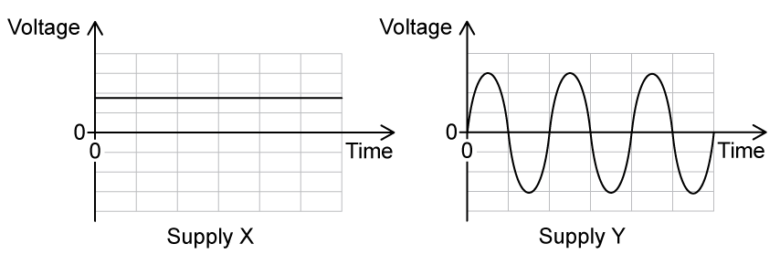
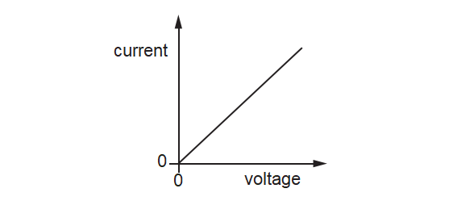
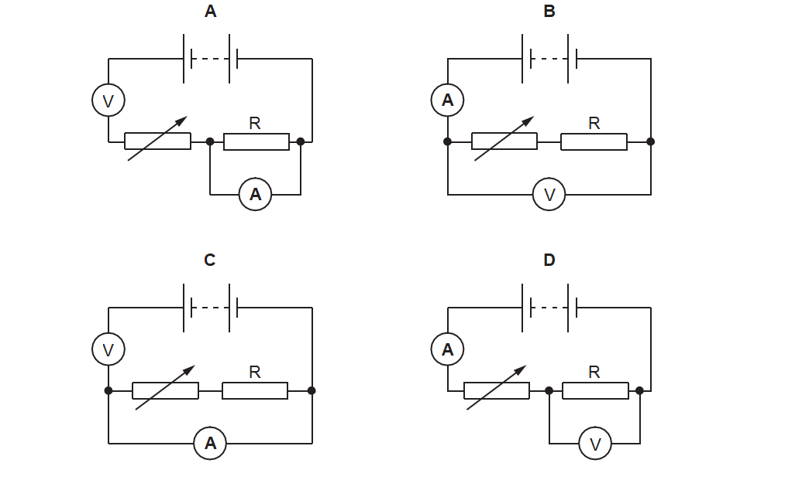
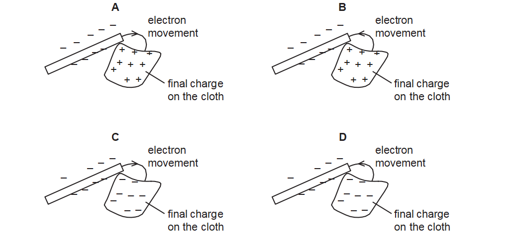
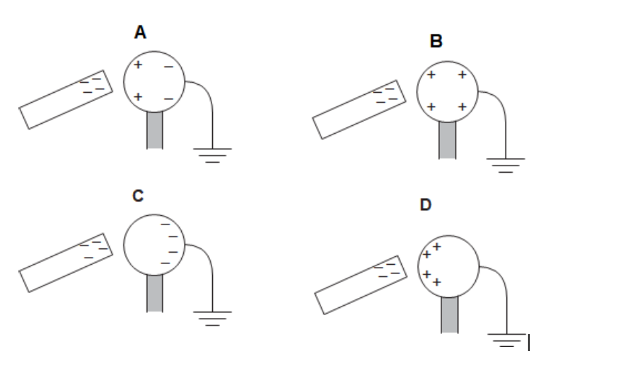
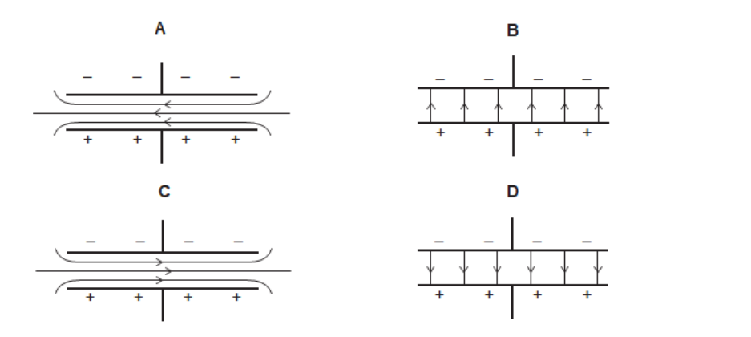
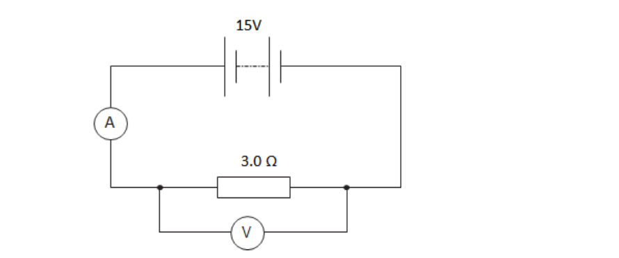

# Exam Questions — Electrical Quantities
**4. Electricity & Magnetism** · Cambridge (CIE) IGCSE physics (0625 & 0972)
> Source: [https://www.savemyexams.com/igcse/physics/cie/23/topic-questions/](https://www.savemyexams.com/igcse/physics/cie/23/topic-questions/) · 40 questions across 1 sets

## Multiple Choice Questions (40 questions)

### Q1 — easy — 1 marks

**Q1** [1 mark]

The electromotive force (e.m.f.) of a battery is

### Q2 — medium — 1 marks

**Q2** [1 mark]

A current of 0.50 A flows through a lamp for 4.0 minutes.

What is the charge that flows through the lamp?

### Q3 — medium — 1 marks

**Q3** [1 mark]

A plastic rod is rubbed with a cloth. The rod becomes negatively charged.

What has happened during the charging process?

### Q4 — hard — 1 marks

**Q4** [1 mark]

An electric heater with a power rating of $2000\text{W}$ is switched on for $3.0\text{hours}$. The cost of $1\text{kWh}$ of electricity is $20\text{cents}$.

What is the total cost of using the heater?

### Q5 — easy — 1 marks

**Q5** [1 mark]

The diagrams show the voltage–time graphs for two electrical power supplies, X and Y.

Which row correctly identifies the type of current provided by each supply?

|   | **supply X** | **supply Y** |
|---|---|---|
| **A** | alternating current (a.c.) | direct current (d.c.) |
| **B** | alternating current (a.c.) | alternating current (a.c.) |
| **C** | direct current (d.c.) | direct current (d.c.) |
| **D** | direct current (d.c.) | alternating current (a.c.) |

### Q6 — medium — 1 marks

**Q6** [1 mark]

A student rubs a plastic rod with a cloth. The rod becomes negatively charged.

Which statement about the rod is correct?

### Q7 — medium — 1 marks

**Q7** [1 mark]

** **A battery is connected to a circuit. It is switched on for 1.0 minute. During that time, there is a current of 0.40 A in the circuit and the battery supplies a total of 48 J of energy.

Which row gives the charge that passes and the electromotive force (e.m.f.) of the battery?

|   | charge that passes in 1.0 minute / C | e.m.f. of the battery / V |
|---|---|---|
| **A** | 0.40 | 2.0 |
| **B** | 0.40 | 120 |
| **C** | 24 | 2.0 |
| **D** | 24 | 120 |

*Source: june 2023 0972/21 Q27*

### Q8 — medium — 1 marks

**Q8** [1 mark]

The diagram shows the current–voltage graph for a metal wire.

What can be deduced from the graph?

*Source: June2023 0972/21 Q26*

### Q9 — easy — 1 marks

**Q9** [1 mark]

A wire has a uniform circular cross-sectional area.

Which statement is correct?

*Source: June 2023 0972/21 Q25*

### Q10 — medium — 1 marks

**Q10** [1 mark]

Four students draw a circuit diagram of the apparatus used to measure the resistance of resistor R.

Which circuit is correct?

*Source: June 2023 0972/ 11 Q26*

### Q11 — easy — 1 marks

**Q11** [1 mark]

Which particles move to cause a current in a copper wire?

*Source:  June 2023 0972/11 Q25*

### Q12 — medium — 1 marks

**Q12** [1 mark]

** **A plastic rod is rubbed with a cloth.

The rod and the cloth both become charged as electrons move between them.

The rod becomes negatively charged.

Which diagram shows how the rod becomes negatively charged and shows the final charge on the cloth?

*Source:  June 2023 0972/11 Q24*

### Q13 — medium — 1 marks

**Q13** [1 mark]

A resistor converts 360 J of energy when there is a current of 3.0 A in it. The potential difference across the resistor is 6.0 V.

For how long is there this current in the resistor?

*Source: June 2022 paper 2 Q31*

### Q14 — medium — 1 marks

**Q14** [1 mark]

A plastic rod is brought near to a small plastic sphere suspended from a stand. The sphere is repelled by the rod.

Why is this?

*Source: June 2022 paper 2 Q29*

### Q15 — medium — 1 marks

**Q15** [1 mark]

The circuit shown is being used to measure the resistance of resistor Z.**  **

What is the correct combination of meters to determine the resistance of resistor Z?

| ** ** | **meter X** | **meter Y** |
|---|---|---|
| **A** | ammeter | ammeter |
| **B** | ammeter | voltmeter |
| **C** | voltmeter | ammeter |
| **D** | voltmeter | voltmeter |

*Source: June 2022 paper 1 Q30*

### Q16 — medium — 1 marks

**Q16** [1 mark]

The diagram shows a charged plastic rod and an uncharged metal sphere. The metal sphere is suspended by an insulating thread.

The plastic rod is then moved close to the metal sphere.

Which row is correct?

| ** ** | **observation** | **the overall state of the metal sphere** |
|---|---|---|
| **A** | The rod attracts the sphere. | charged |
| **B** | The rod attracts the sphere. | uncharged |
| **C** | The rod repels the sphere. | charged |
| **D** | The rod repels the sphere. | uncharged |

*Source: june 2022 paper 1 Q28*

### Q17 — medium — 1 marks

**Q17** [1 mark]

A water heater is connected to a 230 V supply and there is a current of 26 A in the heater.

It takes 20 minutes to heat the water to the required temperature.

How much energy is supplied by the heater?

*Source: specimen 2023 paper 2 Q31*

### Q18 — medium — 1 marks

**Q18** [1 mark]

The electromotive force (e.m.f.) of a mobile phone battery is 3.7 V.

What does this mean?

*Source: specimen 2023 paper 2 Q29*

### Q19 — medium — 1 marks

**Q19** [1 mark]

A plastic rod is rubbed with a cloth. The rod becomes positively charged.

What happens to the plastic rod and what is the charge on the cloth?

|   | plastic rod | charge on cloth |
|---|---|---|
| **A** | gains electrons | negative |
| **B** | gains electrons | positive |
| **C** | loses electrons | negative |
| **D** | loses electrons | positive |

*Source: specimen 2023 paper 1 Q28*

### Q20 — easy — 1 marks

**Q20** [1 mark]

**Extended Tier Only**

Which unit is equivalent to a volt (V)?

*Source: june 2022 paper 2 Q30*

### Q21 — easy — 1 marks

**Q21** [1 mark]

A large battery is labelled with various items of information about the battery.

| 12 V | 30 kg | 216 kJ | 680 A |
|---|---|---|---|

One of these items of information is the electromotive force (e.m.f.) of the battery.

What is the e.m.f. of the battery?

*Source: June 2022 paper 1 Q29*

### Q22 — easy — 1 marks

**Q22** [1 mark]

Which pair of quantities have the same units?

### Q23 — easy — 1 marks

**Q23** [1 mark]

The diagram shows two light, silver-coated balls labelled **X** and **Y** hanging from threads near to each other.

Which line identifies the possible charges on **X** and **Y**?

|   | **X** | **Y** |
|---|---|---|
| **A** | neutral | neutral |
| **B** | negative | negative |
| **C** | negative | positive |
| **D** | positive | negative |

### Q24 — easy — 1 marks

**Q24** [1 mark]

**Extended tier only**

What is the correct unit of charge?

### Q25 — easy — 1 marks

**Q25** [1 mark]

What is the unit of electromotive force?

### Q26 — easy — 1 marks

**Q26** [1 mark]

Which line correctly states the equation for **electrical energy**?

### Q27 — medium — 1 marks

**Q27** [1 mark]

**Extended tier only**

A student has four copper wires, of different dimensions.

Which of the following wires has the largest resistance?

|   | **Length of wire / cm** | **Diameter of wire / mm** |
|---|---|---|
| **A** | 100 | 0.2 |
| **B** | 300 | 0.1 |
| **C** | 50 | 0.4 |
| **D** | 30 | 0.5 |

### Q28 — hard — 1 marks

**Q28** [1 mark]

**Extended tier only**

What is the definition of an electric field?

### Q29 — hard — 1 marks

**Q29** [1 mark]

A 2.0 Ω resistor is connected to meter X and meter Y as shown in the diagram.

Which row in the table shows possible values for the two meters?

|   | **X** | **Y** |
|---|---|---|
| **A** | 4.0 | 8.0 |
| **B** | 2.0 | 2.0 |
| **C** | 4.0 | 2.0 |
| **D** | 1.0 | 1.0 |

### Q30 — medium — 1 marks

**Q30** [1 mark]

**Extended tier only**

A student considers how changing the diameter and length of a wire affects its resistance.

Which row shows the changes that could be made to the length and diameter of the wire to **decrease** its resistance?

|   | **Change to length** | **Change to diameter** |
|---|---|---|
| **A** | increase | increase |
| **B** | increase | decrease |
| **C** | decrease | increase |
| **D** | decrease | decrease |

### Q31 — hard — 1 marks

**Q31** [1 mark]

A student connects a 6 V power supply to a 3 Ω resistor. The resistor is left connected to the power supply for 1 minute.

How much power is dissipated by the resistor?

### Q32 — hard — 1 marks

**Q32** [1 mark]

**Extended tier only**

A student sets up a circuit as shown in the diagram.

A charge of 4.9 C flows through the resistor in 0.7 s.

Which row shows the correct current, direction of electron flow and direction of conventional current through the resistor?

|   | **current / A** | **direction of electron flow** | **direction of conventional current** |
|---|---|---|---|
| **A** | 7.00 | Left to right | Right to left |
| **B** | 3.43 | Left to right | Right to left |
| **C** | 7.00 | Right to left | Right to left |
| **D** | 3.43 | Right to left | Right to left |

### Q33 — hard — 1 marks

**Q33** [1 mark]

**Extended tier only**

Which row in the table gives the correct units for charge and e.m.f.?

|   | **Charge** | **EMF** |
|---|---|---|
| **A** | Q | E |
| **B** | C | V |
| **C** | A | J |
| **D** | J | ᘯ |

### Q34 — medium — 1 marks

**Q34** [1 mark]

A student rubs an acetate rod with a cloth, giving it a negative charge. She then holds it near an earthed, conducting sphere as shown in the diagrams below.

Which diagram shows the correct distribution of charges on the conducting sphere?

### Q35 — hard — 1 marks

**Q35** [1 mark]

**Extended tier only**

Which diagram shows the correct electric field pattern between two oppositely charged parallel plates?

### Q36 — medium — 1 marks

**Q36** [1 mark]

A student wants to charge up some rods by rubbing them with a cloth made from a suitable material.

He has a number of rods to choose from: a copper rod, a PVC rod, an aluminium rod and a glass rod.

Which two of the rods would hold a charge when rubbed with an appropriate cloth?

### Q37 — hard — 1 marks

**Q37** [1 mark]

A student wants to measure the power dissipated by a 10 kΩ resistor.

What equipment should the student use to determine the power dissipated?

### Q38 — medium — 1 marks

**Q38** [1 mark]

A PVC (plastic) rod is rubbed with a nylon cloth. This process causes electrons to be transferred between the rod and the cloth, causing both objects to become charged.

Which row gives the correct nature of the charges on both the cloth and the rod, and the effect the objects have on each other after becoming charged?

|   | **Charges on rod and cloth** | **Effect** |
|---|---|---|
| **A** | the same | repel |
| **B** | the same | attract |
| **C** | opposite | repel |
| **D** | opposite | attract |

### Q39 — hard — 1 marks

**Q39** [1 mark]

A 3.0 Ω resistor is connected to a 15 V power supply as shown in the diagram. The ammeter reads 5 A throughout the experiment.

How much energy is dissipated as heat by the resistor in 2 minutes?

### Q40 — hard — 1 marks

**Q40** [1 mark]

**Extended tier only**

Four current-voltage graphs are given below.

Which graph shows an ohmic resistor and which shows a filament lamp?

|   | **Filament lamp** | **Ohmic resistor** |
|---|---|---|
| **A** | Q | S |
| **B** | R | Q |
| **C** | P | Q |
| **D** | Q | R |
