# Mark Schemes — Electric Circuits & Electrical Safety
**4. Electricity & Magnetism** · Cambridge (CIE) IGCSE physics (0625 & 0972)

## Alternative To Practical Questions (3 questions)

### Q1
On Fig. 3.1, draw a voltmeter connected so that it measures the potential difference (p.d.) across lamp **X**

A diagram that would score 1 mark should look like:

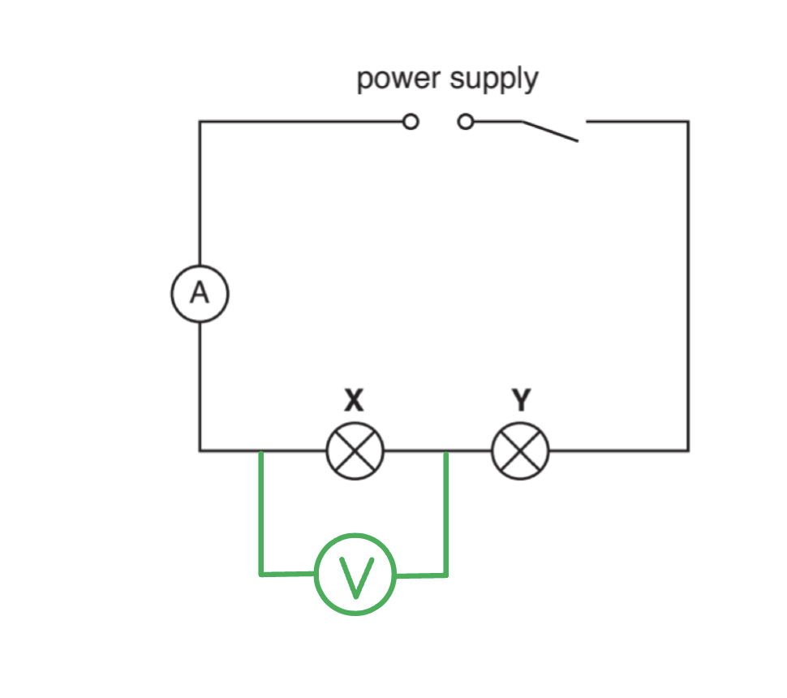

- Voltmeter parallel to lamp **X** with correct symbol (as shown); **[1 mark]**

**[Total: 1 mark]**
Record the current *I*S in amperes, A, in the circuit, as shown in Fig. 3.2:

- 0.34 A **[1 mark]**

**[Total: 1 mark]**

> *Make sure to read the values **carefully** from the scale. *

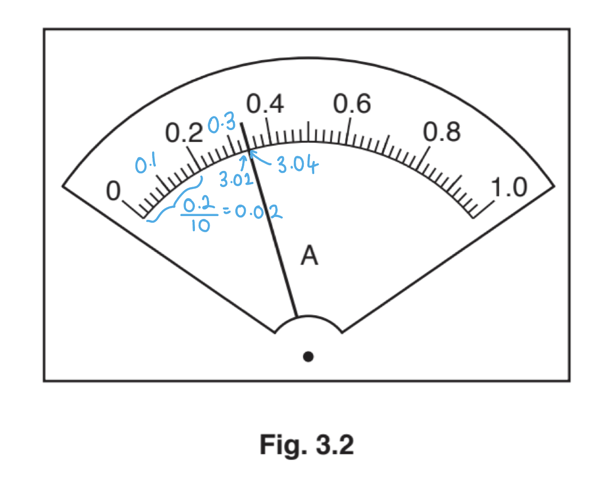

> *There are 10 small divisions between 0 and 0.2, therefore, each small division is *$\frac{0.2}{10}=0.02$*.*
(i)

The value of the p.d. *V*X  across lamp **X**, shown in Fig. 3.3 is:

- 1.2 (V)

**AND**

The value of the p.d. *V*Y across lamp **Y**, shown in Fig. 3.4 is:

- 1.9 (V) **[1 mark]**

(ii)

The value of the p.d. *V*S across both lamps in series, shown in Fig. 3.5 is:

- 3.0 (V) **AND**
- Correct unit of A for value in part (b) and V for values in part (c); **[1 mark]**

(iii)

State whether the readings support this suggestion:

- The readings do support this suggestion; **[1 mark]**

Justify your statement with reference to the results:

- $V_{X}+V_{Y}=1.2+1.9=3.1V$* ***AND**
- 3.1 V is within the limits of experimental accuracy of 3.0 V; **[1 mark]**

**[Total: 4 marks]**

> *The limits of experimental accuracy depend on the resolution of the instrument. In this case, the smallest division the voltmeter can read is 0.1 V (and the ammeter was 0.2 A), Therefore, the lowest limit is 2.9 V and upper limit is 3.1 V for a reading of **V**S**. Make sure to use numerical values where you can in 'justification' questions - these are always expected.*
Calculate the resistance *R*1 of lamp **X**.

List the known quantities:

- *V*X = 1.2 V (from part (c))
- *I*S = 0.34 A (from part (b))

Substitute values into the resistance equation:

- $R_{1}=\frac{V_{X}}{I_{S}}=\frac{1.2}{0.34}$
- *R*1 = 3.5294 = 3.5 Ω **[1 mark]**

**[Total: 1 mark]**
(i) Draw a circuit diagram of this arrangement:

A circuit diagram that would score 2 marks should look like:

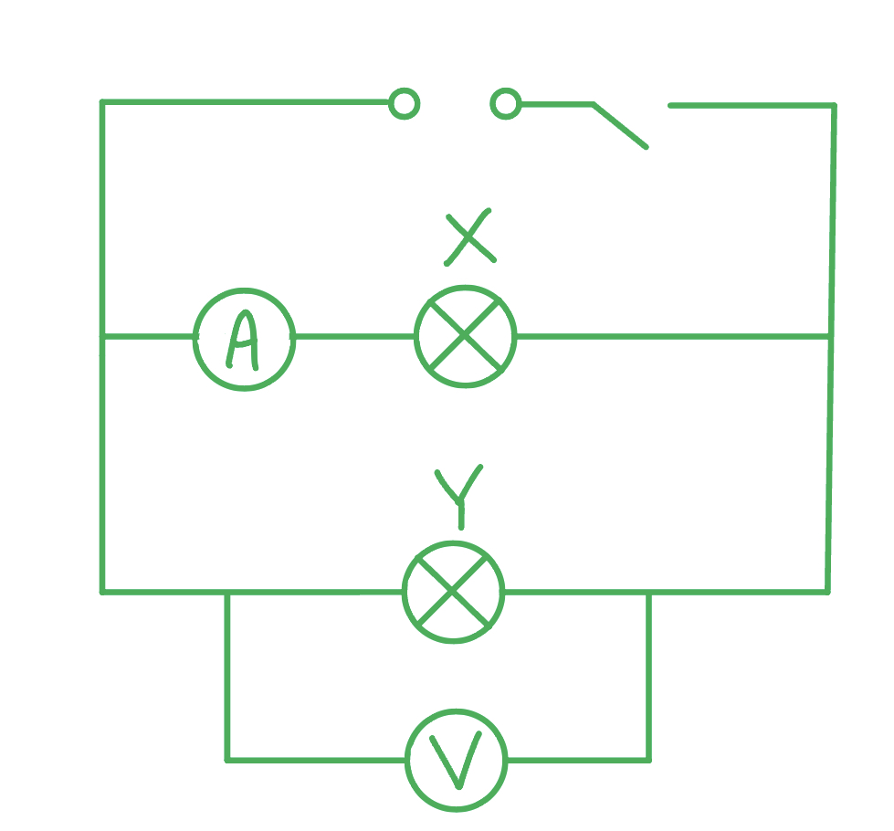

- Lamps X and Y in parallel; **[1 mark]**
- All circuit elements in correct arrangement and all correct circuit symbols (as shown); **[1 mark]**

(ii)

Suggest how temperature affects the resistance of a lamp:

- The resistance (of a lamp) increases with temperature; **[1 mark]**

Justify your suggestion:

- *R*2  = 8.3 Ω and *R*1 = 3.5 Ω therefore *R*2 > *R*1 **AND**** **the brighter lamp has a higher temperature; **[1 mark]**

**[Total: 4 marks]**

> *In a parallel circuit, both lamps X and Y have the same potential difference, but difference current (which depends on their resistance). In a series circuit, lamps X and Y have the same current but a different potential difference (which depends on their resistance). Lamp X therefore has more resistance in the parallel circuit than the series circuit but it is still brighter because it has more potential difference. *

> *Think of a bright light bulb. The brighter the bulb, the hotter it is to touch so it has a higher temperature. *

### Q2
(i) The potential difference across the lamp:

- *V**1* = 3.5 V **[1 mark]**

(ii) The current in the circuit:

- *I**1* = 0.38 A **[1 mark]**

(iii) The resistance of the lamp:

Use the equation from the question and the values from parts (i) and (ii):

- $R_{1}=\frac{V_{1}}{I_{1}}=\frac{3.5}{0.38}$

Calculate the answer and write the unit:

- *R*1 = 9.21 **[1 mark] **Ω** [1 mark]**

**[Total: 4 marks]**
To calculate the resistance of the filament lamps:

For lamp L2:

Use the equation and values given in the question:

- $R_{2}=\frac{V_{2}}{I_{2}}=\frac{1.7}{0.30}=5.7Ω$

**AND**

For lamp L3:

Use the equation and values given in the question:

- $R_{3}=\frac{V_{3}}{I_{3}}=\frac{1.2}{0.26}=4.6Ω$ **[1 mark]**

**[Total: 1 mark]**

> *For this one mark you need both answers correct and both to be two significant figures. The answer you will have got on your calculator is to several decimal places, but you need to round up to the smallest significant figures in the data, which in this question is 2 s.f.*
To calculate *R*1 + *R*2 + *R*3 to a suitable number of significant figures:

List the known quantities:

- *R*1 = 9.21 Ω
- *R*2 = 5.7 Ω
- *R*3 = 4.6 Ω

Add up the values:

- $9.21+5.7+4.6=19.51$

Write the answer to two significant figures:

- Total resistance = 20 Ω **[1 mark]**

**[Total: 1 mark]**

The least precise input value is given to 2 s.f. (5.7 Ω). Therefore, the final answer can only be given to the same level of precision. 19.51 Ω = 20 Ω (2 s.f.)
The statement which matches the readings is:

- Suggestion **B**: *R*1 + *R*2 + *R*3 should be less than 3 × *R*1; **[1 mark]**

Justification:

- *R*1 = 9.21, therefore, 3 × *R*1 = <u>27.63</u> which is <u>more than 20</u>; **[1 mark]**

**[Total: 2 marks]**

> *With a question like this one it is important you quote the data. Paper 6 is about experimental skills, including data analysis. Show that you understand this by using the numbers in your answer.*
A circuit diagram which would score three marks looks like:

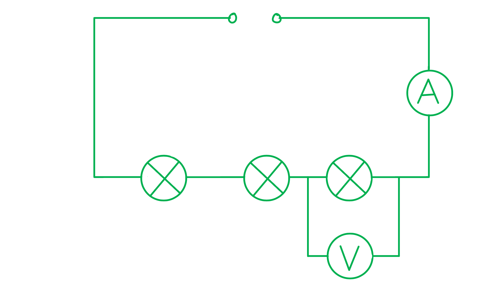

- Three lamps **AND**** **connected in series **AND**** **using the correct symbol; **[1 mark]**
- Voltmeter connected in parallel <u>across lamp L</u><u>3</u><u> / the last lamp</u>; **[1 mark]**
- The ammeter and power /  cells symbols correct **AND**** **the circuit both drawn correctly;** [1 mark]**

**[Total: 3 marks]**

> *These marks are independent of each other. That means, for example, if you did everything right except that you connected the voltmeter in series, you would still have two marks.*

> *We have copied the question and drawn the power source symbol, but a cell or battery would be fine too, as shown below.*

> *One potential mistake to look out for is putting the voltmeter on lamp L**2** (which they do in part (b)). However, when the third lamp is added the voltmeter is moved, so it must be as we have shown.*

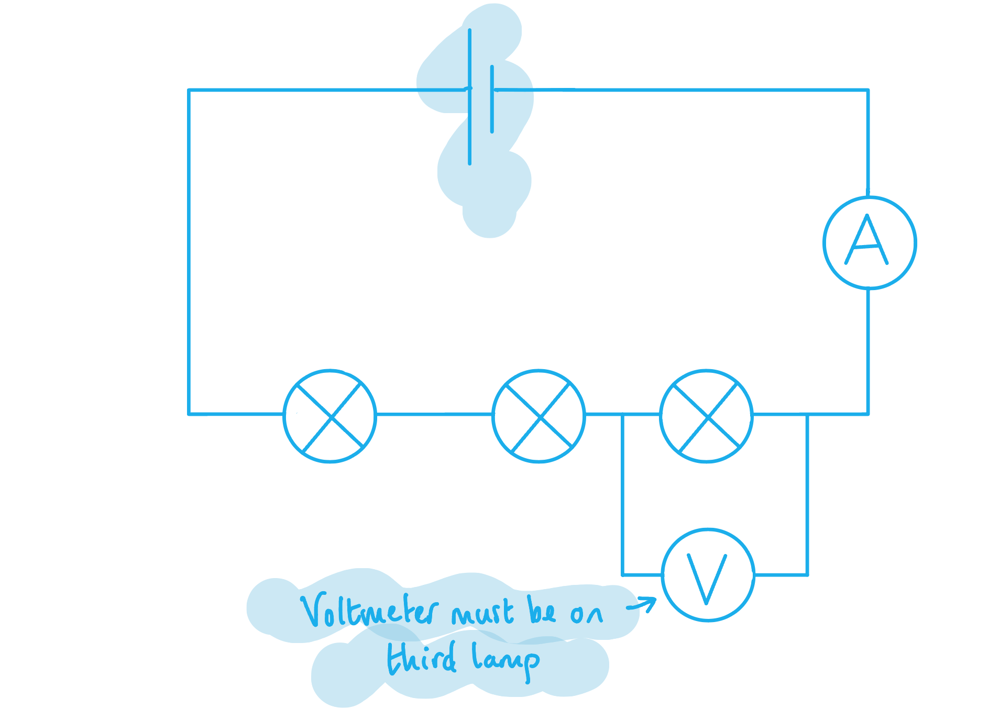

### Q3
To investigate the effect of speed of air flow on the current:

Complete the wind turbine diagram:

- Ammeter in series with the resistor **AND** circuit correct; **[1 mark]**

State any additional equipment needed:

- Ammeter; **[1 mark]**

Identify the control variables and state at least one:

The variables to control are:

**Any one from:**

- Distance between fan and turbine; **[1 mark]**
- Angle between fan and turbine; **[1 mark]**
- Height of fan / turbine; **[1 mark]**
- Angle of air flow; **[1 mark]**

Briefly outline the method:

- Measure / record the air speed **AND**
- (Allow the turbine to turn and) measure / record the current; **[1 mark]**

Mention taking varied readings:

- Repeat the experiment for a different value of air speed; **[1 mark]**

Show how to analyse the results:

|   |   |
|---|---|
|   |   |
|   |   |

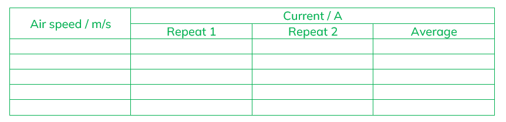

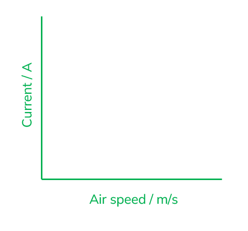

- Table drawn **AND**
- Axes of graph drawn and labelled**; [1 mark]**

Give a final additional point:

**Any one from:**

- At least 5 sets of readings taken; **[1 mark]**
- Repeat each measurement and take the average; **[1 mark]**
- 2nd valid control variable stated; **[1 mark]**
- Repeat for a different resistor and compare the pattern; **[1 mark]**
- Conduct a preliminary experiment to determine a suitable range for the independent variable; **[1 mark]**
- Measure air speed at the same point  in space each time; **[1 mark]**

**An example of an answer which would score 7 marks is:**

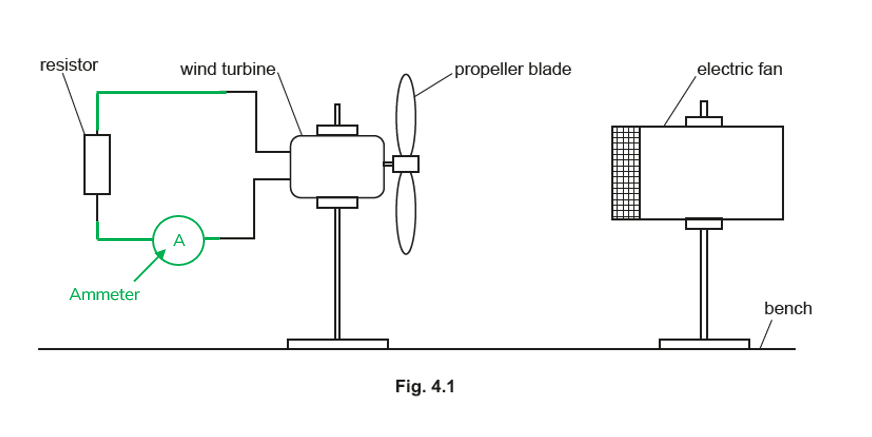

**[Circuit diagram with ammeter correctly: 1 mark]**

The student should add an ammeter into the circuit to measure current;** [1 mark]**

They should turn on the fan at the first setting and record the air speed and current; **[1 mark]**

The distance between the fan and the turbine; **[1 mark] **and the** **height of the fan and  turbine should be kept constant; **[1 mark]**

Repeat for at least 5 values of air speed; **[1 mark]**

They should record their results in the table below

Then the results should be plotted onto the axes to show the relationship between air speed and current; **[1 mark]**

**[Total: 7 marks]**

> *The example above shows the kind of short descriptions which easily score full marks in the exam. An alternative method would be to vary the distance or angle of the fan from the turbine in order to vary the air speed.*

> *The most common mistakes with the investigation question are;*

- *Saying what the result will be, rather than how to draw the conclusion;*
- *Forgetting that only one variable can change per investigation, and changing all of them;*
- *Showing repeat readings or the range in the table, but not mentioning them in the description (it seems unfair, but this won't get you the mark);*
- *Wasting time by inventing data for the table.*

> *If you find yourself doing one of these - **stop**!*

## Multiple Choice Questions (42 questions)

### Q1
**Final answer:** **The correct answer is C**

- A fuse is a safety device that protects the circuit and the appliance
- It contains a thin wire that melts when the current exceeds the rated value
- When the wire melts, the circuit is broken (the current stops flowing)

  - This prevents overheating and reduces the risk of fire
  - Note that in a mains circuit, the fuse is always placed in the live wire

**A** is incorrect because a fuse does not reduce the current. It either allows the current to flow normally or breaks the circuit completely. It does not limit or regulate the current.

**B** is incorrect because the purpose of a fuse is not to increase resistance. A fuse has a very low resistance during normal operation so that it does not affect the circuit.

**D** is incorrect because a fuse responds to excessive current, not voltage. It does not control or limit the voltage in a circuit.

### Q2
**Final answer:** **The correct answer is C**

- First, use Ohm's law to determine the current flowing through the $8.0Ω$ resistor
- Rearrange for $I$ and substitute the potential difference ($12 \text{V}$) and resistance ($8.0Ω$) into the equation:

$V=IR$

$I=\frac{V}{R}=\frac{12}{8.0}$

$I=1.5\text{A}$

- In a series circuit, the current is the same at all points, so $1 . 5 \text{A}$ also flows through the $6.0Ω$ resistor and the power supply
- The potential difference across the $6.0Ω$ resistor is:

$V=I\timesR$

$V=1.5\times6.0=9.0\text{V}$

- The e.m.f. of the power supply is equal to the sum of the potential differences across all components in a series circuit:

$\text{emf}=12+9.0=21V$

**A** is incorrect as this is only the potential difference across the $6 . 0  Ω$ resistor, not the total e.m.f. of the power supply

**B** is incorrect because this is simply the sum of the two resistance values, rather than a calculated voltage

**D** is incorrect as it incorrectly calculates the circuit current by dividing the $12 \text{V}$ by the $6 . 0  Ω$ resistor instead of the $8 . 0  Ω$ resistor, which leads to an incorrect total e.m.f. of $28 \text{V}$

> **[exam-tip]**
> Alternatively, you can solve this in one step using the potential divider formula: $V_{\text{out}} = \text{e.m.f.} \times \frac{R_{2}}{R_{1}+R_{2}}$. Substituting the values gives $12 = \text{e.m.f.} \times \frac{8.0}{14.0}$, which rearranges to an e.m.f. of $21 \text{V}$.

### Q3
**Final answer:** **The correct answer is C**

- To determine the correct fuse, the normal operating current of the hairdryer must be calculated using the power equation:

$\text{power } ( P ) = \text{current } ( I ) \times \text{voltage } ( V )$

- Rearranging for current $I$:

$I=\frac{P}{V}$

$I=\frac{2100}{240}=8.75\text{A}$

- A fuse must have a rating that is higher than the normal operating current so it does not blow during regular use
- To provide the best safety protection, the fuse rating should be the smallest available value that is still higher than the calculated current
- The $10 \text{A}$ fuse is the smallest available rating that is greater than $8 . 75 \text{A}$

**A** is incorrect as a $3 \text{A}$ fuse is much lower than the operating current and would blow immediately.

**B** is incorrect as a $5 \text{A}$ fuse is lower than the $8 . 75 \text{A}$ required by the hairdryer.

**D** is incorrect; while a $13 \text{A}$ fuse would allow the hairdryer to work, it is less suitable than the $10 \text{A}$ fuse as it provides less protection against a fault.

> **[exam-tip]**
> Always select the fuse with the smallest rating that is still greater than the calculated current. Many students incorrectly choose a fuse that is too high (e.g. $13 \text{A}$) because it would still work, but remember that the purpose of a fuse is to protect the circuit — a fuse rated too high offers less protection against faults.

### Q4
**Final answer:** **The correct answer is D**

- Electromotive force (e.m.f.) is the potential difference (voltage) supplied by a power supply
- When electrical cells are connected in **series**, their individual voltages add together to provide a higher total e.m.f.
- To find the total e.m.f., the values of the three cells are summed:

$\text{total emf}=1.5+1.5+1.5=4.5\text{V}$

**A** is incorrect as it results from dividing the voltage of one cell by the total number of cells.

**B** is incorrect as this is the e.m.f. of a single cell only.

**C** is incorrect as it only accounts for two of the three cells in the series connection.

> **[exam-tip]**
> Remember that cells in series have their e.m.f.s added together, while cells in parallel maintain the same e.m.f. as a single cell. A common mistake is to confuse series and parallel arrangements. When you see "series", think "add the voltages". Make sure you account for all cells mentioned in the question. Here, three cells means you need to add three values together.

### Q5
**Final answer:** **The correct answer is B**

- For any current to flow from the battery, the switch in the main loop ($S_{1}$) must be closed to complete the circuit
- To light a specific lamp in a parallel circuit, the switch located in that lamp's individual branch must also be closed
- Closing $S_{2}$ allows current to flow through lamp $L_{1}$
- Switch $S_{3}$ must remain open to ensure that lamp $L_{2}$ does not light

**A** is incorrect as closing only the main switch $S_{1}$ does not complete the path through either parallel branch.

**C** is incorrect because this combination would light lamp $L_{2}$ instead of $L_{1}$.

**D** is incorrect because this combination would light both lamps instead of lamp $L_{1}$ only.

> **[exam-tip]**
> When analysing parallel circuits with multiple switches, always start by identifying which switch controls the main circuit. If the main switch is open, no current can flow to any branch. Then consider each parallel branch independently — only the branch with a closed switch will allow current to flow through its component.

### Q6
**Final answer:** **The correct answer is D because:**

- There are 7 cells with e.m.f. of 1.5 V
- All cells point in the same direction, so the total e.m.f. is equal to the sum of their individual e.m.f.s

  - Total e.m.f. = 7 × 1.5 = 10.5 V

**A **is incorrect as this is the e.m.f. of a single cell

**B **is incorrect as this is the e.m.f. of the battery on the right

**C **is incorrect as this is the e.m.f. of the battery at the top

### Q7
**Final answer:** **The correct answer is ****C**** because:**

- In a parallel circuit, the sum of the currents entering any junction in a circuit is equal to the sum of the currents leaving it
- Ammeters Y and Z measure the current in each of the parallel branches after the junction on the left-hand side of the circuit
- The currents shown by ammeters Y and Z are on parallel branches leaving the junction
- Ammeter X measures the total current leaving the cell, before entering the junction
- The current shown by X is entering the same junction
- Therefore, current X = current Y + current Z

This rule for currents at a junction exists because charge cannot be created or destroyed. The number of electrons entering the junction each second (the current entering) must be equal to the number of electrons leaving the junction per second (the current leaving).

**A** is incorrect because both Y and Z must be smaller than the current X

**B** is incorrect because X is equal to Y + Z, not smaller than either of them.

**D** is incorrect because the current X is entering the junction and currents Y and Z are leaving the junction, so X is the sum of Y and Z, not the difference.

### Q8
**Final answer:** **The correct answer is ****B****, because:**

- An appliance which is double-insulated is made from non-conducting material such as plastic
- This means you cannot be electrocuted when touching it even if there is a fault, because its surface cannot become ‘live’

Fuses protect objects from overheating when there is a fault. They melt when the current is too large and cut off the supply by breaking the circuit. Earth wires protect the user from electrocution when they touch a live conductive surface, such as a metal part.

**A** and **C** are incorrect, as an earth wire is not required.

**D** is incorrect because all appliances should have a fuse to prevent large currents when there are faults. These currents could cause a fire even in a double-insulated appliance.

### Q9
**Final answer:** **The correct answer is ****B**** because:**

- The bell will ring when there is a current through it
- Switch 1 must be closed for current to pass through the battery

  - Therefore, option **D** can be eliminated
- Switch 2 must be open so that current does not pass through the lamp

  - Therefore, option **A** can be eliminated
- Switch 3 must be closed for current to pass through the bell
- Switch 4 must be open to prevent a short circuit

  - Therefore, option **C** can be eliminated
- This means answer **B** is correct

### Q10
**Final answer:** **The correct answer is ****D****, because:**

- This is the symbol for an electric heater

**A** is incorrect as this is the symbol for a fixed-value resistor.

**B** is incorrect as this is the symbol for a fuse.

**C** is incorrect as this is the symbol for a thermistor.

### Q11
**Final answer:** **The correct answer is ****A****, because:**

- Both the lamp and bell have resistance, so when both switches S1 and S2 are closed, the total resistance in the circuit decreases (as the components are connected in parallel)
- According to Ohm's law (*R* = *V*/*I*), for a constant voltage from the battery, if resistance decreases, then current must increase
- Power is directly proportional to current (for a constant voltage) so if current increases, then power must also increase

Components in parallel work independently from each other. Changing what the bell is doing should not affect the lamp as long as the voltage from the battery is constant, so you only need to think about what the bell requires to operate.

### Q12
**Final answer:** **The correct answer is A because:**

- The brightness of a lamp is determined by the power it receives

  - This is dependent on the potential difference and current across each lamp (*P* = *VI*)
- In a series circuit:

  - the potential difference across the components is shared
  - the current through all the components is the same
- Since P, Q&R and S&T&U are in series, the current at a point before P is the same as a point after S&T&U
- In a parallel circuit:

  - the potential difference across each branch is the same
  - the current splits along each branch at a junction
- Lamps R & Q, and lamps S, T & U, are in parallel
- Therefore, the current in P = current in (Q + R) = current in (S + T + U)
- Since the bulbs are identical, lamp P is the brightest as it receives

  - the greatest current
  - the greatest potential difference
  - the maximum power

The combined resistance of two lamps in parallel is less than one individual lamp. This means lamp P has the greatest resistance and, therefore, the greatest share of potential difference.

### Q13
**Final answer:** **The correct answer is B because:**

- If the live wire breaks and touches the metal casing, the casing gains a high potential

  - The casing is said to be live when this happens
- The earth wire connects the casing to the earth so current travels through the wire to reach a lower potential, instead of a person touching the casing

**A **is incorrect as the cable is an insulator and does not get hot easily

**C **is incorrect as the cable cannot prevent the casing from getting wet

**D **is incorrect as the cable cannot regulate the temperature of the casing

### Q14
**Final answer:** **The correct answer is B because:**

- A component is required that will divert more current to the fan when the temperature increases
- At higher temperatures, the resistance of a **thermistor **decreases

  - This means total resistance in the circuit decreases
- Current is equal at all points in a series circuit
- When total resistance decreases, current increases for a given e.m.f.

  - When the temperature decreases, the current through the fan increases

All other options are incorrect as these components do not decrease their resistance with temperature.

### Q15
**Final answer:** **The correct answer is B because:**

- When lamps are connected in parallel

  - the potential difference across each lamp is the same as the power supply
  - the current taken from the supply splits at each junction
- The advantage of this is that if one lamp breaks, the remaining lamps stay lit

**A** & **C **are incorrect because the current flowing into a junction is the same as the current flowing out of the junction on the other side, so the total current is the same. Hence, a smaller current isn’t taken from the supply, and a smaller fuse wouldn’t be needed (as compared to a similar series circuit)

**D** is incorrect because a lamp in parallel uses more power than a lamp in series because it receives the full voltage of the battery

### Q16
**Final answer:** **The correct answer is B because:**

- When the current exceeds a safe level, the fuse will melt and break the circuit, protecting the components from damage due to excessive current flow
- Therefore, fuses are used in circuits to prevent the current from becoming too large

### Q17
**Final answer:** **The correct answer is C because:**

- This is the circuit symbol for a **thermistor**

**A** is incorrect because the symbol for a light-dependent resistor is

**B** is incorrect because the symbol for a relay coil is

**D** is incorrect because the symbol for a variable resistor is

### Q18
**Final answer:** **The correct answer is D because:**

- For current to flow through the lamps, they must be part of a complete circuit
- With the switch open, there is no complete loop from one end of the battery to the other which passes through lamps S or T
- There is a complete loop with lamp R, so only this lamp is illuminated

### Q19
**Final answer:** **The correct answer is ****D**** because: **

- This is the circuit symbol for a relay.

### Q20
**Final answer:** **The correct answer is ****D**** because: **

- The total resistance of a combination of resistors in parallel is **always **less than the smallest resistance.

**A **is incorrect as this would be true if the resistors were connected in series.

**B** and  **C **are incorrect as this is not true.

### Q21
**Final answer:** **The correct answer is**** A ****because:**

- The diode symbol shows an arrow head with a block at one end
- The direction of the arrow head also shows the direction in which current can pass through

### Q22
**Final answer:** **The correct answer is ****B ****because: **

- The fuse must be connected **in series **with the live wire, before any of the components in the circuit.

**A **is incorrect as if this fuse blew, the appliance would remain connected, the blowing of the fuse would have no effect on the safety of the circuit. In fact, this fuse would blow instantly every time it was connected because it short circuits the appliance.

**C **is incorrect as the appliance would still be live if this fuse blew, maintaining the risk of shock.

**D **is incorrect as if this fuse blew, it would not disconnect the circuit at all if the switch were closed.

### Q23
**Final answer:** **The correct answer is ****D**** because: **

This is the circuit symbol for a thermistor.

### Q24
**Final answer:** **The correct answer is ****C**** because:**

- Resistances in parallel are smaller than the smallest resistor in the combination

  - This means that combination **Q** has the smallest resistance

- Resistances in series add up, so, the more resistors in series with each other, the higher the resistance

  - Therefore,** P** has the largest resistance, and **R** has the second-largest resistance

- Hence, from lowest to highest resistance: **Q **→ **R** → **P**

**A **is incorrect as this is not the correct order.

**B **is incorrect as this order spells the name of a well-known football club, but it does not give the correct order of resistances.

**D **is incorrect as this order is the reverse of the correct answer.

### Q25
**Final answer:** **The correct answer is ****D**** because: **

- The putting the fuse on the live wire means that, if it blows, there will be no power delivered to the circuit.

**A **is incorrect as both bulbs would remain live if this fuse blew. Meaning they would both be capable of shocking somebody!

**B **is incorrect as if this fuse blew, the bulb on the live wire side of the circuit would always be live, this means that it could still shock somebody.

**C **is incorrect as current would still flow through the fuse if the switch were open. Blowing this fuse would not break the circuit, it would still work if the switch were closed.

### Q26
**Final answer:** **The correct answer is ****C**** because:**

- The resistors are connected in **series**.
- Therefore their total resistance is 5.0 + 10.0 = 15.0 Ω
- The current through all the components in the circuit will be the same since they are connected in series.
- To calculate the total circuit current, use $I=\frac{V}{R}$
- $I=\frac{10}{15}=0.67A$

The other answers all contain common mistakes.

### Q27
**Final answer:** **The correct answer is ****B**** because:**

- The fuse that should be chosen is one which will just allow the correct operating current to flow, but not much more.
- In this case, 1.2 A flows through each bulb, this means that 2.4 A needs to flow through the fuse.
- The fuse must be rated at 2.4 A or more, or it will blow when the lamps are working normally.
- A fuse should not be chosen that is rated for too high a current, or it will not blow under fault conditions.
- Therefore, a 3.0 A fuse is the most suitable one in the list.

**A  **is incorrect as a 1.0 A fuse would blow under normal operating conditions.

**C **is incorrect as a 5.0 A fuse would allow too much current to flow under fault conditions.

**D **is incorrect as a 13.0 A fuse would allow too much current to flow under fault conditions.

### Q28
**Final answer:** **The correct answer is ****B**** because:**

- The graph shows us that, if the current is below 5 A, the circuit will not break.
- Conversely, at 6 A it takes 20 s to break, and the higher the current, the quicker it breaks. By 14 A the breaking time is very quick indeed.

**A **is incorrect as the circuit would break quickly at 14 A

**C **is incorrect as the circuit would not break at 4 A, but would break at 14 A

**D **is incorrect as the circuit would not break at 4 A.

### Q29
**Final answer:** **The correct answer is ****A**** because:**

- There are two ways to approach this question: calculating the current, and then using *V* = *IR* separately on each resistor, or by using ratios.
- By Ratios:

  - Note that the resistance is split in a 1:3 ratio. The voltage will also split in this way.
  - To calculate this we first total the resistance, 10 + 30 = 40 Ω, and then divide each of our resistances by the total:
  
    - 10/40 = 0.25
    - 30/40 = 0.75
  - Finally, we multiply the 8.0 V supply voltage by our fraction to calculate the voltage across each resistor.
  - V across the 10 Ω resistor = 8.0 x 0.25 = 2.0 V

- By calculating the current:

  - Determine the total resistance of the circuit: 30 + 10 = 40 Ω
  - Determine the current, $I=\frac{V}{R}=\frac{8.0}{40}=0.20A$
  - Use Ohm’s law for the resistor across which you want to find the potential difference: *V* = *IR* = 0.20 x 10 = 2.0 V

The other answers do not calculate the voltmeter reading correctly.

### Q30
**Final answer:** **The correct answer is ****C**** because:**

- The live wire is the one down which the push and pull from the power source comes. Putting the fuse on this wire means that, if it blows, there will be no power delivered to the circuit.
- When a fuse does its job, a small wire inside the fuse melts. This breaks the circuit, meaning no current can flow through the device.

**A **is incorrect as a fuse is not capable of reducing the current in a circuit. It can only break the circuit if too much current flows.

**B **is incorrect as the fuse must be positioned on the live wire, otherwise there is a risk of shock if somebody touches a damaged appliance.

**D **is incorrect as a fuse is not capable of reducing the current in a circuit. It can only break the circuit if too much current flows.

### Q31
**Final answer:** **The correct answer is ****C**** because:**

- If a fuse designed to carry 3 A of current is put into an appliance that carries a greater current than this, it will **melt**
- However, the kettle will remain undamaged as the melted fuse will prevent current from flowing in the rest of the circuit
- The removal of a 13 A fuse gives you a clue that the kettle needs more than 3 A to function correctly

**A **is incorrect as using the fuses are designed to melt under high currents before the appliance can be damaged

**B **is incorrect as this is unlikely. Kettles are high current devices (anything that contains a heater is likely a high current device), and 3 A is quite a small current. The 3 A fuse would certainly blow. Once the fuse has blown the circuit is broken and the kettle cannot work.

**D **is incorrect as if the fuse does not blow, the kettle would work normally.

### Q32
**Final answer:** **The correct answer is ****B**** because:**

- Observe that the two resistors are connected in **parallel**
- For resistors connected in parallel, the **current** before the resistors (X) is the sum of the current in each resistor
- In other words, the current at Y **cannot** be greater than or equal to the current at X or Z
- It should be clear that the current before and after the resistors must be the same

**A **is incorrect as X is equal to Z, so it cannot equal Y + Z

**C **is incorrect as the current splits as it enters the junction between the two resistors, therefore, some current must go to the lower resistor, meaning current X cannot equal current Y.

**D **is incorrect as the current through Y adds to the current through the bottom resistor, and gives current Z. Therefore Z cannot equal Y.

### Q33
**Final answer:** **The correct answer is ****D**** because:**

- All the bulbs are connected in **parallel**, and so will have the same potential difference across them.
- The rating of 10 W is not needed for the question.

**A **is incorrect as some of the bulbs are in series with each other. This means that the potential difference will split between them, reducing their power output, and making them dimmer.

**B** and **C **are incorrect as some of the bulbs are in series with each other. This means that the potential difference will split between them, reducing their power output, and making them dimmer.

### Q34
**Final answer:** **The correct answer is ****A**** because:**

- Recognise that the two resistors are connected in **parallel**.
- Recall Ohm’s Law for calculating Voltage: *V* = *IR*

  - **Step 1**: Calculate the voltage in the 10.0 Ω resistor: *V* = 2.0 A × 10.0 Ω = 20 V
- Remember that for parallel circuits, The **voltage** is the same across each resistor

  - **Step 2**: using, $I=\frac{V}{R}$ calculate the current in the 5.0 Ω resistor:    $I_{5.0Ω}=\frac{20V}{5.0Ω}=4.0A$
- As the resistors are connected in **parallel**, the **current** is the ammeter is the sum of the current in each resistor.

  - **Step 3**: The current on the ammeter is thus:
  $I_{10.0Ω}+I_{5.0Ω}=2.0+4.0=6.0A$

The other answers all contain common mistakes.

### Q35
**Final answer:** **The correct answer is ****C**** because:**

- The problem here is that the wires used to connect the oven are not rated for the amount of current the oven uses. This is an easy mistake to make, as ovens use more current than normal electrical devices.
- Thicker diameter wires are required, since thicker wires have a smaller resistance, and therefore dissipate less heat when current flows through them. Remember: $P=I^{2}R$ gives the power dissipated by a component which has resistance.

**A **is incorrect as this would have no effect, as the oven is operating properly.

**B **is incorrect as thicker insulation might cause the wires to *feel* cooler, but they would still be just as hot. They would actually be less able to dissipate the heat they are generating, and are in greater danger of causing a fire.

**D **is incorrect as thinner wires would exacerbate the problem. They have a higher resistance, and would dissipate more heat, becoming even hotter.

### Q36
**Final answer:** **The correct answer is ****B**** because: **

- A fuse must be connected in series with the live wire. Only fuse **X** is in the correct position.

**A **is incorrect as fuse **Y** is in series with the **neutral** wire. It is in the wrong position.

**C **is incorrect as fuse **Z** is connected in parallel with the heating element. This is really badly in the wrong position, would cause a short circuit, and would blow fuse **Z** as soon as the circuit was switched on.

**D **is incorrect as **X** is in the correct position but **Z** is badly positioned, in parallel with the heating element. It would cause a short circuit, and would blow fuse **Z** as soon as the circuit was switched on

### Q37
**Final answer:** **The correct answer is ****A**** because:**

- Remember that in LDRs that the resistance **increases** as the light intensity **decreases** (it gets dark).
- Recognise the diagram as the layout for a potential divider.
- **Potential** **dividers** divide up the voltage within a circuit so that parts of a circuit only receive a **specific** voltage. Potential dividers usually consist of two or more resistors arranged in series across a power supply.
- As the resistance in the LDR increases in relation to the other resistor (which has a fixed resistance), it causes the potential difference across the LDR to increase.

**B **is incorrect as the resistance of an LDR **increases** as light level decreases.

**C **is incorrect as the p.d. across a component in a potential divider circuit will be higher across the higher resistance.

**D **is incorrect as the resistance of an LDR **increases** as light level decreases.

### Q38
**Final answer:** **The correct answer is ****A**** because:**

- Both fuses and circuit breakers must be connected in series with the live wire, before the first component.

**B **is incorrect as the circuit breaker should not be at position Q

**C **is incorrect as the fuse should not be at position Q

**D **is incorrect as neither device should be at position Q.

### Q39
**Final answer:** **The correct answer is B because: **

- If fuse B blows, no current can pass through it to any of the bulbs. This means that all of the bulbs will fail to light.

**A **is incorrect as the only effect blowing this fuse would have on the circuit is that the bulb in parallel with it would no longer be short-circuited, and would light up.

**C **is incorrect as current can still get to the bulb by fuse **D**, and current can still get to the bulb by fuse **A**.

**D **is incorrect as current can still get to the bulb by fuse **C**, and current can still get to the bulb by fuse **A**

### Q40
**Final answer:** **The correct answer is ****B**** because: **

For resistors in parallel, the combined resistance is given by the equation:

- $\frac{1}{R_{total}}=\frac{1}{R_{1}}+\frac{1}{R_{2}}$
- $\frac{1}{R_{total}}=\frac{1}{12}+\frac{1}{8}$
- $\frac{1}{R_{total}}=\frac{5}{24}$
- $R_{total}=4.8Ω$

The other answers all contain common mistakes. With these sorts of questions be careful:

- Remember to take the inverse of the addition of the fractions. Don’t give 1/Rtotal as your final answer by mistake.
- Don’t just add the resistances. You do that for **series** circuits.

### Q41
**Final answer:** **The incorrect statement is ****A**** because:**

- Current splits between branches in parallel, according to the resistance of each branch. The question states that the bulbs are not identical, and so have different resistances.
- This means that a different amount of current will go to each bulb.

**B **is correct as all components connected in parallel have the same potential difference.

**C **is correct as, as long as switches are placed in series with each bulb on its own branch, they can be operated individually.

**D **is correct as in parallel connection the operation of one branch has no bearing on the operation of another branch.

### Q42
**Final answer:** **The correct answer is ****D**** because:**

- The brightness of the bulb depends on the power it dissipates, *P* = *IV*, so any increase to the voltage or current in the part of the circuit containing the bulb (assuming the other does not change in the opposite direction) would increase its brightness.
- Resistances in parallel are smaller than the smallest resistor in the combination. Adding another resistor in parallel with the original resistor would decrease the overall resistance of the circuit, and would increase the brightness of the bulb.

**A **is incorrect as this would not change the voltage across either the bulb or the resistor, and would not change the current through them. It would, however, give another branch for current to flow down, draining the battery more quickly.

**B **is incorrect as this would decrease the resistance of the bulb/new resistor combo, increasing the total current in the circuit (but not the current through the bulb), and decreasing the voltage across the bulb. Remember that voltage splits according to resistance, so lowering the resistance also lowers the voltage across it. The bulb would get dimmer.

**C **is incorrect as this would **increase** the total resistance of the circuit, thus limiting the current and decreasing the brightness of the bulb.

## Theory Questions (25 questions)

### Q1
To determine the combined resistance of R2 and R3:

- List the known quantities:

  - Resistance of $R_{2}=20Ω$
  - Resistance of $R_{3}=30Ω$
- Recall the rule for adding resistance in parallel combinations:

$\frac{1}{R}=\frac{1}{R_{2}}+\frac{1}{R_{3}}$ **[1 mark]**

- Substitute in the values and rearrange for $R$:

$\frac{1}{R}=\frac{1}{20}+\frac{1}{30}=\frac{5}{60}$

$R=\frac{60}{5}=12Ω$ **[1 mark]**

> **[mark-scheme]**
> 1 mark for stating the correct formula for parallel resistors, e.g. $\frac{1}{R} = \frac{1}{R_{2}} + \frac{1}{R_{3}}$ **OR** $R = \frac{R_{2}\timesR_{3}}{R_{2}+R_{3}}$
> 
> 1 mark for correct substitution, e.g. $\frac{1}{20} + \frac{1}{30} = \frac{5}{60}$ leading to a final answer of $12Ω$
> 
> "Show that" requires the formula to be written before substitution — answer alone scores zero

> **[exam-tip]**
> For two resistors in parallel, a useful check is that the combined resistance of two parallel resistors is always less than the resistance of the smaller individual resistor, so your answer must be less than $20Ω$.
To calculate the current in resistor R1:

- List the known quantities

  - Resistance of parallel resistors, $R_{\mathrm{parallel}}=12Ω$
  - Resistance of $R_{1}=8.0Ω$
  - e.m.f. of battery, $E=12V$
- Calculate the total resistance of the circuit:

$R_{\text{total}}=R_{1}+R_{\text{parallel}}$

$R_{\text{total}}=8.0+12=20Ω$ **[1 mark]**

- Calculate the current in the circuit using $V=E$ (emf of the battery) and $R=R_{\mathrm{total}}$ (total resistance):

$V=IR$ **[1 mark]**

$I=\frac{E}{R_{\text{total}}}=\frac{12}{20}$

$I=$ $0.60\text{A}$ **[1 mark]**

> **[mark-scheme]**
> 1 mark for the correct formula for series resistors **OR** correct substitution
> 
> - Accept $R_{\text{total}}=R_{1}+R_{\text{parallel}}$ **OR** $8.0+12$
> 
> 1 mark for the correct equation **OR** correct rearrangement **OR** correct substitution
> 
> - Accept $V=IR$ **OR** $I=\frac{V}{R}$ **OR** $\frac{12}{20}$
> 
> 1 mark for a final answer of $0.60A$
> 
> Full marks can be scored for the correct answer alone

> **[exam-tip]**
> Make sure you know the rules for current in series and parallel. The current from the battery is the same as the current through R1, because R1 is in the main (series) part of the circuit. This current then splits between R2 and R3 at the parallel junction.
> **[mark-scheme]**
> - Subtract the voltmeter reading from the e.m.f./battery voltage **OR** p.d. across $R_{1}=12-(\text{voltmeter reading})$ **[1 mark]**
> - The sum of the p.d.s across the components in a series circuit equals the e.m.f. of the battery/supply voltage **[1 mark]**
> 
> Accept: "$V_{R_{1}}=12-V_{\text{parallel}}$" stated in words or symbols
> 
> Accept: "the voltages in a series circuit add up to the battery voltage" for the second mark
> 
> Do not accept: just "use $V = I R$" — the question specifically asks how the voltmeter reading is used, not how to calculate from scratch

> **[exam-tip]**
> This question tests whether you understand how potential differences are distributed in a series circuit. The key rule is: the sum of the p.d.s across all components in a series circuit equals the e.m.f. of the battery. Since the voltmeter reads the p.d. across the parallel combination, you can find the p.d. across $R_{1}$ by subtraction. Make sure you state both the method (subtraction) and the reasoning (p.d.s in series add up to the e.m.f.) to secure both marks. Many students lose the second mark by simply writing the equation without explaining why it works.

### Q2
Draw a voltmeter connected to measure the potential difference across resistor A:

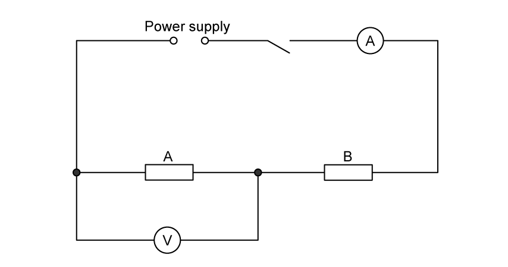

**[1 mark]**

> **[mark-scheme]**
> 1 mark for a correct voltmeter symbol **AND** connected in parallel across resistor A only

> **[exam-tip]**
> Remember that voltmeters must always be connected in parallel with the component you are measuring the potential difference across. A common mistake is to draw the voltmeter in series with the resistor, which would not give a correct reading. Make sure your voltmeter symbol is clearly labelled with a 'V' inside a circle.
> **[mark-scheme]**
> - $V_{A}=1.4V$ **[1 mark]**
> - $I=0.26A$ **[1 mark]**

> **[exam-tip]**
> When reading analogue meters, always check the scale carefully. Count the number of divisions between labelled values to determine what each small division represents. For the ammeter, the scale runs from 0 to 1.0 A, and for the voltmeter, from 0 to 10 V. Make sure you include the correct unit with each reading.
Calculate the resistance $R_{A}$ of resistor A:

- List the known quantities:

  - Potential difference across A, $V_{A}=1.4\text{V}$ (from (b))
  - Current in circuit, $I=0.26A$ (from (b))
- Substitute the known quantities into the resistance equation:

$R_{A}=\frac{V_{A}}{I}$

$R_{A}=\frac{1.4}{0.26}=5.3846...$

$R_{A}=$ $5.4Ω$ **[1 mark]**

Answer given to 2 significant figures **[1 mark]**

> **[mark-scheme]**
> 1 mark for correct calculation of $R_{A}$ from values found in (b)
> 
> 1 mark for giving $R_{A}$to 2 or 3 significant figures

> **[exam-tip]**
> In Paper 6, always look at the precision of your raw data. Since the current ($0 . 26  \text{A}$) and voltage ($1 . 4  \text{V}$) are given to 2 significant figures, your final calculated resistance should also be rounded to 2 significant figures (or 3 at most). You will lose a mark if you write down $5.3846Ω$ as your final answer.
Calculate the combined resistance $R_{\mathrm{AB}}$:

- List the known quantities:

  - Potential difference across A and B, $V_{\mathrm{AB}}=2.6\text{V}$
  - Current in circuit, $I=0.26A$ (from (b))
- Substitute the known quantities into the resistance equation:

$R_{\mathrm{AB}}=\frac{V_{\mathrm{AB}}}{I}$

$R_{\mathrm{AB}}=\frac{2.6}{0.26}$

$R_{\mathrm{AB}}=$ $10Ω$ **[1 mark]**

> **[mark-scheme]**
> 1 mark for correct calculation of $R_{\mathrm{AB}}$ using the value of $I$ found in (b)
> 
> This mark is not dependent on the number of significant figures $R_{\mathrm{AB}}$ is given to

> **[exam-tip]**
> Remember that the current in components connected in series is the same, so you can use the same current value that was measured earlier in the experiment.
Calculate the value of $R_{\mathrm{AB}}$:

- List the known values:

  - Resistance of A, $R_{A}=5.4Ω$ (from (c))
  - Resistance of B, $R_{B}=4.5Ω$
  - Combined resistance of AB, $R_{\mathrm{AB}}=10Ω$ (from (d))

$R_{\mathrm{AB}}=R_{A}+R_{B}$

$R_{\mathrm{AB}}=5.4+4.5$

$R_{\mathrm{AB}}=9.9Ω$

- Statement:

Yes, the results support the student's suggestion that $R_{\mathrm{AB}}=R_{A}+R_{B}$ **[1 mark]**

- Justification:

$9.9Ω$ is very close to $10Ω$. The difference is less than 10%, which is within the limits of experimental accuracy **[1 mark]**

> **[mark-scheme]**
> 1 mark for a statement which matches the results (expect Yes)
> 
> 1 mark for a justification which calculates $R_{\mathrm{AB}}=R_{A}+R_{B}$ **AND** compares with value from (d), stating if values are within 10% or the limit of experimental accuracy

> **[exam-tip]**
> This "accuracy" question comes up in almost every Paper 6! This is a guaranteed 2 marks if you follow the formula:
> 
> 1. Say "Yes" or "No"
> 2. State that the values are "within the limits of experimental accuracy" (if the difference is < 10%)
> 3. Provide the numbers to prove it.
> 
> Make sure you always compare your calculated values explicitly and reference the 10% rule to justify your conclusion.
> 
> To calculate percentage difference:
> 
> $\text{% difference} = \frac{10 - 9.9}{9.9} \times 100 = 1.01 \%$
(i) Complete the circuit diagram to show resistors A and B in parallel:

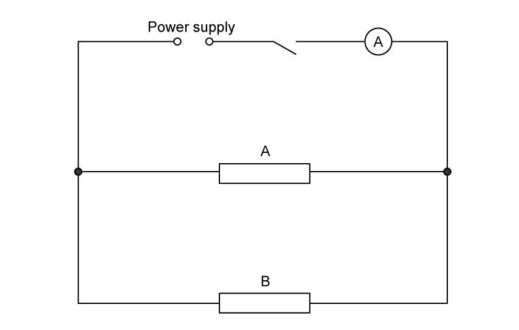

**[1 mark]**

> **[mark-scheme]**
> 1 mark for drawing resistor A and resistor B in parallel branches

> **[mark-scheme]**
> (ii) To reduce this heating effect, the student could:
> 
> Any **one **from:
> 
> - Switch off / disconnect the circuit between readings
> - Use a lower supply voltage
> - Use a variable resistor to reduce current
> 
> **[1 mark]**
> 
> (iii) A hazard associated with wires overheating in a circuit is:
> 
> Any **one **from:
> 
> - Damage to the insulation of the wires / melting insulation
> - Risk of fire
> - Burns to the skin
> 
> **[1 mark]**

> **[exam-tip]**
> Remember that heating in resistors is caused by current flowing through them over time. "Switch off between readings" is the standard answer for reducing heating in a circuit, but any method that reduces the time current flows or reduces the current itself will reduce heating.

### Q3
List the known quantities:

- Current,  = 0.20 A
- Voltage,  = 6.0 V

Write the equation linking electrical power, current and potential difference:

- $\mathrm{electrical} \mathrm{power}=\mathrm{current}\times\mathrm{potential} \mathrm{difference} \mathrm{or}P=IV$   **   [1 mark]**

Substitute in the values and calculate the answer.

- $\mathrm{electrical} \mathrm{power}=0.40\times6.0$     **  [1 mark]**
- $\mathrm{power}=2.4W$  **[1 mark]**

**[Total: 3 marks]**
The circuit with another lamp connected in parallel is as follows:

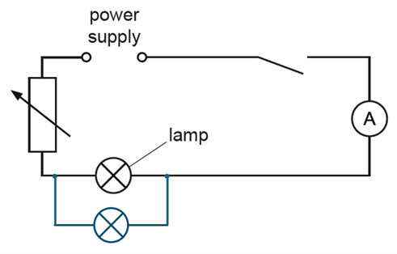

- Lamp symbol drawn in parallel with lamp in circuit; **[1 mark]**

**[Total: 1 mark]**

> **[exam-tip]**
> For this question, you need to modify the figure. Use a pencil for your drawing. The symbol for a lamp has already been shown in the circuit; it is the circle with the diagonal cross:
> 
> 
> 
> When components are connected in parallel, there is a separate path through each of them. You should place the additional lamp close to the original as shown in the figure.
> 
> Make sure that you connect the new lamp to the rest of the circuit, without leaving any gaps. It is best to draw connections as dots as shown above, instead of just leaving the thin wires touching.

### Q4
Two other components in the circuit are:

- Switch;** [1 mark]**
- Ammeter; **[1 mark]**
- <u> Variable</u>** **resistor;** [1 mark]**

**[Total: 2 marks]**

> **[exam-tip]**
> You must state that the resistor shown is a <u>variable</u> resistor, as no mark is awarded for just writing ‘resistor’. The symbols for fixed-value resistors, variable resistors, fuses and thermistors all contain similar rectangles, so try not to mix them up.

### Q5
To find combined resistance from Y to Z:

Find the resistance of the top branch with the 4.0 Ω and 8.0 Ω resistors:

- For resistors in series, $R_{tot}=R_{1}+R_{2}$ **[1 mark]**
- $R_{top}=4.0+8.0=12Ω$ **[1 mark]**

Recall the equation for the combined resistance of resistors in parallel:

- $\frac{1}{R_{comb}}=\frac{1}{R_{1}}+\frac{1}{R_{2}}$ **[1 mark]**

Rearranging for combined resistance:

- $R_{comb}=\frac{1}{\frac{1}{R_{1}}+\frac{1}{R_{2}}}$

Substitute the resistance of the top and bottom branches:

- $R_{comb}=\frac{1}{\frac{1}{12}+\frac{1}{6}}$
- $R_{comb}=4.0Ω$ **[1 mark]**

**[Total: 4 marks]**
To determine the p.d. Across the 8.0 Ω resistor, *V*8:

- p.d. across the top branch is 24 V
- The proportion of p.d. across the 8.0 Ω resistor is equal to its proportion of resistance
- $V_{8}=24\times\frac{8}{12}$** [1 mark]**
- $V_{8}=16V$**[1 mark]**

**[Total: 2 marks]**

> *As mentioned in the Potential Dividers topic, the ratio of resistance in series is equal to the ratio of potential difference. If a resistor accounts for two thirds of the resistance in a branch, it will have two thirds of the potential difference. *

> *Alternatively, this question could have been answered using Ohm’s law on the whole branch to calculate the current along that branch (using Ohm’s law with a resistance of 12 Ω and a potential difference of 24 V), then using Ohm’s law specifically on the 8.0 Ω resistor to find it’s p.d.*

### Q6
1. The earth wire protects the user because:

- If the tap becomes live **OR** if the (live) cable touches the (metal) tap; **[1 mark]**
- There is a current to earth / in the earth wire (which blows the fuse); **[1 mark]**

2. The fuse protects the circuit because

- When the current (in earth wire) becomes too large, the fuse melts / blows / stops the current / breaks the circuit; **[1 mark]**

**[Total: 3 marks]**

### Q7
The fuse and earthed metal case protect the appliance and the user because:

Any **four **from:

- The earth wire keeps the case at zero volts / the same potential as the Earth; **[1 mark]**
- This protects the user from electrocution/electric shocks; **[1 mark]**
- When the live wire touches the metal case, it produces a large current (in the fuse / earth wire); **[1 mark]**
- The large current causes the fuse to melt; **[1 mark]**
- This isolates the appliance from the supply **OR** this stops current from flowing in the appliance **OR** this disconnects / breaks the circuit; **[1 mark]**
- This prevents (electrical) fire / overheating (in cables / appliance); **[1 mark]**

**[Total: 4 marks]**

### Q8
When contact C is moved to point P, the total resistance is:

- Total resistance = R1 + R2

  - Where R1 = resistance of the wire between X and P and R2 = resistance of the fixed resistor
- Total resistance = 20 + 8.0 **[1 mark]**
- Total resistance = 28 Ω **[1 mark]**

**[Total: 2 marks]**

### Q9
Label the heater:

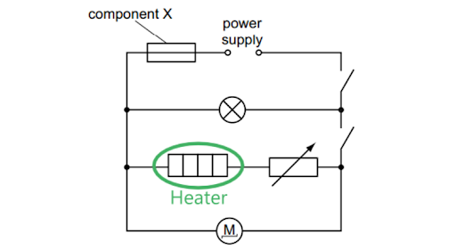

- The correct component clearly identified;** [1 mark]**

**[Total: 1 mark]**
The function of the variable resistor is:

- To vary the amount of current through the heater; **[1 mark]**
- To change the temperature / output of the heater; **[1 mark]**

**[Total: 2 marks]**
To find the resistance, *R*, of the motor:

List the known quantities:

- Potential difference across the motor, *V* = 250 V
- Current through the motor, *I* = 2.0 A

Recall Ohm’s law:

- $V=IR$ **[1 mark]**

Rearrange for resistance and substitute the known quantities:

- $R=\frac{V}{I}$
- $R=\frac{250}{2.0}$** [1 mark]**
- $R=125Ω$ **[1 mark]**

**[Total: 3 marks]**
Name component X:

- Fuse; **[1 mark]**

Explain how it contributes to safety:

- Fuse wire melts (and breaks the circuit) when current gets too large; [1 mark]

**[Total: 2 marks]**

### Q10
(i) The voltage across the upper 10 Ω resistor:

In a series arrangement:

- The total p.d. across the components is equal to the sum of the individual p.d.s across each component
- Therefore, the p.d. across the parallel branch = 40 V − 24 V = 16 V **[1 mark]**

In a parallel arrangement:

- The p.d. across parallel branches is the same
- Therefore, the p.d. across the upper branch = 16 V **[1 mark]**

(ii) The voltage across the lower part of the parallel circuit:

- The p.d. across parallel branches is the same
- Therefore, the p.d. across the lower branch = 16 V **[1 mark]**

**[Total: 3 marks]**
Calculate the current through the upper 10 Ω resistor:

List the known quantities:

- Resistance = 10 Ω
- Potential difference = 16 V (from part (a))

Use the equation for resistance (Ohm's Law):

- $R=\frac{V}{I}$ **[1 mark]**

Rearrange and substitute the values:

- $I=\frac{V}{R}=\frac{16}{10}=1.6A$ **[1 mark]**

**[Total: 2 marks]**

> *The key to solving complicated circuit diagrams is to redraw them and annotate, as shown here.*

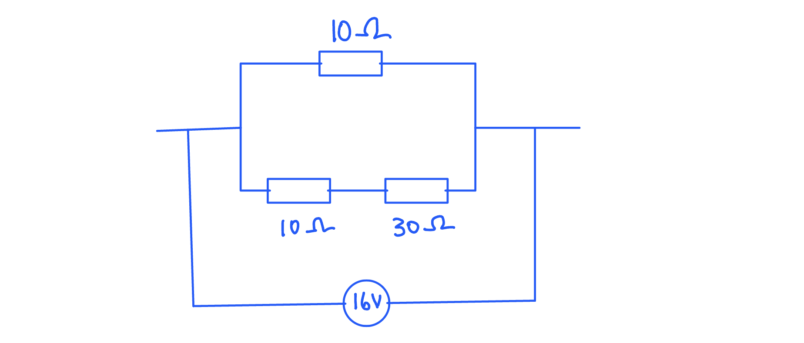

> *By treating the parallel branch as a separate circuit, which you can do once you know the potential difference across it, this problem becomes more straightforward.*
(i) Determine the reading on ammeter A2.

Determine the resistance of the two resistors in series by adding their values together:

- $R_{total}=10+30=40Ω$ **[1 mark]**

Use Ohm's Law:

- $R=\frac{V}{I}$

Rearrange and substitute the values:

- Potential difference = 16 V (from part (a)

- $I=\frac{V}{R}=\frac{16}{40}=0.4A$ **[1 mark]**

(ii) Determine the reading on ammeters A1 and A3:

Recall that the sum of the currents entering a junction in a parallel circuit is equal to the sum of the currents that leave the junction:

- Therefore the sum of the currents in the two branches is equal to the current entering and leaving the branch **OR  **$A_{1}=1.6+0.4=A_{3}$ **[1 mark]**
- $A_{1}=A_{3}=2.0A$**[1 mark]**

**[Total: 4 marks]**
Calculate the value of R:

List the known quantities:

- Current = 2.0 A
- Potential difference = 24 V (from part (a)

Use Ohm's Law:

- $R=\frac{V}{I}=\frac{24}{2.0}=12Ω$ **[1 mark]**

**[Total: 1 marks]**

### Q11
For the lamp to light:

- Switch Y needs to complete the circuit with no breaks
- Therefore it must be in position R; **[1 mark]**

**[Total: 1 mark]**
To calculate the resistance of the lamp:

List the known quantities:

- Current, *I *= 0.50 A
- Potential difference, *V* = 6.0 V

Recall the Ohm's law equation for resistance:

- $R=\frac{V}{I}$ **[1 mark]**

Substitute in the values:

- $R=\frac{6.0}{0.5}$ **[1 mark]**

Calculate and include the units:

- *R* = 12 **[1 mark] **Ω** [1 mark]**

**[Total: 4 marks]**
Advantages of connecting lamps in parallel:

Any **two** from:

- Both lamps have the same p.d. / voltage across them;** [1 mark]**
- If one lamp fails the other still works; **[1 mark]**
- The combined resistance of the circuit is less than the resistance of any single lamp/resistor in the circuit; **[1 mark]**
- The circuit allows a larger current to be drawn from the source compared to a series circuit; **[1 mark]**

**[Total: 2 marks]**

### Q12
(i) The name of the particles which flow in the wires in a circuit are:

- Electrons; **[1 mark]**

(ii) To calculate the combined resistance of the two resistors:

- For resistors in series the values of resistance are added together
- Resistance = 12.0 + 6.0 = 18.0 Ω **[1 mark]**

(iii) To calculate the potential difference shown on the voltmeter:

List the known quantities:

- Current, *I* = 0.50 A
- Resistance,* R* = 18 Ω

Recall Ohm's Law:

- *V* = *I* × *R ***[1 mark]**

Substitute in known values and calculate V:

- *V* = 0.50 × 18 **[1 mark]**
- *V* = 9 V **[1 mark]**

**[Total: 5 marks]**

> *It is ONLY electrons that move, protons are fixed. Ohm's law is a really key equation - make sure you are able to recall and rearrange it!*
If the resistors are connected in parallel:

- The current / reading on the ammeter increases; **[1 mark]**
- This is because the circuit resistance decreases / resistors in parallel have less resistance; **[1 mark]**

**[Total: 2 marks]**

### Q13
(i) On Fig. 10.1, draw circuit symbols to show each meter correctly connected in the circuit:

- To determine resistance, potential difference and current must be measured

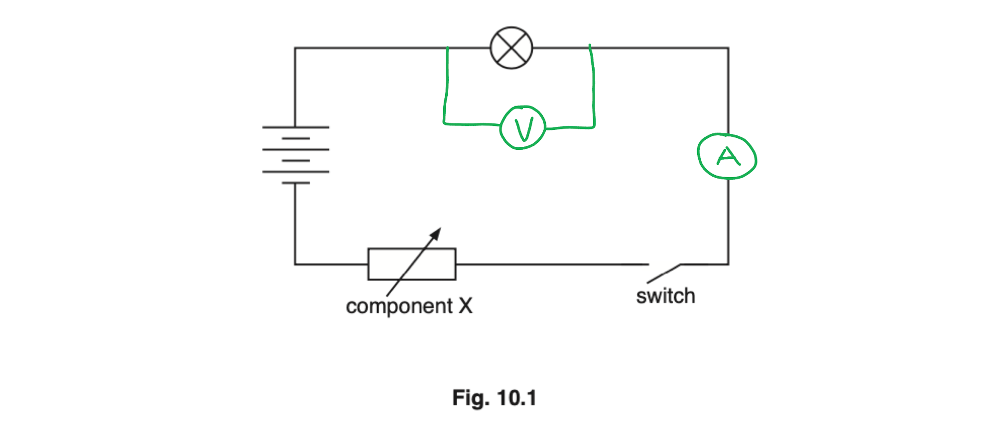

- Correct symbol for the ammeter; **[1 mark]**
- Correct symbol for the voltmeter; **[1 mark]**
- The ammeter is in <u>series</u> and the voltmeter is in <u>parallel</u> with the lamp; **[1 mark]**

(ii) Calculate the resistance of the lamp:

List the known quantities:

- Current, *I* = 0.25 A
- Potential difference, *V* = 4.5 V

Recall Ohm's Law:

- *V* = *I *× *R  ***OR**** **potential difference = current × resistance* ***[1 mark]**

Rearrange Ohm's Law to make resistance the subject:

- $V=I\timesR$
- $R=\frac{V}{I}$

Substitute in the known quantities to the rearranged equation:

- $R=\frac{V}{I}$
- $R=\frac{4.5}{0.25}$ **[1 mark]**

Calculate the resistance of the lamp:

- *R* = 18 Ω **[1 mark]**

**[Total: 6 marks]**

> *When rearranging the equation to *$V=I\timesR$* to make **R** the subject, multiple maths steps occur that will be shown below. *

> *First, we divide both sides of the equation by the term **I **:*

$V=I\timesR$

$\frac{V}{I}=\frac{I\timesR}{I}$

> *On the right hand side of the equation, the terms for current, **I** , cancel out:*

`V / I = (/ I x R)/(/ I)`

> *This just leaves the right hand side as **R **:*

$\frac{V}{I}=R$

> *For neatness, we will write the equation the other way around so the subject is on the left:*

$R=\frac{V}{I}$
(i) State the name of component X:

- Component X is a <u>variable resistor</u>; **[1 mark]**

(ii) Describe and explain how the teacher uses component X to investigate the resistance of the lamp:

Describe how the teacher uses the variable resistor:

- The teacher moves a sliding contact on the variable resistor
- (In order to) change the resistance (in the circuit); **[1 mark]**

Explain how this allows the resistance of the lamp to be investigated:

- (Changing the resistance) <u>changes</u> the <u>current</u> **OR** <u>voltage</u> (in / across the lamp); **[1 mark]**

**[Total: 3 marks]**

> *Being able to vary the current through a component when you are trying to investigate its resistance is important. While you can calculate the resistance of that component for a single value of current, that resistance may change for different values of current. *

> *By changing the current and measuring the potential difference (or by changing potential difference and measuring current), it is possible to plot an I-V graph to show how resistance changes with current through the component. *

### Q14
To calculate the current:

List the known quantities:

- Resistance of the lamp, *R**1* = 3.0 Ω
- Resistance of the resistor, *R**2* = 2.0 Ω
- Resistance of the wire, *R**3* = 6.0 Ω
- Voltage, *V* = 12.0 V

Recall the equation to sum resistors in series:

- For resistors in series, *R**total* = *R**1* + *R**2* + *R**3* ; **[1 mark]**

Substitute the values and calculate:

- *R**total* = 3.0 + 2.0 + 6.0 = 11.0 Ω

Recall the equation for resistance (Ohm's Law):

- $R=\frac{V}{I}$

Rearrange to make current the subject:

- $I=\frac{V}{R}$ **[1 mark]**

Substitute the values and calculate:

- $I=\frac{12}{11}=1.1A$ **[1 mark]**

**[Total: 3 marks]**
To calculate the resistance of the circuit:

Find the resistance of the short length of resistance wire:

- The wire has length 2.0 m
- The whole wire has resistance 6.0 Ω (from part (a))
- 0.6 m is three tenths of 2.0 m, so the resistance of 0.6 m of wire is three tenths of the resistance of 2.0 m of wire

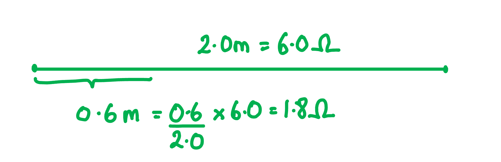

- Therefore the resistance of 0.6 m is 1.8 Ω; **[1 mark]**

**  **

Calculate the resistance of the two resistors in parallel:

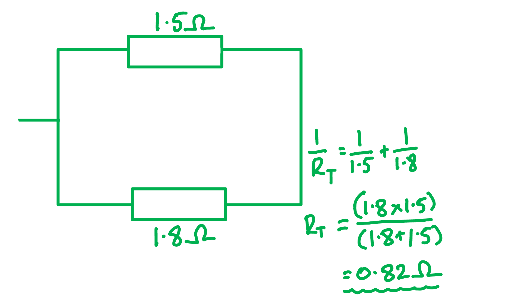

- Recall the equation, $\frac{1}{R_{T}}=\frac{1}{R_{1}}+\frac{1}{R_{2}}$**[1 mark]**
- The parallel combination has a total resistance of 0.82 Ω; **[1 mark]**

**  **

Calculate the total series resistance of the circuit:

- Recall that resistors in series add up:

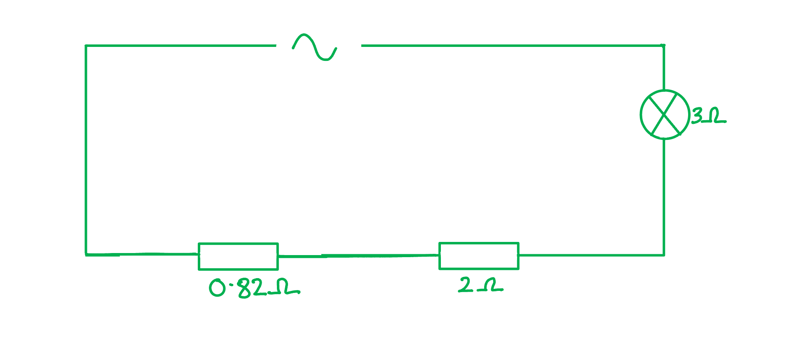

- Total resistance = 3.0 + 2.0 + 0.82 = 5.82 Ω; **[1 mark]**

**   **

**[Total: 4 marks]**

> *This is a complicated question to try to do without sketching the circuit. Once you see the mixture of ratios, parallel and series resistors on the page it becomes a matter of using the equations. But you need to see it first, and quick sketches are your friend.*

### Q15
(i) The term used for component Y is a:

- Thermistor; **[1 mark]**

(ii) Complete the diagram in Fig. 10.1 by adding electrical symbols:

A diagram that would score 3 marks should look like:

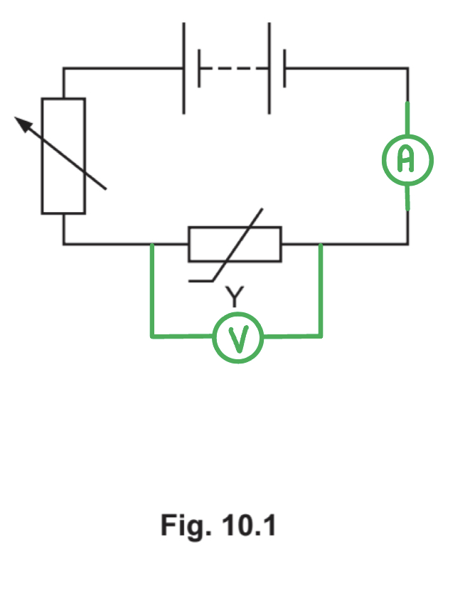

- Ammeter symbol drawn correctly; **[1 mark]**
- Voltmeter symbol drawn correctly; **[1 mark]**
- Ammeter positioned in series **AND** voltmeter position parallel to thermistor; **[1 mark]**

**[Total: 4 marks]**

> *It is important you learn all the circuit symbols required in the CIE syllabus, these are stated in the revision notes. You may be asked to draw or identify any of them.*

> *In part (ii), remember that:*

- *Voltmeters are always connected in **parallel** to the electrical component that you are measuring the potential difference (voltage) of*
- *Ammeters are always connected in **series*
(i) The value of their combined resistance is:

Recall the equation for resistors in series:

- $combinedresis\mathrm{tan}ceinseries=R_{1}+R_{2}+R_{3}...$

Calculate the combined resistance:

- $combinedresistance=5.0+7.0$
- combined resistance = 12.0 Ω **[1 mark]**

(ii) The combined resistance when in parallel with the resistance of A alone is:

- Smaller (than A); **[1 mark]**

**[Total: 2 marks]**

> *For a core question, you only need to know that the combined resistance of resistor in parallel is **smaller** than the resistance of one resistor alone. *

> *For extended questions, you could require the use of the equation for resistors in parallel:*

- $combinedresistanceinparallel=\frac{1}{R_{1}}+\frac{1}{R_{2}}+\frac{1}{R_{3}}...$

### Q16
(i) Draw the circuit symbol for a cell:

- Symbol drawn correctly (facing either direction); **[1 mark]**

(ii) State the term used for the arrangement of lamps in the circuit in Fig. 10.1:

- The lamps are in <u>series</u> (as they are one after another in the same loop in the circuit); **[1 mark]**

(iii) State the name of the charged particles that are flowing through the wires:

- <u>Electrons</u> are the charged particles in a circuit; **[1 mark]**

**[Total: 3 marks]**

> *When drawing a cell, make sure that one line is smaller than the other. If you draw them the same size, you are drawing the symbol for a component called a capacitor (you will learn about this if you go on to study A level physics, but feel free to do your own research now if you are interested!)*

(i) State two advantages of the circuit in Fig. 10.2 compared to the one in Fig. 10.1:

**Any two from:**

- Both lamps receive the correct / full potential difference; **[1 mark]**
- If one lamp fails the other lamp still lights / the circuit is not broken; **[1 mark]**
- Lamps can be switched off / on (independently); **[1 mark]**

(ii) Calculate the size of the current in the circuit:

List the known quantities:

- Combined resistance, *R* = 12 Ω
- Potential difference across the power source, *V**cell* = 3.0 V

Recall Ohm's law:

- $V=I\timesR$ **[1 mark]**

Rearrange this to make current the subject:

- $V=I\timesR$
- Divide both sides by *R*

  - $I=\frac{V}{R}$

Substitute in the known quantities:

- The current in a series circuit is calculated using the potential difference of the cell and the total resistance of the circuit
- The two lamps in parallel act identically to a single lamp with a resistance of 12 Ω
- $I=\frac{V}{R}$
- $I=\frac{3.0}{12}$ **[1 mark]**

Calculate the current in the circuit:

- *I* = 0.25 A **[1 mark]**

**[Total: 5 marks]**

> *Remember that potential difference is shared between components in series, so adding more components reduces the potential difference across each component. In parallel, the potential difference is the same across each branch and is not reduced with more branches.*

> *The opposite is true of current, which **is** shared between branches in a parallel circuit so more branches reduces the current flowing through each branch. *

### Q17
The device shown is:

- A thermistor; **[1 mark]**

**[Total: 1 mark]**
(i) In the starting position:

Brightness of lamp:

- The lamp goes off **OR**** **the brightness is zero / nothing; **[1 mark]**

Explanation:

- The potential difference is (almost) zero (as both contacts are on the same side of the cell); **[1 mark]**

(ii) When the teacher moves the sliding contact from **A** to **B**:

Brightness of lamp:

- The brightness increases (to maximum); **[1 mark]**

Explanation:

- The potential difference is increasing; **[1 mark]**

(iii) When the teacher moves the sliding contact from **B** to **C**:

- The lamp blows / goes out / fuses; **[1 mark]**

**[Total: 5 marks]**

> *The final part of the question is a bit tricky. You may have been lulled into thinking the lamp would just keep getting brighter. In fact, right at the start of the question, you were told that this is a 6 V bulb, and you can see that the maximum p.d. is 12 V. The full voltage of the cell will be too much for this bulb and melt the filament.*

### Q18
(i) Draw the electrical symbol for a fuse

A diagram that would score 1 mark would be:

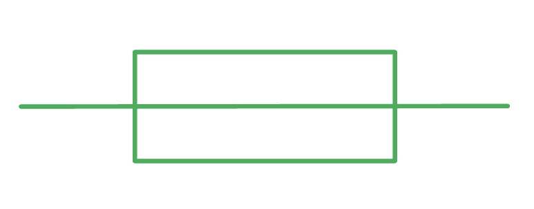

- Fuse symbol drawn as shown; **[1 mark]**

(ii) Earthing the metal case protects the teacher by:

**Any one from:**

- A large current flows to earth / in the live wire;** [1 mark]**
- The fuse is connected into a live wire;** [1 mark]**
- The fuse contains thin/low melting point wire;** [1 mark]**

**AND**

**Any two from:**

- The current heats the fuse wire;** [1 mark]**
- The fuse melts/blows;** [1 mark]**
- The power supply circuit / metal case is disconnected from the mains (supply);** [1 mark]**

**[Total: 4 marks]**

> *It is important you learn all the circuit symbols required in the CIE syllabus, these are stated in the revision notes. You may be asked to draw or identify any of them.*

> *If a live wire (inside the appliance) came into contact with the case, the case would become electrified and the teacher would risk electrocution. The fuse is always connected to a live wire. *

> *In summary:*

- *The earth wire provides a** low resistance path to the earth*
- *His causes a **surge of current in the earth wire** and hence also in the live wire*
- *The high current through the fuse causes it to **melt and break*
- *This **cuts off **the supply of electricity to the appliance, making it safe*
Calculate the output voltage of the transformer

List the known quantities:

- Input voltage, *V*p = 240 V
- Number of turns on the input coil, *N*p = 960 turns
- Number of turns on the output coil, *N*s = 64 turns

State the equation linking the input and output voltage and number of turns:

- $\frac{V_{s}}{V_{p}}=\frac{N_{s}}{N_{p}}$ **OR **$\frac{outputvoltage}{inputvoltage}=\frac{numberofturnsonoutputcoil}{numberofturnsoninputcoil}$** ****[1 mark]**

Rearrange equation for number for output voltage, *V*s:

- $V_{s}=\frac{N_{s}V_{p}}{N_{p}}$ **[1 mark]**

Substitute values into output voltage equation:

- $V_{s}=\frac{64\times240}{960}$
- *V*s = 16 V **[1 mark]**

**[Total: 3 marks]**

> *The equation  *$\frac{V_{s}}{V_{p}}=\frac{N_{s}}{N_{p}}$* can also be written as *$\frac{V_{p}}{V_{s}}=\frac{N_{p}}{N_{s}}$* .*
*However, the latter is harder to rearrange for **V**s**, it is important you know how to rearrange for both variations!*

> *Rearranging for **V**s** from *$\frac{V_{s}}{V_{p}}=\frac{N_{s}}{N_{p}}$*is:*

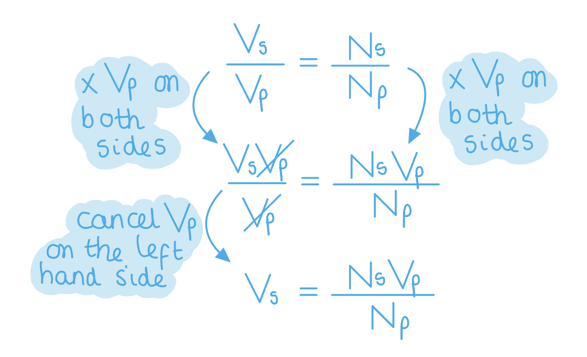

*Rearrange for **V**s** from *$\frac{V_{p}}{V_{s}}=\frac{N_{p}}{N_{s}}$:

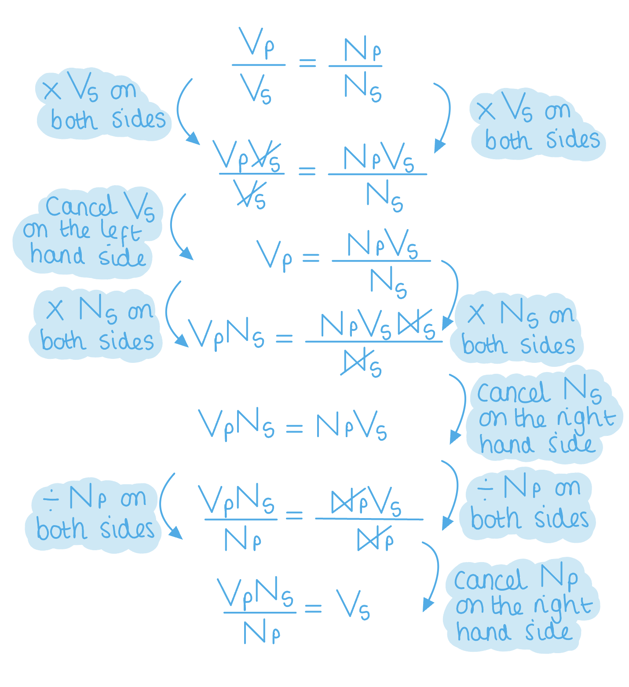

### Q19
State the term used to describe each electrical circuit:

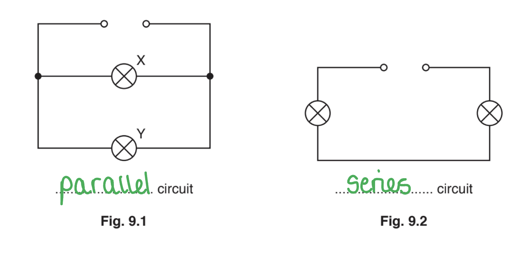

- Fig 9.1 is a parallel circuit; **[1 mark]**
- Fig 9.2 is a series circuit; **[1 mark]**

**[Total: 2 marks]**

> *An exam question will often not state the type of circuit, so recognising a parallel and series circuit is extremely important. Current and potential difference (voltage) act differently in both.*
Two disadvantages for Fig. 9.2 are:

**Any two from:**

- The lamps are less bright; **[1 mark]**
- If one lamp breaks the other does not light / doesn't work; **[1 mark]**
- The lamps cannot be switched (on) independently; **[1 mark]**

**[Total: 2 marks]**

> *These disadvantages are why series circuits are not that common in everyday life.*

> *The bulbs become dimmer as the potential difference is **shared equally **across the bulbs. The current reads the same for each component. In parallel, **e**ach branch has the same potential difference, so the bulbs on one branch will have the same relative brightness.*
Redraw the circuit in Fig. 9.1 with switches that will turn lamps X and Y on and off independently of each other:

A diagram that would score 2 marks should look like:

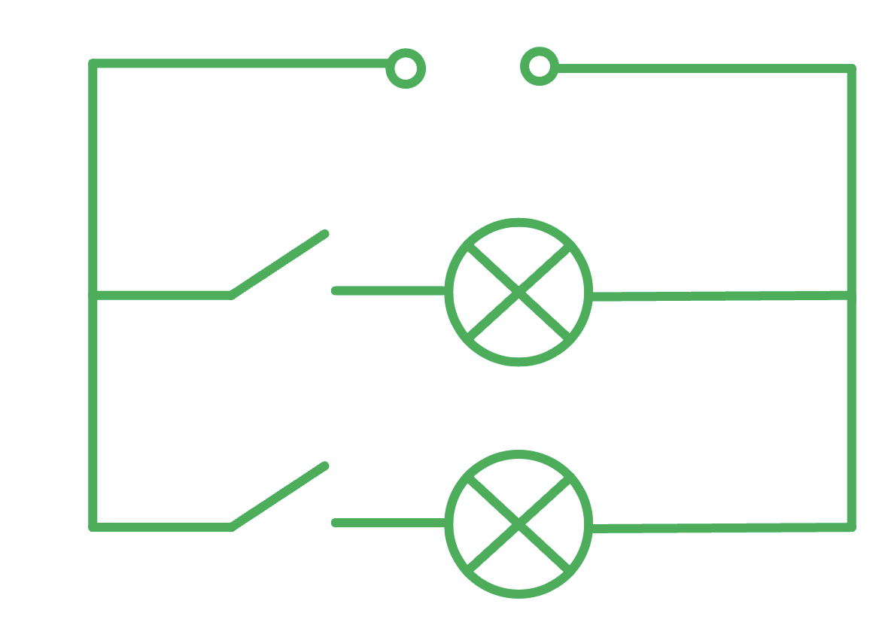

- Two correct switch symbols;** [1 mark]**
- On each branch;** [1 mark]**

**[Total: 2 marks]**

> *Switches are useful in parallel circuits to control which components are connected when. A switch can be either open or closed. When it is closed, current can flow through it, whilst when it's open, the circuit is broken and current will not flow through it (and that branch). The sketch below shows how this would mean the lamps could then be switched on and separately:*

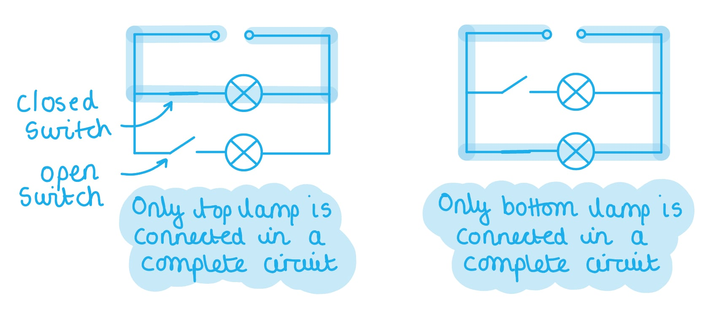
Complete the table stating when the lamps are on or off.

A table that would score 3 marks should look like:

| switch positions | lamps on or off |   |
|---|---|---|
| S1 | S2 |   |
| K | Z | off |
| K | W | **Final answer:** **on** |
| J | W | **Final answer:** **off** |
| J | Z | **Final answer:** **on** |

- With switch positions K and W, the lamps are on; **[1 mark]**
- With switch positions J and W, the lamps are off; **[1 mark]**
- With switch positions J and Z, the lamps are on; **[1 mark]**

**[Total: 3 marks]**

> *The lamps will be on if they're connected to part of a **complete circuit**. This means all components are connected, in parallel or series by wires and there are no breaks. *

> *The sketches below show what the circuit would look like for each of the switch positions. *

- *When the switches are connected to K and Z, or J and W, the wires are not connected, forming a broken circuit and the lamps will be off*
- *When the switches are connected to K and W, or J and Z, the wires are connected in a complete circuit and the lamps will be on*

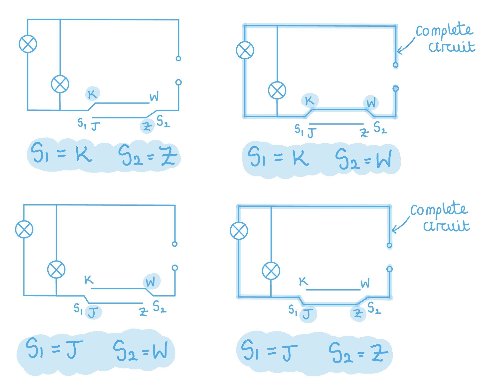

### Q20
(i) The most suitable material for the core of an electromagnet is:

- A (soft) <u>iron</u> bar is; **[1 mark]**

(ii) The name of component X is:

- X is a variable resistor; **[1 mark]**

(iii) To explain how component X varies the strength of the electromagnet:

**Any two from:**

- Increasing the resistance; **[1 mark]**
- Decreases the current; **[1 mark]**
- Which decreases the strength (of the electromagnet);** [1 mark]**

**[Total: 4 marks]**

> *Describing iron as 'soft' seems confusing. Of course, iron is a very hard metal! However it holds onto magnetism very softly, 'letting it go' easily, hence the term.*
To calculate the resistance of the circuit:

List the known quantities:

- Current,* I* = 1.5 A
- Voltage, *V* = 12 V

Recall the equation for resistance:

- $R=\frac{V}{I}$ **[1 mark]**

Substitute the values:

- $R=\frac{12}{1.5}$ **[1 mark]**

Calculate:

- *R* = 8.0 Ω **[1 mark]**

**[Total: 3 marks]**

> *Each stage in the calculation gets marks for correct working. Even just writing the equation gets a mark! So, show your working. You can still get most of the marks even if you end up accidentally writing the wrong answer, if you have shown your correct maths.*

### Q21
(i) On Fig. 10.1, draw the missing circuit symbols:

A diagram scoring two marks:

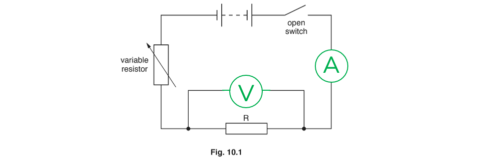

- Ammeter circuit symbol drawn correctly; **[1 mark]**
- Voltmeter circuit symbol drawn correctly; **[1 mark]**
- Ammeter placed in series **AND**** **voltmeter placed in parallel; **[1 mark]**

(ii) Describe how the student could use the circuit to determine a reliable value for the resistance of R:

**Any five from:**

**Method**

- Close the switch; **[1 mark]**
- Adjust the variable resistor to let the current flow through the fixed resistor and therefore get a reading on the ammeter; **[1 mark]**
- Measure / record the readings on the ammeter and voltmeter; **[1 mark]**

**Reliability**

- Check that the range of repeat readings is small / identify and discount anomalous results; **[1 mark]**
- Repeat the readings and calculate a mean; **[1 mark]**
- Adjust the variable resistor to get a range of readings (at different currents); **[1 mark]**
- Take readings at every 0.05 A / 0.1 A; **[1 mark]**

**Analysis**

- Plot the mean currents and voltages on a graph; **[1 mark]**
- Use Ohm's law to calculate resistance **OR ***V = IR*; **[1 mark]**

**[Total: 8 marks]**

> *You may have performed this investigation yourself, or one that is very similar. You may have seen it demonstrated instead. *

> *The variable resistor is used to control the current flowing through the circuit. Changing the voltage using a power supply would also have the same effect, and this may be the method that you have used / seen before. That's OK, the principle is the same. In order to determine the resistance of the **fixed resistor**, you need to take readings of current and voltage so that using Ohm's law (or plotting a graph) you can determine the resistance of the fixed resistor. This is the premise of the question. *

> *The wording of the question asks specifically for how to determine a **reliable value**. This is giving you a hint that you should be thinking about how to increase the reliability of the data you get. In this particular question, it is possible to still score all 5 marks without explicitly touching upon these points. However, it is always best to include reliability in your answer because very often it is expected in the mark scheme.*
Describe how adding a second 20 Ω resistor in series affects the current in the circuit:

- The resistance (in the circuit) increases; **[1 mark]**
- The total resistance becomes 40 Ω / doubles; **[1 mark]**
- The current (in the circuit) decreases; **[1 mark]**
- The total current becomes 0.2 A / halves; **[1 mark]**

**[Total: 4 marks]**

### Q22
(i) State the name of component X:

- Variable resistor **OR** rheostat; **[1 mark]**

** **

(ii) A correctly drawn diagram would look like:

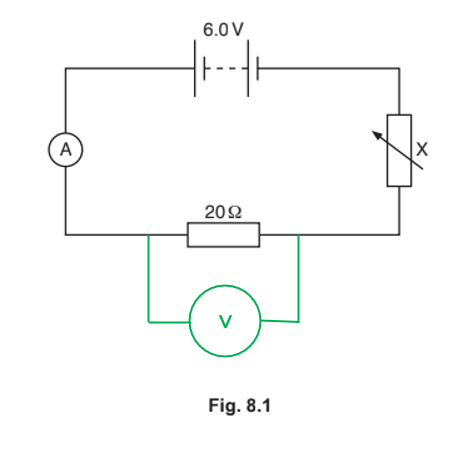

- Voltmeter symbol correctly connected across 20 Ω resistor; **[1 mark]**

**[Total: 2 marks]**
To draw a correct line on the graph:

List the known quantities:

- Resistance of the fixed resistor, *R* = 20 Ω
- Minimum p.d. = 0
- Maximum p.d. = 6.0 V

Recall the equation linking voltage, current and resistance:

- $R=\frac{V}{I}$ **[1 mark]**

Calculate the maximum current:

- $I=\frac{V}{R}=\frac{6.0}{20}=0.30A$
- Plot this point on the graph; **[1 mark]**

A completed graph which would score three marks would look like:

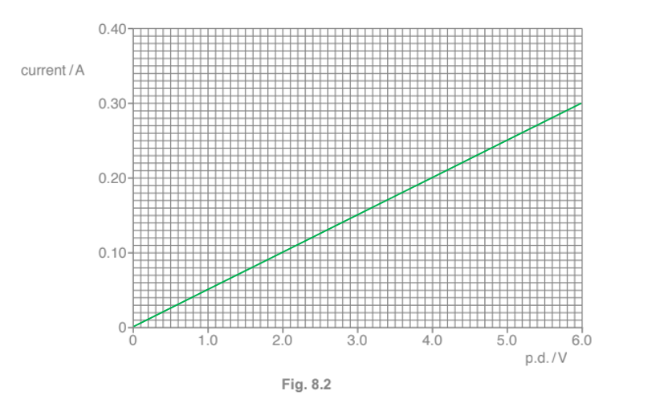

- Straight line drawn from (0,0) to (6.0, 0.30); **[1 mark]**

  - Tolerance within 1⁄2 small square

**[Total: 3 marks]**

> *Make sure you use a ruler when plotting straight line graphs!*

> *Remember that for a fixed resistor, the current and voltage are directly proportional.*
(i) State how the two resistors in parallel are compared to the resistors on their own:

- (The combined resistance) is less (than the resistance of either / smaller resistor); **[1 mark]**

(ii) State how the second line differs from the original line:

**Any one from:**

- The line is <u>steeper</u>; **[1 mark]**
- The <u>gradient is greater</u>; **[1 mark]**
- A description of how the line differs; **[1 mark]**

  - e.g. the line reaches 0.40 A before V reaches 6.0 V

**[Total: 2 marks]**

> *If the questions tells you not to draw on the graph, then you will receive no credit for any markings on it. *

### Q23
(i) To compare the readings on the three ammeters in the first diagram:

The first circuit is a **series **circuit:

- Therefore the ammeters all have the same reading; **[1 mark]**

(ii) To compare the readings on the three ammeters in the second diagram:

The second circuit is a **parallel **circuit:

- Therefore the current splits and is shared by the two branches
- The reading on A1 is the biggest **OR**** **the reading on A1 is twice as much as on the other two ammeters; **[1 mark]**

(iii) Two advantages of connecting the lamps in parallel rather than in series:

- In parallel circuits the lamps have normal brightness **OR**** **are brighter (than lamps in series); **[1 mark]**
- If one lamp fails / breaks the other lamp is still lit; **[1 mark]**

**[Total: 4 marks]**** **

> *You may mention that the lamps in parallel receive the full potential difference / voltage of the battery. But this would only score a mark if it was combined with the effect on brightness.*
(i) The combined resistance of the two lamps connected in series is:

List the known quantities:

- Resistance of each lamp = 12 Ω

Recall the equation for resistors in series:

- $R_{total}=R_{1}+R_{2}$

Substitute the value of R and calculate:

- $R_{total}=12+12$

Write the final answer:

- Rtotal = 24 Ω **[1 mark]**

(ii) To compare the resistance of one lamp with the combined resistance of the two lamps in parallel:

- In parallel combinations the resistance decreases
- Therefore the <u>resistance of one lamp is more</u> than the combined resistance of lamps in parallel; **[1 mark]**

**[Total: 2 marks]**

> *When resistors are set up in parallel it creates alternative routes for the current to follow. This makes it easier for the current to flow. By 'easier' we mean 'there is less resistance'.*

### Q24
State the name of the component shown in Fig. 10.1:

- The component is a <u>thermistor</u>; **[1 mark]**

**[Total: 1 mark]**
(i) Use Fig. 10.2 to determine the resistance of the component at a temperature of 10 °C:

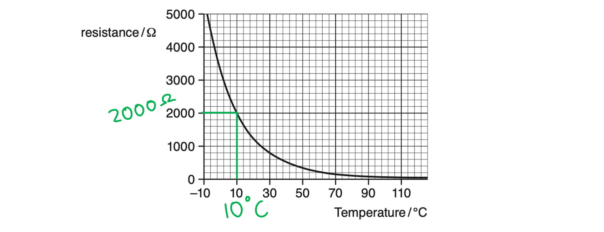

- The resistance at 10 °C is <u>2000 Ω</u>; **[1 mark]**

**   **

(ii) Calculate the current in the component:

List the known quantities:

- Resistance, *R* = 800 Ω
- Potential difference, *V* = 12.0 V

Recall Ohm's law:

- $V=I\timesR$ **[1 mark]**

Rearrange for the current *I*:

- $\frac{V}{R}=I$

Substitute in the known quantities:

- $I=\frac{12.0}{800}$ **[1 mark]**
- *I* = 0.015 A **[1 mark]**

**[Total: 4 marks]**
State the change the students should make:

- Remove / replace the thermistor; **[1 mark]**
- Add a <u>light dependent resistor / LDR</u>;** [1 mark]**

**[Total: 2 marks]**
Draw the symbol for the replacement component you suggested in part (c):

The symbol for a light dependent resistor is:

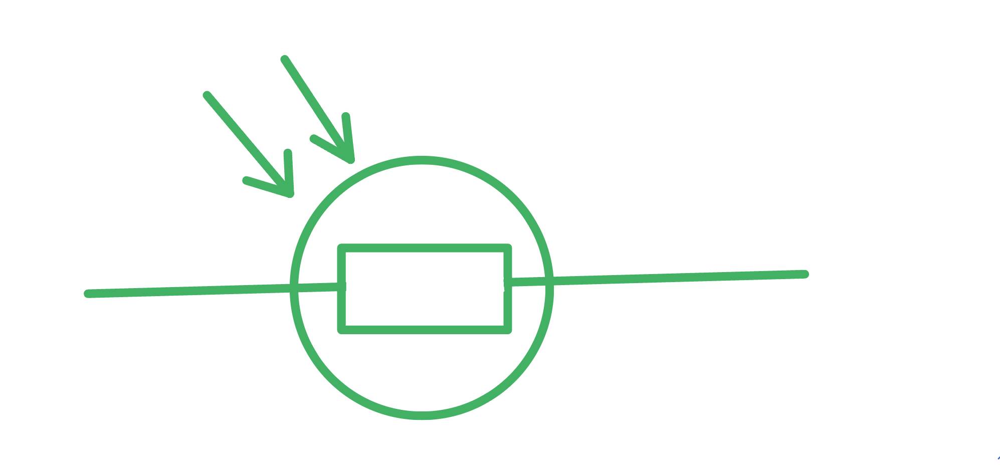

- Can be either vertical or horizontal, arrows on left or right;** [1 mark]**

**[Total: 1 mark]**

### Q25
The fixed resistor labelled R on the circuit diagram would look like:

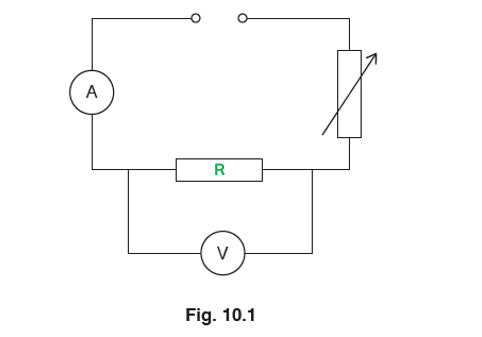

- Fixed resistor labelled R; **[1 mark]**

**[Total: 1 mark]**
A correctly completed table would look like:

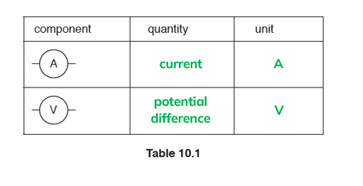

- **One mark for each correct answer**

**[Total: 4 marks]**

> *For the quantity measured by a voltmeter, you could have written 'voltage' instead of potential difference.*

> *If you carry on studying physics for A level you will find that it's important to tell the difference between different voltages measured across components and power sources, but for now you can take it a bit more easily if it helps you pass this exam.*
State how the resistance of a wire is related to its length:

- Increasing the length increases the resistance **OR **decreasing the length decreases the resistance; **[1 mark]**

State how the resistance of a wire is related to its diameter:

- Increasing the diameter decreases the resistance **OR**** **decreasing the diameter increases the resistance; **[1 mark]**

**[Total: 2 marks]**
