# Exam Questions — Electric Circuits & Electrical Safety
**4. Electricity & Magnetism** · Cambridge (CIE) IGCSE physics (0625 & 0972)
> Source: [https://www.savemyexams.com/igcse/physics/cie/23/topic-questions/](https://www.savemyexams.com/igcse/physics/cie/23/topic-questions/) · 42 questions across 1 sets

## Multiple Choice Questions (42 questions)

### Q1 — easy — 1 marks

**Q1** [1 mark]

What is the purpose of a fuse in a mains electrical circuit?

### Q2 — hard — 1 marks

**Q2** [1 mark]

The diagram shows a potential divider circuit. A power supply is connected in series with a $6.0Ω$ resistor and an $8.0Ω$ resistor.

A voltmeter connected across the $8.0Ω$ resistor reads $12V$.

What is the electromotive force (e.m.f.) of the power supply?

### Q3 — medium — 1 marks

**Q3** [1 mark]

An electric hairdryer is used on a $240 \text{V}$ mains supply. The hairdryer has a power rating of $2100 \text{W}$.

Which fuse is the most suitable to use in the plug of the hairdryer?

### Q4 — medium — 1 marks

**Q4** [1 mark]

A student creates a battery by connecting three identical cells in series. Each cell has an electromotive force (e.m.f.) of $1 . 5 \text{V}$.

What is the total e.m.f. of the battery?

### Q5 — medium — 1 marks

**Q5** [1 mark]

The diagram shows a circuit containing a battery, three switches, $S_{1}$, $S_{2}$, and $S_{3}$, and two lamps $L_{1}$ and $L_{2}$.

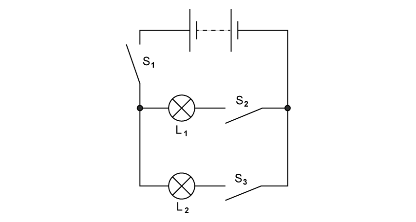

A student wants to light lamp $L_{1}$ only.

Which switches must be closed?

### Q6 — medium — 1 marks

**Q6** [1 mark]

** **The circuit diagram shows cells connected with a resistor in a series circuit.

Each cell has an electromotive force (e.m.f.) of 1.5 V

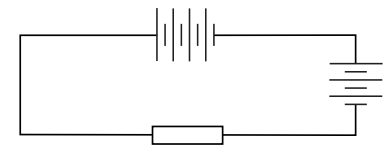

What is the total e.m.f. in the circuit?

*Source: specimen 2023 paper 1 Q29*

### Q7 — medium — 1 marks

**Q7** [1 mark]

The circuit diagram shows two identical lamps connected in parallel to a cell. Three ammeters, X, Y and Z, are also connected in the circuit, as shown.

Which statement about the current in X is correct?

*Source: June 2023 0972/21 Q28*

### Q8 — medium — 1 marks

**Q8** [1 mark]

** **A double-insulated electrical appliance must be connected safely to the electricity supply.

Which statement is correct?

*Source: June 2023 0972/11 Q30*

### Q9 — medium — 1 marks

**Q9** [1 mark]

A student connects the circuit shown.

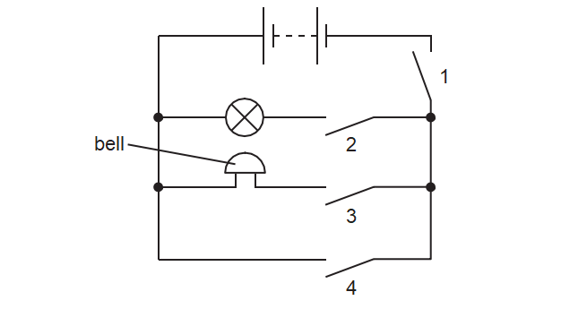

Which switches must be closed for the bell to ring without lighting the lamp?

*Source: June 2023 0972/11 Q29*

### Q10 — easy — 1 marks

**Q10** [1 mark]

** **Which symbol represents an electric heater?

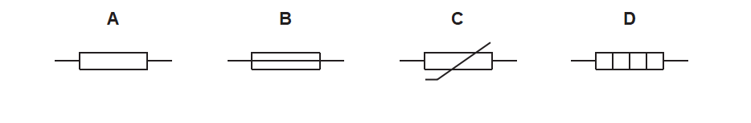

*Source: June 2023 0972/11 Q28*

### Q11 — hard — 1 marks

**Q11** [1 mark]

The battery on a bicycle is connected in parallel to its lamp and bell.

The circuit includes two switches, S1 and S2.

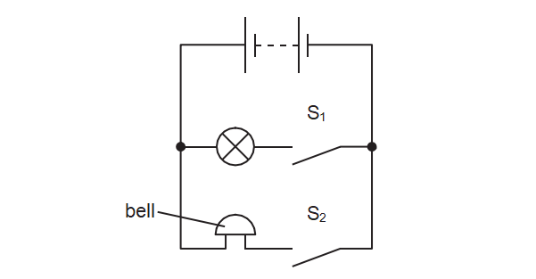

The cyclist closes S1 to light the lamp.

She then also closes S2 to sound the bell.

What happens to the current in the battery and the power output from the battery when the cyclist closes S2?

|   | current in the battery | power output from the battery |
|---|---|---|
| **A** | increases | increases |
| **B** | increases | stays the same |
| **C** | stays the same | increases |
| **D** | stays the same | stays the same |

*Source: June 2023 0972/11 Q27*

### Q12 — hard — 1 marks

**Q12** [1 mark]

The diagram shows a circuit of six identical lamps connected to a battery.

Which lamps are brightest?

*Source: June 2022 paper 1 Q33*

### Q13 — medium — 1 marks

**Q13** [1 mark]

An electric kettle has a metal casing. The cable for the kettle contains a wire that is connected to the earth pin of the plug.

Which danger does this guard against?

*Source: specimen 2023 paper 1 Q32*

### Q14 — medium — 1 marks

**Q14** [1 mark]

A computer engineer wants the speed of a fan to increase when the temperature inside a computer increases. The engineer knows that a larger current causes the fan to turn more quickly

Which component should be placed at X to make this happen?

*Source: specimen 2023 paper 1 Q30*

### Q15 — medium — 1 marks

**Q15** [1 mark]

What is the advantage of connecting lamps in parallel in a lighting circuit?

*Source: June 2022 paper 1 Q32*

### Q16 — easy — 1 marks

**Q16** [1 mark]

Why is a fuse used in an electrical circuit?

*Source: June 2022 paper 1 Q34*

### Q17 — easy — 1 marks

**Q17** [1 mark]

The diagram shows the circuit diagram symbol of an electrical component.

Which component does the symbol represent?

*Source: June 2022 paper 1 Q31*

### Q18 — easy — 1 marks

**Q18** [1 mark]

The diagram shows an electric circuit.

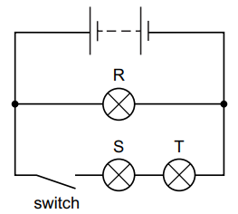

When the switch is open, which lamp(s) are **not **lit?

*Source: specimen 2023 paper 1 Q31*

### Q19 — easy — 1 marks

**Q19** [1 mark]

This is the circuit symbol for which component?

### Q20 — easy — 1 marks

**Q20** [1 mark]

The diagram shows two resistors connected in parallel.

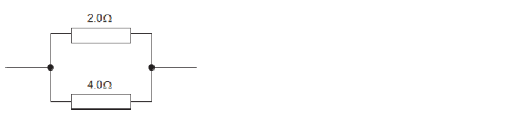

The total resistance of this combination will be:

### Q21 — easy — 1 marks

**Q21** [1 mark]

**Extended tier only**

Which diagram shows the correct symbol for a diode, and the correct direction of current moving through it?

### Q22 — easy — 1 marks

**Q22** [1 mark]

Which of the circuit diagrams above shows a fuse which has been correctly connected?

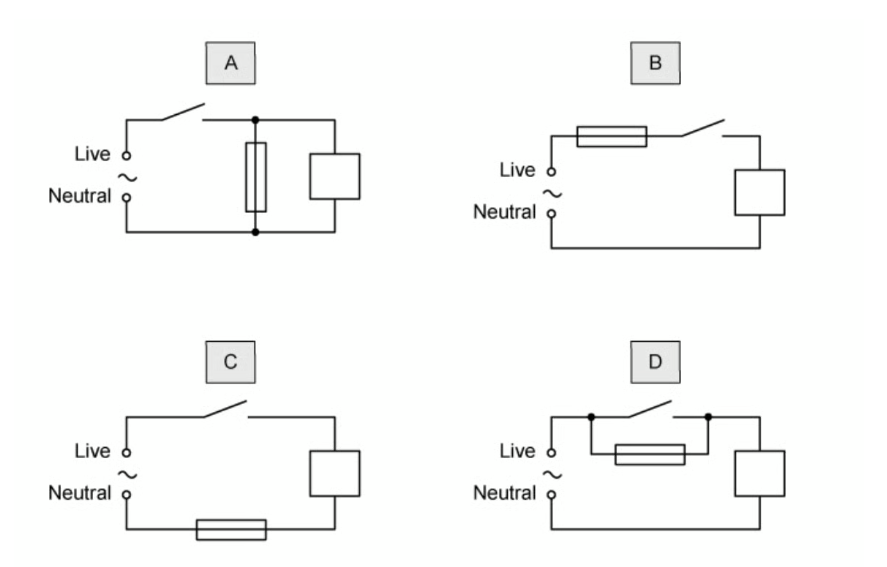

### Q23 — easy — 1 marks

**Q23** [1 mark]

Which of the following circuit symbols is for a thermistor?

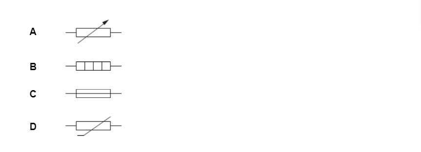

### Q24 — hard — 1 marks

**Q24** [1 mark]

A student connects together some identical resistors in three different combinations, as shown in the diagram.

Which of the answers below shows the correct order of the combinations from the lowest resistance to the highest?

### Q25 — medium — 1 marks

**Q25** [1 mark]

Which of the diagrams below shows a fuse which has been correctly connected to a circuit?

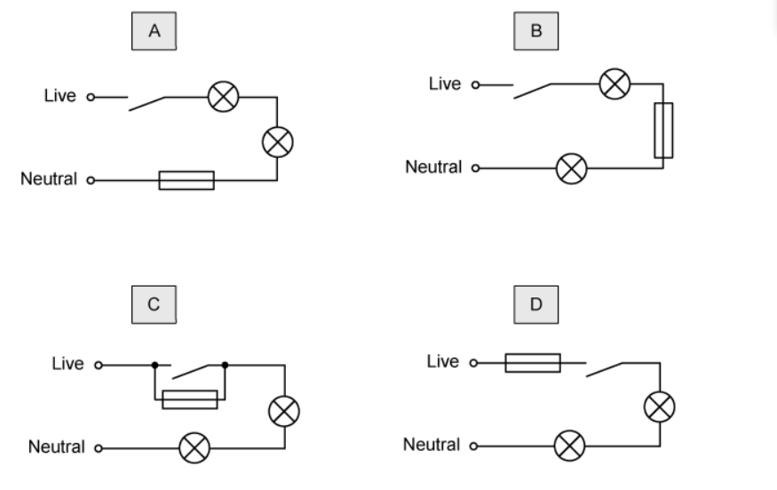

### Q26 — medium — 1 marks

**Q26** [1 mark]

The diagram shows two resistors connected in series with a battery.

What is the current through the battery?

### Q27 — medium — 1 marks

**Q27** [1 mark]

The diagram shows two bulbs, which have been connected in parallel. A fuse has been included in the circuit.

Each of the ammeters reads 1.2 A.

What fuse should be put in this circuit?

### Q28 — hard — 1 marks

**Q28** [1 mark]

A person wants to install a circuit breaker to protect themselves and their lawnmower from too much current.

Under normal operating conditions, the lawnmower carries 4 A of current.

The manufacturer provides the graph below with the circuit breaker.

What will happen when the current is 4 A, and what will happen if the current rises to 14 A?

|   | **4 A** | **14 A** |
|---|---|---|
| **A** | circuit does not break | circuit does not break |
| **B** | circuit does not break | circuit breaks quickly |
| **C** | circuit breaks quickly | circuit does not break |
| **D** | circuit breaks quickly | circuit breaks quickly |

### Q29 — hard — 1 marks

**Q29** [1 mark]

**Extended tier only**

A 10 Ω and a 30 Ω resistor are connected in series, as shown in the diagram below, making a potential divider circuit.

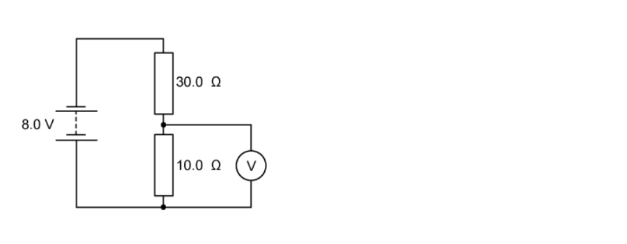

What would be the reading on the voltmeter?

### Q30 — medium — 1 marks

**Q30** [1 mark]

The plug for an electric lamp contains a 3 A fuse. The fuse’s job is to protect the lamp if too much current flows.

Where is the fuse positioned, and what happens when the fuse does its job?

|   | **Where is it positioned?** | **What does it do?** |
|---|---|---|
| **A** | live wire | reduces the current to 3 A |
| **B** | neutral wire | breaks the circuit |
| **C** | live wire | breaks the circuit |
| **D** | neutral wire | reduces the current to 3 A |

### Q31 — medium — 1 marks

**Q31** [1 mark]

A surge of current in a kettle melts the 13 A fuse.

What will happen to the kettle next time it is used if the fuse is replaced with a 3 A fuse?

### Q32 — hard — 1 marks

**Q32** [1 mark]

Which of the following statements about the current in ammeters **X**, **Y** and **Z** is correct?

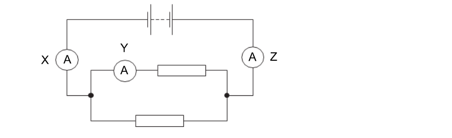

### Q33 — hard — 1 marks

**Q33** [1 mark]

**Extended tier only**

All the light bulbs in the diagrams above are identical. Each one is rated as ‘10 W, 230 V’.

In which of the diagrams are all the bulbs working at their normal brightness?

### Q34 — hard — 1 marks

**Q34** [1 mark]

**Extended tier only**

Two resistors are connected in parallel.

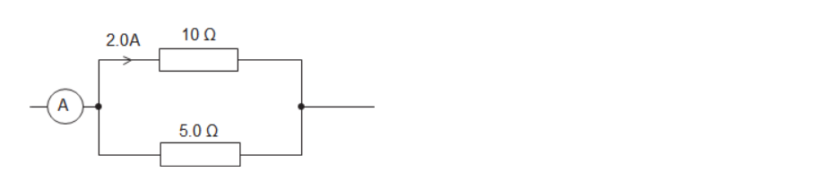

The current through the top resistor is 2.0 A.

What is the reading on the ammeter?

### Q35 — medium — 1 marks

**Q35** [1 mark]

An oven is wired into somebody’s kitchen. The oven is protected by a fuse, and functions normally, but the owner notices that the wires that connect the oven to the mains electricity supply get quite hot.

What could be done to reduce the temperature of the wires?

### Q36 — medium — 1 marks

**Q36** [1 mark]

The diagram shows a toaster that has been wired up.

Three fuses have been connected to the toaster, but only one or two have been connected correctly.

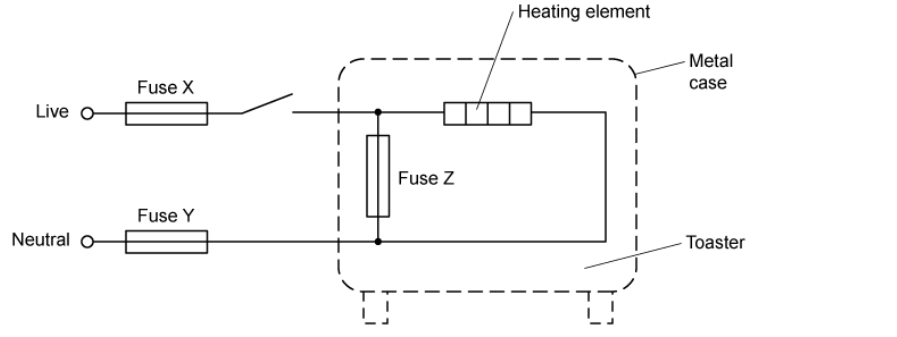

Which of the fuses has been positioned correctly?

### Q37 — hard — 1 marks

**Q37** [1 mark]

**Extended tier only**

A homeowner buys a security light that switches on automatically when it gets dark.

The security light contains the circuit, shown below.

When it gets dark, what happens to the resistance of the LDR, and what happens to the potential difference across the LDR?

|   | **Resistance of LDR** | **p.d. across LDR** |
|---|---|---|
| **A** | increases | increases |
| **B** | decreases | increases |
| **C** | increases | decreases |
| **D** | decreases | decreases |

### Q38 — medium — 1 marks

**Q38** [1 mark]

Both fuses and circuit breakers are devices which protect devices from high currents that could cause them to get too hot and catch fire.

The diagram shows two possible positions where a fuse or a circuit breaker could be positioned.

Which location would be suitable for a fuse, and which would be suitable for a circuit breaker?

|   | **fuse** | **circuit breaker** |
|---|---|---|
| **A** | P | P |
| **B** | P | Q |
| **C** | Q | P |
| **D** | Q | Q |

### Q39 — medium — 1 marks

**Q39** [1 mark]

A student sets up the circuit below, it contains four fuses and four bulbs.

She finds that none of the bulbs are lit, but only one of the fuses has blown.

Which fuse has blown?

### Q40 — hard — 1 marks

**Q40** [1 mark]

**Extended tier only**

Two resistors are connected in parallel.

What is the combined resistance of the combination?

### Q41 — hard — 1 marks

**Q41** [1 mark]

A teacher writes a set of notes about two **non-identical** bulbs which are connected in parallel.

He makes one mistake. Which of the statements below is incorrect?

### Q42 — medium — 1 marks

**Q42** [1 mark]

A book shop owner sets up the circuit below, but they find that the lamp is too dim.

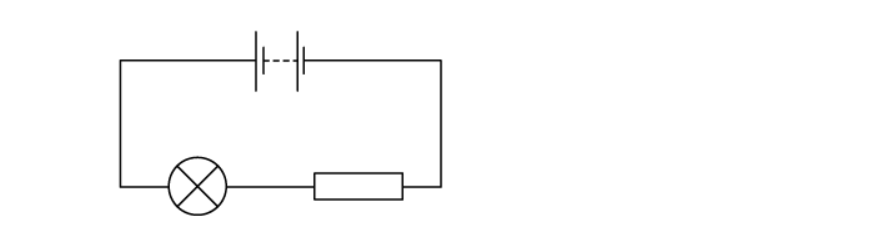

What change can be made to the circuit to increase the brightness of the bulb?
