# Exam Questions — Electric Circuits & Electrical Safety
**4. Electricity & Magnetism** · Cambridge (CIE) IGCSE physics (0625 & 0972)
> Source: [https://www.savemyexams.com/igcse/physics/cie/23/topic-questions/](https://www.savemyexams.com/igcse/physics/cie/23/topic-questions/) · 70 questions across 3 sets

## Alternative To Practical Questions (3 questions)

### Q1 — medium — 11 marks

**Q1** [1 mark]

A student is investigating a circuit containing different lamps. She is using the circuit shown in Fig. 3.1.

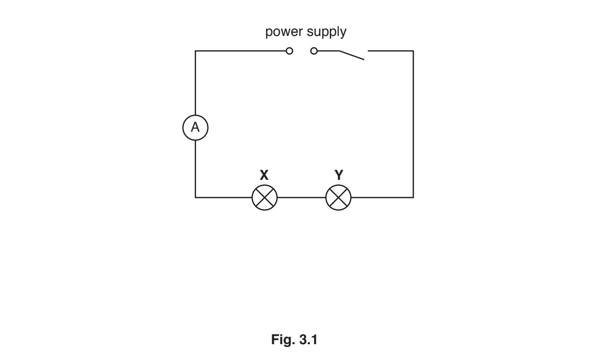

On Fig. 3.1, draw a voltmeter connected so that it measures the potential difference (p.d.) across lamp **X**.

*Source: March 2018 0625/62 Q3A*

**Q1** [1 mark]

The student uses the ammeter to measure the current in the circuit.

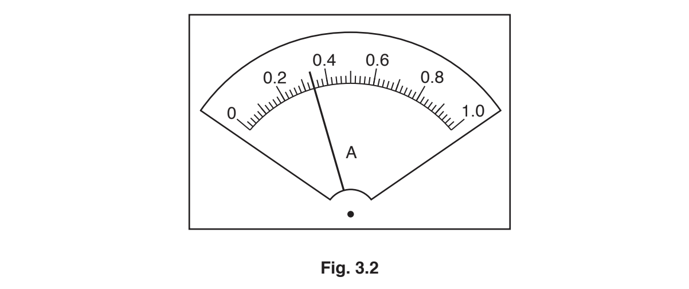

Record the current *I*S in amperes, A, in the circuit, as shown in Fig. 3.2.

*I*S = ............................................................

*Source: March 2018 0625/62 Q3B*

**Q1** [4 marks]

(i) The student uses the voltmeter to measure the p.d. *V*X across lamp **X** and then reconnects the voltmeter to measure the p.d. *V*Y across lamp **Y**.

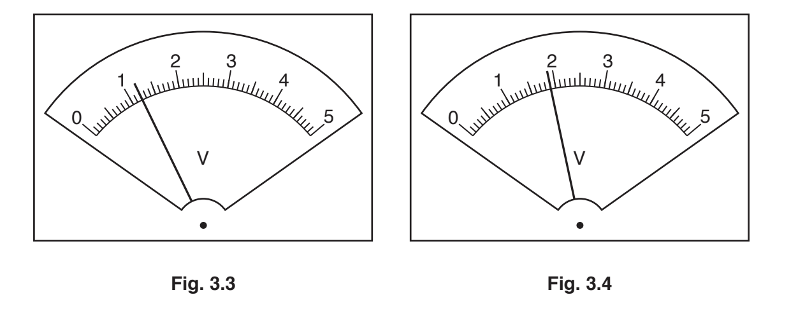

Record the value of the p.d. *V*X  across lamp **X**, shown in Fig. 3.3.

*V*X  = ...............................................................

Record the value of the p.d. *V*Y across lamp **Y**, shown in Fig. 3.4.

*V*Y  = ............................................................... [1]

(ii) She then measures the p.d. *V*S across both lamps in series.

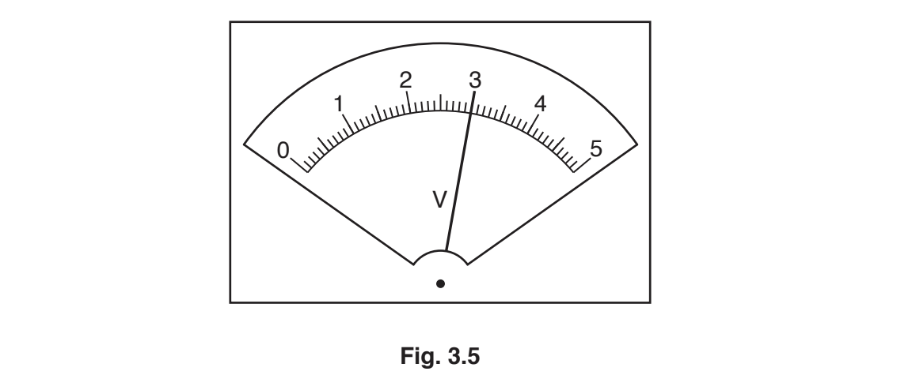

Record the value of the p.d. *V*S across both lamps in series, shown in Fig. 3.5.

*V*S  = ...............................................................[1]

(iii) A student suggests that *V*S should be equal to (*V*X + *V*Y). State whether the readings support this suggestion. Justify your statement with reference to the results.

[2]

*Source: March 2018 0625/62 Q3C*

**Q1** [1 mark]

**Extract:**

The value of the current IS in the circuit, as shown in Fig. 3.2: 0.34 A
The value of the p.d. VX across lamp X, shown in Fig. 3.3: 1.2 V

Calculate the resistance *R*1 of lamp **X**. Use the readings from **(b)** and** (c)(i) **and the equation

$R_{1}=\frac{V_{X}}{I_{S}}$.

*R*1 = ......................................................Ω .

*Source: March 2018 0625/62 Q3D*

**Q1** [4 marks]

**Extract:**

Calculate the resistance *R*~1~ of lamp **X**.

List the known quantities:

- *V*~X~ = 1.2 V (from part (c))
- *I*~S~ = 0.34 A (from part (b))

Substitute values into the resistance equation:

- ![R subscript 1 space equals space V subscript X over I subscript S space equals space fraction numerator 1.2 over denominator 0.34 end fraction]
- *R*~1~ = 3.5294 = 3.5 Ω [1 mark]

(i) The circuit components are to be rearranged so that

- lamps **X** and **Y** are connected in parallel
- the ammeter measures the current in lamp **X** only
- the voltmeter measures the p.d. across the lamps.

Draw a circuit diagram of this arrangement.

[2]

(ii) The student sets up the circuit as described in **(e)(i)**.

She measures and records the current in lamp **X** and the p.d. across the lamps.

She then calculates a new resistance *R*2 for lamp **X** in this parallel circuit.

*R*2 = 8.3 Ω

The student notices that lamp **X** is very bright in this parallel circuit, but it was dim in the series circuit in **(a)**.

Suggest how temperature affects the resistance of a lamp. Justify your suggestion by reference to the value of *R*1 from **(d)** and the value of *R*2.

[2]

*Source: March 2018 0625/62 Q3E*

### Q2 — medium — 11 marks

**Q2** [4 marks]

A student determines the resistances of some filament lamps.

Fig. 2.1 shows the first circuit she uses.

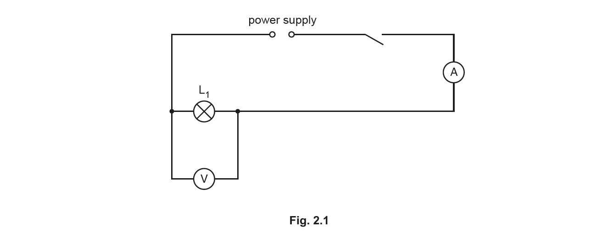

(i) Record the potential difference $V_{1}$ across the lamp L1, as shown on the voltmeter in Fig. 2.2.

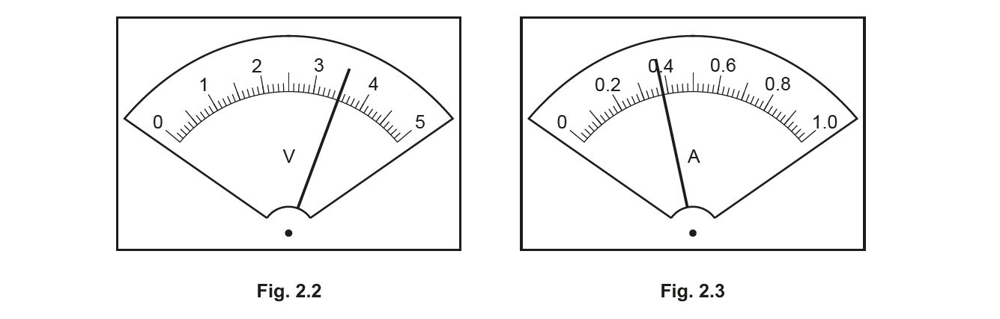

$V_{1}$ = .................................................. V [1]

(ii) Record the current $I_{1}$ in the circuit, as shown in Fig. 2.3.

$I_{1}$ = .................................................. A [1]

(iii) Calculate the resistance $R_{1}$ of the filament of lamp L1. Use the equation $R_{1}=\frac{V_{1}}{I_{1}}$ . Include the unit.

$R_{1}$ = ..................................................... [2]

*Source: 2020 May/ June 0625/61 Q2A*

**Q2** [1 mark]

The student disconnects the voltmeter. She connects lamp L2 in series with lamp L1. She connects the voltmeter across lamp L2.

She measures the current $I_{2}$ in the circuit and the potential difference $V_{2}$ across lamp L2.

$I_{2}$ = ..... 0.30 A ..... $V_{2}$ = ..... 1.7 V .....

Calculate the resistance *R*2 of the filament of lamp L2. Use the equation $R_{2}=\frac{V_{2}}{I_{2}}$.

$R_{2}$ = .............................................

The student disconnects the voltmeter. She connects lamp L3 in series with lamps L1 and L2. She connects the voltmeter across lamp L3.

She measures the current $I_{3}$ in the circuit and the potential difference $V_{3}$ across lamp L3.

$I_{2}$ = ..... 0.26 A ..... $V_{2}$ = ..... 1.2 V .....

Calculate the resistance *R**3* of the filament of lamp L3. Use the equation $R_{3}=\frac{V_{3}}{I_{3}}$.

$R_{3}$ = ...................................

*Source: 2020 May/ June 0625/61 Q2B*

**Q2** [1 mark]

**Extract:**

R1 = 9.21 Ω
R2 = 5.7 Ω
R3 = 4.6 Ω

Calculate *R*1 + *R*2 + *R*3. Give your answer to a suitable number of significant figures for this experiment.

*R*1 + *R*2 + *R*3 = .....................................................

*Source: 2020 May/ June 0625/61 Q2C*

**Q2** [2 marks]

**Extract:**

R1 = 9.21 Ω
R2 = 5.7 Ω
R3 = 4.6 Ω
R1 + R2 + R3 = 20 Ω (to two significant figures)
3 × R1 = 27.63

Some students make suggestions about the results of the experiment.

Suggestion **A**:  *R*1 + *R*2 + *R*3 should be equal to 3 × *R*1

Suggestion **B**:  *R*1 + *R*2 + *R*3 should be less than 3 × *R*1

Suggestion **C**:  *R*1 + *R*2 + *R*3 should be greater than 3 × *R*1

State which suggestion **A**, **B** or **C** agrees with your results. Justify your answer by reference to your results.

*Source: 2020 May/ June 0625/61 Q2D*

**Q2** [3 marks]

**Extract:**

The student disconnects the voltmeter. She connects lamp L~2~ in series with lamp L~1~. She connects the voltmeter across lamp L~2~.

She measures the current ![I subscript 2] in the circuit and the potential difference ![V subscript 2] across lamp L~2~.

The student disconnects the voltmeter. She connects lamp L~3~ in series with lamps L~1~ and L~2~. She connects the voltmeter across lamp L~3~.

She measures the current ![I subscript 3] in the circuit and the potential difference ![V subscript 3] across lamp L~3~.

Draw a circuit diagram to show the circuit used in part (b) with all three lamps connected in series.

*Source: 2020 May/ June 0625/61 Q2E*

### Q3 — medium — 7 marks

**Q3** [7 marks]

A student investigates a wind turbine, which is an electrical generator driven by a propeller blade.

Plan an experiment which will enable him to investigate how the current in a resistor connected across the terminals of the turbine varies with the speed of the air flow through the turbine.

The apparatus available includes:

- a model wind turbine as shown in Fig. 4.1
- an electric fan to provide the moving air to turn the turbine
- a device for measuring air speed.

In your plan, you should:

- list any additional apparatus needed
- complete the wind turbine circuit diagram on Fig. 4.1
- state the key variables to be kept constant
- explain briefly how to carry out the experiment, including how the speed of the air flow is to be changed
- explain how to use the readings to reach a conclusion.

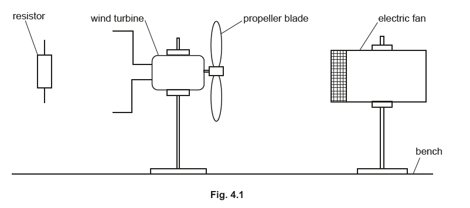

*Source: 2020 0625/62 Q4*

## Multiple Choice Questions (42 questions)

### Q1 — easy — 1 marks

**Q1** [1 mark]

What is the purpose of a fuse in a mains electrical circuit?

### Q2 — hard — 1 marks

**Q2** [1 mark]

The diagram shows a potential divider circuit. A power supply is connected in series with a $6.0Ω$ resistor and an $8.0Ω$ resistor.

A voltmeter connected across the $8.0Ω$ resistor reads $12V$.

What is the electromotive force (e.m.f.) of the power supply?

### Q3 — medium — 1 marks

**Q3** [1 mark]

An electric hairdryer is used on a $240 \text{V}$ mains supply. The hairdryer has a power rating of $2100 \text{W}$.

Which fuse is the most suitable to use in the plug of the hairdryer?

### Q4 — medium — 1 marks

**Q4** [1 mark]

A student creates a battery by connecting three identical cells in series. Each cell has an electromotive force (e.m.f.) of $1 . 5 \text{V}$.

What is the total e.m.f. of the battery?

### Q5 — medium — 1 marks

**Q5** [1 mark]

The diagram shows a circuit containing a battery, three switches, $S_{1}$, $S_{2}$, and $S_{3}$, and two lamps $L_{1}$ and $L_{2}$.

A student wants to light lamp $L_{1}$ only.

Which switches must be closed?

### Q6 — medium — 1 marks

**Q6** [1 mark]

** **The circuit diagram shows cells connected with a resistor in a series circuit.

Each cell has an electromotive force (e.m.f.) of 1.5 V

What is the total e.m.f. in the circuit?

*Source: specimen 2023 paper 1 Q29*

### Q7 — medium — 1 marks

**Q7** [1 mark]

The circuit diagram shows two identical lamps connected in parallel to a cell. Three ammeters, X, Y and Z, are also connected in the circuit, as shown.

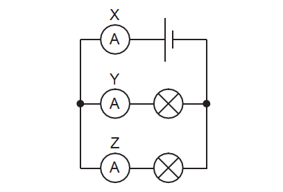

Which statement about the current in X is correct?

*Source: June 2023 0972/21 Q28*

### Q8 — medium — 1 marks

**Q8** [1 mark]

** **A double-insulated electrical appliance must be connected safely to the electricity supply.

Which statement is correct?

*Source: June 2023 0972/11 Q30*

### Q9 — medium — 1 marks

**Q9** [1 mark]

A student connects the circuit shown.

Which switches must be closed for the bell to ring without lighting the lamp?

*Source: June 2023 0972/11 Q29*

### Q10 — easy — 1 marks

**Q10** [1 mark]

** **Which symbol represents an electric heater?

*Source: June 2023 0972/11 Q28*

### Q11 — hard — 1 marks

**Q11** [1 mark]

The battery on a bicycle is connected in parallel to its lamp and bell.

The circuit includes two switches, S1 and S2.

The cyclist closes S1 to light the lamp.

She then also closes S2 to sound the bell.

What happens to the current in the battery and the power output from the battery when the cyclist closes S2?

|   | current in the battery | power output from the battery |
|---|---|---|
| **A** | increases | increases |
| **B** | increases | stays the same |
| **C** | stays the same | increases |
| **D** | stays the same | stays the same |

*Source: June 2023 0972/11 Q27*

### Q12 — hard — 1 marks

**Q12** [1 mark]

The diagram shows a circuit of six identical lamps connected to a battery.

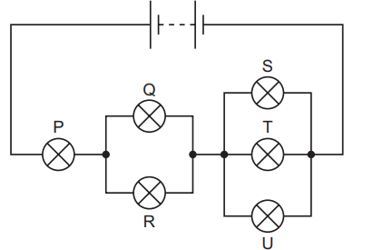

Which lamps are brightest?

*Source: June 2022 paper 1 Q33*

### Q13 — medium — 1 marks

**Q13** [1 mark]

An electric kettle has a metal casing. The cable for the kettle contains a wire that is connected to the earth pin of the plug.

Which danger does this guard against?

*Source: specimen 2023 paper 1 Q32*

### Q14 — medium — 1 marks

**Q14** [1 mark]

A computer engineer wants the speed of a fan to increase when the temperature inside a computer increases. The engineer knows that a larger current causes the fan to turn more quickly

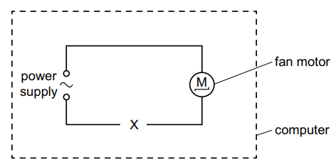

Which component should be placed at X to make this happen?

*Source: specimen 2023 paper 1 Q30*

### Q15 — medium — 1 marks

**Q15** [1 mark]

What is the advantage of connecting lamps in parallel in a lighting circuit?

*Source: June 2022 paper 1 Q32*

### Q16 — easy — 1 marks

**Q16** [1 mark]

Why is a fuse used in an electrical circuit?

*Source: June 2022 paper 1 Q34*

### Q17 — easy — 1 marks

**Q17** [1 mark]

The diagram shows the circuit diagram symbol of an electrical component.

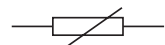

Which component does the symbol represent?

*Source: June 2022 paper 1 Q31*

### Q18 — easy — 1 marks

**Q18** [1 mark]

The diagram shows an electric circuit.

When the switch is open, which lamp(s) are **not **lit?

*Source: specimen 2023 paper 1 Q31*

### Q19 — easy — 1 marks

**Q19** [1 mark]

This is the circuit symbol for which component?

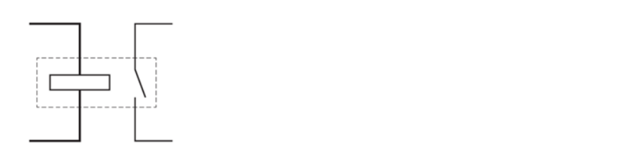

### Q20 — easy — 1 marks

**Q20** [1 mark]

The diagram shows two resistors connected in parallel.

The total resistance of this combination will be:

### Q21 — easy — 1 marks

**Q21** [1 mark]

**Extended tier only**

Which diagram shows the correct symbol for a diode, and the correct direction of current moving through it?

### Q22 — easy — 1 marks

**Q22** [1 mark]

Which of the circuit diagrams above shows a fuse which has been correctly connected?

### Q23 — easy — 1 marks

**Q23** [1 mark]

Which of the following circuit symbols is for a thermistor?

### Q24 — hard — 1 marks

**Q24** [1 mark]

A student connects together some identical resistors in three different combinations, as shown in the diagram.

Which of the answers below shows the correct order of the combinations from the lowest resistance to the highest?

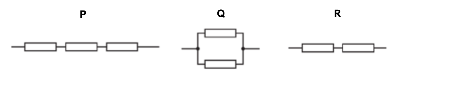

### Q25 — medium — 1 marks

**Q25** [1 mark]

Which of the diagrams below shows a fuse which has been correctly connected to a circuit?

### Q26 — medium — 1 marks

**Q26** [1 mark]

The diagram shows two resistors connected in series with a battery.

What is the current through the battery?

### Q27 — medium — 1 marks

**Q27** [1 mark]

The diagram shows two bulbs, which have been connected in parallel. A fuse has been included in the circuit.

Each of the ammeters reads 1.2 A.

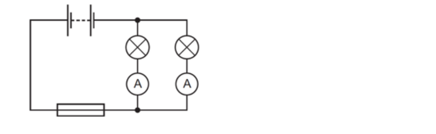

What fuse should be put in this circuit?

### Q28 — hard — 1 marks

**Q28** [1 mark]

A person wants to install a circuit breaker to protect themselves and their lawnmower from too much current.

Under normal operating conditions, the lawnmower carries 4 A of current.

The manufacturer provides the graph below with the circuit breaker.

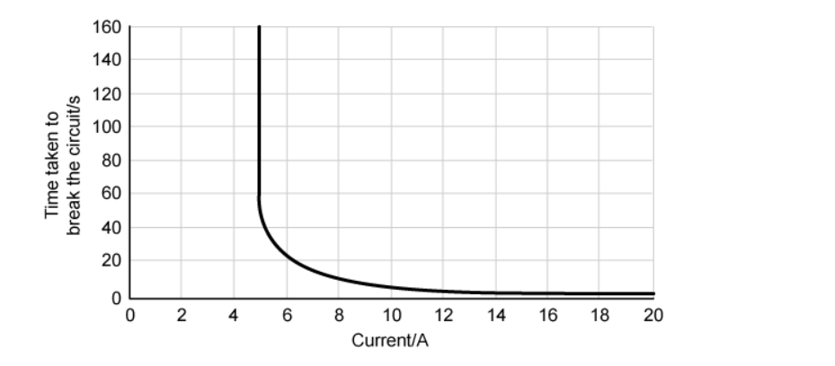

What will happen when the current is 4 A, and what will happen if the current rises to 14 A?

|   | **4 A** | **14 A** |
|---|---|---|
| **A** | circuit does not break | circuit does not break |
| **B** | circuit does not break | circuit breaks quickly |
| **C** | circuit breaks quickly | circuit does not break |
| **D** | circuit breaks quickly | circuit breaks quickly |

### Q29 — hard — 1 marks

**Q29** [1 mark]

**Extended tier only**

A 10 Ω and a 30 Ω resistor are connected in series, as shown in the diagram below, making a potential divider circuit.

What would be the reading on the voltmeter?

### Q30 — medium — 1 marks

**Q30** [1 mark]

The plug for an electric lamp contains a 3 A fuse. The fuse’s job is to protect the lamp if too much current flows.

Where is the fuse positioned, and what happens when the fuse does its job?

|   | **Where is it positioned?** | **What does it do?** |
|---|---|---|
| **A** | live wire | reduces the current to 3 A |
| **B** | neutral wire | breaks the circuit |
| **C** | live wire | breaks the circuit |
| **D** | neutral wire | reduces the current to 3 A |

### Q31 — medium — 1 marks

**Q31** [1 mark]

A surge of current in a kettle melts the 13 A fuse.

What will happen to the kettle next time it is used if the fuse is replaced with a 3 A fuse?

### Q32 — hard — 1 marks

**Q32** [1 mark]

Which of the following statements about the current in ammeters **X**, **Y** and **Z** is correct?

### Q33 — hard — 1 marks

**Q33** [1 mark]

**Extended tier only**

All the light bulbs in the diagrams above are identical. Each one is rated as ‘10 W, 230 V’.

In which of the diagrams are all the bulbs working at their normal brightness?

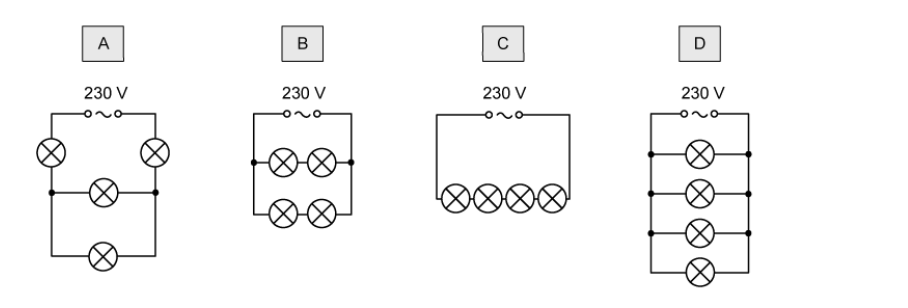

### Q34 — hard — 1 marks

**Q34** [1 mark]

**Extended tier only**

Two resistors are connected in parallel.

The current through the top resistor is 2.0 A.

What is the reading on the ammeter?

### Q35 — medium — 1 marks

**Q35** [1 mark]

An oven is wired into somebody’s kitchen. The oven is protected by a fuse, and functions normally, but the owner notices that the wires that connect the oven to the mains electricity supply get quite hot.

What could be done to reduce the temperature of the wires?

### Q36 — medium — 1 marks

**Q36** [1 mark]

The diagram shows a toaster that has been wired up.

Three fuses have been connected to the toaster, but only one or two have been connected correctly.

Which of the fuses has been positioned correctly?

### Q37 — hard — 1 marks

**Q37** [1 mark]

**Extended tier only**

A homeowner buys a security light that switches on automatically when it gets dark.

The security light contains the circuit, shown below.

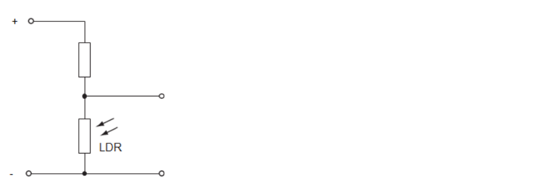

When it gets dark, what happens to the resistance of the LDR, and what happens to the potential difference across the LDR?

|   | **Resistance of LDR** | **p.d. across LDR** |
|---|---|---|
| **A** | increases | increases |
| **B** | decreases | increases |
| **C** | increases | decreases |
| **D** | decreases | decreases |

### Q38 — medium — 1 marks

**Q38** [1 mark]

Both fuses and circuit breakers are devices which protect devices from high currents that could cause them to get too hot and catch fire.

The diagram shows two possible positions where a fuse or a circuit breaker could be positioned.

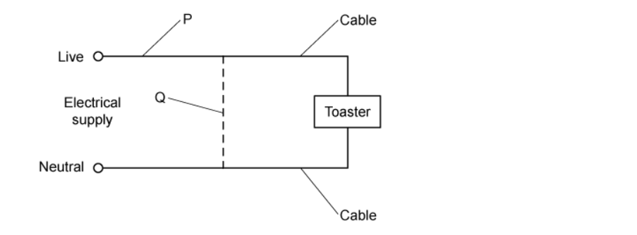

Which location would be suitable for a fuse, and which would be suitable for a circuit breaker?

|   | **fuse** | **circuit breaker** |
|---|---|---|
| **A** | P | P |
| **B** | P | Q |
| **C** | Q | P |
| **D** | Q | Q |

### Q39 — medium — 1 marks

**Q39** [1 mark]

A student sets up the circuit below, it contains four fuses and four bulbs.

She finds that none of the bulbs are lit, but only one of the fuses has blown.

Which fuse has blown?

### Q40 — hard — 1 marks

**Q40** [1 mark]

**Extended tier only**

Two resistors are connected in parallel.

What is the combined resistance of the combination?

### Q41 — hard — 1 marks

**Q41** [1 mark]

A teacher writes a set of notes about two **non-identical** bulbs which are connected in parallel.

He makes one mistake. Which of the statements below is incorrect?

### Q42 — medium — 1 marks

**Q42** [1 mark]

A book shop owner sets up the circuit below, but they find that the lamp is too dim.

What change can be made to the circuit to increase the brightness of the bulb?

## Theory Questions (25 questions)

### Q1 — medium — 7 marks

**Q1** [2 marks]

**Extract:**

Fig. 7.1 shows a circuit containing a battery of e.m.f. 12 V and three resistors.

A circuit diagram showing a 12-volt battery connected in series with resistor R1 and a parallel combination of resistors R2 and R3. A voltmeter is connected across the parallel combination. R1 has a resistance of 8 ohms, R2 has a resistance of 20 ohms, and R3 has a resistance of 30 ohms.

**Fig. 7.1**

The voltmeter measures the potential difference (p.d.) across the parallel

combination of resistors.

Show that the combined resistance of R2 and R3 is $12Ω$.

**Q1** [3 marks]

**Extract:**

Fig. 7.1 shows a circuit containing a battery of e.m.f. 12 V and three resistors.

The voltmeter measures the potential difference (p.d.) across the parallel combination of resistors.

R1 has a resistance of 8 ohms, R2 has a resistance of 20 ohms, and R3 has a resistance of 30 ohms.

Calculate the current in resistor R1.

**Q1** [2 marks]

**Extract:**

Fig. 7.1 shows a circuit containing a battery of e.m.f. 12 V and three resistors.

The voltmeter measures the potential difference (p.d.) across the parallel combination of resistors.

R1 has a resistance of 8 ohms, R2 has a resistance of 20 ohms, and R3 has a resistance of 30 ohms.

Explain how the reading on the voltmeter can be used to determine the p.d. across resistor R1.

### Q2 — medium — 11 marks

**Q2** [1 mark]

A student investigates the resistance of resistors connected in series.

Fig. 2.1 shows the circuit used.

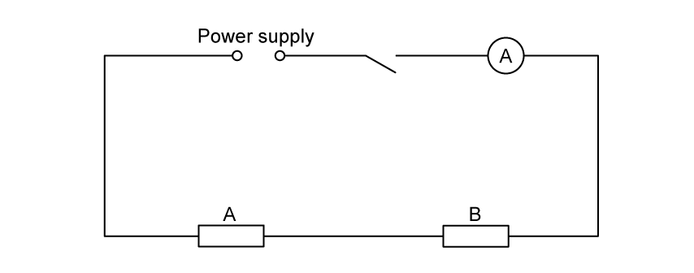

**Fig. 2.1**

On Fig. 2.1, draw a voltmeter connected to measure the potential difference across resistor A.

**Q2** [2 marks]

The student closes the switch and records the potential difference $V_{A}$ across resistor A and current $I$ in the circuit. The meter readings are shown in Fig. 2.2.

**Fig. 2.2**

Record the potential difference $V_{A}$ and current $I$.

**Q2** [2 marks]

**Extract:**

The student closes the switch and records the potential difference \[V_{A}\] across resistor A and current \[I\] in the circuit. The meter readings are shown in Fig. 2.2.

Record the potential difference \[V_{A}\] and current \[I\].

\[V_{A} = 1 . 4 V\]
\[I = 0 . 26 A\]

Calculate the resistance $R_{A}$ of resistor A using the equation $R_{A}=\frac{V_{A}}{I}$.

Give your answer to a suitable number of significant figures for this experiment.

**Q2** [1 mark]

**Extract:**

The student closes the switch and records the potential difference \[V_{A}\] across resistor A and current \[I\] in the circuit. The meter readings are shown in Fig. 2.2.

\[I = 0 . 26 A\]

The student then connects the voltmeter to measure the potential difference across both resistors A and B. The new potential difference reading is $V_{\mathrm{AB}}=2.6\text{V}$.

Calculate the combined resistance $R_{\mathrm{AB}}$ of the two resistors in series.

**Q2** [2 marks]

**Extract:**

Calculate the resistance R_A of resistor A:

R_A = V_A / I

R_A = 1.4 / 0.26 = 5.3846...

R_A = 5.4 Ω

Calculate the combined resistance R_AB:

R_AB = V_AB / I

R_AB = 2.6 / 0.26

R_AB = 10 Ω

The resistance of resistor B is known to be $R_{B}=4.5Ω$.

A student suggests that $R_{\mathrm{AB}}$ should be equal to $R_{A}+R_{B}$.

State whether your results support this suggestion. Justify your answer by reference to your values.

**Q2** [3 marks]

(i) The student wants to repeat the experiment with resistor A and resistor B connected in parallel.

Complete the circuit diagram in Fig. 2.3 to show this arrangement.

[1]

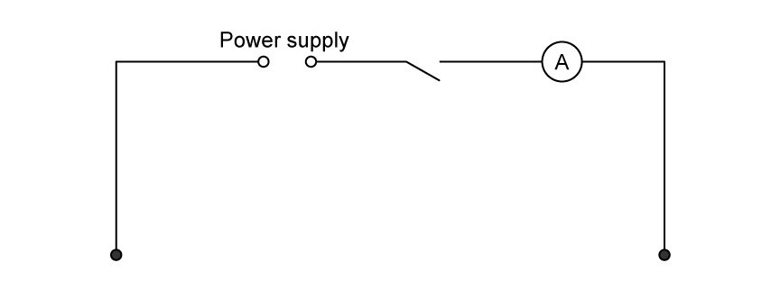

**Fig. 2.3**

(ii) The student notices that the resistors become warm during the experiment.

State **one** change they could make to the procedure to reduce this heating effect.

[1]

(iii) State **one** hazard associated with wires overheating in a circuit.

[1]

### Q3 — medium — 4 marks

**Q3** [3 marks]

** **The current in the lamp is 0.40 A. The potential difference (p.d.) across the lamp is 6.0 V. Calculate the power dissipated in the lamp.

power = ..................................................... W

*Source: 0972/June 2023 31 Q9B*

**Q3** [1 mark]

Draw on Fig. 9.1 to show a lamp connected in parallel with the lamp in the circuit. Use the correct symbol.

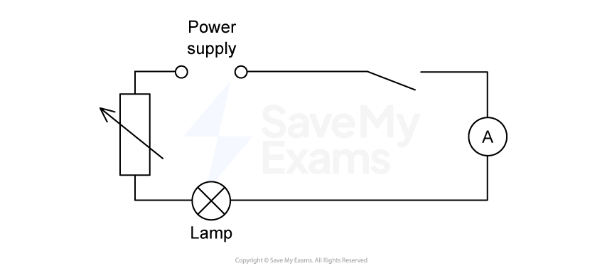

Fig. 9.1

*Source: June 2023 0972/31 Q9C*

### Q4 — easy — 2 marks

**Q4** [2 marks]

Fig. 9.1 shows a series circuit. Two of the components in the circuit are labelled.

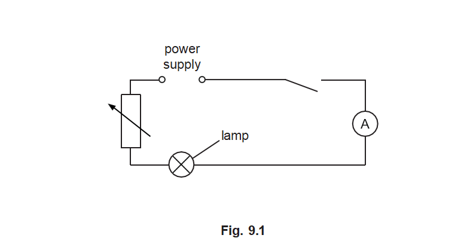

State the name of **two **other components in the circuit.

1 ................................................................................................................................

2.................................................................................................................................

*Source: June 2023 0972/31 Q9A*

### Q5 — hard — 6 marks

**Q5** [4 marks]

**Extended Tier Only**

Fig. 8.1 is a circuit diagram.

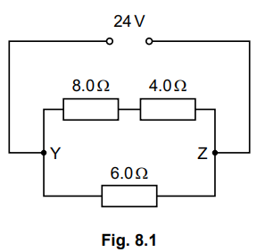

Calculate the combined resistance between Y and Z.

*Source: specimen 2023 paper 4 Q8A*

**Q5** [2 marks]

**Extract:**

Fig. 8.1 is a circuit diagram. Circuit diagram with a 24V battery, three resistors labelled 8Ω, 4Ω, and 6Ω. Resistors connect at points Y and Z. The 8Ω and 4Ω resistors are in series in the top branch, and the 6Ω resistor is in the bottom branch. The branches are in parallel between Y and Z.

**Extended Tier Only**

Calculate the potential difference (p.d.) across the 8.0 Ω resistor.

p.d. = ..........................................................

*Source: Specimen 2023 paper 4 Q8B*

### Q6 — medium — 3 marks

**Q6** [3 marks]

Fig. 5.1 shows a kitchen tap that supplies instant boiling water.

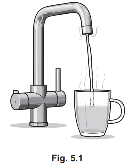

Cold water passes over an electric immersion heater inside the tap.

The metal tap is earthed and there is a fuse in the cable that connects the heater to the mains.

1. Explain how the earth wire protects the user.
2. Explain how the fuse protects the circuit.

*Source: June 2022 paper 4 Q5C*

### Q7 — medium — 4 marks

**Q7** [4 marks]

A microwave oven is fitted with a 13 A fuse and an earth wire is connected to the metal case of the microwave oven. A fault occurs and the live wire of the microwave oven touches the metal case.

Explain how the fuse and an earthed metal case protect the appliance and the user

*Source: June 2022 paper 3 Q10A*

### Q8 — medium — 2 marks

**Q8** [2 marks]

Fig. 9.1 shows an electric circuit which includes uninsulated resistance wire XY. A teacher shows some students how to complete the circuit by placing the contact C at various positions on the wire XY.

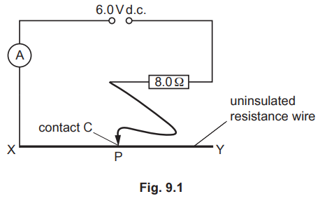

The students move contact C to point P. The resistance of the wire between X and P is 20Ω.

Calculate the total resistance of the resistance wire between X and P and the fixed resistor.

total resistance = ..................................................... Ω

*Source: June 2022 paper 3 Q9C*

### Q9 — medium — 8 marks

**Q9** [1 mark]

Fig. 10.1 shows a simplified circuit diagram for an electric oven. The oven contains a fan driven by a motor.

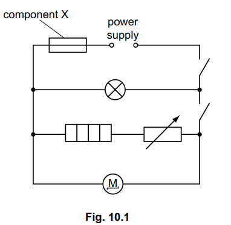

On Fig. 10.1, circle the symbol representing the heater.

*Source: 2023 specimen paper 3 Q10A*

**Q9** [2 marks]

**Extract:**

Fig. 10.1 shows a simplified circuit diagram for an electric oven. The oven contains a fan driven by a motor.

Fig. 10.1 includes a variable resistor.

Explain the function of the variable resistor in this circuit.

*Source: specimen 2023 paper 3 Q10B*

**Q9** [3 marks]

The potential difference across the motor is 250 V. The current in the motor is 2.0 A.

Calculate the resistance of the motor.

resistance = ...................................................... Ω

*Source: specimen 2023 paper 3 Q10C*

**Q9** [2 marks]

**Extract:**

Fig. 10.1 shows a simplified circuit diagram for an electric oven. The oven contains a fan driven by a motor.

[Electrical circuit diagram showing component X, a power supply, a bulb, a switch, a variable resistor, and a motor labelled 'M'.]

State the name of component X and explain how it contributes to the safety of the user.

*Source: specimen 2023 paper 3 Q10D*

### Q10 — hard — 10 marks

**Q10** [3 marks]

**Extended tier only**

The circuit shown in Fig. 1 includes three ammeters labelled A1, A2 and A3, and one unknown fixed resistor, R.

The voltmeter connected across R reads 24 V.

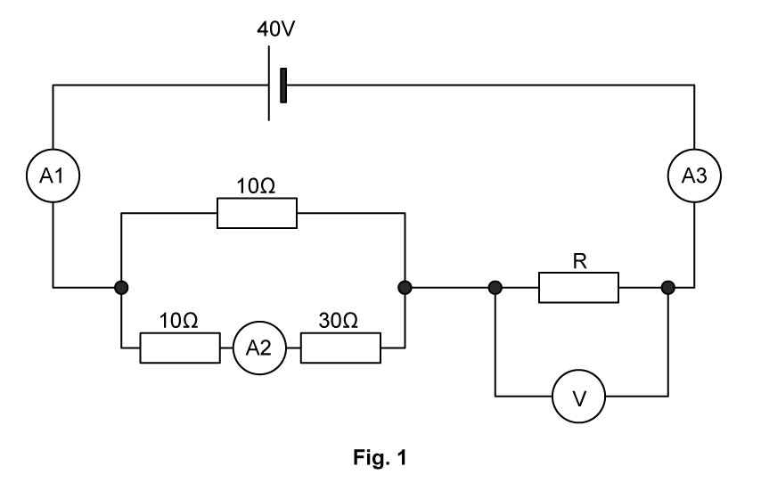

For the parallel branch, determine

(i) the voltage across the upper 10 Ω resistor.

[2]

(ii) the voltage across the lower part of the parallel circuit.

[1]

**Q10** [2 marks]

**Extract:**

The voltage across the upper 10 Ω resistor: In a series arrangement: The total p.d. across the components is equal to the sum of the individual p.d.s across each component. Therefore, the p.d. across the parallel branch = 40 V − 24 V = 16 V. In a parallel arrangement: The p.d. across parallel branches is the same. Therefore, the p.d. across the upper branch = 16 V. The resistance of the upper resistor is 10 Ω.

Calculate the current through the upper 10 Ω resistor.

**Q10** [4 marks]

**Extract:**

The circuit shown in Fig. 1 includes three ammeters labelled A1, A2 and A3, and one unknown fixed resistor, R. The voltmeter connected across R reads 24 V.

For the parallel branch:
- The voltage across the upper 10 Ω resistor: the p.d. across the parallel branch = 40 V − 24 V = 16 V
- The p.d. across parallel branches is the same, so the p.d. across the upper branch = 16 V and the p.d. across the lower branch = 16 V

Calculate the current through the upper 10 Ω resistor:
- Resistance = 10 Ω
- Potential difference = 16 V
- I = V / R = 16 / 10 = 1.6 A

**Extended tier only**

Determine the readings on

(i) ammeter A2

[2]

(ii) ammeters A1 and A3.

[2]

**Q10** [1 mark]

**Extract:**

The voltmeter connected across R reads 24 V.
A1 = A3 = 2.0 A

Calculate the value of R.

### Q11 — easy — 7 marks

**Q11** [1 mark]

A student makes a circuit to switch on a 6.0 V lamp from two different switches X and Y.

Fig. 9.1 shows the circuit.

Switch X is in position P. State the position of switch Y for the lamp to be lit.

*Source: 2019 May/June 0972/31 Q9A*

**Q11** [4 marks]

**Extract:**

A student makes a circuit to switch on a 6.0 V lamp from two different switches X and Y.

Fig. 9.1 shows the circuit.

Switch X is in position P.

The current in the lamp is 0.50 A when the potential difference (p.d.) across the lamp is 6.0 V.

Calculate the resistance of the lamp. Include the unit.

resistance = .........................................................

*Source: 2019 May/June 0972/31 Q9B*

**Q11** [2 marks]

**Extract:**

A student makes a circuit to switch on a 6.0 V lamp from two different switches X and Y.

Fig. 9.1 shows the circuit.

Switch X is in position P.

**Extended tier only**

The student connects another 6.0 V lamp in parallel with the first lamp, as shown in Fig. 9.2.

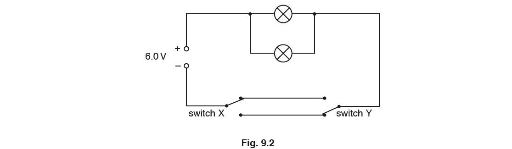

Give two advantages of connecting the lamps in parallel.

*Source: 2019 May/June 0972/31 Q9C*

### Q12 — easy — 7 marks

**Q12** [5 marks]

Fig. 9.1 shows a simple circuit.

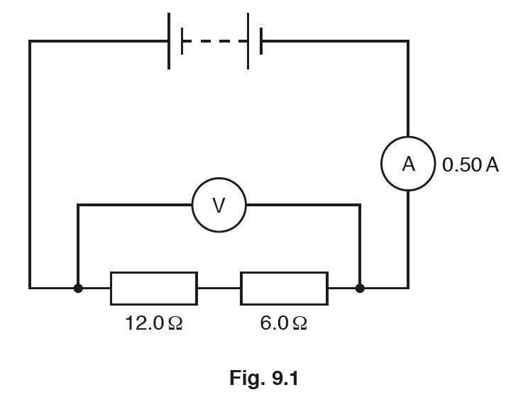

(i) The current in the wires of the circuit is a flow of particles. Indicate the name of these particles. Tick **one** box.

`square` electrons

`square` atoms

`square` protons

[1]

(ii) Calculate the combined resistance of the two resistors.

resistance = ...................................................... Ω [1]

(iii) Calculate the potential difference (p.d.) reading that would be shown on the voltmeter.

potential difference (p.d.) = ...................................................... V [3]

*Source: 2018 0625/32 Q9A*

**Q12** [2 marks]

**Extract:**

Fig. 9.1 shows a simple circuit.

The current in the wires of the circuit is a flow of particles.

The circuit is changed.

The two resistors are connected in parallel.

Explain what happens, if anything, to the current reading on the ammeter.

*Source: 2018 0625/32 Q9B*

### Q13 — medium — 9 marks

**Q13** [6 marks]

A teacher is investigating the resistance of a lamp.

Fig. 10.1 shows part of the circuit she uses. The circuit is incomplete.

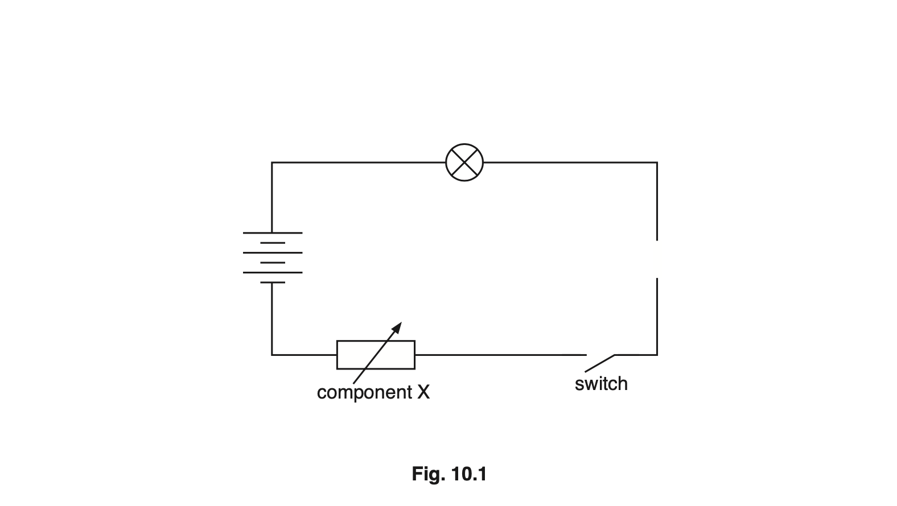

(i) To determine the resistance of the lamp, the teacher adds two meters to her circuit.

On Fig. 10.1, draw circuit symbols to show each meter correctly connected in the circuit.

[3]

(ii) When the current in the lamp is 0.25A, the potential difference (p.d.) across the lamp is 4.5 V. Calculate the resistance of the lamp.

resistance = ...................................................... Ω [3]

*Source: Oct 2019 3 Q10A*

**Q13** [3 marks]

**Extract:**

A teacher is investigating the resistance of a lamp.

Fig. 10.1 shows part of the circuit she uses. The circuit is incomplete.

On Fig. 10.1, draw circuit symbols to show each meter correctly connected in the circuit.

When the current in the lamp is 0.25A, the potential difference (p.d.) across the lamp is 4.5 V.

**Extended tier only**

(i) State the name of component X.

[1]

(ii) Describe and explain how the teacher uses component X to investigate the resistance of the lamp.

[2]

*Source: Oct 2019 3 Q10B*

### Q14 — hard — 7 marks

**Q14** [3 marks]

Fig. 8.1 shows a circuit.

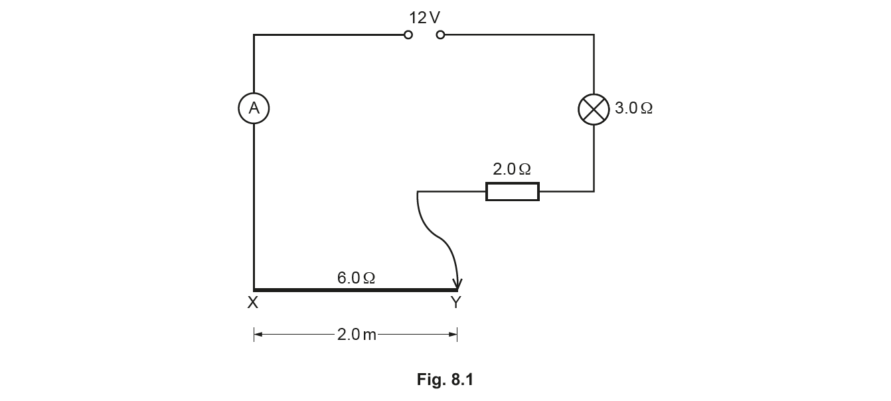

The lamp has a resistance of 3.0 Ω. Line XY represents a uniform resistance wire of resistance 6.0 Ω.

Calculate the reading on the ammeter.

ammeter reading = ........................................................

*Source: 2020 Feb/March 0625/42 Q8A*

**Q14** [4 marks]

**Extract:**

The length XY of the whole resistance wire is 2.0 m. The whole wire has resistance 6.0 Ω (from part (a)). The lamp has a resistance of 3.0 Ω. There is a 2.0 Ω resistor. The contact is made at Q where the distance XQ is 0.60 m.

**Extended tier only**

Fig. 8.2 shows the circuit with a different connection to the resistance wire and an added resistor.

The length XY of the whole resistance wire is 2.0 m. The contact is made at Q where the distance XQ is 0.60 m.

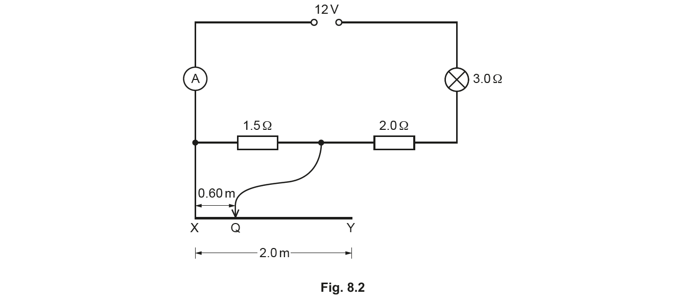

Calculate the resistance of the circuit.

resistance = ........................................................

*Source: 2020 Feb/March 0625/42 Q8B*

### Q15 — easy — 6 marks

**Q15** [4 marks]

A student investigates the electrical resistance of some components.

Fig. 10.1 shows an incomplete diagram of the circuit used by the student.

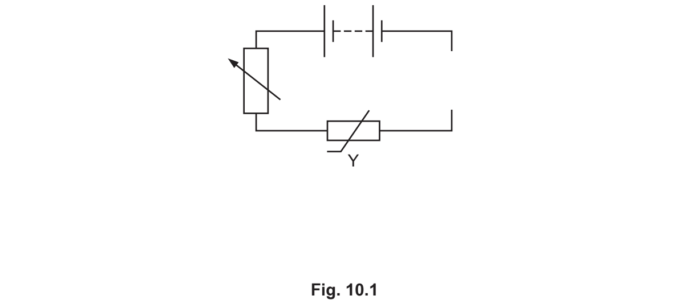

(i) State the term used for component Y.

[1]

(ii) The student uses the circuit to measure the resistance of component Y.

Complete the diagram in Fig. 10.1 by adding electrical symbols to show an ammeter and a voltmeter correctly connected to determine the resistance of component Y.

[3]

*Source: 2020 0625/31 Q10A*

**Q15** [2 marks]

Fig. 10.2 shows two resistors A and B.

(i) Resistor A and resistor B are connected in series.

State the value of their combined resistance.

............................................ Ω [1]

(ii) Resistor A and resistor B are connected in parallel.

Compare the combined resistance when in parallel with the resistance of resistor A alone.

[1]

*Source: 2020 0625/31 Q10B*

### Q16 — medium — 8 marks

**Q16** [3 marks]

A circuit is made from two lamps, a cell and a switch, as shown in Fig. 10.1.

(i) Draw the circuit symbol for a cell.

[1]

(ii) State the term used for the arrangement of lamps in the circuit in Fig. 10.1.

[1]

(iii) The switch is closed and the lamps light.

State the name of the charged particles that are flowing through the wires.

[1]

*Source: Oct 2019 0625/32 Q10A*

**Q16** [5 marks]

**Extract:**

The lamps are in series (as they are one after another in the same loop in the circuit).

**Extended tier only**

Fig. 10.2 represents a different type of circuit.

(i) Compare Fig. 10.1 and Fig. 10.2.

State **two** advantages of the type of circuit shown in Fig. 10.2 with the type of circuit shown in Fig. 10.1.

[2]

(ii) The potential difference across the power source in Fig. 10.2 is 3.0 V. The combined resistance of the two lamps is 12 Ω.

Calculate the size of the current in the circuit when the switches are closed.

current = ...................................................... A [3]

*Source: Oct 2019 0625/32 Q10B*

### Q17 — hard — 6 marks

**Q17** [1 mark]

A teacher demonstrates the action of a device. Fig. 10.1 shows the symbol for the device.

State the name of this device.

*Source: 2019 May/June 0972/31 Q10A*

**Q17** [5 marks]

**Extended tier only**

Fig. 10.2 shows another device being used in a circuit. The circuit contains a 6.0 V lamp.

(i) The sliding contact of this device is at position **A**, as shown in Fig. 10.2.

Describe and explain the brightness of the lamp when the sliding contact is in this position.

[2]

(ii) The teacher moves the sliding contact from position **A** to position **B**. Describe and explain what happens to the brightness of the lamp.

[2]

(iii) The teacher moves the sliding contact from position **B** to position **C**. Suggest what happens to the lamp.

[1]

*Source: 2019 May/June 0972/31 Q10B*

### Q18 — medium — 7 marks

**Q18** [4 marks]

A teacher uses a power supply in a metal case. The circuit for the power supply includes a fuse.

(i) Draw the electrical symbol for a fuse.

[1]

(ii) The metal case of the power supply is earthed. A fault occurs and a live wire touches the metal case.

Explain how earthing the metal case protects the teacher.

[3]

*Source: 2020 0625/31 Q11A*

**Q18** [3 marks]

**Extract:**

A teacher uses a power supply in a metal case. The circuit for the power supply includes a fuse.

The metal case of the power supply is earthed. A fault occurs and a live wire touches the metal case.

The power supply circuit includes a transformer. Its input voltage is 240 V. There are 960 turns on the input coil and 64 turns on the output coil.

Calculate the output voltage of the transformer.

output voltage = ..................................................... V

*Source: 0625/31 0625/31 Q11B*

### Q19 — easy — 9 marks

**Q19** [2 marks]

Fig. 9.1 and Fig. 9.2 each show an electrical circuit. Each circuit has two lamps connected to an electrical supply.

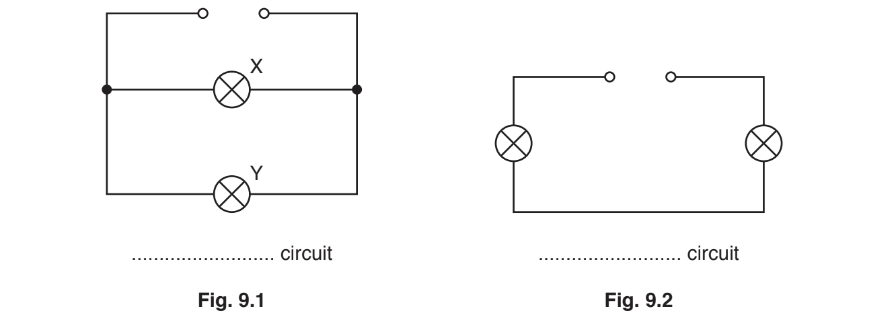

State the term used to describe each electrical circuit. Write the term under each circuit.

*Source: 2019 0625/32 Q9A*

**Q19** [2 marks]

**Extract:**

Fig 9.2 is a series circuit.

State two disadvantages of the circuit in Fig. 9.2.

*Source: 2019 0625/32 Q9B*

**Q19** [2 marks]

**Extract:**

Fig. 9.1 shows an electrical circuit. The circuit has two lamps connected to an electrical supply. Fig 9.1 is a parallel circuit.

Redraw the circuit in Fig. 9.1 with switches that will turn lamps X and Y on and off independently of each other.

*Source: 2019 0625/32 Q9C*

**Q19** [3 marks]

Fig. 9.3 shows another circuit.

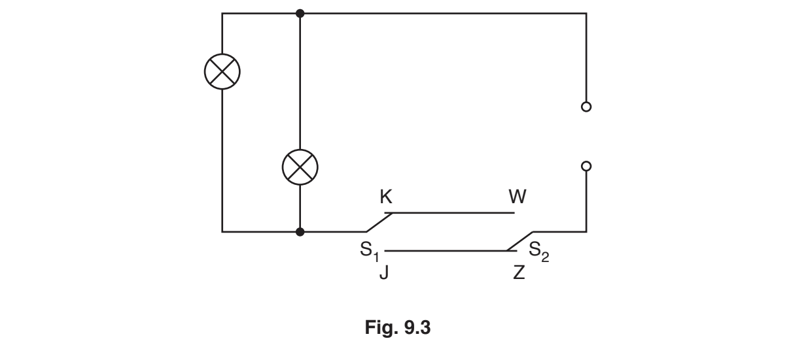

The lamps can be turned on and off using two different switches S1 and S2.

Complete the table stating when the lamps are on or off. The first one has been done for you.

| switch positions | lamps on or off |   |
|---|---|---|
| S1 | S2 |   |
| K | Z | off |
| K | W |   |
| J | W |   |
| J | Z |   |

*Source: 2019 0625/32 Q9D*

### Q20 — medium — 7 marks

**Q20** [4 marks]

Fig. 10.1 shows an arrangement for making an electromagnet.

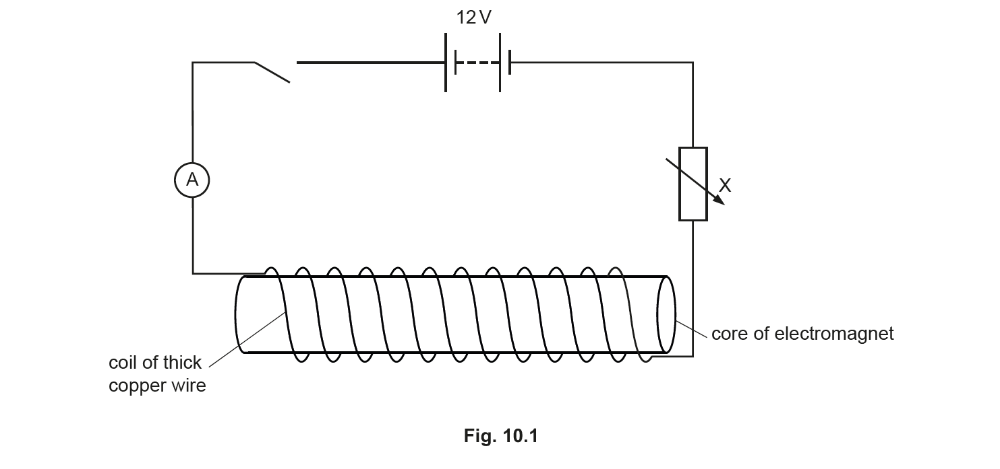

(i) State a material which is suitable for the core of the electromagnet.

[1]

(ii) State the name for component X in Fig. 10.1.

[1]

(iii) Describe and explain how component X varies the strength of the electromagnet.

[2]

*Source: 2020 Feb/March 0625/32 Q10A*

**Q20** [3 marks]

**Extract:**

Fig. 10.1 shows an arrangement for making an electromagnet.

The switch is closed. The reading on the ammeter is 1.5 A.

Calculate the resistance of the circuit.

resistance = .................................................... Ω

*Source: 2020 Feb/March 0625/32 Q10B*

### Q21 — medium — 12 marks

**Q21** [8 marks]

A student does an experiment to determine the resistance of a fixed resistor, R.

The student draws an incomplete diagram of the circuit, as shown in Fig. 10.1.

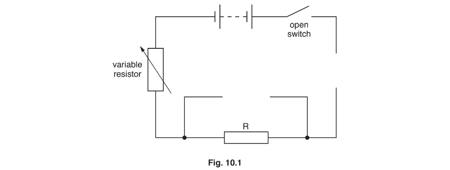

(i) On Fig. 10.1, draw the missing circuit symbols.

[3]

(ii) Describe how the student could use the circuit to determine a reliable value for the resistance of R.

[5]

*Source: Nov 2018 (S1) 0625/31 Q10A *

**Q21** [4 marks]

Fig. 10.2 shows a 20 Ω resistor connected to a power supply.

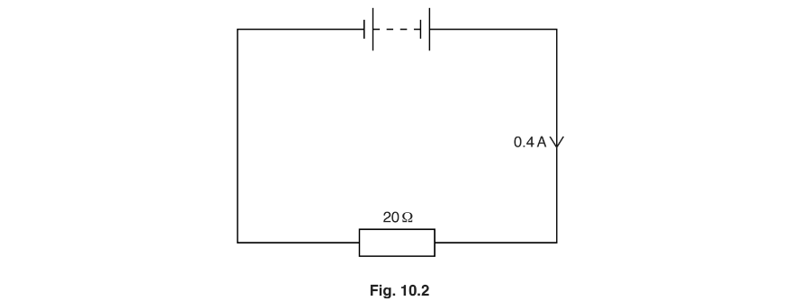

A second 20 Ω resistor is connected in series with the first.

Describe how this affects the current in the circuit.

*Source: Nov 2018 (S1) 0625/31 Q10B*

### Q22 — hard — 7 marks

**Q22** [2 marks]

Fig. 8.1 shows a circuit that contains a battery of electromotive force (e.m.f.) 6.0 V, an ammeter, a 20 Ω resistor and component X.

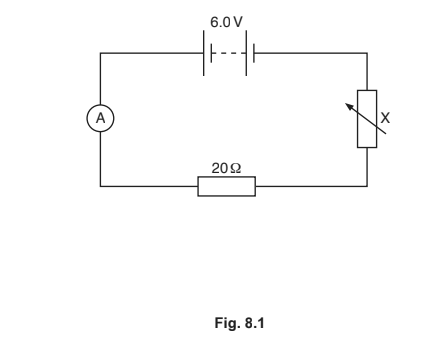

(i) State the name of component X.

[1]

(ii) The potential difference (p.d.) across the 20 Ω resistor is measured with a voltmeter.

On Fig. 8.1, draw the symbol for this voltmeter connected to the circuit.

[1]

*Source: 2018 0625/42 Q8A*

**Q22** [3 marks]

**Extract:**

Fig. 8.1 shows a circuit that contains a battery of electromotive force (e.m.f.) 6.0 V, an ammeter, a 20 Ω resistor and component X.

**Extended tier only**

The p.d. across the 20 Ω resistor is varied from zero to 6.0 V. For each value of p.d. a corresponding current is measured.

On Fig. 8.2, draw a line to indicate how the current measured by the ammeter depends on the p.d. across the 20 Ω resistor.

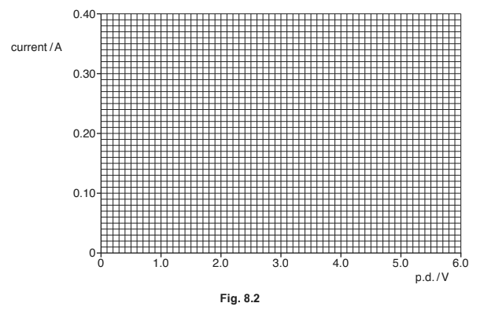

*Source: 2018 0625/42 Q8B*

**Q22** [2 marks]

**Extract:**

Resistance of the fixed resistor, R = 20 Ω
Minimum p.d. = 0
Maximum p.d. = 6.0 V
Recall the equation linking voltage, current and resistance:
R = V / I
Calculate the maximum current:
I = V / R = 6.0 / 20 = 0.30 A
Straight line drawn from (0,0) to (6.0, 0.30)
Remember that for a fixed resistor, the current and voltage are directly proportional.

**Extended tier only**

A second resistor is connected to the circuit in parallel with the 20 Ω resistor.

(i) State how the combined resistance of the two resistors in parallel compares with the resistance of each of the resistors on its own.

[1]

(ii) The p.d. across the two parallel resistors is changed and the current in the battery for each value of the p.d. is measured. A second line could be drawn on Fig. 8.2 to indicate how the current measured by the ammeter depends on the p.d. across the two resistors in parallel.

State how the second line differs from the original line. You are not expected to draw this second line.

[1]

*Source: 2018 0625/42 Q8C*

### Q23 — hard — 6 marks

**Q23** [4 marks]

Fig. 11.1 shows lamps in series. Fig. 11.2 shows lamps in parallel.

The lamps are all identical 6.0 V lamps. In each circuit there are three ammeters A1, A2 and A3.

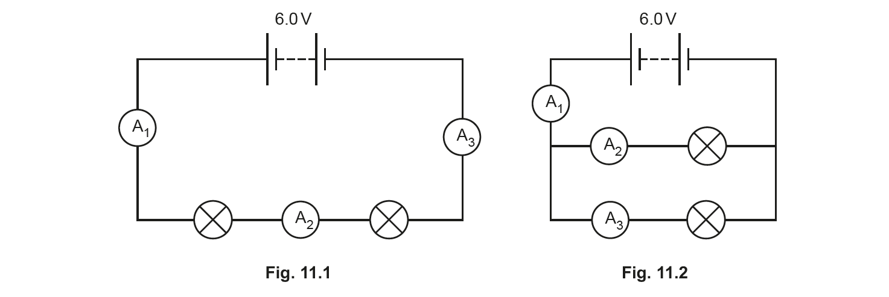

(i) Compare the readings on ammeters A1, A2 and A3 in Fig. **11.1**.

[1]

(ii) Compare the readings on ammeters A1, A2 and A3 in Fig. **11.2**.

[1]

(ii) State two advantages of connecting the 6.0 V lamps in parallel with the 6.0 V battery, compared with connecting the lamps in series with the battery.

[2]

*Source: 2020 Feb/March 0625/32 Q11A*

**Q23** [2 marks]

**Extract:**

Fig. 11.1 shows lamps in series. Fig. 11.2 shows lamps in parallel.

The lamps are all identical 6.0 V lamps. In each circuit there are three ammeters A1, A2 and A3.

Each lamp has a resistance of 12 Ω.

(i) Determine the combined resistance of the two lamps connected in series.

resistance = .................................................... Ω [1]

(ii) Compare the resistance of one lamp with the combined resistance of the two lamps in parallel.

[1]

*Source: 2020 Feb/March 0625/32 Q11B*

### Q24 — easy — 8 marks

**Q24** [1 mark]

Fig. 10.1 shows the symbol for an electrical component.

State the name of the component shown in Fig. 10.1.

*Source: Oct 2019 0625/33 Q10A*

**Q24** [4 marks]

**Extract:**

Fig. 10.1 shows the symbol for an electrical component.

The resistance of the component shown in Fig. 10.1 varies with temperature. Fig. 10.2 shows a graph of resistance against temperature for the component.

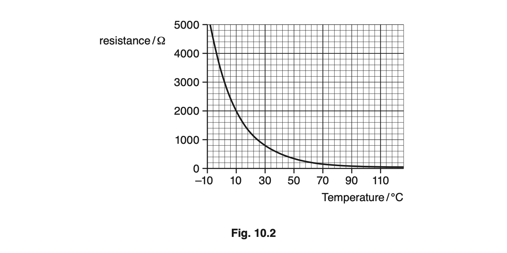

(i) Use the graph to determine the resistance of the component at a temperature of 10 °C.

resistance = ...................................................... Ω [1]

(ii) At another temperature, the resistance of the component is 800 Ω.

Calculate the current in the component when it is connected to a 12.0 V supply.

current = ...................................................... A [3]

*Source: Oct 2019 0625/33 Q10B*

**Q24** [2 marks]

**Extract:**

The component is a thermistor.

The students who built the circuit in part (a) want to change it so that it becomes sensitive to light rather than heat.

State the change the students should make.

**Q24** [1 mark]

**Extract:**

Remove / replace the thermistor; Add a light dependent resistor / LDR;

Draw the symbol for the replacement component you suggested in part (c).

### Q25 — easy — 7 marks

**Q25** [1 mark]

Fig. 10.1 shows a circuit for determining the resistance of a component.

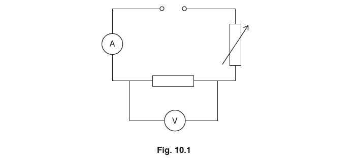

On Fig. 10.1, label the fixed resistor, by writing the letter R.

*Source: 2018 0625/31 Q10A*

**Q25** [4 marks]

Two components in Fig. 10.1 measure electrical quantities.

Identify the quantity that each component measures.

Write each quantity and the unit of each quantity in the correct place in Table 10.1.

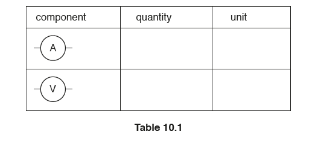

*Source: 2018 0625/31 Q10B*

**Q25** [2 marks]

**Extract:**

Fig. 10.1 shows a circuit for determining the resistance of a component.

A student uses the circuit in Fig. 10.1 to determine the resistance of wires made from the same material.

State how the resistance of a wire is related to its length and its diameter.

*Source: 2018 0625/31 Q10C*

