# Mark Schemes — Electromagnetic Effects
**4. Electricity & Magnetism** · Cambridge (CIE) IGCSE physics (0625 & 0972)

## Multiple Choice Questions (35 questions)

### Q1
**Final answer:** **The correct answer is D**

- An e.m.f. is only induced in the coil when there is a change in the magnetic field through the coil
- Moving the magnet into the coil changes the magnetic flux through the coil, which induces an e.m.f. and causes a current to flow
- When the magnet is stationary inside the coil, the magnetic field through the coil is not changing
- No change in magnetic flux means no induced e.m.f. and therefore no current
- The ammeter reads zero

**A** & **B **are incorrect because a constant reading would require a continuously changing magnetic field. A stationary magnet produces a constant (unchanging) field, which does not induce an e.m.f.

**C** is incorrect because there is no gradual decrease. The reading drops to zero as soon as the magnet stops moving, not gradually over time.

### Q2
**Final answer:** **The correct answer is A**

- To transmit electricity efficiently over long distances, the voltage must be increased to reduce the current and minimise energy loss

  - Therefore, transformer X is a **step-up transformer** used at the power station to increase the voltage for transmission
- The high voltage used in transmission cables is dangerous for use in homes

  - Therefore, transformer Y is a **step-down transformer** used to decrease the voltage to a safe level for domestic appliances

**B** is incorrect as a step-up transformer at position Y would increase the voltage further, making it unsuitable for home use.

**C** is incorrect because using a step-down transformer at position X would lead to high energy losses in the transmission cables.

**D** is incorrect as it reverses the required order of the transformers in the transmission system.

### Q3
**Final answer:** **The correct answer is C**

- An e.m.f. is induced in the coil only when its horizontal wires are cutting through the magnetic field lines
- The magnitude of the induced e.m.f. depends on the speed at which the magnetic field lines are being cut
- As the coil falls, it accelerates due to gravity, meaning its speed increases at each successive position $( v_{C} > v_{B} > v_{A} )$
- In position **C**, the top wire of the coil is cutting the field lines while the coil is moving at a higher speed than it was in position **A**

**A** is incorrect because although an e.m.f. is induced, the coil is moving more slowly than at position **C**.

**B** is incorrect because when the entire coil is within a uniform magnetic field, the e.m.f. induced in the top wire cancels out the e.m.f. induced in the bottom wire, so, the induced e.m.f. is momentarily zero.

**D** is incorrect because the coil has completely left the magnetic field and no field lines are being cut; therefore, the induced e.m.f. is zero.

> **[exam-tip]**
> Remember that an e.m.f. is only induced when there is a change in the magnetic flux through the coil. When the coil is entirely within a uniform field, there is no change in flux, so no e.m.f. is induced. Also consider that a falling object accelerates, so the coil moves faster at lower positions, which affects the rate of cutting field lines.

### Q4
**Final answer:** **The correct answer is ****D**** because:**

- The alternating current in the primary coil produces an alternating magnetic field in the iron core
- This alternating magnetic field induces an alternating voltage across the secondary coil

**A** is incorrect because no current flows through the iron core, as the coils are electrically isolated. The role of the iron core is to channel the alternating magnetic field.

**B** is incorrect because a *current* is produced by the alternating voltage in the secondary coil only if it is connected to a circuit.

**C** is incorrect because the alternating current will induce and alternating voltage, not a direct voltage.

### Q5
**Final answer:** **The correct answer is ****C**** because:**

- The magnetic field is directed into the page, as shown by the cross symbols
- The electron is negatively charged
- Current is the direction of movement of positive charge and so the current is directed towards the left
- Using the left-hand rule, when the magnetic field is pointing into the page and the current is to the left, the force must be directed downward

To use the left-handed rule to find the direction of the force on the electron:

- Put your hand in the shape shown
- Rotate it so that you are pointing your first finger from north to south (into the page) and your second finger in the opposite direction to the electron’s movement
- Your thumb will show the direction of the force, which is downwards

- The force is towards the bottom of the page

The pattern of regularly space small cross symbols are used to show a magnetic field into the page. To show a field pointing out of the page a grid of small dots would be used but doing this is much less common in questions as the dot pattern is harder to understand.

### Q6
**Final answer:** **The correct answer is ****C**** because:**

- At point P in the graph, the magnitude (size) of the p.d. is greatest
- The coil must be parallel to the magnetic field to produce the maximum p.d. (figures A and C)

  - Therefore, options **B** and **D** can be eliminated
- A positive value of p.d. indicates that X is more positive than Y
- Therefore, a negative value of p.d. indicates that Y is more positive than X

**A** is incorrect as this corresponds to a maximum p.d., but the polarity is opposite (X would be more positive than Y), so it matches a positive peak, not point P, which is a negative peak.

**B** and **D** are incorrect as these positions for the coil would produce the minimum (zero) p.d.

### Q7
**Final answer:** **The correct answer is ****C****, because:**

- The power loss due to electrical heating of the cables increases when the current is high
- Decreasing the current will reduce heating and power loss and therefore energy loss

The power transferred is given by:

$\mathrm{power}=\mathrm{current}\times\mathrm{voltage} \mathrm{or}P=\mathrm{IV}$

- Decreasing the current would reduce the power transferred
- To compensate for this, the voltage can be increased to high voltages

**A** is incorrect and the voltage does not affect the speed of transfer in this way.

**B** is incorrect because high voltages are more dangerous than low voltages.

**D** is incorrect because transformers are needed to raise (and lower) the voltage, so more equipment is needed.

### Q8
**Final answer:** **The correct answer is ****C****, because:**

- The direction of the magnetic field is from north to south
- The force on the wire is perpendicular to the direction of the magnetic field and perpendicular to the direction of the current
- The direction can be found using Fleming’s left-hand rule, as shown in the diagram:

  - Using your left hand, point your thumb and first two fingers at right angles to each other
  - Rotate your hand so that your first finger points in the direction of the magnetic field (north to south) and so that your second finger points in the direction of the current in the wire
  - Your thumb will point in the direction of the force on the wire  Don’t be afraid of using the left-hand rule during an examination. Just put your thumb and first two fingers in the correct positions and align them with the field and current directions in the diagram. Make sure you use your left hand! **A** and **B** are incorrect because these directions are not perpendicular (at right angles) to the direction of the magnetic field. **D** is incorrect because this direction is not perpendicular to the direction of the current.

### Q9
**Final answer:** **The correct answer is ****A****, because:**

- The size of the induced e.m.f. depends on

  - the number of turns of wire passing through the magnetic field
  - the strength of the magnetic field
  - the speed of the rotating coil
- Therefore, increasing the number of turns of wire would increase the induced e.m.f.

**B** is incorrect, because increasing the distance would make the magnetic field weaker and this would reduce the size of the induced e.m.f.

**C** is incorrect, as reducing the strength of the magnetic field will reduce the size of the induced e.m.f.

**D** is incorrect, because reversing the direction of the magnetic field will reverse the direction of the e.m.f. but not increase or decrease its size.

### Q10
**Final answer:** **The correct answer is D because:**

- An electric motor uses the effect of a current in a magnetic field to produce a turning effect
- The input is direct current (d.c.), which flows in one direction
- Therefore, the purpose of the split-ring commutator is to ensure that the **turning effect **on the motor stays in the** same direction** at all times

**A** and **B** are incorrect because the magnetic field does not change direction, and this is not influenced by the split ring commutator, which is connected to the coil and external circuit

**C **is incorrect because the force on the sides of the coil depends on the direction of the current, so this must stay constant to ensure the turning effect is uninterrupted

### Q11
**Final answer:** **The correct answer is C because:**

- When a magnet is dropped vertically through a solenoid, the induced magnetic pole can be deduced using Lenz’s law
- Lenz’s law states that the direction of an induced e.m.f. always opposes the change causing it
- In diagram 1:

  - The magnet approaches the coil with its south pole closest to the top of the coil
  - Therefore, a **south **pole will be induced at position X to oppose the magnet’s motion by **repelling **it
- In diagram 3:

  - The magnet leaves the coil with its north pole closest to the bottom of the coil
  - A south pole will be induced at the bottom of the coil to oppose the magnet’s motion by **attracting **it
  - Therefore, a **north **pole will be induced at position X (as the coil acts like a bar magnet, so it must have a north and a south pole)
- This is option **C**

### Q12
**Final answer:** **The correct answer is D because:**

- The transformer equation is given by

$\frac{V_{p}}{V_{s}}=\frac{N_{p}}{N_{s}}$

- Where the input (primary) voltage is Vp = 240 V, and the output (secondary) voltage is Vs = 15 V
- The ratio of these voltages is:

$\frac{V_{p}}{V_{s}}=\frac{240}{15}=16$

- Consider transformer D, where the primary coil has Np = 1200 turns, and the secondary coil has Ns = 75 turns
- The ratio of these turns is:

$\frac{N_{p}}{N_{s}}=\frac{1200}{75}=16$

- Therefore, option **D** is correct

**A** is incorrect as the ratio of the turns is $\frac{N_{p}}{N_{s}}=\frac{800}{40}=20$

**B** is incorrect as the ratio of the turns is $\frac{N_{p}}{N_{s}}=\frac{1000}{25}=40$

**C** is incorrect as the ratio of the turns is$\frac{N_{p}}{N_{s}}=\frac{2400}{15}=160$

### Q13
**Final answer:** **The correct answer is D because:**

- Using the right-hand grip rule:

  - The current is directed into the page, so the magnetic field must act in a clockwise direction
  - Eliminate options **A** and **B**
- The magnetic field gets weaker further from the wire

  - This is represented by drawing field lines further apart at a greater distance
  - Eliminate option **C**

### Q14
**Final answer:** **The correct answer is A because:**

- Electrical power is the product of current and voltage

$P=IV$

- Electrical power remains constant when voltage is increased, so the current must decrease

  - Eliminate options **C** and **D**
- High currents cause electrons to collide with metal ions in the wire

  - This leads to energy losses from the wire to the surroundings by heating
- Reducing current reduces these thermal energy losses

### Q15
**Final answer:** **The correct answer is A because:**

- The ratio of primary and secondary potential differences is equal to the ratio of turns

$\frac{V_{p}}{V_{s}}=\frac{N_{p}}{N_{s}}$

- Rearrange for the number of turns in the secondary coil

$N_{s}=N_{p}\times\frac{V_{s}}{V_{p}}$

- Substitute in the primary p.d. of 240 V, the secondary p.d. of 40 V and the 600 turns on the primary coil

$N_{s}=600\times\frac{40}{240}=100$turns

- This is option **A**

### Q16
**Final answer:** **The correct answer is C because:**

- The speed of the magnet from the point of view of the coil is the factor which determines the size of the e.m.f.
- In **C**, the magnet and coil move towards each other

  - This means the magnet has the greatest relative speed here (from the point of view of the coil)
  - If both the coil and magnet move at speed *v*, the relative speed of the magnet (from the point of view of the coil) is 2*v*

**A **is incorrect as the magnet’s speed from the point of view of the coil is *v*

**B **is incorrect as the magnet’s speed from the point of view of the coil is *v*

**D **is incorrect as the magnet’s speed from the point of view of the coil is 0

### Q17
**Final answer:** **The correct answer is C because:**

- Relays are switches that open and close via the action of an electromagnet
- Therefore, they use magnetic induction, not heating

  - Eliminate options **A** and **B**
- The voltage of a supply cannot be changed by an external circuit

  - Eliminate option **D**
- A relay allows a small current to switch on a large current

### Q18
**Final answer:** **The correct answer is D because:**

- The turning effect of a current-carrying coil in a magnetic field can be increased by increasing

  - the **number of turns** on the coil
  - the **current** in the coil
  - the **strength** of the magnetic field
- Therefore, all three suggestions are correct

### Q19
**Final answer:** **The correct answer is B because:**

- The direction of the magnetic field due to the current in the wire can be found using the **right-hand grip rule**
- If the current (thumb) points perpendicularly out of the page, the magnetic field (fingers) curl around in the **anticlockwise** direction

  - This is shown by option **B**

**A **is incorrect because this shows the magnetic field around a bar magnet

**C **is incorrect because this shows the magnetic field directed in the clockwise direction

**D **is incorrect because the arrows on either side of the wire show the magnetic field directed in both the clockwise and anticlockwise directions

### Q20
**Final answer:** **The correct answer is ****D ****because:**

- A d.c. motor can be made to turn more quickly by:

  - increasing the current in the coil
  - adding more turns to the coil
  - increasing the magnetic field strength of the magnetic field

**A **is incorrect as reducing the strength of the magnetic field would cause it to turn more slowly.

**B **is incorrect as swapping both of these elements would cause it to turn in the same direction at the same speed.

**C **is incorrect as swapping the poles over would cause it to turn in the opposite direction.

### Q21
**Final answer:** **The correct answer is ****A ****because: **

- a d.c. motor uses a split ring commutator to reverse the direction of the current through the coil every half turn, and, therefore, to keep it spinning in the same direction.
- a.c. generators use slip rings, transformers have no moving parts, and relays use no rings at all.

### Q22
**Final answer:** **The correct answer is ****B ****because: **

- The magnetic field lines around a solenoid are similar to the magnetic field lines around a bar magnet.

### Q23
**Final answer:** **The correct answer is ****B**** because:**

- A step-up transformer has more turns on the secondary coil than on the primary coil
- This means that Ns > Np (or Np < Ns)

### Q24
**Final answer:** **The correct answer is ****B ****because: **

- Using the right-hand grip rule:

  - the current (thumb) points out of the page
  - the magnetic field lines (curled fingers) will be **anticlockwise**

Remember to use the right-hand grip rule to determine the direction of the magnetic field around a current-carrying wire

### Q25
**Final answer:** **The correct answer is ****B ****because:**

- When a wire is moved through a magnetic field, the induced e.m.f. can be used to drive a current
- The combination of current and voltage can deliver electrical power to devices (*P* = *IV*), which causes them to work
- This is the process used by a generator to produce electricity

**A **is incorrect as an electric motor works using the reverse effect: when a current is passed through a wire in a magnetic field, it experiences a force.

**C **is incorrect as a photon accelerator is a fictitious device, popularised on a children’s TV show in the early 90s called “Bucky O’Hare”. One might argue that a light bulb accelerates photons.

**D **is incorrect as a transformer uses the induction effect, but does not use a moving wire, it uses an alternating magnetic field to create the same effect.

### Q26
**Final answer:** **The correct answer is ****B ****because:**

- Since *P* = *IV*, when the voltage increases, the current decreases
- This is because the electrical power must be the same before and after transforming, otherwise, you create or destroy energy, which is not possible
- The lower the current, the less power is dissipated as heat in the power lines
- If less power is wasted, the transmission is more efficient

**A **is incorrect as electricity does not flow more or less quickly due to the voltage.

**C **is incorrect as power cannot be created or destroyed due to the conservation of energy. If the voltage goes up, the current comes down to compensate, since *P* = *IV.*

**D **is incorrect as high voltage transmission is much **less** safe than low voltage transmission, but the rewards are worth the risk.

### Q27
**Final answer:** **The correct answer is ****B ****because:**

- In a simple a.c. generator a coil rotates between magnetic poles (or a magnet rotates around a coil)
- This causes the voltage to rise, then fall, then to rise in the opposite direction, then fall, and to repeat in this manner
- This produces a graph with a sine or cosine curve, which is shown by graph **B**

**A **&** C **are incorrect as the voltage is never negative in these graphs. An a.c. generator makes the voltage negative every half cycle.

**D **is incorrect as this graph shows d.c. (direct current)

### Q28
**Final answer:** **The correct answer is ****A ****because: **

- Using Fleming’s left-hand rule:

  - the magnetic field (first finger) points from North to South
  - the current (second finger) points “into the page” in the direction of current flow.
  - the force on the wire (thumb) is directed downwards, in the direction OP

Fleming’s left-hand rule predicts the direction of the force on a current-carrying wire in a magnetic field.

This is a motor effect question, you know because current is already flowing in the wire, and you are asked to predict the direction of the force. If the wire had been pushed, it would be a generator question.

**Top Tip:** if a wire experiences a force without being touched, it’s the motor effect. If the wire is physically dragged through the field, it’s the generator effect.

Actually, the two are equivalent, but that requires slightly deeper thought than we need at IGCSE.

### Q29
**Final answer:** **The correct answer is ****C ****because:**

- Realise that this question concerns electromagnetic induction
- You can disregard answers **A** and **D**. The poles induced in the solenoid will change as the direction of the magnet changes
- When the north pole of the magnet is moved towards the left-hand end of the coil, the induced current flows anticlockwise.
- The anti-clockwise flow of current makes the left-hand end of the coil into a north pole. And this north pole tries to repel the incoming north pole of the magnet. In other words, the induced current opposes the motion that induced it (from Lenz's Law).
- Hence answer C is correct

### Q30
**Final answer:** **The correct answer is ****B**** because:**

- Electrical power is given by $P=VI$
- For an ideal transformer (100% efficient): power into a transformer = power out of a transformer
- Therefore, the relationship between the voltage and current in a transformer is: $I_{p}V_{p}=I_{s}V_{s}$
- The primary voltage is $V_{p}=25\mathrm{kV}=25000V$,the primary current $I_{p}=4000A$ and the secondary voltage is 
$V_{s}=400\mathrm{kV}=400000V$
- Substituting these values gives: 
$4000\times25000=400000\timesI_{s}$
- Rearranging the equation gives:

$I_{s}=\frac{4000\times25000}{400000}=250A$

When doing calculations always write the formula out in full. Substitute the numbers in and write out each stage of rearranging the equation. This makes it much less likely that you’ll make mistakes.

### Q31
**Final answer:** **The correct answer is ****C ****because:**

- Using Fleming’s left-hand rule:

  - the current (second finger) is directed along the wire, in the direction shown on the arrow
  - the force on the wire (thumb) is directed upwards, in the direction shown on the diagram
  - the magnetic field (first finger) points left to right

- Magnetic fields point from N to S, so the left pole is N and the right is S

Fleming’s left-hand rule predicts the direction of the force on a current-carrying wire in a magnetic field.

It’s very easy to get confused between the motor effect (left-hand rule) and the generator effect (right-hand rule).

**Top Tip:** if a wire experiences a force without being touched, it’s the motor effect. If the wire is physically dragged through the field, it’s the generator effect.

Actually, the two are equivalent, but that requires slightly deeper thought than we need at IGCSE.

### Q32
**Final answer:** **The correct answer is ****D ****because:**

- **γ**-rays have no charge. Therefore they would not experience a force when passing between two charged plates.
- **β-**particles have a negative charge. This causes them to be attracted towards the positively charged plate.

### Q33
**Final answer:** **The correct answer is ****B ****because:**

- Using Fleming's left-hand rule:

  - the field (first finger) is directed out of the page
  - the current (second finger) is directed in the direction of the alpha particle beam since they are positively charged
  - the force (thumb) will be pointing downwards

- Therefore, the alpha particle is deflected **downwards**

Fleming’s left-hand rule predicts the direction charged particles will deflect when they pass through a magnetic field.

Remember, when dealing with Fleming’s left-hand rule that the current finger (second finger) always points in the direction that positively charged particles are flowing, or in the direction of conventional current + to - in a wire. Had this been about a beam of electrons, the second finger would point the other way.

### Q34
**Final answer:** **The correct answer is ****B**** because:**

- The relationship between the voltage and the number of coils of a transformer is: $\frac{V_{p}}{V_{s}}=\frac{N_{p}}{N_{s}}$
- The primary voltage is $V_{p}=12V$ , the secondary voltage is
$V_{s}=240V$ and the number of secondary coils is 
$N_{s}=1200$
- Substituting these values gives: $\frac{12}{240}=\frac{N_{p}}{1200}$
- Rearranging the equation gives: $N_{p}=12\times\frac{1200}{240}=60$

When doing calculations always write the formula out in full. Substitute the numbers in and write out each stage of rearranging the equation. This makes it much less likely that you’ll make mistakes.

### Q35
**Final answer:** **The correct answer is ****C**** because:**

- The relationship between the voltage and the number of coils of a transformer is: $\frac{V_{p}}{V_{s}}=\frac{N_{p}}{N_{s}}$
- The number of primary coils is $N_{p}=80$, the number of secondary coils is $N_{s}=400$ and the primary voltage is 
$V_{p}=48V$
- Substituting these values gives: $\frac{48}{V_{s}}=\frac{80}{400}$
- Rearranging the equation gives: $V_{s}=48\times\frac{400}{80}=240V$

When doing calculations always write the formula out in full. Substitute the numbers in and write out each stage of rearranging the equation. This makes it much less likely that you’ll make mistakes.

## Theory Questions (23 questions)

### Q1
> **[mark-scheme]**
> - A: slip rings **[1 mark]**
> - B: brushes **[1 mark]**

> **[exam-tip]**
> Do not confuse slip rings with a commutator. A commutator is a split ring used in d.c. motors to reverse the current direction every half turn. Slip rings are continuous rings that maintain electrical contact as the coil rotates, allowing the alternating current to pass to the external circuit without reversing it.
> **[mark-scheme]**
> - The coil cuts the magnetic field (lines) **OR** there is a changing magnetic field through the coil (which induces an e.m.f.) **[1 mark]**
> - The direction of the e.m.f. reverses every half turn / 180° 
> **OR** 
> As the coil rotates, the sides move up, then down (relative to the field), which causes the induced e.m.f. to change direction **[1 mark]**
> **[mark-scheme]**
> Any **two **from:
> 
> - Use a stronger magnet / increase the strength of the magnetic field
> - Rotate the coil faster / increase the speed of rotation
> - Increase the number of turns on the coil
> 
> **[2 marks]**
To calculate the output voltage of the transformer:

- List the known quantities:

  - Turns ratio of the primary : secondary coil, $\frac{N_{p}}{N_{s}}=\frac{20}{1}=20$
  - Voltage across the primary coil, $V_{p}=240V$
- Write down the transformer equation:

$\frac{V_{p}}{V_{s}}=\frac{N_{p}}{N_{s}}$ **[1 mark]**

- Rearrange for $V_{s}$ and substitute in the known values:

$V_{s}=V_{p}\times\frac{N_{s}}{N_{p}}=\frac{240}{20}$

$V_{s}=$ $12\text{V}$ **[1 mark]**

> **[mark-scheme]**
> 1 mark for the correct equation **OR** correct substitution into the transformer equation,
> 
> - Accept $V_{p} / V_{s} = N_{p} / N_{s}$ **OR** $V_{s} = V_{p} \times N_{s} / N_{p}$ **OR** $240/20$
> 
> 1 mark for a final answer of $12\text{V}$
> 
> Both marks can be scored for the correct answer alone

### Q2
(i) The pointer deflects because:

Any **two **from:

- (The magnet’s) magnetic field;** [1 mark]**
- Cuts / links with the coil / conductor / wire; **[1 mark]**
- An e.m.f. / voltage / p.d. is induced (in the coil);** [1 mark]**

An example answer could be:

*As the magnet moves towards the coil, its magnetic field cuts through the coils of wire. This changing magnetic field induces an e.m.f. in the coil, which causes the pointer on the voltmeter to deflect.*

> **[exam-tip]**
> For this **explanation** question, you need to imagine the magnet moving into the coil and notice that something is not shown in the figure. The magnet is producing a magnetic field, which is not shown, and this is key to answering the question successfully. Moving the magnet moves the magnetic field and this causes more of the magnetic field to pass through the coils in the wire. This change in the ‘linkage’ of the magnetic field with the coil causes a potential difference (p.d.) in the wire and this p.d. is detected by the voltmeter.

(ii) ** **The deflection on the voltmeter can be increased by:

Any **two** from:

- Increasing the strength of the magnetic field; **[1 mark]**
- Increasing the speed of the magnet; **[1 mark]**
- Increasing (the number of) turns on the coil; **[1 mark]**

An example answer could be:

1. *    Move the magnet towards the coil faster.*
2. *    Use a stronger magnet.*

**[Total: 2 marks]**

> **[exam-tip]**
> This part of the question asks you to **state** two changes, so you need to understand what would change the voltage detected by the voltmeter. The voltage depends on how quickly the magnetic field passing through the coil changes and how strong the field is. It also depends on how many loops of coil the field passes through. You don’t need to explain why these changes increase the voltage, so don’t waste any time trying to do this.
List the known quantities:

- Voltage across primary coil, *V*p = 180 V
- Turns on primary coil, *N*p = 4800
- Turns on secondary coil, *N*s = 200

Write the transformer equation:

- $\frac{p.d\mathrm{on} \mathrm{secondary} \mathrm{coil}}{p.d\mathrm{on} \mathrm{primary} \mathrm{coil}}=\frac{\mathrm{number} \mathrm{of} \mathrm{turns} \mathrm{on} \mathrm{secondary} \mathrm{coil}}{\mathrm{number} \mathrm{of} \mathrm{turns} \mathrm{on} \mathrm{primary} \mathrm{coil}}\mathrm{OR}\frac{V_{s}}{V_{p}}=\frac{N_{s}}{N_{P}}$

**    [1 mark]**

Substitute values into the equation and solve for *V*s:

- $\frac{V_{S}}{180}=\frac{200}{4800}\mathrm{OR}V_{s}=\frac{200\times1800}{4800}$  **[1 mark]**
- $V_{s}=7.5V$    **[1 mark]**

**[Total: 3 marks]**

> **[exam-tip]**
> This is the most complicated **calculation** on the examination paper. It can be solved in the same way as the others, but a little extra care is needed. There are four variables and some rearrangement is needed. You can rearrange before entering values or simplify the calculation once they have been entered.

### Q3
(i) There is a current in the copper tube because:

- The magnetic field / magnetic field lines (of the magnet) cut the copper tube;** [1 mark]**
- Electromagnetic induction occurs **OR** an e.m.f. is induced (in the copper tube); **[1 mark]**

(ii) The magnet falls more slowly in the copper tube than the plastic tube because:

- (There is an upwards / opposing) force on magnet; **[1 mark]**
- The force / magnetic field / e.m.f. / current opposes the change (producing it) / opposes the motion (of the magnet); **[1 mark]** **OR **
- The force on the magnet is due to the magnetic field caused by the current in the tube; **[1 mark]**

**[Total:4 marks]**

### Q4
To calculate the number of turns in the secondary coil:

List the known quantities:

- p.d. in primary coil, *V*p = 240 V
- p.d. in secondary coil, *V*s = 6.0 V
- Number of turns in the primary coil, *N*p = 8000

Recall the transformer equation:

- $\frac{N_{s}}{N_{p}}=\frac{V_{s}}{V_{p}}$ **[1 mark]**

Rearrange this for *N*s:

- $N_{s}=N_{p}\times\frac{V_{s}}{V_{p}}$

Substitute the known quantities:

- $N_{s}=8000\times\frac{6.0}{240}$
- $N_{s}=200$ turns **[1 mark]**

**[Total: 2 marks]**
To calculate primary current:

List the known quantities:

- p.d. in primary coil, *V*p = 240 V
- p.d. in secondary coil, *V*s = 6.0 V
- Current in secondary coil, *I*s = 2.0 A

Recall the ideal transformer equation:

- $I_{p}V_{p}=I_{s}V_{s}$ **[1 mark]**

Rearrange this for primary current:

- $I_{p}=\frac{I_{s}V_{s}}{V_{p}}$

Substitute the known quantities:

- $I_{p}=\frac{2.0\times6.0}{240}$
- $I_{p}=0.050$ A **[1 mark]**

**[Total: 2 marks]**

> *This equation comes from the fact that, because the transformer is 100% efficient, the electrical power in the primary coil is equal to the electrical power in the secondary coil. Electrical power is the product of current and p.d. so these products are equal in the primary and secondary coils of an ideal transformer.*

### Q5
Calculate the secondary voltage *V*s for the transformer:

List the known quantities:

- Primary voltage to the transformer, *V*p = 240 V
- Number of turns on the primary coil, *N*p = 70 turns
- Number of turns on the secondary coil, *N*s = 560 turns

Use the transformer equation to calculate the secondary voltage:

- $\frac{V_{s}}{V_{p}}=\frac{N_{s}}{N_{p}}$** [1 mark]**
- $\frac{V_{s}}{240}=\frac{560}{70}$ **[1 mark]**
- $V_{s}=\frac{560}{70}\times240$
- $V_{s}=1920$ V **[1 mark]**

**[Total: 3 marks]**

### Q6
A diagram which would score three marks would look like:

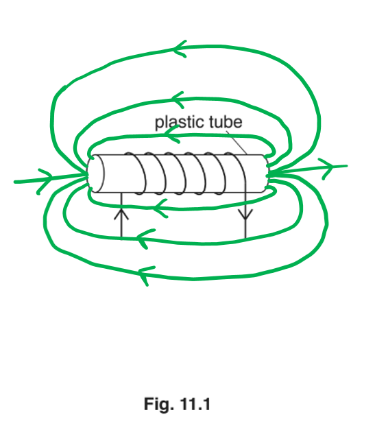

- Correct field pattern drawn; **[1 mark]**
- Lines drawn emerging from the ends of the tube; **[1 mark]**
- Correct direction of the magnetic field indicated by arrows from right to left; **[1 mark]**

**[Total: 3 marks]**

> *The key to this question is the right hand grip rule shown below:*

> *This enables you to work out the direction of a magnetic field for a given direction of current, or vice versa. It's really important not to get this confused with Fleming's Left Hand rule which is about current carrying wires in magnetic fields, and the force they will experience.*
State the name of the device:

- Electromagnet; **[1 mark]**

**[Total: 1 mark]**
To describe how closing the switch causes the electric motor to operate:

- When the switch is closed, a current flows in the coil of wire; **[1 mark]**
- The soft iron core becomes magnetised **OR** a magnetic field is created; **[1 mark]**
- The soft iron armature is attracted to the core; **[1 mark]**
- This causes the contacts A and B to close, completing the circuit, and allows a current to flow in the motor circuit; **[1 mark]**

**[Total: 4 marks]**

> *A common extension to this question is considering why soft iron is used - this is because it magnetises and demagnetises quickly.*

### Q7
**Any four from:**

- Needle moves (one way) as N pole / magnet moves downward / into coil; **[1 mark]**
- As the coil cuts across magnetic field (of magnet); **[1 mark]**
- The needle moves in opposite direction as N pole / magnet moves upward / out of coil; **[1 mark]**
- The magnetic field is cut in opposite direction; **[1 mark]**
- The needle will be at zero when spring at max extension; **[1 mark]**
- The magnet is stationary so no cutting of field lines occurs; **[1 mark]**

**[Total: 4 marks]**

> *Understanding electromagnetic induction is one of the hardest concepts you need to understand for IGCSE Physics. Make sure you know how it works, as well as how the EMF can be increased. *
The name of the device used in X is:

- Step up transformer; **[1 mark]**

The name of the device used in Y is:

- Step down transformer; **[1 mark]**

**[Total: 2 marks]**

> *Make sure you get the position of the step-up and step-down transformers correct. A step-up transformer steps up/increases the voltage. This means when the electricity is being transported it has a low current and a high voltage, so it does not lose too much of its energy via heating. The voltage then needs to be stepped down so it can be used in houses at 230 V. *

### Q8
(i) Draw arrows to show the direction the coil rotates and explain this direction:

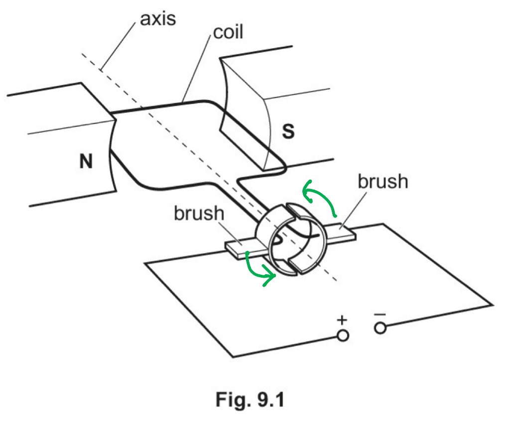

- Arrows are drawn to show anti-clockwise rotation; **[1 mark]**

Explain the direction of the coil rotation:

- The current creates a magnetic field around the coil **AND **This interacts with the field produced by the magnets; **[1 mark]**
- This results in a force* *being exerted on the coil **AND **The direction of this force can be determined using Fleming's left-hand rule; **[1 mark]**

(ii) Draw an arrow to show the direction in which electrons flow through the coil:

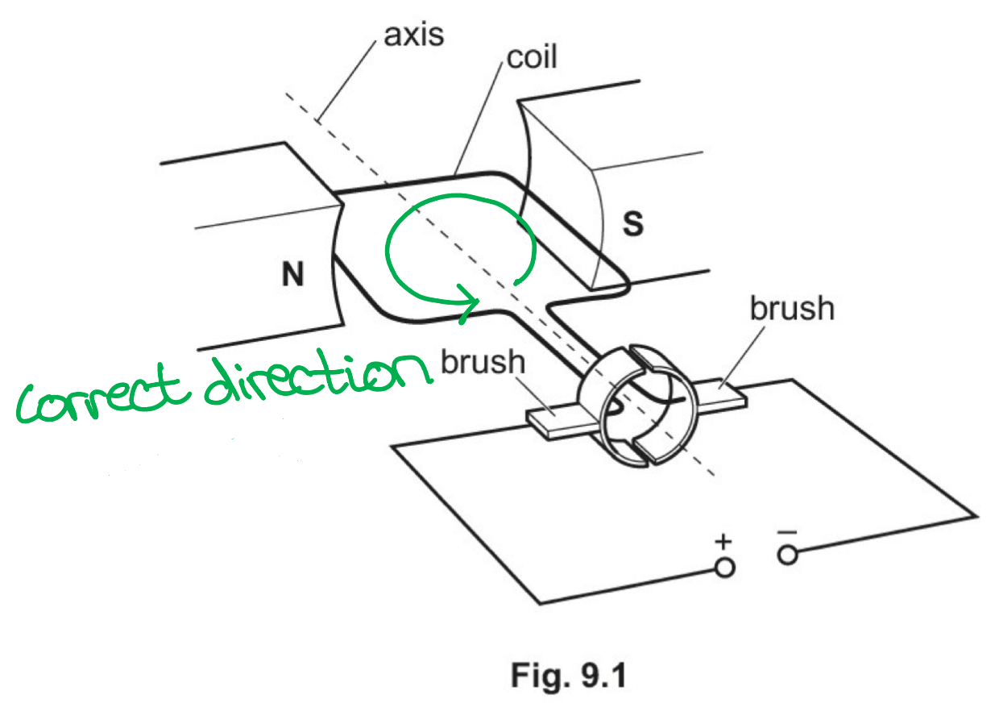

- An arrow is drawn on the coil from the negative side of the power supply to the positive side; **[1 mark]**

(iii) Explain why the electrons flow in the direction you have shown in (a)(ii):

- Electrons are negatively charged, so they are attracted to the positive terminal of the power supply **OR **they are** **repelled by the negative terminal of the supply; **[1 mark]**

**[Total: 5 marks]**
(i) State any differences made by changing the polarity of the power supply:

- The coil rotates in the opposite direction; **[1 mark]**

(ii) State any differences made by changing the coil to the new coil:

- The new coil turns faster **OR **has a greater moment / turning effect; **[1 mark]**

(iii) State any differences made by using a stronger magnetic field:

- The new coil turns faster **OR **has a greater moment / turning effect; **[1 mark]**

**[Total: 3 marks]**

> *Use the revision notes to make your own summary sheet on the workings of the motor, including changes in the coil speed and direction.*

### Q9
The voltage of the supply to the primary coil of a transformer must be alternating because:

- It must produce an alternating / changing magnetic field; **[1 mark]**
- So that a current / voltage is induced (continuously) in the <u>secondary</u> coil / circuit; **[1 mark]**

**[Total: 2 marks]**

> *A d.c. voltage will not enable a transformer to work as the induced magnetic field must be continuously changing direction in order to induce a voltage in the secondary coil.*

> *As a sequence of events:*

- *An **alternating current** is supplied to the **primary coil*
- *The **current** is continually **changing direction*

  - *This means it will produce a **changing magnetic field** around the primary coil*

- *The iron core is **easily magnetised**, so the changing magnetic field passes through it*
- *As a result, there is now a **changing magnetic field** inside the **secondary coil*

  - *This changing field **cuts** through the secondary coil and **induces a potential difference*

- *As the magnetic field is continually changing the potential difference induced will be **alternating*

  - *The alternating potential difference will have the **same frequency** as the alternating current supplied to the primary coil*

- *If the secondary coil is part of a **complete circuit** it will cause an **alternating current** to flow*

> *The structure of a transformer is:*

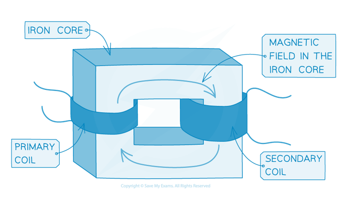
(i) To calculate the number of turns in the secondary coil

List the known quantities:

- Number of turns in the primary coil, *N*p = 8000
- Voltage in the primary coil, *V*p = 240 V
- Voltage in the secondary coil, *V*s = 6.0 V

Recall the equation linking primary and secondary numbers of coils and the voltage:

- $\frac{N_{p}}{N_{s}}=\frac{V_{p}}{V_{s}}$ **[1 mark]**

Rearrange for *N*s, substitute in values and calculate *N*s:

- $N_{s}=\frac{N_{p}\timesV_{s}}{V_{p}}=\frac{8000\times6.0}{240}$
- *N*s = 200 turns **[1 mark]**

(ii) To calculate the current in the primary circuit:

List the known quantities:

- Voltage in the primary coil, *V*p = 240 V
- Voltage in the secondary coil, *V*s = 6.0 V
- Current in the secondary circuit,* I*s = 2.0 A

Recall the equation linking current and voltage in the primary and secondary coils:

- $I_{p}V_{p}=I_{s}V_{s}$ **[1 mark]**

Rearrange for *I*p, substitute in known values and calculate *I*p:

- $I_{p}=\frac{I_{s}\timesV_{s}}{V_{p}}=\frac{2.0\times6.0}{240}$
- *I*p = 0.050 A **[1 mark]**

(iii) To calculate the maximum number of lamps that can be connected in parallel in the secondary circuit:

List the known quantities:

- Current in the secondary circuit,* I*s = 2.0 A
- Fuse rating = 6.0 A

Divide the maximum current which can flow through the fuse by current in one lamp:

- Since current adds in parallel: $\mathrm{number} \mathrm{of} \mathrm{lamps}=\frac{\mathrm{fuse} \mathrm{rating}}{\mathrm{current} \mathrm{in} \mathrm{one} \mathrm{lamp}}=\frac{6.0}{2.0}$
- Therefore the maximum number of lamps is 3; **[1 mark]**

**[Total: 5 marks]**

> *Giving the rearranged and substituted values, *$N_{s}=\frac{8000\times6.0}{240}$*is acceptable for the first mark in part (i).*

> *Giving the rearranged and substituted values, *$I_{p}=\frac{2.0\times6.0}{240}$*is acceptable for the first mark in part (ii).*

### Q10
(i) A circuit diagram which would score two marks is:

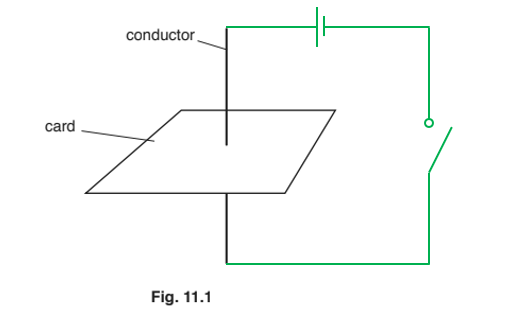

- Correct circuit symbols for cell and switch used; **[1 mark]**
- Both components connected in series; **[1 mark]**

(ii) The magnetic field pattern seen would look like:

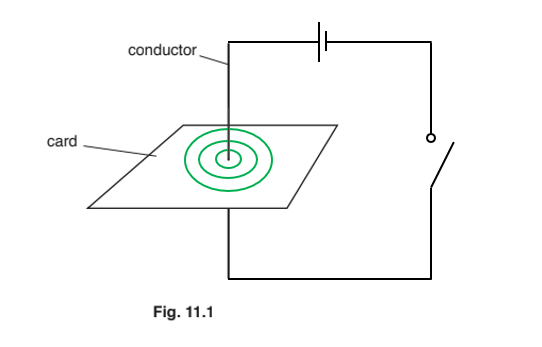

- Circular pattern;** [1 mark]**
- The pattern is centred around the conductor; **[1 mark]**

(iii) The effect of reversing the current on the pattern seen:

- There is no direction involved in the magnetic field seen
- Therefore, there would be no change; **[1 mark]**

**[Total: 5 marks]**
A diagram which would show how to arrange the equipment would look like:

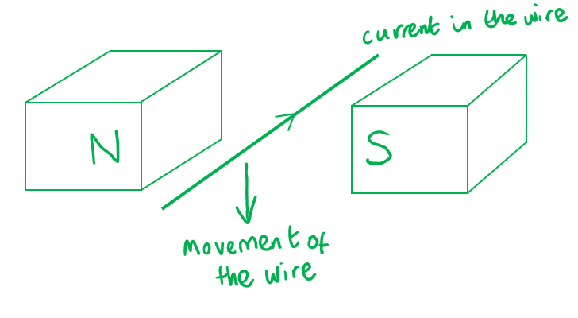

- A conductor / wire should be between the poles of two magnets; **[1 mark]**
- The opposite poles should be facing each other; **[1 mark]**
- There is a current in the wire; **[1 mark]**
- <u>The wire moves</u> due to Fleming's left hand rule; **[1 mark]**

**[Total: 4 marks]**

### Q11
Three factors that affect the size of the deflection of the needle on the galvanometer are:

- The strength of the magnetic field / the strength of the magnet; **[1 mark]**
- The speed of the movement of the wire; **[1 mark]**
- The length of the wire / the length of AB within the magnetic field; **[1 mark]**

**[Total: 3 marks]**

> *Induced EMF means a voltage is generated inside an electrical conductor when it moves within a magnetic field. Make sure you use the revision notes to cement your understanding of this tricky topic. *
(i) To calculate the number of turns in the secondary coil:

List the known quantities:

- Number of turns in the primary coil, *N**P* = 8000
- Voltage in the primary coil, *V**P* = 240 V
- Voltage in the secondary coil, *V**S* = 12 V

Recall the transformer equation:

- $\frac{V_{P}}{V_{S}}=\frac{N_{P}}{N_{S}}$

Rearrange and substitute the known quantities into the transformer equation:

- $N_{S}=\frac{N_{P}\timesV_{S}}{V_{P}}$
- $N_{S}=\frac{8000\times12}{240}$ **[1 mark]**

Calculate the number of turns in the secondary coil:

- *N**S* = 400 turns **[1 mark]**

(ii) To draw the circuit:

A diagram that would score 1 mark should look like this:

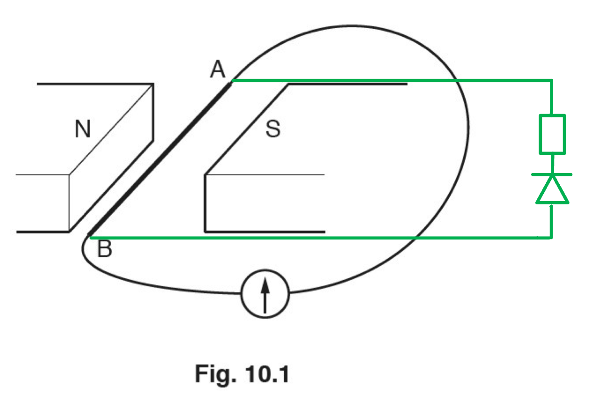

- Circuit is connected to A and B with resistor and diode drawn in series with correct circuit symbols; **[1 mark]**

**[Total: 3 marks]**

> *In part (i), rearranging the transformer equation involves several steps. These are laid out clearly for you below. *

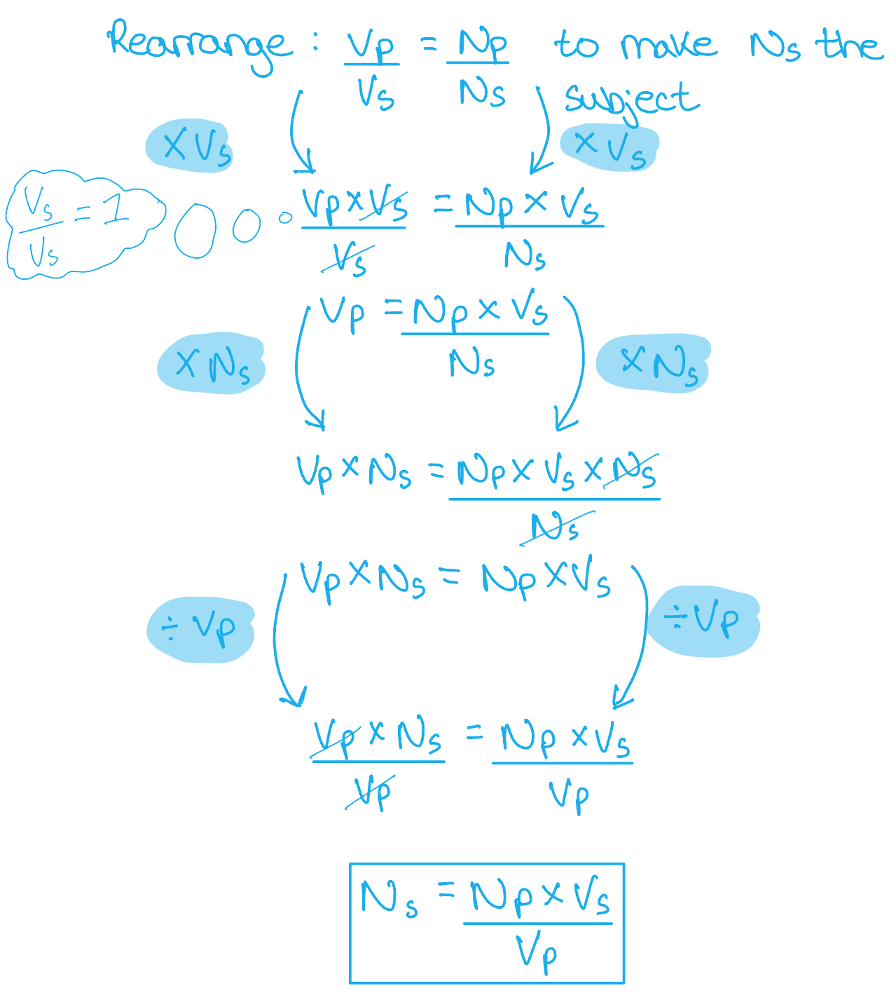

> *The answer for part (ii) shows the most logical place to draw. You will be awarded the mark if you have the components listed. Don't let a 1 mark question like this take up too much time. It is only 1 mark after all!*

### Q12
Describe the equipment required:

- Use a magnet / magnetic field; **[1 mark] ****OR**
- Connect a coil / conductor to a (sensitive) voltmeter / ammeter; **[1 mark]**

Describe the movement required:

- (There must be) <u>relative motion / movement</u> (between the magnet / magnetic field and the coil / conductor); **[1 mark]**

Describe how the electromagnetic induction could be detected:

- (There will be) deflection / a reading on the voltmeter / ammeter; **[1 mark] ****OR**
- Potential difference / current will be generated; **[1 mark]**

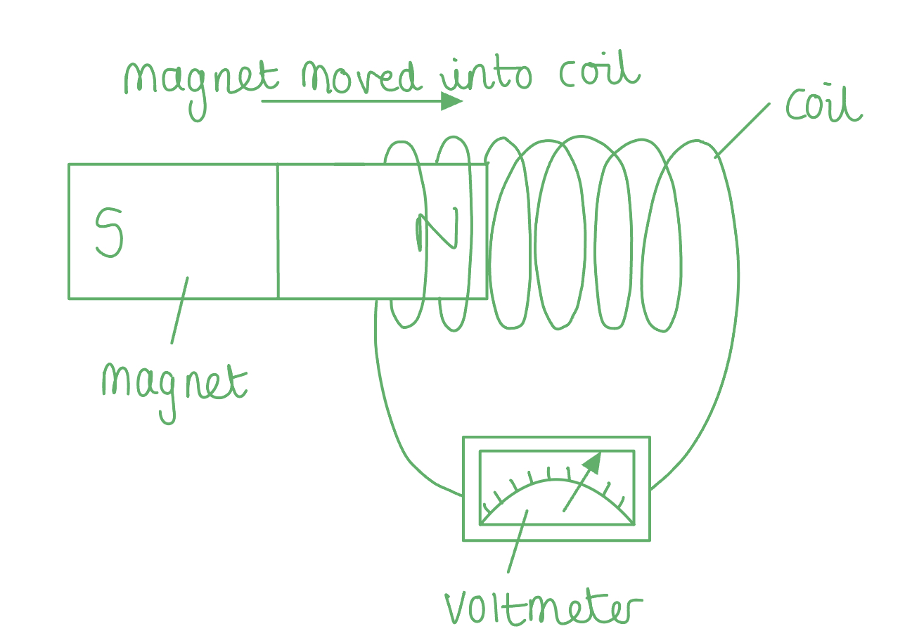

**[Total: 3 marks]**

> *Technically, there is a subtle distinction between the situations when you would use an ammeter or a voltmeter. In the presence of a moving magnetic field, a conductor will always have an induced potential difference, regardless of whether the circuit is complete or not. A current will not be induced, however, if the conductor does not form a complete circuit - current cannot flow in this so the ammeter will read zero even though electromagnetic induction is still occurring. *
(i) State the name of a suitable material for the core of the transformer:

- Iron; **[1 mark]**

(ii) Explain how the diagram in Fig. 11.1 shows a step-up transformer:

- The output coil has more turns than the input coil (so the voltage across the output coil is higher than the voltage across the input coil); **[1 mark]**

(iii) Calculate the output voltage of the transformer:

List the known quantities:

- Potential difference across the primary coil, *V**p* = 12 V
- Turns in primary coil, *N**p* = 20
- Turns in secondary coil, *N**s* = 300

Recall the transformer equation:

- $\frac{V_{p}}{V_{s}}=\frac{N_{p}}{N_{s}}$ **[1 mark]**

Rearrange the transformer equation to make the potential difference across the secondary coil, *V**s* , the subject:

- $\frac{V_{p}}{V_{s}}=\frac{N_{p}}{N_{s}}$
- $V_{s}=V_{p}\times\frac{N_{s}}{N_{p}}$

Substitute the known values into the equation:

- $V_{s}=V_{p}\times\frac{N_{s}}{N_{p}}$
- $V_{s}=12\times\frac{300}{20}$ **[1 mark]**

Calculate the potential difference across the secondary coil:

- *V**s* = 180 V **[1 mark]**

**[Total: 5 marks]**

> *Iron is a magnetically soft material, which means that it becomes magnetised quickly in the presence of a magnetic field. This is useful in a transformer where the magnetic field is constantly changing as a result of the alternating potential difference. *

### Q13
(i) Complete and label Fig. 7.1:

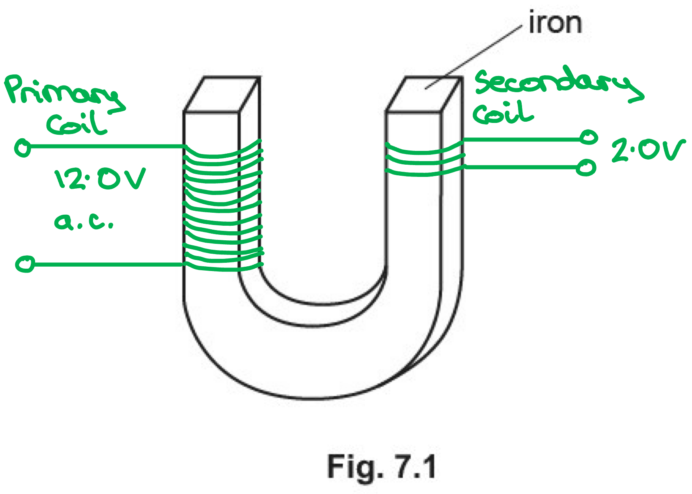

- Labelled primary coil wound around the iron core **AND **connected to a labelled supply / 12 V; **[1 mark]**
- Labelled secondary coil wound around the iron core **AND **connected to a labelled output / 2 V; **[1 mark]**
- More primary coils drawn than secondary coils; **[1 mark]**

(ii) Explain the function of the piece of iron in the transformer:

**Any two from:**

- The iron links the magnetic fields of the primary and secondary coils; **[1 mark]**
- The magnetic field is stronger in the <u>secondary</u> coil; **[1 mark]**
- This means electromagnetic induction is better; **[1 mark]**

(iii) Calculate the input current to the transformer:

List the known quantities:

- Input potential difference, *V**p* = 12.0 V
- Output potential difference, *V**s* = 2.0 V
- Output current, *I**s* = 100 mA

Convert the output current, *I**s* from mA into A:

- $1000\mathrm{mA}=1A$
- $100\mathrm{mA}=\frac{100}{1000}=0.1A$

Recall the equation for transformer efficiency:

- $V_{p}I_{p}=V_{s}I_{s}$ **OR**** **$I_{p}=\frac{V_{s}I_{s}}{V_{p}}$** ****[1 mark]**

Substitute the known quantities into the equation:

- $I_{p}=\frac{2\times0.10}{12}$
- *I**p* = 0.017 A **[1 mark]**

**[Total: 7 marks]**
State and explain an essential safety feature required for this arrangement:

- The metal case of the transformer is earthed; **[1 mark]**
- This is incase the wire / insulation falls off **OR **the live wire touches the case; **[1 mark]**

**[Total: 2 marks]**

> *Ensure you understand the function of all the electrical safety features described in the revision notes. *

### Q14
To describe the magnetic effect of alternating current:

- The alternating current produces / induces a magnetic field; **[1 mark]**
- The magnetic field alternates **OR **changes direction **OR **reverses; **[1 mark]**

**[Total: 2 marks]**

> *Magnetic fields can be hard to imagine since we can't see them, and they are very different to the physical world which we are used to. The language and vocabulary are also completely new.*

> *If you find this difficult to visualise and don't really understand the words, and find it is holding you back then this is a topic where it is important to memorise the definitions and explanations so that you can write them word for word. *

> *Understanding will come as you get used to working with magnetic fields.*
The quantity induced in the base of the pan:

- An <u>e.m.f. / potential difference / voltage</u> is induced; **[1 mark]**

**[Total: 1 mark]**
To explain the heating effect on the pan:

- The induced voltage causes a current in the <u>base of the pan</u>; **[1 mark]**
- This <u>increases</u> the temperature of the pan; **[1 mark]**
- As electrical energy transfers to <u>thermal energy</u>; **[1 mark]**

**[Total: 3 marks]**

This is a difficult question requiring you to think about the logical steps which could lead from a current in the coil to a heated-up pan.

Working ***backwards ***sometimes helps.

The question in part (c) tells you that the pan has got hot (well, it asks you about the temperature of the water, and you can guess it must have got hot!).

If heating has occurred then **some energy store has transferred to thermal energy store** - this is **energy conservation and energy transfers**.

The only energy store available is **electrical**.

We know from part (b) that a voltage has been induced and we also know from the electricity topic that **currents have  heating effect**.

These logical steps backwards from the question are enough to give us the answer to part (c).

### Q15
(i) To explain why there is a turning effect:

- A current-carrying wire in a magnetic field will experience a force
- The force on AB and the force on CD are in opposite (vertical) directions; **[1 mark]**

(ii) An answer which would score** **three marks would look like:

| turning effect | number of turns on coil increased to six | current increased to 9A | strength of magnetic field decreased by a factor of 2 |
|---|---|---|---|
| decreased by a factor of 4 |   |   |   |
| decreased by a factor of 3 |   |   |   |
| decreased by a factor of 2 |   |   | **Final answer:** **✓** |
| no change |   |   |   |
| increased by a factor of 2 |   |   |   |
| increased by a factor of 3 | **Final answer:** **✓** | **Final answer:** **✓** |   |
| increased by a factor of 4 |   |   |   |

- The number of turns on the coil is proportional to the turning effect

  - Number of turns has increased from 2 to 6, which is a factor of 3
  - Therefore the turning effect will be increased by a factor of 3; **[1 mark]**

- The current is proportional to the turning effect

  - The current has increased from 3 to 9, which is a factor of 3
  - Therefore the turning effect will be increased by a factor of 3; **[1 mark]**

- The strength of the magnetic field is proportional to the turning effect

  - Magnetic field is decreased by a factor of 2
  - Therefore the turning effect will be decreased by a factor of 2; **[1 mark]**

**[Total: 4 marks]**

> *The turning effect on a coil is proportional to the number or turns, the current and the magnetic field strength.*
(i) The effect on the galvanometer is:

- The galvanometer will deflect **OR** show current / voltage / potential difference; **[1 mark]**
- Then the galvanometer will return to zero; **[1 mark]**

(ii) The effect on the magnetic field produced by the coil is:

- The magnetic field produced by the coil would change; **[1 mark]**
- The magnetic field produced will oppose the magnetic field of the magnet; **[1 mark]**

**[Total: 4 marks]**

> *A magnet moving in a magnet field will experience a force which opposes the motion. This is known as Lenz's Law.*

### Q16
Calculate the output voltage of the transformer:

List the known quantities:

- Input voltage, *V*p = 230 V
- Number of turns on input coil, *N*p = 1710
- Number of turns on output coil, *N*s = 90

Recall the transformer equation:

- $\frac{V_{p}}{V_{s}}=\frac{N_{p}}{N_{s}}$ **[1 mark]**

Rearrange the equation to make the output voltage, *V*s, the subject:

- Flip the equation upside down

  - $\frac{V_{s}}{V_{p}}=\frac{N_{s}}{N_{p}}$
- Multiply both sides by *V*p

  - $V_{s}=\frac{N_{s}V_{p}}{N_{p}}$

Substitute in the known values to calculate:

- $V_{s}=\frac{90\times230}{1710}$ **[1 mark]**
- *V*s = 12 V **[1 mark]**

**[Total: 3 marks]**

> *Remember that when stating an equation, you will still get the marks if the equation is given in its rearranged form as long as the rearrangement is correct.*
Describe the differences in the coil arrangement for the two types of transformer:

- In a step-down transformer there are fewer turns on the <u>secondary</u> / <u>output coil</u> (than on the primary / input coil); **[1 mark]**
- In a step-up transformer there are more turns on the <u>secondary</u> / <u>output coil</u> (than on the primary / input coil); **[1 mark]**

**[Total: 2 marks]**

> *A step-up transformer increases the potential difference of a power source by having more turns on the secondary coil than on the primary coil. A step-down transformer decreases the potential difference of a power source by having fewer turns on the secondary coil than on the primary coil.*
Explain the advantage of transmitting electricity at high voltages, rather than at low voltages:

- Less energy / power is wasted **OR** transmission is more efficient; **[1 mark]**

**Any one from:**

- Because there is a smaller current (in the transmission cables); **[1 mark]**
- Because there is a smaller heating effect (in the transmission cables); **[1 mark]**
- Therefore, thinner cables can be used (which are cheaper); **[1 mark]**

**[Total: 2 marks]**

> *When electricity is transmitted over large distances, the current in the wires heats them, resulting in energy loss. This energy loss can be reduced by transmitting the energy at high voltages using a step-up transformer. The voltage can then be lowered to a safer level by a step-down transformer before the energy is supplied to homes and businesses. *

### Q17
Identify which of the following metals can be permanently magnetised:

`square`  aluminium

`square`  copper

**✓**  steel **[1 mark]**

`square`  tungsten

**[Total: 1 mark]**

> *The three metal elements which can be magnetised are nickel, cobalt and iron. Steel is an **alloy** of iron and other elements, usually carbon or chromium. This means steel can also be magnetised. Iron by its self, however, is a soft magnet and does not become **permanently** magnetised, whereas steel does.*
Describe the test you would carry out to confirm that both rods are permanent magnets:

- Place the ends / poles together (and repeat by rotating the first magnet to face its other pole towards the second magnet); **[1 mark]**
- Repulsion (will be seen in one orientation and attraction in the other); **[1 mark]**

**[Total: 2 marks]**

> *There are two types of magnets:*

- *Induced magnets*
- *Permanent magnets*

*Induced magnets are **always** attracted to the magnet that magnetised them. We only see a repulsive force between two permanent magnets when like poles are facing each other. This is caused by the interaction between the magnetic fields*.

> *This only occurs between two permanent magnets, so if we observe this phenomenon, we must have two permanent magnets. *

> *Induced magnets can also magnetise other materials. If a paperclips is magnetised, it can also magnetise other materials, hence why it is possible to pick up a **chain** of paperclips with a single permanent magnet. *

> *The ability to attract materials such as iron is not unique to permanent magnets, so this cannot be used to prove that a magnet is permanent.  *
(i) Describe how to make an electromagnet:

- A <u>coil</u> of wire;** [1 mark]**
- An iron rod inside (increases the strength of the magnetic field); **[1 mark]**
- The coil is connected to an (electrical) power supply **OR** current (flows) in the coil; **[1 mark]**

(ii) Suggest **two** factors that affect the strength of the magnetic field of an electromagnet:

- The number of turns (in the coil); **[1 mark]**
- The current (in the coil); **[1 mark]**

**[Total: 5 marks]**

> *A diagram scoring three marks might look like this:*

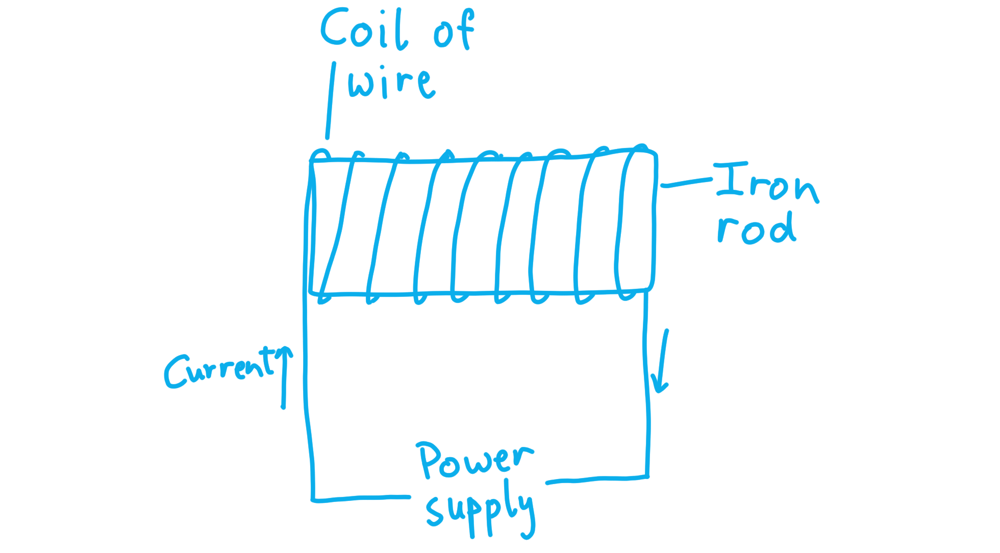

### Q18
(i) State the motion of the coil:

- The coil turns; **[1 mark]**
- in a clockwise direction **OR** continuously; **[1 mark]**

Explain this motion:

**Any one from:**

- Current (in coil) reverses every half turn; **[1 mark]**
- Current (in coil) reverses when the coil is in the vertical position; **[1 mark]**
- There is a force on a current in a magnetic field; **[1 mark]**

(ii) A completed table which would score 3 marks would look like:

**Table 9.1**

| number of turns | current in the coil / A | magnetic field strength | turning effect |
|---|---|---|---|
| 3 | 2.0 | *M* | *T* |
| 3 | 8.0 | *M* | **Final answer:** **4T** |
| 6 | 2.0 | *M* | **Final answer:** **2T** |
| 3 | 2.0 | $\frac{M}{2}$ | **Final answer:** $\frac{T}{2}$** ** |

Relate turning effect *T* to the current, *I*, the number of turns, *N* and magnetic field strength, *M*:

- *T* is proportional to each variable

  - $T\proptoI$
  - $T\proptoN$
  - $T\proptoM$

Calculate the effect on the turning effect:

- Row 2: *I* is multiplied by 4

  - Therefore *T* is multiplied by 4; **[1 mark]**
- Row 3: *N* is multiplied by 2

  - Therefore *T* is multiplied by 2; **[1 mark]**
- Row 4: *M* is divided by 2

  - Therefore *T* is divided by 2; **[1 mark]**

**[Total: 6 marks]**

> *It is important to remember the effect of changing number of coils, the magnetic field strength and the current on the motion of the coil. You also need to understand that a current carrying conductor in a magnetic field will experience a force. This is because it generates a magnetic field of its own which opposes the permanent magnetic field and so a force is experienced.*

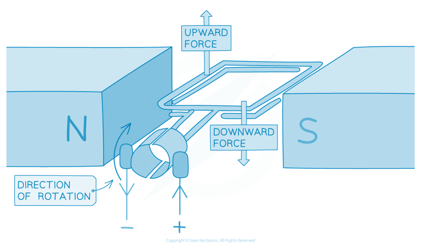

### Q19
(i) The term d.c. means:

- d.c. / direct current is <u>current</u> (flowing) in <u>one direction</u>; **[1 mark]**

(ii) Complete the diagram in Fig. 11.1 by drawing the symbols for two cells in series and a switch to make a circuit:

A diagram that would score 2 marks should look like:

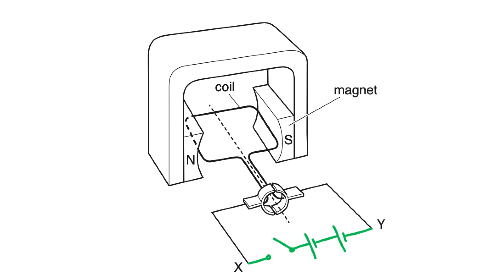

- Symbols for two cells connected in series (see above); **[1 mark]**
- correct symbol for a switch (see above); **[1 mark]**

**[Total: 3 marks]**

> *For questions like this, the diagram might seem complicated! This is where reading the question thoroughly becomes really important - you're not being asked to draw anything particularly complex, so don't be intimidated by the context of the question. *
(i) The electrical device shown in Fig. 11.1 is:

- A (d.c.) <u>motor</u>; **[1 mark]**

(ii) Two changes to the electrical device that will make the coil in the device rotate faster are:

**Any two from:**

- Increase the number of turns on the coil; **[1 mark]**
- Increase the current (in the coil); **[1 mark]**
- Increase the strength of the magnetic field; **[1 mark]**

**[Total: 3 marks]**

> *Moving charge (i.e. current) in a magnetic field experiences a force. That force causes the coil to spin. It should be pretty clear that you can increase the force by increasing the strength of the magnetic field, or by increasing the amount of charge moving in the field. *

> *Increasing the magnetic field is as simple as using a stronger magnet. We can increase the number of electrons flowing through the field by:*

1. *Increasing the current through the coil, so more charge flows every second*
2. *Increase the number of turns of wire on the coil, so there are more electrons in total (one wire has a certain number of moving electrons, so more loops of wire will have more electrons)*

### Q20
State the diagram which correctly shows the magnetic field around a current-carrying conductor:

- The magnetic field pattern around a current-carrying conductor is a series of concentric circles
- The correct diagram is A; **[1 mark]**

**[Total: 1 mark]**
(i) A method to generate and detect an electromotive force (e.m.f.):

Describe moving a magnet inside a coil to generate an e.m.f.;

- Connect the coil to the meter; **[1 mark]**
- Move the magnet into / in and out of the coil; **[1 mark]**
- (To detect the e.m.f.) observe the deflection on meter; **[1 mark]**

A diagram which scores **2 marks** looks like:

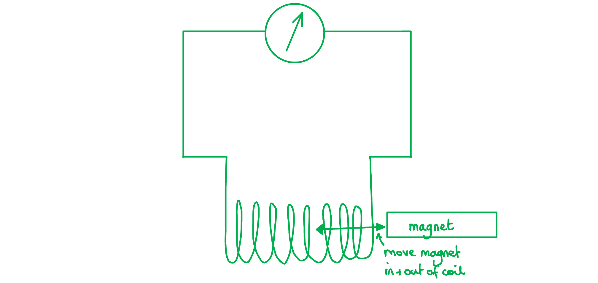

- Coil and meter are connected; **[1 mark]**
- Magnet shown being moved in and out of the coil; **[1 mark]**

(ii) Two changes that will generate a larger e.m.f. are:

**Any two points from:**

- Use a stronger magnet; **[1 mark]**
- Move the magnet faster; **[1 mark]**
- Have more turns on coil / more than 100 turns; **[1 mark]**

**[Total: 5 marks]**

> *The diagram in part (i) is a great way to score marks without having to write everything out in sentences. Just check that you have covered everything. This diagram would need a note to say that the needle of the meter deflects when an emf is detected.*

> *This diagram has included the accepted symbol for an eye making an observation, and an arrow to show that the needle is moving.*

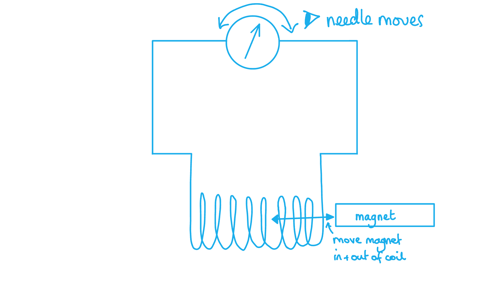
The needle moves from side to side because:

- The generator produces an alternating current **OR**** **the direction of the current keeps changing; **[1 mark]**

**[Total: 1 mark]**

### Q21
State the name of the metal from which the core is made:

- (Soft) iron; **[1 mark]**

**[Total: 1 mark]**
(i) Explain why there is a voltage between the two terminals of the secondary coil:

- (The alternating current induces) a changing magnetic field in the primary coil; **[1 mark]**
- Which produces a changing magnetic field in the core and the secondary coil; **[1 mark]**
- Therefore, an e.m.f. / voltage is induced in the secondary coil; **[1 mark]**

(ii) Calculate the voltage supplied by the a.c. generator:

List the known quantities:

- Number of turns on primary coil, *N*P = 560
- Number of turns on secondary coil, *N*S = 910
- Voltage of secondary coil, *V*S = 78 V

Recall the transformer equation:

- $\frac{V_{P}}{V_{S}}=\frac{N_{P}}{N_{S}}$

Rearrange the equation to make *V*P the subject:

- $V_{P}=\frac{N_{P}\timesV_{S}}{N_{S}}$

Substitute in the known values to calculate:

- $V_{P}=\frac{560\times78}{910}$ **[1 mark]**
- *V*P = 48 V **[1 mark]**

**[Total: 2 marks]**

> *The two rules you need to remember when rearranging equations are:*

1. *To undo an operation, do the opposite operation (to cancel a multiplication relationship, you need to divide, to cancel a minus you need to add or vice versa)*
2. *Whatever you do to an equation, you need to do it to **both sides*

> *If you need a reminder of how to rearrange the transformer equation to make **V**P** the subject:*

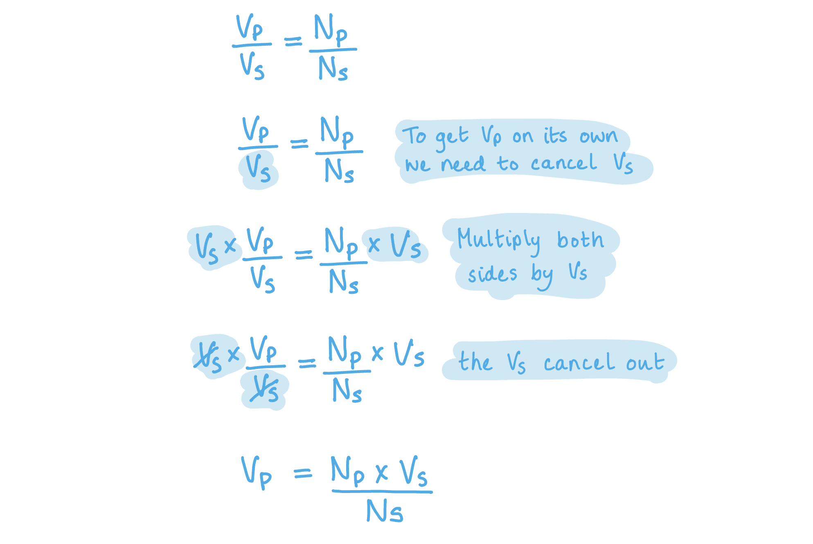
Explain why power losses in the cables are lower when the voltage is high:

- Higher voltage means a <u>lower current</u>; **[1 mark]**
- Lower current means less energy lost as heat / less power loss (because *P* =* I *2*R*); **[1 mark]**

**[Total: 2 marks]**

### Q22
(i) The name of the part of the transformer labelled Q is:

- Secondary output / coil;** [1 mark]**

(ii)

1. The metal used to make part P is:

- Soft iron; **[1 mark]**

2. The term given to part P is:

- Core; **[1 mark]**

(iii) The alternating current produces in part P:

- An alternating; **[1 mark]**
- magnetic field **OR** emf; **[1 mark]**

(iv) To complete the sentence using terms from the box:

- When there are **more** turns in the primary coil than in Q, the device is called a **step-down **transformer; **[1 mark] ****OR**
- When there are **fewer **turns in the primary coil than in Q, the device is called a **step-up** transformer; **[1 mark]**

**[Total: 6 marks]**
Two advantages of transmitting electricity at high voltages rather than at low voltages are:

**Any two from:**

- Smaller current in the wires; **[1 mark]**
- Smaller drop in p.d. / voltage across the cables; **[1 mark]**
- A smaller heating effect; **[1 mark]**
- Less energy wasted / transmission is more efficient; **[1 mark]**
- Thinner cables can be used; **[1 mark]**
- Fewer pylons are needed; **[1 mark]**
- Electricity can be transmitted over long(er) distances; **[1 mark]**

**[Total: 2 marks]**

### Q23
Identify the correct order of the statements

The correct order that would score 3 marks should look like:

| **Final answer:** **T** | **Final answer:** **P** | S | **Final answer:** **R** | **Final answer:** **Q** |
|---|---|---|---|---|

- **3 ****marks for T, P, R and Q in the right order**

**[Total: 3 marks]**
State the name of the metal labelled C and explain why this metal is used in the electromagnet.

- (Soft) iron; **[1 mark]**
- Because this forms a <u>temporary</u> magnet; **[1 mark]**

**[Total: 2 marks]**
