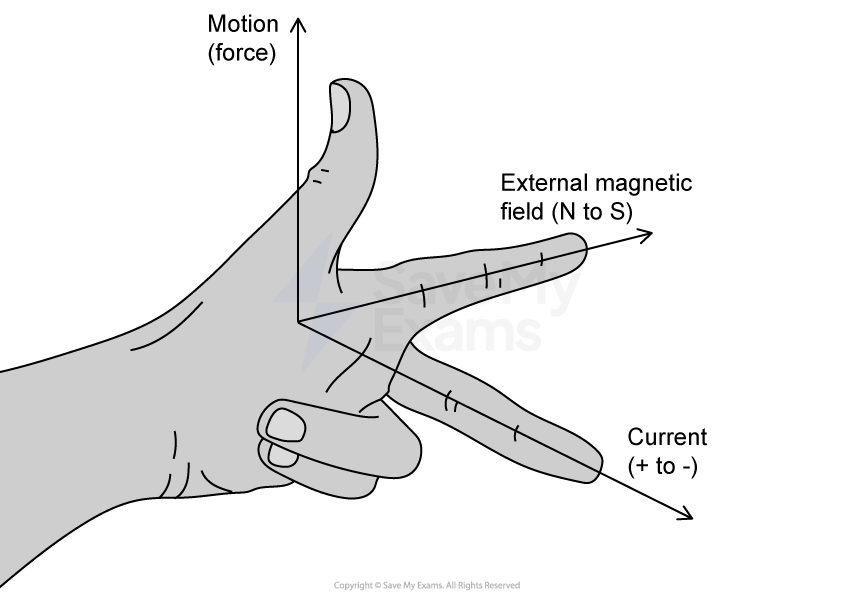
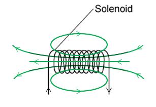

# Mark Schemes — Electromagnetic Effects
**4. Electricity & Magnetism** · Cambridge (CIE) IGCSE physics (0625 & 0972)

## Multiple Choice Questions (35 questions)

### Q1
**Final answer:** **The correct answer is D**

- An e.m.f. is only induced in the coil when there is a change in the magnetic field through the coil
- Moving the magnet into the coil changes the magnetic flux through the coil, which induces an e.m.f. and causes a current to flow
- When the magnet is stationary inside the coil, the magnetic field through the coil is not changing
- No change in magnetic flux means no induced e.m.f. and therefore no current
- The ammeter reads zero

**A** & **B **are incorrect because a constant reading would require a continuously changing magnetic field. A stationary magnet produces a constant (unchanging) field, which does not induce an e.m.f.

**C** is incorrect because there is no gradual decrease. The reading drops to zero as soon as the magnet stops moving, not gradually over time.

### Q2
**Final answer:** **The correct answer is A**

- To transmit electricity efficiently over long distances, the voltage must be increased to reduce the current and minimise energy loss

  - Therefore, transformer X is a **step-up transformer** used at the power station to increase the voltage for transmission
- The high voltage used in transmission cables is dangerous for use in homes

  - Therefore, transformer Y is a **step-down transformer** used to decrease the voltage to a safe level for domestic appliances

**B** is incorrect as a step-up transformer at position Y would increase the voltage further, making it unsuitable for home use.

**C** is incorrect because using a step-down transformer at position X would lead to high energy losses in the transmission cables.

**D** is incorrect as it reverses the required order of the transformers in the transmission system.

### Q3
**Final answer:** **The correct answer is C**

- An e.m.f. is induced in the coil only when its horizontal wires are cutting through the magnetic field lines
- The magnitude of the induced e.m.f. depends on the speed at which the magnetic field lines are being cut
- As the coil falls, it accelerates due to gravity, meaning its speed increases at each successive position `open parentheses v subscript C space greater than space v subscript B space greater than space v subscript A close parentheses`
- In position **C**, the top wire of the coil is cutting the field lines while the coil is moving at a higher speed than it was in position **A**

**A** is incorrect because although an e.m.f. is induced, the coil is moving more slowly than at position **C**.

**B** is incorrect because when the entire coil is within a uniform magnetic field, the e.m.f. induced in the top wire cancels out the e.m.f. induced in the bottom wire, so, the induced e.m.f. is momentarily zero.

**D** is incorrect because the coil has completely left the magnetic field and no field lines are being cut; therefore, the induced e.m.f. is zero.

> **[exam-tip]**
> Remember that an e.m.f. is only induced when there is a change in the magnetic flux through the coil. When the coil is entirely within a uniform field, there is no change in flux, so no e.m.f. is induced. Also consider that a falling object accelerates, so the coil moves faster at lower positions, which affects the rate of cutting field lines.

### Q4
**Final answer:** **The correct answer is ****D**** because:**

- The alternating current in the primary coil produces an alternating magnetic field in the iron core
- This alternating magnetic field induces an alternating voltage across the secondary coil

**A** is incorrect because no current flows through the iron core, as the coils are electrically isolated. The role of the iron core is to channel the alternating magnetic field.

**B** is incorrect because a *current* is produced by the alternating voltage in the secondary coil only if it is connected to a circuit.

**C** is incorrect because the alternating current will induce and alternating voltage, not a direct voltage.

### Q5
**Final answer:** **The correct answer is ****C**** because:**

- The magnetic field is directed into the page, as shown by the cross symbols
- The electron is negatively charged
- Current is the direction of movement of positive charge and so the current is directed towards the left
- Using the left-hand rule, when the magnetic field is pointing into the page and the current is to the left, the force must be directed downward

To use the left-handed rule to find the direction of the force on the electron:

- Put your hand in the shape shown
- Rotate it so that you are pointing your first finger from north to south (into the page) and your second finger in the opposite direction to the electron’s movement
- Your thumb will show the direction of the force, which is downwards

- The force is towards the bottom of the page

The pattern of regularly space small cross symbols are used to show a magnetic field into the page. To show a field pointing out of the page a grid of small dots would be used but doing this is much less common in questions as the dot pattern is harder to understand.

### Q6
**Final answer:** **The correct answer is ****C**** because:**

- At point P in the graph, the magnitude (size) of the p.d. is greatest
- The coil must be parallel to the magnetic field to produce the maximum p.d. (figures A and C)

  - Therefore, options **B** and **D** can be eliminated
- A positive value of p.d. indicates that X is more positive than Y
- Therefore, a negative value of p.d. indicates that Y is more positive than X

**A** is incorrect as this corresponds to a maximum p.d., but the polarity is opposite (X would be more positive than Y), so it matches a positive peak, not point P, which is a negative peak.

**B** and **D** are incorrect as these positions for the coil would produce the minimum (zero) p.d.

### Q7
**Final answer:** **The correct answer is ****C****, because:**

- The power loss due to electrical heating of the cables increases when the current is high
- Decreasing the current will reduce heating and power loss and therefore energy loss

The power transferred is given by:

$\mathrm{power}=\mathrm{current}\times\mathrm{voltage} \mathrm{or}P=\mathrm{IV}$

- Decreasing the current would reduce the power transferred
- To compensate for this, the voltage can be increased to high voltages

**A** is incorrect and the voltage does not affect the speed of transfer in this way.

**B** is incorrect because high voltages are more dangerous than low voltages.

**D** is incorrect because transformers are needed to raise (and lower) the voltage, so more equipment is needed.

### Q8
**Final answer:** **The correct answer is ****C****, because:**

- The direction of the magnetic field is from north to south
- The force on the wire is perpendicular to the direction of the magnetic field and perpendicular to the direction of the current
- The direction can be found using Fleming’s left-hand rule, as shown in the diagram:

  - Using your left hand, point your thumb and first two fingers at right angles to each other
  - Rotate your hand so that your first finger points in the direction of the magnetic field (north to south) and so that your second finger points in the direction of the current in the wire
  - Your thumb will point in the direction of the force on the wire  Don’t be afraid of using the left-hand rule during an examination. Just put your thumb and first two fingers in the correct positions and align them with the field and current directions in the diagram. Make sure you use your left hand! **A** and **B** are incorrect because these directions are not perpendicular (at right angles) to the direction of the magnetic field. **D** is incorrect because this direction is not perpendicular to the direction of the current.

### Q9
**Final answer:** **The correct answer is ****A****, because:**

- The size of the induced e.m.f. depends on

  - the number of turns of wire passing through the magnetic field
  - the strength of the magnetic field
  - the speed of the rotating coil
- Therefore, increasing the number of turns of wire would increase the induced e.m.f.

**B** is incorrect, because increasing the distance would make the magnetic field weaker and this would reduce the size of the induced e.m.f.

**C** is incorrect, as reducing the strength of the magnetic field will reduce the size of the induced e.m.f.

**D** is incorrect, because reversing the direction of the magnetic field will reverse the direction of the e.m.f. but not increase or decrease its size.

### Q10
**Final answer:** **The correct answer is D because:**

- An electric motor uses the effect of a current in a magnetic field to produce a turning effect
- The input is direct current (d.c.), which flows in one direction
- Therefore, the purpose of the split-ring commutator is to ensure that the **turning effect **on the motor stays in the** same direction** at all times

**A** and **B** are incorrect because the magnetic field does not change direction, and this is not influenced by the split ring commutator, which is connected to the coil and external circuit

**C **is incorrect because the force on the sides of the coil depends on the direction of the current, so this must stay constant to ensure the turning effect is uninterrupted

### Q11
**Final answer:** **The correct answer is C because:**

- When a magnet is dropped vertically through a solenoid, the induced magnetic pole can be deduced using Lenz’s law
- Lenz’s law states that the direction of an induced e.m.f. always opposes the change causing it
- In diagram 1:

  - The magnet approaches the coil with its south pole closest to the top of the coil
  - Therefore, a **south **pole will be induced at position X to oppose the magnet’s motion by **repelling **it
- In diagram 3:

  - The magnet leaves the coil with its north pole closest to the bottom of the coil
  - A south pole will be induced at the bottom of the coil to oppose the magnet’s motion by **attracting **it
  - Therefore, a **north **pole will be induced at position X (as the coil acts like a bar magnet, so it must have a north and a south pole)
- This is option **C**

### Q12
**Final answer:** **The correct answer is D because:**

- The transformer equation is given by

$\frac{V_{p}}{V_{s}}=\frac{N_{p}}{N_{s}}$

- Where the input (primary) voltage is Vp = 240 V, and the output (secondary) voltage is Vs = 15 V
- The ratio of these voltages is:

$\frac{V_{p}}{V_{s}}=\frac{240}{15}=16$

- Consider transformer D, where the primary coil has Np = 1200 turns, and the secondary coil has Ns = 75 turns
- The ratio of these turns is:

$\frac{N_{p}}{N_{s}}=\frac{1200}{75}=16$

- Therefore, option **D** is correct

**A** is incorrect as the ratio of the turns is $\frac{N_{p}}{N_{s}}=\frac{800}{40}=20$

**B** is incorrect as the ratio of the turns is $\frac{N_{p}}{N_{s}}=\frac{1000}{25}=40$

**C** is incorrect as the ratio of the turns is$\frac{N_{p}}{N_{s}}=\frac{2400}{15}=160$

### Q13
**Final answer:** **The correct answer is D because:**

- Using the right-hand grip rule:

  - The current is directed into the page, so the magnetic field must act in a clockwise direction
  - Eliminate options **A** and **B**
- The magnetic field gets weaker further from the wire

  - This is represented by drawing field lines further apart at a greater distance
  - Eliminate option **C**

### Q14
**Final answer:** **The correct answer is A because:**

- Electrical power is the product of current and voltage

$P=IV$

- Electrical power remains constant when voltage is increased, so the current must decrease

  - Eliminate options **C** and **D**
- High currents cause electrons to collide with metal ions in the wire

  - This leads to energy losses from the wire to the surroundings by heating
- Reducing current reduces these thermal energy losses

### Q15
**Final answer:** **The correct answer is A because:**

- The ratio of primary and secondary potential differences is equal to the ratio of turns

$\frac{V_{p}}{V_{s}}=\frac{N_{p}}{N_{s}}$

- Rearrange for the number of turns in the secondary coil

$N_{s}=N_{p}\times\frac{V_{s}}{V_{p}}$

- Substitute in the primary p.d. of 240 V, the secondary p.d. of 40 V and the 600 turns on the primary coil

$N_{s}=600\times\frac{40}{240}=100$turns

- This is option **A**

### Q16
**Final answer:** **The correct answer is C because:**

- The speed of the magnet from the point of view of the coil is the factor which determines the size of the e.m.f.
- In **C**, the magnet and coil move towards each other

  - This means the magnet has the greatest relative speed here (from the point of view of the coil)
  - If both the coil and magnet move at speed *v*, the relative speed of the magnet (from the point of view of the coil) is 2*v*

**A **is incorrect as the magnet’s speed from the point of view of the coil is *v*

**B **is incorrect as the magnet’s speed from the point of view of the coil is *v*

**D **is incorrect as the magnet’s speed from the point of view of the coil is 0

### Q17
**Final answer:** **The correct answer is C because:**

- Relays are switches that open and close via the action of an electromagnet
- Therefore, they use magnetic induction, not heating

  - Eliminate options **A** and **B**
- The voltage of a supply cannot be changed by an external circuit

  - Eliminate option **D**
- A relay allows a small current to switch on a large current

### Q18
**Final answer:** **The correct answer is D because:**

- The turning effect of a current-carrying coil in a magnetic field can be increased by increasing

  - the **number of turns** on the coil
  - the **current** in the coil
  - the **strength** of the magnetic field
- Therefore, all three suggestions are correct

### Q19
**Final answer:** **The correct answer is B because:**

- The direction of the magnetic field due to the current in the wire can be found using the **right-hand grip rule**
- If the current (thumb) points perpendicularly out of the page, the magnetic field (fingers) curl around in the **anticlockwise** direction

  - This is shown by option **B**

**A **is incorrect because this shows the magnetic field around a bar magnet

**C **is incorrect because this shows the magnetic field directed in the clockwise direction

**D **is incorrect because the arrows on either side of the wire show the magnetic field directed in both the clockwise and anticlockwise directions

### Q20
**Final answer:** **The correct answer is ****D ****because:**

- A d.c. motor can be made to turn more quickly by:

  - increasing the current in the coil
  - adding more turns to the coil
  - increasing the magnetic field strength of the magnetic field

**A **is incorrect as reducing the strength of the magnetic field would cause it to turn more slowly.

**B **is incorrect as swapping both of these elements would cause it to turn in the same direction at the same speed.

**C **is incorrect as swapping the poles over would cause it to turn in the opposite direction.

### Q21
**Final answer:** **The correct answer is ****A ****because: **

- a d.c. motor uses a split ring commutator to reverse the direction of the current through the coil every half turn, and, therefore, to keep it spinning in the same direction.
- a.c. generators use slip rings, transformers have no moving parts, and relays use no rings at all.

### Q22
**Final answer:** **The correct answer is ****B ****because: **

- The magnetic field lines around a solenoid are similar to the magnetic field lines around a bar magnet.

### Q23
**Final answer:** **The correct answer is ****B**** because:**

- A step-up transformer has more turns on the secondary coil than on the primary coil
- This means that Ns > Np (or Np < Ns)

### Q24
**Final answer:** **The correct answer is ****B ****because: **

- Using the right-hand grip rule:

  - the current (thumb) points out of the page
  - the magnetic field lines (curled fingers) will be **anticlockwise**

Remember to use the right-hand grip rule to determine the direction of the magnetic field around a current-carrying wire

### Q25
**Final answer:** **The correct answer is ****B ****because:**

- When a wire is moved through a magnetic field, the induced e.m.f. can be used to drive a current
- The combination of current and voltage can deliver electrical power to devices (*P* = *IV*), which causes them to work
- This is the process used by a generator to produce electricity

**A **is incorrect as an electric motor works using the reverse effect: when a current is passed through a wire in a magnetic field, it experiences a force.

**C **is incorrect as a photon accelerator is a fictitious device, popularised on a children’s TV show in the early 90s called “Bucky O’Hare”. One might argue that a light bulb accelerates photons.

**D **is incorrect as a transformer uses the induction effect, but does not use a moving wire, it uses an alternating magnetic field to create the same effect.

### Q26
**Final answer:** **The correct answer is ****B ****because:**

- Since *P* = *IV*, when the voltage increases, the current decreases
- This is because the electrical power must be the same before and after transforming, otherwise, you create or destroy energy, which is not possible
- The lower the current, the less power is dissipated as heat in the power lines
- If less power is wasted, the transmission is more efficient

**A **is incorrect as electricity does not flow more or less quickly due to the voltage.

**C **is incorrect as power cannot be created or destroyed due to the conservation of energy. If the voltage goes up, the current comes down to compensate, since *P* = *IV.*

**D **is incorrect as high voltage transmission is much **less** safe than low voltage transmission, but the rewards are worth the risk.

### Q27
**Final answer:** **The correct answer is ****B ****because:**

- In a simple a.c. generator a coil rotates between magnetic poles (or a magnet rotates around a coil)
- This causes the voltage to rise, then fall, then to rise in the opposite direction, then fall, and to repeat in this manner
- This produces a graph with a sine or cosine curve, which is shown by graph **B**

**A **&** C **are incorrect as the voltage is never negative in these graphs. An a.c. generator makes the voltage negative every half cycle.

**D **is incorrect as this graph shows d.c. (direct current)

### Q28
**Final answer:** **The correct answer is ****A ****because: **

- Using Fleming’s left-hand rule:

  - the magnetic field (first finger) points from North to South
  - the current (second finger) points “into the page” in the direction of current flow.
  - the force on the wire (thumb) is directed downwards, in the direction OP

Fleming’s left-hand rule predicts the direction of the force on a current-carrying wire in a magnetic field.

This is a motor effect question, you know because current is already flowing in the wire, and you are asked to predict the direction of the force. If the wire had been pushed, it would be a generator question.

**Top Tip:** if a wire experiences a force without being touched, it’s the motor effect. If the wire is physically dragged through the field, it’s the generator effect.

Actually, the two are equivalent, but that requires slightly deeper thought than we need at IGCSE.

### Q29
**Final answer:** **The correct answer is ****C ****because:**

- Realise that this question concerns electromagnetic induction
- You can disregard answers **A** and **D**. The poles induced in the solenoid will change as the direction of the magnet changes
- When the north pole of the magnet is moved towards the left-hand end of the coil, the induced current flows anticlockwise.
- The anti-clockwise flow of current makes the left-hand end of the coil into a north pole. And this north pole tries to repel the incoming north pole of the magnet. In other words, the induced current opposes the motion that induced it (from Lenz's Law).
- Hence answer C is correct

### Q30
**Final answer:** **The correct answer is ****B**** because:**

- Electrical power is given by $P=VI$
- For an ideal transformer (100% efficient): power into a transformer = power out of a transformer
- Therefore, the relationship between the voltage and current in a transformer is: $I_{p}V_{p}=I_{s}V_{s}$
- The primary voltage is $V_{p}=25\mathrm{kV}=25000V$,the primary current $I_{p}=4000A$ and the secondary voltage is 
$V_{s}=400\mathrm{kV}=400000V$
- Substituting these values gives: 
$4000\times25000=400000\timesI_{s}$
- Rearranging the equation gives:

$I_{s}=\frac{4000\times25000}{400000}=250A$

When doing calculations always write the formula out in full. Substitute the numbers in and write out each stage of rearranging the equation. This makes it much less likely that you’ll make mistakes.

### Q31
**Final answer:** **The correct answer is ****C ****because:**

- Using Fleming’s left-hand rule:

  - the current (second finger) is directed along the wire, in the direction shown on the arrow
  - the force on the wire (thumb) is directed upwards, in the direction shown on the diagram
  - the magnetic field (first finger) points left to right

- Magnetic fields point from N to S, so the left pole is N and the right is S

Fleming’s left-hand rule predicts the direction of the force on a current-carrying wire in a magnetic field.

It’s very easy to get confused between the motor effect (left-hand rule) and the generator effect (right-hand rule).

**Top Tip:** if a wire experiences a force without being touched, it’s the motor effect. If the wire is physically dragged through the field, it’s the generator effect.

Actually, the two are equivalent, but that requires slightly deeper thought than we need at IGCSE.

### Q32
**Final answer:** **The correct answer is ****D ****because:**

- **γ**-rays have no charge. Therefore they would not experience a force when passing between two charged plates.
- **β-**particles have a negative charge. This causes them to be attracted towards the positively charged plate.

### Q33
**Final answer:** **The correct answer is ****B ****because:**

- Using Fleming's left-hand rule:

  - the field (first finger) is directed out of the page
  - the current (second finger) is directed in the direction of the alpha particle beam since they are positively charged
  - the force (thumb) will be pointing downwards

- Therefore, the alpha particle is deflected **downwards**

Fleming’s left-hand rule predicts the direction charged particles will deflect when they pass through a magnetic field.

Remember, when dealing with Fleming’s left-hand rule that the current finger (second finger) always points in the direction that positively charged particles are flowing, or in the direction of conventional current + to - in a wire. Had this been about a beam of electrons, the second finger would point the other way.

### Q34
**Final answer:** **The correct answer is ****B**** because:**

- The relationship between the voltage and the number of coils of a transformer is: $\frac{V_{p}}{V_{s}}=\frac{N_{p}}{N_{s}}$
- The primary voltage is $V_{p}=12V$ , the secondary voltage is
$V_{s}=240V$ and the number of secondary coils is 
$N_{s}=1200$
- Substituting these values gives: $\frac{12}{240}=\frac{N_{p}}{1200}$
- Rearranging the equation gives: $N_{p}=12\times\frac{1200}{240}=60$

When doing calculations always write the formula out in full. Substitute the numbers in and write out each stage of rearranging the equation. This makes it much less likely that you’ll make mistakes.

### Q35
**Final answer:** **The correct answer is ****C**** because:**

- The relationship between the voltage and the number of coils of a transformer is: $\frac{V_{p}}{V_{s}}=\frac{N_{p}}{N_{s}}$
- The number of primary coils is $N_{p}=80$, the number of secondary coils is $N_{s}=400$ and the primary voltage is 
$V_{p}=48V$
- Substituting these values gives: $\frac{48}{V_{s}}=\frac{80}{400}$
- Rearranging the equation gives: $V_{s}=48\times\frac{400}{80}=240V$

When doing calculations always write the formula out in full. Substitute the numbers in and write out each stage of rearranging the equation. This makes it much less likely that you’ll make mistakes.
