# Exam Questions — Electromagnetic Effects
**4. Electricity & Magnetism** · Cambridge (CIE) IGCSE physics (0625 & 0972)
> Source: [https://www.savemyexams.com/igcse/physics/cie/23/topic-questions/](https://www.savemyexams.com/igcse/physics/cie/23/topic-questions/) · 58 questions across 2 sets

## Multiple Choice Questions (35 questions)

### Q1 — medium — 1 marks

**Q1** [1 mark]

A magnet is pushed into a coil of wire connected to a centre-zero sensitive ammeter. The ammeter shows a negative reading, as shown in diagram 1.

The magnet is then held stationary inside the coil.

What does the ammeter read when the magnet is stationary, as shown in diagram 2?

### Q2 — easy — 1 marks

**Q2** [1 mark]

The diagram shows the transmission of electricity from a power station to a home.

Which row identifies the types of transformers used at position X and position Y?

|   | **Transformer X** | **Transformer Y** |
|---|---|---|
| **A** | step-up | step-down |
| **B** | step-up | step-up |
| **C** | step-down | step-down |
| **D** | step-down | step-up |

### Q3 — hard — 1 marks

**Q3** [1 mark]

A rectangular coil is dropped between a pair of opposite magnetic poles, as shown.

In which position is the magnitude of the induced e.m.f. in the coil the greatest?

### Q4 — medium — 1 marks

**Q4** [1 mark]

Which statement about a transformer is correct?

*Source: June 2023 0972/21 Q32*

### Q5 — medium — 1 marks

**Q5** [1 mark]

An electron moves into a uniform magnetic field.

The arrow shows the initial direction of motion of the electron.

The direction of the magnetic field is into the plane of the page.

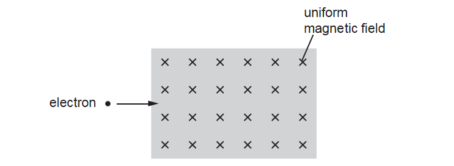

In which direction does a force act on the electron when it enters the magnetic field?

*Source: June 2023 0972/21 Q31*

### Q6 — hard — 1 marks

**Q6** [1 mark]

The diagram shows an a.c. generator.

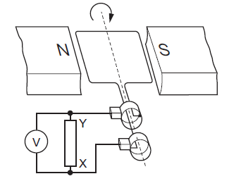

The graph shows the potential difference (p.d.) between points X and Y plotted against time. A positive value of p.d. indicates that X is more positive than Y.

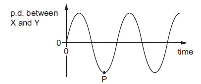

Which diagram shows the position of the coil at point P on the graph?

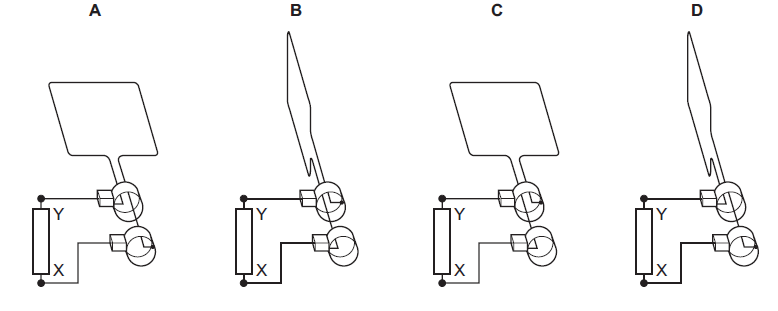

*Source: June 2023 0972/21 Q30*

### Q7 — easy — 1 marks

**Q7** [1 mark]

** **What is an advantage of transmitting electricity at a high voltage?

*Source: June 2023 0972/11 Q33*

### Q8 — hard — 1 marks

**Q8** [1 mark]

The diagram shows a vertical wire carrying a current *I *placed between the poles of a magnet.

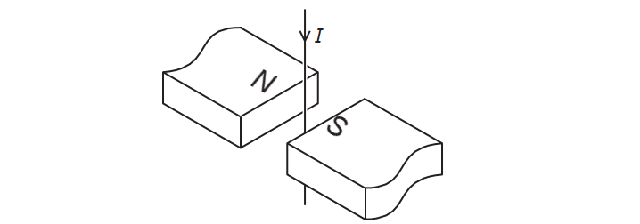

What is the direction of the force on the wire exerted by the magnetic field?

*Source: June 2023 0972/11 Q32*

### Q9 — medium — 1 marks

**Q9** [1 mark]

** **A simple electric generator induces an electromotive force (e.m.f.).

Which modification would increase the induced e.m.f.?

*Source: June 2023 0972/11 Q31*

### Q10 — medium — 1 marks

**Q10** [1 mark]

**Extended Tier Only**

What is the purpose of the split-ring commutator in an electric motor?

*Source: June 2022 paper 2 Q37*

### Q11 — medium — 1 marks

**Q11** [1 mark]

**Extended Tier Only**

A magnet is dropped vertically through a solenoid. This induces magnetic poles at both ends of the solenoid.

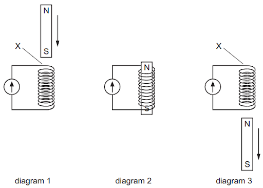

Which magnetic poles are induced at position X in diagram 1 and diagram 3?

|   | **diagram 1** | **diagram 3** |
|---|---|---|
| **A** | N pole | N pole |
| **B** | N pole | S pole |
| **C** | S pole | N pole |
| **D** | S pole | S pole |

*Source: June 2022 paper 2 Q35*

### Q12 — medium — 1 marks

**Q12** [1 mark]

Which transformer can change a 240V a.c. input into a 15V a.c. output?

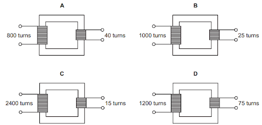

*Source: june 2022 paper 1 Q35*

### Q13 — medium — 1 marks

**Q13** [1 mark]

There is an electric current in a straight wire in the direction into the page. This produces a magnetic field around the wire.

All the field lines are circles but only one field line is shown.

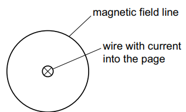

Which row describes the magnetic field?

| ** ** | **direction of the field lines** | **spacing of the field lines** |
|---|---|---|
| **A** | anti-clockwise | equally spaced over the whole field |
| **B** | anti-clockwise | more widely spaced further from the wire |
| **C** | clockwise | equally spaced over the whole field |
| **D** | clockwise | more widely spaced further from the wire |

*Source: specimen 2023 paper 1 Q36*

### Q14 — medium — 1 marks

**Q14** [1 mark]

Increasing the transmission voltage in transmission cables reduces power losses.

What is the explanation for this reduction?

*Source: specimen 2023 paper 2 Q35*

### Q15 — medium — 1 marks

**Q15** [1 mark]

The diagram shows a simple transformer with an input of 240 V a.c. and an output of 40 V a.c.

There are 600 turns on the primary coil.

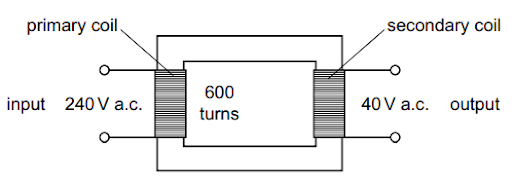

How many turns are there on the secondary coil?

*Source: specimen 2023 paper 1 Q35*

### Q16 — medium — 1 marks

**Q16** [1 mark]

The diagram shows a bar magnet and a coil of wire. The bar magnet is moved at the same speed in each experiment.

In which situation is the largest electromotive force (e.m.f.) induced?

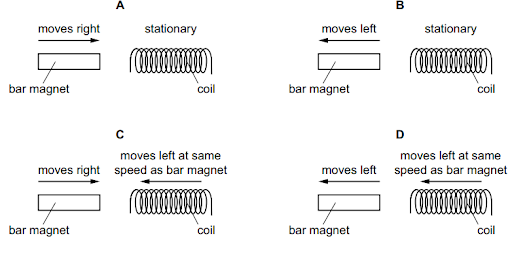

*Source: specimen 2023 paper 1 Q34*

### Q17 — medium — 1 marks

**Q17** [1 mark]

An electric current can produce a heating effect and a magnetic effect.

Which row shows the effect that a relay uses and one application of a relay?

|   | **effect used by a relay** | **one application of a relay** |
|---|---|---|
| **A** | heating effect | allowing a small current to switch on a large current |
| **B** | heating effect | changing the voltage of an a.c. supply |
| **C** | magnetic effect | allowing a small current to switch on a large current |
| **D** | magnetic effect | changing the voltage of an a.c. supply |

*Source: specimen 2023 paper 1 Q33*

### Q18 — easy — 1 marks

**Q18** [1 mark]

A current-carrying coil in a magnetic field experiences a turning effect.

Three suggestions for increasing the turning effect are given.

1. Increase the number of turns on the coil.
2. Increase the current in the coil.
3. Increase the strength of the magnetic field.

Which suggestions are correct?

*Source: June 2022 paper 1 Q37*

### Q19 — easy — 1 marks

**Q19** [1 mark]

** **The diagrams show patterns around a straight wire carrying a current perpendicularly out of the page.

Which pattern represents the magnetic field due to the current in the wire?

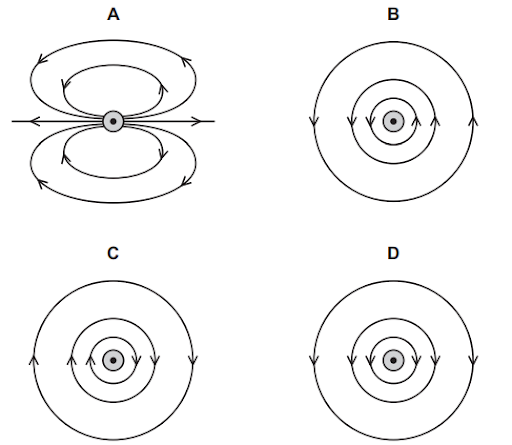

*Source: June 2022 paper 1 Q36*

### Q20 — easy — 1 marks

**Q20** [1 mark]

**Extended tier only**

A simple d.c. electric motor is shown in the diagram.

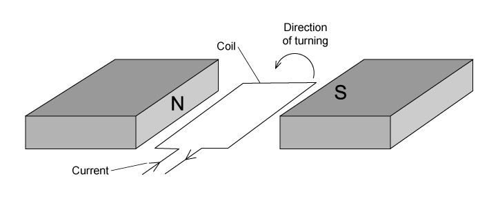

Which of the following changes would make the coil turn more quickly?

### Q21 — easy — 1 marks

**Q21** [1 mark]

**Extended tier only**

Which device uses a split ring commutator?

### Q22 — easy — 1 marks

**Q22** [1 mark]

Which diagram shows the correct magnetic field pattern around a current-carrying solenoid?

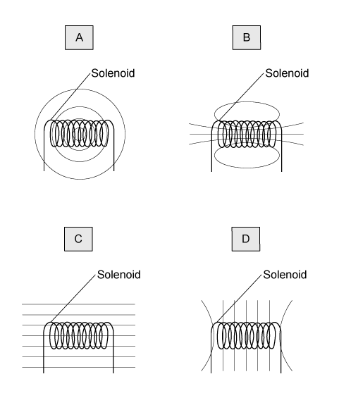

### Q23 — easy — 1 marks

**Q23** [1 mark]

The number of turns in the primary coil and secondary coil of a transformer is Np and Ns respectively.

Which of the following statements represents a step-up transformer?

### Q24 — easy — 1 marks

**Q24** [1 mark]

Which diagram correctly shows the magnetic field lines around a current-carrying wire if the current is directed out of the page?

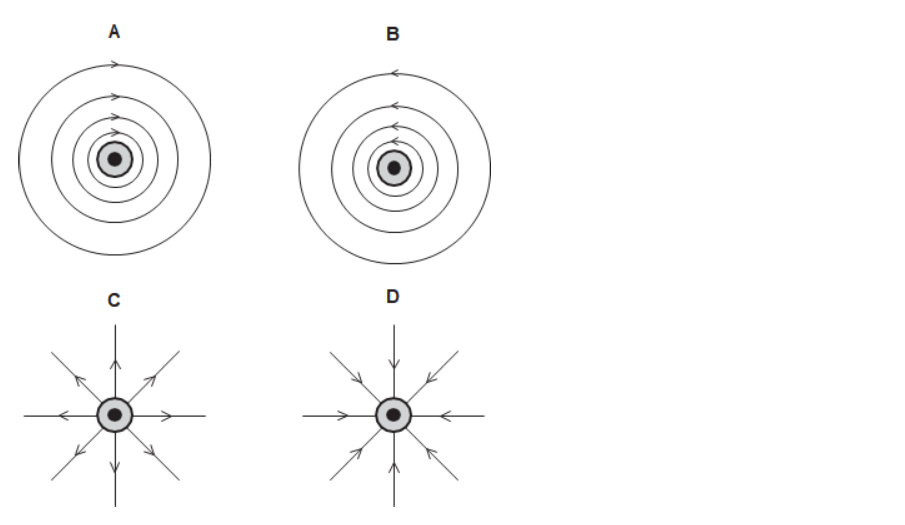

### Q25 — medium — 1 marks

**Q25** [1 mark]

When a wire is moved through a magnetic field, an e.m.f. is induced in the wire.

Which of the following devices uses this effect?

### Q26 — medium — 1 marks

**Q26** [1 mark]

After electricity is generated at a power station, the voltage is increased significantly for transmission across the country via the national grid.

What is the advantage of transmitting electricity at very high voltages?

### Q27 — medium — 1 marks

**Q27** [1 mark]

**Extended tier only**

Which graph represents the output of a simple a.c. generator?

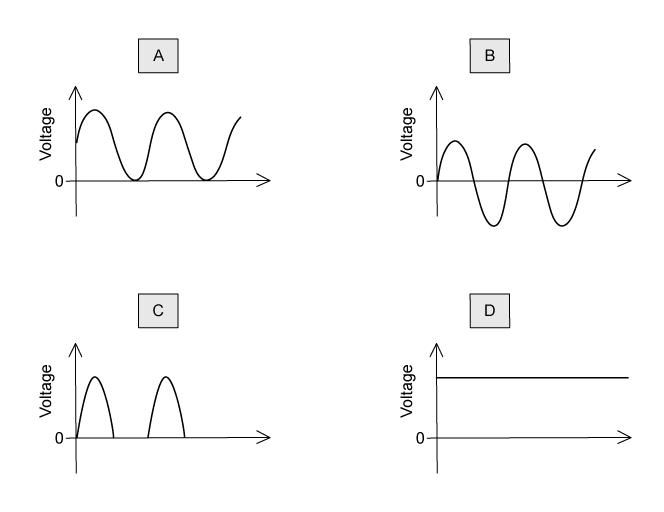

### Q28 — hard — 1 marks

**Q28** [1 mark]

**Extended tier only**

A current-carrying wire is placed into a magnetic field as shown in the diagram. The wire experiences a force.

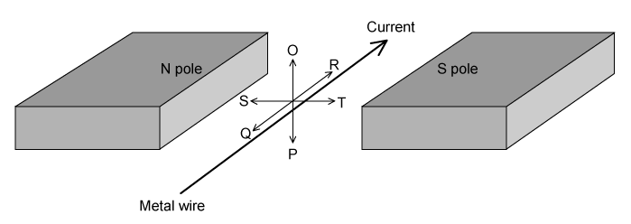

In which direction does the force on the wire act?

### Q29 — hard — 1 marks

**Q29** [1 mark]

**Extended tier only**

The south pole of a magnet is brought near to a solenoid, which is connected to an ammeter. The magnet is then pulled away again.

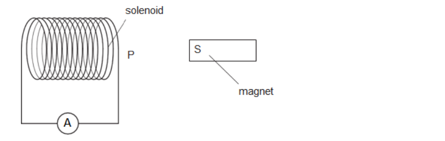

As the magnet is moved towards point P the needle on the ammeter deflects. When it is moved away from point P, the needle on the ammeter also deflects.

What magnetic pole is produced at P when the south pole of the magnet is brought towards and away from the solenoid?

|   | **S pole brought towards P** | **S pole moved away from P** |
|---|---|---|
| **A** | N | N |
| **B** | N | S |
| **C** | S | N |
| **D** | S | S |

### Q30 — hard — 1 marks

**Q30** [1 mark]

**Extended tier only**

A transformer is used to raise the voltage of electricity produced at a power station before it is transmitted in power lines.

The power station generates electricity at a voltage of 25 kV and a current of 4000 A. The step-up transformer increases the voltage to 400 kV.

Assume that the transformer is 100% efficient.

What current flows in the power lines?

### Q31 — hard — 1 marks

**Q31** [1 mark]

**Extended tier only**

A current-carrying wire is placed between two magnetic poles as shown in the diagram below. It experiences an upwards force.

What is the orientation of the magnetic poles?

|   | **Left magnet** | **Right magnet** |
|---|---|---|
| **A** | N | N |
| **B** | S | N |
| **C** | N | S |
| **D** | S | S |

### Q32 — medium — 1 marks

**Q32** [1 mark]

**Extended tier only**

Beta and gamma radiation are passed through two metal plates, with equal and opposite charges, as shown in the diagram below.

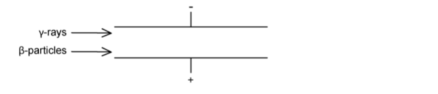

Which direction, if any, would the β-particles and γ-rays be deflected?

|   | **β-particles** | **γ-rays** |
|---|---|---|
| **A** | into the page | continue straight |
| **B** | towards the negative plate | out of the page |
| **C** | continue straight | towards the negative plate |
| **D** | towards the positive plate | continue straight |

### Q33 — hard — 1 marks

**Q33** [1 mark]

**Extended tier only**

A magnetic field can be represented by the diagram shown below. The dots represent magnetic field lines coming out of the page.

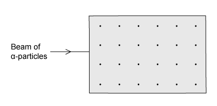

A beam of alpha particles is directed through the field as shown above. Alpha particles, being charged, will be deflected by the field.

In which direction will the alpha particles be deflected?

### Q34 — hard — 1 marks

**Q34** [1 mark]

A transformer has 1200 turns on its secondary coil and has an output voltage of 240 V.

If the input voltage is 12 V, how many turns are there on the primary coil?

### Q35 — hard — 1 marks

**Q35** [1 mark]

Transformers are used to change the voltage of a power supply.

The diagram below shows a simple transformer.

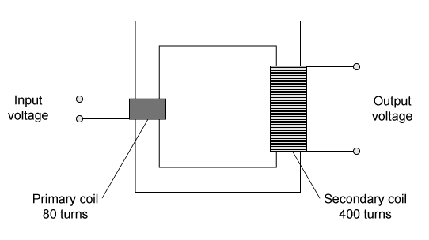

If the input voltage is 48 V, what is the output voltage?

## Theory Questions (23 questions)

### Q1 — easy — 8 marks

**Q1** [2 marks]

Fig. 8.1 shows a simple a.c. generator. A rectangular coil is rotating between two magnetic poles. Components A and B are labelled.

**Fig. 8.1**

State the names of the components labelled A and B.

**Q1** [2 marks]

**Extract:**

Fig. 8.1 shows a simple a.c. generator. A rectangular coil is rotating between two magnetic poles.

Describe how an alternating electromotive force (e.m.f.) is produced in the coil.

**Q1** [2 marks]

**Extract:**

Fig. 8.1 shows a simple a.c. generator. A rectangular coil is rotating between two magnetic poles.

State **two **changes that could be made to produce a larger maximum e.m.f.

**Q1** [2 marks]

The output from the generator is connected to a step-down transformer with a turns ratio of $20:1$. The voltage across the primary coil is $240V$.

Calculate the voltage across the secondary coil.

### Q2 — hard — 7 marks

**Q2** [4 marks]

Fig. 10.1 shows an arrangement used to demonstrate electromagnetic induction.

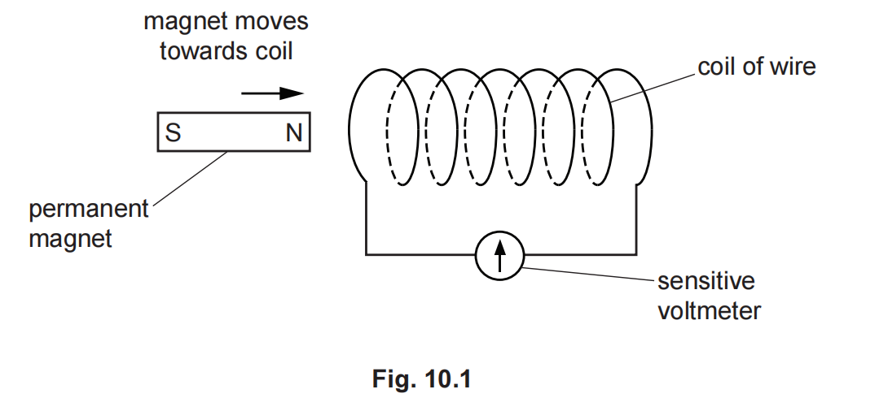

(i) ** **When the magnet moves towards the coil of wire, the pointer on the sensitive voltmeter deflects to the right.

Explain why the pointer deflects.

[2]

(ii)  State **two **changes that increase the deflection on the sensitive voltmeter.

[2]

*Source: 0972/June 2023 31 Q10A*

**Q2** [3 marks]

Fig. 10.2 shows the symbol for a transformer. The primary coil is connected to a voltage of 180 V a.c.

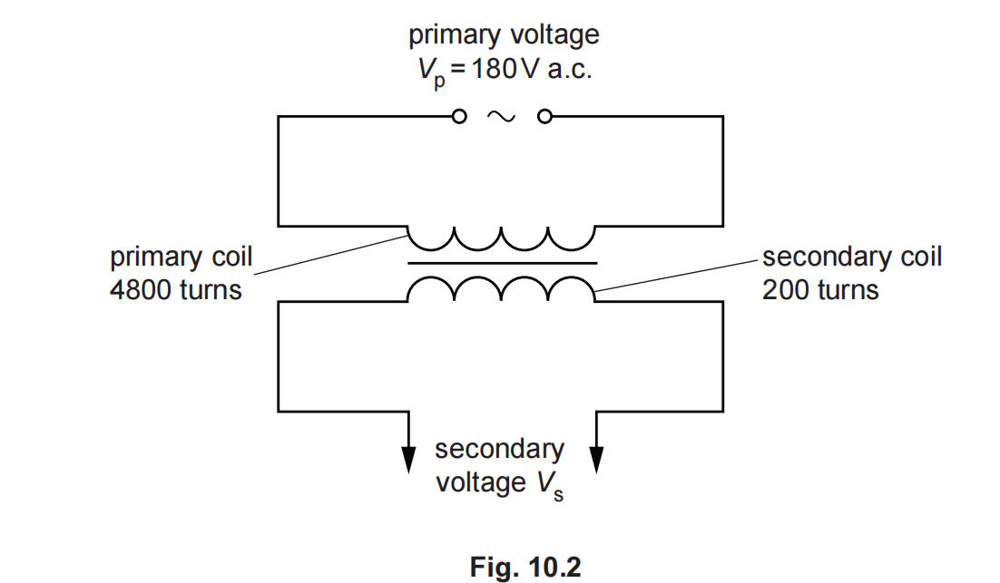

Calculate the secondary voltage *V*s for the transformer.

*Source: June 2023 0972/31 Q10B*

### Q3 — medium — 4 marks

**Q3** [4 marks]

**Extended Tier Only**

Fig. 8.1 shows two vertical, cylindrical tubes and a cylindrical magnet all held in a vacuum

One tube is made of plastic and the other tube is made of copper. The two cylindrical tubes have identical dimensions.

The magnetic field of the small, cylindrical magnet is extremely strong.

Initially, the magnet is at rest at the top of the plastic tube.

The magnet is released and it falls through the plastic tube without experiencing a resistive force. The magnet takes 0.67 s to fall to the lower end of the plastic tube.

The magnet is then held at the top of the copper tube and released. As it falls through the copper tube, an electric current is generated in the copper.

(i)** **Explain why there is a current in the copper.

[2]

(ii)** **The current in the copper produces a magnetic field of its own in the tube.

The magnet falls much more slowly in the copper tube than in the plastic tube.

Explain why the magnet falls more slowly in the copper tube.

[2]

*Source: june 2022 paper 4 Q8B*

### Q4 — medium — 4 marks

**Q4** [2 marks]

Fig. 12.1 shows a transformer.

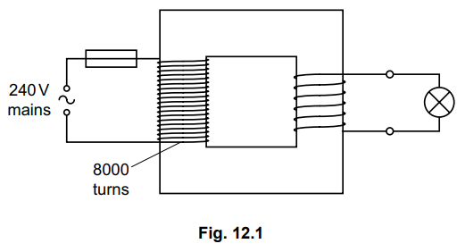

There are 8000 turns in the primary coil of the transformer. The primary coil is connected to a 240 V mains supply. A 6.0 V lamp connected to the secondary coil operates at full brightness.

Calculate the number of turns in the secondary coil.

*Source: specimen 2023 paper 4 Q12A*

**Q4** [2 marks]

**Extended Tier Only**

The current in the lamp is 2.0 A. The transformer operates with 100% efficiency.

Calculate the current in the primary circuit.

*Source: specimen 2023 paper 4 Q12B*

### Q5 — medium — 3 marks

**Q5** [3 marks]

The electric circuit for a microwave oven includes a transformer.

The voltage to the primary coil of the transformer Vp is 240 V.

The number of turns on the primary coil Np is 70.

The number of turns on the secondary coil Ns is 560.

Calculate the secondary voltage Vs for the transformer.

*Source: June 2022 paper 3 Q10B*

### Q6 — easy — 8 marks

**Q6** [3 marks]

Fig. 11.1 shows a coil (solenoid) wrapped around a plastic tube. There is a current in the coil.

The arrows show the direction of the current in the coil.

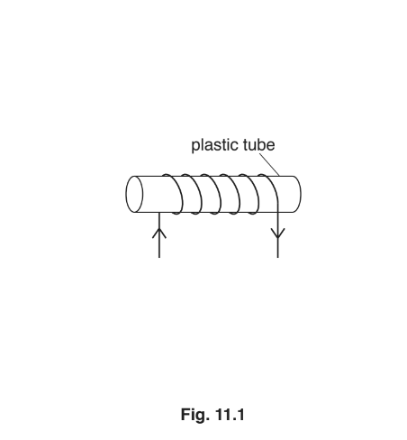

On Fig. 11.1, draw the pattern of the magnetic field lines around the coil.

Add arrows to show the direction of the magnetic field.

*Source: 2018 0625/33 Q11A*

**Q6** [1 mark]

A long soft iron bar is placed inside the plastic tube. There is a current in the coil. This forms a device. State the name of the device.

*Source: 2018 0625/33 Q11B*

**Q6** [4 marks]

Fig. 11.2 shows a relay operated by switch S.

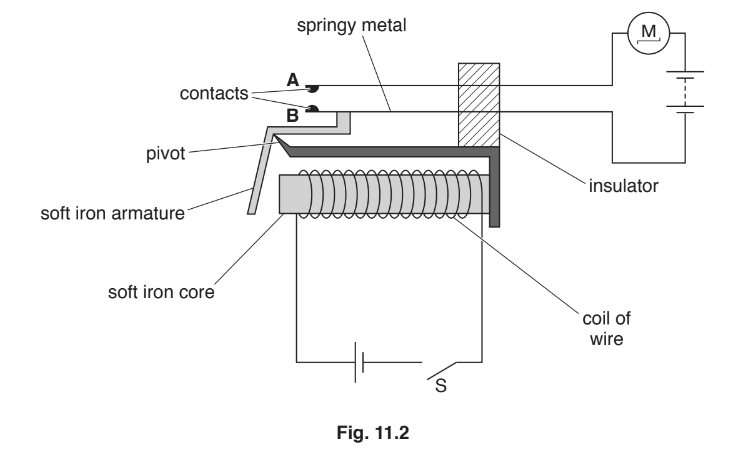

Using Fig. 11.2, describe how closing the switch, S, causes the electric motor to operate.

*Source: 2018 0625/33 Q11C*

### Q7 — hard — 6 marks

**Q7** [4 marks]

A teacher demonstrates electromagnetic induction using the apparatus shown in Fig.10.1.

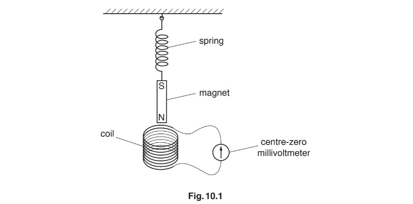

The teacher pulls the magnet down until one end is inside the coil. The teacher then releases the magnet. The magnet moves up and down repeatedly. As it moves, one end of the magnet enters and leaves the coil.

Describe and explain the readings on the centre-zero millivoltmeter as the magnet enters and leaves the coil.

*Source: February/March 2018 0625/32 Q10A*

**Q7** [2 marks]

Fig.10.2 shows a system for transmitting electricity from a power station.

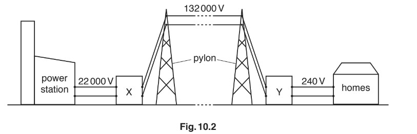

State the name of the device used in X and the name of the device used in Y.

*Source: February/March 2018 0625/32 Q10B*

### Q8 — medium — 8 marks

**Q8** [5 marks]

Fig. 9.1 shows a simple direct current (d.c.) electric motor. The coil rotates about the axis when there is a current in the coil. The coil is connected to the rest of the circuit by the brushes.

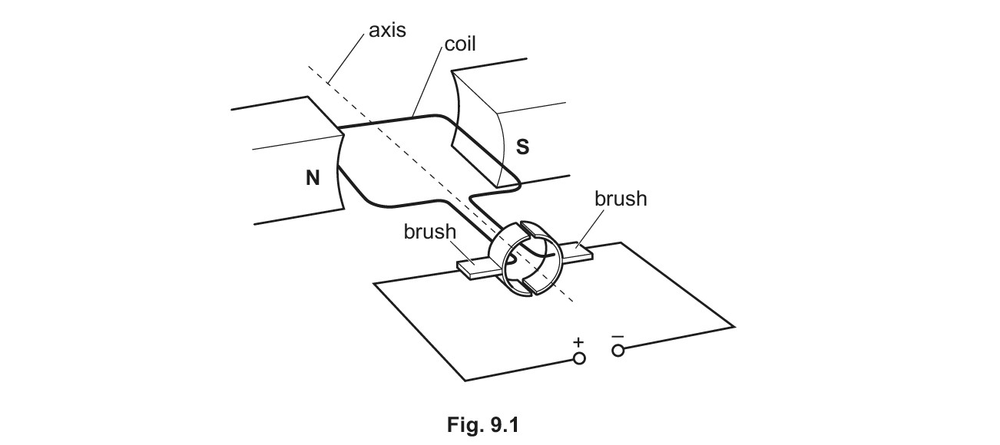

(i) On Fig. 9.1, draw a pair of arrows to show which way the coil rotates. Explain the direction you have chosen.

[3]

(ii) On Fig. 9.1, draw an arrow to show the direction in which electrons flow through the coil.

[1]

(iii) Explain why the electrons flow in the direction you have shown in **(a)(ii)**.

[1]

*Source: May/June 2020 (Series 3) 0625/43 Q9A*

**Q8** [3 marks]

**Extract:**

Fig. 9.1 shows a simple direct current (d.c.) electric motor. The coil rotates about the axis when there is a current in the coil. The coil is connected to the rest of the circuit by the brushes.

On Fig. 9.1, draw a pair of arrows to show which way the coil rotates.

State any difference each of the following changes makes to the rotation of the coil in Fig. 9.1:

(i) changing the polarity of the power supply to that shown in Fig. 9.2

[1]

(ii) changing the coil to the new coil shown in Fig. 9.3

[1]

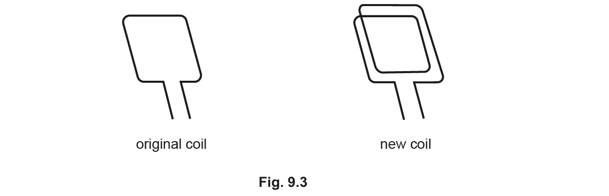

(iii) using a stronger magnetic field.

[1]

*Source: May/June 2020 (Series 3) 0625/43 Q9A*

### Q9 — hard — 7 marks

**Q9** [2 marks]

**Extended tier only**

Explain why the voltage of the supply to the primary coil of a transformer must be alternating.

*Source: 2018 0625/41 Q10A*

**Q9** [5 marks]

**Extended tier only**

Fig. 10.1 shows a transformer.

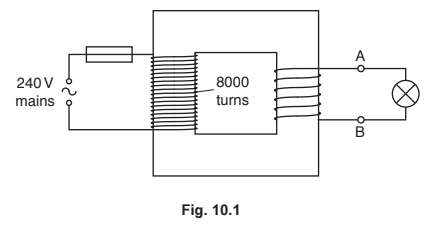

There are 8000 turns in the primary coil of the transformer. The primary coil is connected to a 240 V mains supply. A 6.0 V lamp connected to the secondary coil operates at full brightness.

(i) Calculate the number of turns in the secondary coil

number of turns = ...........................................................[2]

(ii) The current in the lamp is 2.0A. The transformer operates with 100% efficiency.

Calculate the current in the primary circuit.

current = ...........................................................[2]

(iii) The secondary circuit contains a 6.0 A fuse.

Calculate the maximum number of lamps, identical to the lamp in **(ii)**, that can be connected in parallel in the secondary circuit without blowing the fuse.

number of lamps = ...........................................................[1]

*Source: 2018 0625/41 Q10B*

### Q10 — hard — 9 marks

**Q10** [5 marks]

Fig. 11.1 shows a vertical conductor passing through a horizontal piece of card.

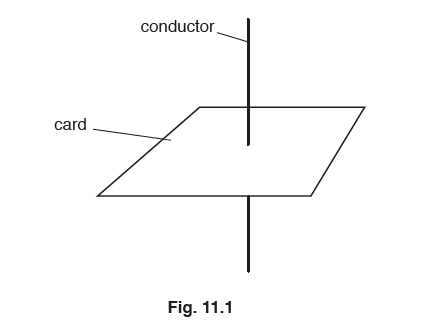

(i) On Fig. 11.1, draw a cell and a switch in series with the conductor to form a complete circuit.

Use the correct circuit symbols.

[2]

(ii) A student sprinkles iron filings onto the card and closes the switch. There is a current in the conductor. Describe the pattern of the magnetic field seen.

[2]

(iii) The student reverses the direction of the current in the conductor. State the effect, if any, on the pattern he sees.

[1]

*Source: 2018 0625/31 Q11A*

**Q10** [4 marks]

Describe an experiment to show that a force acts on a current-carrying conductor in a magnetic field. Show how to arrange the equipment. Include a diagram in your answer.

*Source: 2018 0625/31 Q11B*

### Q11 — hard — 6 marks

**Q11** [3 marks]

Fig. 10.1 shows a straight wire AB placed in the magnetic field between the poles of a magnet.

The ends of AB are connected to a galvanometer.

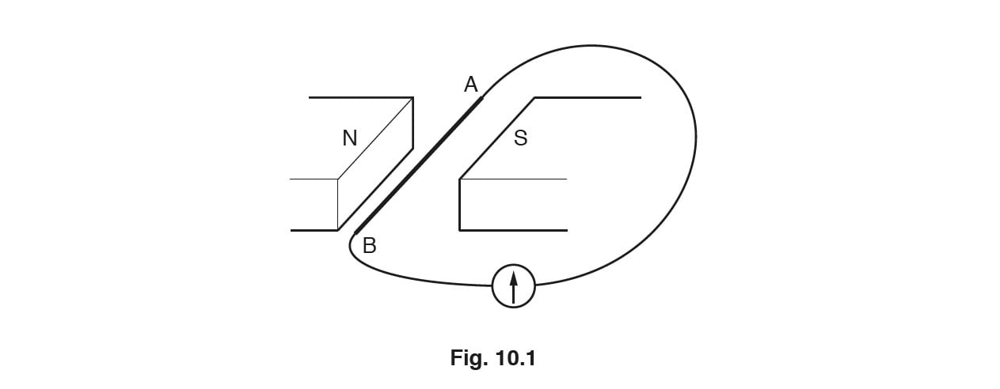

When AB is moved vertically, the needle of the galvanometer shows a deflection.

State three factors that affect the size of the deflection.

*Source: February/March 2018 0625/42 Q10A*

**Q11** [3 marks]

Fig. 10.2 shows a transformer.

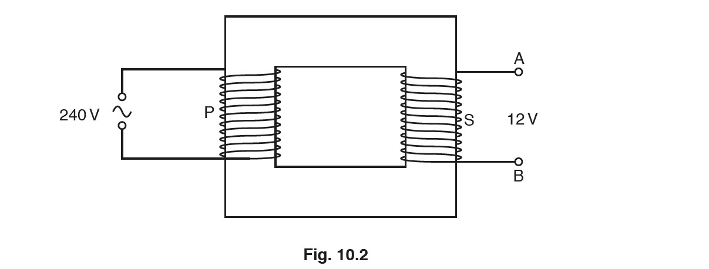

(i) The primary coil P has 8000 turns and an input of 240 V. The secondary coil S has an output of 12 V.

Calculate the number of turns in the secondary coil.

number = ......................................................... [2]

(ii) A circuit containing a resistor is connected to the terminals A and B.

A direct current (d.c.) is required in this resistor.

On Fig. 10.1, draw this circuit.

[1]

*Source: February/March 2018 0625/42 Q10B*

### Q12 — hard — 8 marks

**Q12** [3 marks]

A student is experimenting with electromagnetic effects.

Describe an experiment, using any standard laboratory equipment, to demonstrate electromagnetic induction. You may draw a diagram.

*Source: Oct 2019 3 Q11A*

**Q12** [5 marks]

Fig. 11.1 shows a transformer connected to an input voltage of 12 V a.c.

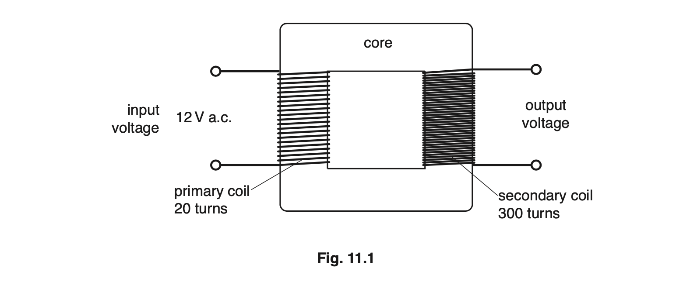

(i) State the name of a suitable material for the core of the transformer.

[1]

(ii) Explain how the diagram in Fig. 11.1 shows a step-up transformer.

[1]

(iii) Using the information in Fig. 11.1, calculate the output voltage of the transformer.

output voltage = ...................................................... V [3]

*Source: Oct 2019 3 Q11B*

### Q13 — hard — 9 marks

**Q13** [7 marks]

**Extended tier only**

A student makes a transformer that uses an alternating current (a.c.) supply with an electromotive force (e.m.f.) of 12.0 V to induce an output potential difference (p.d.) of 2.0 V.

The student is provided with two lengths of insulated wire and the U-shaped piece of iron shown in Fig. 7.1.

(i) Complete and label Fig. 7.1 to show the transformer connected to the supply and the output from the transformer.

[3]

(ii) Explain the function of the piece of iron in the transformer.

[2]

(iii) The output of the transformer is connected to a lamp. The current in the lamp is 100 mA.

The transformer is 100% efficient.

Calculate the input current to the transformer.

current = ......................................................... [2]

*Source: May/June 2020 (Series 2) 0625/42 Q7A*

**Q13** [2 marks]

Another transformer is used in a school laboratory to step down a mains supply with a p.d. of 110 V to 12 V. This transformer is mounted in a metal case.

State and explain an essential safety feature required for this arrangement.

*Source: May/June 2020 (Series 2) 0625/42 Q7B*

### Q14 — medium — 6 marks

**Q14** [2 marks]

**Extended tier only**

Fig. 10.1 is a simplified top view of a flat coil. There is an alternating current (a.c.) in the coil.

Describe the magnetic effect of this alternating current.

*Source: 2020 Feb/March 0625/42 Q10A*

**Q14** [1 mark]

**Extract:**

Fig. 10.1 is a simplified top view of a flat coil. There is an alternating current (a.c.) in the coil.

**Extended tier only**

Fig. 10.2 shows a pan placed above the coil. The base of the pan is made of steel.

State what quantity is induced in the base of the pan.

*Source: 2020 Feb/March 0625/42 Q10B*

**Q14** [3 marks]

**Extract:**

The quantity induced in the base of the pan:

- An e.m.f. / potential difference / voltage is induced;

The pan contains water.

State and explain the effect of the quantity induced in part (b) on the temperature of the water in the pan.

*Source: 2020 Feb/March 0625/42 Q10C*

### Q15 — hard — 8 marks

**Q15** [4 marks]

**Extended tier only**

Fig. 9.1 shows a coil ABCD with two turns. The coil is in a magnetic field.

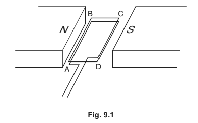

When there is a current in the coil, the coil experiences a turning effect.

(i) Explain why there is a turning effect.

[1]

(ii) The value of the current is 3 A.

Place one tick in each column of the table to indicate how the turning effect changes with the change described.

| turning effect | number of turns on coil increased to six | current increased to 9A | strength of magnetic field decreased by a factor of 2 |
|---|---|---|---|
| decreased by a factor of 4 |   |   |   |
| decreased by a factor of 3 |   |   |   |
| decreased by a factor of 2 |   |   |   |
| no change |   |   |   |
| increased by a factor of 2 |   |   |   |
| increased by a factor of 3 |   |   |   |
| increased by a factor of 4 |   |   |   |

[3]

*Source: 2018 0625/42 Q9A*

**Q15** [4 marks]

**Extended tier only**

Fig. 9.2 shows a magnet held just below a vertical coil connected to a galvanometer.

The magnet is released.

(i) State any effect on the galvanometer.

[2]

(ii) State any effect on the magnetic field produced by the coil.

[2]

*Source: 2018 0625/42 Q9B*

### Q16 — medium — 7 marks

**Q16** [3 marks]

A student has a model electric railway. The model railway uses a step-down transformer.

The input voltage is 230 V. The transformer has 1710 turns on the input coil and 90 turns on the output coil.

Calculate the output voltage of the transformer.

output voltage = ....................................................... V

*Source: Nov 2018 (S1) 0625/31 Q11A*

**Q16** [2 marks]

A step-up transformer is used to increase voltage.

Step-up transformers and step-down transformers have different coil arrangements.

Describe the differences in the coil arrangement for the two types of transformer.

*Source: Nov 2018 (S1) 0625/31 Q11B*

**Q16** [2 marks]

Explain the advantage of transmitting electricity at high voltages, rather than at low voltages.

*Source: Nov 2018 (S1) 0625/31 Q2C*

### Q17 — easy — 8 marks

**Q17** [1 mark]

Identify which of the following metals can be permanently magnetised. Place a tick (✓) in the box next to any correct metal.

`square`  aluminium

`square`  copper

`square`  steel

`square`  tungsten

*Source: Oct 2019 0625/32 Q11A*

**Q17** [2 marks]

Two metal rods are thought to be permanent magnets. Describe the test you would carry out to confirm that both rods are permanent magnets.

*Source: Oct 2019 0625/32 Q11B*

**Q17** [5 marks]

(i) Describe how to make an electromagnet. You may draw a labelled diagram to help your answer.

[3]

(ii) Suggest **two** factors that affect the strength of the magnetic field of an electromagnet.

[2]

*Source: Oct 2019 0625/32 Q11C*

### Q18 — hard — 6 marks

**Q18** [6 marks]

**Extended tier only**

Fig. 9.1 shows a coil supplied with current using a split-ring commutator.

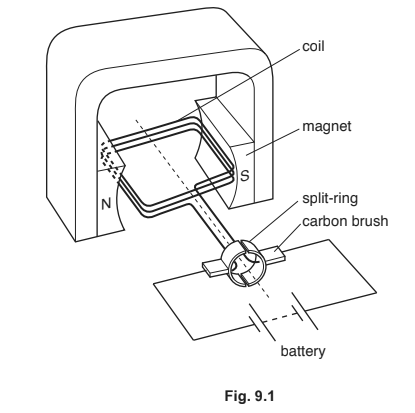

(i) State and explain any motion of the coil.

[3]

(ii) The coil in Fig. 9.1 consists of three turns of wire. The magnetic field strength of the magnet is M. With a current of 2.0 A in the coil, the coil experiences a turning effect, T.

The first row of Table 9.1 shows this data.

**Table 9.1**

| number of turns | current in the coil / A | magnetic field strength | turning effect |
|---|---|---|---|
| 3 | 2.0 | *M* | *T* |
| 3 | 8.0 | *M* |   |
| 6 | 2.0 | *M* |   |
| 3 | 2.0 | $\frac{M}{2}$ |   |

Complete Table 9.1 to give the turning effect for the changes made to the arrangement shown in Fig. 9.1.

Choose your answers from the box.

| $\frac{T}{8}$              $\frac{T}{4}$              $\frac{T}{2}$              T              2T              4T               8T |
|---|

[3]

*Source: 2018 0625/41 Q9B*

### Q19 — easy — 6 marks

**Q19** [3 marks]

Fig. 11.1 shows a diagram of an electrical device. The diagram is not complete. The coil rotates in a magnetic field when connected to a d.c. power supply.

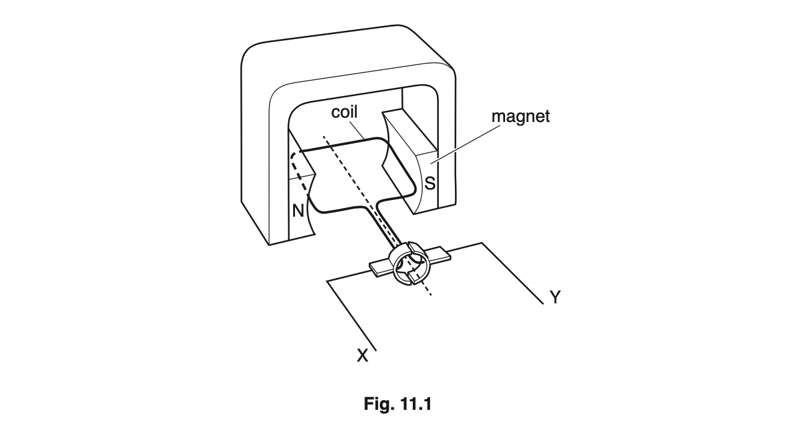

(i) Explain the meaning of the term d.c.

[1]

(ii) Complete the diagram in Fig. 11.1 by drawing the symbols for two cells in series **and** a switch to make a circuit.

[2]

*Source: Oct 2019 0625/33 Q11A*

**Q19** [3 marks]

**Extract:**

Fig. 11.1 shows a diagram of an electrical device. The diagram is not complete. The coil rotates in a magnetic field when connected to a d.c. power supply.

(i) State the name of the electrical device shown in Fig. 11.1.

[1]

(ii) State **two** changes to the electrical device that will make the coil in the device rotate faster.

[2]

*Source: Oct 2019 0625/33 Q11B*

### Q20 — medium — 7 marks

**Q20** [1 mark]

Fig. 11.1 shows in each of the diagrams a current-carrying conductor and a magnetic field pattern.

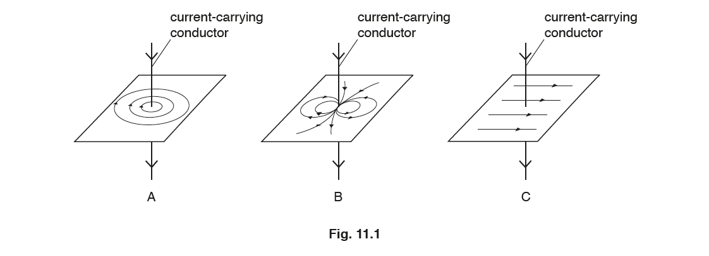

State the diagram which correctly shows the magnetic field around a current-carrying conductor.

*Source: 2019 May/June 0972/31 Q11A*

**Q20** [5 marks]

Fig. 11.2 shows three pieces of equipment.

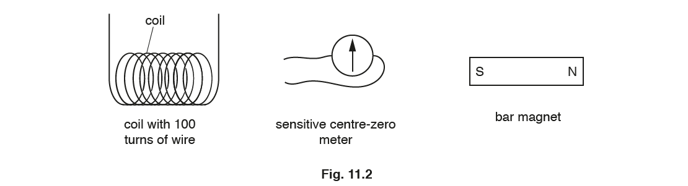

(i) Describe how to generate and detect an electromotive force (e.m.f.) using the equipment in Fig. 11.2. You may draw a diagram.

[3]

(ii) Describe two changes that will generate a larger e.m.f. using similar equipment to that in Fig. 11.2.

[2]

*Source: 2019 May/June 0972/31 Q11B*

**Q20** [1 mark]

**Extended tier only**

A student connects a lamp and centre-zero galvanometer in series with a generator, as shown in Fig. 11.3.

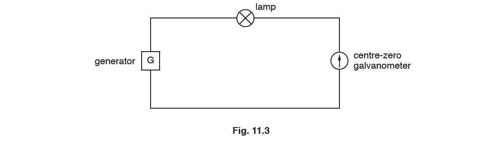

The student observes the galvanometer needle moving from side to side repeatedly.

Explain why the needle moves in this way.

*Source: 2019 May/June 0972/31 Q11C*

### Q21 — medium — 8 marks

**Q21** [1 mark]

A transformer consists of two coils of wire wound on a metal core. Fig. 10.1 represents the transformer.

State the name of the metal from which the core is made.

*Source: 2018 (Series 1) 0625/41 Q10A*

**Q21** [5 marks]

**Extract:**

A transformer consists of two coils of wire wound on a metal core. Fig. 10.1 represents the transformer.

**Extended tier only**

The primary coil of the transformer is connected to the output voltage of an a.c. generator which supplies an alternating current.

(i) Explain why there is a voltage between the two terminals of the secondary coil.

[3]

(ii) There are 560 turns on the primary coil and 910 turns on the secondary coil of the transformer. The voltage between the two terminals of the secondary coil is 78 V.

Calculate the voltage supplied by the a.c. generator.

generator voltage = ............................................................[2]

*Source: 2018 (Series 1) 0625/41 Q10B*

**Q21** [2 marks]

**Extended tier only**

Transformers are used to increase the voltage when electrical energy is transmitted in cables across long distances.

Explain why power losses in the cables are lower when the voltage is high.

*Source: 2018 (Series 1) 0625/41 Q10C*

### Q22 — easy — 8 marks

**Q22** [6 marks]

Fig. 11.1 represents a transformer.

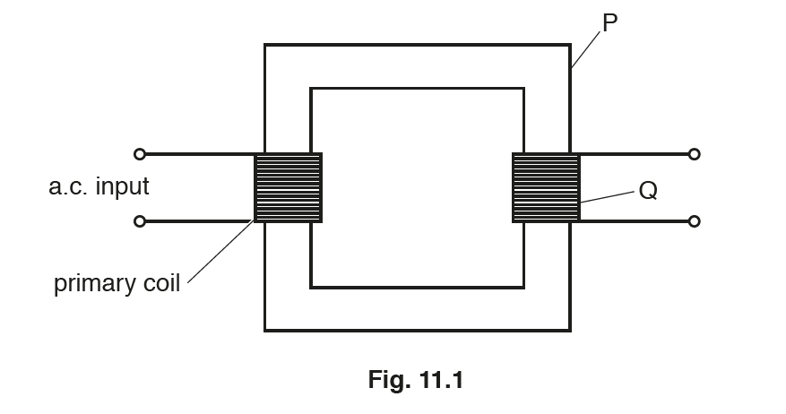

(i) State the name of the part of the transformer labelled Q in Fig. 11.1.

[1]

(ii) In Fig. 11.1, part P is made from a metal.

1. State the metal used to make part P. ..........................................................................

2. State the term given to part P. .......................................................................................

[2]

(iii) There is an alternating current (a.c.) in the primary coil.

Describe what this current produces in part P.

[2]

(iv) Complete the sentence using terms from the box.

| more | fewer | step-up | step-down |
|---|---|---|---|

When there are ......................... turns in the primary coil than in Q, the device is called a ......................... transformer.

[1]

*Source: 2018 0625/32 Q11A*

**Q22** [2 marks]

The high-voltage transmission of electricity uses transformers.

Describe two advantages of transmitting electricity at high voltages rather than at low voltages.

*Source: 2018 0625/32 Q11A*

### Q23 — easy — 5 marks

**Q23** [3 marks]

Fig. 11.1 shows a relay.

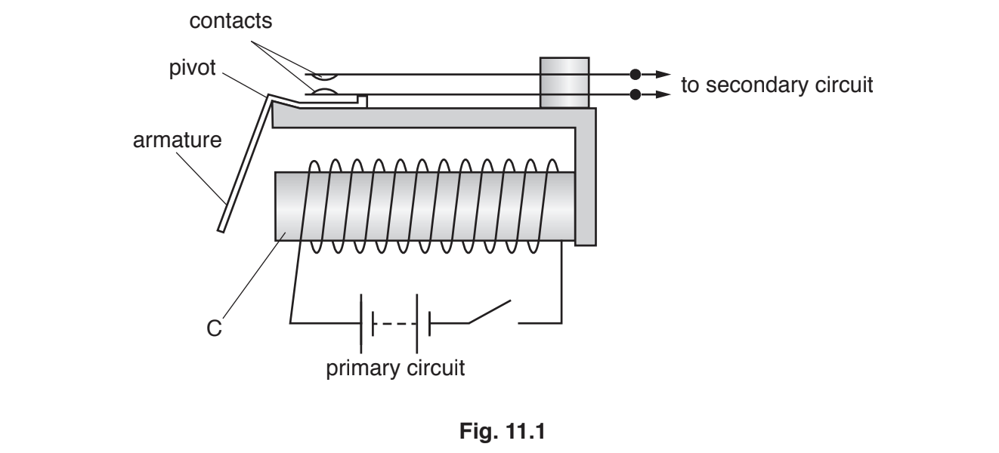

The statements describe the action of a relay. They are not in the correct order.

P      Current in the coil creates an electromagnet.

Q      Secondary circuit is completed.

R      Armature pivots, closing the contacts.

S      Part C attracts the armature.

T      The switch in the primary circuit is closed.

Identify the correct order of the statements. One has been done for you.

|   |   | S |   |   |
|---|---|---|---|---|

*Source: 2019 0625/32 Q11A*

**Q23** [2 marks]

**Extract:**

S      Part C attracts the armature.

Fig. 11.1 includes the part labelled C, which is made from a metal.

State the name of the metal and explain why this metal is used in the electromagnet.

*Source: 2019 0625/32 Q11B*

