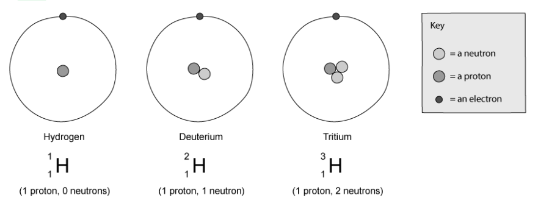
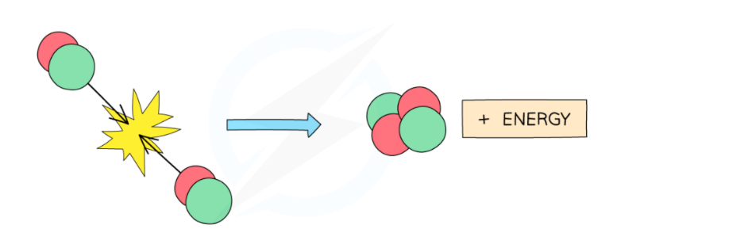
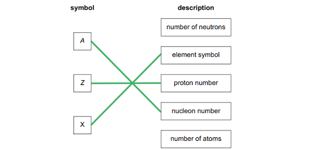
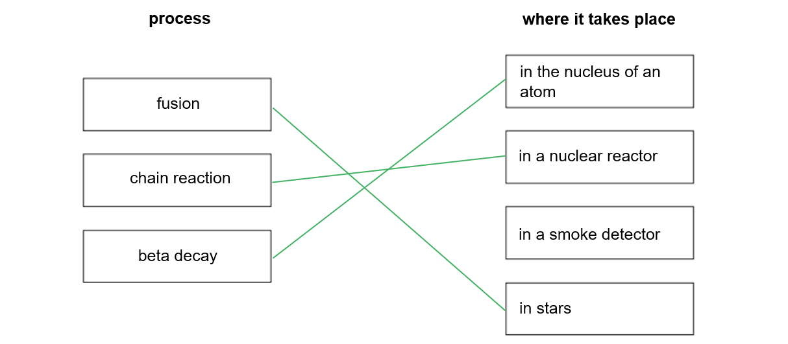
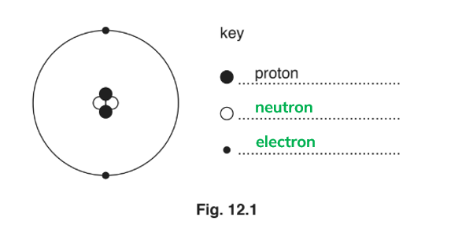
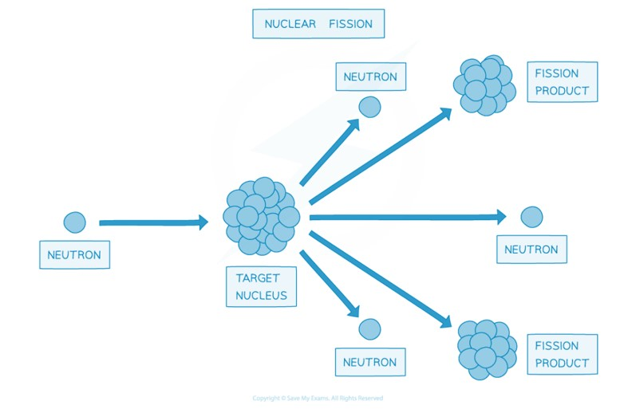
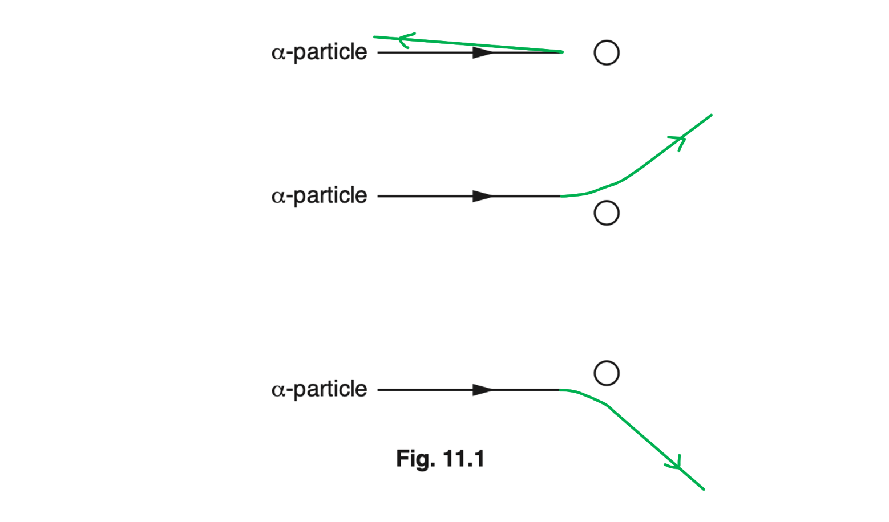
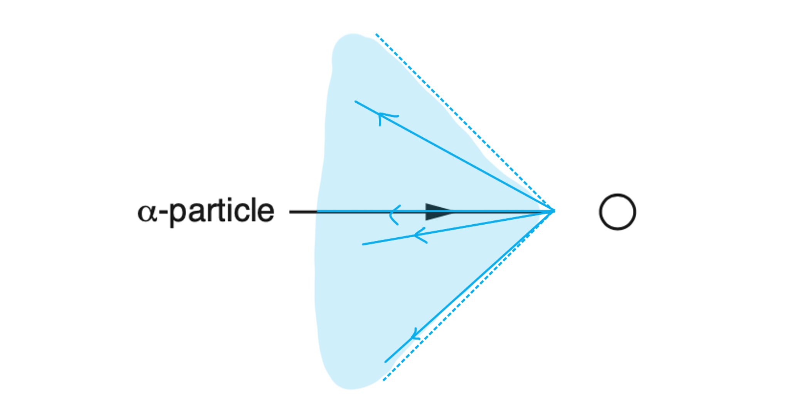

# Mark Schemes — The Nuclear Model of the Atom
**5. Nuclear Physics** · Cambridge (CIE) IGCSE physics (0625 & 0972)

## Multiple Choice Questions (24 questions)

### Q1
**Final answer:** **The correct answer is C**

- The number of neutrons in an atom is found by subtracting the proton number from the nucleon number

$\text{number of neutrons} = \text{nucleon number} - \text{proton number}$

$\text{number of neutrons} = 56 - 26 = 30$

- In a neutral atom, the number of electrons is equal to the number of protons, so the number of electrons is 26

**A** is incorrect because 26 neutrons would mean the nucleon number equals twice the proton number, which is not the case here

**B** is incorrect because the number of electrons has been calculated as the number of neutrons (30) instead of equalling the proton number (26)

**D** is incorrect because although the number of neutrons is correct (30), the number of electrons should equal the proton number (26), not the number of neutrons

### Q2
**Final answer:** **The correct answer is A**

- In nuclide notation `text X end text _ Z ^ A`:

  - the top number $( \mathrm{A} )$ is the nucleon (mass) number
  - the bottom number $( \mathrm{Z} )$ is the proton (atomic) number
- Isotopes are atoms of the same element that have the same proton number but different nucleon numbers
- Both P and Q have a proton number of 6, which identifies them as the same element
- Since their nucleon numbers are different (12 and 14), they are **isotopes **of each other

**B** is incorrect as both atoms have a proton number of 6.

**C** is incorrect because the number of neutrons is calculated as nucleon number − proton number ($14 - 6 = 8$).

**D** is incorrect as 6 is the proton number of P; its nucleon number is 12.

### Q3
**Final answer:** **The correct answer is B**

- Protons are found in the nucleus and have a relative charge of +1
- Neutrons are also found in the nucleus and have no charge (they are neutral)
- Electrons orbit the nucleus and have a relative charge of -1

**A** is incorrect because neutrons are neutral (0) and electrons are negative (-1).

**C** is incorrect because protons are positive (+1) and neutrons are neutral (0).

**D** is incorrect because protons are positive (+1) and electrons are negative (-1).

### Q4
**Final answer:** **The correct answer is ****B**** because:**

- Isotopes of an element all have the same number of protons and so have the same proton number (atomic number)
- Proton number (*Z*) is shown as the lower of the two numbers in nuclear notation: `X _ proton number ^ nucleon number` or $\mathrm{X} pre_{Z} pre^{A}$
- Element X has a proton number of 26 according to the question
- Answer **B** has a proton number of 26 and so is an isotope of element X

**A**, **C** and **D** are incorrect because they have different proton numbers from the original element and so cannot be isotopes of it.

### Q5
**Final answer:** **The correct answer is ****C**** because:**

- Electrons are negatively charged and can be added to or removed from atoms
- Removing an electron from an atom would leave the resulting ion with an overall positive charge, a positive ion
- Adding an electron to an atom would leave the resulting ion with an overall negative charge, a negative ion

**A**, **B** and **D** are incorrect because positively charged particles cannot be added to or removed from atoms to form ions.

### Q6
**Final answer:** **The correct answer is C**

- Nuclear fusion is the combining of two small nuclei

  - Eliminate options **A** and **B**
- Energy is released in this process

  - A small amount of the mass of the particles is converted into this energy
  - This means total mass decreases slightly
  - Eliminate option **D**

Mass cannot increase in this process without additional energy being put into the system. The law of conservation of energy means that this increase in mass would have to come from somewhere.

### Q7
**Final answer:** **The correct answer is C**

- In a nuclear fission reaction, one larger nucleus splits into two smaller nuclei
- Therefore, the sizes of the two product nuclei are **both smaller** than the original nucleus

### Q8
**Final answer:** **The correct answer is B**

- The positive charge in an atom comes from protons
- Protons are located in the** nucleus**

### Q9
**Final answer:** **The correct answer is B**

- Electrons are negative
- Atoms are neutral
- When a neutral object gains a negative charge, it is overall negatively charged

  - Atom Y becomes negative
  - Eliminate options **A** and **C**
- When a neutral object loses negative charge, it is overall positively charged

  - Atom X becomes positive
  - Eliminate option **D**

### Q10
**The correct answer is**** B**** because:**

- uranium has **92 protons**. All isotopes of the same element must have the same number of protons.

**A** is incorrect as this atom has 91 protons, which would make it an atom of the element protactinium.

**C** is incorrect as the nucleon and proton numbers are the wrong way around.

**D** is incorrect as this atom has 90 protons, which would make it an atom of the element thorium.

### Q11
**Final answer:** **The correct answer is ****A**** because:**

- Protons have a charge of +1. Electrons have a charge of -1.
- For an atom to be **neutral**, the **positive** charges and **negative** charges must be **equal**. Therefore the number of protons must be the same as the number of electrons.

**B** and **D** are incorrect as neutrons have no charge so do not affect the overall charge of the atom.

**C** is incorrect as atoms can have different numbers of neutrons and still be neutral.

### Q12
**Final answer:** **The correct answer is ****A**** because:**

- The symbol gives the nuclide name. For example, carbon has the symbol “C”.
- The nucleon number gives the total number of protons and neutrons.
- The proton number gives the number of protons.

### Q13
**Final answer:** **The correct answer is ****B**** because: **

- Hydrogen always has one proton. An atom is always neutrally charged, this means it must always have one electron. The different isotopes of hydrogen have different numbers of neutrons.

The three atoms shown above are all forms of hydrogen, but they each have different numbers of neutrons. Remember the proton number defines which element the atom is.

### Q14
**Final answer:** **The correct answer is ****C**** because:**

- a proton has a positive charge and a neutron has no charge.

### Q15
**Final answer:** **The correct answer is ****B**** because: **

- The nucleus contains protons and neutrons.
- Protons have a positive charge and neutrons have no charge. Therefore the overall charge of the nucleus is **always positive**.

Option **A **is correct for a hydrogen atom but the question asks for **any** atom in which case this is **not** correct.

### Q16
**Final answer:** **The correct answer is ****D**** because:**

- When atoms lose or gain electrons they become ions

  - When a negative electron is lost from the atom, the resulting ion will have a net positive charge

**Atom** refers to the **neutral** form where there are equal numbers of protons and electrons, and therefore there is no overall charge

### Q17
**Final answer:** **The correct answer is ****D**** because: **

- All isotopes of the same element have the same proton number.
- Isotopes can have different amounts of neutrons. Therefore the nucleon number can be different.

**A** is incorrect as these nuclides have the same nucleon number but not the same proton number

**B** and **C **are incorrect as these nuclide combinations have different proton numbers.

### Q18
**Final answer:** **The correct answer is ****C**** because:**

- The proton number of helium is two. This means it must have two protons.
- The charge on a proton is positive. Since an atom is neutral, this means it must have two electrons.
- The nucleon number of this atom is 4. The number of neutrons is the nucleon number minus the proton number (4 - 2 = 2). This means there are two neutrons in this atom.

**A** is incorrect as this atom has three electrons, so this atom is not neutral.

**B** is incorrect as this atom has four protons, so this atom is not helium, and it is not neutral.

**D** is incorrect as this atom has four protons and four electrons. This atom is not helium.

### Q19
**Final answer:** **The correct answer is ****C**** because **

- the number of neutrons is found by subtracting the number of protons (13) from the total atomic mass (27).

**A **is incorrect as this is the proton number. This tells us the number of *protons* in the nucleus of an aluminium atom.

**B **is incorrect as this is the nucleon number. This tells us the number of *protons *plus the number of *neutrons *in the nucleus of an aluminium atom*.*

**D **is incorrect as this number does not represent the number of neutrons. We never add the proton number to the nucleon/mass number.

### Q20
**Final answer:** **The correct answer is ****A**** because: **

**α**-particles have a positive charge. A nucleus always has a positive charge, therefore will cause the **α**-particle to repel.

A neutron has no charge, and therefore would not be repelled by the nucleus.

### Q21
**Final answer:** **The correct answer is ****D**** because **

- nuclear fusion involves taking small nuclei (such as hydrogen) and colliding them together at high speed to form larger nuclei, as shown below.

**A **is incorrect as nuclear fusion occurs in stars (including the Sun)

**B** is incorrect as this process describes nuclear **fission.**

**C** is incorrect as uranium is a fuel for nuclear fission*.*

### Q22
**Final answer:** **The correct answer is ****B**** because:**

- A **fusion** reaction is where smaller nuclei (such as hydrogen and helium) are ***fused*** together. This is what occurs in stars (like the Sun).
- A **fission** reaction is where larger, **unstable** isotopes (such as uranium) are **broken** **down** into two (or more) stable nuclei. This is what occurs in nuclear power stations.

### Q23
**Final answer:** **The correct answer is ****A**** is because: **

- An **α**-particle was used as it has a positive charge, and it is **relatively** **heavy**.
- When the positively charged **α**-particle was fired near to the nucleus, it was **repelled**. This demonstrated that the nucleus also had a positive charge.

### Q24
**Final answer:** **The correct answer is ****D**** because:**

- Like charges repel, therefore the positive proton would be repelled by the positive nucleus (as the nucleus contains positive protons and neutral neutrons).
- The neutron has no charge, therefore it would not be affected by the nucleus.

## Theory Questions (18 questions)

### Q1
The completed table for the radioactive isotope of carbon is as follows:

| name of particle | number of particles | position of particle | relative charge of particle |
|---|---|---|---|
| electron | **Final answer:** ** 6** | **Orbiting nucleus** | **Final answer:** **-1 (minus 1) ** |
| neutron | **Final answer:** ** 8** | in the nucleus | **0 (neutral)** |
| **Final answer:** ** proton** | 6 | **Final answer:** ** in the nucleus** | +1 (plus one) |

- Name of particle column correct; **[1 mark]**
- Number of particles column correct;** [1 mark]**
- Position of particle column correct; **[1 mark]**
- Relative charge of particle column correct; **[1 mark]**

**[Total: 4 marks]**

> **[exam-tip]**
> To complete the table, you need to look carefully at the figure and remember where the different types of particles are found in an atom and what properties they have. Complete each column in turn:
> Start by thinking about which particles are in an atom. The table gives the names of two, but you should remember that the third type of particle is a proton. This allows you to complete the first column.
> You should then remember where each type of particle belongs in an atom to complete the third column.
> Now, go back to the second column and try to complete it. There are the same number of electrons as protons. Look at the nucleus: there are 6 particles coloured black and 8 coloured white. The 6 black particles must be the protons, since 6 electrons means there are 6 protons. So how many neutrons are there?
> Finally, you need to remember the charges of the particles. Neutrons are neutral and electrons have an opposite charge to protons.

### Q2
(i) A similarity in the composition of hydrogen-2 and hydrogen-3 is:

- (They both have) the same number of protons / one proton; **[1 mark]**

(ii) A nucleus of hydrogen-3 differs from a nucleus of hydrogen-2 because:

- (They both have) different number of neutrons / nucleons; **[1 mark]**
- Hydrogen-3 has one more neutron (than hydrogen-2); **[1 mark]**

**Total: [3 marks]**
(i) An extremely high temperature is needed for nuclear fusion because:

- (A high temperature produces) high (kinetic) energy / momentum / speed / ability to do a large quantity of work; **[1 mark]**
- (Nuclei / protons) repel each other; **[1 mark]**
- (Because they) are positively charged / have like charges; **[1 mark]**

**OR**

- (Therefore, high energies are needed) to come close together (and fuse); **[1 mark]**

(ii) The completed nuclear reaction equation is:

$H_{1}^{2} + H_{1}^{3} \rightarrow H_{2}^{4} e + n_{0}^{1}$

- Correct nuclide notation for helium: $X_{2}^{4} \text{or} H_{2}^{4} e \text{or} \\alpha pre_{2} pre^{4}$ ; **[1 mark]**
- Correct nuclide notation for neutron: `n presubscript 0 presuperscript 1`; **[1 mark]**

**Total: [5 marks]**

### Q3
The terms *A*, *Z* and *X* mean:

- *One mark per correct line; ***[3 marks]**

**[Total: 3 marks]**

### Q4
Use data from the table to write down the nuclide equation for this decay:

`C _ 6 ^ 14 -> N _ 7 ^ 14 + e _ - 1 ^ 0`    **OR**    `C _ 6 ^ 14 - e _ - 1 ^ 0 -> N _ 7 ^ 14`

- `C _ 6 ^ 14` on left hand side; **[1 mark]**
- `blank presubscript 7 presuperscript 14`on right hand side; **[1 mark]**
- N on right hand side; **[1 mark]**
- `( + e _ - 1 ^ 0 )` on right hand side **OR** `( - e _ - 1 ^ 0 )` on left hand side; **[1 mark]**

**[Total: 4 marks]**

> *Radioactive decay events can be shown using a decay equation. A decay equation is similar to a chemical reaction equation.*

> *The particles present **before** the decay are shown **before** the arrow, and the particles **produced** in the decay are shown **after** the arrow. *

> *Just like chemical equations, decay equations must be **balanced**. The sum of the mass and atomic numbers before the reaction must be the **same** as the sum of the mass and atomic numbers after the reaction*
Explain whether any α-particles, β-particles or γ-rays are emitted by the radioactive sample:

Determine whether α-particles are emitted:

- α-particles are <u>not</u> emitted because the count rate increases with paper (and paper would stop alpha particles reaching the detector); **[1 mark]**

Determine whether β-particles are emitted:

- β-particles are <u>not</u> emitted because the count rate increases with aluminium (and aluminium would stop beta particles reaching the detector); **[1 mark]**

Determine whether γ-rays are emitted:

- γ-rays <u>are emitted</u> because the count rate decreases with lead (and only lead would stop the gamma rays reaching the detector); **[1 mark]**

**[Total: 3 marks]**

> *In any measurement, there will be a slight difference in the values recorded for any repeated reading. With radioactivity, you also have to account for background radiation, which is typically between 2 and 10 counts per second. So in this question, the slight differences between the count rate measurements, 597, 598 and 602 counts/s, can all be accounted for by variation due to repeat readings or background radiation. In other words, we can accept these values as being the same. When looking for a significant change, the values should be different by >5%.*

### Q5
(i) The number of protons in a carbon-12 nucleus is:

- 6; **[1 mark]**

(ii) The number of neutrons in a carbon-14 nucleus is:

- 8; **[1 mark]**

(i) The number of electrons orbiting the nucleus of a single carbon-14 atom is:

- 6; **[1 mark]**

**[Total: 3 marks]**

> *Remember that the mass number tells us the number of particles (nucleons) in the nucleus. The mass number of carbon-12 is 12. The mass number of carbon-14 is 14. Isotopes have the same number of protons, but different numbers of neutrons.*

> *So if carbon-14 has 14 particles in its nucleus and 6 of those particles are protons, the rest must be neutrons. *

> *Isotopes are neutral atoms, therefore the number of protons and electrons will always be equal.*
When a nucleus of carbon-14 emits a β-particle:

- It changes to a different element **OR** it gains a proton; **[1 mark]**

**[Total: 1 mark]**

> *Make sure you memorise what effect each type of radiation has on the nucleus.*
(i) State a suitable material that will absorb all types of naturally occurring nuclear radiation:

- Lead; **[1 mark]**

(ii) To reduce the amount of ionising radiation:

**Any one from:**

- Minimise the time spent handling the radioactive substance; **[1 mark]**
- Maximise the distance of the person from the source of the radiation; **[1 mark]**
- Prevent contamination; **[1 mark]**

**[Total: 2 marks]**

> *Make sure you memorise the uses and dangers of radioactivity.*

### Q6
(i) To determine the number of neutrons in a nucleus:

- The symbol for this nucleus is `space presubscript 95 presuperscript 241 A m`

  - Therefore there are **241** nucleons, of which **95** are protons
- The number of neutrons = 241 − 95 = <u>146</u>; **[1 mark]**

(ii) To determine the charge on the nucleus:

- The charge of a nucleus is always positive; **[1 mark]**
- There are 95 protons with a charge of +1 each
- The charge on the nucleus = + <u>95</u>; **[1 mark]**

**[Total: 3 marks]**

> *Since nuclei are made up of only protons and neutrons, and neutrons have no charge at all, while protons are positively charged, it follows that **all nuclei are positively charged**.*
The correct statements are:

`square`  α-particles are electromagnetic waves.

`square`  α-particles are fast-moving electrons.

`☑`  α-particles are helium nuclei. **[1 mark]**

`☑`  α-particles are stopped by a sheet of paper. **[1 mark]**

`square`  α-particles can pass through 3 cm of aluminium.

**[Total: 2 marks]**
To calculate the time until 4.0 mg of americium-241 are left:

List the known quantities:

- Half life,* t *= 432 years
- Initial amount of sample = 16 mg
- Final amount of sample = 4 mg

Calculate how many times the sample has reduced by half:

- 16 mg → 8 mg
- 8 mg → 4 mg

Determine the number of half-lives have passed:

- The sample has been reduced by half two times
- Therefore two half-lives have passed; **[1 mark]**

Calculate how many years in two half-lives:

- $432\times2=864$years; **[1 mark]**

**[Total: 2 marks]**

> *You will usually be given half-life calculations where no more than three half-lives have passed, and usually just two. This means that a simple, counting approach works well.*

### Q7
The correct lines are:

- **One mark for each correct line**

**[Total: 3 marks]**
A table with ticks in the correct boxes would look like:

| Fission is the splitting of a large nucleus into daughter nuclei | **Final answer:** **✓** |
|---|---|
| Electrons are released alongside the daughter nuclei in fission |   |
| Fusion is the joining of two nuclei into a heavier nucleus | **Final answer:** **✓** |
| Fission releases energy, but fusion does not |   |

- **One mark for each correct tick**

**[Total: 2 marks]**

> *The second statement is incorrect as it is **neutrons** which are released, not electrons.*

> *The fourth statement is incorrect as both fission and fusion release energy*

### Q8
The symbols for isotopes of hydrogen are:

- hydrogen-1: `H presubscript 1 presuperscript 1`** AND**
- hydrogen-2: `H _ 1 ^ 2`** AND**
- hydrogen-3: `H _ 1 ^ 3` **[1 mark]**

**[Total: 1 mark]**
(i) Nuclear fusion is defined as:

- The joining together of small / H nuclei; **[1 mark]**
- To produce a larger nucleus / He nucleus **OR** with the release of energy; **[1 mark]**

(ii) The correct equation for this fusion reaction is as follows:

`H _ 1 ^ 2 + H _ 1 ^ 3 -> n _ 0 ^ 1 + He _ 2 ^ 4`

- Identifies the 'one other particle' is helium / alpha particle; **[1 mark]**
- Correct nuclide notation of the free neutron `n presubscript 0 presuperscript 1`; **[1 mark]**
- Correct nuclide notation of the helium / alpha particle `He presubscript 2 presuperscript 4` or $\ \\alpha pre_{2} pre^{4}$; **[1 mark]**

**[Total: 5 marks]**

### Q9
Explain the meaning of the term isotope:

- An isotope is a form of the same element that has the same number of protons / proton number / atomic number; **[1 mark]**
- Different numbers of neutrons / nucleon number; **[1 mark]**

**[Total: 2 marks]**
State the proton number, the mass number and the neutron number of this isotope:

- Proton number: 92

**   ****AND**

- Mass number: 239 **[1 mark]**
- Neutron number: 239 − 92 = 147 **[1 mark]**

**[Total: 2 marks]**

- *Bigger number on top = mass number = total number of protons and neutrons in the nucleus*
- *Proton number = number of protons in the nucleus*
- *Number of neutrons = proton number − mass number*
Determine the fraction of the uranium-239 that remains after 46 minutes:

List the known quantities:

- Half-life of uranium-239 = 23 minutes
- Time of decay = 46 minutes

Calculate the number of half-lives in the time of decay:

- $numberofhalf-lives=\frac{totaldecaytime}{half-life}$
- $numberofhalf-lives=\frac{46}{23}=2$ **[1 mark]**

Calculate the fraction of uranium-239 left:

- After 1 half-life ½ of the sample will be left
- After 2 half-lives $\frac{1}{2}\times\frac{1}{2}=\frac{1}{4}$ will be left **[1 mark]**

**[Total: 2 marks]**

> *Imagine the half-life decay on the graph to make answering this question easier. *

### Q10
A completed diagram which would score two marks is:

- Neutron correct; **[1 mark]**
- Electron correct; **[1 mark]**

**[Total: 2 marks]**
A correctly completed table which would score 2 marks would look like:

|   | `He presubscript 2 presuperscript 3` | `He presubscript 2 presuperscript 5` |
|---|---|---|
| number of protons | **Final answer:** **2** | **Final answer:** **2** |
| number of neutrons | **Final answer:** **1** | **Final answer:** **3** |

**Fig 12.2**

- **Top row correct scores one mark**
- **Bottom row correct scores one mark**

**[Total: 2 marks]**

> *Knowing the structure of different isotopes is a key learning point. The top number is the nucleon number, the total number of protons and neutrons in the nucleus. The bottom number is the number of protons in the nucleus. This tells us which element it is.*
(i) The penetrating ability of α-particles can be described as:

- Weakly penetrating; **[1 mark]**

(ii) To explain why it is dangerous to swallow a source that emits α-particles:

**Any two from:**

- The α-particles are absorbed over a short distance; **[1 mark]**
- They have a large mass; **[1 mark]**
- They have a high (+2) charge; **[1 mark]**
- The α-particles are highly ionising; **[1 mark]**
- They cause cell mutation OR damage to DNA; **[1 mark]**
- There would be a high risk of developing cancer; **[1 mark]**

**[Total: 3 marks]**

> *Answers about radiation are often given in relative terms e.g. alpha is weakly penetrating compared to beta or gamma. *

### Q11
(i) The process shown in the diagram is:

- Nuclear <u>fission</u>; **[1 mark]**

(ii) The correct equation for this fission reaction is as follows:

`n _ 0 ^ 1 + U _ 92 ^ 235 -> Ba _ 56 ^ 141 + Kr _ 36 ^ 92 + 3 n _ 0 ^ 1`

- Correct notation for `n presubscript bold 0 presuperscript bold 1`, `U _ 92 ^ 235` **AND** `3 n _ 0 ^ 1`; **[1 mark]**
- Correct calculation of 141, `Ba presubscript 56 presuperscript bold 141`; **[1 mark]**
- Correct calculation of 36, `Kr presubscript bold 36 presuperscript 92`; **[1 mark]**

*Example of calculation:*

- Nucleon number:  1 + 235 = Ba + 92 + 3

  - Therefore, Ba = (1 + 235) − (92 + 3) = 141

- Atomic number:  92 = 56 + Kr

  - Therefore, Kr = 92 − 56 = 36

**[Total: 4 marks]**
The process shown in Fig 1.1 can lead to a chain reaction as:

- The <u>nucleus</u> splits; **[1 mark]**
- Releasing <u>neutrons</u>; **[1 mark]**
- Which hit / collide with different uranium <u>nuclei</u>; **[1 mark]**

**[Total: 3 marks]**

> *You need to be very specific with the terminology to get the marks for this question. You need to talk specifically about the nuclei, **not** more generally about atoms.*

> *Remember that fission is a nuclear reaction, therefore we are looking specifically at the **nuclei** of atoms. *
The energy transfer in this reaction is:

- Energy is transferred from the nuclear energy store of the uranium nuclei; **[1 mark]**
- To the kinetic energy store of the neutrons and the daughter nuclei; **[1 mark]**

**[Total: 2 marks]**

### Q12
(i) State the number of protons in the nucleus of an atom of carbon-14:

The lower, smaller number is the *atomic*, or *proton *number:

- There are 6 protons; **[1 mark]**

(ii) State the number of electrons orbiting the nucleus of an atom of carbon-14:

In a neutral atom the number of electrons is equal to the number of protons:

- There are 6 electrons; **[1 mark]**

(iii) State the number of neutrons in the nucleus of an atom of carbon-14:

The higher, larger number is the *mass*, or *nucleon *number, with neutrons added to protons:

- There are (14 − 6) = 8 neutrons; **[1 mark]**

**[Total: 3 marks]**

> *Neutral atoms have the same number of positive protons and negative electrons, so if the atom is neutral, these numbers will be the same.*

> *In your physics exam you won't be asked how many electrons there are in ions, but this will come up in chemistry.*
State the similarities and differences between the nucleus of carbon-14 with the nucleus of carbon-12:

**Any three from:**

- The two nuclei have the same;

  - atomic number / proton number / number of protons; **[1 mark]**
  - charge; **[1 mark]**
- The two nuclei have different:

  - masses; **[1 mark]**
  - nucleon numbers; **[1 mark]**
  - numbers of neutrons; **[1 mark]**

**[Total: 3 marks]**

> *The number of protons determines the element. All isotopes of carbon have 6 protons.*

> *For isotopes, the only difference between the atoms is the number of neutrons.*

Estimate the age of the sample of wood:

List the known quantities:

- Half-life = 5700 years
- Initial number of carbon atoms = 8.0 × 108
- Current number of carbon atoms = 1.0 × 108

Determine the number of half-lives between 8.0 × 108 and 1.0 × 108:

- The order of magnitude is the same for both numbers, therefore we can ignore the × 108

  - ½ of 8.0  is 4.0
  - ½ of 4.0  is 2.0
  - ½ of 2.0  is 1.0
- Therefore, 3 half-lives have passed; **[1 mark]**

Determine how many years have passed in 3 half-lives:

- Number of years = 3 × 5700 **[1 mark]**
- Number of years = 17 100 **[1 mark]**

**[Total: 3 marks]**

> *Remember that half-life is defined as the time it takes for the number of nuclei of a sample of radioactive isotopes to decrease by half. Knowing this is the key to accessing this question. *

### Q13
State one similarity between this atom and a neutral atom of a different isotope of element X:

- Both atoms have equal numbers of electrons **OR**** **equal numbers of protons; **[1 mark]**

**[Total: 1 mark]**

> *Remember a neutral atom has an **equal number** of + and − charges. So, overall charge = 0.*

> *Isotopes** are atoms of the same element that have an equal number of protons but a **different** number of **neutrons**.*
(i) Deduce the nuclide notation for the isotope of Y produced by this decay:

Denote the nuclide notation for isotope X:

- Isotope X has 13 nucleons therefore, atomic number, *A* = 13
- Isotope X has 5 protons, therefore, proton number, Z = 5
- Hence, the nuclide notation is: `X _ 5 ^ 13` **[1 mark]**

Recall the nuclide notation for a β-particle:

- `beta _ - 1 ^ 0` **[1 mark]**

Consider the radioactive decay equation:

- `X _ 5 ^ 13 -> beta _ - sign 1 ^ 0 + Y _ square ^ square`

Balance the atomic and proton numbers for both sides of the equation:

- Atomic numbers: 13 = 0 + ?

  - Hence, atomic number for Y = 13
- Proton numbers: 5 = −1 + ?

  - 5 + 1 = ?
  
    - Hence, proton number = 6

Obtain the nuclide notation for Y:

- `Y _ 6 ^ 13` **[1 mark]**

(ii) Suggest why β-particles ionise the air they pass through less strongly than the same number of α-particles:

**Any three from:**

- β-particles have a smaller charge than α-particles; **[1 mark]**
- β-particles have a smaller mass than α-particles; **[1 mark]**
- β-particles have less energy than α-particles; **[1 mark]**
- β-particles travel faster / have less travel time near to the air particles than α-particles; **[1 mark]**
- β-particles have a smaller effect / force on electrons in the air molecules than α-particles; **[1 mark]**

**[Total: 6 marks]**

> *The trick to answering part (i) correctly is to consider individually the nuclide notation of each term in the decay equation. Then, balance the atomic and proton numbers to deduce **A** and **Z **for Y.*

> *In part (ii) remember ionisation is the process by which an atom becomes negative by gaining electrons, or positive losing electrons. The question tells you that β-particles are more ionising than α-particles, you should refer to this in your answer.*

### Q14
Correct descriptions of charges on particles are:

- The charge on the nucleus of an atom is **positive**; **[1 mark]**
- The charge on a proton is  **positive**; **[1 mark]**
- The charge on electrons orbiting the nucleus is **negative**; **[1 mark]**

**[Total: 3 marks]**
(i) The number of protons:

Look for the smaller number in the notation:

- The number of protons is 88; **[1 mark]**

(ii) The number of neutrons:

Subtract the proton or atomic number from the larger number (the total nucleons):

- The number of neutrons is (226 - 88) = 138; **[1 mark]**

(ii) To write the notation for an isotope:

Recall that isotopes have the same number of protons:

- Therefore the notation has the smaller number the same;  `space presubscript 88 presuperscript blank R a`

Recall that the name of the isotope tells the total number of nucleons:

- Therefore the notation for radium-223 will have the larger number as 223
- The nuclide should be written `space presubscript 88 presuperscript 223 R a` **[1 mark]**

**[Total: 3 marks]**
To calculate the time for a sample to decay:

Determine the number of half lives that have passed:

1. 8.0 mg → 4.0 mg

2. 4.0 mg → 2.0 mg

3. 2.0 mg → 1.0 mg

- Three half lives are needed for 8.0 mg to reduce to 1.0 mg; **[1 mark]**

Determine the amount of time this represents:

- One half life takes 1600 years
- Therefore the answer is (3 × 1600) = 4800 years; **[1 mark]**

**[Total: 2 marks]**

> *You may see more complicated ways to calculate half-lives and radioactive decay. If you continue to A-level physics these will certainly be important.*

> *For now, keep it simple. An iteration strategy like the one shown above is both straightforward and guaranteed to get you the right answer.*

### Q15
The particles labelled **X** are:

- Electrons; **[1 mark]**

**[Total: 1 mark]**
The correct sentences are:

- The particle with a positive charge is **a proton**; **[1 mark]**
- The particle with the smallest mass is **an electron**; **[1 mark]**
- The particle with no charge is **a neutron**; **[1 mark]**

**[Total: 3 marks]**
(i) The name of this type of atom is:

- An ion; **[1 mark]**

(ii) The effect on the overall charge is:

- (The ion will have an overall) positive charge; **[1 mark]**

**[Total: 2 marks]**

### Q16
Complete the nuclide notation for this reaction:

Recall the nuclide notation for a neutron:

- A neutron has 1 neutron and no protons, so the nuclide notation is:

  - `n _ 0 ^ 1`

Complete the nuclide notation for the neutrons in the reaction equation:

- `U _ 92 ^ 235 + n _ 0 ^ 1 -> Cs _ square ^ 144 + Rb _ 37 ^ square + 2 n _ 0 ^ 1` **[1 mark]**

Consider the atomic numbers in the reaction:

- 235 + 1 = 144 + ? + 2
- 236 = 146 + ?
- 236 − 146 = ?
- 90 = ?
- So, the atomic number of rubidium is 90

Consider the proton numbers in the reaction:

- 92 + 0 = ? + 37 + 0
- 92 = ? + 37
- 92 − 37 = ?
- 55 = ?
- So, the proton number of caesium is 55

Complete the nuclide notation for caesium and rubidium in the reaction:

- `U _ 92 ^ 235 + n _ 0 ^ 1 -> Cs _ 55 ^ 144 + Rb _ 37 ^ 90 + 2 n _ 0 ^ 1` **[1 mark]**

**[Total: 2 marks]**

> *The trick to this question is learning the nuclide notation for a nucleus. Complete that and then you can balance the equation. It will also help to recognise that the equation is for a nuclear fission reaction!*
State and explain the process shown by the equation in (a):

- The process shown by the equation is nuclear <u>fission</u>; **[1 mark]**
- A neutron collides with an <u>unstable</u> nucleus; **[1 mark]**
- The nucleus <u>splits</u> into two smaller nuclei / daughter nuclei and some neutrons;** [1 mark]**

**[Total: 3 marks]**

> *Having an image of the nuclear fission process, like the one below, in your head makes it easier to describe. *

(i) Describe and give a reason for the mass difference:

- The mass of the products / daughter nuclei and neutrons is <u>less</u> then the mass of the reactants / original nucleus; **[1 mark]**
- This is because the remaining mass is converted into the energy released during the fission process; **[1 mark]**

(ii) State the energy transfer that takes place in the products of the reaction from part (a):

- Energy is transferred from the <u>nuclear energy</u> store into the <u>kinetic energy</u> store; **[1 mark]**

**[Total: 3 marks]**

> *The products of this fission reaction are caesium, rubidium and two neutrons. The neutrons move quickly away from the initial nuclear reaction. Therefore, energy from the nuclear store of the uranium nucleus is transferred into the kinetic energy store of the neutrons. *

### Q17
On Fig. 11.1, complete the path of each α-particle:

For the top diagram:

- Any path drawn the the <u>left</u> within <u>45°</u> of the horizontal line; **[1 mark]**

For the middle diagram:

- A path drawn to the <u>right</u> **AND** deflected <u>up</u> **AND** ending in a <u>straight</u> line; **[1 mark]**

For the bottom diagram:

- A path drawn to the <u>right</u> **AND** deflected <u>down</u> **AND** ending in a <u>straight</u> line; **[1 mark]**

**[Total: 3 marks]**

> *The best way to tackle this question is to consider the interaction between the α-particles and the nuclei and then evaluate the paths that each α-particle will take*

> *Consider the interaction between the α-particles and the nuclei:*

- *The α-particles have a positive charge*
- *The nuclei also have a positive charge*
- *They will both experience a repulsive electrostatic force*

> *Evaluate the path of each α-particle:*

- *In the first diagram, the α-particle is heading straight for the centre of the nucleus*

  - *Therefore, the α-particle will deflect back on itself*

- *In the second diagram, the α-particle is travelling above the gold nucleus*

  - *Therefore, the α-particle will continue to the right but will be deflected upwards at an angle*

- *In the third diagram, the α-particle is travelling below the gold nucleus:*

  - *Therefore, the α-particle will continue to the right but will be deflected downwards at an angle*

> *For the first diagram, a range of directions are allowed. Anything 45° above the horizon or 45° below the horizon, as long as it is pointing to the left. This indicates that the path of the α-particle is deflected back on itself, which was the surprising result of Rutherford's gold leaf experiment. *

> *The shaded region shows all the possible angles that would score a correct mark.*

### Q18
Nuclides which have the same number of protons but different numbers of neutrons are called:

- Isotopes; **[1 mark]**

**[Total: 1 mark]**
(i) The nuclides which have the same number of protons are:

- Lead-216 and lead-206;** [1 mark]**

  - Number of protons = bottom number, `Pb presubscript bold 82 presuperscript 216`, `Pb presubscript bold 82 presuperscript 206`

(ii) Complete Table 1.1:

| name of nuclide | radium-222 | radon-222 | lead-216 | lead-206 |
|---|---|---|---|---|
| nuclide notation | `Ra presubscript 88 presuperscript 222` | `Rn presubscript 86 presuperscript 222` | `Pb presubscript 82 presuperscript 216` | `Pb presubscript bold 82 presuperscript bold 206` |

- Correct notation for lead-206, `Pb presubscript 82 presuperscript 206`; **[1 mark]**

**[Total: 2 marks]**
(i) The nuclides which have the same number of nucleons are:

- Radium-222 and radon-222; **[1 mark]**

  - Nucleon number = top number, `Ra presubscript 88 presuperscript bold 222`, `Rn presubscript 86 presuperscript bold 222`

(ii) The nuclides which have the same number of neutrons are:

- Radium-222 and lead-216; **[1 mark]**

  - Number of neutrons = nucleon number − atomic number
  - `Ra presubscript bold 88 presuperscript bold 222`: 222 − 88 = 134
  - `Pb presubscript bold 82 presuperscript bold 216`: 216 − 82 = 134

(iii) The nuclide which has the most electrons is:

- Radium-222; **[1 mark]**

  - Number of electrons = number of protons, `Ra presubscript bold 88 presuperscript 222`

**[Total: 3 marks]**

> *A neutral atom is one with the same number of protons and electrons (so the overall charge is 0). *

> *The nuclide notation above does not show the number of electrons directly, but remember, that for a neutral atom this is just the same as the number of protons!*
