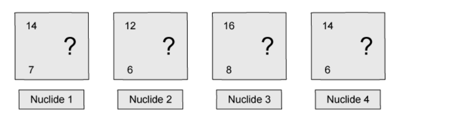
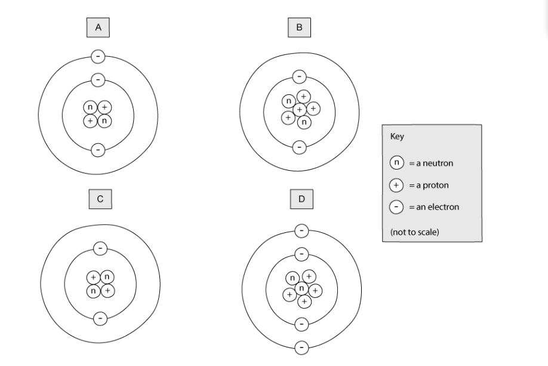
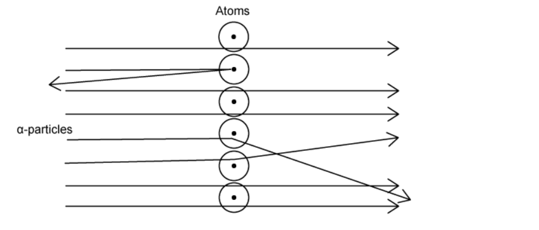
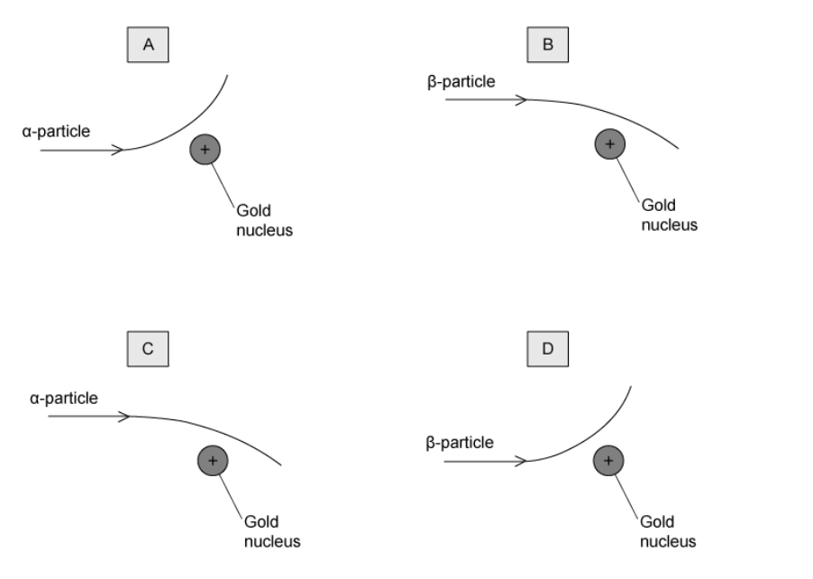
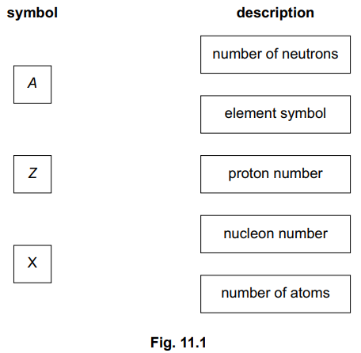
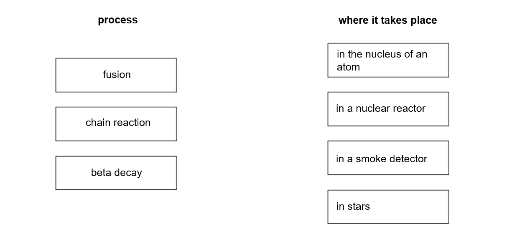
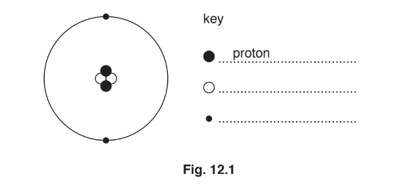
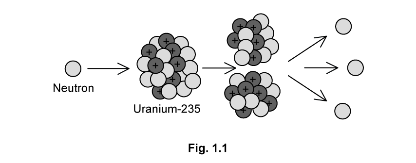
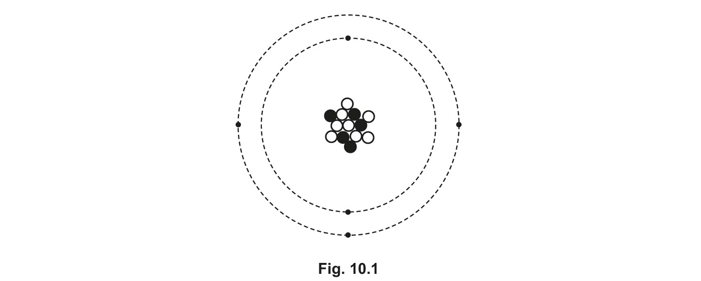
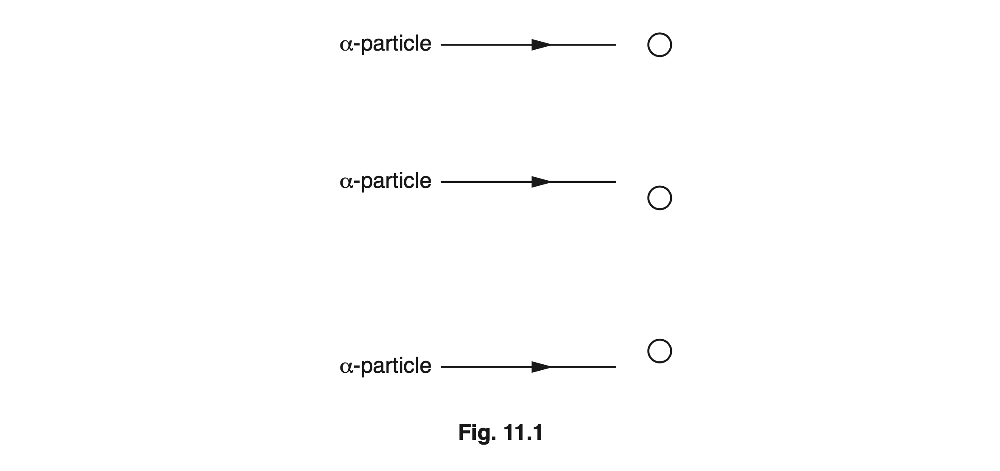

# Exam Questions — The Nuclear Model of the Atom
**5. Nuclear Physics** · Cambridge (CIE) IGCSE physics (0625 & 0972)
> Source: [https://www.savemyexams.com/igcse/physics/cie/23/topic-questions/](https://www.savemyexams.com/igcse/physics/cie/23/topic-questions/) · 42 questions across 2 sets

## Multiple Choice Questions (24 questions)

### Q1 — medium — 1 marks

**Q1** [1 mark]

A neutral atom of element X has a nucleon number of 56 and a proton number of 26.

What is the number of neutrons and the number of electrons in this atom?

|   | number of neutrons | number of electrons |
|---|---|---|
| **A** | 26 | 26 |
| **B** | 26 | 30 |
| **C** | 30 | 26 |
| **D** | 30 | 30 |

### Q2 — medium — 1 marks

**Q2** [1 mark]

The nuclide notations for two atoms, P and Q, are shown.

`scriptbase text P end text end scriptbase presubscript 6 presuperscript 12`‎ ‎ ‎ ‎ ‎ ‎ ‎ ‎ ‎ ‎ ‎ `scriptbase text Q end text end scriptbase presubscript 6 presuperscript 14`

Which statement is correct?

### Q3 — easy — 1 marks

**Q3** [1 mark]

Which row correctly identifies the relative charges of the three types of particle in an atom?

|   | **proton** | **neutron** | **electron** |
|---|---|---|---|
| **A** | +1 | -1 | 0 |
| **B** | +1 | 0 | -1 |
| **C** | -1 | +1 | 0 |
| **D** | -1 | 0 | +1 |

### Q4 — easy — 1 marks

**Q4** [1 mark]

A nucleus of element X is represented as  `X _ 26 ^ 56`.

Which is an isotope of element X?

*Source: June 2023 0972/21 Q34*

### Q5 — medium — 1 marks

**Q5** [1 mark]

How are positive and negative ions formed from atoms?

|   | positive ion | negative ion |
|---|---|---|
| **A** | add positive charge to the nucleus | add an electron to the atom |
| **B** | add positive charge to the nucleus | remove positive charge from the nucleus |
| **C** | remove an electron from the atom | add an electron to the atom |
| **D** | remove an electron from the atom | remove positive charge from the nucleus |

*Source: June 2023 0972/21 Q33*

### Q6 — medium — 1 marks

**Q6** [1 mark]

**Extended Tier Only**

Which row in the table describes the process of nuclear fusion and identifies the change in total mass of the particles involved?

| ** ** | **process** | **change in total mass of the particles** |
|---|---|---|
| **A** | a large nucleus splits into two smaller nuclei | decreases |
| **B** | a large nucleus splits into two smaller nuclei | increases |
| **C** | two small nuclei combine to form a larger nucleus | decreases |
| **D** | two small nuclei combine to form a larger nucleus | increases |

*Source: 2023 specimen paper 2 Q38*

### Q7 — medium — 1 marks

**Q7** [1 mark]

**Extended Tier Only**

How do the sizes of the two nuclei produced in a nuclear fission reaction compare to the size of the original nucleus?

*Source: June 2022 paper 2 Q38*

### Q8 — easy — 1 marks

**Q8** [1 mark]

A model of an atom consists of small particles orbiting a central nucleus.

Where is the positive charge in an atom?

*Source: June 2022 paper 1 Q38*

### Q9 — easy — 1 marks

**Q9** [1 mark]

Atom X loses an electron to form an ion.

Atom Y gains an electron to form an ion.

Which row in the table is correct?

| ** ** | charge on the ion of atom X | charge on the ion of atom Y |
|---|---|---|
| **A** | positive | positive |
| **B** | positive | negative |
| **C** | negative | positive |
| **D** | negative | negative |

*Source: 2023 specimen paper 1 Q37*

### Q10 — easy — 1 marks

**Q10** [1 mark]

An isotope of uranium is represented by the symbol:

$U_{92}^{235}$

Which of the answers below could** **be a different isotope of uranium?

### Q11 — easy — 1 marks

**Q11** [1 mark]

An atom consists of electrons orbiting a nucleus. The nucleus contains protons and neutrons.

For the atom to be neutral, which statement about the atom **must** be correct?

### Q12 — easy — 1 marks

**Q12** [1 mark]

The nuclide notation for a generic element is given below:

$X pre_{Z} pre^{A}$

Which of the following is the correct definition of each of the terms?

|   | **X** | **A** | **Z** |
|---|---|---|---|
| **A** | symbol | nucleon number | proton number |
| **B** | symbol | proton number | nucleon number |
| **C** | symbol | neutron number | proton number |
| **D** | nucleon number | proton number | neutron number |

### Q13 — easy — 1 marks

**Q13** [1 mark]

Hydrogen is an element with one proton. It has three different isotopes.

Which statement about the three Hydrogen isotopes is correct?

### Q14 — easy — 1 marks

**Q14** [1 mark]

The charge on an electron is -e.

Which answer below correctly describes the charge of a proton and the charge on a neutron?

|   | **Proton** | **Neutron** |
|---|---|---|
| **A** | 0 | +e |
| **B** | +e | -e |
| **C** | +e | 0 |
| **D** | -e | +e |

### Q15 — medium — 1 marks

**Q15** [1 mark]

Which of the following statements would **not** be correct for the nucleus of **any** atom?

### Q16 — medium — 1 marks

**Q16** [1 mark]

A nitrogen atom loses an electron.

What is it called now?

### Q17 — medium — 1 marks

**Q17** [1 mark]

Below are the symbols for four different nuclides.

Which two nuclides are isotopes of the same element?

### Q18 — medium — 1 marks

**Q18** [1 mark]

An atom of helium has the following nuclide symbol:

$He_{2}^{4}$

Which of the following diagrams best represents a neutral atom of helium?

### Q19 — medium — 1 marks

**Q19** [1 mark]

How many neutrons are in a nucleus of aluminium? The chemical symbol is given below:

### Q20 — hard — 1 marks

**Q20** [1 mark]

**Extended tier only**

In Rutherford's experiment, **α**-particles were fired at a thin metal foil. This is shown in the image below.

Why are **α**-particles used rather than neutrons?

### Q21 — hard — 1 marks

**Q21** [1 mark]

**Extended tier only**

Fusion is a type of nuclear reaction.

Which term below is a **correct **statement about nuclear fusion?

### Q22 — hard — 1 marks

**Q22** [1 mark]

**Extended tier only**

Nuclear reactions can release huge amounts of energy.

Which nuclear reaction takes place in the Sun and which nuclear reaction takes place in a nuclear power station?

|   | **The Sun** | **A nuclear power station** |
|---|---|---|
| **A** | fusion | fusion |
| **B** | fusion | fission |
| **C** | fission | fission |
| **D** | fission | fusion |

### Q23 — hard — 1 marks

**Q23** [1 mark]

**Extended tier only**

In 1911 Rutherford performed an experiment that provided evidence for the nuclear atom.

Which of the diagrams below best represents this experiment?

### Q24 — hard — 1 marks

**Q24** [1 mark]

**Extended tier only**

A neutron and a proton are near to a positive nucleus.

If anything, what would happen to the proton and the neutron due to the charge on the nucleus?

## Theory Questions (18 questions)

### Q1 — medium — 4 marks

**Q1** [4 marks]

Fig. 11.1 represents all the particles in an atom which is a radioactive isotope of carbon.

Table 11.1 gives information about the particles shown in Fig. 11.1.

Using the information in Fig. 11.1, write in the empty boxes to complete

**Table 11.1.**

| name of particle | number of particles | position of particle | relative charge of particle |
|---|---|---|---|
| electron |   |   |   |
| neutron |   | in the nucleus |   |
|   | 6 |   | +1 (plus one) |

*Source: June 2023 0972/31 Q11A*

### Q2 — medium — 8 marks

**Q2** [3 marks]

Two of the isotopes of hydrogen are hydrogen-2 * ( *`H presubscript 1 presuperscript 2`) and hydrogen-3 ( `H presubscript 1 presuperscript 3`). ** **

(i) State **one** similarity in the composition of their nuclei.

[1]

(ii)** **Describe how a nucleus of hydrogen-3 differs from a nucleus of hydrogen-2.

[2]

*Source: June 2022 paper 4 Q11A*

**Q2** [5 marks]

**Extended Tier Only**

In a nuclear fusion reactor, a nucleus of hydrogen-2 fuses with a nucleus of hydrogen-3 at an extremely high temperature. This fusion reaction produces an isotope of element X and releases a neutron.

(i) Explain why an extremely high temperature is needed when forcing these two nuclei together.

[3]

(ii) Using nuclide notation, complete the equation for this reaction.

`H presubscript 1 presuperscript 2`  +   `H presubscript 1 presuperscript 3`       ⟶

[2]

*Source: June 2022 paper 4 Q10B*

### Q3 — medium — 1 marks

**Q3** [1 mark]

The nuclide notation `X presubscript Z presuperscript A` describes the nucleus of one type of atom.

On Fig. 11.1 draw a line from each symbol to the correct description for that symbol.

*Source: 2023 specimen paper 3 Q11A*

### Q4 — hard — 7 marks

**Q4** [4 marks]

**Extended tier only**

Table 1.1 shows data about nine elements.

**Table 1.1**

| **proton number** | **element** | **symbol** |
|---|---|---|
| 2 | helium | He |
| 3 | lithium | Li |
| 4 | beryllium | Be |
| 5 | boron | B |
| 6 | carbon | C |
| 7 | nitrogen | N |
| 8 | oxygen | O |
| 9 | fluorine | F |
| 10 | neon | Ne |

Carbon-14 is a radioactive isotope with a nucleon number of 14. It decays by emitting β-particles.

Use data from Table 1.1 to write down the nuclide equation for this decay.

*Source: 2018 (Series 1) 0625/41 Q11A*

**Q4** [3 marks]

A radioactive sample is placed close to a detector. The radioactive isotope in the sample has a long half-life. The detector records a count rate of 597 counts/s.

Fig. 11.2 shows the readings when different materials are placed between the radioactive sample and the detector.

| Material | $\frac{\mathrm{count} \mathrm{rate}}{\mathrm{counts}/s}$ |
|---|---|
| a sheet of paper | 602 |
| a piece of thin aluminium | 598 |
| a piece of thin lead | 510 |

** Fig. 11.2**

Explain whether any α-particles, β-particles or γ-rays are emitted by the radioactive sample.

*Source: 2018 (Series 1) 0625/41 Q11B*

### Q5 — easy — 6 marks

**Q5** [3 marks]

Carbon-14 is a radioactive isotope of carbon. An atom of carbon-14 has 6 protons in its nucleus.

Another isotope of carbon is carbon-12.

(i) Determine the number of protons in a carbon-12 nucleus.

[1]

(ii) Determine the number of neutrons in a carbon-14 nucleus.

[1]

(iii) Determine the number of electrons orbiting the nucleus of a single carbon-14 atom.

[1]

*Source: 2020 0625/32 Q12A*

**Q5** [1 mark]

Carbon-14 decays by emitting a β-particle.

State what happens to a nucleus of carbon-14 when it emits a β-particle.

*Source: 2020 0625/32 Q12B*

**Q5** [2 marks]

People working with radioactive sources need to take safety precautions.

(i) A shielding material can absorb ionising radiation and reduce the damage to living tissue.

State a suitable material that will absorb all types of naturally occurring nuclear radiation.

[1]

(ii) Apart from using shielding, state how a person can reduce the amount of ionising radiation they absorb when they handle samples of radioactive substances.

[1]

*Source: 2020 0625/32 Q12C*

### Q6 — medium — 7 marks

**Q6** [3 marks]

**Extended tier only**

A nucleus of americium-241 has the nuclide notation shown.

`space presubscript 95 presuperscript 241 A m`

(i) Determine the number of neutrons in a nucleus of americium-241.

number of neutrons = ........................................................ [1]

(ii) Determine the charge on a nucleus of americium-241.

charge = ........................................................ [2]

*Source: 2020 Feb/March 0625/32 Q12A*

**Q6** [2 marks]

Americium-241 decays by emitting α-particles.

Put a tick in the box next to each correct statement.

`square`  α-particles are electromagnetic waves.

`square`  α-particles are fast-moving electrons.

`square`  α-particles are helium nuclei.

`square`  α-particles are stopped by a sheet of paper.

`square`  α-particles can pass through 3 cm of aluminium.

*Source: 2020 Feb/March 0625/32 Q12B*

**Q6** [2 marks]

Americium-241 has a half-life of 432 years. A sample contains 16 mg of americium-241.

Calculate the time it takes until only 4.0 mg of americium-241 are left in the sample.

time = .............................................. years

*Source: 2020 Feb/March 0625/32 Q12C*

### Q7 — easy — 5 marks

**Q7** [3 marks]

**Extended tier only**

Fig. 1.1 shows the names of three different processes that take place in different locations.

**Fig 1.1**

Draw one line from each process to the location it takes place.

**Q7** [2 marks]

**Extended tier only**

This passage is about the differences between nuclear fission and fusion.

Tick the correct statements in the table below

| Fission is the splitting of a large nucleus into daughter nuclei |   |
|---|---|
| Electrons are released alongside the daughter nuclei in fission |   |
| Fusion is the joining of two nuclei into a heavier nucleus |   |
| Fission releases energy, but fusion does not |   |

### Q8 — hard — 6 marks

**Q8** [1 mark]

There are three naturally occurring isotopes of hydrogen: hydrogen-1, hydrogen-2 and hydrogen-3.

Hydrogen-1 is the simplest nuclide containing only one proton. Each isotope of hydrogen is represented by the symbol $H$.

Write down the symbols, using nuclide notation, for:

hydrogen-1 ...................................

hydrogen-2 ...................................

hydrogen-3 ...................................

**Q8** [5 marks]

**Extract:**

hydrogen-1: H₁¹ AND hydrogen-2: H₁² AND hydrogen-3: H₁³

**Extended tier only**

In a fusion reactor, a nucleus of hydrogen-2 and a nucleus of hydrogen-3 undergo fusion.

(i) State what is meant by nuclear fusion.

[2]

(ii) The fusion reaction produces a free neutron and one other particle.

Write down, using nuclide notation, the equation that represents this reaction.

[3]

### Q9 — medium — 6 marks

**Q9** [2 marks]

A nuclear power station uses uranium to generate thermal energy.

The fuel for the power station is an isotope of uranium.

Explain the meaning of the term isotope.

*Source: Oct/Nov2018  (Series 3) 0625/33 Q12A*

**Q9** [2 marks]

When the nucleus of one particular isotope of uranium decays, it releases a β-particle. In the periodic table the entry for this isotope looks like this:

`U presubscript 92 presuperscript 239`

State the proton number, the mass number and the neutron number of this isotope.

*Source: Oct/Nov2018  (Series 3) 0625/33 Q12B*

**Q9** [2 marks]

A sample of rock includes some uranium-239.

The half-life of uranium-239 is 23 minutes.

Determine the fraction of the uranium-239 that remains after 46 minutes.

fraction remaining = ...........................................................

*Source: Oct/Nov2018  (Series 3) 0625/33 Q12C*

### Q10 — easy — 7 marks

**Q10** [2 marks]

Fig. 12.1 shows a diagram to represent a helium atom, and an incomplete key.

Complete the key in Fig. 12.1. State the name of each particle.

*Source: 2018 0625/33 Q12A*

**Q10** [2 marks]

**Extract:**

Fig. 12.1 shows a diagram to represent a helium atom, and an incomplete key.

The table in Fig. 12.2 compares two isotopes of helium.

|   | `He presubscript 2 presuperscript 3` | `He presubscript 2 presuperscript 5` |
|---|---|---|
| number of protons |   |   |
| number of neutrons |   |   |

**Fig 12.2**

For each isotope, write the number of protons and the number of neutrons in the correct places in the table.

*Source: 2018 0625/33 Q12B*

**Q10** [3 marks]

The nucleus of the helium atom in (a) is the same as an α-particle.

(i) Describe the penetrating ability of α-particles.

[1]

(ii) Explain why it is dangerous to swallow a source that emits α-particles.

[2]

*Source: 2018 0625/33 Q12C*

### Q11 — hard — 9 marks

**Q11** [4 marks]

**Extended tier only**

Fig 1.1 shows a neutron colliding with a nucleus of uranium-235, producing a number of products.

(i) Name the process shown in the diagram.

[1]

(ii) Complete, using nuclide notation, the equation that represents the reaction shown in Fig 1.1.

[3]

**Q11** [3 marks]

**Extract:**

Fig 1.1 shows a neutron colliding with a nucleus of uranium-235, producing a number of products.

The process shown in the diagram is: Nuclear fission.

The correct equation for this fission reaction is as follows:
n^1_0 + U^235_92 → Ba^141_56 + Kr^92_36 + 3 n^1_0

(Where a neutron collides with uranium-235, producing barium-141, krypton-92, and 3 neutrons.)

**Extended tier only**

Explain how the process shown in Fig 1.1 can lead to a chain reaction.

**Q11** [2 marks]

**Extract:**

Fig 1.1 shows a neutron colliding with a nucleus of uranium-235, producing a number of products.

(i) The process shown in the diagram is:

- Nuclear fission; [1 mark]

(ii) The correct equation for this fission reaction is as follows:

n + U-235 → Ba-141 + Kr-92 + 3n

*Example of calculation:*

- Nucleon number:  1 + 235 = Ba + 92 + 3
- Therefore, Ba = (1 + 235) − (92 + 3) = 141
- Atomic number:  92 = 56 + Kr
- Therefore, Kr = 92 − 56 = 36

**Extended tier only**

This process releases energy.

Explain the energy transfer taking place in this reaction.

### Q12 — medium — 9 marks

**Q12** [3 marks]

This notation represents the nucleus of a neutral atom of carbon-14.

`C _ 6 ^ 14`

State the number of:

(i) protons in the nucleus of an atom of carbon-14

[1]

(ii) electrons orbiting the nucleus of an atom of carbon-14

[1]

(iii) neutrons in the nucleus of an atom of carbon-14.

[1]

*Source: Nov 2018 (S1) P3 Q12A*

**Q12** [3 marks]

**Extract:**

Carbon-14 is an isotope of carbon. Carbon-12 is another isotope of carbon.

State the similarities and differences between the nucleus of carbon-14 with the nucleus of carbon-12:

- The two nuclei have the same;
- atomic number / proton number / number of protons;
- charge;
- The two nuclei have different:
- masses;
- nucleon numbers;
- numbers of neutrons;

The number of protons determines the element. All isotopes of carbon have 6 protons.

For isotopes, the only difference between the atoms is the number of neutrons.

The lower, smaller number is the atomic, or proton number:
- There are 6 protons;
The higher, larger number is the mass, or nucleon number, with neutrons added to protons:
- There are (14 − 6) = 8 neutrons;

Carbon-14 is an isotope of carbon. Carbon-12 is another isotope of carbon.

Compare the nucleus of carbon-14 with the nucleus of carbon-12.

State the similarities and differences.

*Source: Nov 2018 (S1) 0625/31 Q12B*

**Q12** [3 marks]

Scientists use carbon-14 to estimate the age of wood that is very old.

A very old sample of wood contains 1.0 × 108 carbon-14 atoms.

When the sample was new, it contained 8.0 × 108 carbon-14 atoms. The half-life of carbon-14 is 5700 years.

Estimate the age of the sample of wood.

age of wood = ........................... years

*Source: Nov 2018 (S1) 0625/31 Q12C*

### Q13 — hard — 7 marks

**Q13** [1 mark]

Fig. 10.1 represents a neutral atom of an isotope of element X.

State one similarity between this atom and a neutral atom of a different isotope of element X.

*Source: May/June 2020 (Series 1) 0625/41 Q10A*

**Q13** [6 marks]

**Extract:**

Isotope X has 13 nucleons therefore, atomic number, A = 13
Isotope X has 5 protons, therefore, proton number, Z = 5
Hence, the nuclide notation is: X presubscript 5 presuperscript 13
Recall the nuclide notation for a β-particle: beta presubscript −1 presuperscript 0
Consider the radioactive decay equation:
X presubscript 5 presuperscript 13 → beta presubscript −1 presuperscript 0 + Y presubscript ? presuperscript ?
Balance the atomic and proton numbers for both sides of the equation:
Atomic numbers: 13 = 0 + ?
Hence, atomic number for Y = 13
Proton numbers: 5 = −1 + ?
5 + 1 = ?
Hence, proton number = 6
Obtain the nuclide notation for Y:
Y presubscript 6 presuperscript 13

The isotope of element X is radioactive. It decays to form an isotope of element Y by emitting a β-particle.

(i) Using Fig. 10.1 deduce the nuclide notation for the isotope of Y produced by this decay.

nuclide notation: `Y presubscript..... end presubscript presuperscript..... end presuperscript` [3]

(ii) β-particles ionise the air they pass through less strongly than the same number of α-particles.

Suggest why this is so.

[3]

*Source: May/June 2020 (Series 1) 0625/41 Q10B*

### Q14 — medium — 8 marks

**Q14** [3 marks]

Use words from the box to complete the sentences about the charges in an atom. Words can be used once, more than once or not at all.

**    negative  **

**neutral**

**positive**

The charge on the nucleus of an atom is ..........................................

The charge on a proton is ..........................................

The charge on electrons orbiting the nucleus is ..........................................

*Source: 2019 May/June 0972/31 Q12A*

**Q14** [3 marks]

A nucleus of radium-226 has the nuclide notation shown.

`Ra presubscript 88 presuperscript 226`

(i) Determine the number of protons in a nucleus of radium-226.

[1]

(ii) Determine the number of neutrons in a nucleus of radium-226.

[1]

(iii) Radium has another isotope, radium-223.

Write the nuclide notation for radium-223.

[1]

*Source: 2019 May/June 0972/31 Q12B*

**Q14** [2 marks]

Radium-226 has a half-life of 1600 years.

A sample contains 8.0 mg of radium-226.

Calculate the time for the sample to decay until only 1.0 mg of radium-226 remains.

time = ............................................... years

*Source: 2019 May/June 0972/31 Q12C*

### Q15 — easy — 6 marks

**Q15** [1 mark]

Fig 1.1 show two different models of an atom.

**Fig 1.1**

The particles labelled **X** in the plum pudding model are also included in the model of the atom used today.

State the name of the particles labelled **X**.

**Q15** [3 marks]

Use words from the box to complete the sentences about the particles in an atom in today's model. Words can be used once, more than once or not at all.

| **an electron                a neutron                a proton** |
|---|

The particle with a positive charge is ..........................................

The particle with the smallest mass is ..........................................

The particle with no charge is ..........................................

**Q15** [2 marks]

An electron is removed from the atom, as shown in Fig. 1.2.

**Fig. 1.2**

(i) State the name given to this type of atom.

[1]

(ii) State the effect on the charge of the overall atom.

[1]

### Q16 — hard — 8 marks

**Q16** [2 marks]

**Extended tier only**

When uranium-235 ($space_{92}^{235} \mathrm{U}$) is bombarded with a neutron, it forms an isotope of caesium (Cs) and an isotope of rubidium (Rb).

Complete the nuclide notation for this reaction.

`U _ 92 ^ 235 + n _ square ^ square -> Cs _ square ^ 144 + Rb _ 37 ^ square + 2 n _ square ^ square`

*Source: Oct/Nov2018  (Series 3) 0625/43 Q10A*

**Q16** [3 marks]

**Extract:**

When uranium-235 (U-235) is bombarded with a neutron, it forms an isotope of caesium (Cs) and an isotope of rubidium (Rb). The completed reaction equation is: U-235 + n → Cs-144 + Rb-90 + 2n. This is a nuclear fission reaction, where a neutron collides with an unstable nucleus, causing it to split into two smaller nuclei (daughter nuclei) and some neutrons.

**Extended tier only**

State and explain the process shown by the equation in **(a)**.

*Source: Oct/Nov2018  (Series 3) 0625/43 Q10B*

**Q16** [3 marks]

**Extract:**

When uranium-235 (U-235) is bombarded with a neutron, it forms an isotope of caesium (Cs) and an isotope of rubidium (Rb). The completed nuclide notation for this reaction is:
U-235 (subscript 92, superscript 235) + n (subscript 0, superscript 1) → Cs (subscript 55, superscript 144) + Rb (subscript 37, superscript 90) + 2 n (subscript 0, superscript 1)

The products of this fission reaction are caesium, rubidium and two neutrons. The neutrons move quickly away from the initial nuclear reaction. Therefore, energy from the nuclear store of the uranium nucleus is transferred into the kinetic energy store of the neutrons.

**Extended tier only**

(i) Describe and give a reason for the difference between the mass of the products and the reactants in the reaction from part **(a)**.

[2]

(ii) State the energy transfer that takes place in the products of the reaction from part **(a)**.

[1]

*Source: Oct/Nov2018  (Series 3) 0625/43 Q10C*

### Q17 — medium — 3 marks

**Q17** [3 marks]

**Extended tier only**

The circles shown in Fig. 11.1 represent three gold nuclei. Three α-particles are approaching the gold nuclei.

On Fig. 11.1, complete the path of each α-particle.

*Source: Oct 2019 0625/43 Q11A*

### Q18 — easy — 6 marks

**Q18** [1 mark]

State the term used to describe nuclides which have the same number of protons but different numbers of neutrons.

**Q18** [2 marks]

Table 1.1 describes four nuclides. The nuclide notation for lead-206 is missing.

| name of nuclide | radium-222 | radon-222 | lead-216 | lead-206 |
|---|---|---|---|---|
| nuclide notation | `Ra presubscript 88 presuperscript 222` | `Rn presubscript 86 presuperscript 222` | `Pb presubscript 82 presuperscript 216` |   |

**Table 1.1**

(i) State which **two** nuclides have the same number of protons.

[1]

(ii) Complete the table by filling in the nuclide notation for lead-206.

[1]

**Q18** [3 marks]

**Extract:**

| name of nuclide | radium-222 | radon-222 | lead-216 | lead-206 |
| nuclide notation | Ra 88 222 | Rn 86 222 | Pb 82 216 | Pb 82 206 |
- Number of protons = bottom number
- Number of nucleons = top number
- Number of neutrons = nucleon number − atomic number
A neutral atom is one with the same number of protons and electrons (so the overall charge is 0). The nuclide notation above does not show the number of electrons directly, but remember, that for a neutral atom this is just the same as the number of protons!

Using the information from Table 1.1

(i) State which** two** nuclides have the same number of nucleons.

[1]

(ii) State which **two** nuclides have the same number of neutrons.

[1]

(iii) State which **one** of the four nuclides has the most electrons orbiting when it is in a neutral atom.

[1]
