# Mark Schemes — Radioactivity
**5. Nuclear Physics** · Cambridge (CIE) IGCSE physics (0625 & 0972)

## Multiple Choice Questions (28 questions)

### Q1
**Final answer:** **The correct answer is D**

- For use as a medical tracer, the radioactive source must:

  - be penetrating enough to be detected outside the body - gamma rays are the best for this
  - have a short half-life, so that the source decays quickly and the patient is not exposed to radiation for a prolonged period

**A** is incorrect because alpha and beta particles would be absorbed by body tissue and could not be detected externally.

**C** is incorrect because, although gamma rays are the correct type of emission, a long half-life would mean prolonged exposure to ionising radiation.

### Q2
**Final answer:** **The correct answer is A**

- Radium-226 ($Rn_{88}^{226}$) has a nucleon number of 226 and a proton number of 88
- In alpha decay, the nucleus emits an alpha particle ($alpha_{2}^{4}$), which consists of 2 protons and 2 neutrons (a helium-4 nucleus)
- The nucleon number decreases by 4:

$226 - 4 = 222$

- The proton number decreases by 2:

$88 - 2 = 86$

- The new nucleus is radon-222 with nucleon number 222 and proton number 86

### Q3
**Final answer:** **The correct answer is A**

- The half-life of a radioactive source is the time taken for the number of nuclei (or activity) to fall to half of its original value
- According to the graph, when time = 0, the initial number of nuclei in the sample is 400
- The half-life is the time it takes for the number of nuclei remaining in the sample to fall from 400 to 200
- Reading from the curve, when number of nuclei = 200, time = 1 hour

  - Therefore, half-life = **1 hour**

**B** is incorrect as 2 hours would be the time for the number of nuclei to fall to a quarter of the original value (two half-lives).

**C** is incorrect as 4 hours would represent four half-lives, reducing the nuclei to $\frac{1}{16}$ of the original value.

**D** is incorrect as 8 hours would represent eight half-lives, which is far beyond what the graph shows.

> **[exam-tip]**
> When reading half-life from a decay curve, always start from the initial value on the y-axis, halve it, then read across to the curve and down to the x-axis. A common mistake is to confuse the number of nuclei with count rate — while both can be used to determine half-life, make sure you read the axis labels carefully. Remember that after one half-life, half the nuclei remain; after two half-lives, a quarter remains, and so on.

### Q4
**Final answer:** **The correct answer is B**

- Background radiation comes from both natural and man-made sources
- Natural sources include

  - cosmic rays
  - radon gas
  - radioactive elements found naturally in rocks, buildings, and even food and drink
- Man-made sources include medical procedures (like X-rays) and nuclear power generation

**A** is incorrect as medical X-rays are a man-made source of radiation

**C** is incorrect as nuclear power stations are a man-made source of radiation

**D** is incorrect as mobile phones do not emit ionising nuclear radiation and are not a source of background radiation

> **[exam-tip]**
> Remember that background radiation has both natural and man-made sources. Be careful not to confuse non-ionising radiation (e.g. from mobile phones) with ionising nuclear radiation — mobile phones are not a source of background radiation.

### Q5
**Final answer:** **The correct answer is ****C**** because:**

- The half-life of an isotope is the time it takes for half of its active nuclei to decay
- As there will be half of the active nuclei, the activity will have fallen to half of its initial value
- The count rate is proportional to the activity, so the half-life of the isotope is the same as the time for the count rate to fall to half of its initial value
- The initial count rate is 480 counts / second; half of this is 240 counts / second
- The count rate has fallen to 240 counts / second after 60 minutes, so the half-life is 60 minutes

The half-life of an isotope is constant; therefore, it does not depend on the number of active nuclei remaining. You should know the definition of half-life based on the number of active nuclei, but you should also realise that half-life can be defined in terms of activity and even count rate.

### Q6
**Final answer:** **The correct answer is ****C****, because:**

- All atoms of uranium-238 are identical
- They all have the same chance of decaying in any ten-minute period
- The chance of any individual nucleus decaying does not change over time

**A** is incorrect because it is only possible to estimate the probability of a nucleus decaying in a given time period, not the type of radiation that will be emitted.

**B** and **D** are incorrect because the probability of an individual nucleus decaying in a given time period is constant: it does not increase or decrease as time passes.

### Q7
**Final answer:** **The correct answer is ****C**** because:**

- The corrected count rate at the start of the experiment is

960 cpm – 40 cpm = 920 cpm

- One hour is three half-lives (3 × 20 minutes), so the count rate due to the radioactive source will halve three times in one hour
- Therefore, the detector will record a count of

920 × ½ × ½ × ½ = 115 cpm

- The background count needs to be added to this, so the detected count rate is

115 cpm + 40 cpm = 155 cpm

**A** is incorrect because the background count has not been added back into the count rate.

**B** is incorrect because the background count has been ignored completely in the calculation.

**D** is incorrect because the background count in the first stage was omitted, even though it was added back in at the end.

### Q8
**Final answer:** **The correct answer is ****A**** because:**

- The uncorrected count rate is 210 counts ÷ 3 minutes = 70 cpm
- The counter detects 20 counts per minute from the background radiation, this needs to be subtracted from the uncorrected count rate to give the corrected count rate
- The corrected count rate is 70 cpm – 20 cpm = 50 cpm

**B** is incorrect because the background count has not been subtracted to give the corrected count rate (it is the uncorrected count rate).

**C** is incorrect as this is the total count over 3 minutes with just 1 minute of background count rate subtracted.

**D** is incorrect as it has the background count added to the total count instead of being subtracted.

### Q9
**Final answer:** **The correct answer is A because:**

- The emission of radiation from a nucleus is **spontaneous** and **random **in direction
- This means that it cannot be predicted when a particular nucleus will decay

**B** is incorrect because placing a radioactive substance inside a lead-lined box doesn’t prevent it from decaying, but it does stop harmful radiation from escaping

**C** is incorrect because radioactive decay does not produce poisonous gases, it is the emission of ionising radiation i.e. alpha, beta or gamma particles

**D** is incorrect because the rate of decay of a substance cannot be changed or influenced by environmental factors, such as dissolving it in water

### Q10
**Final answer:** **The correct answer is C because:**

- α-particles are the **most ionising** and the **least penetrating** form of radiation

  - Eliminate options **A **and **B**
- α-particles consist of two neutrons and two protons
- β-particles consist of one fast-moving electron

  - α particles have a relative charge of +2
  - β particles have a relative charge of −1
  - Eliminate option **D**

### Q11
**Final answer:** **The correct answer is D because:**

- The direction of deflection of the ꞵ-particles by the magnet can be determined using Fleming’s left-hand rule, where:

  - The thumb = direction of the force, or thrust, on the particles
  - The first finger = direction of the magnetic field (from north to south)
  - The second finger = the direction of current flow (from positive to negative)
- From the diagram:

  - The first finger points downwards from the north pole to the south pole
  - The second finger points from right to left, as ꞵ-particles are negatively charged
  - As a result, the thumb points out of the page
- This means the force acts to deflect the particles out of the page
- This is option **D**

### Q12
**Final answer:** **The correct answer is A because:**

- A half-life of 0.5 hours means the activity of the radioactive source falls by half every 0.5 hours
- In a time of 1.5 hours, the radioactive source undergoes 3 half-lives
- If the initial activity is 6000 counts per second:

  - after 1 half-life (0.5 hours), the activity will be 3000 counts per second
  - after 2 half-lives (1 hour), the activity will be 1500 counts per second
  - after 3 half-lives (1.5 hours), the activity will be 750 counts per second
- This means the reading on the detector will be 750 counts per second

### Q13
**Final answer:** **The correct answer is C because:**

- The source emits two types of radiation, both of which pass through an electric field

  - One is deflected, the other is not
- Charged objects are deflected in electric fields

  - The radiation which continues in a straight line is not deflected
  - It has no charge - this could be a neutron or a gamma ray
  - Eliminate option **B** which states both types of radiation are charged
- The deflected radiation moves towards the negative plate

  - This means it must have a positive charge
  - Of the types of radiation listed, only α radiation has a positive charge
  - Eliminate options **A** and **D**, which do not feature α radiation
- The source emits γ and α radiation

> *To answer this question, you must confidently know the properties of different types of radiation. Flashcards can be a good tool to improve your ability to recall this information quickly.*

### Q14
**Final answer:** **The correct answer is ****A**** because:**

- Lead can block **α**, **β** and **γ** radiation
- Aluminium will only block **α** and **β** radiation.
- Copper will block some **α**, **β** and **γ** radiation, but it is not as effective as lead.

### Q15
**Final answer:** **The correct answer is ****D ****because:**

- **α**-particles have a positive charge of +2 and an atomic mass of 4
- This makes them heavier and more charged than other types of radiation
- For this reason, they are more likely to interact with matter, causing **ionisation**

**A** is incorrect as **α**-particles consist of two protons and two neutrons. This means they have an overall charge of +2. They don’t contain any electrons.

**B** is incorrect as **γ**-rays are the most penetrating.

**C** is incorrect as **γ**-rays are a type of electromagnetic radiation.

### Q16
**Final answer:** **The correct answer is**** B**** because:**

- **α-**particles are stopped by a sheet of paper.
- **β**-particles are stopped by a few mm of aluminium.
- **γ**-rays are partially stopped by a few cm of lead.

### Q17
**Final answer:** **The correct answer is ****C**** because:**

- The temperature **does not **change the radioactivity of the source.
- Shielding the source with lead, reducing the time spent handling the source and keeping as far away from the source as feasible are all effective ways of reducing the risk from radiation.

### Q18
**Final answer:** **The correct answer is ****D**** because:**

- As **γ**-rays travel through most materials they are only partially stopped by a few cm of lead
- This makes them the most penetrating out of the three types of radiation

**A** is incorrect as both **α**-particles and** β**-particles have a charge.

**B** is incorrect as **γ**-rays are only *reduced* by a few mm of lead.

**C** is incorrect as **α**-particles have the greatest ionising effect.

### Q19
**Final answer:** **The correct answer is ****A**** because:**

- During **beta** decay a **neutron** **changes** into a **proton** and an **electron**  (**β**-particle).
- The proton remains in the nucleus. This means that the **proton** number **increases** by 1.
- The nucleon number is equal to the number of protons plus the number of neutrons. Since a neutron has changed into a proton, this number remains the same.

### Q20
**Final answer:** **The correct answer is ****D****:**

- The reading on the detector is the radiation from the radioactive source **plus** the background radiation. So the total count rate from the radioactive source is 88 - 40 = 48 counts per second.
- 24 hours is two half-lives. After one half-life the count rate would be 48 ÷ 2=24 counts per second. After the second half-life the count rate would be 24 ÷ 2=12 counts per second.
- The reading on the detector after 24 hours would be the count rate from the source plus the background radiation which is 12 + 40=52 counts per second.

### Q21
**Final answer:** **The correct answer is ****B**** because:**

- **α-**particles are stopped by a few cm of air, and so none would pass through the aluminium.
- **γ**-rays are highly penetrating and so almost all of it would get through the aluminium. This means the sensors would not be able to detect a change.
- **β**-particles would be **partially absorbed** by the aluminium. This means that if the thickness changed, the amount of **β**-particles passing through would also change.

### Q22
**Final answer:** **The correct answer is ****D**** because:**

- The half-life is the time taken for the count rate of radioactive source to fall to half its initial value
- From the graph, the initial count rate is 800 counts/s
- The half-life is the time taken to fall to a count rate of

  - $\frac{800}{2}=400\mathrm{counts}/s$

- This is at 5 hours
- 5 hours in minutes is

  - 5 × 60 = 300 minutes

Take care to look at the **units** of the time axis before choosing your answer!

### Q23
**Final answer:** **The correct answer is ****A****:**

- An **α**-particle consists of two protons and two neutrons.
- When a nuclide emits an **α**-particle, the nuclide loses two protons and two neutrons. This means the proton number reduces by two and the nucleon number reduces by four.
- **Nuclear equations must be balanced**, which means the sum of the nucleon numbers on the left of the equation must equal the sum on the right. The same goes for the proton numbers.
- Since the proton number has changed, this means that it is a different element.

**B** is incorrect as in this answer the numbers are correct, but since the proton number has changed then this element is no longer uranium (U).

**C** is incorrect as this equation does not describe the decay. Uranium is the nuclide which decays into **α**-particle and another nuclide. Therefore, the **α**-particle should be on the right hand side. You should also notice that this equation is not balanced.

**D** is incorrect as this equation is not balanced, the total proton number on the left hand side is 92, and on the right hand side is 88+2=90. Therefore this cannot be correct.

### Q24
**Final answer:** **The correct answer is ****D**** because:**

- When a nuclide decays by **β** emission, a neutron decays into a proton plus a **β**-particle. This is shown in the diagram below. 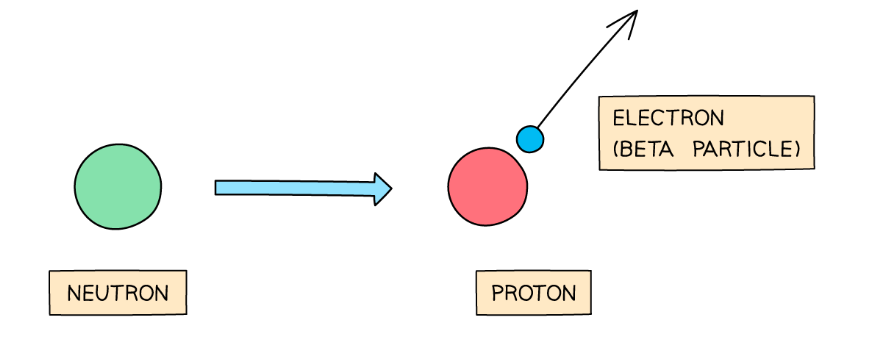
- When this occurs, the proton number increases by 1 but the nucleon number doesn’t change.

**A** is incorrect as an **α**-particle is two protons and two neutrons. If strontium decayed by emitting this particle, the nucleon number would reduce by four and the proton number would reduce by two.  **B** is incorrect as if a nuclide emitted a neutron, the nucleon number would decrease by one but the proton number would stay the same.

**C** is incorrect as **γ**-rays are not particles. If a nuclide emits a **γ**-ray, the proton and neutron number remain the same.

### Q25
**Final answer:** **The correct answer is ****B**** because:**

- If the initial count-rate is 300 counts per second, then the half-life is the time it takes for this to fall to half of it's starting level.
- Half of 300 is 150 counts per second. This takes 40 seconds.

### Q26
**Final answer:** **The correct answer is ****D**** because:**

- **γ**-rays have no charge. Therefore they would not experience a force when passing between two charged plates.
- **β**-particles have a negative charge. This causes them to be attracted towards the positively charged plate**.**

### Q27
**Final answer:** **The correct answer is ****C**** because:**

- The half-life of a radioactive isotope is the time taken for the count rate to fall to **half** its initial value
- For this isotope, this is the time taken to reach:

  - $\frac{1200}{2}=600\mathrm{counts}/s$
- This would occur between 3-4 hours (between 673 counts/s and 555 counts/s)

### Q28
**Final answer:** **The correct answer is ****C**** because:**

- If the half-life is 4 days, then 12 days is **three half-lifes**.
- After each half-life, the count-rate reduces by **half**.
- After 4 days, the count-rate would be (8000 ÷ 2 = ) 4000 β-particles per minute.
- After 8 days, the count-rate would be (4000 ÷ 2 = ) 2000 β-particles per minute.
- After 12 days, the count-rate would be (2000 ÷ 2 = ) 1000 β-particles per minute.

## Theory Questions (24 questions)

### Q1
> **[mark-scheme]**
> - The time taken for half the (unstable) nuclei to decay
> **OR**
> The time taken for the activity / count rate to fall to half its initial value **[1 mark]**
The complete nuclide equation for this decay is:

`text Sr end text _ 38 ^ 90 ->` $pre_{39} pre^{90}$$\text{Y}+$ `_ - 1 ^ 0`$\text{β}$

**[2 marks]**

> **[mark-scheme]**
> 1 mark for correct nuclide `text Y end text _ 39 ^ 90`
> 
> 1 mark for correct beta particle `text β end text _ - 1 ^ 0`

> **[exam-tip]**
> In beta decay, a neutron in the nucleus changes into a proton and an electron (the beta particle). This means the mass number stays the same (90 → 90) and the atomic number increases by 1 (38 → 39). Always check that both the mass numbers and atomic numbers balance on each side of the equation.
> **[mark-scheme]**
> - The count rate / number of beta particles detected varies with the thickness of metal **[1 mark]**
> - (Beta particles) can penetrate thin metal **OR** are stopped by thick metal **[1 mark]**

> **[exam-tip]**
> Make sure you link the type of radiation emitted by strontium-90 (beta particles) to its ability to pass through thin metal but be absorbed by thicker metal. Remember that alpha particles would be stopped by any thickness of metal, and gamma rays would pass through most thicknesses without significant change — so beta is the ideal choice for this application.
To calculate the count rate recorded by the detector after 87 years:

- Subtract the background count rate to find the corrected count rate:

$\text{corrected count rate}=830-30$ **[1 mark]**

$\text{corrected count rate}=800\text{cpm}$

- Determine the number of half-lives in 87 years:

$\text{number of half-lives}=\frac{87}{29}=3$ **[1 mark]**

- Apply three half-lives to the corrected count rate:

$800\rightarrow400\rightarrow200\rightarrow100\text{cpm}$

- Add the background count rate back:

$\text{recorded count rate}=100+30$

$\text{recorded count rate}=$ $130$ $\text{cpm}$  **[1 mark]**

> **[mark-scheme]**
> 1 mark for correct use of background count rate
> 
> - Accept 830 − 30 **OR** 100 + 30
> 
> 1 mark for determining the number of half-lives (87 / 29 = 3)
> 
> 1 mark for a correct final answer of 130 (counts per minute)
> 
> Full marks can be scored for the correct answer alone

### Q2
Determine the number of half-lives that have passed:

- 8.00  $\rightarrow$4.00 $\rightarrow$ 2.00 **OR** 8.00 × ½ × ½ = 2.00 **[1 mark]**
- The item has decayed for two half-lives; **[1 mark]**

Calculate the age of the wood:

- age of wood = 2 × 5700 years = 11 400 years** [1 mark]**

To **calculate** the age, you need to know how many half-lives have passed since the item was made. The item contains 2.00 mg, which is ¼ of the original value of 8.00 mg. This means the item is two half-lives old, as the amount of the isotope has halved and then halved again.

**[Total: 3 marks]**

> **[exam-tip]**
> Remember that the half-life of a sample is the time taken for half of its nuclei to decay. During the next half-life, half of the remaining sample will decay, leaving one quarter of the original. The pattern of decay is:
> 
> - After 1 half-life,  $\frac{1}{2}$of the original sample remains.
> - After 2 half-lives,  $\frac{1}{4}$of the original sample remains.
> - After 3 half-lives,     $\frac{1}{8}$of the original sample remains.
> - After 4 half-lives,$\frac{1}{16}$      of the original sample remains.

### Q3
(i) The completed decay equation is:

$A_{95}^{241} m \rightarrow \\alpha pre_{2} pre^{4} + N_{93}^{237} p$

- Alpha particle written correctly; **[1 mark]**
- Neptunium nucleus written correctly; **[1 mark]**

(ii) Beta and gamma emitters are not used in smoke detectors because:

- Beta and gamma radiation do not produce <u>enough</u> ions in smoke; **[1 mark]**

**[Total: 3 marks]**

> *A smoke detector operates on the basis that alpha particles produce ion pairs in smoke, which then complete a circuit and set off an alarm. Beta and gamma radiation mostly pass through smoke without ionising it, so the circuit would not be completed when smoke reaches it.*
To calculate the time that has passed:

List the known quantities:

- Initial number of nuclei, *N*0 = 8.0 $\times$ 1014
- Number of nuclei that have decayed = 6.0 $\times$ 1014
- Half-life of americium, *t*1/2 = 470 years

Determine the number of americium nuclei still present, *N*, after the time:

- $N=8.0\times10^{14}-6.0\times10^{14}$
- $N=2.0\times10^{14}$ **[1 mark]**

Determine how many time *N*0 has halved to reach 2.0 $\times$ 1014:

- $N_{0}\times\frac{1}{2}=4.0\times10^{14}$ **[1 mark]**
- $N_{0}\times\frac{1}{2}\times\frac{1}{2}=2.0\times10^{14}$
- When $N=2.0\times10^{14}$, two half lives have passed

Calculate the time taken for two half-lives to pass:

- $t=2t_{1/2}$
- $t=2\times470$
- $t=940$ years **[1 mark]**

**[Total: 3 marks]**

> *This is a regular half-life question with an extra step added in. You are given the number of nuclei that have decayed and must use that to find the number that remains. *

> *Once you have this value, it is back to the standard question of knowing the half-life, initial number and final number of nuclei and determining the time that has passed.*

### Q4
The results in Table 11.1 suggest:

- (The source) does not emit alpha (particles); **[1 mark]**

This is because:

- The count rate for paper is similar to the count rate for air; **[1 mark]** **OR **
- If alpha particles were emitted, the count rate for paper would decrease / be less (than 480); **[1 mark]**

**[Total:2 marks]**

> *Alpha radiation is the most ionising and least penetrating type of radiation, which means it is easily absorbed by a thin sheet of paper.*
The results in Table 11.1 suggest:

- (The source) emits gamma (rays); **[1 mark]**

This is because:

- The count rate for lead is less than the count rate for aluminium / air / paper; **[1 mark]** **OR**
- (Most / some of) the gamma (rays) are absorbed by lead;** ****[1 mark]**

**[Total: 2 marks]**

> *Gamma radiation is the least ionising and most penetrating type of radiation, which means it can only be reduced by a thick block of lead.*

### Q5
To calculate mass remaining:

List the known quantities:

- Half-life, *T**1/2** *= 6.0 years
- Initial mass, *m**0** *= 12 mg
- Time passed, *t* = 18 years

Calculate the number of half-lives that have passed:

- $numberofhalflives=\frac{timepassed}{half-life}$
- $numberofhalflives=\frac{18}{6}=3halflives$** [1 mark]**

Calculate the factor by which the mass reduces:

- The mass halves three times
- $\frac{1}{2}\times\frac{1}{2}\times\frac{1}{2}=\frac{1}{8}$

Calculate the new mass, *m*:

- $m=\frac{1}{8}\timesm_{0}$ **[1 mark]**
- $m=\frac{1}{8}\times12$
- $m=1.5\mathrm{mg}$ **[1 mark]**

**[Total: 3 marks]**

> *Students often find this question tricky. Just remember that for every half-life, the radioactive mass halves (it’s in the name ‘half-life’). In 18 years, three half-lives pass so halve the mass three times. You can either halve the mass three times separately, or you can divide it by 8 and do it all in one.*

### Q6
State the number of each type of particle in a neutral atom of `I _ 53 ^ 135`:

- 53 protons **AND **53 electrons; **[1 mark]**
- 82 neutrons **[1 mark]**

**[Total: 2 marks]**
Complete the decay equation:

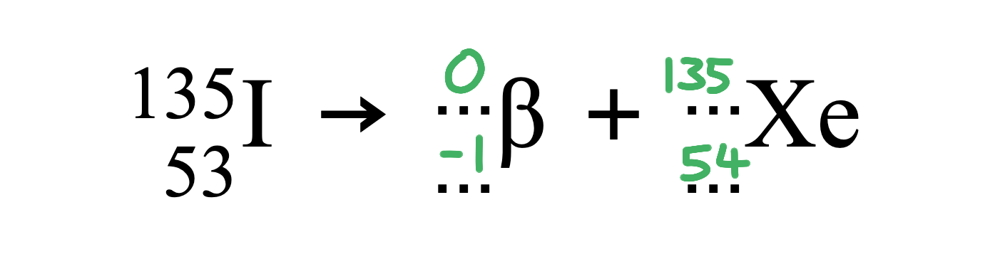

- Values correct for beta particle; **[1 mark]**
- Values correct for xenon nucleus; **[1 mark]**

**[Total: 2 marks]**
(i) Explain why alpha radiation is not used:

- Alpha radiation is blocked by paper; **[1 mark]**
- (Therefore) the Geiger counter would not detect the radiation / would only detect background radiation; **[1 mark]**

(ii) Explain why gamma radiation is not used:

- Gamma radiation passes through paper (completely); **[1 mark]**
- Changing thickness would not affect the count rate detected; **[1 mark]**

(iii) The Geiger counter now detects a greater count rate. Describe how the thickness of the paper has changed:

- The thickness has <u>decreased</u> **OR** the paper is <u>thinner</u>; **[1 mark]**

**[Total: 5 marks]**

### Q7
Complete the nuclide equation and state the name of the particle:

Equate the nucleon numbers (A) in the equation:

- $14=14+A$
- Therefore, A = 0
- So, $\mathrm{X} pre_{ } pre^{0}$ **[1 mark]**

Equate the proton numbers (Z) in the equation:

- $6=7+Z$
- $6-7=Z$
- Therefore, Z = −1
- So, `X _ - sign 1 ^ _` **[1 mark]**

Determine the nuclide X:

- `X _ - 1 ^ 0`
- Hence, X is a beta / β particle; **[1 mark]**

**[Total: 3 marks]**

> *For each type of radiation A and Z are different. Take time to equate both in your calculation.*
(i) Explain why the radiation detector records a reading and suggest a possible source:

- The radiation detector is recording background radiation; **[1 mark]**

Any **one **from:

Sources of background radiation include:

- Rocks; **[1 mark]**
- Ground; **[1 mark]**
- Buildings; **[1 mark]**
- Food; **[1 mark]**
- Space; **[1 mark]**
- Weapons testing; **[1 mark]**
- Nuclear accidents; **[1 mark]**
- Nuclear waste; **[1 mark]**
- Sun; **[1 mark]**
- Air; **[1 mark]**
- Radon; **[1 mark]**
- Argon; **[1 mark]**

(ii) Check whether the suggestion is correct:

List the known quantities:

- Half-life of carbon-14 = 5700 years
- Background radiation = 10 counts/min
- Sample 1 = 20 counts/min
- Sample 2 = 80 counts/min
- Suggested age of sample = 11 400 years

Remove the background count from the activity for samples 1 and 2:

- Sample 1: $20-10=10$ counts/min

**   AND**

- Sample 2: $80-10=70$ counts/min **[1 mark]**

Calculate the estimated number of half-lives in the sample:

- $Estimatednumberofhalflives=\frac{11400}{5700}=2$ **[1 mark]**

Calculate the change in the activity between the samples:

- $Changeinactivity=\frac{activityofsample2}{activityofsample1}$
- $Changeinactivity=\frac{70}{10}=7$
- Sample 2 is 7 times as active as sample 1

Calculate the actual number of half-lives in the sample:

- After 1 half-life the activity is half as much

  - $1\times2=2$
- After 2 half-lives the activity is $\frac{1}{4}$ as much

  - $2\times2=4$
- After 3 half-lives the activity is $\frac{1}{8}$ as much

  - $4\times2=8$
- Hence, the number of half-lives of the sample is:

  - > 2 **OR **just less than 3; **[1 mark]**

Identify whether the suggestion is correct:

- There are more than 2 half-lives in the sample
- So the age of the sample must be > 11 400 years;
- **So the suggestion is incorrect; [1 mark]**

**[Total: 4 marks]**

> *With each half-life, the activity of the sample decreases by a further ½. The relationship between activity and time is exponential, as shown on the graph.*

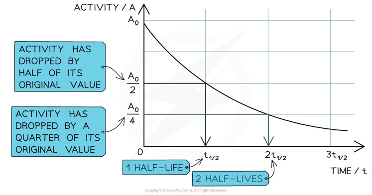

### Q8
The types of radiation that can pass through paper are:

- Beta/β **AND** gamma/γ;** [1 mark]**

**[Total: 1 mark]**
The number of neutrons in a nucleus of barium-137 is:

Determine the total number of nucleons (protons and neutrons):

- This is the 'top' number in the ZXA notation = 137

Determine the total number of protons:

- This is the 'bottom' number in the ZXA notation = 56

Calculate the number of neutrons:

- $numberofneutrons=nucleonnumber--protonnumber$
- $numberofneutrons=137-56$
- number of neutrons = 81 **[1 mark]**

**[Total: 1 mark]**

> *It is important you know how to read the ZXA (nuclide) notation. *

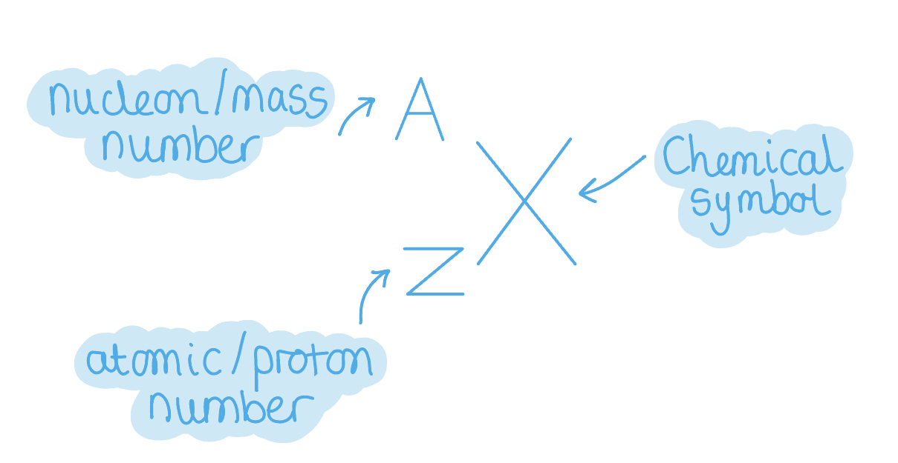

- *The nucleon (or mass) number is the total number of protons **and **neutrons*
- *The atomic (or proton) number is the total number of protons*
Calculate the mass of the isotope that remains in the source after 9 minutes

List the known quantities:

- Half-life of barium–137 = 3 minutes
- Mass of barium–137 = 36 mg
- Time of calculating the mass remaining = 9 minutes

Determine the number of half-lives in 9 minutes:

- The half life of the source is the time taken for half the nuclei of that isotope to decay
- $numberofhalf-lives=\frac{9}{3}=3$ ** [1 mark]**

Calculate the mass remaining after 9 minutes:

- This means that the mass is halved **three times**
- $massremaining=\frac{36}{2^{3}}=\frac{36}{8}$ ** [1 mark]**
- mass remaining = 4.5 mg** [1 mark]**

**[Total: 3 marks]**

> *3 half-lives means that the mass has been halved **three** times. If the original mass is 36 mg then:*

- *After 1 half-life, this is *$\frac{36}{2}=18mg$
- *After 2 half-lives this is *$\frac{18}{2}=9mg$
- *After 3 half-lives, this is *$\frac{9}{2}=4.5mg$

> *A quicker way to do this, is use the equation *$\frac{originalmass}{2^{numberofhalf-lives}}$

### Q9
A correctly completed table looks like:

|   | helium-3 | helium-4 |
|---|---|---|
| number of neutrons | **Final answer:** **1** | **Final answer:** **2** |
| number of electrons | **Final answer:** **2** | **Final answer:** **2** |
| mass compared to a neutral atom of hydrogen-1 | **Final answer:** **3** | **Final answer:** **4** |

- **One mark for each correct ****row**

**[Total: 3 marks]**

> *You may have written for the final row '2 more' and '3 more'. This would also be allowed.*

> *This question is a puzzle. You have been given the first part then asked to work out the rest as you go along. Knowing that isotope means 'having the same number of protons but different numbers of neutrons' is the key.*

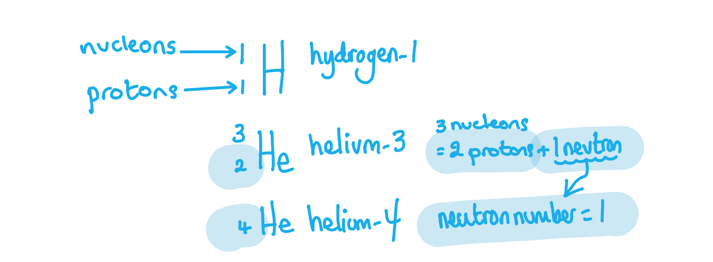
To state and explain the radiation passing through the aluminium foil:

Consider the penetrating power of alpha, beta and gamma-rays:

- The radiation is not stopped by 1 cm of air and very thin foil, so it is not alpha-radiation; **[1 mark]**
- It is stopped by 5 mm thick foil, so it is not gamma-radiation; **[1 mark]**
- The radiation is beta-radiation / β; **[1 mark]**

**[Total: 3 marks]**

### Q10
(i) The type of radiation which causes the proton number to increase by 1 is:

- Beta / β; **[1 mark]**

(ii) The type of radiation which causes the nucleon number to decrease by 4 is:

- Alpha / α; **[1 mark]**

(iii) The type of radiation which causes no change in the proton number and no change in the nucleon number of a nuclide is:

- Gamma / γ; **[1 mark]**

**[Total: 3 marks]**

> *Alpha radiation is the emission of a **helium nucleus** therefore the nucleon number of the nuclide will decrease by **4 **and the proton number by **2**.*

> *Beta radiation is the emission of an electron when a neutrons turns from a **neutron** to a **proton**, therefore the proton number increases by **1** and the nucleon number **doesn't change**.*

> *Gamma radiation is emitted when the nucleus emits electromagnetic radiation, therefore there is **no change** in nucleon or proton number.*
(i) A diagram which would score one mark is:

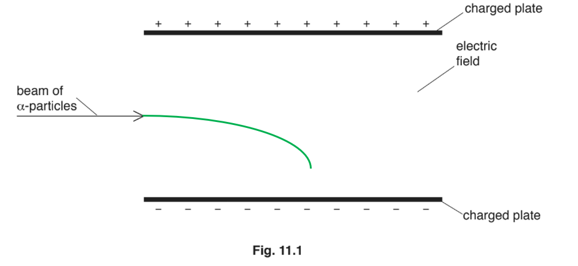

- The alpha particles have a positive charge, and so are attracted to the negative plate
- Therefore, the correct line will be a <u>curve downwards</u>; **[1 mark]**

(ii) To predict the number of α-particles emitted in 168 s.

List the known quantities:

- Half-life = 56 s
- Number of atoms = 7.2 × 106 atoms
- Time elapsed = 168 s

Determine the number of half-lives that pass in 168 seconds:

- $numberofhalf-lives=\frac{timeelapsed}{half-life}=\frac{168}{56}=3$ **[1 mark]**

Determine how many particles of radon remain:

- $a f t e r 3 h a l f - l i v e s , t h e n u m b e r o f a t o m s i s r e d u c e d b y ( 2 )^{3} = 8$
- $particlesremaining=\frac{7.2\times10^{6}}{8}=9.0\times10^{5}$ **[1 mark]**

Determine the number of α-particles emitted:

- $α-particlesemitted=initialnumberofpartcles-numberdecayed$
- $\\alpha - p a r t i c l e s e m i t t e d = ( 7.2 \times 10^{6} ) - ( 9.0 \times 10^{5} )$
- α-particles emitted = 6.3 × 106 **[1 mark]**

**[Total: 4 marks]**

> *To calculate the particle remaining after a certain number of half-lives, you can use the equation*

> $\frac{originalnumberofparticles}{2^{numberofhalf-lives}}$*.*

> *In this case it would be *$\frac{7.2\times10^{6}}{2^{3}}$*.*

### Q11
Complete the table:

| **Source** | **Recorded count rate (counts/s)** | **Background count rate (counts/s)** | **Corrected count rate (counts/s)** |
|---|---|---|---|
| Radium | 104 | **Final answer:** **4** | 100 |
| Americium | 25 | **Final answer:** **4** | **Final answer:** **21** |

- One mark for each correct entry in the table; **[3 marks]**

**[Total: 3 marks]**

> *The actual corrected count rate is calculated by subtracting background count rate from the recorded count rate of the source.*
Calculate the count rate from radium after 60 days:

State the initial count rate:

- Initial count rate = 100 counts/s **[1 mark]**

Determine the number of half-lives in 60 days:

- $\frac{60}{30}=2$ **[1 mark]**

Determine the final count rate:

- First half-life: $\frac{100}{2}=50\mathrm{counts}/s$
- Second half-life: $\frac{50}{2}=25\mathrm{counts}/s$
- Final count rate is 25 counts/s **[1 mark]**

**[Total: 3 marks]**
Use Fig. 1.1 to determine the half-life of the source:

Find the time at which activity halves on the graph:

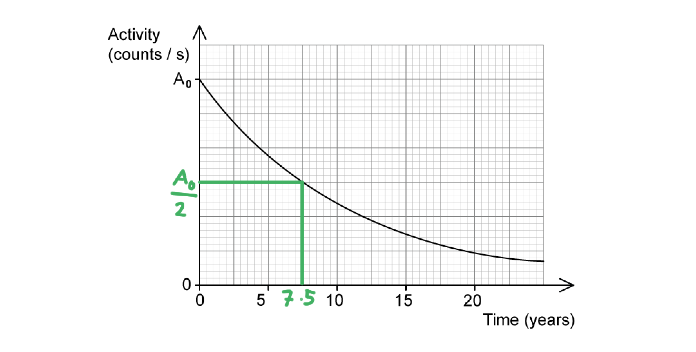

- At least one pair of lines drawn on Fig. 1.1 to determine half-life; **[1 mark]**

State the half-life:

- Half-life = 7.5 years **[1 mark]**

**[Total: 2 marks]**

> *Full marks will be awarded for the correct answer without any lines drawn on the graph. It is always a good idea to draw two sets of lines though, to **double check** your half-life value. Draw one set after one half-life, then another after the next half-life. *

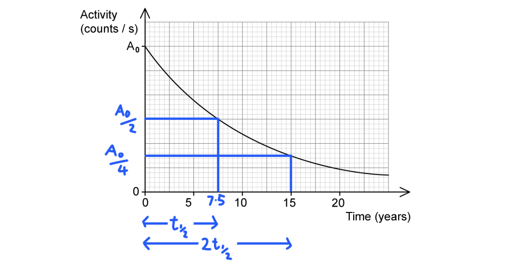

> *The second pair of lines shows us that two half-lives are 15 years - this is in agreement with the first set of lines, where one half-life is 7.5 years.*
Explain why the isotope from part **(c)** would be an inappropriate radioactive source for this purpose:

- The half-life is long / 7.5 years; **[1 mark]**
- The patient would be exposed to radiation for a <u>long time</u> (which could damage cells); **[1 mark]**

**[Total: 2 marks]**

> *Tracers should have a half-life that is **long** enough to be **detected** in the body, but **short** enough to **minimise** the patient's **contact** with radiation. The **benefit** of tracing blood can often **outweigh** the **risk **of being exposed to radiation. *

> *Often, a gamma or beta source is used - alpha radiation is too ionising and would harm the patient, plus it would never actually penetrate the body to be detected.*

### Q12
For a neutral atom of radon-222:

- The number of protons is the proton number:

  - 86; **[1 mark]**
- The number of neutrons is calculated by subtracting the proton number from the nucleon number:

  - $222-86=136$ **[1 mark]**
- The number of electrons in a neutral atom is the same as the proton number:

  - 86; **[1 mark]**

**[Total: 3 marks]**

> *Nuclide notation enables you to determine the number of protons, neutrons and electrons in a neutral atom.*

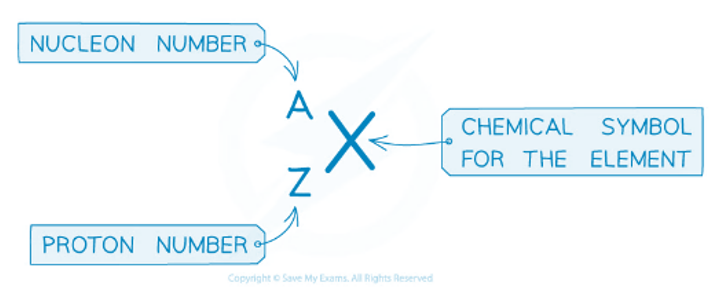
A completed nuclear equation which would score two marks is:

$Rn_{86}^{222} \rightarrow Po_{84}^{218} + \ \\alpha pre_{2} pre^{4}$

- $Po_{84}^{218}$ **[1 mark]**
- $\ \\alpha pre_{2} pre^{4}$ **[1 mark]**

**[Total: 2 marks]**

> *An alpha particle consists of 2 protons and 2 neutrons. Therefore the radon loses 2 protons and 2 neutrons from the nucleus. This reduces the nucleon number by 4 and the proton number by 2.*
To calculate the number of α-particles emitted:

List the known quantities:

- Half-life of radon = 3.8 days
- Initial number of radon nuclei = 6.4 × 106
- Time elapsed = 7.6 days

Determine the number of half-lives that have passed:

- 7.6 days is equal to 2 half-lives; **[1 mark]**

Determine the number of radon nuclei remaining after 2 half-lives:

- The number will have reduced by (22)
- $numberofradonnucleiremaining=\frac{6.4\times10^{6}}{4}=1.6\times10^{6}$ **[1 mark]**

Calculate the number of α-particles emitted:

- $numberofαparticlesemitted=initialnumberofradonnuclei-finalnumberofradonnuclei$
- $n u m b e r o f \\alpha p a r t i c l e s e m i t t e d = ( 6.4 \times 10^{6} ) - ( 1.6 \times 10^{6} )$
- number of  α-particles emitted = 4.8 × 106 **[1 mark]**

**[Total: 3 marks]**

> *Half-life is defined as the time taken for half the nuclei of that isotope in any sample to decay. One α-particle is emitted each time a nucleus decays. Therefore, the number of nuclei that have decayed is equal to the number of α-particles emitted.*

### Q13
Complete the table to describe the nucleus of astatine-210.

A table that would score 4 marks should look like:

| type of particle | number of particles | charge on particle |
|---|---|---|
| neutron | **Final answer:** **125** | **Final answer:** **neutral** |
| **Final answer:** **proton** | **Final answer:** **85** | positive |

- 125 in correct cell; **[1 mark]**
- neutral in correct cell; **[1 mark]**
- proton in correct cell; **[1 mark]**
- 85 in correct cell; **[1 mark]**

**[Total: 4 marks]**

> *It is important you know how to read the ZXA (nuclide) notation. *

- *The nucleon (or mass) number is the total number of protons **and **neutrons*
- *The atomic (or proton) number is the total number of protons*
(i) On Fig. 12.1, sketch a line to show how the count rate changes over the 24 hours.

A graph that would score 2 marks should look like:

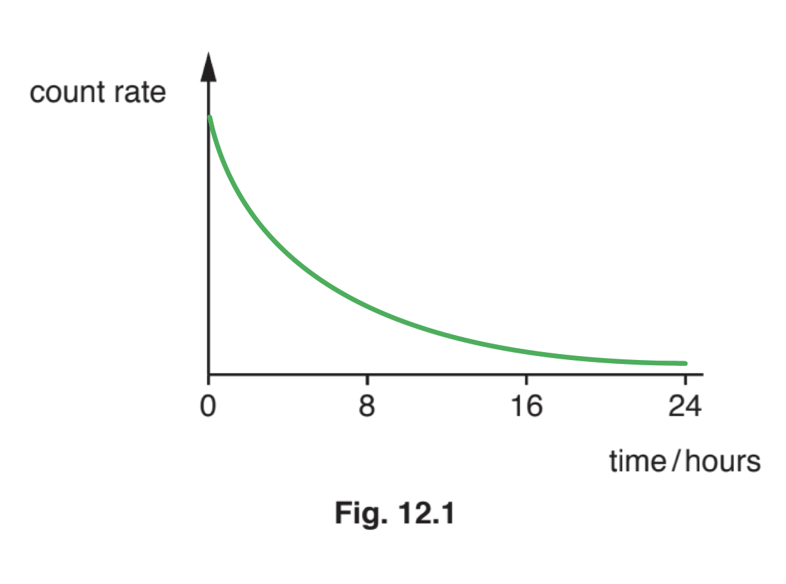

- Curve of negative gradient with gradient decreasing; **[1 mark]**
- Curve with negative gradient starts on y axis; **[1 mark]**

(ii) Calculate how long it takes for 0.375kg of the sample to decay.

List the known quantities:

- Half-life of astatine-210 = 8 hours
- Mass of sample of astatine-210 with half-life of 8 hours = 0.500 kg
- Mass of sample to calculate time to decay = 0.375 kg

Determine the amount of sample remaining:

- $amountofsampleremaining=0.500-0.375=0.125\mathrm{kg}$ **[1 mark]**

Calculate number of half-lives to get to 0.125 kg:

- $1half-life=\frac{0.500}{2}=0.25\mathrm{kg}$
- $2half-lives=\frac{0.25}{2}=0.125\mathrm{kg}$ **[1 mark]**

Calculate time taken for 0.375 kg of the sample to decay:

- $1half-life=8hours$
- $2half-lives=2\times8=16\mathrm{hours}$ **[1 mark]**

**[Total: 5 marks]**

> *Always read the question very carefully. Part (ii) asks to calculate how long it takes for 0.375 kg of the sample to decay, whilst after a certain number of half-lives, this is how much of the mass is **remaining**. The mass is directly related to the count rate.*

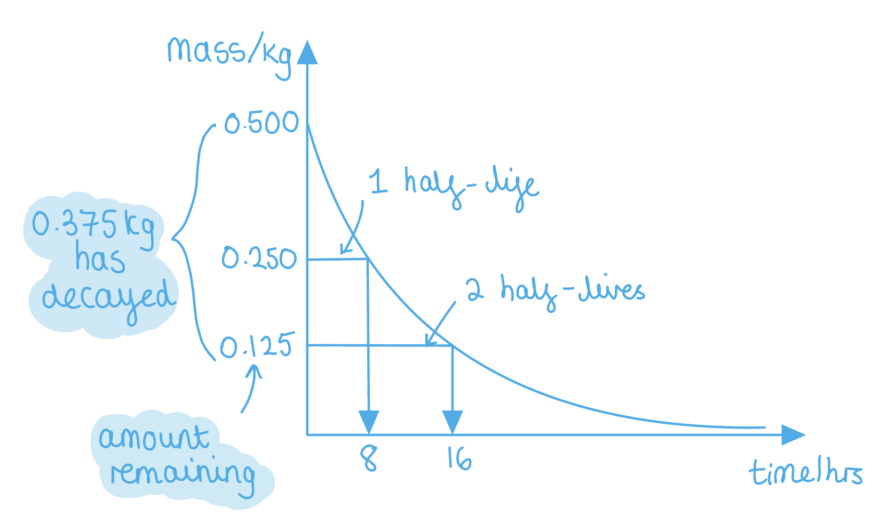

### Q14
To describe how you could show that the source emits β-particles only:

**Any four from:**

- Take a background reading / reading without source; **[1 mark]**
- Place piece of paper between source and detector; **[1 mark]**
- Beta particles can pass through paper **OR** alpha particles stopped / absorbed by paper; **[1 mark]**
- Reading on detector similar / unchanged; **[1 mark]**
- So no alpha particles emitted; **[1 mark]**
- Use few mm of aluminium between source and detector; **[1 mark]**
- Reading on detector now similar to background reading; **[1 mark]**
- (Because) beta particles stopped by a few mm of aluminium; **[1 mark]**

A diagram which would aid the answer would look like:

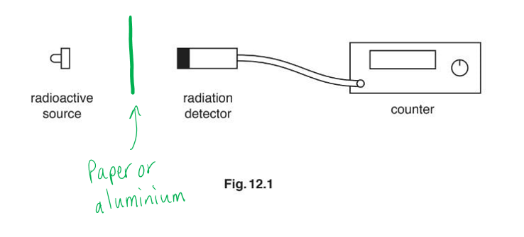

**[Total: 4 marks]**

> *When answering questions that involve measuring/detecting radiation make sure you say that you must measure the background count first. This is easy to miss out of an answer but is also an easy mark to gain. *

### Q15
A completed equation which would score two marks would look like:

- 4 nucleons (protons and neutrons) have been emitted

  - Nucleon number is reduced by 4
  - Therefore thorium has a nucleon number of <u>231</u>; **[1 mark]**
- 2 protons have been emitted

  - Proton number is reduced by 2
  - Therefore thorium has a proton number of <u>90</u>; **[1 mark]**

**[Total: 2 marks]**

> *Any alpha emission will reduce nucleon number by 4 and proton number by 2.*
(i) To state what is meant by nuclear fission:

- The splitting of a nucleus into (2) parts / a light(er) nucleus; **[1 mark]**

(ii) The nuclear reactor is surrounded by thick concrete walls because:

- (Fission involves production of) ionising radiation **OR** radiation is dangerous / harmful (to humans); **[1 mark]**
- They absorb / stop the radiation (and so protect workers); **[1 mark]**

(iii) One environmental advantage of a fission reactor is:

**Any one from:**

- No CO2 emitted; **[1 mark]**
- No SO2 emitted; **[1 mark]**
- No greenhouse gases emitted; **[1 mark]**
- No acid rain produced; **[1 mark]**

One environmental disadvantage of a fission reactor is:

**Any one from:**

- Production of nuclear waste / nuclear waste needs to be disposed of; **[1 mark]**
- Possibility of leaks of radioactive material; **[1 mark]**
- Risk of radiation in case of an accident; **[1 mark]**

**[Total: 5 marks]**

> *It is important to learn the advantages and disadvantages of the different fuels for energy production. It is a common exam question to ask you to compare two methods.*
To calculate the number of atoms of the sample that decay in the following 52 hours:

List the known quantities:

- Half-life of thorium =  26 hours
- Number of atoms in the sample = 4.8 × 109 atoms
- Time elapsed = 52 hours

Determine the number of half lives that have passed:

- $numberofhalf-lives=\frac{timeelapsed}{half-life}=\frac{52}{26}$
- Therefore 2 half lives have passed; **[1 mark]**

Determine the number of thorium atoms remaining after 52 hours:

- The number of thorium atoms will halve and then will halve again
- Therefore the number of thorium atoms will decrease by a factor of 4
- $thoriumatomsremaining=\frac{4.8\times10^{9}}{4}$
- Thorium atoms remaining = 1.2 × 109 **[1 mark]**

Determine the number of atoms that have decayed:

- $n u m b e r d e c a y e d = i n i t i a l n u m b e r - n u m b e r r e m a i n i n g = ( 4.8 \times 10^{9} ) - ( 1.2 \times 10^{9} )$
- Number of thorium atoms which have decayed = 3.6 × 109 **[1 mark]**

**[Total: 3 marks]**

### Q16
(i) State the term given to the number 4:

- 4 represents the <u>nucleon number</u> **OR** <u>mass number</u>; **[1 mark]**

(ii) State the term given to the number 2:

- 2 represents the <u>atomic number</u> **OR** <u>proton number</u>; **[1 mark]**

**[Total: 2 marks]**
(i) Use information from the graph in Fig. 12.1 to determine the half-life of the material:

Determine the initial count rate:

- From the graph, count rate is 880 counts / min to a time of 0 minutes

Recall the definition of half-life:

- Half-life is the time taken for the count rate to halve

From the graph, determine the time taken for the initial count rate to halve:

- The time taken for the initial count rate of 880 counts / min to halve to 440 counts / min is 4 minutes
- The time taken for the count rate of 440 counts / min to halve to 220 counts / min is 4 minutes

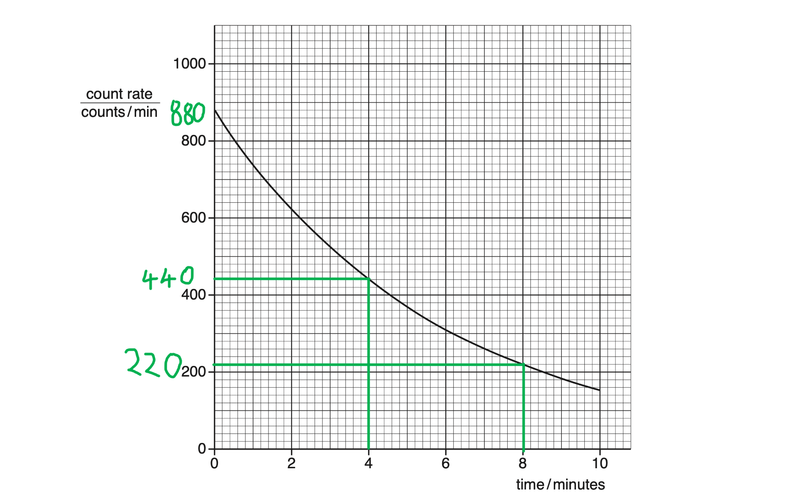

- A selected count rate has been halved; **[1 mark]**
- Two pairs of co-ordinates are clearly indicated (on the graph); **[1 mark]**
- Half-life = 4 minutes **[1 mark]**

**  **

(ii) Sketch the decay curve for this material:

List the known quantities:

- Initial count rate is 600 counts / min
- Half-life = 4 minutes (from part (b)(i))

Determine another data point to help sketch the graph:

- After a time of 4 minutes, the initial count rate will have halved

  - At a time of 4 minutes, the count rate will be 300 counts / min

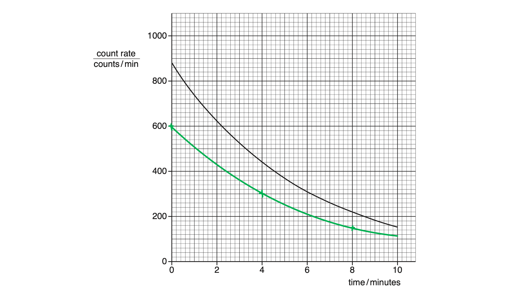

- Initial count rate is 600 counts/min **AND** the curve has a shallower (less steep) gradient; **[1 mark]**

**[Total: 3 marks]**

> *When asked to find a half-life from a graph, it is always a good idea to use **two** sets of coordinates. The mark scheme only gives a mark for halving the count rate twice, but it also acts as a good "double check" that you did get the half-life correct the first time. *

> *With half-life graphs like this, you don't have to start with the initial count rate at a time of 0 minutes. Often, the best way to determine the half-life is to choose "nice" values of time and count rate that are easy to halve or lie on grid lines, not in between. In the question above, the initial count rate was easy to halve and 440 counts/min clearly lies at 4 minutes.*

### Q17
(i) State the type of radiation which has the greatest ionising effect:

- α-radiation; **[1 mark]**

(ii) State the type of radiation which has the lowest penetrating ability:

- α-radiation; **[1 mark]**

**[Total: 2 marks]**

> *There are certain facts about radiation that you need to memorise. These include knowing about the ionising and penetrating powers of the different types of radiation.*

> *From greatest ionising effect to least:*

- *α-radiation*
- *β-radiation*
- *γ-radiation*

> *This is due to the relative charges: α-radiation carries the most charge (+2) and so is the most ionising. γ-radiation carries no charge and so is the least ionising.*

> *From greatest penetrating power to least:*

- *γ-radiation*
- *β-radiation*
- *α-radiation*

> *This is due to the relative size of the particles: α-particles are the largest and so are most likely to hit other molecules and so be stopped. *
(i) State the type of radiation used:

- Beta or β; **[1 mark]**

Explain why beta is used:

- Beta emission would be affected by the thickness of the metal

  - The amount of radiation detected would vary based on the thickness of the foil; **[1 mark]**

(ii) Describe the effect of a foil that is too thin on the reading on the counter:

- More radiation would pass through
- Therefore the reading on the counter would <u>increase</u>; **[1 mark]**

(iii) To correct the fault in **(b)(ii)**:

- The rollers will <u>move apart</u> so that the resulting foil is thicker; **[1 mark]**

(iv) State the number of protons in a nucleus of strontium-90:

- The nuclear symbol for stronium-90 is $space_{38}^{90} \text{Sr}$
- The bottom number is the atomic or proton number, corresponding to the number of protons
- Therefore the number of protons is <u>38</u>; **[1 mark]**

**[Total: 5 marks]**

> *For part** (i)**, alpha cannot be used as all of it would be absorbed by the foil, and gamma cannot be used as all of it would pass through regardless of the foil's thickness.*

### Q18
(i) State the number of protons in the nucleus of an atom of carbon-14:

The lower, smaller number is the *atomic*, or *proton *number:

- There are 6 protons; **[1 mark]**

(ii) State the number of electrons orbiting the nucleus of an atom of carbon-14:

In a neutral atom the number of electrons is equal to the number of protons:

- There are 6 electrons; **[1 mark]**

(iii) State the number of neutrons in the nucleus of an atom of carbon-14:

The higher, larger number is the *mass*, or *nucleon *number, with neutrons added to protons:

- There are (14 − 6) = 8 neutrons; **[1 mark]**

**[Total: 3 marks]**

> *Neutral atoms have the same number of positive protons and negative electrons, so if the atom is neutral, these numbers will be the same.*

> *In your physics exam you won't be asked how many electrons there are in ions, but this will come up in chemistry.*
State the similarities and differences between the nucleus of carbon-14 with the nucleus of carbon-12:

**Any three from:**

- The two nuclei have the same;

  - atomic number / proton number / number of protons; **[1 mark]**
  - charge; **[1 mark]**
- The two nuclei have different:

  - masses; **[1 mark]**
  - nucleon numbers; **[1 mark]**
  - numbers of neutrons; **[1 mark]**

**[Total: 3 marks]**

> *The number of protons determines the element. All isotopes of carbon have 6 protons.*

> *For isotopes, the only difference between the atoms is the number of neutrons.*

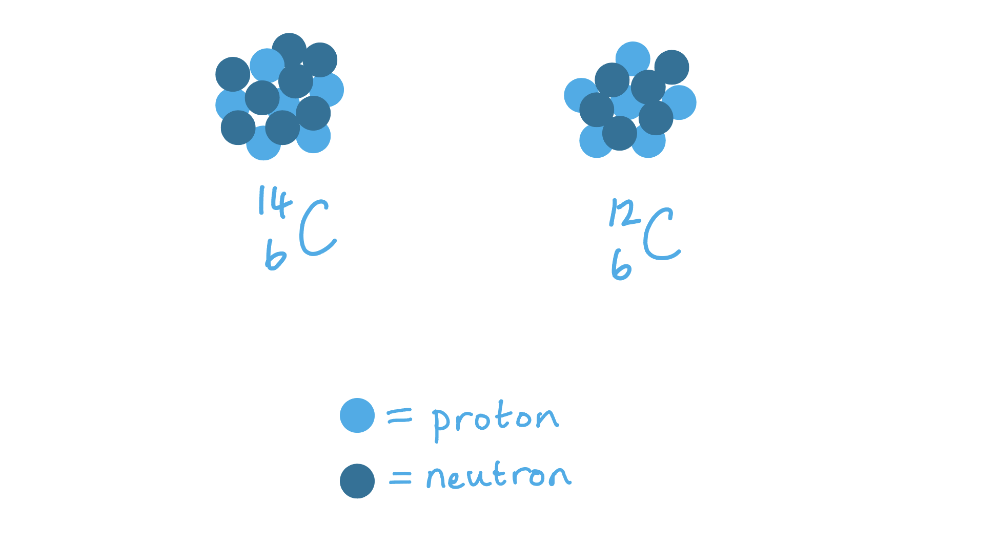
Estimate the age of the sample of wood:

List the known quantities:

- Half-life = 5700 years
- Initial number of carbon atoms = 8.0 × 108
- Current number of carbon atoms = 1.0 × 108

Determine the number of half-lives between 8.0 × 108 and 1.0 × 108:

- The order of magnitude is the same for both numbers, therefore we can ignore the × 108

  - ½ of 8.0  is 4.0
  - ½ of 4.0  is 2.0
  - ½ of 2.0  is 1.0
- Therefore, 3 half-lives have passed; **[1 mark]**

Determine how many years have passed in 3 half-lives:

- Number of years = 3 × 5700 **[1 mark]**
- Number of years = 17 100 **[1 mark]**

**[Total: 3 marks]**

> *Remember that half-life is defined as the time it takes for the number of nuclei of a sample of radioactive isotopes to decrease by half. Knowing this is the key to accessing this question. *

### Q19
Half-life is:

- The time taken for half the nuclei of that isotope in a sample to decay **OR **the time it takes for the activity of a sample to fall to half its original level; **[1 mark]**

**[Total: 1 mark]**
Complete the sentences:

- The particles in **alpha [1 mark]** radiation have a greater mass than those in **beta [1 mark]** radiation.
- **Gamma [1 mark]** radiation is a type of electromagnetic radiation and does not have mass.

**[Total: 3 marks]**
(i) Draw a line between the type of radiation and its charge:

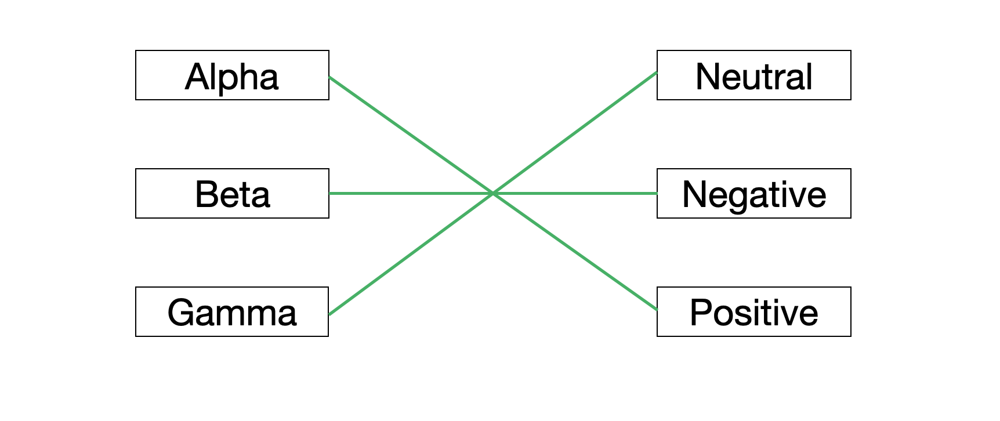

- One mark for one correct line; **[1 mark]**
- Second mark for all three correct; **[1 mark]**

(ii) State the type of radiation coming from each source:

- X emits alpha; **[1 mark]**
- Y emits gamma; **[1 mark]**
- Z emits beta; **[1 mark]**

**[Total: 5 marks]**

> *The radiation from X is **repelled** by the positive charge, so it must be positive. This is alpha radiation.*

> *The path of radiation from Y is **unaffected** by the positive charge, so it must be neutral. This is gamma radiation.*

*The radiation from Z is **attracted** to the positive charge, so it must be negative. This is beta radiation*.
Suggest one safety precaution the scientist might take the protect themselves from the radioactive sources:

**Any one from:**

- (The sources should be kept in a) shielded container / lead-lined box (when not in use); **[1 mark]**
- Wearing gloves (to handle sources); **[1 mark]**
- Using tongs (to handle sources); **[1 mark]**
- Protective clothing; **[1 mark]**
- Limiting the time the source is used for; **[1 mark]**

**[Total: 1 mark]**

> *Lots of students get their safety precautions mixed up and end up writing 'lead gloves'.*

> *Lead is very heavy and very dense. If you wore gloves made from it you would hardly be able to move your hands off the table, never mind bend your fingers!*

### Q20
(i) Describe how the nuclide notation shows that each isotope is of the same element:

**Any one from:**

- The elements have the same proton number / number of protons; **[1 mark]**
- The elements have the same atomic number; **[1 mark]**
- The elements have the same Z; **[1 mark]**

**  **

(ii) Describe how the nuclide notation shows the differences between the isotopes:

**Any one from:**

- The elements have a different nucleon / (atomic) mass number; **[1 mark]**
- The elements have a different number of neutrons; **[1 mark]**
- The elements have a different A; **[1 mark]**

**[Total: 2 marks]**

> *Knowing that A and Z refer to the nucleon and proton numbers can be helpful, but is not essential to your understanding. The nucleon number will always be larger (except for hydrogen, where nucleon and proton numbers are both 1) and is usually at the top of the nuclide notation.*

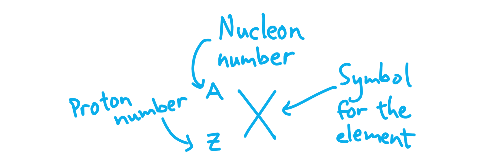
State the names of three types of radioactive emission:

- Alpha **OR** α
- Beta **OR **β;
- Gamma **OR** γ;

**Two marks for all three correctly named;**

**One mark for two correctly named;**

**[Total: 2 marks]**
When atoms are ionised, **electrons ****[1 mark] **may be removed, leaving **positively ****[1 mark] **charged atoms (ions), or **electrons** **[1 mark] **may be gained, forming **negatively ****[1 mark] **charged atoms (ions).

**[Total: 4 marks]**

> *Electrons are the only charged particles that can be transferred between atoms, protons and neutrons are never transferred. *

> *For word-fill questions such as this one, you are usually told "words can be used more than once" for a reason. Underline this kind of thing when reading the question so you don't miss it!*
Calculate the number of polonium-210 atoms remaining in the sample after 280 days:

List the known quantities:

- Half-life of polonium-210 = 140 days
- Number of atoms = 8.0 × 1010
- Time passed = 280 days

Determine the number of half-lives that pass in 280 days:

- 280 days have passed

  - The half-life of polonium-210 is 140 days
- $140\mathrm{days}\times2=280\mathrm{days}$
- 280 days is <u>two half-lives</u> (of polonium-210); **[1 mark]**

Recall the definition of half-life:

- Half-life is the time taken for half the nuclei of an isotope in a sample to decay

  - Every half-life, the number of polonium nuclei halves

Calculate the number of nuclei after 280 days:

- Two half-lives pass, so the number of atoms, 8.0 × 1010, halves twice
- $\frac{8.0\times10^{10}}{2}=4.0\times10^{10}$
- $\frac{4.0\times10^{10}}{2}=2.0\times10^{10}$
- 2.0 × 1010 atoms of polonium-210 remain; **[1 mark]**

**[Total: 2 marks]**

> *The number of nuclei halves after a half-life has passed, but the radioactivity also halves. Activity or count rate of a source is much easier to measure than counting 80 billion atoms, so experiments tend to use use count rate to determine half-life!*

### Q21
Recall the definition of half-life:

- The half-life of a radioactive substance is the time taken for the count rate to halve

Calculate half the initial count rate:

- *initial count rate *= 1246 counts per second
- Half of this is 1246 ÷ 2 = 623 counts per second

Estimate the time at which count rate is 623 counts per second:

- From the table, count rate is 621 counts per second after 2.5 minutes have passed

Estimate the half-life:

- half-life = 2.5 minutes **[1 mark] **

**[Total: 1 mark]**

> *While the working in the model answer above is sufficient, you have been given an entire table of data - use it!*

> *You can use multiple values to double check that your estimate of half-life is correct. For example, after 1 minute has passed, the count rate of the sample is 941 counts per second. Half of this is 470.5 counts per second.*

> *While we do not have this exact value on the table, 468 counts per second is on the table and is very close to 470.5 counts per second (and we are only **estimating** the half-life). The count rate is 468 counts per second after 3.5 minutes have passed, so from 1 minute to 3.5 minutes the count rate has halved, thus **confirming** that our half-life is 2.5 minutes.*
Suggest a value for the initial count rate for the larger sample:

- The larger sample has more nuclei so its count rate will be higher
- Any value <u>above</u> 1246 counts/second (e.g. 2000 counts/second); **[1 mark]**

**  **

**[Total: 1 mark]**
(i) Describe the nature of an α-particle:

- An alpha particle is a <u>helium nucleus </u><u>**OR**</u><u> </u>An alpha particle is <u>2 protons and 2 neutrons</u>; **[1 mark]**

(ii) Describe the ionising ability of an α-particle:

- Alpha particles are <u>strongly</u> / <u>highly</u> ionising; **[1 mark]**

(iii) Describe the penetrating ability of an α-particle:

- Alpha particles are <u>weakly</u> penetrating <u>**OR**</u>** **have a <u>low</u> penetrating power; **[1 mark]**

**  **

**[Total: 3 marks]**

> *The mark schemes for questions like this often have a note to examiners saying "or words to that effect". This means that examiners should award marks to students giving answers that are not the exact wording of the mark scheme but mean the same thing.*

> *For example in part (ii), if you wrote "alpha particles are very good at ionising", you would gain the marks even though you didn't say highly or strongly. When checking over a question in an exam, always think about the words you write - if somebody else were to read them, would they understand the point you are trying to make? *

### Q22
(i) To describe how radioactive materials should be stored:

- In a box / cupboard with <u>lead walls</u>; **[1 mark]**

(ii) To describe how radioactive materials should be handled:

**Any one from:**

- Using long tongs; **[1 mark]**
- Using a remote controlled robot / device; **[1 mark]**
- When wearing a lead suit; **[1 mark]**

**[Total: 2 marks]**

> *In part (i) you must state **lead **as alpha, beta or gamma radiation cannot penetrate lead. *
A table that would score 3 marks should look like this:

| type of emission | nature | range in air | absorbed by |
|---|---|---|---|
| **Final answer:** **gamma / γ** | electromagnetic radiation | several km | **Final answer:** **thick lead / very thick concrete** |
| **Final answer:** **alpha / α** | helium nucleus | **Final answer:** **a few cm** | 0.2 mm paper |
| **Final answer:** **beta / β** | electron | **Final answer:** **a few cm** | **Final answer:** **thin aluminium** |

- *Colum 1 correct scores 1 mark*
- *Column 3 correct scores 1 mark*
- *Column 4 correct scores 1 mark*

**[Total: 3 marks]**

> *Use the revision notes to improve your confidence in being able to explain and describe these properties of radiation. Questions that lead on from this will often include identifying the type of radiation from the results of an experiment. *
(i) To state the type of radiation emitted when $Am_{95}^{241}$ decays into $Np_{93}^{237}$.

Consider the difference in the mass numbers:

- 241 − 237 = 4

Consider the difference in the atomic numbers:

- 95 − 93 = 2

Identify the type of radiation $square_{2}^{4}$:

- This is an alpha / α particle; **[1 mark]**

(ii) To state the type of radiation emitted when `P _ 15 ^ 32` decays into $Si_{16}^{32}$.

Consider the difference in the mass numbers:

- 32 − 32 = 0

Consider the difference in the atomic numbers:

- 15 − 16 = −1

Identify the type of radiation `square _ - 1 ^ 0`:

- This is a beta / β particle; **[1 mark]**

**[Total: 2 marks]**

> *Make sure you carefully consider the differences in mass and atomic numbers so you do not make a mistake in these types of questions.*

### Q23
State the effect of the lead cylinder:

**Any one from:**

- The lead cylinder makes the radiation beam narrow; **[1 mark]**
- The lead cylinder makes the radiation beam straight; **[1 mark]**
- The lead cylinder makes the radiation go in one direction; **[1 mark]**

Explain the effect of the lead cylinder:

- The lead cylinder absorbs radiation travelling in other directions; **[1 mark]**

**[Total: 2 marks]**
(i) Describe the path of α-particles:

- The α-particles will move out of the page / towards the viewer; **[1 mark]**
- The α-particles are the equivalent to the current in the direction of the beam; **[1 mark]**

(ii) Describe the path of β-particles:

- The β-particles will move into the page / away from the viewer; **[1 mark]**
- The β-particles are equivalent to the current in the opposite direction to the beam; **[1 mark]**

(iii) Describe the path of γ-rays:

- The γ-ray does not have a path through the magnetic field; **[1 mark]**
- The γ-ray is uncharged **OR**** **the γ-ray is not equivalent to the current; **[1 mark]**

**[Total: 6 marks]**

> *Use Fleming's left-hand rule to identify the path of the current. The correct orientation is shown below.*

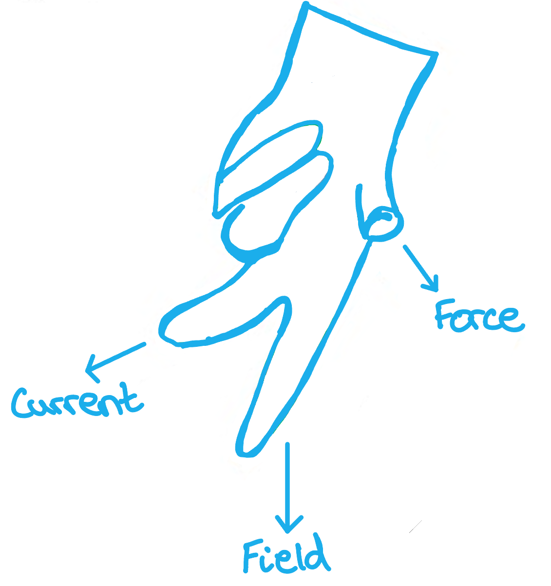

> *The thumb represents the movement and faces out of the page. The magnetic field goes from the north pole to the south pole. *

### Q24
A correctly completed diagram would look like:

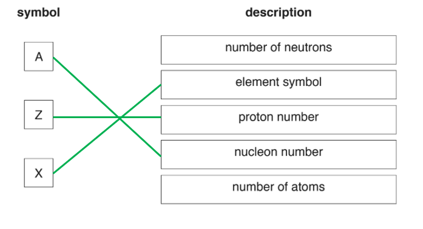

- **One mark for each correct line**

**[Total: 3 marks]**
(i) To calculate the mass of the isotope remaining after 18 years:

List the known quantities:

- Time elapsed = 18 years
- Mass = 12 mg
- Half-life = 6.0 years

Determine the number of half-lives elapsed:

- The number of half-lives is determined by $\frac{timeelapsed}{half-life}$
- Therefore, number of half-lives elapsed = $\frac{18}{6}=3$ **[1 mark]**

Determine the mass remaining:

- The mass reduces by half every 6 years.
- Since there are 3 half-lives, the mass remaining will be $( 1 \frac{1}{2} )^{3} = \frac{1}{8}$ of the initial mass; **[1 mark]**
- Mass remaining = $\frac{1}{8}$× 12 = 1.5 mg **[1 mark]**

(ii) To describe the nature of a β-particle:

**Any two from:**

- A high energy / fast-moving; **[1 mark]**
- Electron / negatively charged particle; **[1 mark]**
- About 2000 times smaller than a proton / neutron; **[1 mark]**

(iii) To describe how the nucleus changes after emission of a β-particle:

**Any one from:**

- A new element is formed; **[1 mark]**
- A neutron turns into a proton; **[1 mark]**
- Z / proton number increases by one; **[1 mark]**
- Neutron number decreases by one; **[1 mark]**

**[Total: 6 marks]**
