# Exam Questions — Radioactivity
**5. Nuclear Physics** · Cambridge (CIE) IGCSE physics (0625 & 0972)
> Source: [https://www.savemyexams.com/igcse/physics/cie/23/topic-questions/](https://www.savemyexams.com/igcse/physics/cie/23/topic-questions/) · 52 questions across 2 sets

## Multiple Choice Questions (28 questions)

### Q1 — medium — 1 marks

**Q1** [1 mark]

A radioactive source is used inside the body to diagnose a medical condition.

Which properties should the radioactive source have?

### Q2 — medium — 1 marks

**Q2** [1 mark]

A nucleus of radium-226 ($Ra_{88}^{226}$) undergoes alpha decay.

What are the nucleon number and the proton number of the new nucleus formed?

|   | nucleon number | proton number |
|---|---|---|
| **A** | 222 | 86 |
| **B** | 222 | 88 |
| **C** | 224 | 87 |
| **D** | 230 | 90 |

### Q3 — medium — 1 marks

**Q3** [1 mark]

The graph shows how the number of nuclei from a radioactive source changes with time.

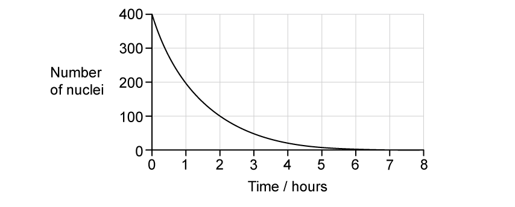

What is the half-life of the radioactive source?

### Q4 — easy — 1 marks

**Q4** [1 mark]

Background radiation is the radiation that is always present in the environment around us.

Which list contains only **natural** sources of background radiation?

### Q5 — hard — 1 marks

**Q5** [1 mark]

The count rate due to a sample of a radioactive isotope is measured for 80 minutes.

| **time**  **(minutes)** | <u>**        count rate          **</u>** ** **(counts / second)** |
|---|---|
| 0 | 480 |
| 20 | 380 |
| 40 | 300 |
| 60 | 240 |
| 80 | 190 |

What is the half-life of the isotope?

*Source: June 2023 0972/11 Q37*

### Q6 — medium — 1 marks

**Q6** [1 mark]

Which statement about the random decay of the nuclei in a sample of uranium-238 is correct?

*Source: June 2023 0972/11 Q36*

### Q7 — hard — 1 marks

**Q7** [1 mark]

The background count rate measured by a radiation counter is 40 counts per minute (cpm).

With the counter close to a radioactive source, the counter reading is 960 cpm.

The half-life of the source is 20 minutes.

What is the counter reading one hour later?

*Source: 0972/June 2023 21 Q36*

### Q8 — medium — 1 marks

**Q8** [1 mark]

A radioactive source is placed near a detector connected to a counter.

210 counts are recorded by the counter in 3 minutes.

The background count rate is 20 counts per minute (cpm).

What is the corrected count rate for the radioactive source?

*Source: June 2023 0972/21 Q35*

### Q9 — easy — 1 marks

**Q9** [1 mark]

Which statement about the radioactive decay of a substance is correct?

*Source: June 2022 Paper 1 Q40*

### Q10 — medium — 1 marks

**Q10** [1 mark]

Which statement about **α**-particles and **β**-particles is correct?

*Source: Specimen 2023 Paper 1 Q38*

### Q11 — medium — 1 marks

**Q11** [1 mark]

**Extended Tier Only**

The diagram shows a stream of -particles travelling in a line that passes between the poles of a magnet.

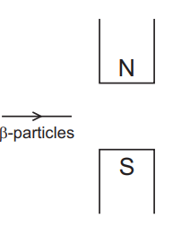

In which direction will the -particles be deflected by the magnet?

*Source: June 2022 Paper 2 Q40*

### Q12 — medium — 1 marks

**Q12** [1 mark]

A radioactive source has a half-life of 0.5 hours.

A detector near the source shows a reading of 6000 counts per second.

Background radiation can be ignored.

What is the reading on the detector 1.5 hours later?

*Source: June 2022 Paper 1 Q39*

### Q13 — medium — 1 marks

**Q13** [1 mark]

**Extended Tier Only**

The diagram shows emissions from a source passing into the electric field between two charged plates.

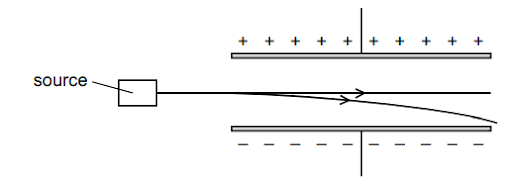

What is emitted by this source?

*Source: Specimen 2023 Paper 2 Q37*

### Q14 — easy — 1 marks

**Q14** [1 mark]

Radioactive materials are usually stored in containers lined with metal. This is done to reduce the amount of radiation being emitted, to protect people nearby.

What type of metal is used for this purpose?

### Q15 — easy — 1 marks

**Q15** [1 mark]

Which statement about **α**-particles is correct?

### Q16 — easy — 1 marks

**Q16** [1 mark]

A student has three radioactive sources **X**,** Y** and **Z**. They devised the following experiment to determine what type of radiation each source is emitting.

The student found that the radiation from **X** was stopped by a sheet of paper, **Y** was partially stopped by a few cm of lead and **Z** was stopped by a few mm of aluminium.

Which of the following correctly identifies each type of radiation

|   | **X** | **Y** | **Z** |
|---|---|---|---|
| **A** | **α**-particle | **β**-particle | **γ**-ray |
| **B** | **α**-particle | **γ**-ray | **β**-particle |
| **C** | **γ**-ray | **β**-particle | **α**-particle |
| **D** | **β**-particle | **γ**-ray | **α**-particle |

### Q17 — easy — 1 marks

**Q17** [1 mark]

Which statement is **not** a method used to minimise the risk caused by working with radioactive sources.

### Q18 — easy — 1 marks

**Q18** [1 mark]

There are three main types of radiation which may be emitted during radioactive decay: **α**-particles, **β**-particles and **γ**-rays.

Which of the following statements about these types of emissions is **true**?

### Q19 — medium — 1 marks

**Q19** [1 mark]

**Extended tier only**

A radioactive nucleus emits a **β**-particle.

What happens to the proton number and the nucleon number of this nucleus?

|   | **Proton number** | **Nucleon number** |
|---|---|---|
| **A** | increases by 1 | stays the same |
| **B** | stays the same | decreases by one |
| **C** | decreases by 2 | decreases by 4 |
| **D** | decreases by 1 | stays the same |

### Q20 — hard — 1 marks

**Q20** [1 mark]

The count rate of a radioactive material is measured using a detector. The reading on the detector is 88 counts per second. The background count rate is 40 counts per second.

The half-life of the radioactive substance is 12 hours. What is the reading on the detector after 24 hours?

### Q21 — hard — 1 marks

**Q21** [1 mark]

**Extended tier only**

Radioactive sources are often used in industry as part of manufacturing processes. The diagram below shows radiation being used to measure the thickness of a sheet of aluminium foil. The detector feeds back to the rollers to adjust the thickness.

What type of radiation would be the most suitable for this purpose?

### Q22 — hard — 1 marks

**Q22** [1 mark]

The graph shows the activity of a radioactive source over a period of time.

What is the half-life of the source?

### Q23 — medium — 1 marks

**Q23** [1 mark]

**Extended tier only**

A nucleus of uranium ( $U_{92}^{238}$) is unstable and decays by emitting an **α**-particle.

Which equation correctly describes this process?

### Q24 — medium — 1 marks

**Q24** [1 mark]

**Extended tier only**

Strontium-90 is a radioactive substance with the nuclide symbol $S_{38}^{90} r$ .

It decays by emitting radiation, as shown by the following equation.

$S_{38}^{90} r \rightarrow Y_{39}^{90} + ?$

What is missing in this equation?

### Q25 — medium — 1 marks

**Q25** [1 mark]

A student carried out an experiment to find the half-life of a radioactive substance. Their results are shown in the table below.

| **Time(seconds)** | **Count-rate from source(counts per second)** |
|---|---|
| 0 | 300 |
| 20 | 200 |
| 40 | 150 |
| 60 | 100 |
| 80 | 75 |

What is the half-life of this substance?

### Q26 — hard — 1 marks

**Q26** [1 mark]

**Extended tier only**

Beta and gamma radiation are passed through two charged metal plates as shown in the diagram below.

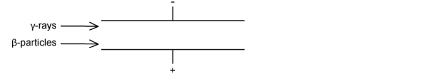

Which direction, if any, would the **β**-particles and **γ**-rays be deflected?

|   | **β-particles** | **γ-rays** |
|---|---|---|
| **A** | into the page | continue straight |
| **B** | towards the negative plate | out of the page |
| **C** | continue straight | towards the negative plate |
| **D** | towards the positive plate | continue straight |

### Q27 — medium — 1 marks

**Q27** [1 mark]

The count rate from a radioactive isotope is recorded every hour. The count rate is corrected for background radiation. The table shows the readings.

| time / hours | 0 | 1 | 2 | 3 | 4 | 5 |
|---|---|---|---|---|---|---|
| corrected count rate / counts/s | 1200 | 990 | 816 | 673 | 555 | 458 |

What estimate of the half-life of the isotope can be obtained from the readings in the table?

### Q28 — hard — 1 marks

**Q28** [1 mark]

A radioactive substance has a half-life of 4 days.

It is currently emitting 8000 **β**-particles per minute.

How many **β**-particles will it emit per minute after 12 days?

## Theory Questions (24 questions)

### Q1 — hard — 8 marks

**Q1** [1 mark]

Define the half-life of a radioactive isotope.

**Q1** [2 marks]

Strontium-90 (`text Sr end text _ 38 ^ 90`) decays by the emission of beta ($\text{β}$) particles to an isotope of yttrium ($Y$).

Complete the nuclide equation for this decay.

`text Sr end text _ 38 ^ 90 -> text Y end text _... ^... + text β end text _... ^...`

**Q1** [2 marks]

**Extract:**

Strontium-90 (\[\_{38}^{90}\text{Sr}\]) decays by the emission of beta (\[\beta\]) particles to an isotope of yttrium (\[Y\]).

A radioactive source containing strontium-90 is used in a factory to monitor the thickness of metal sheets. The source is placed on one side of the metal sheet, and a detector is placed on the other side.

Suggest why strontium-90 is a suitable source for measuring the thickness of metal sheets.

**Q1** [3 marks]

The half-life of strontium-90 is 29 years.

When the source is new, the detector records a count rate of 830 counts per minute. The background count rate is 30 counts per minute.

Calculate the count rate recorded by the detector after 87 years.

### Q2 — hard — 3 marks

**Q2** [3 marks]

A museum displays an item made of ancient wood. When the wood was new, the item contained 8.00 mg of the isotope shown in Fig. 11.1. The item now contains 2.00 mg of the isotope. The half-life of the isotope is 5700 years.

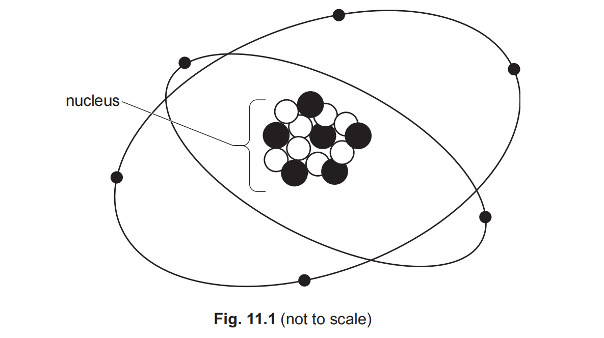

Calculate the age of the wood in the item.

age of wood = ............................................... years

*Source: June 2023 0972/31 Q11B*

### Q3 — hard — 6 marks

**Q3** [3 marks]

**Extended Tier Only**

(i) An americium (Am) nucleus decays by the emission of an α-particle into a neptunium (Np) nucleus.

Complete the nuclear equation for this decay.

$Am_{95}^{241} \rightarrow$

[2]

(ii) Americium is used in smoke detectors.

Explain why beta (β) emitters or gamma (γ) emitters are **not** used in smoke detectors.

[1]

*Source: Specimen  2023 Paper 4 Q10A*

**Q3** [3 marks]

The half-life of this americium nuclide is 470 years. A sample of this nuclide contains 8.0 $\times$ 1014 atoms. After some time, 6.0 $\times$ 1014 americium atoms have decayed.

Calculate the time required for this decay.

*Source: 2023 Paper 4 Q10B*

### Q4 — medium — 4 marks

**Q4** [2 marks]

A teacher determines the types of emission from a radioactive source. He uses different materials to absorb the emissions. Fig. 11.1 shows the equipment.

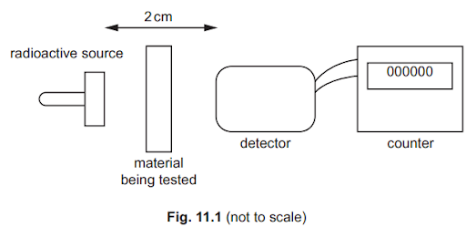

The teacher places a material between the radioactive source and the detector. The counter shows the count rate for the emission that reaches the detector. The teacher records the count rate. He repeats the experiment for different materials.

Table 11.1 shows the results.

**Table 11.1**

| **material being tested** | $\frac{\mathrm{count} \mathrm{rate}}{\mathrm{counts}/s}$ |
|---|---|
| air (no object in gap) | 480 |
| thin sheet of paper | 481 |
| 2 mm sheet of aluminium | 479 |
| 10 mm block of lead | 120 |

State whether the source emits α (alpha)-particles.

Use information from Table 11.1 to give a reason for your answer

*Source: June 2022 Paper 3 Q11A*

**Q4** [2 marks]

**Extract:**

The teacher places a material between the radioactive source and the detector. The counter shows the count rate for the emission that reaches the detector. The teacher records the count rate. He repeats the experiment for different materials. 

Table 11.1 shows the results.

Table 11.1

| material being tested | count rate (counts/s) |
| air (no object in gap) | 480 |
| thin sheet of paper | 481 |
| 2 mm sheet of aluminium | 479 |
| 10 mm block of lead | 120 |

State whether the source emits γ (gamma)-rays.

Use information from Table 11.1 to give a reason for your answer

*Source: June 2022 Paper 3 Q11B*

### Q5 — medium — 3 marks

**Q5** [3 marks]

A radioactive isotope has a half-life of 6.0 years.

A sample of this isotope has a mass of 12 mg.

Calculate the mass of this isotope that remains in the sample after 18 years.

*Source: Specimen 2023 Paper 3 Q11B*

### Q6 — easy — 9 marks

**Q6** [2 marks]

An iodine isotope $I_{53}^{135}$ decays beta emission. The daughter particle is an isotope of xenon (Xe).

State the number of each type of particle in a neutral atom of $I_{53}^{135}$.

**Q6** [2 marks]

**Extended tier only**

** **Complete the decay equation:

`I _ 53 ^ 135 -> beta _... ^... + Xe _... ^...`

**Q6** [5 marks]

**Extended tier only**

A factory makes baking paper. In order to keep the baking paper the same thickness, beta radiation is passed through the paper.

A Geiger counter on the other side of the paper measures how much radiation passes through the paper and the rollers change the thickness of paper accordingly (see Fig. 1.1).

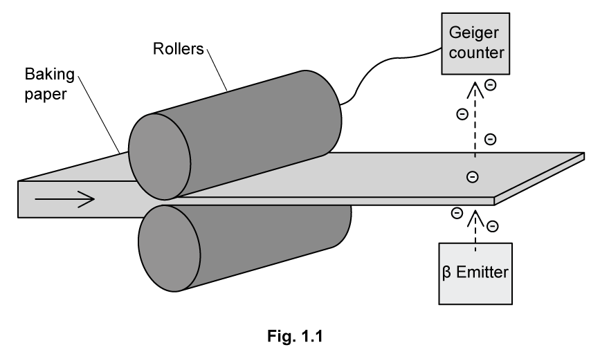

(i) Explain why alpha radiation is not used.

[2]

(ii) Explain why gamma radiation is not used.

[2]

(iii) A worker bumps into the rollers. The Geiger counter now detects a greater count rate. Describe how the thickness of the paper has changed.

[1]

### Q7 — hard — 5 marks

**Q7** [3 marks]

**Extended tier only**

A radioactive nucleus of carbon decays to a nucleus of nitrogen by emitting a particle.

Complete the nuclide equation and state the name of the particle.

`C _ 6 ^ 14 -> N _ 7 ^ 14 + X _... ^...`

*Source: May/June 2020 (Series 3) 0625/43 Q10A*

**Q7** [2 marks]

**Extended tier only**

A radiation detector in a laboratory records a reading of 10 counts/min. There are no radioactive samples in the laboratory.

(i) Explain why the radiation detector records a reading and suggest a possible source.

[2]

(ii) Carbon-14 has a half-life of 5700 years. There are atoms of carbon-14 in all living organisms.

An archaeologist digs up some ancient wood. In the same laboratory as in **(b)(i)**, a sample of this ancient wood gives a reading of 20 counts/min. An equivalent sample of living wood gives a reading of 80 counts/min. It is suggested that the age of the ancient sample is 11 400 years.

Do a calculation to check whether this suggestion is correct.

[4]

*Source: May/June 2020 (Series 3) 0625/43 Q10B*

### Q8 — medium — 5 marks

**Q8** [1 mark]

Radioactive sources emit α-(alpha), β-(beta) and γ-(gamma) radiations.

State which of these types of radiation can pass through paper.

*Source: 2020 0625/31 Q12A*

**Q8** [1 mark]

Barium-137 is a radioactive isotope. The nuclide notation for barium-137 is

$B_{56}^{137} a$

Determine the number of neutrons in a nucleus of barium-137.

number of neutrons = ........................................................

*Source: 2020 0625/31 Q12B*

**Q8** [3 marks]

An isotope of barium–137 has a half-life of 3 minutes.

A radioactive source contains 36 mg of this isotope.

Calculate the mass of the isotope that remains in the source after 9 minutes.

mass of the isotope remaining = .................................................. mg

*Source: 2020 0625/31 Q12C*

### Q9 — medium — 6 marks

**Q9** [3 marks]

The isotope hydrogen-1 has a proton number of 1 and a nucleon number of 1.

Two isotopes of helium are helium-3 and helium-4.

Helium-3 has a proton number of 2 and a nucleon number of 3.

Helium-4 has a nucleon number of 4.

Complete Table 11.1 for neutral atoms of these isotopes of helium.

**Table 11.1**

|   | helium-3 | helium-4 |
|---|---|---|
| number of neutrons |   |   |
| number of electrons |   |   |
| mass compared to a neutral atom of hydrogen-1 |   |   |

*Source: 2020 Feb/March 0625/42 Q11A*

**Q9** [3 marks]

An experiment takes place in a laboratory shielded from all background radiation. A sample of radioactive material is wrapped in aluminium foil of thickness 0.1 mm. A detector of ionising radiation placed 1 cm from the foil records a reading.

A piece of aluminium of thickness 5 mm is placed between the detector and the foil. The detector reading drops to zero.

State and explain any type of radiation passing through the aluminium foil.

*Source: 2020 Feb/March 0625/42 Q11B*

### Q10 — hard — 7 marks

**Q10** [3 marks]

State the type of radioactive emission that causes

(i) the proton number of a nuclide to increase by 1,

[1]

(ii) the nucleon number of a nuclide to decrease by 4,

[1]

(iii) no change in the proton number and no change in the nucleon number of a nuclide.

[1]

*Source: 2018 0625/43 Q11A*

**Q10** [4 marks]

**Extended tier only**

The isotope radon-220 is radioactive and it decays by α-particle emission.

(i) Fig. 11.1 shows a beam of α-particles entering the electric field between two charged plates.

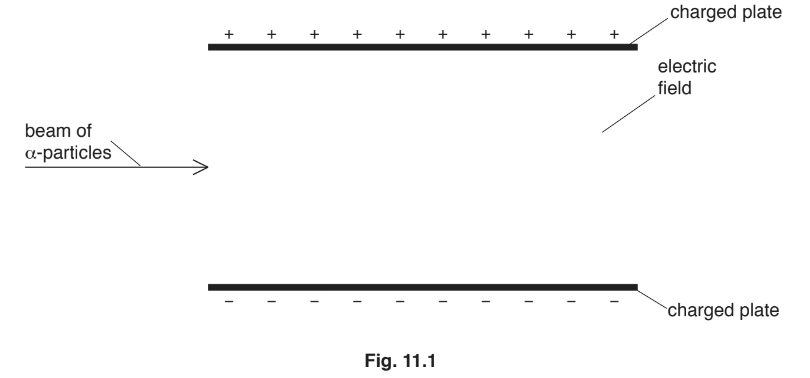

On Fig. 11.1, sketch the path that the beam of α-particles follows in the electric field.

[1]

(ii) The half-life of radon-220 is 56 s.

A sample of this isotope contains 7.2 × 106 atoms.

Predict the number of α-particles that the radon-220 in the sample emits in the next 168 s.

number of α-particles emitted = ...........................................................[3]

*Source: 2018 0625/43 Q11B*

### Q11 — easy — 10 marks

**Q11** [3 marks]

**Extended tier only**

A student records the following data in a table when using a Geiger counter on two radioactive sources at the same.

Complete the table.

| **Source** | **Recorded count rate (counts/s)** | **Background count rate (counts/s)** | **Corrected count rate (counts/s)** |
|---|---|---|---|
| Radium | 104 |   | 100 |
| Americium | 25 |   |   |

**Q11** [3 marks]

**Extract:**

| Source | Recorded count rate (counts/s) | Background count rate (counts/s) | Corrected count rate (counts/s) |
| Radium | 104 | 4 | 100 |

The half-life of the radium isotope is 30 days. Calculate the count rate from the radium source from part **(a)** after 60 days.

**Q11** [2 marks]

**Extended tier only**

Another source has an initial activity of *A*0.

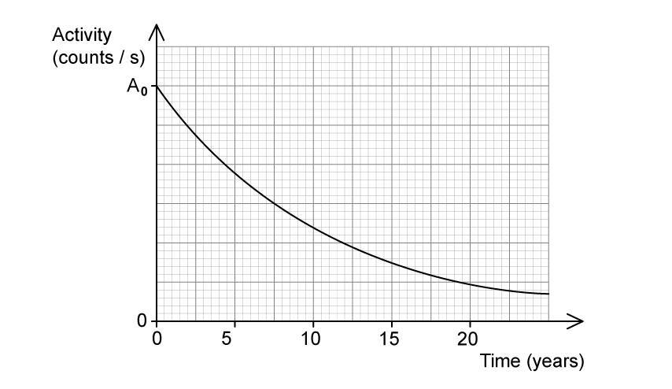

**Fig. 1.1**

Use Fig. 1.1 to determine the half-life of the source.

**Q11** [2 marks]

**Extract:**

Half-life = 7.5 years

**Extended tier only**

Medical tracers are radioactive sources that can be inserted into the body to track the movement of blood.

Explain why the isotope from part **(c)** would be an inappropriate radioactive source for this purpose.

### Q12 — medium — 8 marks

**Q12** [3 marks]

Radon-222 is radioactive. It can be represented as $Rn_{86}^{222}$.

For a neutral atom of radon-222, state

1. the number of protons, ...........................

2. the number of neutrons, ...........................

3. the number of electrons. ...........................

*Source: 2018 0625/41 Q11A*

**Q12** [2 marks]

**Extended tier only**

A radon-222 nucleus decays by α-particle emission to a polonium (Po) nucleus.

Complete the equation for the decay of radon-222.

$Rn_{86}^{222} \rightarrow$

*Source: 2018 0625/41 Q11B*

**Q12** [3 marks]

Radon-222 has a half-life of 3.8 days.

At a certain time, a sample contains 6.4 × 106 radon nuclei.

Calculate the number of α-particles emitted by the radon nuclei in the following 7.6 days.

number = ...........................................................

*Source: 2018 0625/41 Q11C*

### Q13 — hard — 9 marks

**Q13** [4 marks]

Astatine-210 is a radioactive material. The nucleus of astatine can be represented by the symbol shown.

$A_{85}^{210} t$

Complete the table to describe the nucleus of astatine-210.

| type of particle | number of particles | charge on particle |
|---|---|---|
| neutron |   |   |
|   |   | positive |

*Source: 2019 0625/32 Q12A*

**Q13** [5 marks]

Astatine-210 has a half-life of 8 hours.

(i) The count rate of a sample of astatine-210 is measured over 24 hours.

On Fig. 12.1, sketch a line to show how the count rate changes over the 24 hours.

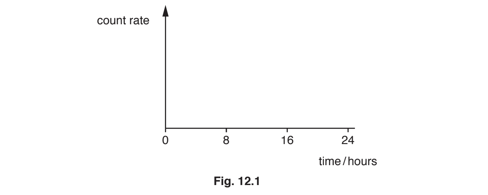

[2]

(ii) The mass of a sample of astatine-210 is 0.500 kg.

Calculate how long it takes for 0.375 kg of the sample to decay.

decay time = ............................................... hours [3]

*Source: 2019 0625/32 Q12B*

### Q14 — hard — 4 marks

**Q14** [4 marks]

Fig.12.1 shows a radioactive source placed close to a radiation detector and counter. The detector can detect α, β and γ radiation.

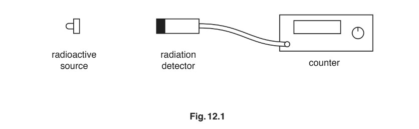

The radioactive source emits β-particles only.

Describe how you could show that the source emits β-particles only. As part of your answer, you may draw on Fig.12.1 and add any other apparatus you may need.

*Source: February/March 2018 0625/32 Q12*

### Q15 — medium — 10 marks

**Q15** [2 marks]

**Extended tier only**

A radioactive nucleus of uranium-235 decays to a nucleus of thorium and emits an α-particle. Complete the equation.

*Source: 2018 0625/42 Q11A*

**Q15** [5 marks]

A nucleus of uranium-235 undergoes nuclear fission in a reactor.

(i) State what is meant by nuclear fission.

[1]

(ii) Suggest why a nuclear reactor is surrounded by thick concrete walls.

[2]

(iii) State one environmental advantage and one environmental disadvantage of using a fission reactor to generate electrical energy in a power station.

[2]

*Source: 2018 0625/42 Q11B*

**Q15** [3 marks]

**Extract:**

A radioactive nucleus of uranium-235 decays to a nucleus of thorium and emits an α-particle.

The thorium produced by the decay in (a) is also radioactive and has a half-life of 26 hours.

At a certain time, a pure sample of this isotope initially contains 4.8 × 109 atoms.

Calculate the number of atoms of this sample that decay in the following 52 hours.

number = ...........................................................

*Source: 2018 0625/42 Q11C*

### Q16 — hard — 6 marks

**Q16** [2 marks]

A radioactive substance decays by emitting an α-particle.

The nuclide notation for an α-particle is

$\ \\alpha pre_{2} pre^{4}$

(i) State the term given to the number 4, written in the nuclide notation.

[1]

(ii) State the term given to the number 2, written in the nuclide notation.

[1]

*Source: Oct 2019 0625/32 Q12A*

**Q16** [4 marks]

**Extract:**

Fig. 12.1 shows the decay curve for a radioactive material.

(i) Use information from the graph in Fig. 12.1 to determine the half-life of the material. Clearly show how you used the graph to obtain your answer.

(ii) Another radioactive material with the same half-life has an initial count rate of 600 counts/min. On Fig. 12.1 sketch the decay curve for this material.

Fig. 12.1 shows the decay curve for a radioactive material.

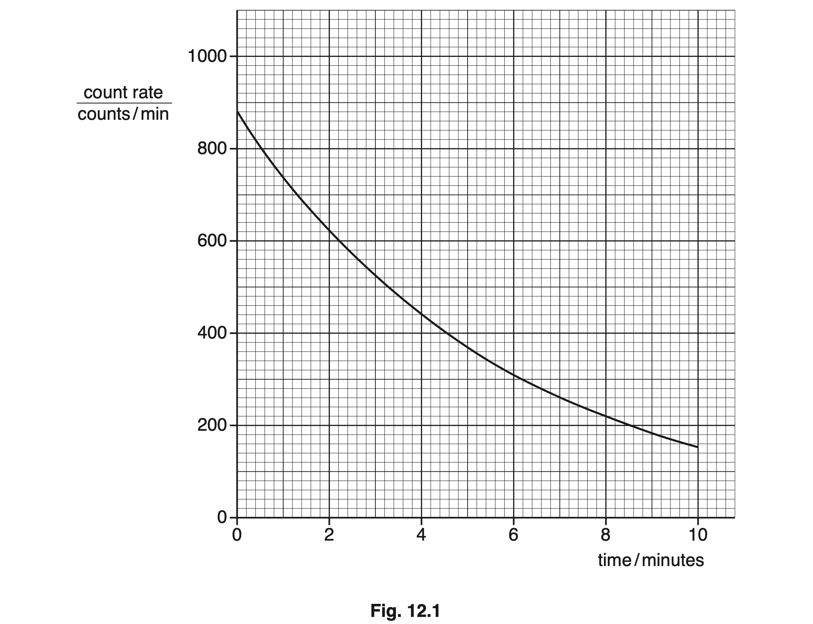

(i) Use information from the graph in Fig. 12.1 to determine the half-life of the material. Clearly show how you used the graph to obtain your answer.

half-life = ...................................................... minutes [3]

(ii) Another radioactive material with the same half-life has an initial count rate of 600 counts/min. On Fig. 12.1 sketch the decay curve for this material.

[1]

*Source: Oct 2019 0625/32 Q12B*

### Q17 — medium — 7 marks

**Q17** [2 marks]

Radioactive decay may include the emission of:

α-radiation

β-radiation

γ-radiation

(i) From the list, state the type of radiation which has the greatest ionising effect.

[1]

(ii) From the list, state the type of radiation which has the lowest penetrating ability.

[1]

*Source: 2018 0625/31 Q12A*

**Q17** [5 marks]

**Extended tier only**

In a factory, rollers press aluminium metal to make thin foil sheets. An automatic system for controlling the thickness of the foil uses a radioactive source. The automatic system changes the gap between the top and bottom roller. Fig. 12.1 shows the equipment.

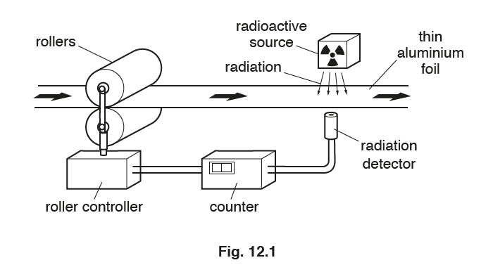

(i) Use your ideas about the properties of radiation to suggest and explain the type of radiation used.

type of radiation: ..........................................................................................

explanation: ..........................................................................................

[2]

(ii) The aluminium foil passing the radiation detector is too thin. Describe how this fault affects the reading on the counter.

[1]

(iii) Suggest how the fault in **(b)(ii)** is corrected. State what happens to the rollers.

[1]

(iv) The source used is strontium-90. A nucleus of strontium-90 can be described as $space_{38}^{90} \text{Sr}$. State the number of protons in a nucleus of strontium-90.

[1]

*Source: 2018 0625/31 Q12B*

### Q18 — medium — 9 marks

**Q18** [3 marks]

This notation represents the nucleus of a neutral atom of carbon-14.

`C _ 6 ^ 14`

State the number of:

(i) protons in the nucleus of an atom of carbon-14

[1]

(ii) electrons orbiting the nucleus of an atom of carbon-14

[1]

(iii) neutrons in the nucleus of an atom of carbon-14.

[1]

*Source: Nov 2018 (S1) P3 Q12A*

**Q18** [3 marks]

**Extract:**

(i) State the number of protons in the nucleus of an atom of carbon-14:
- There are 6 protons.

(ii) State the number of electrons orbiting the nucleus of an atom of carbon-14:
- There are 6 electrons.

(iii) State the number of neutrons in the nucleus of an atom of carbon-14:
- There are (14 − 6) = 8 neutrons.

Neutral atoms have the same number of positive protons and negative electrons, so if the atom is neutral, these numbers will be the same.

Carbon-14 is an isotope of carbon. Carbon-12 is another isotope of carbon.

Compare the nucleus of carbon-14 with the nucleus of carbon-12.

State the similarities and differences.

*Source: Nov 2018 (S1) 0625/31 Q12B*

**Q18** [3 marks]

**Extract:**

A very old sample of wood contains 1.0 × 10^8^ carbon-14 atoms.
When the sample was new, it contained 8.0 × 10^8^ carbon-14 atoms. The half-life of carbon-14 is 5700 years.

Scientists use carbon-14 to estimate the age of wood that is very old.

A very old sample of wood contains 1.0 × 108 carbon-14 atoms.

When the sample was new, it contained 8.0 × 108 carbon-14 atoms. The half-life of carbon-14 is 5700 years.

Estimate the age of the sample of wood.

age of wood = ........................... years

*Source: Nov 2018 (S1) 0625/31 Q12C*

### Q19 — easy — 10 marks

**Q19** [1 mark]

Define the term "half-life".

**Q19** [3 marks]

Complete the sentences.

The particles in _______ radiation have a greater mass than those in _______ radiation.

_______ radiation is a type of electromagnetic radiation and does not have mass.

**Q19** [5 marks]

**Extended tier only**

Three radioactive sources, X, Y and Z, are in a lab. One emits only alpha radiation, one emits only beta radiation and one emits only gamma radiation.

(i) Draw a line between the type of radiation and its charge.

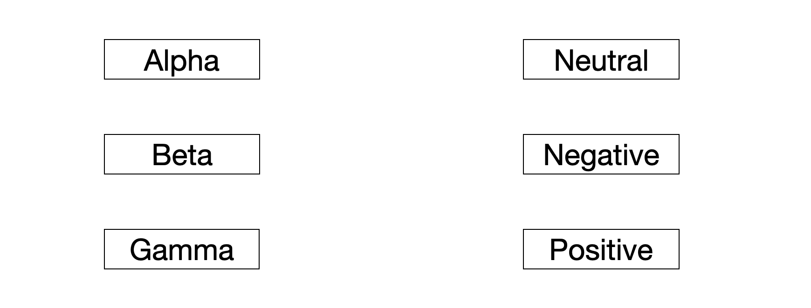

[2]

(ii) To determine which source emits which type of radiation, a scientist places a positive charge near the sources, as shown in Fig. 1.1.

State the type of radiation coming from each source.

[3]

**Q19** [1 mark]

**Extended tier only**

Suggest one safety precaution the scientist might take to protect themselves from the radioactive sources.

### Q20 — easy — 10 marks

**Q20** [2 marks]

Fig. 12.1 shows the nuclide notation for three isotopes of an element.

(i) Describe how the nuclide notation shows that each isotope is of the same element.

[1]

(ii) Describe how the nuclide notation shows the differences between the isotopes.

[1]

*Source: Oct 2019 0625/33 Q12A*

**Q20** [2 marks]

Radioactive sources emit radiation when they decay. State the names of **three** types of radioactive emission.

*Source: Oct 2019 0625/33 Q12B*

**Q20** [4 marks]

**Extended tier only**

Radioactive emissions have differing characteristics. One characteristic is their ionising effect.

Complete the statement about ionisation, using words from the box. The words can be used once, more than once or not at all.

| **electrons      negatively      neutrons      positively      neutrally      protons** |
|---|

When atoms are ionised, ............................... may be removed, leaving ............................... charged atoms (ions), or ............................... may be gained, forming ............................... charged atoms (ions).

*Source: Oct 2019 0625/33 Q12C*

**Q20** [2 marks]

Polonium-210 has a half-life of 140 days. A sample of polonium-210 has 8.0 × 1010 atoms. Calculate the number of polonium-210 atoms remaining in the sample after 280 days.

number of atoms = ......................................................

*Source: Oct 2019 0625/33 Q12D*

### Q21 — hard — 5 marks

**Q21** [1 mark]

A teacher carries out two experiments at the same time.

In the first experiment the count rate for a sample of a radioactive isotope is measured every 30 seconds for 6 minutes.

The results are shown in Table 12.1.

**Table 12.1**

| time / minutes | count rate counts/second |
|---|---|
| 0.0 | 1246 |
| 0.5 | 1036 |
| 1.0 | 941 |
| 1.5 | 810 |
| 2.0 | 686 |
| 2.5 | 621 |
| 3.0 | 550 |
| 3.5 | 468 |
| 4.0 | 421 |
| 4.5 | 368 |
| 5.0 | 318 |
| 5.5 | 280 |
| 6.0 | 242 |

Estimate the half-life of the radioactive isotope. Use the information in the table.

half-life = ...................................................... minutes

*Source: Oct 2019 3 Q12A*

**Q21** [1 mark]

**Extract:**

| time / minutes | count rate counts/second |
| 0.0 | 1246 |

In the second experiment the teacher repeats the procedure with another sample of the same radioactive isotope. The mass of the second sample is greater than that of the first sample.

Suggest a value for the count rate for this sample at the start of the experiment.

count rate = ...................................................... counts/second

*Source: Oct 2019 3 Q12B*

**Q21** [3 marks]

One type of particle emitted during radioactive decay is an α-particle (alpha particle).

Describe:

(i) the nature of an α-particle

[1]

(ii) the ionising ability of an α-particle

[1]

(iii) the penetrating ability of an α-particle.

[1]

*Source: Oct 2019 3 Q12C*

### Q22 — easy — 7 marks

**Q22** [2 marks]

**Extended tier only**

To ensure the safety of workers in laboratories where radioactive sources are used, describe how radioactive materials

(i) should be stored,

[1]

(ii) should be handled.

[1]

*Source: February/March 2018 0625/42 Q11A*

**Q22** [3 marks]

Complete the table below for three types of emission from radioactive sources.

| type of emission | nature | range in air | absorbed by |
|---|---|---|---|
|   | electromagnetic radiation | several km |   |
|   | helium nucleus |   | 0.2 mm paper |
|   | electron |   |   |

*Source: February/March 2018 0625/42 Q11B*

**Q22** [2 marks]

**Extended tier only**

State the type of radiation emitted when

(i) an americium nucleus ( $Am_{95}^{241}$) decays into a neptunium nucleus ($Np_{93}^{237}$),

[1]

(ii) a phosphorus nucleus (`P _ 15 ^ 32`) decays into a silicon nucleus ( $Si_{16}^{32}$).

[1]

*Source: February/March 2018 0625/42 Q11C*

### Q23 — medium — 8 marks

**Q23** [2 marks]

Fig. 10.1 shows a vacuum tube with a radioactive source. The radioactive source emits α-particles, β-particles and γ -rays. There is a very strong magnetic field between the N pole and the S pole of the magnet.

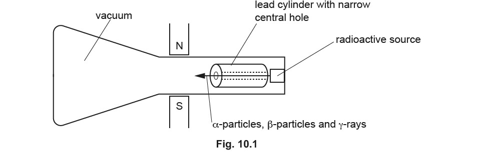

The lead cylinder has a narrow central hole. State and explain the effect of the lead cylinder.

*Source: May/June 2020 (Series 2) 0625/42 Q10A*

**Q23** [6 marks]

**Extract:**

Fig. 10.1 shows a vacuum tube with a radioactive source. The radioactive source emits α-particles, β-particles and γ -rays. There is a very strong magnetic field between the N pole and the S pole of the magnet. The lead cylinder has a narrow central hole.

**Extended tier only**

Describe the paths of the α-particles, β-particles and γ -rays as they pass through the magnetic field. Explain your answers.

(i) α-particles

[2]

(ii) β-particles

[2]

(iii) γ -rays

[2]

*Source: May/June 2020 (Series 2) 0625/42 Q10B*

### Q24 — medium — 9 marks

**Q24** [3 marks]

The nuclide notation $pre_{Z} pre^{A} \mathrm{X}$ describes the nucleus of one type of atom. Draw a line from each symbol to the correct description for that symbol.

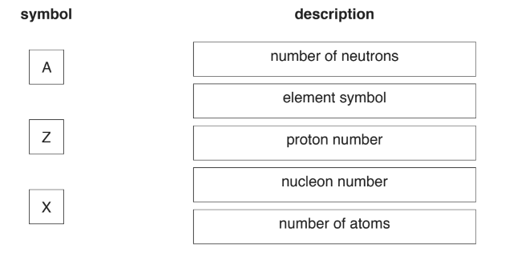

*Source: 2018 0625/32 Q12A*

**Q24** [6 marks]

(i) One radioactive isotope has a half-life of 6.0 years.

A sample of this isotope has a mass of 12 mg.

Calculate the mass of this isotope that remains in the sample after 18 years.

mass remaining = .................................................... mg [3]

(ii) The sample decays by emitting a β-particle.

Describe the nature of a β-particle.

[2]

(iii) Describe how the nucleus of the isotope changes due to the emission of a β-particle.

[1]

*Source: 2018 0625/32 Q12B*

