# Mark Schemes — Earth & The Solar System
**6. Space Physics** · Cambridge (CIE) IGCSE physics (0625 & 0972)

## Multiple Choice Questions (22 questions)

### Q1
**Final answer:** **The correct answer is C**

- Comets travel in highly elliptical orbits around the Sun
- As a comet moves further away from the Sun, the distance between them increases, which means energy is transferred to its gravitational potential store

  - Therefore, at the point furthest from the Sun, the energy in the gravitational potential store is at its **maximum**
- The total energy of the comet remains constant throughout its orbit
- Due to the principle of conservation of energy, an increase in gravitational potential energy results in a decrease in kinetic energy
- When the gravitational potential energy is at its maximum, the kinetic energy is at its minimum

  - Since kinetic energy depends on speed, a minimum kinetic energy means the orbital speed of the comet is also at its **minimum**

**A** is incorrect as it assumes the orbital speed is at its maximum when the comet is furthest from the Sun

**B** is incorrect because the comet has its minimum orbital speed and maximum gravitational potential energy at this point, not the other way around

**D** is incorrect as the energy in the gravitational potential store is at its maximum, not its minimum, when the comet is furthest away

> **[exam-tip]**
> A great way to remember this is to apply the principle of conservation of energy. When a comet approaches the Sun, it "falls" towards it, losing gravitational potential energy and gaining kinetic energy, causing it to speed up. As it moves away, it travels "uphill" against the Sun's gravity, losing kinetic energy and gaining gravitational potential energy, causing it to slow down.

### Q2
**Final answer:** **The correct answer is C**

- Distances in space are vast, and light takes different amounts of time to travel between objects depending on the scale of the system
- The distance to the centre of the Milky Way is so large that it is measured in light-years
- It takes light approximately 30 000 years to travel from the Sun to the centre of the Milky Way

**A** is incorrect as light takes only a few minutes to reach a rocky planet in the inner Solar System.

**B** is incorrect as light takes several hours to reach a gaseous planet in the outer Solar System.

**D** is incorrect as light takes several years to travel from the Sun to Proxima Centauri (approximately 4 light-years away).

> **[exam-tip]**
> Remember that distances in space increase dramatically as you move from within our Solar System to interstellar distances and beyond. Light-years are used specifically because the distances between stars and galactic structures are so vast that using kilometres or even astronomical units becomes impractical. When comparing time intervals for light travel, think about the scale: minutes for inner planets, hours for outer planets, years for nearby stars, and thousands of years for galactic distances.

### Q3
**Final answer:** **The correct answer is C**

- The Earth rotates on its axis once every 24 hours

  - This rotation causes the side of the Earth facing the Sun to change, creating the cycle of **day and night**
- The Earth orbits the Sun once approximately every 365 days

  - This orbital motion, combined with the tilt of the Earth's axis, causes the periodic cycle of the **seasons**

**A** is incorrect as the orbit around the Sun is too slow to cause the daily cycle of day and night.

**B** is incorrect as it reverses the two causes.

**D** is incorrect as the rotation on the axis happens daily and is not responsible for the yearly change in seasons.

### Q4
**Final answer:** **The correct answer is ****D**** because:**

- The circumference of the orbit is the distance the space station travels each orbit $\mathrm{circumference}=2\mathrm{πr}=2\timesπ\times7000\mathrm{km}=43982\mathrm{km}$
- The space station completes 15 orbits in 24 hours, so the total distance travelled in this time is: $\mathrm{distance} \mathrm{travelled}=43982\mathrm{km}\times15=659735\mathrm{km}$
- Finally, the speed is found using the speed equation:

$v=\frac{s}{t}=\frac{659735\mathrm{km}}{24h}=27489\mathrm{km}/h$

$v=27000\mathrm{km}/h(\mathrm{to}2\mathrm{significant} \mathrm{figures})$

### Q5
**Final answer:** **The correct answer is ****A****, because:**

- Mercury is the planet nearest to the Sun

  - Therefore, eliminate options **C** and **D**
- Mercury is rocky

  - Therefore, option **A** is correct

The four inner planets (Mercury, Venus, Earth and Mars) are all rocky. The four outer planets (Jupiter, Saturn, Uranus, Neptune) are much larger and are gaseous.

### Q6
**Final answer:** **The correct answer is D**

- To find the speed of the Moon, the distance it covers each orbit and the time of each orbit are both needed
- The distance is the circumference, *C*, of its circular orbit

$C=2πr$

- The orbital time is given as 710 hours (h) and the radius is 3.8 × 105 km
- Speed is distance per unit time

$v=\frac{2π\times(3.8\times10^{5})}{710}=3360$   km/h

- Written in standard form to two significant figures, this is

$v=3360$  km/h = 3.4 $\times$103  km/h

It is possible to memorise the equation $v=\frac{2πr}{T}$ , but a little physical reasoning and understanding of where this equation comes from could save you having to learn one more equation (and potentially mis-remembering it under exam pressure!).

### Q7
**Final answer:** **The correct answer is B**

- A comet is the only listed object which orbits the Sun

**A **is incorrect as ‘interstellar’ implies the dust and gas cloud is between stars, not orbiting our Sun

**C **is incorrect as a galaxy’s mass is too large to orbit the Sun

**D **is incorrect as the solar system contains only one star, which is the Sun

### Q8
**Final answer:** **The correct answer is ****C**** because:**

- The tilting of the Earth's axis means that certain hemispheres (halves) of the Earth tilt towards the Sun for one half of the year, and away from the Sun from the other half

  - When the northern hemisphere is tilted towards the Sun, this is spring and summer
  - When it is tilted away from the Sun, this is autumn and winter
- The orbiting of the Earth around the Sun means that different sides of the Earth face the Sun at different parts of the year, every 365 days

  - Therefore, the combination of both creates the seasons

The tilting of the Earth's axis and its orbit around the Sun is why when it is winter in Europe (in the northern hemisphere), it is summer in Australia (in the southern hemisphere). Whilst Europe is facing away from the Sun during that time, this means Australia is facing towards the Sun, because of the tilt.

### Q9
**Final answer:** **The correct answer is ****A**** because:**

- Jupiter, Saturn and Uranus are gaseous planets while Mars is a rocky planet

  - Option **B** cannot be correct
- The order of the planets counting from the Sun outwards is:

  - Mercury, Venus, Earth, Mars, Jupiter, Saturn, Uranus, Neptune
- Therefore, Jupiter is the gaseous planet closest to the Sun

To learn the order of the planets, try a mnemonic such as ***'my very excellent mother just served us noodles'***.

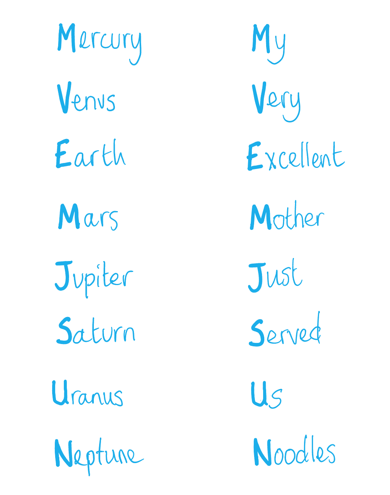

### Q10
**Final answer:** **The correct answer is ****A**** because:**

- Most objects in our solar system have elliptical orbits

  - This includes all planets, minor planets (such as dwarf planets and moons) and comets

**B** is incorrect as the Sun is at the centre of a **circular** orbit, not in an elliptical one

**C** is incorrect as planets also have elliptical orbits **D** is incorrect as the orbital radius of an object in an elliptical orbit constantly changes (an ellipse looks like a squashed circle)

It is a common misconception that planets have a circular orbit around the Sun. You will notice calculations for orbital speed and radius will assume the orbit is circular, this is a simplified model that is only an approximation.

### Q11
**Final answer:** **The correct answer is ****A**** because:**

- **Asteroids** are mostly found between Mars and Jupiter where they orbit the Sun in an area called the Asteroid Belt
- **Comets** orbit the Sun on long paths which bring them periodically into the Solar System and then far out to an area called the Oort Cloud
- **Galaxies **are distant groupings of stars which are receding from our own galaxy
- **Moons** are described as orbiting their parent planet

  - It could be said that since the planet orbits the Sun that the Moon does too, but this is not the **usual** description of their motion

### Q12
**Final answer:** **The correct answer is ****C**** because:**

- The strength of the gravitational field:

  - At the surface of a planet depends on the **mass** of the planet - more mass means more gravitational pull
  - Around a planet **decreases** as the distance from the planet **increases **- gravitational field strength gets weaker the further you are from the planet
- This is row **C**

Make sure to remember it is the **mass** of the planet that affects its gravitational field strength the most, not so much its surface area or diameter or density.

### Q13
**The answer is ****A**** because**

- Gravitational field strength is proportional to the mass

  - If the mass of Earth were higher then the force would be higher
  - Only option **A** shows the force increase

- Gravitational force decreases as the distance between the masses increases

  - Therefore, if the distance between the Earth and the Moon increased then the force would decrease
  - This confirms that option **A** is the only possible correct solution

### Q14
**Final answer:** **The correct answer is ****B**** because:**

- To find the orbital speed use the equation for speed
$v=\frac{d}{t}$
- Where *v* = average velocity, *d* = distance and *t *= time
- From the question:

  - Circumference, or distance, *d* = 942 × 106 km
  - Time of one orbit, *t* = 365 days
  - Time can be converted using *t *= (365 × 24) hours = **8760 hours**

- Therefore, the orbital speed,
- $v=\frac{(942\times10^{6})\mathrm{km}}{8760h}=107534\mathrm{km}/h$
- This can be written as 100 000 km /h when rounded to one significant figure

Notice that if a more accurate value for time is used, 365.25 days = 8766 hours, the final answer still rounds to the same value.

### Q15
**Final answer:** **The correct answer is ****B**** because:**

- The Earth’s axis tilts 23.4° from the vertical
- The effect of this tilt is a change in intensity of the sunlight falling on the surface of the Earth at different times of year

  - Therefore, the tilt of the Earth’s axis causes the changing of the seasons

**A** and **C** are incorrect as the rising and setting of the Sun are caused by the rotation of the Earth on its axis

**D** is incorrect as the angle is too large

It’s a common misconception to think that the seasons are caused by the Earth being closer to the Sun during the summer.

But, when it is summer in the Northern Hemisphere it is winter in the Southern Hemisphere!

Although the Earth **is **slightly closer to the Sun at certain times, the distances are so huge that it makes virtually no difference to the heat and light energy received.

What **does **make a big difference is the tilt, so that sometimes the Earth ‘leans into’ the sunlight, and at other times, ‘leans away’.

### Q16
**Final answer:** **The correct answer is ****C**** because:**

- The average orbital speed, *v* is calculated by: $v=\frac{2πr}{T}$

  - Where *r* is the orbital radius and *T* is the orbital time period

- Convert the orbital radius (distance) from km into m

  - 227.9 million km = 227.9 × 106 km = 227.9 × 109 m
  - orbital radius, *r*  = 227.9 × 109 m

- Convert the time period (orbital duration) from days into hours:

  - 1 day = 24 hours
  - orbital period, *T* = 687 × 24 = 16 488 hours

- Substituting the values into the orbital speed equation gives:

  - $v = \frac{2 \mathrm{\pi } \times ( 227.9 \times 10^{9} ) }{16 488} = 8.68 \times 10^{7} \mathrm{m} \div \text{hr}$

Whenever you are doing calculations based on values from a table, make sure to read the units properly!

In this case, the orbital distance (radius) has been given in 'million km' and the orbital duration (time period) has been given in days or hours (hr). These must match the units that are needed for the orbital speed (m/hr)

### Q17
**Final answer:** **The correct answer is ****C**** because:**

- **Accretion disc** describes a rotating disc of gas, plasma and other matter which forms around a star

  - It is not made up of rocky material as this is the description of an asteroid belt
  - Therefore statement **1** is correct and statement **2** is not correct

- The accretion disc which formed around the early Sun provided the material which now makes up the rocky and gaseous planets

  - Statement **3** is correct

- The range of elements in the accretion disc therefore explains the range of elements found in the planets

  - Statement **4** is correct

- The Sun had already formed, and elements are created within it, they do not come from the accretion disc

  - Statement **5** is not correct

The Space topic has a lot of vocabulary which is completely new to you.

Don't be surprised or put off if sometimes that feels difficult.

But it does mean that it's essential that you spend time learning the definitions and getting used to using the language in this topic.

### Q18
**Final answer:** **The correct answer is ****C ****because:**

- The question shows the Moon in its **first quarter**

  - This is the phase seen a quarter of a lunar month (7 days) after the New Moon
- Seven days after the first quarter the Moon will be **full,** as shown in Option **C**

**A **is incorrect as this shows the third quarter, which is seen 21 days into the Lunar cycle, two weeks after the phase in the question

**B** is incorrect as  this shows a waxing crescent, which is seen a few days before the phase seen in the question

**D** is incorrect as this is a New Moon, seen three weeks after the first quarter

It can be difficult to visualise the different phases of the moon. The easiest way is to draw them out in a simpler version of the diagram below.

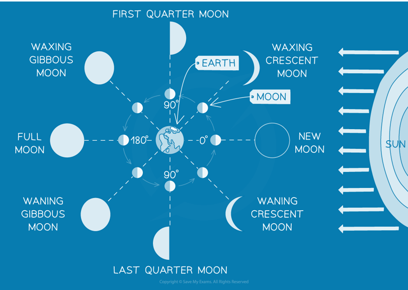

In this diagram, you need to read the cycle anticlockwise, beginning with the New Moon

### Q19
**Final answer:** **The correct answer is ****B**** because:**

- Energy is always conserved

  - This means that throughout the orbit of a comet, the total of its kinetic energy and gravitational energy must always be the same

- Gravitational potential energy **increases** when the comet is far from the Sun (and about to be pulled back towards it) and **decreases** when it is close to the Sun

  - The decrease in gravitational potential energy is balanced by an increase in kinetic energy

### Q20
**Final answer:** **The correct answer is ****C**** because:**

- Average orbital speed is defined by the equation $v=\frac{2πr}{T}$

  - Where *r *is the average radius of the orbit and *T* is the orbital period

- From the question

  - Average radius, *r* = 108.2 million km = 108.2 × 106 km
  - Orbital period, *T* = 225 days = 225 × 24 = 5400 hours

- Therefore, average orbital speed,
- $v=\frac{2π\times(108.2\times10^{6})}{5400}=125896\mathrm{km}/h$ Rounding to 3 significant figures gives 126 000 km/h

**A** is incorrect as the value of π has been left out of the calculation

**B** is incorrect as the 2 was left out of the calculation

**D** is incorrect as the answer is derived from dividing the distance by the number of days, rather than hours

### Q21
**Final answer:** **The correct answer is ****D**** because:**

- A **year **is defined as the amount of time it takes for a planet to complete one orbit of its star

  - In this case the Earth is usually said to orbit the Sun once every 365 days
  - Only **C** or **D** could be correct

- A **day **is defined as the amount of time it takes for a planet to complete one full rotation on its axis

  - The Earth rotates once every 24 hours
  - **D** must be correct

- An **equinox **(meaning ‘equal night’) happens twice a year (21st March and 23rd September) when the daylight and night-time hours are equal

  - Therefore, daylight hours during an equinox are half of 24, or 12 hours
  - This confirms that answer** D** is correct

In fact the Earth takes 365.25 days to orbit the Sun.

These extra 6 hours are ‘saved up’ for four years, then added to February in leap years. This prevents the calendar getting out of synch with the seasons (which otherwise it would eventually) and creates that extra day in February.

### Q22
The answer is **B** because:

- The time is calculated by:

  - $speed=\frac{distance}{time}\Rightarrowtime=\frac{distance}{speed}$
- The speed is the speed of light = 3 × 108 m/s
- Converting the distance into metres (m) gives:

  - 1 km = 1000 m
  - 778 × 106 km = (778 × 106) × 103 m = 778 × 109 m
- Substituting these values into the time equation gives:

  - $timetaken=\frac{778\times10^{9}}{3\times10^{8}}=2593=2600s$

**A** is incorrect as the distance has not been converted from km into m

**B** is incorrect as the time has been calculated as 
$\frac{speed}{distance}$instead of $\frac{distance}{time}$ and the distance has not been converted into m

**D** is incorrect as the time has been calculated as $\frac{speed}{distance}$instead of $\frac{distance}{time}$

For the time to be in s, the distance must be in m and the speed in m/s. Make sure to look out for unit conversions, as units on both sides of the equations must be equal

## Theory Questions (20 questions)

### Q1
> **[mark-scheme]**
> A light-year is:
> 
> - The distance travelled by light in one year **[1 mark]**

> **[exam-tip]**
> A very common mistake is to describe a light-year as a unit of time. Remember, a light-year is a unit of distance. Make sure your answer includes the word 'distance' (or 'how far'), refers to 'light', and specifies 'one year'. Avoid phrases like 'the time it takes light to travel' or 'the speed of light in one year', as these will not earn the mark.
To calculate the distance of one light-year:

- List the known quantities:

  - Speed of light, $v=3.0\times10^{8}m/s$
  - Time, $t=1\mathrm{year}$
- Calculate the number of seconds in one year

$1 \text{year} = 365 \times 24 \times 3600 = 3 . 15 \times 10^{7} \text{s}$ **[1 mark]**

- Substitute the known quantities into $d = v \times t$:

$d = ( 3.0 \times 10^{8} ) \times ( 3.15 \times 10^{7} )$ **[1 mark]**

$d=$ $9.5\times10^{15}\text{m}$ **[1 mark]**

> **[mark-scheme]**
> 1 mark for correctly converting 1 year to seconds
> 
> - Accept 3.15 × 107 s or 3.16 × 107 s (using 365.25 days)
> - Do not accept if days, hours or minutes are not all converted
> 
> 1 mark for correct substitution into $d=vt$
> 
> 1 mark for a correct final answer of 9.5 × 1015 m
> 
> - Must be given to 2 s.f. as stated in the question

> **[exam-tip]**
> When calculating large distances in astronomy, always convert time into seconds first before multiplying by the speed of light. A common error is to forget one of the conversion steps (days → hours → minutes → seconds), giving an answer that is many orders of magnitude too small.
To calculate the time for the signal to reach Proxima Centauri:

- List the known quantities:

  - Speed of light, $v=3.0\times10^{8}m/s$
  - Distance from Earth, $d=4.0\times10^{16}m$
  - Seconds in $1\text{year}=3.15\times10^{7}\text{s}$ (from (b))
- Rearrange $d = v \times t$ to calculate the time in seconds:

$t=\frac{d}{v}$

$t=\frac{4.0\times10^{16}}{3.0\times10^{8}}$

$t=1.33\times10^{8}\text{s}$ **[1 mark]**

- Convert to years:

$t=\frac{1.33\times10^{8}}{3.15\times10^{7}}$ **[1 mark]**

$t=$ $4.2\text{years}$ **[1 mark]**

> **[mark-scheme]**
> 1 mark for correct substitution into $t = d / v$ **OR** correct time in seconds
> 
> - Accept 1.3 × 108 s or 1.33 × 108 s
> 
> 1 mark for correct conversion to years
> 
> 1 mark for a correct final answer of 4.2 years

> **[exam-tip]**
> This question tests your ability to work with very large numbers in standard form. Remember to convert your final answer into the units asked for — here the question asks for the time 'in years', so you must convert from seconds back to years using the same conversion factor from part (b).

### Q2
To calculate the average orbital speed of the Earth:

- List the known quantities:

  - Orbital radius of Earth, $r=150\times10^{6}\text{km}$
  - Orbital period of Earth, $T=1.00\mathrm{year}$
- Convert the orbital radius to metres:

$r=150\times10^{6}\times10^{3}=150\times10^{9}\text{m}$

- Convert the orbital period to seconds:

$T=365\times24\times3600=3.15\times10^{7}\text{s}$ **[1 mark]**

- Calculate the orbital speed:

$v=\frac{2πr}{T}$ **[1 mark]**

$v = \frac{2 \mathrm{\pi } \times ( 150 \times 10^{9} )}{3.15 \times 10^{7} }$

$v = 3 . 0 \times 10^{4}  \text{m/s}$ **[1 mark]**

> **[mark-scheme]**
> 1 mark for correct conversion of time to seconds
> 
> - Accept $365\times24\times3600$ **OR** $3.15\times10^{7}\text{s}$
> 
> 1 mark for the correct equation **OR** correct substitution
> 
> - Accept $v=2πr/T$ **OR** $( 2 \mathrm{\pi } \times 150 \times 10^{6} ) \div ( 365 \times 24 \times 3600 )$ **OR** $9.42\times10^{11}/3.15\times10^{7}$
> 
> 1 mark for a correct final answer of $3.0\times10^{4}\text{m/s}$
> 
> - Accept: use of $T = 3 . 2 \times 10^{7}  \text{s}$ giving $v = 2 . 9 \times 10^{4}  \text{m/s}$

> **[exam-tip]**
> A very common mistake is to use the radius instead of the circumference — remember, the planet travels the full circumference in one orbital period, not just one radius.
> **[mark-scheme]**
> - Orbital speed decreases as distance from the Sun increases **OR** planets further from the Sun have a lower orbital speed **[1 mark]**
> - Gravitational field strength/gravitational force decreases with distance from the Sun, so the planet needs a lower speed to stay in orbit **[1 mark]**

> **[exam-tip]**
> You can verify the relationship from the data: Mercury is closest to the Sun and orbits fastest (largest circumference-to-period ratio), while Jupiter is furthest and orbits slowest. The explanation links to gravitational field strength — further from the Sun, the gravitational field is weaker, so the gravitational pull on the planet is smaller. A weaker pull means the planet needs a lower speed to remain in a stable orbit; if it moved too fast, it would spiral outwards.
> 
> Make sure you link the weaker gravitational field to the effect on orbital speed — simply saying "less gravity" without explaining why this leads to a lower speed will not earn the second mark.
To calculate the speed at which this galaxy is moving away from the Earth:

- List the known quantities:

  - Distance of galaxy from Earth, $d=9.0\times10^{7}$ light-years
  - Hubble constant, $H_{0}=2.2\times10^{-18}$ per second
- Recall the value of a light-year and convert the distance to metres:

1 light-year = $9.5\times10^{15}m$ **[1 mark]**

$d = ( 9.0 \times 10^{7} ) \times ( 9.5 \times 10^{15} )$

$d=8.55\times10^{23}\text{m}$

- Apply Hubble's law to calculate speed:

$v=H_{0}d$ **[1 mark]**

$v = ( 2.2 \times 10^{- 18} ) \times ( 8.55 \times 10^{23} )$

$v=1881000$

$v=$ $1.9\times10^{6}\text{m/s}$ **[1 mark]**

> **[mark-scheme]**
> 1 mark for stating 1 light-year = $9.5\times10^{15}m$ **OR** correct conversion to metres
> 
> - Accept $9 . 0 \times 10^{7} \times 9 . 5 \times 10^{15}$ **OR** $8 . 55 \times 10^{23}  \text{m}$
> 
> 1 mark for correct equation **OR** correct substitution
> 
> - Accept $v=H_{0}d$ **OR** $2 . 2 \times 10^{-18} \times 8 . 55 \times 10^{23}$
> 
> 1 mark for a correct final answer of $1.9\times10^{6}\text{m/s}$
> 
> - Accept: $1880\text{km/s}$ or $1.88\times10^{6}\text{m/s}$ or $1900\text{km/s}$ or $1.9\times10^{3}\text{km/s}$

> **[exam-tip]**
> Sometimes you may be given the values of a light year ($9.5\times10^{15}m$) and the Hubble constant ($2.2\times10^{-18}$ per second) in a question, but not always. If you are taking the extended paper, you must learn them as you could be expected to recall either value.

### Q3
> **[mark-scheme]**
> - A galaxy is a collection of billions of stars **[1 mark]**
> **[mark-scheme]**
> - The distance travelled by light in one (Earth) year **[1 mark]**
> **[mark-scheme]**
> - Planets orbit stars **[1 mark]**
> - The Moon orbits a planet **[1 mark]**
> **[mark-scheme]**
> Any **four **from (one mark for each point):
> 
> - Dust and gas clouds orbit the Sun
> - Contained many different elements
> - The material rotates around the Sun / forms an accretion disk
> - Further from the Sun, the temperature is lower/cooler
> - Lighter elements / hydrogen / helium / water / methane trapped there (due to lower temperature)
> - Larger, gaseous / low density planets formed
> - Due to gravitational attraction
> 
> **[4 marks]**

### Q4
The four inner planets are:

1. Mercury
2. Venus
3. Earth
4. Mars

- Three correct names for the planets (in any order);** [1 mark]**
- Names are in the correct order (as shown); **[1 mark]**

**[Total: 2 marks]**

### Q5
The apparent motion of the Sun across the sky is observed because:

- The Earth rotates on its axis; **[1 mark]**
- Every 24 hours or every day; **[1 mark]**

An example answer could be:

*The Sun appears to move across the sky because of the Earth’s rotation on its axis once every day.*

**[Total: 2 marks]**

> **[exam-tip]**
> The key concept for this explanation is that the Sun is *apparently* moving. If it is not moving across the sky and so something else must be happening to cause this apparent movement. You should know that the Earth is rotating and that makes the Sun appear to move.

### Q6
The statement is wrong because:

- The <u>Sun is a star</u> (so it is the closest);** [1 mark]**

**[Total: 1 mark]**
To calculate the distance to Proxima Centauri:

List the known quantities:

- Speed of light, *v * = 3.0 × 108 m/s; **[1 mark]**
- Time from Proxima Centauri, *t*p = 2 200 000 minutes = 1.32 × 108 s
- Time from the Sun, *t*s = 8.3 minutes = 498 s

(i) Calculate the distance, *s*, in metres:

Rearrange the equation for speed and substitute the quantities:

- $s = v \times t = ( 3.0 \times 10^{8} ) \times ( 1.32 \times 10^{8} ) = 3.96 \times 10^{16}$ **[1 mark]**

Write the answer to two sig figs including units:

- $s=4.0\times10^{16}m$ **[1 mark]**

** **

(ii) Use the ratio method to determine the distance in terms of astronomical units:

Determine a quantity which will be valid in a ratio calculation:

- Since distance is directly proportional to time, the distances can be compared <u>using time</u>
- Ratio of times, $\frac{toP.Centauri}{totheSun}=\frac{2200000\mathrm{mins}}{8.3\mathrm{mins}}=265060$ **[1 mark]**
- Distance = 265 000 Au **[1 mark]**

**[Total: 5 marks]**

> *You may have spent much more time on your calculation than our solution suggests. Always look for simpler routes to the answer before starting a lengthy calculation. Especially if the mark scheme suggests a short method will work, as it does here.*

> *The examiner won't expect you to write your explanation of why you chose time to calculate with, but you would get a mark when they saw you working with it. *
Suggest a reason to give the distance from stars in terms of light years:

- Stars are so distant / far away; **[1 mark]**
- That a large unit of distance is needed **OR **the numbers (of m or km) would be too big **OR **light years are easier to work with; **[1 mark]**

**[Total: 2 marks]**

### Q7
(i) The name of the body indicated is:

- Neptune; **[1 mark]**

(ii) The name of the body indicated is:

- Saturn; **[1 mark]**

(iii) The name of the body indicated is:

- Earth; **[1 mark]**

**[Total: 3 marks]**
The differences between the inner and outer planets include:

**Any three from:**

- Inner planets are rocky **AND **outer planets are gas / gaseous; **[1 mark]**
- Inner planets are smaller than outer planets (or reverse argument); **[1 mark]**
- Inner planets have shorter time period / orbital time / year (or reverse argument); **[1 mark]**
- Inner planets have greater orbital speed (or reverse argument); **[1 mark]**
- Inner planets experience a stronger gravitational pull from the Sun (or reverse argument); **[1 mark]**

**[Total: 3 marks]**

> *Your answer in a 'compare' question must take into account features of both sides. So it isn't enough to say 'inner planets are small', but instead the answer has to say 'inner planets are small**er** **than** outer planets'.*

> *Reverse argument simply means stating the same fact in the opposite way. So for example, 'the outer planets have longer years than the inner planets'.*
(i) The position on the graph where Uranus should be plotted:

The position of the X scores **three marks**:

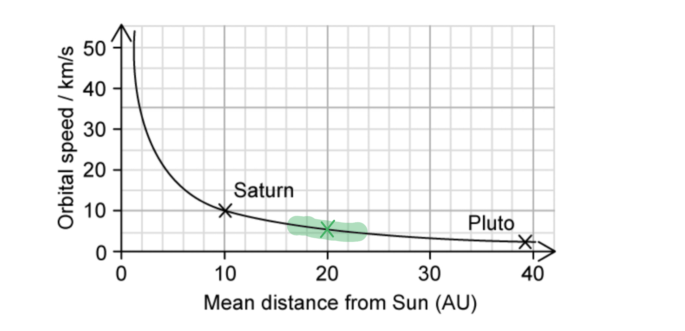

- To the right of the plot for Saturn **AND **on the line; **[1 mark]**
- In the range 16 - 24 AU (as shown by the highlighted area); **[1 mark]**
- Within the range 19.5 - 20.5 AU (as shown by the green **X**); **[1 mark]**

ii) To estimate the orbital speed of Uranus:

Use the graph to read the corresponding value from the y-axis:

- Answer in the range 4.0 - 7.0 km/s **[1 mark]**

**[Total: 4 marks]**

### Q8
To determine the orbital speed from the graph:

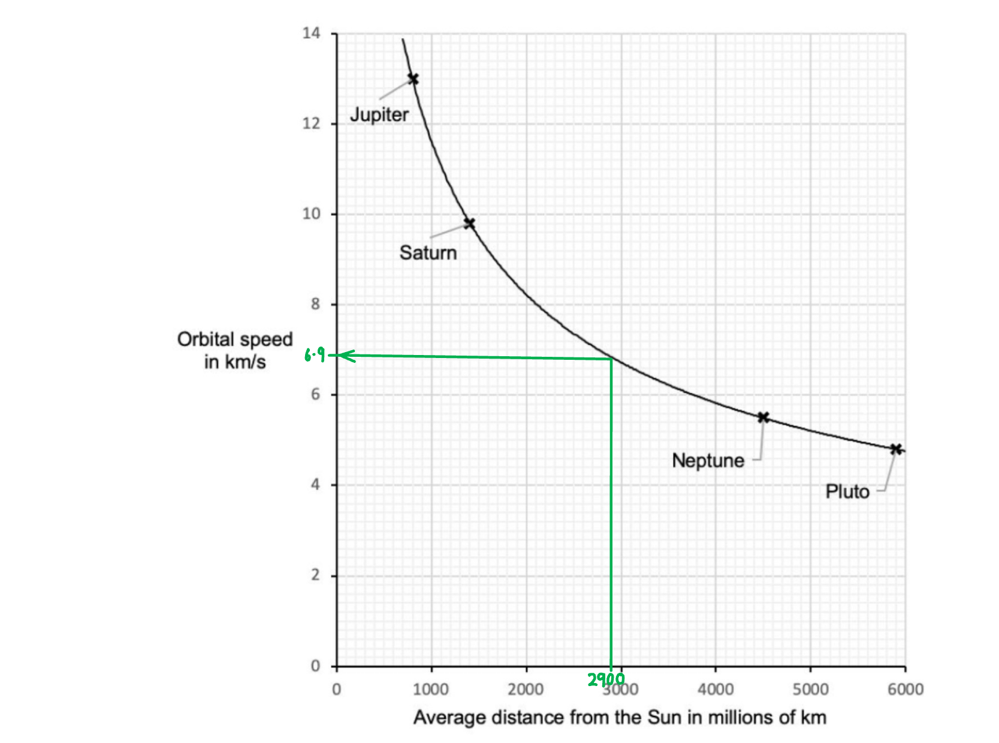

- Clearly mark the graph to show the method;** [1 mark]**
- Orbital speed in the range 6.8 - 6.9 km/s;** [1 mark]**

**[Total: 2 marks]**

> *When you are asked to 'use the graph' to find an answer, there will be a mark simply for showing on the graph that you know what the method is. This is quite separate from the mark for the correct answer.*
(i) To calculate the distance travelled in one orbit:

List the known quantities:

- Radius of orbit, *r*  = 800 million km (from the graph) **[1 mark]**

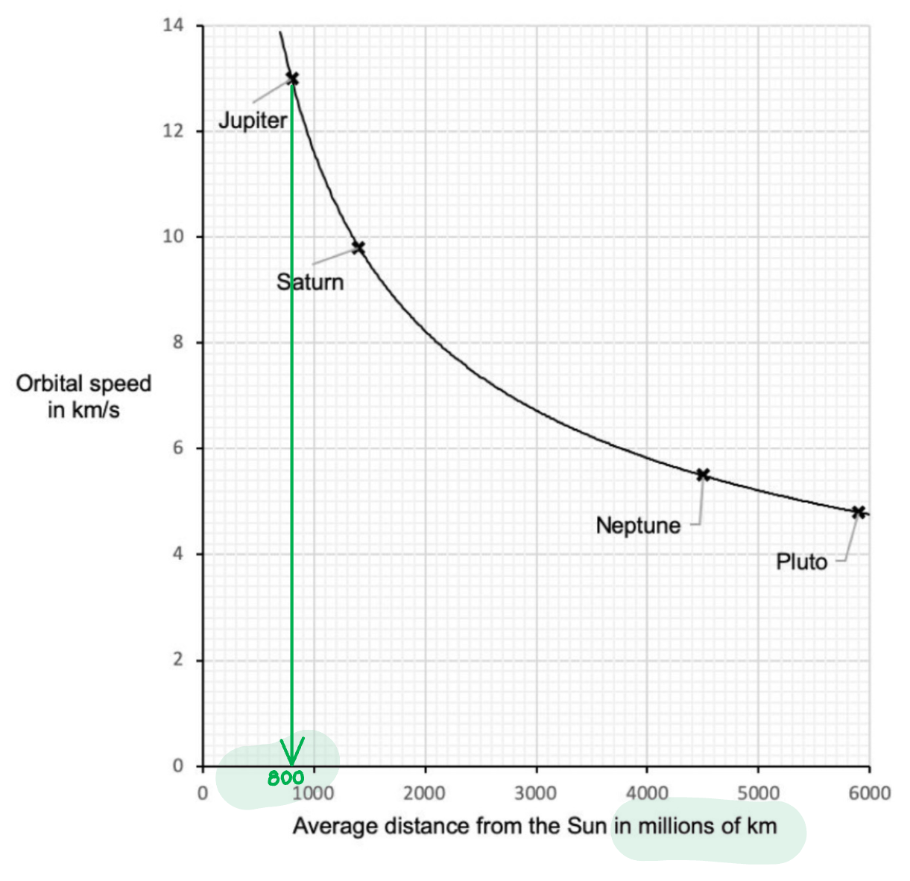

Recall the equation for the circumference of a circle:

- $c=2πr$ **[1 mark]**

Substitute the radius and calculate:

- $c=2\timesπ\times800\mathrm{million}$
- $c=5027\mathrm{million}$

Round the answer to two significant figure and write the units

- Distance travelled by Jupiter in one full orbit = 5 000 million km **[1 mark]**

(ii) To calculate the time taken to complete one orbit:

List the known quantities:

- Distance travelled in one orbit, d = 5 000 million km (from part (i))
- Orbital speed, *s* = 13 km/s (from the graph) 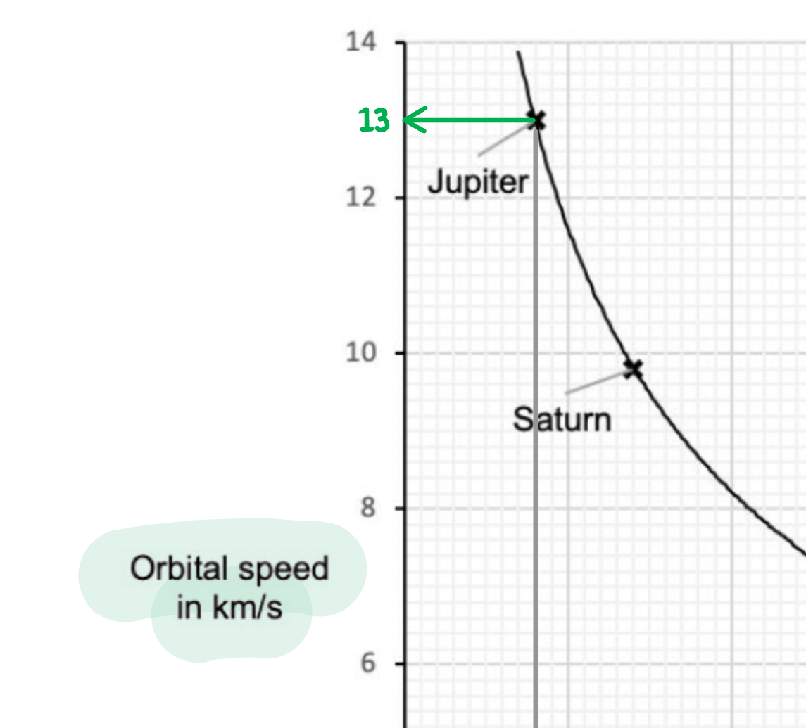

Use the equation linking speed, distance and time:

- $speed=\frac{distance}{time}$ **OR**** **$s=\frac{d}{t}$ **[1 mark]**

Rearrange to make time the subject:

- ** **$t=\frac{d}{s}$

Substitute the values and calculate to get a time in seconds:

- Leave the distance in km as the orbital speed is given in km/s
- $t=\frac{5000000000}{13}$
- $t=384.6\mathrm{million} \mathrm{seconds}$ **[1 mark]**

To convert seconds to days divide by (seconds × minutes × hours):

- $t = \frac{384 600 000}{( 60 \times 60 \times 24 )} = 4451$

Round the answer to two significant figures:

- Orbital period of Jupiter = 4500 days **[1 mark]**

**[Total: 6 marks]**

> *For part (ii) if you didn't spot that you could use the equation for speed, you may have used the equation for orbital speed, in which case your calculation should look like this:*

> *Recall the equation relating orbital speed, radius and orbital period, **T **:*

> $v=\frac{2πr}{T}$* [1 mark]*

> *Rearrange to make T the subject:*

- $T=\frac{2πr}{v}$* *

> *Substitute the values and calculate:*

- $T=\frac{2\timesπ\times800000000}{13}=387000000seconds$*[1 mark]*

> *Convert seconds to days:*

- $T = \frac{387 000 000}{( 60 \times 60 \times 24 )} = 4478 = 4500 d a y s$*[1 mark]*

> *Hopefully you are getting confident with standard form. In that case you should be writing 5000 million = 5000 × 10**6**, for example, which will make your calculations neater and easier to follow. *

> *If you aren't confident with standard form yet you can get away without using it at GCSE, but we do recommend you try as you will really need it if you continue on to A-level sciences or maths.*
A diagram showing the typical orbit of a comet looks like:

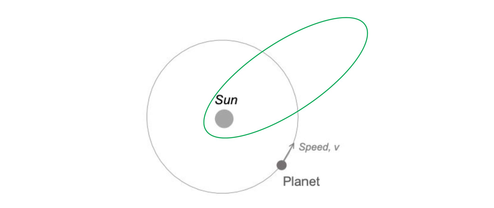

- Orbit is elliptical (<u>not</u> circular) **AND **Sun shown off-centre at a focal point (by eye) **AND **orbit extends beyond the planet's orbit; **[1 mark]**

**[Total: 1 mark]**

> *In an exam situation don't waste time making your comet diagrams perfectly geometrical, but do pay attention to the rules in the list above. Use a pencil in case your diagram goes wrong and be prepared to make a quick sketch of the orbit. The diagrams below show three versions which would get the mark, and two which would not.*

> *Enough for [1] mark*

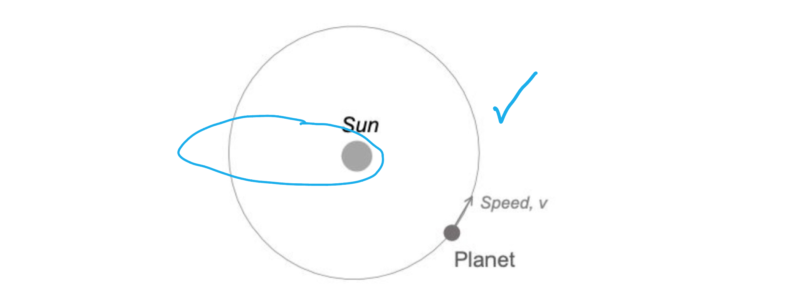

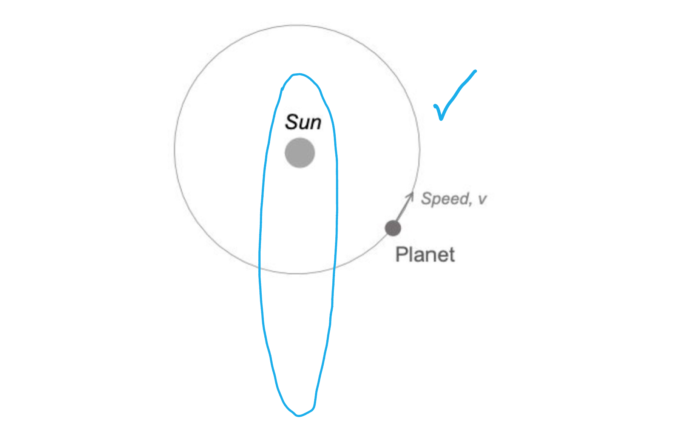

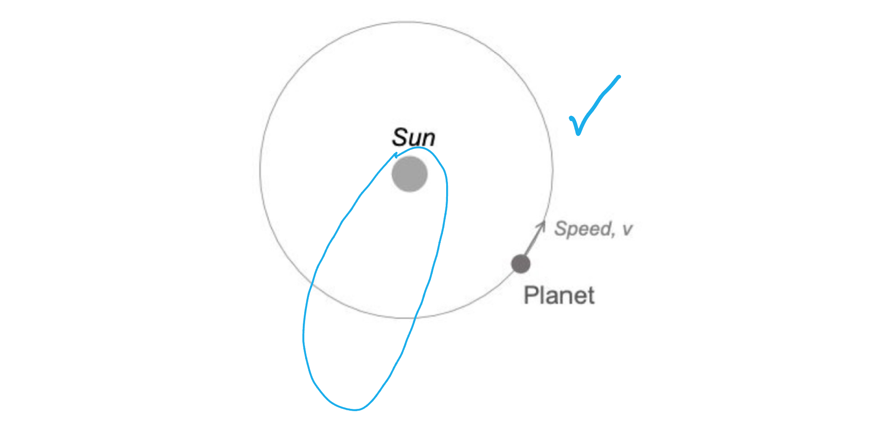

*Not enough for [1] mark***  **

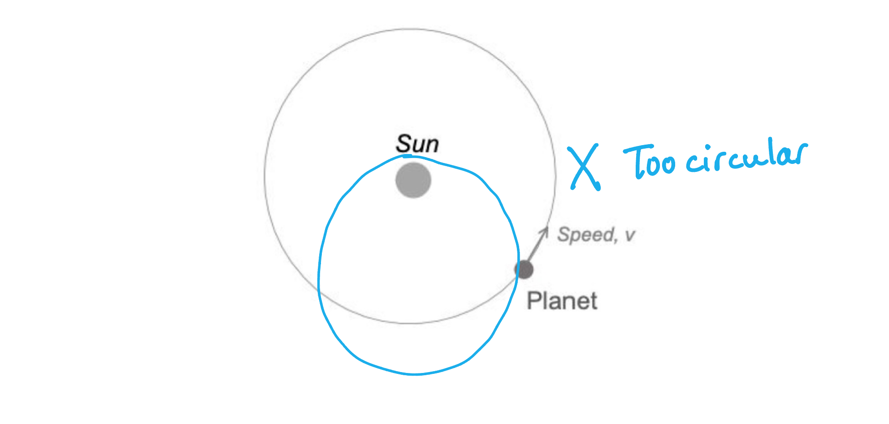
The point where the comet is travelling at greatest speed is:

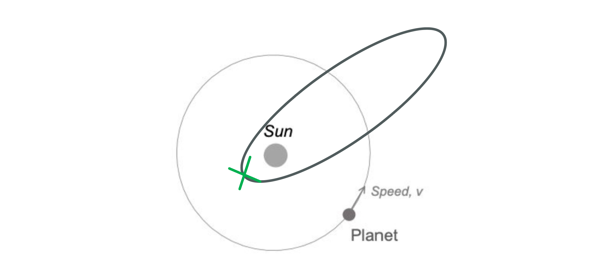

- **X** marked where the orbit comes closest to the Sun;** [1 mark]**

**[Total: 1 mark]**

> *At this point, the gravitational force between the Sun and the comet is strongest as they are at their closest. Gravity is a force that becomes much stronger when the objects move closer to one another. *

### Q9
State similarities between orbits:

**Any two from:**

- The orbits are:

  - Elliptical **OR**** **approximately/nearly circular; **[1 mark]**
  - In the same plane; **[1 mark]**
  - In the same direction (around the Sun); **[1 mark]**

State differences between orbits:

**Any one from:**

- The orbits:

  - Are at different <u>distances</u> from the Sun **OR**** **have different <u>radii / diameter</u>; **[1 mark]**
  - Have different <u>speeds</u>; **[1 mark]**
  - Have different <u>durations / orbital periods</u>; **[1 mark]**

**[Total: 3 marks]**

> *A good way to learn facts like these is to draw annotated diagrams as part of your revision notes, using the correct keywords to label your sketches. The sketch below is just an example - try to construct your own notes and diagrams as this form of **synthesis of knowledge** really helps with recall.*

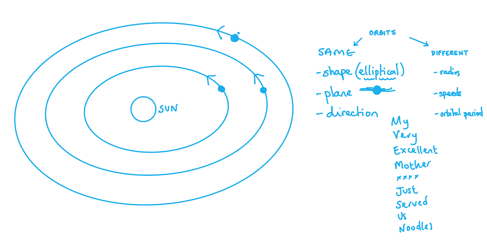
(i) The source of the heavier elements is:

- A supernova (explosion); **[1 mark]**

**    **

(ii) The process which formed the inner planets:

- Is called the <u>accretion model</u> of the solar system; **[1 mark]**

**Any four from:**

- Dust / a disc cloud of matter (left from the formation of the Sun); **[1 mark]**
- Contained elements created in a <u>supernova</u>; **[1 mark]**
- <u>Gravity caused the disc to spin / rotate</u> around the Sun; **[1 mark]**
- <u>Gravitational attraction / gravity</u> caused the dust / (small) particles to <u>join / clump together</u>; **[1 mark]**
- Forming an <u>accretion disc</u>; **[1 mark]**
- Near the Sun the <u>temperature was high</u>; **[1 mark]**
- Therefore the inner planets are made of materials with <u>high melting points</u> (such as metals); **[1 mark]**

**An example of an answer which would score five marks is:**

- The accretion model **[1 mark] **of the solar system.
- This says that the dust left over after the Sun formed **[1 mark] **contained many heavy elements formed in a supernova explosion **[1 mark].**
- First the dust made a disc which rotated around the Sun due to gravity **[1 mark]. **
- Slowly the dust started to clump together due to gravitational attraction between the particles **[1 mark]. **
- The inner planets are rocky because the temperature near the sun meant that only elements with high melting points existed as solids **[1 mark].**

**[Total: 6 marks]**

> *Long explanations like the one above can seem difficult to learn. However if you practice saying it out loud or writing it down you will see that there is a series of logical steps which must follow one after the other. You will never be expected to recall all the possible answers, so even getting most of it right should be enough to earn you all, or most of, the marks.*
State the difference between the inner and outer planets:

- The outer planets are gaseous **OR**** **much larger (than the inner planets);** [1 mark]**

Explain the difference by referring to the accretion model:

- Temperatures are lower (further from the Sun); **[1 mark]**
- Lighter molecules / gaseous elements have lower melting points / could exist in a solid state; **[1 mark]**
- (Outer planets) could grow to larger size since gravitational effect is less (on lighter molecules); **[1 mark]**

**[Total: 4 marks]**

> *The outer planets have a much lower **density** than the inner planets. A spoonful of Neptune will have a much smaller mass than a spoonful of Venus.*

### Q10
(i) The fourth planet from the Sun is:

- Mars; **[1 mark]**

(ii) A dwarf planet beyond the orbit of Neptune is:

- Pluto; **[1 mark]   **

(iii) A natural satellite orbiting a planet is:

- A moon; **[1 mark]**

**[Total: 3 marks]**

> *For part (iii) make sure not to write 'the Moon'. This is just the moon around Earth, but many of the other planets also have moons, which are all natural satellites.*
The asteroid belt is located:

- Between the <u>orbits</u> of Mars and Jupiter; **[1 mark]**

**[Total: 1 mark]**
The two words most commonly used to describe the outer four planets: are

**EITHER**

- Gaseous; **[1 mark]**
- Large;** [1 mark]**

**OR**

- Gas giants;** [2 marks]**

**[Total: 2 marks]**
The three factors which led to the formation of the planets are

- Gravity / gravitational force (from the Sun); **[1 mark]**
- Many elements in clouds of gas / dust; **[1 mark]**
- (Rotating cloud of dust) forming a disc;** [1 mark]**

**[Total: 3 marks]**

### Q11
(i) The names of the body indicated is:

- Mercury; **[1 mark]**

(ii) The names of the body indicated is:

- Asteroid belt; **[1 mark]**

(iii) The names of the body indicated is:

- Jupiter; **[1 mark]**

**[Total: 3 marks]**
(i) Explain what makes a body in the solar system a moon:

- A <u>natural satellite</u> that <u>orbits a planet</u>; **[1 mark]**

(ii) The body from part (a) which has moons:

- Jupiter; **[1 mark]**

(iii) One other planet apart from Earth and Jupiter which has a moon.

- Mars / Saturn / Uranus / Neptune; **[1 mark]**

**[Total: 3 marks]**
(i) Calculate the closest distance between the Moon and the Hubble telescope:

Subtract the smaller number from the larger:

- 385 000 − 550 = <u>384 450 km</u> **[1 mark]**

(ii) The distance between the Moon and the Hubble telescope changes because:

**Any two from:**

- Their relative positions in their orbits changes; **[1 mark]**
- The orbits have different radii; **[1 mark]**
- The orbits have different speeds / time / periods; **[1 mark]**

**[Total: 3 marks]**
To calculate the orbital speed of the satellite:

List the known quantities:

- Orbital radius,* h* = 550 km = 550 000 m
- Radius of the Earth,* R* = 6400 km = 6400 000 m
- Orbital period, *T* = 96 minutes ⇒ (96 × 60) = 5760 s **[1 mark]**

Calculate the value for orbital radius:

- *r* = *R* + *h* = 6400 000 + 550 000 = 6 950 000 m **[1 mark]**

Use the equation for orbital speed:

- $v=\frac{2πr}{T}$ **[1 mark]**

Substitute the quantities and calculate:

- $v=\frac{2πr}{T}=\frac{2\timesπ\times6950000}{5760}$** [1 mark]**

Write the answer to two sig figs with the unit:

- $v=7581=7600m/s$ ** [1 mark]**

**[Total: 5 marks]**

### Q12
The Moon rises and sets because:

- The Earth rotates on its axis; **[1 mark]**

**[Total: 1 mark]**

> *You might think that the orbit of the Moon causes it to rise and set. But the motion of the Moon across the sky is far too fast to be explained by its orbital speed around the Earth. *

> *You can see the effect of the orbit by noticing how the Moon appears against different stars each night. This is due to the orbital motion.*
(i) The time for a complete lunar cycle:

Any **one **from:

- Approximately one month; **[1 mark]**
- 28 days; **[1 mark]**
- 29.5 days; **[1 mark]**

(ii) The Moon has phases because:

- The Moon orbits the Earth (approximately every month); **[1 mark]**
- The Moon is illuminated by the Sun **OR**
- Light from the Sun hits the Moon; **[1 mark]**
- As the Moon orbits, different proportions/amounts/sections) of the Moon's illuminated/lit surface are visible from Earth; **[1 mark]**

**[Total: 4 marks]**

> *The explanation of phases is not necessarily easy to do using words, unless you have practiced and learned it. If it suits your style better, you can also answer a question like this with a labelled diagram and you will be awarded the marks. For example the one below.*

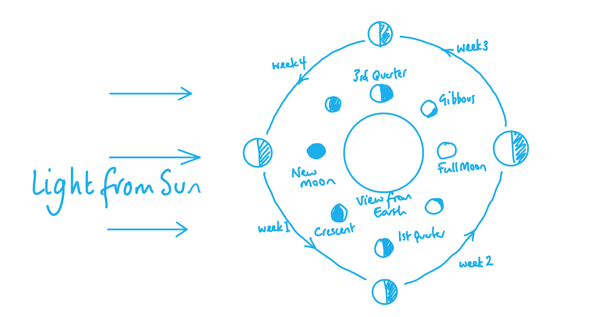
We never see the other side of the Moon because:

- The Moon is rotating on its axis; **[1 mark]**
- The speed of rotation matches / is the same as the orbital speed <u>**OR**</u>** **<u>tidal locking</u> takes place; **[1 mark]**

**[Total: 2 marks]**

Avoid calling the far side of the Moon the 'dark side'. Although this is a popular phrase, you know that we **do **see the dark side of the Moon, for about 25 nights out of 28, as it is the dark side which creates the shapes seen in the phases of the Moon.

### Q13
For each orbit state the position of the body which is being orbited:

(i) Approximately circular:

- At the centre; **[1 mark]**

(ii) Elliptical:

- Focus of ellipse / away from the centre; **[1 mark]**

**[Total: 2 marks]**
The force which keeps satellites in orbit is:

- Gravitational attraction / gravity; **[1 mark]**

**[Total: 1 mark]**
As the distance from the Sun increases:

(i) As the distance from the Sun increases, the gravitational field strength:

- Decreases;** [1 mark]**

(ii) As the distance from the Sun increases, the orbital speed:

- Decreases;** [1 mark]**

**[Total: 2 marks]**
(i) Identify the planet which is closest to the star:

- Hecate;** [1 mark]**

(ii) State the reason for your choice:

- It has the fastest orbital speed; **[1 mark]**

**[Total: 2 marks]**

### Q14
Complete the description of the Earth by filling in the blanks:

- The Earth is a rocky planet following an **elliptical**** **orbit around the Sun; **[1 mark]**
- It rotates on its **axis****; ****[1 mark]**
- Which is tilted at an angle of approximately 23.4° from the **vertical****; ****[1 mark]**
- The Earth takes approximately 24 **hours**** **to complete one full rotation; **[1 mark]**
- Causing the **apparent**** **daily motion of the Sun rising and setting; **[1 mark]**
- Rotation of the Earth on its axis is therefore responsible for the **periodic**** **cycle of day and night; **[1 mark]**

**[Total: 6 marks]**
It is summer in the northern hemisphere at position A because:

- The northern hemisphere is <u>tilted towards</u> the Sun; **[1 mark]**

**[Total: 1 mark]**
Complete the description of the Moon

- The Moon is a natural **satellite**** **of the Earth; **[1 mark]**
- Which travels in a roughly **circular**** **orbit; **[1 mark]**
- The **period**** **of the Moon's orbit**;**** [1 mark] **
- Is approximately **28 days;**** ****[1 mark]**
- The Moon revolves around its own axis with the same **period **as its orbit; **[1 mark]**
- The Moon shines with** reflected**** **light; **[1 mark]**
- From the **Sun**, it does not produce its own light; **[1 mark]**

**[Total: 7 marks]**

> *Unlike Earth which rotates every 24 hours, and takes 365 days to orbit the Sun, the Moon only has one full orbit on its axis as it travels one full orbit around the Earth (roughly 28 days). This is why we always see the same side of the Moon.*
Identify the following phases:

(i) Full moon:

- G **[1 mark]**

(ii) New moon:

- C **[1 mark]**

**[Total: 2 marks]**

### Q15
Orbital speeds of the gas giants are slower than those of the rocky planets because:

Note that the gas giants are further from the Sun:

- The strength of the Sun’s <u>gravitational field decreases</u> with distance;** [1 mark]**
- <u>Centripetal</u> force decreases with distance;** [1 mark]**
- Therefore acceleration is reduced / F = ma; **[1 mark]**

**[Total: 3 marks]**
To estimate the missing masses by referring to the data:

**Method 1 - Using mass and surface gravity:**

(i) Mercury:

- The <u>diameter is approximately one third</u> that of Earth;** [1 mark]**
- If the <u>mass was the same</u> the gravitational field strength would be <u>much larger</u> / approximately nine times as large; **[1 mark]**
- However gravitational field strength is <u>approximately one third</u> that of Earth, suggesting mass is much <u>smaller</u>; **[1 mark]**

(ii) Venus:

- The <u>diameter is similar / almost the same</u> as Earth;** [1 mark]**
- Gravitational field strength is <u>very similar / a little smaller than</u> on Earth;** [1 mark]**
- Suggesting mass is <u>very similar / a little smaller</u>; **[1 mark]**

(iii) Mars:

- The <u>diameter is approximately half</u> that of Earth; **[1 mark]**
- If the <u>mass was the same</u> the gravitational field strength would be <u>much more</u> / approximately four times as large; **[1 mark]**
- However gravitational field strength is <u>less than one third</u> that of Earth, suggesting mass is <u>much smaller</u>;** [1 mark]**

**Method 2 - Using density and diameter:**

(i) Mercury:

- The <u>density is very similar </u>to Earth’s;** [1 mark]**
- The <u>diameter is approximately one third</u> that of Earth, so the volume is much smaller;** [1 mark]**
- Therefore, the mass is much <u>smaller</u> than Earth’s; **[1 mark]**

(ii) Venus:

- The density is similar / slightly smaller than Earth’s;** [1 mark]**
- The <u>diameter is similar / slightly smaller</u> as Earth, so the volume is similar / slightly smaller;** [1 mark]**
- Therefore, the mass is <u>very similar / slightly smaller</u> than Earth’s;; **[1 mark]**

(iii) Mars:

- The density is much <u>smaller</u> than Earth’s;** [1 mark]**
- The <u>diameter is approximately half</u> that of Earth, so the volume is much smaller; **[1 mark]**
- Therefore, the mass is <u>much smaller </u>than Earth’s;** [1 mark]**

**[Total: 9 marks]**

> *A question like this, where you must refer to the data, don’t be tempted to guess, or write down information you can remember. You need to work through it step by step and make it clear how the data supports your conclusion.*

> *There are two different ways that you can think about this. The first uses surface gravity and diameter. The second uses density and diameter. Density is defined as density = mass / volume, so mass = density × volume. And because planets are (roughly) spherical, volume depends on diameter**3**. Therefore, mass depends on density × diameter**3**  (which means even a small change in diameter can make a big difference to mass).*

> *For Mercury and Venus, the densities are quite similar to Earth’s, so diameter (and therefore volume) is the main factor affecting mass. For Mars, both a smaller diameter and a lower density support the conclusion that its mass is much smaller than Earth’s.*
To describe and explain why orbital speeds of comets are not constant;

*Data*

- As orbital radius increases, orbital period increases; **[1 mark]**
- Comparison of data: e.g.: doubling distance increases time by four / from Mercury to Mars the distance multiplies by about four but period by about 8; **[1 mark]**

*Explanation*

Any **five **points from:

- Planets are travelling in <u>circular motion</u>; **[1 mark]**
- Bodies move in a circle due to <u>centripetal force</u>;** [1 mark] **
- The centripetal force is the <u>Sun's gravitational field</u>;** [1 mark] **
- The Sun's gravitational field <u>decreases with distance</u> away;** [1 mark] **
- (Newton's second law states that) F = ma;** [1 mark] **
- Therefore the law predicts that with the increased distance, we expect to see a reduced speed;** [1 mark] **
- Data on distance and orbital speed agrees with this prediction;** [1 mark] **

**[Total: 7 marks]**

> *As long as you have made a comparison between the actual numbers you could choose any pair to compare.*

> *For example: **108 ÷ 58 ≅ 2 but 225 ÷  8 ≅ 4 ** would be enough for the second mark*

### Q16
(i) The fifth planet from the Sun:

- Jupiter; **[1 mark]**

(ii) A rocky object located between Mars and Jupiter:

- Asteroid; **[1 mark]**

(iii) A ball of ice and dust whose orbit takes it beyond the Solar System:

- A comet **OR**** **named comet (for example Halley's comet, Hale-Bopp, Swift-Tuttle); **[1 mark]**

(iv) A small, rocky object orbiting Jupiter:

- A <u>moon</u> / moons (**NOT**** **<u>The</u> <u>M</u>oon); **[1 mark]**

**[Total: 4 marks]**

> *Be careful of mixing up our moon, which we call the Moon, with other moons which orbit other planets. A moon is simply a natural satellite of any planet, and there are over 200 just in our own solar system!*
(i) The correct statements are:

**✓** The Earth orbits the Sun once every 365 days; **[1 mark]**

The Moon takes five weeks to orbit the Earth

**✓** The Moon passes through phases as it orbits the Earth; **[1 mark]**

Day and night on Earth are caused by the Moon's orbit

(ii) To sketch and explain appearance of the Moon two weeks after a New Moon:

A correct sketch looks like:

- Moon shown with no shading; **[1 mark]**

To explain the appearance:

**Any three from:**

- The light we see from the Moon is reflected from the Sun; **[1 mark]**
- The side facing the Sun is always fully illuminated; **[1 mark]**
- As the Moon orbits the Earth we see different amounts of the lit surface;** [1 mark]**
- Two weeks after the Moon is between Earth and the Sun it is on the other side of the Earth; **[1 mark]**
- So we see the whole of the illuminated side; **[1 mark]**

A diagram which would score three marks looks like:

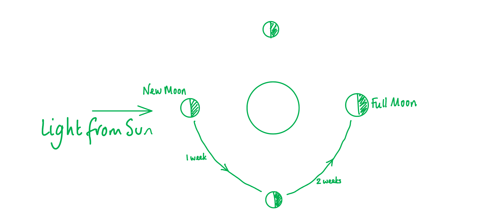

**[Total: 6 marks]**

> *Many students wonder why we do not observe a solar eclipse (where the Moon blocks the light from the Sun) every time there is a new moon. This is because the Moon orbits the Earth at a different angle to the plane of the solar system. The side of the moon facing us receives no direct light from the Sun still, but it does not block the Sun. It is rare that the three align in this way. *

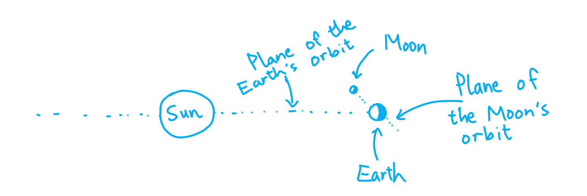

### Q17
(i) The location of the asteroid belt is:

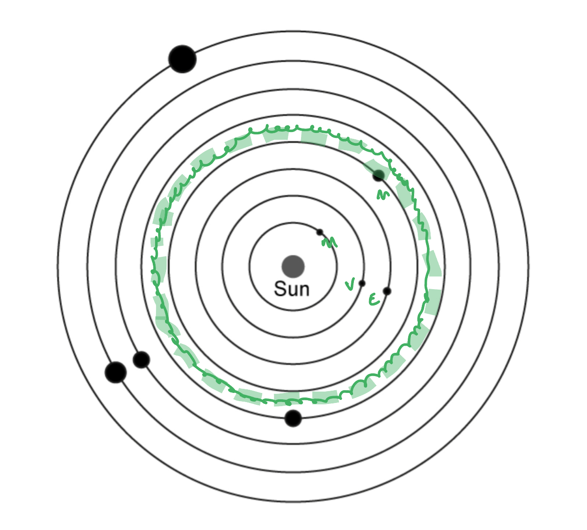

- Between fourth and fifth orbits; **[1 mark]**
- A complete circle; **[1 mark]**

(ii) A possible orbit of a comet entering and leaving the solar system:

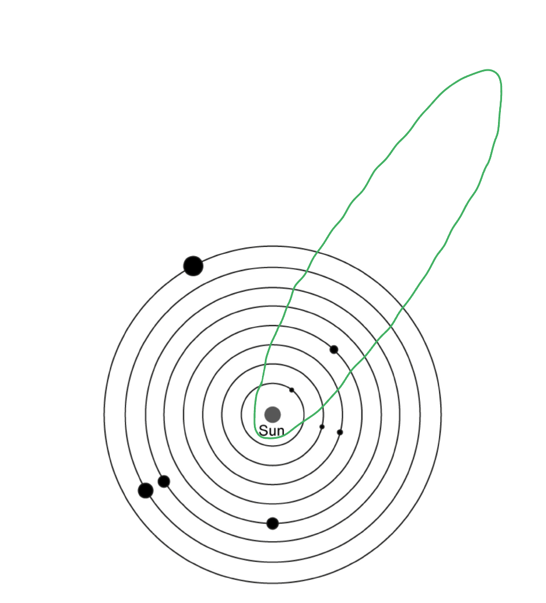

- Squashed / elongated ellipse **AND **<u>one</u> end outside the orbit of Neptune:** [1 mark]**
- Sun is clearly at one end / focus of the ellipse **NOT **in the centre;** [1 mark]**

**[Total: 4 marks]**
Compare the orbits of comets and planets:

**Any five from:**

- Both orbit the Sun; **[1 mark]**
- Both are elliptical; **[1 mark]**

*Planets*

- Planets' orbits are <u>approximately</u> circular; **[1 mark]**
- Sun is at the centre; **[1 mark]**
- Remain inside the (main/ inner) solar system;** [1 mark]**

*Comets*

- <u>Highly</u> elliptical orbits; **[1 mark]**
- Sun is at one focus (of the ellipse); **[1 mark]**
- Can leave the (main / inner) solar system / travel to outer solar system / Oort Cloud / Kuiper Belt;** [1 mark]**

**[Total: 5 marks]**

### Q18
To describe and explain why orbital speeds of comets are not constant;

Any **five **points from:

- Comets' orbits are <u>highly elliptical</u>; **[1 mark]**
- Speed <u>increases closer</u> to the Sun / <u>decreases</u> moving <u>away</u> from the Sun;** [1 mark]**
- Potential energy due to the Sun's gravitational field increases with distance;** [1 mark] **
- Due to conservation of energy; **[1 mark]**
- Energy is transferred from the gravitational potential store to the kinetic store when distance is less / comet nears the Sun; **[1 mark]**
- Increase in KE leads to increased speed **OR **v2 ∝ KE **OR **KE = ½mv2; **[1 mark]**

**[Total: 5 marks]**
To determine the time for Ganymede to complete one orbit of Jupiter:

Choose one position and calculate the number of days between returns:

- e.g: 4 June to 20 June = 16 days; **[1 mark]**

**[Total: 1 mark]**
To calculate the distance from Europa to Ganymede on 8 June:

Consider the problem as a right-angled triangle and use Pythagoras:

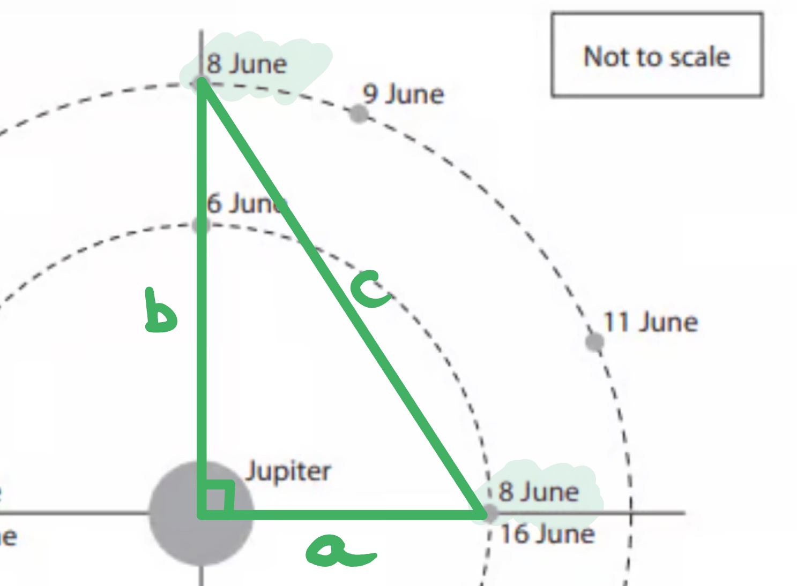

- $a^{2}+b^{2}=c^{2}$ **[1 mark]**

List the known quantities from part (b)

- Radius of Europa's orbit = *a* = 671 000 km
- Radius of Ganymede’s orbit = *b* = 1 070 000 km

Substitute and calculate:

- distance between the moons = *c*
- $c=\sqrt{671000^{2}+1070000^{2}}$ **[1 mark]**

Write the answer to three sig figs and include the unit:

- Distance between the moons, $c = 1 260 000 \text{km} ( 3 \mathrm{s} . \mathrm{f} . )$ **[1 mark]**

**[Total: 3 marks]**
Describe how the distance between Europa and Ganymede changes during three orbits of Europa:

*Data from the diagram:*

**Any two from:**

- Smallest separation on 4 / 20th June **AND** distance = 399 000 km;** [1 mark]**
- Largest separation on 12 / 28th June **AND **distance = 1 741 000 km; **[1 mark]**
- Separation increases after 4th June; **[1 mark]**

*Description:*

**Any one from:**

- Distance between moons increases and then decreases as they orbit; **[1 mark]**
- Distance increases from a minimum on 4th June to a maximum on 12th June, back to a minimum on 20th June and maximum on 28th June; **[1 mark]**
- Distance change is not linear; **[1 mark]**

*Explanation:*

**Any two from:**

- Europa is closer (to Jupiter) / Ganymede is further (from Jupiter); **[1 mark]**
- Europa moves faster / Ganymede moves more slowly; **[1 mark]**
- Europa has a shorter orbital period **/ **Ganymede has a longer orbital speed; **[1 mark]**

**[Total: 5 marks]**

> *There are more marks available for using data (quantitative description) than 'wordy' observation (qualitative description) because, as scientists, we must learn to rely on data to form our conclusions.*

### Q19
Orbital period is:

- The <u>time</u> taken; **[1 mark]**
- For an object to <u>complete one orbit</u>; **[1 mark]**

**[Total: 2 marks]**
State the equation needed to calculate average orbital speed:

- $v=\frac{2πr}{T}$** [1 mark]**
- Where* r* = radius **AND ***T *= orbital / time period;** [1 mark]**

**[Total: 2 marks]**
(i) Determine the radius of a circular orbit:

Recall that the orbital radius is measured from the centre of the Earth:

- Orbital radius = radius of Earth + height of orbit **OR ***R* + *h* **OR **6400 km + 600 km; **[1 mark]**
- r = 7000 km
- r = 7 000 000 m **OR** 7 × 106 m **[1 mark]**

(ii) Convert the orbital period to S.I. units for a circular orbit:

- 1 minute = 60 seconds
- $106\times60=6360s$ **[1 mark]**

**[Total: 3 marks]**

> *The question has asked for your final answer to be in specific **units** - make sure to check your final answer is in these for full marks!*
To calculate the orbital speed of the satellite:

List the known quantities:

- Orbital radius,* r* = 7 000 000 m (from part c)
- Orbital period, *T* = 6360 s (from part c)

Use the equation for orbital speed:

- $v=\frac{2πr}{T}$

Substitute the quantities and calculate:

- $v=\frac{2πr}{T}=\frac{2\timesπ\times7000000}{6360}$** [1 mark]**

Write the answer to two sig figs with the unit:

- $v=6915=6900m/s=6.9\times10^{3}m/s$ ** [1 mark]**

**[Total: 2 marks]**

> *For the speed, **v** to be in m/s, the radius of the orbit **r** must be in **metres** and the time period **T** must be in **seconds**.*

### Q20
(i) The comet travels:

- Towards the Sun;** [1 mark]**

(ii) Gravitational field strength:

- <u>Increases</u> as the distance to the Sun decreases; **[1 mark]**

(iii) The speed of the comet:

- <u>Increases</u> at it enters the Solar System; **[1 mark]**

**[Total: 3 marks]**
(i) To compare and explain the orbital speeds of Mercury and Saturn:

State the relative speed by comparing:

- Mercury's orbital speed is higher than Saturn's **OR **Saturn's orbital speed is lower than Mercury's;** [1 mark]**

Give the reason:

- Mercury is closer to the Sun;** [1 mark]**
- So the gravitational attraction is higher;** [1 mark]**

**OR**

- Saturn is further from the Sun;** [1 mark]**
- So the gravitational attraction is lower;** [1 mark]**

**   **

(ii) To compare the length of the year on different planets:

- One year is the time it takes to complete one full orbit;** [1 mark]**
- Saturn has a longer year than on Mercury **OR**** **Mercury has a shorter year than Saturn; **[1 mark]**
- Because Saturn has a larger orbit **OR**** **Mercury has a smaller orbit; **[1 mark]**

**[Total: 6 marks]**
