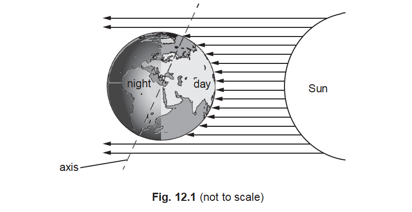
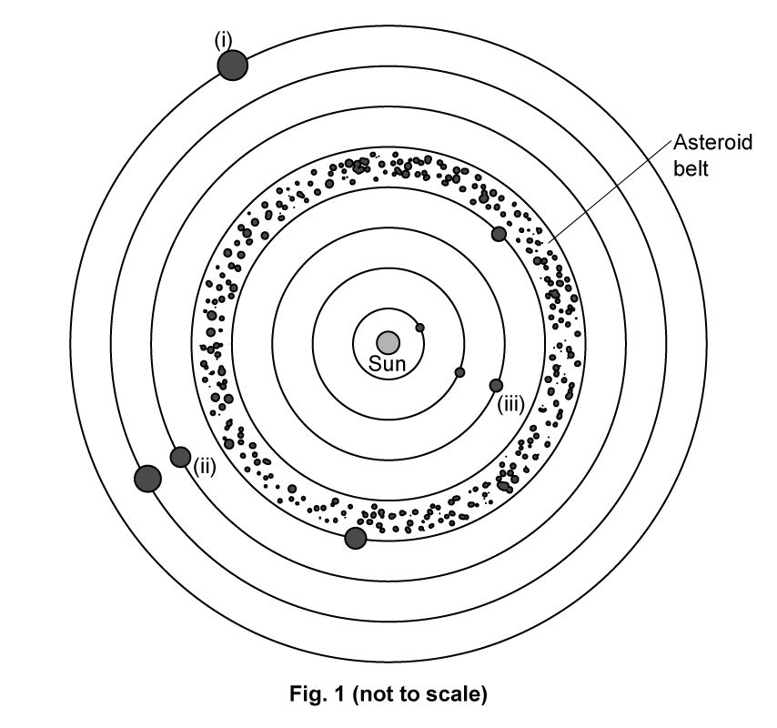
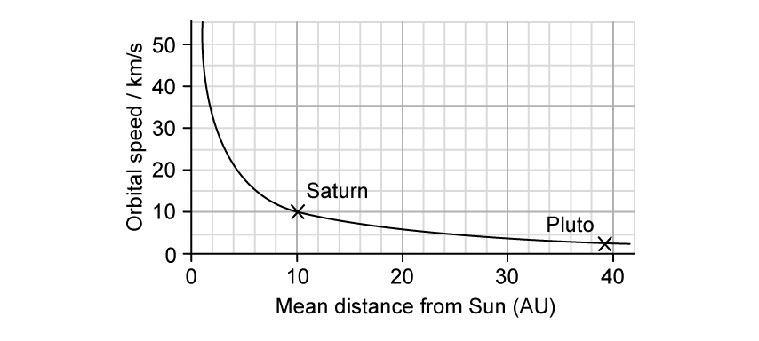
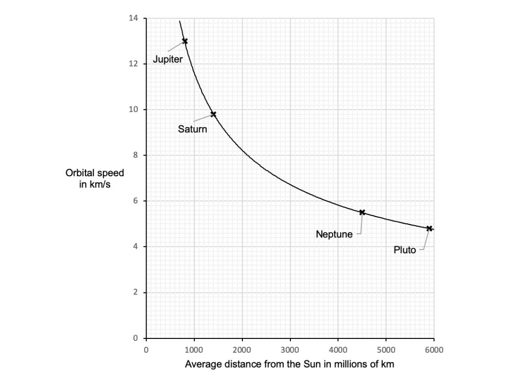
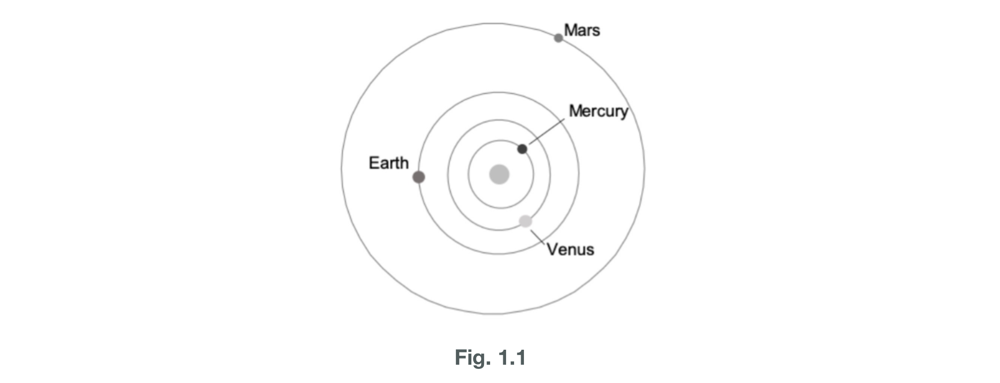
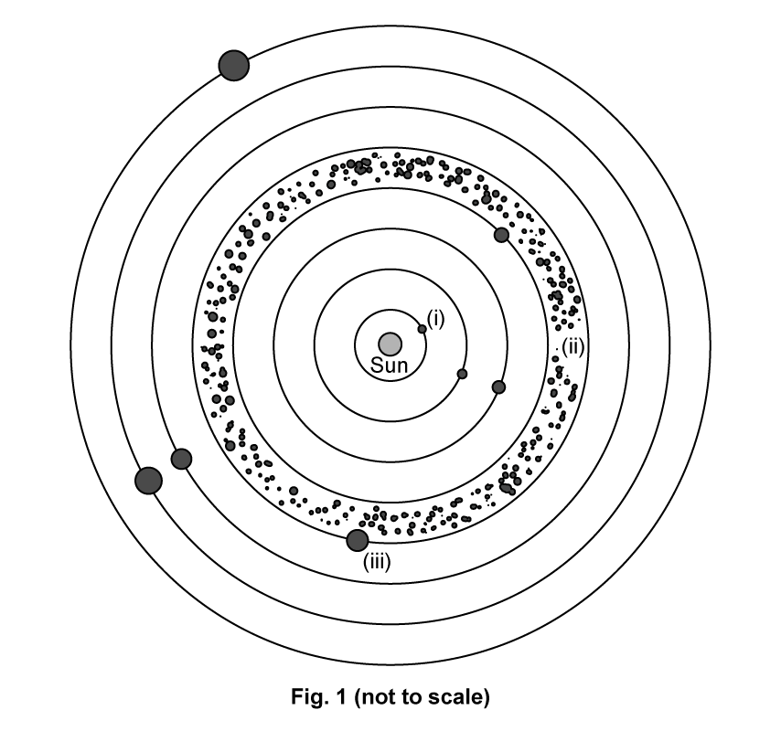
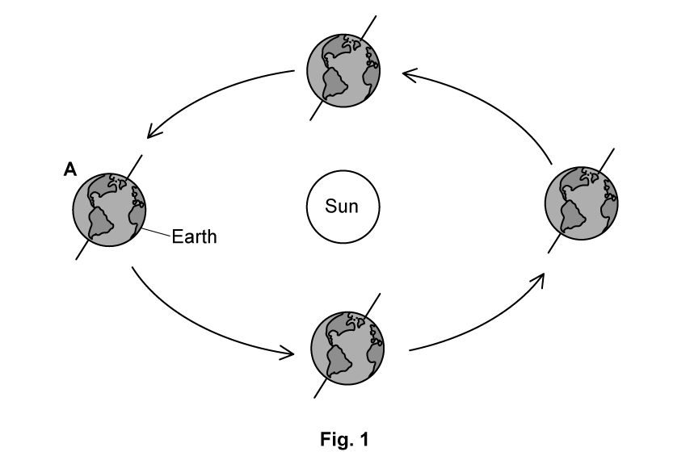
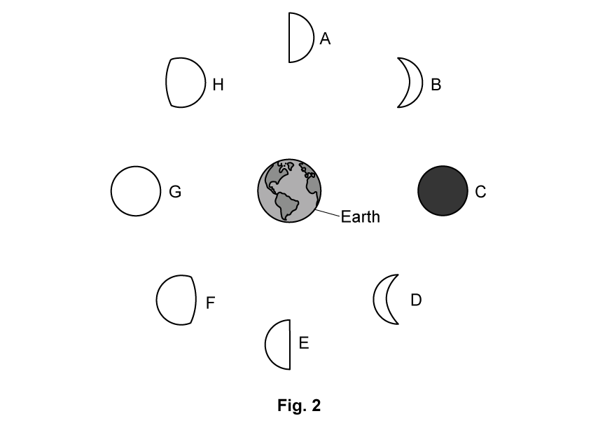
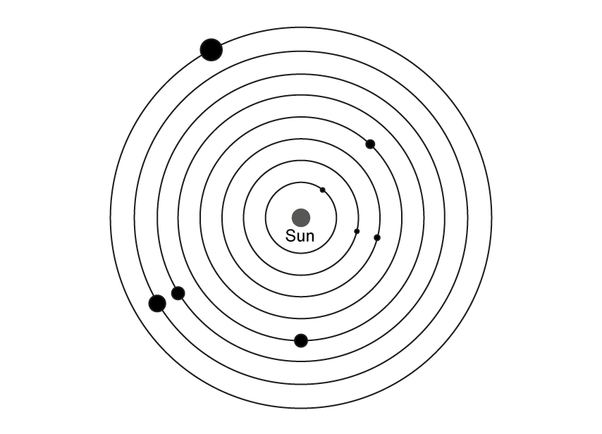
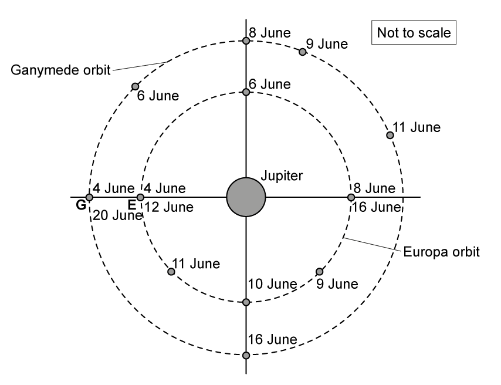

# Exam Questions — Earth & The Solar System
**6. Space Physics** · Cambridge (CIE) IGCSE physics (0625 & 0972)
> Source: [https://www.savemyexams.com/igcse/physics/cie/23/topic-questions/](https://www.savemyexams.com/igcse/physics/cie/23/topic-questions/) · 42 questions across 2 sets

## Multiple Choice Questions (22 questions)

### Q1 — medium — 1 marks

**Q1** [1 mark]

A comet is at the point in its orbit where it is furthest from the Sun.

Which row is correct?

|   | orbital speed | energy in gravitational potential store |
|---|---|---|
| **A** | at its maximum | at its maximum |
| **B** | at its maximum | at its minimum |
| **C** | at its minimum | at its maximum |
| **D** | at its minimum | at its minimum |

### Q2 — medium — 1 marks

**Q2** [1 mark]

Which time interval is the largest?

### Q3 — medium — 1 marks

**Q3** [1 mark]

The Earth is a planet in the Solar System.

Which row relates the motion of the Earth to the cycle of day and night and the cycle of the seasons?

|   | **cause of day and night** | **cause of the seasons** |
|---|---|---|
| **A** | Earth orbits the Sun | Earth orbits the Sun |
| **B** | Earth orbits the Sun | Earth rotates on its axis |
| **C** | Earth rotates on its axis | Earth orbits the Sun |
| **D** | Earth rotates on its axis | Earth rotates on its axis |

### Q4 — hard — 1 marks

**Q4** [1 mark]

A space station orbits the Earth at a distance of 7000 km from the Earth’s centre. It makes 15 orbits in every 24-hour period.

What is the speed of the space station in its orbit?

*Source: JUNE 2023 0972/21 Q38*

### Q5 — medium — 1 marks

**Q5** [1 mark]

Which planet in our Solar System is nearest to the Sun and what is the nature of the planet?

| ** ** | **planet** | **nature** |
|---|---|---|
| **A** | Mercury | rocky |
| **B** | Mercury | gaseous |
| **C** | Venus | rocky |
| **D** | Venus | gaseous |

*Source: June 2023 0972/11 Q38*

### Q6 — medium — 1 marks

**Q6** [1 mark]

**Extended Tier Only**

The orbit of the Moon around the Earth is modelled as a circular path of radius $3.8\times10^{5}$km.

The orbital period is 29.5 days (710 hours).

What is the orbital speed of the Moon?

*Source: 2023 specimen paper 2 Q39*

### Q7 — easy — 1 marks

**Q7** [1 mark]

Which type of object orbits the Sun?

*Source: 2023 Specimen paper 1 Q39*

### Q8 — easy — 1 marks

**Q8** [1 mark]

What creates the periodic nature of the seasons?

### Q9 — easy — 1 marks

**Q9** [1 mark]

Which of the planets listed is the gaseous planet which is closest to the Sun?

### Q10 — easy — 1 marks

**Q10** [1 mark]

**Extended tier only**

Which of the following statements about orbits is true?

### Q11 — easy — 1 marks

**Q11** [1 mark]

Which of the following objects are described as orbiting the Sun?

1. Asteroids
2. Comets
3. Galaxies
4. Moons

### Q12 — easy — 1 marks

**Q12** [1 mark]

Which of the following statements about the strength of a gravitational field is correct?

|   | ** At the surface of a planet it depends on** | ** Around a planet it** |
|---|---|---|
| **A** | the diameter of the planet | decreases as the distance from the planet increases |
| **B** | the diameter of the planet | increases as the distance from the planet decreases |
| **C** | the mass of the planet | decreases as the distance from the planet increases |
| **D** | the mass of the planet | increases as the distance from the planet increases |

### Q13 — hard — 1 marks

**Q13** [1 mark]

The Earth and Moon are held together by a gravitational force acting between them.

Which row describes possible changes to the mass of the Earth and the distance between the Earth and the Moon that would cause the gravitational force to increase?

|   | **Mass of Earth** | **Distance between the Earth and the Moon** |
|---|---|---|
| **A** | Double | Drop to one quarter |
| **B** | Stay the same | Stay the same |
| **C** | Halve | Stay the same |
| **D** | Drop to one quarter | Double |

### Q14 — medium — 1 marks

**Q14** [1 mark]

**Extended tier only**

The orbit of the Earth around the Sun can be thought of as following a circular path with a circumference of 942 × 106 km.

What is the approximate orbital speed of the Earth?

### Q15 — medium — 1 marks

**Q15** [1 mark]

Which line in the table best describes the angle of the Earth’s axis from the vertical, and the effect of this tilt?

|   | **Angle of tilt** | **Effect of tilt** |
|---|---|---|
| **A** | 23.4° | Rising and setting of the Sun |
| **B** | 23.4° | Changing of the seasons |
| **C** | 66.6° | Rising and setting of the Sun |
| **D** | 66.6° | Changing of the seasons |

### Q16 — hard — 1 marks

**Q16** [1 mark]

**Extended tier only**

The table shows some planetary data for planets in our Solar System

| **Planet** | **Orbital distance / million km** | **Orbital duration / days or years** | **Density / kg/m****3** | **Surface Temperature/ °C** | **Uniform Surface Gravitational Field Strength/ N/kg** |
|---|---|---|---|---|---|
| **Mercury** | 57.9 | 88 days | 5427 | 350 | 3.7 |
| **Venus** | 108.2 | 225 days | 5243 | 460 | 8.9 |
| **Earth** | 149.6 | 365 days | 5514 | 20 | 9.8 |
| **Mars** | 227.9 | 687 days | 3933 | –23 | 3.7 |
| **Jupiter** | 778.6 | 11.9 years | 1326 | –120 | 23.1 |
| **Saturn** | 1433.5 | 29.5 years | 687 | –180 | 9.0 |
| **Uranus** | 2872.5 | 75 years | 1271 | –210 | 8.7 |
| **Neptune** | 4495.1 | 165 years | 1638 | –220 | 11.0 |

What is the orbital speed of Mars?

### Q17 — hard — 1 marks

**Q17** [1 mark]

Select the combination which best defines and describes an accretion disc.

1. Gases rotating around a star
2. Ring of rocky material
3. Leads to formation of orbiting planets
4. Explains the range of elements in rocky planets
5. Explains the range of elements in the parent star

### Q18 — hard — 1 marks

**Q18** [1 mark]

The diagram shows a phase of the Moon.

Which of the four options shows the Moon 7 days later?

### Q19 — medium — 1 marks

**Q19** [1 mark]

**Extended tier only**

Comets travel faster within the Solar System than they do when they are outside it.

Which of the following gives the correct reason for this?

### Q20 — hard — 1 marks

**Q20** [1 mark]

**Extended tier only**

The orbit of Venus around the Sun is treated as a circular path with an average radius of 108.2 million km. The orbital period of Venus is 225 days.

What is the orbital speed of Venus?

### Q21 — medium — 1 marks

**Q21** [1 mark]

Which line in the table correctly identifies the length of one year, one day and daylight hours during an equinox, all as experienced on Earth?

|   | **One Earth year / days** | **One Earth day / hours** | **Daylight hours during an equinox / hours** |
|---|---|---|---|
| **A** | 356 | 8 | 8 |
| **B** | 364 | 12 | 12 |
| **C** | 365 | 12 | 8 |
| **D** | 365 | 24 | 12 |

### Q22 — medium — 1 marks

**Q22** [1 mark]

The radius of Jupiter's orbit is 778 × 106 km. What is the time taken for light from the Sun to reach the surface of Jupiter?

The speed of light is 3 × 108 m/s.

## Theory Questions (20 questions)

### Q1 — medium — 7 marks

**Q1** [1 mark]

State what is meant by a light-year.

**Q1** [3 marks]

The speed of light is $3.0\times10^{8}m/s$.

Calculate the distance, in metres, of one light-year.

Give your answer to 2 significant figures.

**Q1** [3 marks]

The star Proxima Centauri is at a distance of $4.0\times10^{16}m$ from Earth.

A radio signal is sent from Earth towards Proxima Centauri.

Calculate the time, in years, for the signal to reach Proxima Centauri.

### Q2 — medium — 8 marks

**Q2** [3 marks]

Table 10.1 shows the orbital radius and orbital period for three planets in the Solar System.

**Table 10.1**

| Planet | Average orbital radius / × 106 km | Orbital period / Earth years |
|---|---|---|
| Mercury | 57.9 | 0.24 |
| Earth | 150 | 1.00 |
| Jupiter | 778 | 11.86 |

The orbit of Earth is approximately circular.

Calculate the average orbital speed of the Earth.

**Q2** [2 marks]

**Extract:**

Table 10.1 shows the orbital radius and orbital period for three planets in the Solar System.

**Table 10.1**

Planet

Average orbital radius / × 10^6^ km

Orbital period / Earth years

Mercury

57.9

0.24

Earth

150

1.00

Jupiter

778

11.86

Using data from Table 10.1, state the relationship between a planet's average orbital speed and its distance from the Sun.

Explain this relationship in terms of gravitational field strength.

**Q2** [3 marks]

A galaxy is at a distance of $9 . 0 \times 10^{7}$ light-years from the Earth. The current value of the Hubble constant is $2.2\times10^{-18}$ per second.

Calculate the speed at which this galaxy is moving away from the Earth.

### Q3 — medium — 8 marks

**Q3** [1 mark]

The universe is made up of billions of galaxies.

Define the term **galaxy**.

**Q3** [1 mark]

State what is meant by one** light-year**.

**Q3** [2 marks]

The Moon is classified as a natural satellite.

Explain why the Moon is not considered to be a planet.

**Q3** [4 marks]

The Solar System consists of eight planets.

Describe how the four outermost planets were formed.

### Q4 — easy — 2 marks

**Q4** [2 marks]

List the four planets closest to the Sun in order of their distance from the Sun. One is done for you.

1 ......................    2 .......................    3. Earth         4......................

*Source: June 2023 0972/31 Q12B*

### Q5 — medium — 2 marks

**Q5** [2 marks]

** **Fig. 12.1 represents the Earth and the Sun at one point in the Earth’s orbit of the Sun.

Explain the apparent daily motion of the Sun across the sky.

*Source: June 2023 0972/31 Q12A*

### Q6 — hard — 8 marks

**Q6** [1 mark]

A student states that the nearest star to Earth is Proxima Centauri.

Explain what is wrong with this statement.

**Q6** [5 marks]

Light from Proxima Centauri takes 2 200 000 minutes to reach the Earth. Light from the Sun takes 8.3 minutes to reach the Earth.

The distance from the Sun to the Earth is defined as being 1 astronomical unit (AU).

For the distance to Proxima Centauri

(i) Calculate the distance in metres.

[3]

(ii) Use the ratio method to determine the distance in terms of astronomical units

[2]

**Q6** [2 marks]

A light year is the **distance **that light travels in one year.

Astronomers usually give the distance from stars in terms of light years rather than using metres and kilometres.

Suggest a reason for this.

### Q7 — medium — 10 marks

**Q7** [3 marks]

Fig. 1 shows a diagram of the solar system.

For each position (i - iii) state the name of the body indicated.

**Q7** [3 marks]

The asteroid belt can be considered as the dividing line between the inner and outer planets.

Compare the differences between these two groups of planets.

**Q7** [4 marks]

**Extended tier only**

Fig. 2 is a graph showing the relationship between orbital speed in km/s and mean distance from the Sun measured in astronomical units, AU.

The positions of Saturn and Pluto have been plotted and labelled.

**Fig. 2**

For the planet Uranus

(i) Indicate on the graph where Uranus is most likely to be plotted

[3]

(ii) Use your plotted point to estimate the orbital speed of Uranus

[1]

### Q8 — medium — 10 marks

**Q8** [2 marks]

**Extended tier only**

The graph in Fig. 2.1 gives data for four bodies in the outer solar system.

Uranus orbits the Sun at an average distance of 2900 million km.

**Fig. 2.1         **

Use the graph to determine the orbital speed of Uranus.

*Source: 2018 specimen Q*

**Q8** [6 marks]

**Extract:**

Radius of orbit, r = 800 million km (from the graph)
Orbital speed, s = 13 km/s (from the graph)

**Extended tier only**

Use data from the graph to calculate

(i) The distance travelled by Jupiter in one orbit.

distance = ............................... million km [3]

(ii) The time taken for Jupiter to complete one orbit, giving your answer in days.

orbital period = ................................ days [3]

*Source: 2018 specimen Q*

**Q8** [1 mark]

**Extended tier only**

Fig. 2.2 shows the typical orbit of a planet.

**Fig. 2.2**

**      **

Add a line to the diagram to show the typical orbit of a comet.

*Source: 2018 specimen Q*

**Q8** [1 mark]

**Extract:**

A diagram showing the typical orbit of a comet looks like:

- Orbit is elliptical (not circular) AND Sun shown off-centre at a focal point (by eye) AND orbit extends beyond the planet's orbit; [1 mark]

**Extended tier only**

Add an **X** to the line drawn in part (c) indicating the point at which the comet will be travelling with the greatest speed.

*Source: 2018 specimen Q*

### Q9 — medium — 13 marks

**Q9** [3 marks]

**Extended tier only**

The Sun lies at the centre of our solar system, with all other bodies, such as planets, orbiting it, as shown in Fig. 1.1.

State **two **similarities and **one **difference between the orbits of the planets.

*Source: 2018 specimen Q*

**Q9** [6 marks]

The innermost planets of the solar system are rocky compared to the outer planets.

(i) State the source of the heavier elements making up the inner planets.

[1]

(ii) State the name of the process which led to the formation of the inner planets and explain their formation.

[5]

*Source: 2018 specimen Q*

**Q9** [4 marks]

Explain the difference between the inner planets of the solar system and the outer planets.

*Source: 2018 specimen Q*

### Q10 — easy — 9 marks

**Q10** [3 marks]

For each description identify the body in the Solar System which is being described.

(i) The fourth planet from the Sun.

[1]

(ii) A dwarf planet beyond the orbit of Neptune.

[1]

(iii) A natural satellite orbiting a planet.

[1]

**Q10** [1 mark]

State the location of the asteroid belt.

**Q10** [2 marks]

The inner four planets of the Solar System are described as being small and rocky.

State the two words most commonly used to describe the outer four planets.

**Q10** [3 marks]

State the three factors that form the basis of the accretion model for the formation of the Solar System.

### Q11 — medium — 14 marks

**Q11** [3 marks]

Fig. 1 shows a diagram of the solar system.

For each position (i - iii) state the name of the body indicated.

**Q11** [3 marks]

**Extract:**

(i) The names of the body indicated is:
- Mercury; [1 mark]
(ii) The names of the body indicated is:
- Asteroid belt; [1 mark]
(iii) The names of the body indicated is:
- Jupiter; [1 mark]

There are more than 200 moons in our solar system.

(i) State the meaning of the term 'moon'.

[1]

(ii) Choosing from the labelled bodies in part (a), state the body or bodies which have moons.

[1]

(iii) Earth has one moon, known as the Moon. Name one other planet in the solar system apart from the answer to part (ii) which has a moon.

[1]

**Q11** [3 marks]

**Extended tier only**

Astronomers launched the Hubble telescope in 1990, placing it in orbit around the Earth.

The table in Fig. 2 shows information about the orbits around the Earth of both the Hubble Telescope and the Moon.

|   | **average radius of orbit / km** | **orbital period** |
|---|---|---|
| Hubble telescope | 550 | 96 minutes |
| Moon | 385 000 | 28 days |

**Fig. 2**

For the Hubble telescope and the Moon:

(i) Calculate the closest distance between the Moon and the Hubble telescope.

[1]

(ii) Explain why the distance between the Moon and the Hubble telescope changes.

[2]

**Q11** [5 marks]

**Extract:**

|   | **average radius of orbit / km** | **orbital period** |
| Hubble telescope | 550 | 96 minutes |
| Moon | 385 000 | 28 days |
**Fig. 2**

The radius of the Earth is 6400 km.

**Extended tier only**

Using the data in the table in part (c) calculate the orbital speed of the Hubble telescope.

The radius of the Earth is 6400 km.

### Q12 — easy — 7 marks

**Q12** [1 mark]

The appearance of the Moon from Earth can be explained by the relative motion of the Moon and the Earth.

Explain why the Moon rises and sets.

**Q12** [4 marks]

The Moon is said to undergo a lunar cycle.

(i) State how much time each lunar cycle takes to complete.

[1]

(ii) Explain why the Moon has phases which are seen throughout the lunar cycle.

[3]

**Q12** [2 marks]

Observers on Earth always see the same side of the Moon.

Explain why we never see the far side of the Moon when looking from Earth.

### Q13 — easy — 7 marks

**Q13** [2 marks]

**Extended tier only**

Orbits are considered to be either approximately circular or elliptical.

State the position of the body which is being orbited for

(i) an approximately circular orbit

[1]

(ii) an elliptical orbit

[1]

**Q13** [1 mark]

Name the force which keeps satellites in orbit.

**Q13** [2 marks]

**Extended tier only**

The strength of the Sun’s gravitational field and the orbital speeds of the planets are affected by the distance from the Sun.

For each property state the change as the distance from the Sun increases.

(i) Gravitational field strength

[1]

(ii) Orbital speed

[1]

**Q13** [2 marks]

**Extract:**

As the distance from the Sun increases:

(ii) As the distance from the Sun increases, the orbital speed:

- Decreases; [1 mark]

**Extended tier only**

The table in Fig. 1 shows data for three planets orbiting the same star.

| **Planet** | **Orbital Speed**  **/ km/s** | **Orbital period**  **/ days** |
|---|---|---|
| **Artemis** | 35.0 | 120 |
| **Hecate** | 67.4 | 58 |
| **Medea** | 24.1 | 231 |

** Fig. 1**

** **

(i) Identify the planet which is closest to the star

[1]

(ii) State the reason for your choice

[1]

### Q14 — easy — 16 marks

**Q14** [6 marks]

Complete the description of the Earth by filling in the blanks using words from the list below.

You may use words more than once, or not at all.

- The Earth is a rocky planet following an  ______ orbit around the Sun.
- It rotates on its ______, which is tilted at an angle of approximately 23.4° from the ______.
- The Earth takes approximately 24 ______ to complete one full rotation, causing the ______ daily motion of the Sun rising and setting.
- Rotation of the Earth on its axis is therefore responsible for the ______ cycle of day and night.

| ** ** | **apparent** | **hours** |
|---|---|---|
| ** ** | **axis** | **periodic** |
| ** ** | **circular** | **real** |
| ** ** | **elliptical** | **vertical** |
| ** ** | **horizontal ** | ** ** |

**Q14** [1 mark]

**Extract:**

It rotates on its axis, which is tilted at an angle of approximately 23.4° from the vertical.

Fig. 1 shows the Earth orbiting the Sun.

Explain why it is summer in the northern hemisphere at position A.

**Q14** [7 marks]

Complete the description of the Moon by filling in the blanks using words from the list below.

You may use words more than once, or not at all.

- The Moon is a natural ______ of the Earth which travels in a roughly _____ orbit.
- The ______ of the Moon's orbit is approximately 28 ______.
- The Moon revolves around its own axis with the same ______ as its orbit so always has the same side facing the Earth.
- The Moon shines with ______ light from the ______, it does not produce its own light

| ** ** | **circular** | **period ** |
|---|---|---|
| ** ** | **days** | **planet** |
| ** ** | **Earth** | **reflected ** |
| ** ** | **elliptical** | **satellite ** |
| ** ** | **hours** | **Sun** |

**Q14** [2 marks]

Fig. 2 shows the phases of the Moon.

Using the labels A - H, identify the following phases.

(i) Full moon.

[1]

(ii) New moon.

[1]

### Q15 — hard — 19 marks

**Q15** [3 marks]

**Extended tier only**

Explain why the orbital speeds of the gas giants are slower than those of the rocky planets.

**Q15** [9 marks]

**Extract:**

|   | **Mean distance from Sun / millions km** | **Orbital period / days** | **Surface temp / °C** | **Density / kg/m**^**3**^ | **Diameter / 10**^**3**^** km** | **Mass / 10**^**24**^** kg** | **Surface gravity / N/kg** |
| **Mercury** | 57.9 | 88 | 350 | 5427 | 4.8 |   | 3.7 |
| **Venus** | 108.2 | 225 | 460 | 5243 | 12.1 |   | 8.9 |
| **Earth** | 149.6 | 365 | 20 | 5514 | 12.8 | 5.97 | 9.8 |
| **Mars** | 227.9 | 687 | 23 | 3933 | 6.8 |   | 3.7 |
**Fig. 1**

Estimate whether the missing masses of Mercury, Venus and Mars, are larger, smaller or very similar to the mass of Earth, referring to the data to support your answer.

**Extended tier only**

The data table in Fig. 1 shows data on the four inner planets.

|   | **Mean distance from Sun / millions km** | **Orbital period / days** | **Surface temp / °C** | **Density / kg/m****3** | **Diameter / 10****3**** km** | **Mass / 10****24**** kg** | **Surface gravity / N/kg** |
|---|---|---|---|---|---|---|---|
| **Mercury** | 57.9 | 88 | 350 | 5427 | 4.8 |   | 3.7 |
| **Venus** | 108.2 | 225 | 460 | 5243 | 12.1 |   | 8.9 |
| **Earth** | 149.6 | 365 | 20 | 5514 | 12.8 | 5.97 | 9.8 |
| **Mars** | 227.9 | 687 | 23 | 3933 | 6.8 |   | 3.7 |

**Fig. 1**

Estimate whether the missing masses of Mercury, Venus and Mars, are larger, smaller or very similar to the mass of Earth, referring to the data to support your answer.

(i) Mercury

[3]

(ii) Venus

[3]

(iii) Mars

[3]

**Q15** [7 marks]

**Extract:**

|   | **Mean distance from Sun / millions km** | **Orbital period / days** | **Surface temp / °C** | **Density / kg/m**^**3**^ | **Diameter / 10**^**3**^** km** | **Mass / 10**^**24**^** kg** | **Surface gravity / N/kg** |
| **Mercury** | 57.9 | 88 | 350 | 5427 | 4.8 |   | 3.7 |
| **Venus** | 108.2 | 225 | 460 | 5243 | 12.1 |   | 8.9 |
| **Earth** | 149.6 | 365 | 20 | 5514 | 12.8 | 5.97 | 9.8 |
| **Mars** | 227.9 | 687 | 23 | 3933 | 6.8 |   | 3.7 |

**Extended tier only**

Select data from the table to support the use of Newton's Laws of Motion when calculating for orbital motion.

Explain your choice.

### Q16 — hard — 10 marks

**Q16** [4 marks]

The statements below describe some of the objects which are found in the Solar System.

For each description, state the name of the object.

(i) The fifth planet from the Sun.

[1]

(ii) A rocky object located between Mars and Jupiter.

[1]

(iii) A ball of ice and dust whose orbit takes it beyond the Solar System.

[1]

(iv) One of a number of small, rocky objects orbiting Jupiter.

[1]

**Q16** [6 marks]

The Earth-Moon system creates effects which can be observed from Earth.

(i) Tick the statements which are **correct**.

`square` The Earth orbits the Sun once every 365 days

`square` The Moon takes five weeks to orbit the Earth

`square` The Moon's phases change on a regular cycle

`square` Day and night on Earth are caused by the Moon's orbit

[2]

(ii) Sketch and explain the appearance of the Moon two weeks after a New Moon.

You may use your diagram to support your explanation.

[4]

### Q17 — medium — 9 marks

**Q17** [4 marks]

Fig. 1 shows a diagram of the solar system.

(i) Add to the diagram to show the location of the asteroid belt.

[2]

(ii) Sketch a possible orbit of a comet entering and leaving the solar system.

[2]

**Fig. 1 (not to scale)**

**Q17** [5 marks]

**Extended tier only**

Compare the orbits of comets and planets.

### Q18 — hard — 14 marks

**Q18** [5 marks]

**Extended tier only**

The orbital speeds of comets are not constant.

Describe and explain how the speed changes.

**Q18** [1 mark]

**Extended tier only**

Fig. 1 shows Jupiter and the orbits of two of its moons, Ganymede and Europa.

The positions of the two moons are marked for various dates.

The radius of Europa’s orbit is 671 000 km. The radius of Ganymede’s orbit is 1 070 000 km

**Fig.1.**

Determine the time for Ganymede to complete one orbit of Jupiter.

**Q18** [3 marks]

**Extract:**

The radius of Europa's orbit is 671 000 km. The radius of Ganymede's orbit is 1 070 000 km.

**Extended tier only**

Calculate the distance from Europa to Ganymede on 8 June.

**Q18** [5 marks]

**Extract:**

Fig. 1 shows Jupiter and the orbits of two of its moons, Ganymede and Europa. The positions of the two moons are marked for various dates. The radius of Europa's orbit is 671 000 km. The radius of Ganymede's orbit is 1 070 000 km.

**Extended tier only**

Describe and explain how the distance between Europa and Ganymede changes during three orbits of Europa.

### Q19 — easy — 9 marks

**Q19** [2 marks]

**Extended tier only**

State the definition of 'orbital period'.

**Q19** [2 marks]

**Extended tier only**

State the equation needed to calculate average orbital speed, defining any variables.

**Q19** [3 marks]

**Extended tier only**

A satellite moves in a circular orbit.

Its distance above the Earth’s surface is 600 km and the radius of the Earth is 6400 km.

The orbital period of the satellite is 106 minutes.

(i) Determine the radius of the orbit, stating your answer in metres.

[2]

(ii) Convert the orbital period to S.I. units.

[1]

**Q19** [2 marks]

**Extract:**

(i) Determine the radius of a circular orbit:
Recall that the orbital radius is measured from the centre of the Earth:
- Orbital radius = radius of Earth + height of orbit OR R + h OR 6400 km + 600 km; [1 mark]
- r = 7000 km
- r = 7 000 000 m OR 7 × 10^6 m [1 mark]

(ii) Convert the orbital period to S.I. units for a circular orbit:
- 1 minute = 60 seconds
- 106 × 60 = 6360 s [1 mark]

**Extended tier only**

Use your answers to part (c) to calculate the orbital speed of the satellite.

### Q20 — hard — 9 marks

**Q20** [3 marks]

**Extended tier only**

A comet enters the Solar System from beyond the orbit of Pluto.

(i) State the direction in which the comet travels.

[1]

(ii) State how the strength of the Sun's gravitational field changes as the distance from the Sun decreases.

[1]

(iii) State how the speed of the comet changes as it enters the Solar System.

[1]

**Q20** [6 marks]

**Extended tier only**

Mercury is nearer to the Sun than Saturn.

(i) Compare the orbital speeds of Mercury and Saturn. Explain your answer.

[3]

(ii) Compare the length of the year on Saturn to a year on Mercury.

Explain any differences which you mention in your answer.

[3]
