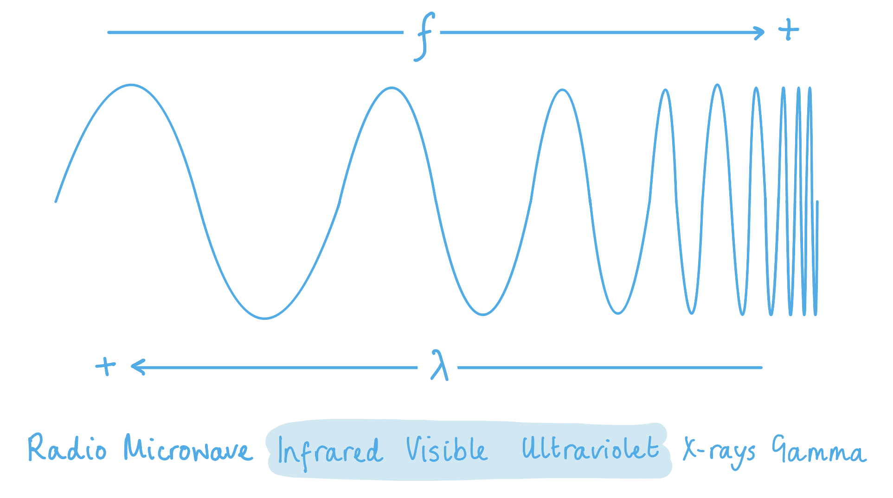
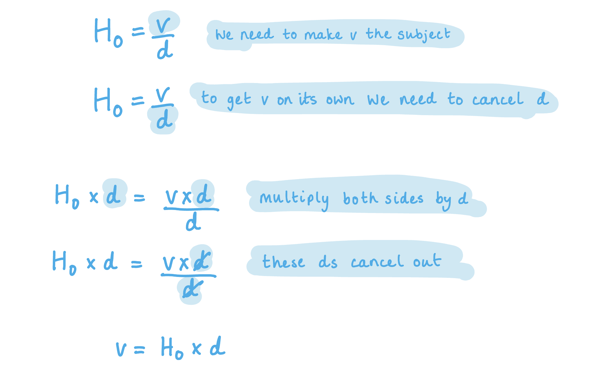
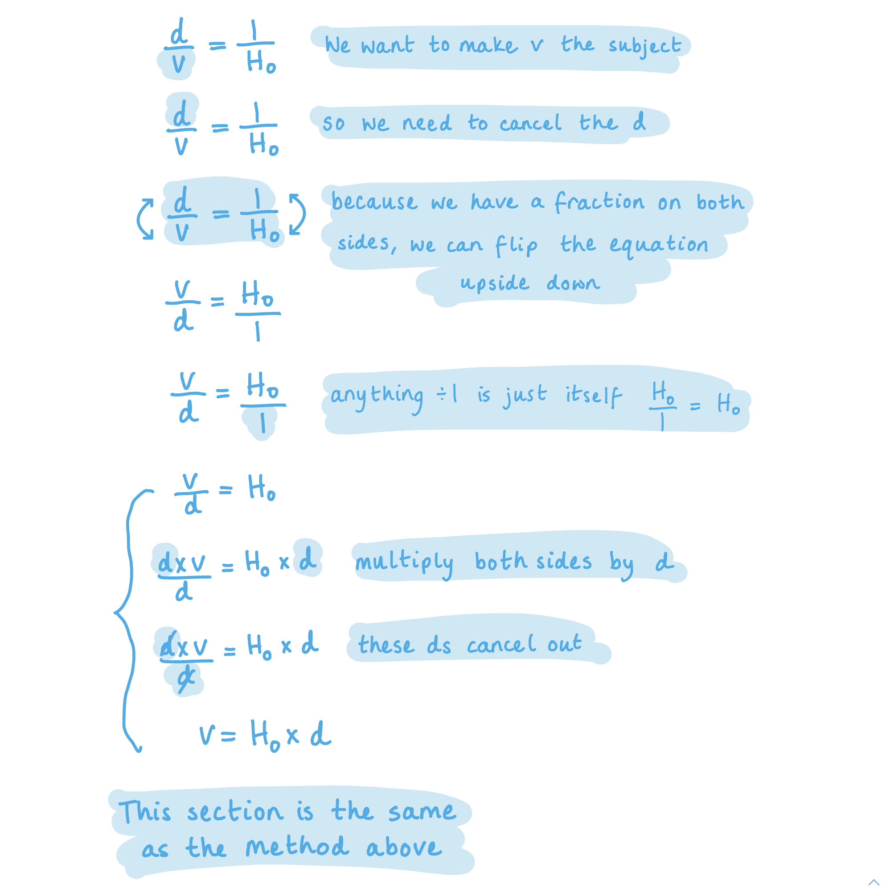
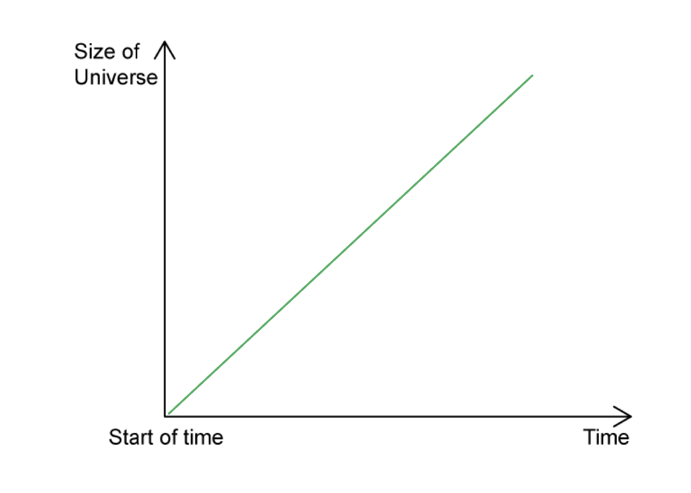
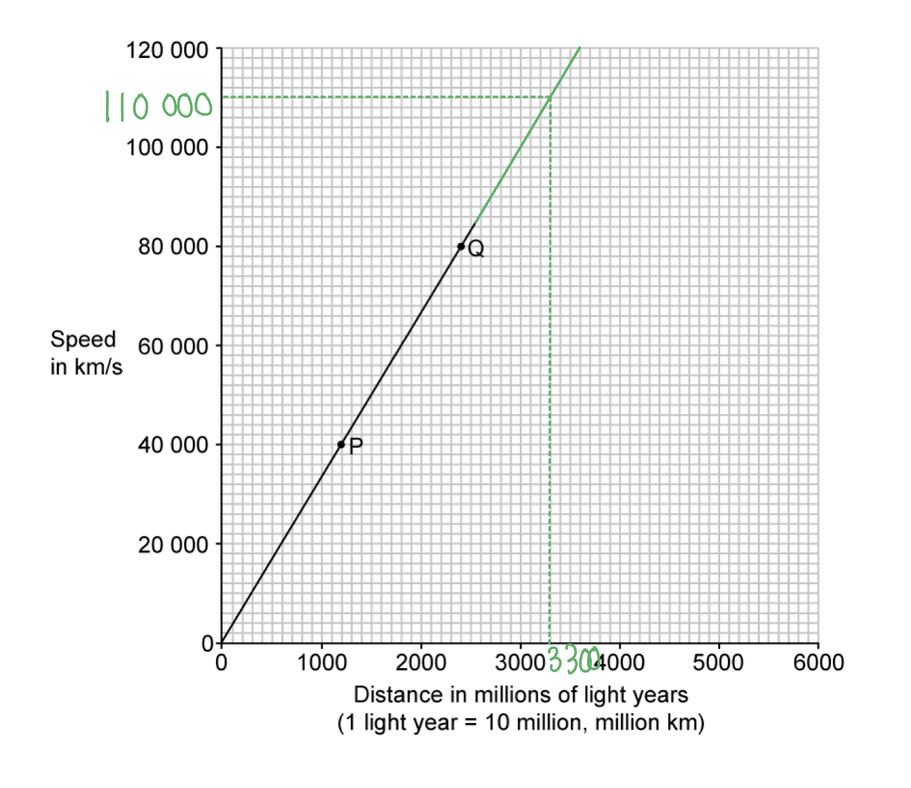
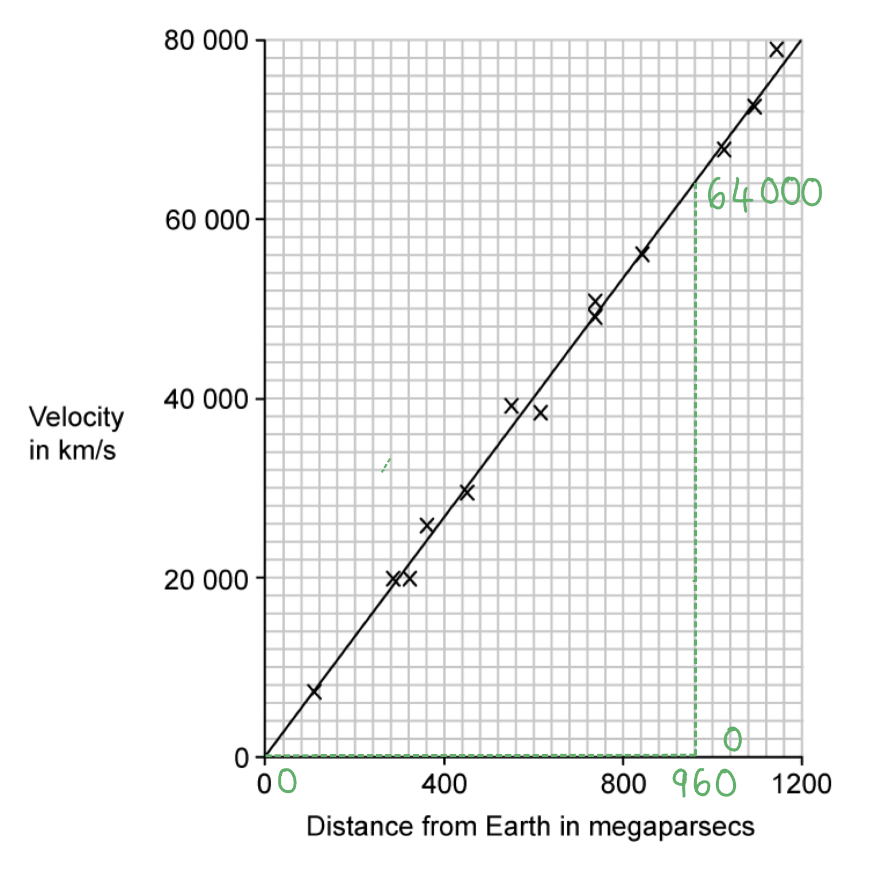

# Mark Schemes — Stars & The Universe
**6. Space Physics** · Cambridge (CIE) IGCSE physics (0625 & 0972)

## Multiple Choice Questions (25 questions)

### Q1
**Final answer:** **The correct answer is B**

- Redshift is the increase in the observed wavelength (decrease in frequency) of light from distant galaxies
- It occurs because the galaxies are moving away from us — the expansion of the Universe stretches the wavelength of the light
- The faster a galaxy moves away, the greater the redshift
- This is evidence that the Universe is expanding

**A** is incorrect because the colour shift is not caused by temperature. Redshift is a Doppler-type effect caused by the relative motion of the galaxy away from the observer.

**C** is incorrect because light does not lose energy as it travels through the vacuum of space. The frequency of light remains constant unless the source is moving relative to the observer.

**D** is incorrect because red-shift indicates that wavelengths are being stretched (increased), not compressed. If the Universe were contracting, we would observe blueshift (shorter wavelengths), not redshift.

### Q2
**Final answer:** **The correct answer is B**

- A star like the Sun (a star of similar mass) follows this life cycle:

  - a nebula (cloud of gas and dust) collapses under gravity
  - nuclear fusion begins and the star becomes a stable main sequence star
  - when hydrogen fuel is exhausted, the star expands to become a red giant
  - the outer layers are expelled and the remaining core contracts to form a white dwarf
- The white dwarf eventually cools and fades

**A** is incorrect because red supergiants and neutron stars are stages in the life cycle of a much more massive star, not a star like the Sun. Only very massive stars become red supergiants.

**C** is incorrect because the red giant stage comes after the main sequence stage, not before it. A star must first spend billions of years as a main sequence star before expanding into a red giant.

**D** is incorrect because a nebula is the beginning of a star's life, not a stage after the main sequence. Also, black holes are only formed from the most massive stars, not from stars like the Sun.

### Q3
**Final answer:** **The correct answer is A**

- Redshift occurs when the light observed from an object has a longer wavelength than the light originally emitted
- This increase in wavelength happens because the source of the light is moving away from the observer
- Observations of redshift from almost all distant galaxies show that they are moving away from us

  - This provides evidence that the Universe is expanding and supports the Big Bang Theory

**B** is incorrect because moving towards the Earth would cause a decrease in wavelength (blueshift).

**C** is incorrect as the speed of light in a vacuum is a constant and the galaxies are known to be in motion.

**D** is incorrect as the expansion of the Universe happens in all directions and does not imply that the Earth is in a special central position.

> **[exam-tip]**
> Remember that redshift indicates objects moving away (wavelength increases), whilst blueshift indicates objects moving towards us (wavelength decreases). The observation that almost all galaxies show redshift is key evidence for the expanding Universe and the Big Bang Theory. Be careful not to confuse the expansion of the Universe with the Earth being at the centre — the expansion occurs uniformly in all directions from any point in space.

### Q4
**Final answer:** **The correct answer is C**

- The Sun is a medium-sized star

  - Therefore, statement 1 is **correct**
- The Sun consists mostly of hydrogen and helium, not nitrogen and oxygen

  - Therefore, statement 2 is **incorrect**
- The Sun is one of billions of stars that make up the Milky Way galaxy

  - Therefore, statement 3 is **correct**

> **[exam-tip]**
> Remember that the Sun is composed primarily of hydrogen and helium, not nitrogen and oxygen. Many students confuse the composition of the Sun with that of Earth's atmosphere. Also, keep in mind that the Sun is located within the Milky Way galaxy, not outside it.

### Q5
**Final answer:** **The correct answer is ****D**** because:**

- The life cycle for a star similar in size to the Sun is:

  - formation of a **protostar** from a collapsing interstellar dust cloud (a nebula)
  - formation of a **stable star** when the gravitational forces are balanced by an outward force due to nuclear fusion starting in the star’s core
  - expansion to a **red giant** star when hydrogen fuel runs out in star’s core and helium fusion begins
  - formation of a **white dwarf** star when the outer layers of the red giant escape, leaving behind only the very hot core.

You also need to know about the life cycle of a star much larger than the Sun. This interstellar dust cloud $\rightarrow$ protostar $\rightarrow$ (large) stable star $\rightarrow$ red supergiant $\rightarrow$ supernova explosion  $\rightarrow$neutron star or black hole.

**A** is incorrect because the protostar forms before the stable star.

**B** is incorrect because the stable star forms before the red giant.

**C** is incorrect as all the stages are in the wrong order.

### Q6
**Final answer:** **The correct answer is ****D**** because:**

· Nuclear fusion of the process of combining two light nuclei to form a heavier nucleus

- Stars are composed of mostly hydrogen and helium
- The core of a star is at high temperature and pressure
- Stable stars fuse hydrogen in their cores to produce helium and this powers the star

The terms ‘nuclear fission’ and ‘nuclear fusion’ are often mixed up. You should try to remember that to fuse something means to ‘stick it together’ while a fissure is a crack or splitting apart so fission is ‘cracking apart nuclei’.

**A** is incorrect because hydrogen is not produced by the process in stars, it is used up.

**B** and **C** are incorrect because they describe nuclear fission, the splitting of large nuclei to form smaller one. This does not power stars.

### Q7
**Final answer:** **The correct answer is ****A****, because:**

- The Milky Way is a galaxy

**B**, **C** and **D** are incorrect because the Milky Way is none of these things.

You should recall that the Universe contains billions of galaxies and that galaxies each contain billions of stars. The Sun is a single star in the Milky Way galaxy.

### Q8
**Final answer:** **The correct answer is ****B****, because:**

- The Sun is composed of about 73% hydrogen and 25% helium by mass

**A**, **C** and **D** are incorrect because neither oxygen nor nitrogen are the most abundant elements in stars.

### Q9
**Final answer:** **The correct answer is D**

- Redshift describes the lengthening of visible light from distant objects

  - This is caused by them moving away from the observer
  - The red end of the visible spectrum has greater wavelengths
- Distant stars move away from the observer because the Universe is expanding
- The wavelength of light from these stars is lengthened, so the light moves towards the red end of the spectrum

**A **is incorrect as some distant galaxies are moving towards us and are blue-shifted

**B **is incorrect as stars in the Milky Way emit a wide range of wavelengths of visible light

**C **is incorrect as not all stars in the Milky Way are moving away from us

### Q10
**Final answer:** **The correct answer is A**

- The question is asking which option is an incorrect description of redshift
- When objects move away from Earth, their light is redshifted

  - This means the wavelength of light is moved further towards the red end of the spectrum
- This does not mean, however, that the light turns red

  - Violet light from a star may appear more blue, for example
- Therefore, statement **A** is incorrect

  - The light from all distant galaxies may be redshifted, but that does not mean it is all at the red end of the spectrum

**B **is incorrect as this is a description of redshift

**C **is incorrect as this occurs in redshift

**D **is incorrect as all distant galaxies are receding, therefore their light is shifted towards the red end of the spectrum

There is a subtle but important difference between light being at the red end of a spectrum and being redshifted. Redshift describes the change of wavelength towards the red end, but this can occur at any wavelength.

Questions which ask for the incorrect option trip up a lot of students. Highlight what the question is asking for and write it in your own words if you are struggling to understand what the question wants from you. For example, ‘Which statement does not describe redshift?’ can be rewritten as ‘Which statement is a bad description of redshift?’. This can remove the confusing double negative.

### Q11
**Final answer:** **The correct answer is ****B**** because:**

- The Sun radiates most of its energy in the **infrared**, **visible** and **ultraviolet** regions of the electromagnetic spectrum

  - Infrared radiation makes the Sun feel warm
  - Visible radiation means we can see the Sun
  - Ultraviolet radiation means we can get sunburn

### Q12
**Final answer:** **The correct answer is ****B**** because:**

- **Redshift **is an increase in the observed wavelength of electromagnetic radiation emitted from **receding** stars and galaxies (those ones which are moving away from us)

  - The light emitted from distant galaxies appears redshifted in comparison with light emitted on the Earth
- This means that redshift in the light from distant galaxies is evidence that

  - The Universe is expanding
  - This supports the Big Bang Theory

### Q13
**Final answer:** **The answer is ****C**** because:**

- The Sun consists of approximately 75 % hydrogen and 24 % helium
- The rest of the material is other elements, including oxygen and carbon

### Q14
**The correct answer is ****D**** because:**

- 2.2 × 10–18 per second is the current estimate of the **Hubble constant**.

### Q15
**Final answer:** **The correct answer is ****C**** because:**

- The lifecycle of a star the size of our sun (medium-sized) is:

  - interstellar hydrogen clouds (a nebula) → protostar → main sequence star → red giant  → planetary nebula → white dwarf

**A** & **D** are incorrect as this is the life cycle of a star much larger than the Sun (high mass star)

**B **is incorrect as the protostar phase comes second and the planetary nebula comes before becoming a white dwarf

### Q16
**Final answer:** **The correct answer is ****B**** because:**

- 1 light year = 9.5 × 1015 m
- Hubble constant, H0 = 2.2 × 10–18 per second
- Hubble's law:

  - $H_{0}=\frac{v}{d}$
- Rearranging this for the recession velocity gives:

  - $v=H_{0}d$
- Converting the distance into metres is:

  - 2.5 million light years = 2.5 × 106 light-years
  - $( 2.5 \times 10^{6} ) \times ( 9.5 \times 10^{15} ) = 2.375 \times 10^{22} \mathrm{m}$
- Substitute the values into the recession velocity equation:

  - $v = ( 2.2 \times 10^{- 18} ) \times ( 2.375 \times 10^{22} ) = 52.25 \times 10^{3} \mathrm{m} \div \mathrm{s} = 52 \text{km} \div \mathrm{s}$

You will be expected to convert different units and know how to use the Hubble constant where required!

### Q17
**Final answer:** **The correct answer is ****D**** because:**

- All stars and galaxies emit electromagnetic waves, including light, from the whole spectrum.
- As the Universe is expanding, all observed galaxies appear to be moving away from us.

  - This relative motion causes the light we receive to be shifted so that its wavelength appears longer.
- Longer wavelengths look red, hence the term 'red shift'.

**A** and **C** are incorrect as stars and galaxies emit electromagnetic waves, including light, from the whole spectrum

**B** is incorrect as all parts of the spectrum can be received, but the relative motion of the emitting body shifts the wavelength of the light towards the red end of the visible spectrum

### Q18
**Final answer:** **The correct answer is ****C**** because:**

- Stars shine due to the nuclear fusion reactions happening inside them, which give off large amounts of energy
- In the process four hydrogen nuclei fuse together to form one helium nuclei

### Q19
**Final answer:** **The correct answer is ****C**** because the Milky Way is a ****galaxy****.**

**A** is incorrect as the Universe is a collection of galaxies.

**B** is incorrect as stars make up galaxies.

**D** is incorrect as a nebula is a cloud of dust and gas.

### Q20
**Final answer:** **The correct answer is ****C**** because:**

- From the question, the distance, d =  4 500 million km = 4 500 × 106 km

  - Convert this distance into metres by multiplying by 1 000 (103)
  
    - Distance *d* = (4 500 × 106 km) × 103 = 4 500 × 109 m
- Recall the speed of light, *c* = 3 × 108 m / s
- Use the speed equation $v=\frac{d}{t}$and rearrange to make *t* the subject:

  - $t=\frac{d}{v}$
- Substituting the known values:

  - $t=\frac{(4500\times10^{9})m}{(3\times10^{8})m/s}=15000s$
  - To convert seconds to hours, divide by (60 × 60) (since each hour contains 60 minutes each of 60 seconds)
  - $t=\frac{15000}{(60\times60)}=4.17\mathrm{hours}$

You will often have to convert units since the distances in space are so huge. Make sure you are comfortable working with indices to do this.

### Q21
**Final answer:** **The correct answer is ****B**** because:**

- The diameter of the Milky Way is 100 000 light years.

  - This means that it would take light 100 000 years to travel across the whole of the diameter.
- The question asks how long light would take from the centre to the edge.

  - Therefore the solution is one half of 100 000 years, or 50 000 years.

Remember that a light year is a measure of <u>distance</u>, not time!

Light takes one year to travel the distance of one light year, hence the name.

### Q22
**Final answer:** **The correct answer is ****B**** because:**

- The difference in the observed wavelength and expected wavelength of light from fast-moving and distant objects is known as **redshift**

  - Comparing the observed and expected values allows the speed of recession (moving away) to be calculated.
  - Either **A** or **B** are correct
- Supernovae have a brightness which is both:

  - High enough in absolute magnitude to outshine the whole galaxy that the supernova star is inside
  - Predictable in value
- These facts allow astronomers to determine the distance to a galaxy which is far, far away using the brightness of a supernova in that galaxy

  - Option **B** is correct.

### Q23
**Final answer:** **The correct answer is ****D**** because:**

- The Hubble Constant has a known value, where H0 = 2.2 × 10-18 per second

  - It is defined as the ratio of the **speed** at which the galaxy is moving away from the Earth to its **distance** from the Earth
  - Therefore both **1** and **2** are correct
- Plotting a graph of the velocities and distances of galaxies allows the line to be extended back to distance = zero

  - Astronomers use the Big Bang Theory to infer that when distance is zero, this is the moment of the Big Bang, and so the Age of the Universe can be found
  - Option **3** is also correct

At the time of the Big Bang and for millions of years afterwards, galaxies had not yet formed. However, the idea of extending the graph to a point where distance = zero is still a sound one*.*

### Q24
**Final answer:** **The correct answer is ****B**** because:**

- The light year is a measurement of **distance**, equal to 9.5 × 1015 m

### Q25
**Final answer:** **The correct answer is ****D**** because:**

- The age of the Universe is equivalent to:$\frac{1}{H_{0}}$

  - Where H0 is the Hubble constant

- H0 is given by:

  - $H_{0}=\frac{v}{d}$
- Therefore, the age of the universe is:

  - $\frac{1}{H_{0}}=\frac{1}{\frac{v}{d}}=\frac{d}{v}$

## Theory Questions (18 questions)

### Q1
To calculate the average orbital speed of the Earth:

- List the known quantities:

  - Orbital radius of Earth, $r=150\times10^{6}\text{km}$
  - Orbital period of Earth, $T=1.00\mathrm{year}$
- Convert the orbital radius to metres:

$r=150\times10^{6}\times10^{3}=150\times10^{9}\text{m}$

- Convert the orbital period to seconds:

$T=365\times24\times3600=3.15\times10^{7}\text{s}$ **[1 mark]**

- Calculate the orbital speed:

$v=\frac{2πr}{T}$ **[1 mark]**

$v = \frac{2 \mathrm{\pi } \times ( 150 \times 10^{9} )}{3.15 \times 10^{7} }$

$v = 3 . 0 \times 10^{4}  \text{m/s}$ **[1 mark]**

> **[mark-scheme]**
> 1 mark for correct conversion of time to seconds
> 
> - Accept $365\times24\times3600$ **OR** $3.15\times10^{7}\text{s}$
> 
> 1 mark for the correct equation **OR** correct substitution
> 
> - Accept $v=2πr/T$ **OR** $( 2 \mathrm{\pi } \times 150 \times 10^{6} ) \div ( 365 \times 24 \times 3600 )$ **OR** $9.42\times10^{11}/3.15\times10^{7}$
> 
> 1 mark for a correct final answer of $3.0\times10^{4}\text{m/s}$
> 
> - Accept: use of $T = 3 . 2 \times 10^{7}  \text{s}$ giving $v = 2 . 9 \times 10^{4}  \text{m/s}$

> **[exam-tip]**
> A very common mistake is to use the radius instead of the circumference — remember, the planet travels the full circumference in one orbital period, not just one radius.
> **[mark-scheme]**
> - Orbital speed decreases as distance from the Sun increases **OR** planets further from the Sun have a lower orbital speed **[1 mark]**
> - Gravitational field strength/gravitational force decreases with distance from the Sun, so the planet needs a lower speed to stay in orbit **[1 mark]**

> **[exam-tip]**
> You can verify the relationship from the data: Mercury is closest to the Sun and orbits fastest (largest circumference-to-period ratio), while Jupiter is furthest and orbits slowest. The explanation links to gravitational field strength — further from the Sun, the gravitational field is weaker, so the gravitational pull on the planet is smaller. A weaker pull means the planet needs a lower speed to remain in a stable orbit; if it moved too fast, it would spiral outwards.
> 
> Make sure you link the weaker gravitational field to the effect on orbital speed — simply saying "less gravity" without explaining why this leads to a lower speed will not earn the second mark.
To calculate the speed at which this galaxy is moving away from the Earth:

- List the known quantities:

  - Distance of galaxy from Earth, $d=9.0\times10^{7}$ light-years
  - Hubble constant, $H_{0}=2.2\times10^{-18}$ per second
- Recall the value of a light-year and convert the distance to metres:

1 light-year = $9.5\times10^{15}m$ **[1 mark]**

$d = ( 9.0 \times 10^{7} ) \times ( 9.5 \times 10^{15} )$

$d=8.55\times10^{23}\text{m}$

- Apply Hubble's law to calculate speed:

$v=H_{0}d$ **[1 mark]**

$v = ( 2.2 \times 10^{- 18} ) \times ( 8.55 \times 10^{23} )$

$v=1881000$

$v=$ $1.9\times10^{6}\text{m/s}$ **[1 mark]**

> **[mark-scheme]**
> 1 mark for stating 1 light-year = $9.5\times10^{15}m$ **OR** correct conversion to metres
> 
> - Accept $9 . 0 \times 10^{7} \times 9 . 5 \times 10^{15}$ **OR** $8 . 55 \times 10^{23}  \text{m}$
> 
> 1 mark for correct equation **OR** correct substitution
> 
> - Accept $v=H_{0}d$ **OR** $2 . 2 \times 10^{-18} \times 8 . 55 \times 10^{23}$
> 
> 1 mark for a correct final answer of $1.9\times10^{6}\text{m/s}$
> 
> - Accept: $1880\text{km/s}$ or $1.88\times10^{6}\text{m/s}$ or $1900\text{km/s}$ or $1.9\times10^{3}\text{km/s}$

> **[exam-tip]**
> Sometimes you may be given the values of a light year ($9.5\times10^{15}m$) and the Hubble constant ($2.2\times10^{-18}$ per second) in a question, but not always. If you are taking the extended paper, you must learn them as you could be expected to recall either value.

### Q2
The two main elements in the Sun are:

- Hydrogen; **[1 mark]**
- Helium; **[1 mark]**

**[Total: 2 marks]**

> **[exam-tip]**
> This is a **state** question, so you just need to remember what you know about stars and write it down. Stars, including the Sun, are mostly composed of the two light elements hydrogen and helium, which typically account for over 90% of a star’s total mass.
The Sun is a star in:

- The Milky Way;** [1 mark]**

**[Total: 1 mark]**

> **[exam-tip]**
> The Milky Way is the only galaxy you need to know the name of. Any other galaxies will be named for you if needed by the question.

### Q3
To explain how a stable star is formed:

- Hydrogen gas in a nebular / stellar cloud is pulled together by gravity; **[1 mark]**
- Hydrogen temperature increases **AND** a protostar forms; **[1 mark]**
- Nuclear fusion forms **AND** the outward force from this balances the inward force of gravity; **[1 mark]**

**[Total: 3 marks]**
To explain deductions from the CMBR:

Any **three** from:

- Microwave radiation is detected from all points in space; **[1 mark]**

- This radiation was produced when the Universe was formed; **[1 mark]**
- The radiation has expanded into the microwave region of the EM spectrum; **[1 mark]**
- This is evidence for the Universe’s expansion; **[1 mark]**

**[Total: 3 marks]**

### Q4
(i) The three main forms of radiation from the Sun are:

- Ultraviolet radiation
- Visible light
- Infrared radiation

**[2 marks]**

> **[mark-scheme]**
> 1 mark for any one correct answer
> 
> 1 mark for all three correct

> **[exam-tip]**
> The easiest way to remember the main forms of EM radiation emitted by the sun is to remember that we see sunlight, hence it is visible light. Plus the two closest EM waves either side of visible light.
> 
> 

(ii) The two main elements in the Sun are:

- Hydrogen
- Helium

**[1 mark]**

> **[mark-scheme]**
> Must give both to earn the mark.
> **[mark-scheme]**
> Any **three** from:
> 
> - The wavelengths of light from distant galaxies are compared to the wavelengths (of spectral lines) on Earth
> - The wavelengths of galaxies are found to be longer / shifted towards the red end of the spectrum
> - This means that the galaxy is receding / moving away from Earth
> - This is evidence that the universe is expanding
> 
> **[3 marks]**

### Q5
Two pieces of evidence which support the Big Bang Theory of the origin of the Universe are:

- (Galactic) red-shift; **[1 mark]**
- Since the light observed from <u>distant</u> galaxies has red-shifted, this shows that the universe is expanding; **[1 mark]**
- Cosmic Microwave Background (CMB) radiation; **[1 mark]**
- Since this (electromagnetic) radiation was produced shortly after the big bang and has now been red-shifted / expanded into the microwave region; **[1 mark]**

**[Total: 4 marks]**
Calculate the distance of 50 light-years

List the known quantities:

- Distance = 50 light-years
- Speed of light, *c* = 3.0 × 108 m/s

State the equation linking speed, distance and time:

- $speed=\frac{distance}{time}\Rightarrowdistance=speed\timestime$ **[1 mark]**

Convert 1 year into seconds:

- $1year=365\times24\times60\times60=31536000s$ **[1 mark]**
- The time is the number of seconds in 1 year

Substitute values into the distance equation:

- $d i s t a n c e = 1 l i g h t y e a r = ( 3.0 \times 10^{8} ) \times 31 536 000$
- $1lightyear=9.46\times10^{15}m$ **[1 mark]**

Calculate 50 light years:

- $50 l i g h t y e a r s = 50 \times ( 9.46 \times 10^{15} ) = 4.7 \times 10^{17} \mathrm{s}$ **[1 mark]**

**[Total: 4 marks]**

> *To calculate the number of seconds in a year, remember:*

- *1 year = 365 days*
- *1 day = 24 hours*
- *1 hour = 60 minutes*
- *1 minute = 60 seconds*
Use Hubble's Law to calculate how many light-years the galaxy is distant from the Solar System

List the known quantities:

- 1 light year = 9.46 × 1015 m (from part b)
- The Hubble constant, *H*0 =  2.2 × 10-18 per second
- Speed of the galaxy, *v* = 32 000 km/s

State the equation for the Hubble constant:

- $H_{0}=\frac{v}{d}$ **[1 mark]**

Rearrange the Hubble constant equation for the distance, *d:*

- $d=\frac{v}{H_{0}}$ **[1 mark]**

Convert the speed from km/s into m/s:

- 1 km = 1000 m = 1 × 103 m
- 32 000 km/s = 32 000 × 103 m/s **[1 mark]**

Substitute the values into the distance equation, *d*:

- $d=\frac{32000\times10^{3}}{2.2\times10^{-18}}=1.45\times10^{25}m$ **[1 mark]**

Convert the distance into light years:

- 1 light year = 9.46 × 1015 m
- $d=\frac{1.45\times10^{25}}{9.46\times10^{15}}=1.5\times10^{9}\mathrm{light} \mathrm{years}$ **[1 mark]**

**[Total: 5 marks]**

> *Units are **really** important in this topic!*

> *You could also convert 1 light year into km, and keep the speed of the galaxy **v** in km - this will also get you the same final answer. *

> *Make sure to look at previous sub-parts if you are missing any values. Make sure to use the unrounded value where possible. Only round your final answers (preferably to 2 s.f).*

### Q6
The spectrum 'shifts' of the dark lines tells us that the galaxies are;

- Moving <u>away</u> from us / from Earth; **[1 mark]**
- Because the lines are shifted towards the <u>red</u> end of the spectrum / they have red-shifted; **[1 mark]**

**[Total: 2 marks]**
(i) The galaxy moving faster is:

- Galaxy B; **[1 mark]**

(ii) The galaxy that is further away is:

- Galaxy B; **[1 mark]**

**[Total: 2 marks]**

> *The greater the redshift, the faster a galaxy is moving away from us. Hubble's law states that the further away a galaxy is, the faster it is moving away from us.*
Calculate the recession velocity of Galaxy A

List the known quantities:

- Distance, *d* = 150 000 × 109 m
- Hubble constant = 2.2 × 10–18 per second

State the equation linking distance and recession velocity:

- $H_{0}=\frac{v}{d}$ **[1 mark]**

Rearrange for recession velocity, *v*:

- $v=H_{0}d$ **[1 mark]**

Substitute in the values:

- $v = ( 2.2 \times 10^{- 18} ) \times ( 150 000 \times 10^{9} )$ **[1 mark]**
- $v=3.3\times10^{-4}m/s$ **[1 mark]**

**[Total: 4 marks]**
Determine the recession velocity of galaxy C

List the known quantities:

- Recession velocity of Galaxy A = 3.3 × 10–4 m/s (from part c)

Calculate the recession velocity of galaxy C:

- Galaxy C velocity = 2 × (3.3 × 10–4) **[1 mark]**
- Galaxy C velocity = 6.6 × 10–4 m/s **[1 mark]**

**[Total: 2 marks]**

> *Since the Hubble constant is the same, if a galaxy is twice as far, it must be travelling at twice the speed. Speed and distance are directly proportional to each other according to Hubble's law.*

### Q7
The Hubble constant is:

- The ratio of the speed at which the galaxy is moving away from the Earth to its distance from the Earth; **[1 mark]**

**[Total: 1 mark]**
State the equation for the Hubble constant and define all the variables

The Hubble constant equation is:

- $H_{0}=\frac{v}{d}$ **[1 mark]**

The variables are defined as:

- *v* is r<u>ecession</u> velocity; **[1 mark]**
- *d *is distance; **[1 mark]**

**[Total: 3 marks]**
The equation to calculate the age of the universe is:

- $\frac{1}{H_{0}}$ **[1 mark]**

**[Total: 1 mark]**
Calculate the age of the universe in years.

List the known quantities:

- The Hubble constant, *H*0 = 2.2 × 10–18 per second
- 1 year = 3.15 × 107 s
- Age of the universe = $\frac{1}{H_{0}}$ (from part b)

Substitute the values into the age of the universe equation:

- $AgeoftheUniverse=\frac{1}{2.2\times10^{-18}}$**[1 mark]**
- $AgeoftheUniverse=4.54\times10^{17}s$ **[1 mark]**

Convert the age from seconds into years:

- $AgeoftheUniverse=\frac{4.54\times10^{17}}{3.15\times10^{7}}$ **[1 mark]**
- $AgeoftheUniverse=1.4\times10^{10}\mathrm{years}$ **[1 mark]**

**[Total: 4 marks]**

### Q8
Starting with the largest, the list in increasing size is:

- Universe, Galaxy, Sun, Jupiter; **[1 mark]**

**[Total: 1 mark]**
The stages in the life cycle of a star the size of the Sun after the stable stage are:

- Stable star → **red giant**** ****[1 mark]**** **→ **white dwarf**** **[1 mark]

**[Total: 2 marks]**
The stages in the life cycle of a star much more massive than the Sun after the stable stage are:

- Stable star → **red supergiant** **[1 mark] → ****supernova ****[1 mark] **→ **neutron star ****[1 mark]**** **or **black hole**** ****[1 mark]**

**[Total: 4 marks]**

> *'black hole' and 'neutron star' can be placed either way around in the gap fill to get full marks.*

> *Remember to state that this star will become a red **super**giant, which is what explodes into a supernova. A red giant forms from a low mass star.*
In the nebulae created by a supernova, there may be the formation of:

- New stars; **[1 mark]**
- With orbiting planets; **[1 mark]**

**[Total: 2 marks]**

### Q9
Define the Hubble constant, *H**0*:

The Hubble constant is:

- The ratio of the speed at which a galaxy is moving away from from Earth to its distance from the Earth; **[1 mark]**

**[Total: 1 mark]**

> *The Hubble constant can also be written as *$H_{0}=\frac{v}{d}$*. It is fine to use this equation in your answer, but you must also define what it means!*
State the current value of the Hubble constant and give the unit:

- $H_{0}=2.2\times10^{-18}$**[1 mark]**
- per second **[1 mark]**

**[Total: 2 marks]**

> *You could also have stated the units as /s or s**−1** and you would still be awarded the mark.*
Calculate the speed with which the Triangulum galaxy is receding from Earth:

List the known quantities:

- Distance from Earth, *d* = 2.7 million ly
- Hubble constant, *H*0 = 2.2 × 10−18/s

Recall the equation for Hubble's law:

- $v=H_{0}d$

Convert* d* into scientific notation:

- 2.7 million ly = 2.7 × 106 ly

Substitute in the known values to calculate the recession speed:

- $v = ( 2.2 \times 10^{- 18} ) \times ( 2.7 \times 10^{6} )$ **[1 mark]**
- $v=5.94\times10^{-12}\mathrm{ly}/s$ **[1 mark]**

Convert the units into km/s:

- $1\mathrm{ly}=9.5\times10^{12}\mathrm{km}$ **[1 mark]**
- $v = ( 5.94 \times 10^{- 12} ) \times ( 9.5 \times 10^{12} )$
- *v* = 56.4 km/s **[1 mark]**

**[Total: 4 marks]**

> *You may have recalled Hubble's Law in a different form such as *$H_{0}=\frac{v}{d}$* or *$\frac{d}{v}=\frac{1}{H_{0}}$*. This is fine, but you would need to rearrange the equation to make **v **the subject. *

> *The two rules you need to remember when rearranging equations are:*

1. * To undo an operation, do the opposite operation (to cancel a multiplication relationship, you need to divide, to cancel a minus you need to add etc)*
2. *Whatever you do to an equation, you need to do it to both sides*

> *To rearrange *$H_{0}=\frac{v}{d}$* to make **v** the subject:*

> *To rearrange *$\frac{d}{v}=\frac{1}{H_{0}}$* to make **v** the subject:*

### Q10
Explain the term *galactic redshift*:

- An<u> increase</u> in the observed <u>wavelength</u> of <u>light</u> emitted from <u>distant galaxies</u>; **[1 mark]**
- When <u>compared</u> to the wavelength of similar light <u>on Earth</u>;** [1 mark]**
- Galactic redshift is evidence that the Universe is <u>expanding</u>; **[1 mark]**

**[Total: 3 marks]**
Explain why galactic redshift is considered as evidence supporting the Big Bang theory:

- If the Universe is expanding, then it must have been closer together in the past; **[1 mark]**
- The expansion of the Universe can be extrapolated back to its point of origin (known as the Big Bang); **[1 mark]**

**[Total: 2 marks]**

> *If the Universe is expanding at a measurable rate, then it makes sense that if we were able to rewind this expansion we would find a point in time where the Universe existed at a single point in time and space (called a singularity). This is the point at which the Big Bang is thought to have occurred. By doing this, scientists have been able to estimate the age of the Universe to be about 13.7 billion years old.*

### Q11
(i) Sketch the graph of the size of the Universe with time on Fig 1.1

A graph that would score 2 marks should look like:

- A diagonal straight line with positive gradient; **[1 mark]**
- Through the origin (start of time); **[1 mark]**

(ii) The graph supports the Big Bang Theory because:

- The universe is expanding / the size of the universe increases constantly with time; **[1 mark]**
- From a very small (dense) point; **[1 mark]**

**[Total: 4 marks]**
(i) The main properties of the CMBR are:

**Any two from:**

- The CMBR has the same <u>intensity</u> / frequency in all directions / everywhere; **[1 mark]**
- Temperature corresponds to 2.7K / 3K **[1 mark]**
- There is a structure in background intensity / ripples; **[1 mark]**

(ii) CMBR provides evidence for the evolution of the Universe as:

- (CMBR) was originally gamma radiation / the radiation was at the gamma end of the (electromagnetic) spectrum; **[1 mark]**
- (Gamma) red-shifted to the microwave (end of the spectrum); **[1 mark]**
- This is evidence that the universe began with the Big Bang; **[1 mark]**

**[Total: 5 marks]**
Our understanding of the very earliest moments of the Universe is unreliable because:

**Any two from:**

- No experimental evidence / no physical evidence; **[1 mark]**
- State of matter / laws of physics unknown; **[1 mark]**
- The temperatures / energies are too high to reproduce (and experiment); **[1 mark]**

**[Total: 2 marks]**

### Q12
The correct order for the life cycle of a star is:

| **1** | interstellar clouds of gas and dust (stellar nebula) | **[1 mark]** |
|---|---|---|
| **2** | protostar | **[1 mark]** |
| **3** | stable star | **[1 mark]** |
| **4** | red giant | **[1 mark]** |
| **5** | planetary nebula | **[1 mark]** |
| **6** | white dwarf | **[1 mark]** |

**[Total: 6 marks]**
(i) The name of the force pulling inwards is:

- Gravity / gravitational attraction; **[1 mark]**
- 

(ii) The force pushing outwards is caused by:

- Nuclear <u>fusion</u> (reactions) in the <u>core</u>; **[1 mark]**

**[Total: 2 marks]**
The star that will go through the supernova stage is:

- Betelgeuse; **[1 mark]**
- Because it is much larger / bigger / more massive than the Sun **OR **it has a bigger solar mass;** [1 mark]**

**[Total: 2 marks]**

> *Neutron stars are the final stage of a high-mass star, i.e. stars that are around 1.44 times the mass of our Sun. Remember, this is also after the red supergiant and supernova stage.*

> *Remember that 'Sun' refers to the Sun in **our** solar system. There are many billions of stars in our galaxy and other galaxies.*

> *Alpha Centauri B is roughly 1 solar mass, which means it will go through the same life cycle as our Sun after being in its stable star phase (red giant, then white dwarf).*
A *supernova* is:

- The <u>explosion</u> of a <u>large</u> / massive star; **[1 mark]**

**[Total: 1 mark]**

### Q13
Nuclear fusion is:

- The joining / fusing of <u>hydrogen</u> nuclei to form a <u>helium</u> nucleus (in the core of a star);** [1 mark]**
- Releasing <u>energy</u> (in the process); **[1 mark]**

**[Total: 2 marks]**

> *An atom includes both the nucleus **and** the electrons around it.*

> *Therefore, you must be careful not to write 'atoms' or 'molecules' instead of **nuclei**, as electrons are **not** a part of the fusion process. *
List the known quantities:

- Speed of light, *c* = 3.0 × 108 m/s
- Time,* t* = 1 year

Calculate the time for 1 year in seconds:

- *t* = 1 year = 365 × 24 × 60 × 60 = 3.1536 × 107 s
- *t* = 3.1536 × 107 s **[1 mark] **

State the equation linking speed, distance, and time:

- $v=\frac{s}{t}$ **[1 mark]**

Rearrange the equation for distance and calculate:

- $s=vt$
- $s = 1 \text{light} \text{year} = ( 3.0 \times 10^{8} ) \times ( 3.1536 \times 10^{7} )$ **[1 mark]**
- $s=9.46\times10^{15}=9.5\times10^{15}m$

**[Total: 3 marks]**

> *1 light year is defined as the distance travelled in space by light in one year.*

> *If the speed of light is given in m/s, this means to get the distance in m, we need the time to be in s. The time we are given in 1 year, but this needs to be converted.*
Calculate the time it would take a spacecraft travelling at the speed of light to travel from one side of the Milky Way to the other

List the known quantities:

- Diameter of the Milky Way, *d* = 100 000 light years
- 1 year = 3.1536 × 107 s (from part b)

Determine the number of years it would take the spacecraft to travel:

- 100 000 light years means it would take light 100 000 years to travel from one end of the other

Convert 100 000 years into seconds:

- 1 year = 3.1536 × 107 s
- 100 000 years = 100 000 × (3.1536 × 107) = 3.1536 × 1012 s **[1 mark]**

State your answer to an appropriate number of significant figures:

- time = 3.2 × 1012 s **[1 mark]**

**[Total: 2 marks]**

> *This question looks a lot more complicated than it is. It really tests the meaning of 'light years'.*

> *Although we are used to the unit 'years' being a unit of time, in cosmology, light years is as a unit of **distance**.*
The statements that are false are:

- 1, 2 and 4 **[1 mark]**

Because:

- Galaxies are made up of <u>billions</u> of stars; **[1 mark]**
- The Sun is a star (not a planet); **[1 mark]**
- There are no other galaxies in the Milky Way; **[1 mark]**

**[Total: 4 marks]**

> *These are some common misconceptions in Cosmology. *

> *Our Sun is part of our Solar System, which only contains the Sun, the 8 planets, dwarf planets and many meteoroids and asteroids. This is inside the Milky Way galaxy, which is made up of billions of stars, each with its own solar system. *

> *Just because the Sun has a core doesn't mean it is a planet. Planets also have cores, but they both have very different environments (with the Sun's being much hotter).*

### Q14
Describe and explain how a stable star is formed:

- Hydrogen gas in a stellar cloud / nebula is pulled together by gravitational forces;** [1 mark]**
- The temperature of the hydrogen increases **AND** a protostar is formed; **[1 mark]**
- Nuclear fusion begins creating outward forces which balance the inward force of gravity; **[1 mark]**

**[Total: 3 marks]**
Describe and explain what can be deduced from cosmic microwave background radiation (CMBR):

**Any three from:**

- Microwave radiation is observed at all points in space around the whole Earth; **[1 mark]**
- This radiation was produced when the Universe was formed; **[1 mark]**
- The wavelength of the radiation has expanded into the microwave region of the electromagnetic spectrum; **[1 mark]**
- This is evidence that the Universe has expanded; **[1 mark]**

**[Total: 3 marks]**

> *Initially, the CMBR would have been high energy radiation, towards the gamma end of the spectrum. As the Universe expanded, the wavelength of the radiation increased.*

> *Over time, it has increased so much that it is now in the microwave region of the spectrum.*

### Q15
Describe the evolution of a stable star to the point at which it becomes a black hole:

Any **four** from:

- The stable star runs out of hydrogen as fuel for nuclear fusion / reactions (to continue); **[1 mark]**
- High mass stars expand to become red supergiants; **[1 mark]**
- The red supergiant will explode as a supernova; **[1 mark]**
- Forming a nebula containing hydrogen and heavier elements; **[1 mark]**
- Leaving behind a black hole at its centre; **[1 mark]**

**[Total: 4 marks]**

> *Questions like this are fairly common, and very similar in structure. It is worth learning the points given here by heart, so that you can reproduce a very similar answer in the exam.*
State and explain whether the Sun will eventually become a black hole:

- No, the Sun will not become a black hole; **[1 mark]**
- Because the Sun is not massive enough; **[1 mark]**

**[Total: 2 marks]**

> *The Sun is a medium-sized star. Low mass stars, like the Sun, will become a red giant, and eventually go on to become a planetary nebula with a white dwarf in the centre.*

> *Only high mass stars become red supergiants, explode as a supernova and then go on to become either a neutron star or a black hole.*

### Q16
The approximate diameter of the Milky Way in light years is:

- 100 000 **[1 mark]**

**[Total: 1 mark]**
The complete sentence is:

- Nuclear reactions in the core of a star involve the fusion of **hydrogen**** ****[1 mark]**** **into **helium**** ****[1 mark]**

**[Total: 2 marks]**
The galaxy which moving faster away from Earth is:

- Virgo A; **[1 mark]**
- Because the further away a galaxy is, the faster its recession velocity **OR **the bigger the doppler shift; **[1 mark]**

**[Total: 2 marks]**
The distance of a far galaxy can be determined by:

- The (peak) <u>brightness</u> of a <u>supernova</u> / <u>supernovae</u>; **[1 mark]**

**[Total: 1 mark]**

### Q17
The inner planets contain elements which are heavier than the elements hydrogen and helium because:

- The heavier elements were formed by (nuclear) <u>fusion</u>; **[1 mark]**
- At very <u>high temperatures</u> in a supernova / (super)red giant / when stars explode; **[1 mark]**

**[Total: 2 marks]**

> *This evidence means that our Solar System must have been produced after a previous star had exploded.*
The visible light spectrum from galaxy Q looks different from the visible light spectrum from galaxy P by:

- The line shifts (more) towards the red end of the spectrum; **[1 mark]**
- Because its <u>wavelength</u> increases; **[1 mark]**
- Since galaxy Q is moving away faster (from Earth) than galaxy P; **[1 mark]**

**[Total: 3 marks]**

> *Make sure not to just state 'redshift' as a standard response. It is better to **describe** redshift. In this case, the lines from the spectrum are shifted towards the **red** end.*

> *Avoid saying 'because the Universe is expanding' - you must be specific about the movement of the **galaxies** in this question.*
Estimate how far galaxy R might be from the Earth, showing how you use the graph to do this

Extrapolate the line:

- Line linking P and Q extrapolated to the end of the graph; **[1 mark]**

Read the distance from the graph:

- 3300 **[1 mark]**

State the distance with the appropriate units:

- 3300 <u>million light years</u> **[1 mark]**

**[Total: 3 marks]**

> *When you have to read values from a graph, make sure to use a ruler and a pencil where possible to annotate it. This will help read the numbers more accurately from the scale.*

> *Always check the units on the axes and always write your answer **with** units.*

### Q18
The wavelength of the CMBR is likely to:

- (Become) radio waves; **[1 mark]**
- Since the Universe continues to accelerate outwards / expands; **[1 mark]**
- So there is a greater red-shift / the wavelength increases; **[1 mark]**

**[Total: 3 marks]**

> *You must think back to the electromagnetic spectrum for this question. The only radiation with a wavelength greater than microwaves (which the CMBR is currently at) is **radio** waves). We know the wavelength of the radiation will expand as the Universe itself is always expanding.*
Calculate the distance of galaxy B in light years

- Initial wavelength of galaxy A = 63.2 m
- Final wavelength of galaxy A = 63.4 m
- Initial wavelength of galaxy B = 63.4 m
- Final wavelength of galaxy B = 63.8 m
- Recession velocity of galaxy A = 260 km/hr

Calculate the change in wavelength (red-shift) of both galaxies A and B:

- $\Deltaλ_{A}=63.4-63.2=0.2m$

**AND**

- $\Deltaλ_{B}=63.8-63.4=0.4m$ **[1 mark]**

Calculate the velocity of galaxy B:

- The change in wavelength of galaxy B is double that of galaxy A, therefore the velocity is also doubled
- velocity of galaxy B = $260\times2=520\mathrm{km}/\mathrm{hr}$ **[1 mark]**

Convert the velocity into m/s:

- 1 km = 1000 m = 1 × 103 m
- 1 hour = 60 × 60 = 3600 s
- $520\mathrm{km}/\mathrm{hr}=\frac{520\times10^{3}}{3600}$**[1 mark]**
- velocity of galaxy B = 144 m/s **[1 mark]**

**[Total: 4 marks]**

> *The answer line for the question states that the velocity must be in m/s, so this **must** be converted from km/hr.*

> *The change in wavelength is equal to the amount of **redshift**. From Hubble's law, the velocity and the amount of redshift are **directly proportional**. This is because the greater the redshift, the further away an object is. *
Calculate *H*0 in km / s megaparsec.

State how to calculate *H*0 from the graph:

- *H*0 / the Hubble constant is the **gradient** of the graph; **[1 mark]**

Calculate *H*0:

- $H_{0}=gradient=\frac{\Deltav}{\DeltadistancefromEarth}=\frac{64000}{960}$**[1 mark]**
- $H_{0}=66.67=67\mathrm{km}/s\mathrm{megaparsec}$ **[1 mark]**

**[Total: 3 marks]**

> *You should be confident in calculating the gradient from any graph - making sure you use points on the line of best fit where possible and reading the values from the axes scales properly.*

> *On the **y** axis, there are 10 small squares that equal 20 000. This means each small square is worth *$\frac{20000}{10}=2000$* km/s. The scale for the **x** axis is slightly different, 10 small squares equals 400 megaparsecs.*
Show that *H*0 is roughly equal to 2.0 × 10–18 per second

List the known quantities:

- 1 megaparsec = 3.1 × 1022 m
- *H*0 = 66.67 km/s megaparsec (from part c)

Convert *H*0 from 66.67 km to m:

- 1 km = 1000 m = 1 × 103 m
- 66.67 km = 66.67 × 103 m **[1 mark]**

Convert *H*0 from per megaparsec to per m:

- *H*0 = 66.67 × 103 m/s megaparsec
- $H_{0}=\frac{66.67\times10^{3}}{3.1\times10^{22}}$ **[1 mark]**
- $H_{0}=2.15\times10^{-18}s^{-1}=2.0\times10^{-18}$ per second** [1 mark]**

**[Total: 3 marks]**

> *Although you will not be expected to use megaparsecs in an exam, you should be comfortable with converting between units when a new one has been given.*

> *km/s megaparsec means 'km per second per megaparsec'.*
