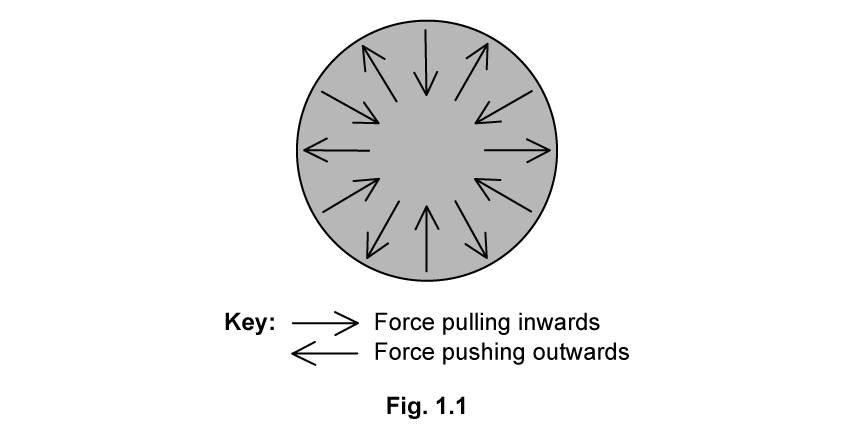
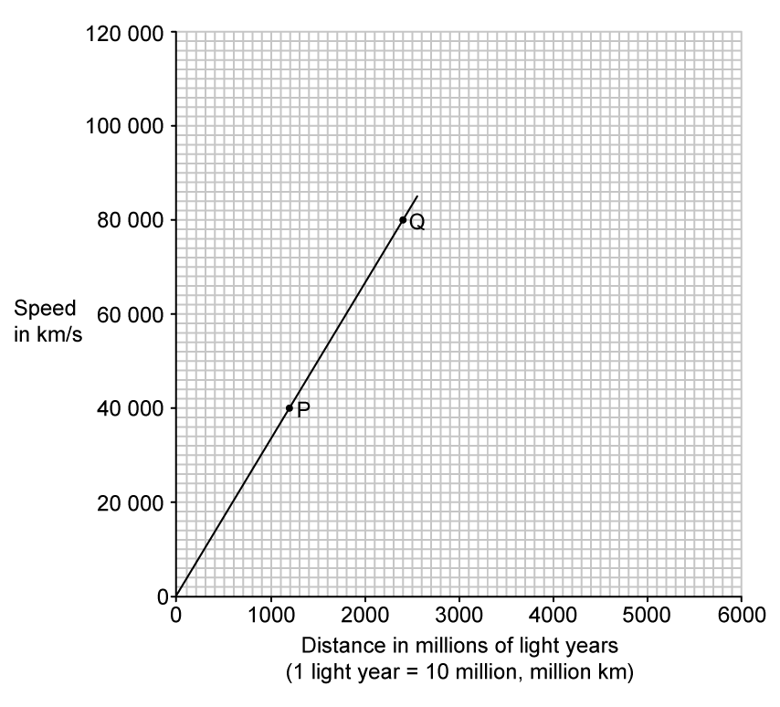
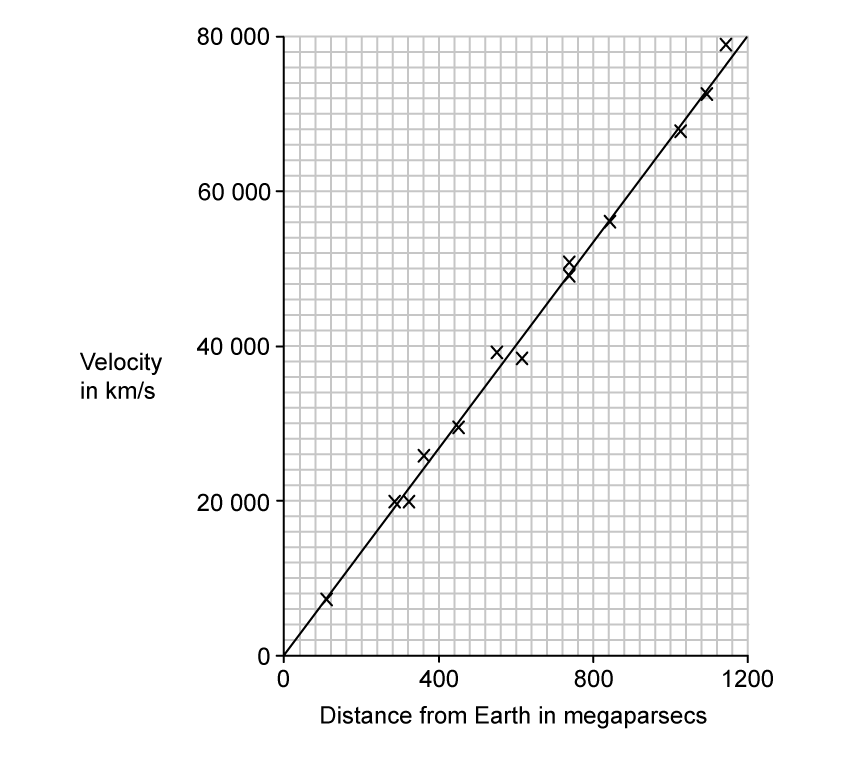

# Exam Questions — Stars & The Universe
**6. Space Physics** · Cambridge (CIE) IGCSE physics (0625 & 0972)
> Source: [https://www.savemyexams.com/igcse/physics/cie/23/topic-questions/](https://www.savemyexams.com/igcse/physics/cie/23/topic-questions/) · 43 questions across 2 sets

## Multiple Choice Questions (25 questions)

### Q1 — medium — 1 marks

**Q1** [1 mark]

The light from distant galaxies is observed to be redshifted.

Which statement correctly explains this observation?

### Q2 — easy — 1 marks

**Q2** [1 mark]

Which list shows the correct order of the life cycle of a star like the Sun?

### Q3 — medium — 1 marks

**Q3** [1 mark]

Astronomers observe light from distant galaxies and find that the wavelength has increased. This effect is called redshift.

What is the main conclusion from these observations?

### Q4 — easy — 1 marks

**Q4** [1 mark]

Which statements about the Sun are correct?

1. The Sun is a star of medium size.
2. The Sun consists mostly of nitrogen and oxygen.
3. The Sun is located inside the Milky Way galaxy.

### Q5 — medium — 1 marks

**Q5** [1 mark]

Which stages in the life cycle of a star are listed in the order that they occur?

*Source: June 2023 0972/21 Q40*

### Q6 — easy — 1 marks

**Q6** [1 mark]

** **Which nuclear reaction powers a stable star?

*Source: June 2023 0972/21 Q39*

### Q7 — easy — 1 marks

**Q7** [1 mark]

Which statement about the Milky Way is correct?

*Source: June 2023 0972/11 Q40*

### Q8 — easy — 1 marks

**Q8** [1 mark]

The Sun consists mostly of two elements.

What are these two elements?

*Source: June 2023 0972/11 Q39*

### Q9 — medium — 1 marks

**Q9** [1 mark]

Which statement describes redshift?

*Source: specimen 2023 paper 1 Q40*

### Q10 — medium — 1 marks

**Q10** [1 mark]

Which statement does **not **describe redshift?

*Source: specimen 2023 paper 2 Q40*

### Q11 — easy — 1 marks

**Q11** [1 mark]

Which part of the electromagnetic spectrum does the Sun radiate most of its energy in?

### Q12 — easy — 1 marks

**Q12** [1 mark]

Light from distant galaxies is redshifted when measured on Earth.

Which of the following ideas does this provide evidence for?

1. The Big Bang Theory

2. The Universe is expanding

3. Distant Galaxies are moving both towards us and away from us

### Q13 — easy — 1 marks

**Q13** [1 mark]

Which two elements are the most commonly found in the Sun?

### Q14 — easy — 1 marks

**Q14** [1 mark]

**Extended tier only**

What does the constant 2.2 × 10–18 per second represent?

### Q15 — easy — 1 marks

**Q15** [1 mark]

**Extended tier only**

Which of the following describes the lifecycle of a star about the size of the Sun?

### Q16 — hard — 1 marks

**Q16** [1 mark]

**Extended tier only**

The Andromeda galaxy is 2.5 million light-years away from Earth.

What is the velocity of the galaxy as it moves away from Earth?

### Q17 — medium — 1 marks

**Q17** [1 mark]

Which is the best description of redshift?

### Q18 — medium — 1 marks

**Q18** [1 mark]

**Extended tier only**

What is the process which makes stable stars such as the Sun shine, and which element produced in the reaction?

|   | **Process** | **Element** |
|---|---|---|
| **A** | fusion | oxygen |
| **B** | fission | hydrogen |
| **C** | fusion | helium |
| **D** | fission | helium |

### Q19 — medium — 1 marks

**Q19** [1 mark]

What is the correct description of the Milky Way?

### Q20 — hard — 1 marks

**Q20** [1 mark]

The planet Neptune has an average orbital radius of 4 500 million km. How long does it take light from the Sun to travel to Neptune?

### Q21 — medium — 1 marks

**Q21** [1 mark]

How many years would it take light to travel from the centre of the Milky Way to the outer edge?

### Q22 — hard — 1 marks

**Q22** [1 mark]

**Extended tier only**

Which row shows the correct methods for measuring galactic speeds and distances?

|   | **Galactic speeds** | **Galactic distances** |
|---|---|---|
| **A** | redshift | redshift |
| **B** | redshift | brightness of supernovae |
| **C** | brightness of supernovae | redshift |
| **D** | brightness of supernovae | brightness of supernovae |

### Q23 — hard — 1 marks

**Q23** [1 mark]

**Extended tier only**

Hubble's law gives an expression for the Hubble constant

$H_{0}=\frac{v}{d}$

What does the equation allow astronomers to calculate?

1. The distance to other galaxies
2. The speed of galactic recession
3. The age of the Universe

### Q24 — hard — 1 marks

**Q24** [1 mark]

**Extended tier only**

Which is the correct value of one light year?

### Q25 — medium — 1 marks

**Q25** [1 mark]

**Extended tier only**

Which of the following equations correctly represents the age of the Universe?

## Theory Questions (18 questions)

### Q1 — medium — 8 marks

**Q1** [3 marks]

Table 10.1 shows the orbital radius and orbital period for three planets in the Solar System.

**Table 10.1**

| Planet | Average orbital radius / × 106 km | Orbital period / Earth years |
|---|---|---|
| Mercury | 57.9 | 0.24 |
| Earth | 150 | 1.00 |
| Jupiter | 778 | 11.86 |

The orbit of Earth is approximately circular.

Calculate the average orbital speed of the Earth.

**Q1** [2 marks]

**Extract:**

Table 10.1 shows the orbital radius and orbital period for three planets in the Solar System.

**Table 10.1**

Planet

Average orbital radius / × 10^6^ km

Orbital period / Earth years

Mercury

57.9

0.24

Earth

150

1.00

Jupiter

778

11.86

Using data from Table 10.1, state the relationship between a planet's average orbital speed and its distance from the Sun.

Explain this relationship in terms of gravitational field strength.

**Q1** [3 marks]

A galaxy is at a distance of $9 . 0 \times 10^{7}$ light-years from the Earth. The current value of the Hubble constant is $2.2\times10^{-18}$ per second.

Calculate the speed at which this galaxy is moving away from the Earth.

### Q2 — easy — 3 marks

**Q2** [2 marks]

** **The Sun mostly consists of two elements.

State the **two **elements.

*Source: June 2023 0972/31 Q12C*

**Q2** [1 mark]

The Sun is a star in a galaxy.

State the name of the galaxy.

*Source: June 2023 0972/31 Q12D*

### Q3 — hard — 6 marks

**Q3** [3 marks]

**Extended Tier Only**

Describe and explain how a stable star is formed.

*Source: 2023 specimen paper 4 Q11A*

**Q3** [3 marks]

**Extended Tier Only**

Describe and explain what can be deduced from cosmic microwave background radiation (CMBR).

*Source: specimen 2023 paper 4 Q11B*

### Q4 — medium — 6 marks

**Q4** [3 marks]

** **The Sun is our nearest star.

(i) State the **three** main forms of electromagnetic radiation emitted by the Sun.

[2]

(ii) State the **two** main elements that are found in the Sun.

[1]

*Source: specimen 2023 paper 3 Q12A*

**Q4** [3 marks]

State and explain what can be deduced from the ‘redshift’ observed by astronomers in the light from all distant galaxies.

*Source: specimen 2023 paper 3 Q12B*

### Q5 — hard — 13 marks

**Q5** [4 marks]

**Extended tier only**

State and explain the two pieces of evidence which support the Big Bang Theory of the origin of the Universe.

**Q5** [4 marks]

**Extended tier only**

Calculate the distance of 50 light-years in metres.

*Speed of light* = 3.0 × 108 m/s.

**Q5** [5 marks]

**Extract:**

1 light year = 9.46 × 10^15 m

**Extended tier only**

Redshift measurements show that a galaxy is receding from Earth at a speed of 32 000 km/s.

Use Hubble's Law to calculate how many light-years the galaxy is distant from the Solar System.

Take the Hubble constant to be 2.2 × 10-18 per second.

### Q6 — medium — 10 marks

**Q6** [2 marks]

The visible part of the electromagnetic spectrum from a star includes a dark line. This line is at a specific wavelength.

Fig 1.1 shows the position of the dark line in the spectrum from the Sun and in the spectrum from two different galaxies, galaxy A and galaxy B.

Explain what the spectrum ‘shifts’ of the dark lines tells us about the direction of the galaxies.

**Q6** [2 marks]

**Extract:**

Fig 1.1 shows the position of the dark line in the spectrum from the Sun and in the spectrum from two different galaxies, galaxy A and galaxy B.

**Extended tier only**

State which galaxy is:

(i) is moving faster.

[1]

(ii) is further away.

[1]

**Q6** [4 marks]

**Extended tier only**

Galaxy A is 150 000 × 109 m away.

Calculate its recession velocity.

Hubble constant = 2.2 × 10–18 per second.

**Q6** [2 marks]

**Extract:**

Distance, d = 150 000 × 10^9 m
Hubble constant = 2.2 × 10^–18 per second
Recession velocity of Galaxy A = 3.3 × 10^–4 m/s

**Extended tier only**

A galaxy C is twice as far as galaxy A.

Determine the recession velocity of galaxy C.

### Q7 — easy — 9 marks

**Q7** [1 mark]

**Extended tier only**

Define the Hubble Constant.

**Q7** [3 marks]

**Extended tier only**

State the equation for the Hubble constant and define all the variables.

**Q7** [1 mark]

**Extended tier only**

State the equation to calculate the age of the Universe.

**Q7** [4 marks]

**Extract:**

The equation to calculate the age of the universe is:

- 1 / H_0

**Extended tier only**

The Hubble constant is estimated to be 2.2 × 10–18 per second.

Calculate the age of the Universe in years.

1 year = 3.15 × 107 s

### Q8 — easy — 9 marks

**Q8** [1 mark]

Starting with the largest, list the following in order of decreasing size

| **Galaxy         Sun        Universe        Jupiter** |
|---|

**Q8** [2 marks]

**Extended tier only**

State the stages in the life cycle of a star the size of the Sun after it is no longer a stable star in the gaps below.

Stable star → ................................... → ...................................

**Q8** [4 marks]

**Extended tier only**

State the stages in the life cycle of a star much more massive than the Sun after it is no longer a stable star in the gaps below.

Stable star → ................................... → ................................... → ................................... or ...................................

**Q8** [2 marks]

**Extended tier only**

Explain what may form in nebulae created by a supernova.

### Q9 — hard — 7 marks

**Q9** [1 mark]

**Extended tier only**

Edwin Hubble was an American scientist who studied galactic recession.

Define the Hubble constant, *H**0*.

**Q9** [2 marks]

**Extended tier only**

State the current value of the Hubble constant.

**Q9** [4 marks]

**Extract:**

The Triangulum galaxy is approximately 2.7 million light years from Earth.
Hubble constant, H_0 = 2.2 × 10^−18 /s
1 light year = 9.5 × 10^12 km

**Extended tier only**

The Triangulum galaxy is the Milky Way's second closest galactic neighbour. The Triangulum galaxy is approximately 2.7 million light years from Earth.

Calculate the speed with which the Triangulum galaxy is receding from Earth. You should give your answer in km/s.

............................................................... km/s

### Q10 — easy — 5 marks

**Q10** [3 marks]

Explain the term *galactic redshift*.

**Q10** [2 marks]

**Extract:**

An increase in the observed wavelength of light emitted from distant galaxies; When compared to the wavelength of similar light on Earth; Galactic redshift is evidence that the Universe is expanding;

Explain why galactic redshift is considered as evidence supporting the Big Bang theory.

### Q11 — hard — 11 marks

**Q11** [4 marks]

The ‘big bang’ theory is one theory explaining the origin of the Universe.

**Fig 1.1**

(i) Sketch the graph of the size of the Universe with time on Fig 1.1.

[2]

(ii) Explain how your graph in part (i) supports the Big Bang Theory.

[2]

**Q11** [5 marks]

**Extended tier only**

(i) Describe and explain the main properties of CMBR.

[2]

(ii) Explain how CMBR provides evidence for the evolution of the Universe.

[3]

**Q11** [2 marks]

**Extended tier only**

Suggest why our understanding of the very earliest moments of the Universe is unreliable.

### Q12 — easy — 11 marks

**Q12** [6 marks]

**Extended tier only**

Rearrange the stages of the life cycle of a star into the correct order.

| **1** | white dwarf |
|---|---|
| **2** | planetary nebula |
| **3** | protostar |
| **4** | stable star |
| **5** | interstellar clouds of gas and dust (stellar nebula) |
| **6** | red giant |

**Q12** [2 marks]

**Extended tier only**

A star can be in its stable phase for billions of years.

Fig. 1.1 shows the forces acting on the Sun during this stable stage of its life cycle.

(i) State the name of the force pulling inwards.

[1]

(ii) Explain what causes the force pushing outwards.

[1]

**Q12** [2 marks]

**Extended tier only**

Two stars, Alpha Centauri B and Betelgeuse are 0.9 and 16.5 solar masses respectively.

State which star could eventually become a neutron star. Explain your reasoning.

1 solar mass = mass of the Sun

**Q12** [1 mark]

**Extended tier only**

State what is meant by a *supernova*.

### Q13 — medium — 11 marks

**Q13** [2 marks]

**Extended tier only**

Describe *nuclear fusion *in stars.

**Q13** [3 marks]

**Extended tier only**

The speed of electromagnetic radiation in a vacuum is 3.0 × 108 m/s

Show that one light-year is equal to 9.5 × 1015 m.

**Q13** [2 marks]

**Extract:**

Diameter of the Milky Way, d = 100 000 light years
1 year = 3.1536 × 10^7 s (from part b)

**Extended tier only**

The Milky Way is approximately 100 000 light years in diameter.

Calculate the time it would take a spacecraft travelling at the speed of light to travel from one side of the Milky Way to the other.

time = ......................................... s

**Q13** [4 marks]

**Extract:**

The Milky Way is approximately 100 000 light years in diameter.

Below are some statements related to Cosmology.

1. Galaxies are made of up millions of stars
2. The Sun is a planet because it has a core
3. Other stars that make up the Milky Way are much further away from the Earth than the Sun is from the Earth
4. There may be other galaxies in the Milky Way

State all of the statements that are false and explain why.

### Q14 — medium — 6 marks

**Q14** [3 marks]

**Extended tier only**

Describe and explain how a stable star is formed.

*Source: 2023 0972/04 Q11A*

**Q14** [3 marks]

**Extended tier only**

Describe and explain what can be deduced from cosmic microwave background radiation (CMBR).

*Source: 2023 0972/04 Q11B*

### Q15 — medium — 6 marks

**Q15** [4 marks]

**Extended tier only**

Some stable stars become black holes.

Describe the evolution of a stable star to the point at which it becomes a black hole.

**Q15** [2 marks]

**Extended tier only**

State and explain whether the Sun will eventually become a black hole.

### Q16 — easy — 6 marks

**Q16** [1 mark]

State the approximate diameter of the Milky Way in light years.

**Q16** [2 marks]

**Extended tier only**

Nuclear fusion occurs in the core of a stable star.

Complete the sentence explaining nuclear fusion.

Nuclear reactions in the core of a star involve the fusion of ........................... into ...........................

**Q16** [2 marks]

The Virgo A galaxy and Messier 90 galaxy are 6.2 × 1020 km and 5.5 × 1020 km from Earth respectively. They are both moving away from Earth.

State and explain which galaxy is moving faster away from Earth.

**Q16** [1 mark]

**Extended tier only**

Explain how the distance of a far galaxy can be determined.

### Q17 — hard — 8 marks

**Q17** [2 marks]

**Extended tier only**

Nuclear fusion reactions in the Sun fuse hydrogen to make helium.

In the Solar System, the inner planets, such as the Earth, contain elements which are heavier than the elements hydrogen and helium.

Explain how this can be the case.

**Q17** [3 marks]

**Extract:**

Nuclear fusion reactions in the Sun fuse hydrogen to make helium.

In the Solar System, the inner planets, such as the Earth, contain elements which are heavier than the elements hydrogen and helium.

**Extended tier only**

From the data collected, a graph can be drawn that links the speed of a galaxy with the distance of the galaxy from the Earth. This graph is shown in Fig. 1.1.

**Fig 1.1**

Describe how the visible light spectrum from galaxy Q looks different from the visible light spectrum from galaxy P.

**Q17** [3 marks]

**Extract:**

From the data collected, a graph can be drawn that links the speed of a galaxy with the distance of the galaxy from the Earth. This graph is shown in Fig. 1.1.

**Fig 1.1**

[Graph: Speed in km/s vs Distance in millions of light years (1 light year = 10 million, million km)]

A third galaxy, R, seems to be travelling away from the Earth at about 110 000 km/s.

**Extended tier only**

A third galaxy, R, seems to be travelling away from the Earth at about 110 000 km/s.

Estimate how far galaxy R might be from the Earth, showing how you use the graph in Fig. 1.1 to do this.

### Q18 — hard — 13 marks

**Q18** [3 marks]

**Extended tier only**

Explain what type of radiation the CMBR will eventually change into over the next billion years.

**Q18** [4 marks]

**Extract:**

Scientists measure the wavelength of the radio waves from galaxy A travelling at 260 km/hr away from Earth to be 63.2 m. Sometime later, the wavelength is measured to be 63.4 m. The wavelength of the radio waves from galaxy B is initially measured to be 63.4 m and at the same time later, measured to be 63.8 m. Recession velocity of galaxy A = 260 km/hr.

**Extended tier only**

Scientists measure the wavelength of the radio waves from galaxy A travelling at 260 km/hr away from Earth to be 63.2 m. Sometime later, the wavelength is measured to be 63.4 m.

The wavelength of the radio waves from galaxy B is initially measured to be 63.4 m and at the same time later, measured to be 63.8 m.

Calculate the velocity of galaxy B.

velocity of galaxy B  = ...................................... m/s

**Q18** [3 marks]

**Extract:**

The graph in Fig 1.1 was used to calculate the most up-to-date value of the Hubble constant, H_0. Megaparsecs are a unit for large distances commonly used in Astronomy and Cosmology. 1 megaparsec = 3.1 × 10^22 m. Calculate H_0 in km/s megaparsec.

State how to calculate H_0 from the graph:
- H_0 / the Hubble constant is the gradient of the graph; [1 mark]

Calculate H_0:
- H_0 = gradient = Δv / Δdistance from Earth = 64,000 / 960 [1 mark]
- H_0 = 66.67 ≈ 67 km/s megaparsec [1 mark]

On the y axis, there are 10 small squares that equal 20,000. This means each small square is worth 2,000 km/s. The scale for the x axis is slightly different, 10 small squares equals 400 megaparsecs.

**Extended tier only**

By measuring the redshift of galaxies, Hubble was able to calculate the speed at which they move away from the Earth. Hubble was also able to calculate the distance of these galaxies from the Earth.

The graph in Fig 1.1 shows some of the data calculated by Hubble.

**Fig 1.1**

The graph in Fig 1.1 was used to calculate the most up-to-date value of the Hubble constant, *H*0.

Megaparsecs are a unit for large distances commonly used in Astronomy and Cosmology. 1 megaparsec = 3.1 × 1022 m.

Calculate *H*0 in km/s megaparsec.

**Q18** [3 marks]

**Extract:**

The graph in Fig 1.1 was used to calculate the most up-to-date value of the Hubble constant, *H*~0~.  Megaparsecs are a unit for large distances commonly used in Astronomy and Cosmology. 1 megaparsec = 3.1 × 10^22^ m.

Calculate *H*~0~ in km/s megaparsec.

*H*~0~ / the Hubble constant is the **gradient** of the graph; 
*H*~0~ = gradient = (Δv)/(Δdistance from Earth) = 64000/960 = 66.67 = 67 km/s megaparsec

**Extended tier only**

Show that *H*0 is roughly equal to 2.0 × 10–18 per second.
