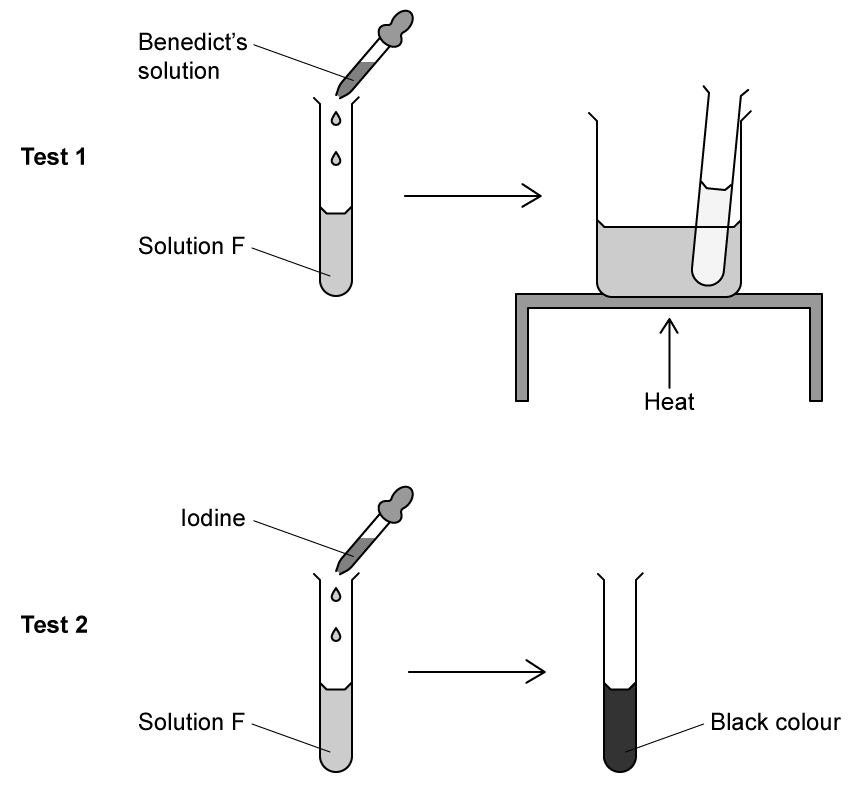

# Exam Questions — Biological Molecules
**4. Biological Molecules** · Cambridge (CIE) IGCSE science (0654 & 0973)
> Source: [https://www.savemyexams.com/igcse/science/cie/co-ordinated-sciences-double-award/23/biology/topic-questions/](https://www.savemyexams.com/igcse/science/cie/co-ordinated-sciences-double-award/23/biology/topic-questions/) · 14 questions across 1 sets

## Multiple Choice Questions (14 questions)

### Q1 — hard — 1 marks

**Q1** [1 mark]

A student ate a meal which contained a type of biomolecule, **X**.

The digestion of biomolecule **X **started in the mouth, and finished in the duodenum.

What is the product of the digestion of biomolecule **X**?

### Q2 — easy — 1 marks

**Q2** [1 mark]

The drawing shows a food test being carried out in a laboratory.

Which food test is being shown and which food group is being tested for?

### Q3 — easy — 1 marks

**Q3** [1 mark]

Which row shows the three main elements from the Period Table that are present in most molecules in living organisms?

| **A** | carbon | oxygen | nitrogen |
|---|---|---|---|
| **B** | hydrogen | carbon | oxygen |
| **C** | oxygen | sulfur | carbon |
| **D** | hydrogen | carbon | nitrogen |

### Q4 — hard — 1 marks

**Q4** [1 mark]

Four foods were tested for the following food molecules:

- reducing sugar using Benedict’s reagent
- protein using Biuret solution
- fat using ethanol
- Vitamin C using DCPIP

|   | colour of food test result |   |   |   |
|---|---|---|---|---|
|   | brick-red/orange | purple/lilac | colourless | milky-white |
| **A** | **✓** | **✘** | **✓** | **✘** |
| **B** | **✓** | **✘** | **✘** | **✓** |
| **C** | **✘** | **✓** | **✓** | **✘** |
| **D** | **✘** | **✘** | **✓** | **✓** |

Which food contains sugar and Vitamin C?

### Q5 — hard — 1 marks

**Q5** [1 mark]

A group of students tested four different foods using some common food tests.

Their results are shown in the table below.

|   | Benedict’s test | Biuret test | Iodine test | DCPIP test |
|---|---|---|---|---|
| **A** | brick-red | purple | brown | colourless |
| **B** | brick-red | blue | brown | colourless |
| **C** | blue | blue | black | blue |
| **D** | brick-red | blue | black | colourless |

Which food contains reducing sugar and Vitamin C but **not **protein or starch?

### Q6 — medium — 1 marks

**Q6** [1 mark]

The table below lists three large molecules found in living organisms.

Which row correctly describes the smaller molecules these substances are made from?

|   | **glycogen** | **cellulose** | **oils** |
|---|---|---|---|
| **A** | glucose | glucose | glycerol |
| **B** | glycerol | starch | fatty acids |
| **C** | glycerol | glucose | glucose |
| **D** | glucose | starch | glycerol |

### Q7 — easy — 1 marks

**Q7** [1 mark]

The drawing shows a food test being carried out in a laboratory.

Which food test is being shown and which food group is being tested for?

### Q8 — medium — 1 marks

**Q8** [1 mark]

A student mixes a food reagent with solution X in a test tube.

They observe a positive test result when a cloudy emulsion forms.

|   | **food reagent** | **food molecule present in solution X** |
|---|---|---|
| **A** | ethanol | glycogen |
| **B** | Biuret | lipids (fats and oils) |
| **C** | Benedict’s solution | glycogen |
| **D** | ethanol | lipids (fats and oils) |

Which row of the table below identifies the reagent used and molecule present in Solution X?

### Q9 — hard — 1 marks

**Q9** [1 mark]

The table below shows the elements and basic units used by cells to make large biological molecules.

|   | basic units | elements | large molecule |
|---|---|---|---|
| **A** | amino acid | carbon, hydrogen, oxygen, nitrogen | protein |
| **B** | glycerol | carbon, hydrogen, oxygen, nitrogen | fats |
| **C** | glycerol | carbon, hydrogen, nitrogen | fats |
| **D** | amino acid | carbon, hydrogen, oxygen | carbohydrate |

Which row of the table is correct?

### Q10 — medium — 1 marks

**Q10** [1 mark]

The image below shows two molecules before and after chemical digestion by enzymes in the alimentary canal.

Which letter(s) identify the product(s) of complete starch digestion?

### Q11 — medium — 1 marks

**Q11** [1 mark]

A student carried out two food tests on solution F to determine what food groups it contains.

What food molecules does solution F contain?

### Q12 — medium — 1 marks

**Q12** [1 mark]

Which row of the table below correctly describes the role of cellulose, proteins and water in living organisms?

|   | **cellulose** | **proteins** | **water** |
|---|---|---|---|
| **A** | solvent | enzymes & antibodies | for chemical reactions |
| **B** | strengthens cell walls | to make fats & oils | solvent |
| **C** | strengthens cell walls | enzymes & antibodies | solvent |
| **D** | solvent | enzymes & antibodies | strengthens cell walls |

### Q13 — medium — 1 marks

**Q13** [1 mark]

Three statements about proteins are given below.

1. Different sequences of amino acids give different shapes to protein molecules.
2. Amylase is made from a sequence of amino acids joined together forming a non-specific 3D shape.
3. When mixed with Biuret solution, there is a colour change from blue to purple.

Which of the statements above are true?

### Q14 — medium — 1 marks

**Q14** [1 mark]

Four statements about large biological molecules are given below:

1. Proteins are made from a number of different amino acids.
2. Both glycogen and starch are made from simple sugar base units.
3. Fats are made from glycerol and fatty acids.
4. Oils are made from glycerol only.

Which of the four statements above is/are **false**?
