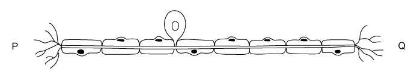

# Exam Questions — Coordination, Response & Homeostasis
**13. Coordination & Response** · Cambridge (CIE) IGCSE science (0654 & 0973)
> Source: [https://www.savemyexams.com/igcse/science/cie/co-ordinated-sciences-double-award/23/biology/topic-questions/](https://www.savemyexams.com/igcse/science/cie/co-ordinated-sciences-double-award/23/biology/topic-questions/) · 14 questions across 1 sets

## Multiple Choice Questions (14 questions)

### Q1 — hard — 1 marks

**Q1** [1 mark]

Which of the following statements about glucagon are **false**?

1. Glucagon reverses the effect of the hormone glycogen
2. Glucagon is produced in the pancreas
3. Glucagon is secreted when blood glucose levels fall
4. Glucagon stimulates liver and muscle cells to convert glucose into stored glycogen
5. Glucagon is a polysaccharide
6. Glucagon is usually secreted soon after ingestion of carbohydrate-rich food

### Q2 — easy — 1 marks

**Q2** [1 mark]

Which of the following statements would **not **be a correct example of negative feedback?

### Q3 — medium — 1 marks

**Q3** [1 mark]

The image below shows a cell from the nervous system. The cell forms part of a reflex arc.

An impulse moves along the neurone from Q to P.

What structures would be found at P and Q?

|   | **P** | **Q** |
|---|---|---|
| **A** | receptor | relay neurone |
| **B** | relay neurone | receptor |
| **C** | motor neurone | relay neurone |
| **D** | gland | relay neurone |

### Q4 — easy — 1 marks

**Q4** [1 mark]

Which row of the table best describes receptor organs and their respective stimuli in the human body?

|   | **Skin** | **Ears** | **Nose** |
|---|---|---|---|
| **A** | pressure | sound | chemical (in solution) |
| **B** | heat | balance | chemical (in solution) |
| **C** | pressure | balance | chemical (vapours) |
| **D** | heat | sound | temperature |

### Q5 — medium — 1 marks

**Q5** [1 mark]

The image below shows a cell from the nervous system. The cell forms part of a reflex arc.

An impulse moves along the neurone from Q to P.

What structures would be found at P and Q?

|   | **P** | **Q** |
|---|---|---|
| **A** | receptor | relay neurone |
| **B** | relay neurone | receptor |
| **C** | motor neurone | relay neurone |
| **D** | gland | relay neurone |

### Q6 — medium — 1 marks

**Q6** [1 mark]

The image below shows a simple reflex arc.

Which of the following sequences correctly shows the order of cells that an impulse passes through during a reflex action?

|   | **first  →  last** |
|---|---|
| **A** | Z   →    X   →    Y |
| **B** | X   →   Y    →   Z |
| **C** | Y  →     X   →    Z |
| **D** | Z   →    Y   →    X |

### Q7 — easy — 1 marks

**Q7** [1 mark]

Which of the following statements are reasons for the evolution of reflex arcs in the mammalian nervous system?

1. To prevent harm or damage to an organism.
2. To provide a rapid response to dangerous situations.
3. To allow a degree of choice to an organism about response.
4. To allow certain stimuli to be ignored/eliminated.

### Q8 — easy — 1 marks

**Q8** [1 mark]

Which row of the table best summarises the parts of the nervous system?

|   | **brain** | **neurones** | **spinal cord** |
|---|---|---|---|
| **A** | central | peripheral | central |
| **B** | peripheral | peripheral | central |
| **C** | central | central | central |
| **D** | peripheral | central | peripheral |

### Q9 — easy — 1 marks

**Q9** [1 mark]

**Extended Tier Only**

Which of the following statements is a correct reason that humans sweat?

### Q10 — medium — 1 marks

**Q10** [1 mark]

**Extended Tier Only**

An athlete takes part in a marathon.

What would be the effect of an athlete taking part in a marathon race on a hot, sunny day?

|   | **volume of water reabsorbed in the kidneys** | **volume of water lost from the skin** | **effect on hairs on the skin** |
|---|---|---|---|
| **A** | less | decreases | lie flat |
| **B** | more | decreases | erect |
| **C** | less | increases | lie flat |
| **D** | more | increases | lie flat |

### Q11 — hard — 1 marks

**Q11** [1 mark]

**Extended Tier Only**

Which of the following statements about glucagon are **false**?

1. Glucagon reverses the effect of the hormone glycogen
2. Glucagon is produced in the pancreas
3. Glucagon is secreted when blood glucose levels fall
4. Glucagon stimulates liver and muscle cells to convert glucose into stored glycogen
5. Glucagon is a polysaccharide
6. Glucagon is usually secreted soon after ingestion of carbohydrate-rich food

### Q12 — easy — 1 marks

**Q12** [1 mark]

**Extended Tier Only**

Which of the following statements would **not **be a correct example of negative feedback?

### Q13 — medium — 1 marks

**Q13** [1 mark]

**Extended Tier Only**

Which row of the following table correctly describes what happens in the body after a person consumes a can of sugary drink?

|   | **role of the pancreas** | **role of the liver** | **effect** |
|---|---|---|---|
| **A** | releases glucagon | converts glycogen into glucose | blood sugar levels rise |
| **B** | releases insulin | converts excess glucose into glycogen | blood sugar level falls |
| **C** | releases glucagon | converts excess glucose into glycogen | blood sugar level falls |
| **D** | releases insulin | converts glycogen into glucose | blood sugar levels rise |

### Q14 — medium — 1 marks

**Q14** [1 mark]

The image below shows the structures involved in a simple reflex arc.

Which of the following sequences correctly shows the order that an impulse passes through during a reflex action?
